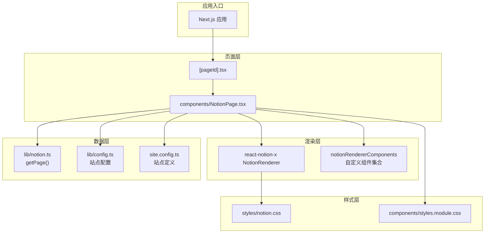
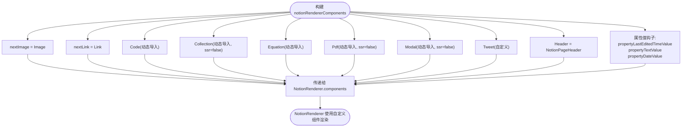
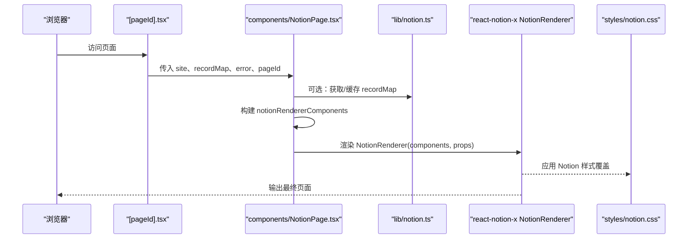
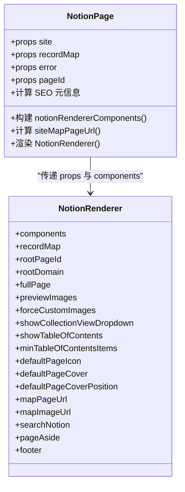
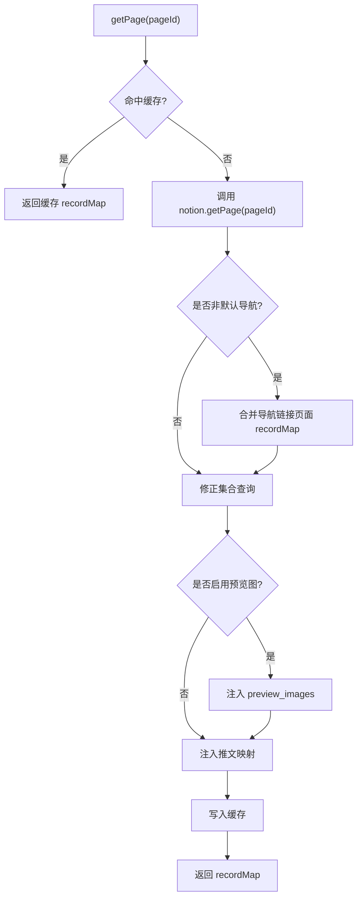
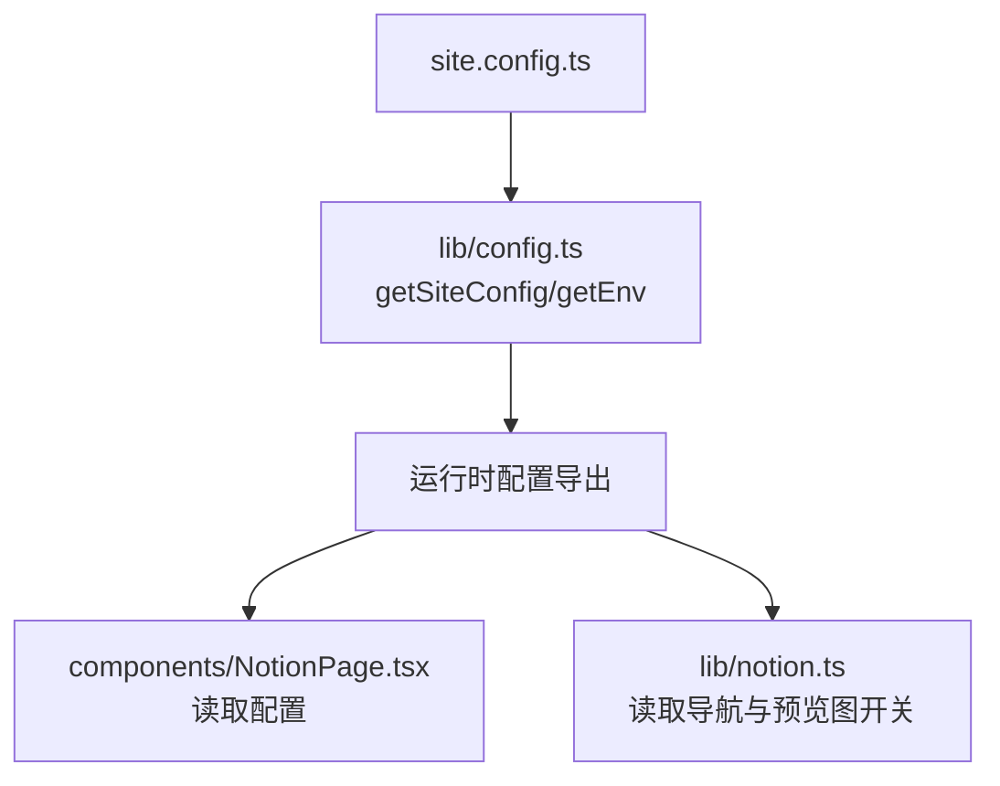
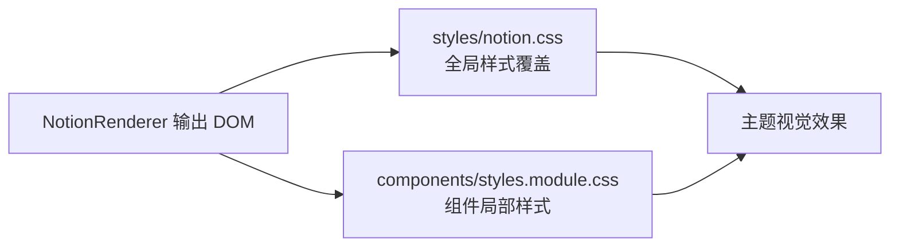
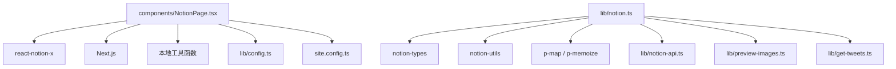

# 扩展机制

<cite>
**本文引用的文件**   
- [components/NotionPage.tsx](file://components/NotionPage.tsx)
- [lib/notion.ts](file://lib/notion.ts)
- [site.config.ts](file://site.config.ts)
- [lib/config.ts](file://lib/config.ts)
- [lib/types.ts](file://lib/types.ts)
- [styles/notion.css](file://styles/notion.css)
- [components/styles.module.css](file://components/styles.module.css)
</cite>

## 目录
1. [简介](#简介)
2. [项目结构](#项目结构)
3. [核心组件与扩展点](#核心组件与扩展点)
4. [架构总览](#架构总览)
5. [详细组件分析](#详细组件分析)
6. [依赖关系分析](#依赖关系分析)
7. [性能与可扩展性考量](#性能与可扩展性考量)
8. [故障排查指南](#故障排查指南)
9. [结论](#结论)
10. [附录：扩展开发清单](#附录扩展开发清单)

## 简介
本文件面向希望扩展 NotionRenderer 渲染体系、注入自定义组件、覆盖配置以及集成第三方服务的开发者。文档围绕以下目标展开：
- 解释 NotionRenderer 的扩展点与组件注入机制
- 说明配置覆盖策略（站点级配置与环境变量）
- 指导如何添加新的内容类型、自定义样式主题、集成第三方服务
- 梳理扩展点的接口约定、注册方式与生命周期钩子
- 提供可操作的扩展开发指南与最佳实践

## 项目结构
本项目基于 Next.js，使用 react-notion-x 渲染 Notion 页面。扩展主要发生在三个层面：
- 组件层：通过 NotionRenderer 的 components 属性注入或替换内置组件
- 数据层：在获取 recordMap 后对数据进行增强（如预览图、推文映射）
- 样式层：通过 CSS 覆盖 Notion 默认样式，实现主题定制

图表来源
- [components/NotionPage.tsx:196-353](file://components/NotionPage.tsx#L196-L353)
- [lib/notion.ts:161-213](file://lib/notion.ts#L161-L213)
- [lib/config.ts:157-163](file://lib/config.ts#L157-L163)
- [site.config.ts:1-78](file://site.config.ts#L1-L78)
- [styles/notion.css:1-20](file://styles/notion.css#L1-L20)

章节来源
- [components/NotionPage.tsx:1-357](file://components/NotionPage.tsx#L1-L357)
- [lib/notion.ts:1-219](file://lib/notion.ts#L1-L219)
- [site.config.ts:1-78](file://site.config.ts#L1-L78)
- [lib/config.ts:1-224](file://lib/config.ts#L1-L224)
- [styles/notion.css:1-794](file://styles/notion.css#L1-L794)

## 核心组件与扩展点
本节聚焦 NotionRenderer 的扩展能力与注入机制。

### NotionRenderer 组件注入
- 通过 notionRendererComponents 对象向 NotionRenderer 注入或替换组件
- 已注入的组件包括：
  - nextImage、nextLink：适配 Next.js 的图片与链接
  - Code、Collection、Equation、Pdf、Modal：按需动态加载的第三方组件
  - Tweet：自定义推文展示组件
  - Header：自定义页头组件
  - propertyLastEditedTimeValue、propertyTextValue、propertyDateValue：属性值渲染钩子

图表来源
- [components/NotionPage.tsx:43-142](file://components/NotionPage.tsx#L43-L142)
- [components/NotionPage.tsx:144-209](file://components/NotionPage.tsx#L144-L209)
- [components/NotionPage.tsx:319-353](file://components/NotionPage.tsx#L319-L353)

章节来源
- [components/NotionPage.tsx:196-209](file://components/NotionPage.tsx#L196-L209)
- [components/NotionPage.tsx:319-353](file://components/NotionPage.tsx#L319-L353)

### 属性值渲染钩子
- propertyLastEditedTimeValue：在特定条件下（例如页面头部）重写“最后编辑时间”显示
- propertyTextValue：针对特定字段（如作者）进行文本样式增强
- propertyDateValue：针对“Published”字段进行日期格式化

这些钩子遵循“优先返回自定义渲染结果，否则调用 defaultFn() 回退到默认行为”的模式，便于渐进式覆盖。

章节来源
- [components/NotionPage.tsx:155-194](file://components/NotionPage.tsx#L155-L194)

### 动态组件加载与 SSR 控制
- Code、Collection、Equation、Pdf、Modal 等通过 next/dynamic 动态导入
- Collection、Pdf、Modal 设置 ssr: false，避免服务端/客户端水合不一致
- Code 动态导入时按需加载 Prism 语法高亮插件，减少首屏体积

章节来源
- [components/NotionPage.tsx:43-142](file://components/NotionPage.tsx#L43-L142)

## 架构总览
下图展示了从页面请求到 NotionRenderer 渲染的关键流程，以及扩展点在其中的位置。

图表来源
- [components/NotionPage.tsx:211-353](file://components/NotionPage.tsx#L211-L353)
- [lib/notion.ts:161-213](file://lib/notion.ts#L161-L213)
- [styles/notion.css:1-20](file://styles/notion.css#L1-L20)

## 详细组件分析

### NotionPage 组件
NotionPage 是 Notion 页面的容器组件，负责：
- 根据路由参数与查询字符串决定 lite 模式
- 计算站点 URL 映射、社交图片、SEO 元信息
- 组装 notionRendererComponents 并传给 NotionRenderer
- 注入 pageAside、footer 等布局元素

关键扩展点：
- components：注入自定义组件与属性值钩子
- mapPageUrl、mapImageUrl：自定义 URL 与图片映射逻辑
- searchNotion：启用搜索功能
- footer：注入评论系统或其他尾部内容

图表来源
- [components/NotionPage.tsx:211-353](file://components/NotionPage.tsx#L211-L353)

章节来源
- [components/NotionPage.tsx:211-353](file://components/NotionPage.tsx#L211-L353)

### 数据层扩展：lib/notion.ts
lib/notion.ts 负责获取并增强 recordMap，包含：
- 服务器端内存缓存（TTL 60s），用于快速响应与降级
- 导航链接页面预取与合并
- 集合视图查询修正（确保排序与过滤生效）
- 预览图映射与推文映射注入
- 将增强后的 recordMap 缓存并返回

图表来源
- [lib/notion.ts:161-213](file://lib/notion.ts#L161-L213)
- [lib/notion.ts:57-81](file://lib/notion.ts#L57-L81)
- [lib/notion.ts:95-159](file://lib/notion.ts#L95-L159)

章节来源
- [lib/notion.ts:161-213](file://lib/notion.ts#L161-L213)

### 配置覆盖策略
站点配置由 site.config.ts 定义，并通过 lib/config.ts 解析为运行时配置。支持：
- 站点基础信息（名称、域名、作者、描述）
- 默认图标与封面图
- 预览图开关、URL 中是否包含 Notion ID
- 导航风格与导航链接
- 搜索引擎验证码、IndexNow Key
- 分析与速度洞察开关
- ISR revalidateSeconds 重验证间隔
- 环境变量覆盖（如 Google/Bing 验证、IndexNow Key、Analytics ID）

图表来源
- [site.config.ts:1-78](file://site.config.ts#L1-L78)
- [lib/config.ts:1-224](file://lib/config.ts#L1-L224)
- [components/NotionPage.tsx:319-353](file://components/NotionPage.tsx#L319-L353)
- [lib/notion.ts:10-17](file://lib/notion.ts#L10-L17)

章节来源
- [site.config.ts:1-78](file://site.config.ts#L1-L78)
- [lib/config.ts:1-224](file://lib/config.ts#L1-L224)

### 样式主题扩展
样式扩展主要通过 styles/notion.css 覆盖 react-notion-x 的默认样式，实现：
- 全局变量（如 --notion-max-width、--notion-header-height）
- 页面布局与间距调整
- 画廊网格密度与卡片比例
- 引用块、书签、列表、表格等细节还原
- 暗色模式适配
- 文章大纲侧边栏交互效果

此外，components/styles.module.css 提供组件局部样式（如加载动画、页脚布局）。

图表来源
- [styles/notion.css:1-794](file://styles/notion.css#L1-L794)
- [components/styles.module.css:1-226](file://components/styles.module.css#L1-L226)

章节来源
- [styles/notion.css:1-794](file://styles/notion.css#L1-L794)
- [components/styles.module.css:1-226](file://components/styles.module.css#L1-L226)

## 依赖关系分析
- NotionPage 依赖：
  - react-notion-x 的 NotionRenderer 与 NotionComponents 类型
  - Next.js 的 dynamic、Image、Link、useRouter
  - 本地工具函数（mapImageUrl、mapPageUrl、searchNotion）
  - 站点配置（config.ts）与站点定义（site.config.ts）
- lib/notion.ts 依赖：
  - notion-types、notion-utils
  - p-map、p-memoize
  - 本地 config、notion-api、preview-images、get-tweets

图表来源
- [components/NotionPage.tsx:1-38](file://components/NotionPage.tsx#L1-L38)
- [lib/notion.ts:1-17](file://lib/notion.ts#L1-L17)

章节来源
- [components/NotionPage.tsx:1-38](file://components/NotionPage.tsx#L1-L38)
- [lib/notion.ts:1-17](file://lib/notion.ts#L1-L17)

## 性能与可扩展性考量
- 动态导入：Code、Collection、Pdf、Modal 等按需加载，降低首屏体积
- SSR 控制：Collection、Pdf、Modal 禁用服务端渲染以避免水合不一致
- 服务器端缓存：lib/notion.ts 使用内存缓存（TTL 60s），提升响应速度与容错
- 集合查询修正：确保排序与过滤与 Notion 一致，避免额外请求失败影响渲染
- 预览图与推文映射：仅在需要时注入，避免不必要的开销
- 样式优化：通过 CSS 变量与媒体查询适配不同屏幕尺寸与暗色模式

章节来源
- [components/NotionPage.tsx:43-142](file://components/NotionPage.tsx#L43-L142)
- [lib/notion.ts:19-55](file://lib/notion.ts#L19-L55)
- [lib/notion.ts:95-159](file://lib/notion.ts#L95-L159)

## 故障排查指南
- Notion API 不可用：
  - getPage 捕获异常后尝试返回陈旧缓存，避免 500 错误
  - 日志记录失败信息与 pageId，便于定位问题
- 集合视图排序/过滤不生效：
  - fixCollectionQueries 会重新执行查询并合并结果；若仍异常，检查 viewValue.query2 是否存在
- 预览图未显示：
  - 确认 isPreviewImageSupportEnabled 为 true，且 getPreviewImageMap 成功注入 preview_images
- 推文未显示：
  - 确认 getTweetsMap 成功执行，ExtendedTweetRecordMap.tweets 存在对应 id

章节来源
- [lib/notion.ts:168-182](file://lib/notion.ts#L168-L182)
- [lib/notion.ts:95-159](file://lib/notion.ts#L95-L159)
- [lib/notion.ts:203-208](file://lib/notion.ts#L203-L208)

## 结论
本项目的扩展机制围绕 NotionRenderer 的组件注入、属性值钩子、数据增强与样式覆盖展开。开发者可通过 notionRendererComponents 注入自定义组件，通过 lib/notion.ts 增强 recordMap，通过 site.config.ts 与 lib/config.ts 管理配置，通过 styles/notion.css 定制主题。该设计在保证性能与稳定性的同时，提供了灵活的扩展点，便于集成第三方服务与实现个性化需求。

## 附录：扩展开发清单
- 添加新内容类型
  - 在 notionRendererComponents 中添加对应组件键（如 CustomBlock）
  - 在 NotionRenderer 中传入 components，并确保 recordMap 中包含对应 block 数据
  - 如需服务端处理，可在 lib/notion.ts 的数据增强阶段注入必要字段
- 自定义样式主题
  - 在 styles/notion.css 中覆盖相关类名或使用 CSS 变量
  - 在 components/styles.module.css 中维护组件局部样式
- 集成第三方服务
  - 通过动态导入引入第三方组件（如 Chart、Map、Video）
  - 在 notionRendererComponents 中注册组件
  - 在 lib/notion.ts 中注入服务所需数据（如地图坐标、视频元信息）
- 配置覆盖策略
  - 在 site.config.ts 中定义站点级配置
  - 在 lib/config.ts 中解析并暴露运行时配置
  - 通过环境变量覆盖敏感或环境相关配置
- 生命周期钩子
  - 属性值钩子：propertyLastEditedTimeValue、propertyTextValue、propertyDateValue
  - 组件钩子：Header、Footer、pageAside 等
  - 数据钩子：在 lib/notion.ts 的 getPage 流程中注入或修正数据

章节来源
- [components/NotionPage.tsx:196-209](file://components/NotionPage.tsx#L196-L209)
- [lib/notion.ts:161-213](file://lib/notion.ts#L161-L213)
- [site.config.ts:1-78](file://site.config.ts#L1-L78)
- [lib/config.ts:1-224](file://lib/config.ts#L1-L224)
- [styles/notion.css:1-794](file://styles/notion.css#L1-L794)