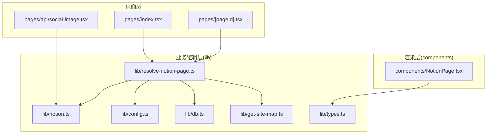
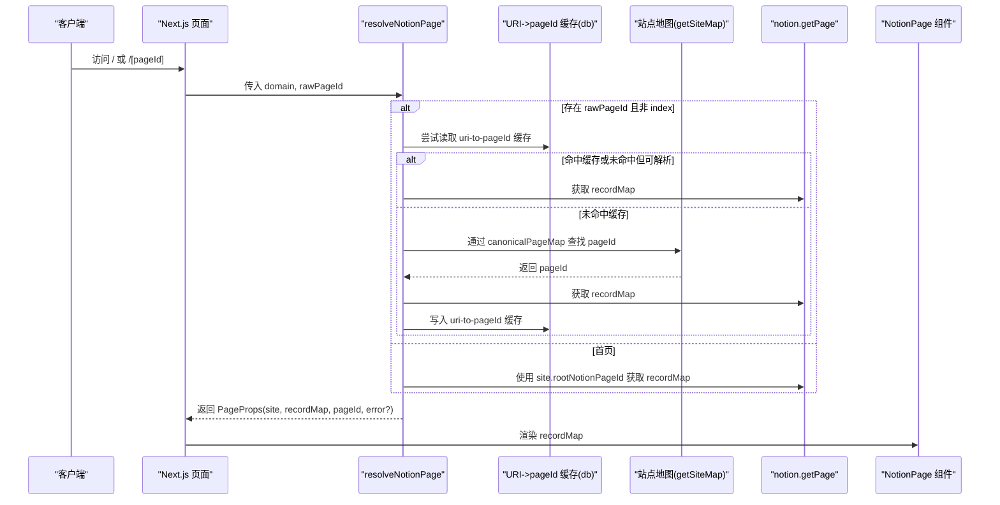
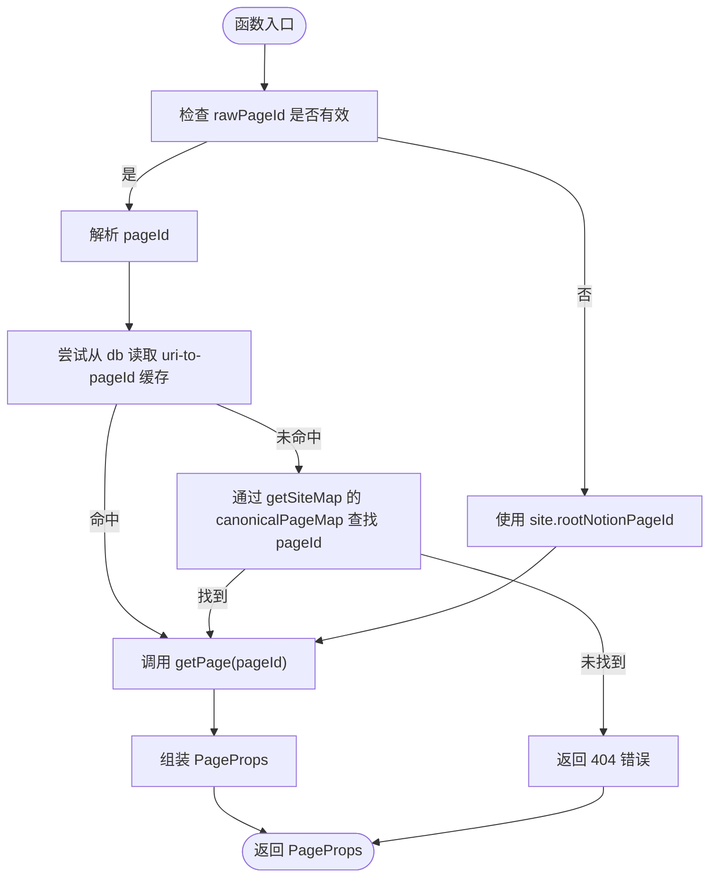
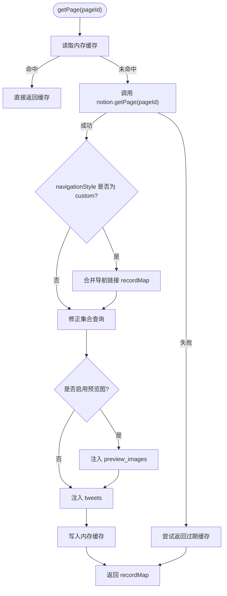
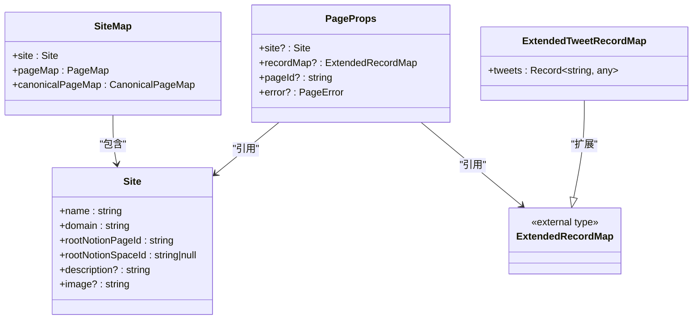
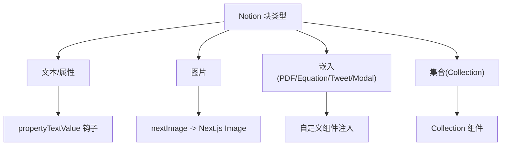
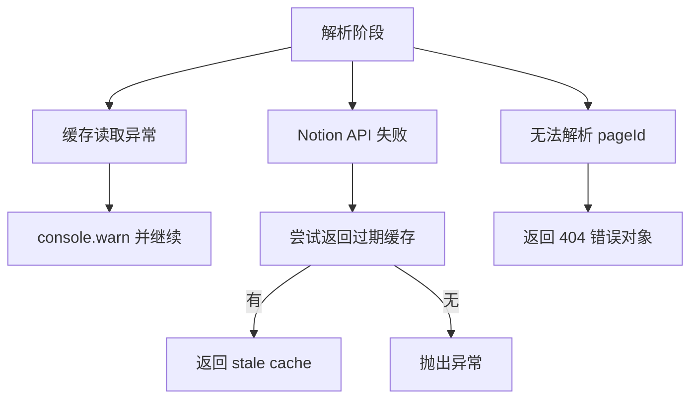
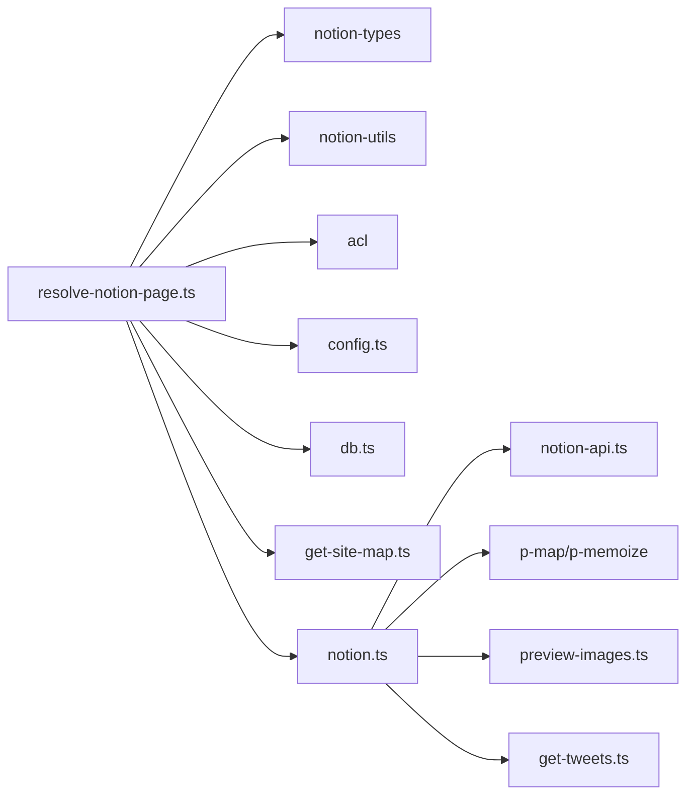
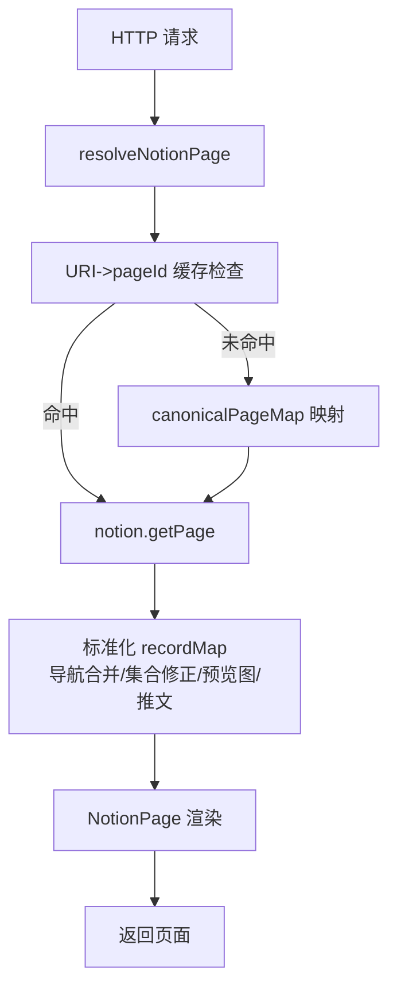

# 数据处理与转换

<cite>
**本文引用的文件**   
- [resolve-notion-page.ts](file://lib/resolve-notion-page.ts)
- [notion.ts](file://lib/notion.ts)
- [types.ts](file://lib/types.ts)
- [config.ts](file://lib/config.ts)
- [db.ts](file://lib/db.ts)
- [get-site-map.ts](file://lib/get-site-map.ts)
- [NotionPage.tsx](file://components/NotionPage.tsx)
- [social-image.tsx](file://pages/api/social-image.tsx)
</cite>

## 目录
1. [引言](#引言)
2. [项目结构](#项目结构)
3. [核心组件](#核心组件)
4. [架构总览](#架构总览)
5. [详细组件分析](#详细组件分析)
6. [依赖关系分析](#依赖关系分析)
7. [性能考量](#性能考量)
8. [故障排查指南](#故障排查指南)
9. [结论](#结论)
10. [附录](#附录)

## 引言
本文聚焦于 Notion 数据在站点中的解析、转换与标准化流程，重点说明：
- resolveNotionPage 如何将原始 Notion 数据转换为页面组件可用的 PageProps。
- ExtendedRecordMap 类型定义及其在数据映射中的作用。
- 不同类型 Notion 块（文本、图片、嵌入等）的处理方式与扩展点。
- 数据验证与错误处理机制。
- 提供流程图、字段映射表与类型说明，帮助读者快速理解并扩展该数据管线。

## 项目结构
本项目采用“功能模块 + 页面”的组织方式：
- lib 层负责数据获取、缓存、配置与类型定义。
- components 层负责将 recordMap 渲染为 UI。
- pages 层作为 Next.js 入口，调用 lib 层完成数据解析与渲染。

图表来源
- [resolve-notion-page.ts:11-84](file://lib/resolve-notion-page.ts#L11-L84)
- [notion.ts:161-214](file://lib/notion.ts#L161-L214)
- [config.ts:157-163](file://lib/config.ts#L157-L163)
- [db.ts:1-7](file://lib/db.ts#L1-L7)
- [get-site-map.ts:18-28](file://lib/get-site-map.ts#L18-L28)
- [types.ts:14-23](file://lib/types.ts#L14-L23)
- [NotionPage.tsx:211-231](file://components/NotionPage.tsx#L211-L231)

章节来源
- [resolve-notion-page.ts:11-84](file://lib/resolve-notion-page.ts#L11-L84)
- [notion.ts:161-214](file://lib/notion.ts#L161-L214)
- [config.ts:157-163](file://lib/config.ts#L157-L163)
- [db.ts:1-7](file://lib/db.ts#L1-L7)
- [get-site-map.ts:18-28](file://lib/get-site-map.ts#L18-L28)
- [types.ts:14-23](file://lib/types.ts#L14-L23)
- [NotionPage.tsx:211-231](file://components/NotionPage.tsx#L211-L231)

## 核心组件
- resolveNotionPage：根据域名与 rawPageId 解析出最终 pageId，拉取并标准化 recordMap，返回 PageProps。
- notion.getPage：封装 Notion API 调用，包含内存缓存、导航链接合并、集合查询修正、预览图与推文增强。
- types：定义 PageProps、ExtendedTweetRecordMap、Site、SiteMap 等关键类型。
- config：站点级配置，包括 rootNotionPageId、domain、导航样式、预览图等开关。
- db：基于 Keyv 的轻量内存缓存，用于 URI-to-pageId 映射缓存。
- get-site-map：构建站点地图，维护 canonicalPageMap 以支持友好 URL 到 Notion pageId 的映射。
- NotionPage：将 recordMap 渲染为 UI，并提供自定义渲染器扩展点。

章节来源
- [resolve-notion-page.ts:11-84](file://lib/resolve-notion-page.ts#L11-L84)
- [notion.ts:161-214](file://lib/notion.ts#L161-L214)
- [types.ts:14-23](file://lib/types.ts#L14-L23)
- [config.ts:23-30](file://lib/config.ts#L23-L30)
- [db.ts:1-7](file://lib/db.ts#L1-L7)
- [get-site-map.ts:18-28](file://lib/get-site-map.ts#L18-L28)
- [NotionPage.tsx:196-209](file://components/NotionPage.tsx#L196-L209)

## 架构总览
下图展示了从请求到数据标准化再到渲染的关键路径：

图表来源
- [resolve-notion-page.ts:11-84](file://lib/resolve-notion-page.ts#L11-L84)
- [notion.ts:161-214](file://lib/notion.ts#L161-L214)
- [get-site-map.ts:18-28](file://lib/get-site-map.ts#L18-L28)
- [db.ts:1-7](file://lib/db.ts#L1-L7)

## 详细组件分析

### resolveNotionPage 解析流程
- 输入：domain、rawPageId（可选）。
- 输出：PageProps（site、recordMap、pageId、error?）。
- 关键点：
  - 优先解析 rawPageId；若无效则回退到 pageUrlOverrides/pageUrlAdditions。
  - 使用 db 做 URI-to-pageId 缓存，TTL 为一天。
  - 通过 getSiteMap 的 canonicalPageMap 将友好 URL 映射为 Notion pageId。
  - 最终返回 PageProps，并附加 ACL 权限信息。

图表来源
- [resolve-notion-page.ts:11-84](file://lib/resolve-notion-page.ts#L11-L84)
- [get-site-map.ts:64-100](file://lib/get-site-map.ts#L64-L100)
- [db.ts:1-7](file://lib/db.ts#L1-L7)

章节来源
- [resolve-notion-page.ts:11-84](file://lib/resolve-notion-page.ts#L11-L84)
- [get-site-map.ts:64-100](file://lib/get-site-map.ts#L64-L100)
- [db.ts:1-7](file://lib/db.ts#L1-L7)

### notion.getPage 数据标准化
- 内存缓存：对每个 pageId 缓存 ExtendedRecordMap，TTL 60 秒，具备“过期仍可用”的回退策略。
- 导航链接增强：当 navigationStyle 非 default 时，预取导航链接页面的 recordMap 并合并。
- 集合查询修正：修复 collection_view.value 的双层嵌套问题，重新执行 queryCollection 应用真实排序与过滤，并将结果合并回 recordMap。
- 预览图与推文增强：可选地注入 preview_images 与 tweets 字段。

图表来源
- [notion.ts:161-214](file://lib/notion.ts#L161-L214)
- [notion.ts:95-159](file://lib/notion.ts#L95-L159)

章节来源
- [notion.ts:161-214](file://lib/notion.ts#L161-L214)
- [notion.ts:95-159](file://lib/notion.ts#L95-L159)

### 类型定义与数据映射规则
- ExtendedRecordMap：来自 notion-types，表示 Notion 的标准记录映射结构，包含 block、collection、collection_view、collection_query 等键。
- PageProps：站点渲染所需的最小属性集，包含 site、recordMap、pageId、error。
- ExtendedTweetRecordMap：在 ExtendedRecordMap 基础上增加 tweets 字段，便于渲染推文。
- Site/SiteMap：站点元信息与站点地图结构，canonicalPageMap 用于友好 URL 到 pageId 的映射。

图表来源
- [types.ts:14-23](file://lib/types.ts#L14-L23)
- [types.ts:29-55](file://lib/types.ts#L29-L55)

章节来源
- [types.ts:14-23](file://lib/types.ts#L14-L23)
- [types.ts:29-55](file://lib/types.ts#L29-L55)

### Notion 块类型处理与扩展点
- 文本块：默认由 Notion 渲染器处理；可通过 propertyTextValue 钩子定制页头作者等字段的显示。
- 图片块：通过 nextImage 替换为 Next.js Image 组件，提升加载性能与体验。
- 嵌入块：如 PDF、Equation、Tweet、Modal 等，通过 notionRendererComponents 注入自定义组件。
- 集合块：Collection 组件用于渲染表格/看板等集合视图。
- 扩展点：
  - notionRendererComponents：覆盖默认渲染器，注入自定义组件与属性值处理器。
  - propertyDateValue/propertyTextValue：针对特定属性的展示进行定制。

图表来源
- [NotionPage.tsx:196-209](file://components/NotionPage.tsx#L196-L209)
- [NotionPage.tsx:168-194](file://components/NotionPage.tsx#L168-L194)

章节来源
- [NotionPage.tsx:168-194](file://components/NotionPage.tsx#L168-L194)
- [NotionPage.tsx:196-209](file://components/NotionPage.tsx#L196-L209)

### 数据验证与错误处理
- URI-to-pageId 缓存读写异常：捕获并打印警告，不影响主流程。
- Notion API 不可用：getPage 捕获异常后尝试返回过期缓存，避免全站 500。
- 404 处理：当无法解析 pageId 且无缓存时，返回结构化错误对象（message、statusCode）。
- OG 图像接口校验：校验 pageId 合法性与 workspace 一致性，返回明确错误信息。

图表来源
- [resolve-notion-page.ts:36-42](file://lib/resolve-notion-page.ts#L36-L42)
- [resolve-notion-page.ts:66-74](file://lib/resolve-notion-page.ts#L66-L74)
- [notion.ts:168-182](file://lib/notion.ts#L168-L182)
- [social-image.tsx:27-32](file://pages/api/social-image.tsx#L27-L32)
- [social-image.tsx:192-204](file://pages/api/social-image.tsx#L192-L204)

章节来源
- [resolve-notion-page.ts:36-42](file://lib/resolve-notion-page.ts#L36-L42)
- [resolve-notion-page.ts:66-74](file://lib/resolve-notion-page.ts#L66-L74)
- [notion.ts:168-182](file://lib/notion.ts#L168-L182)
- [social-image.tsx:27-32](file://pages/api/social-image.tsx#L27-L32)
- [social-image.tsx:192-204](file://pages/api/social-image.tsx#L192-L204)

## 依赖关系分析
- resolveNotionPage 依赖：
  - notion-types：ExtendedRecordMap 类型。
  - notion-utils：parsePageId。
  - acl：页面权限控制。
  - config：站点配置与环境变量。
  - db：URI-to-pageId 缓存。
  - get-site-map：canonicalPageMap。
  - notion：getPage 获取 recordMap。
- notion 模块依赖：
  - notion-api：底层 Notion API 客户端。
  - p-map/p-memoize：并发与缓存工具。
  - preview-images/tweets：可选的数据增强。
- 类型与配置：
  - types：导出所有 notion-types 类型并扩展站点相关类型。
  - config：集中管理站点配置与 URL 重写规则。

图表来源
- [resolve-notion-page.ts:1-9](file://lib/resolve-notion-page.ts#L1-L9)
- [notion.ts:1-17](file://lib/notion.ts#L1-L17)
- [types.ts:1-5](file://lib/types.ts#L1-L5)

章节来源
- [resolve-notion-page.ts:1-9](file://lib/resolve-notion-page.ts#L1-L9)
- [notion.ts:1-17](file://lib/notion.ts#L1-L17)
- [types.ts:1-5](file://lib/types.ts#L1-L5)

## 性能考量
- 多级缓存：
  - URI-to-pageId 缓存（Keyv），TTL 一天，减少频繁 URL 解析与站点地图查询。
  - 页面 recordMap 内存缓存（60 秒），降低 Notion API 压力并提高响应速度。
- 并发优化：
  - 导航链接页面并行获取（pMap 并发 4）。
  - 集合查询修正并行执行（pMap 并发 3）。
- 增量增强：
  - 仅在需要时注入 preview_images 与 tweets，避免不必要的开销。

[本节为通用性能建议，不直接分析具体文件]

## 故障排查指南
- 无法解析 pageId：
  - 检查 rawPageId 是否合法，必要时使用 pageUrlOverrides/pageUrlAdditions 进行映射。
  - 确认 canonicalPageMap 是否正确生成。
- Notion API 不稳定：
  - 观察控制台警告，确认是否返回了过期缓存。
  - 检查 notion-api 配置与网络连通性。
- 集合视图排序/过滤不一致：
  - 确认视图是否定义了 query2.sort/filter。
  - 查看 fixCollectionQueries 日志，确保已重新执行查询并合并结果。
- OG 图像接口报错：
  - 校验 pageId 与 workspace 是否匹配。
  - 检查 Social Image 与 Author 属性是否存在。

章节来源
- [resolve-notion-page.ts:18-30](file://lib/resolve-notion-page.ts#L18-L30)
- [resolve-notion-page.ts:47-74](file://lib/resolve-notion-page.ts#L47-L74)
- [notion.ts:168-182](file://lib/notion.ts#L168-L182)
- [notion.ts:119-155](file://lib/notion.ts#L119-L155)
- [social-image.tsx:192-204](file://pages/api/social-image.tsx#L192-L204)

## 结论
本数据管线通过 resolveNotionPage 与 notion.getPage 的组合，实现了从原始 Notion 数据到组件可用格式的完整转换与标准化。借助多级缓存、并发优化与数据增强，系统在稳定性与性能之间取得平衡。同时，通过类型定义与渲染扩展点，开发者可以灵活定制不同 Notion 块的展示行为，满足多样化业务需求。

[本节为总结性内容，不直接分析具体文件]

## 附录

### 数据转换流程图（端到端）

图表来源
- [resolve-notion-page.ts:11-84](file://lib/resolve-notion-page.ts#L11-L84)
- [notion.ts:161-214](file://lib/notion.ts#L161-L214)
- [get-site-map.ts:64-100](file://lib/get-site-map.ts#L64-L100)

### 字段映射表（常见 Notion 属性到站点字段）
- 标题：getBlockTitle(block, recordMap)
- 封面图：block.format.page_cover 或 Social Image 属性
- 作者：Author 属性或 notional_user
- 发布时间：Published 属性（日期）
- 描述：Description 属性（可选）

章节来源
- [social-image.tsx:206-270](file://pages/api/social-image.tsx#L206-L270)