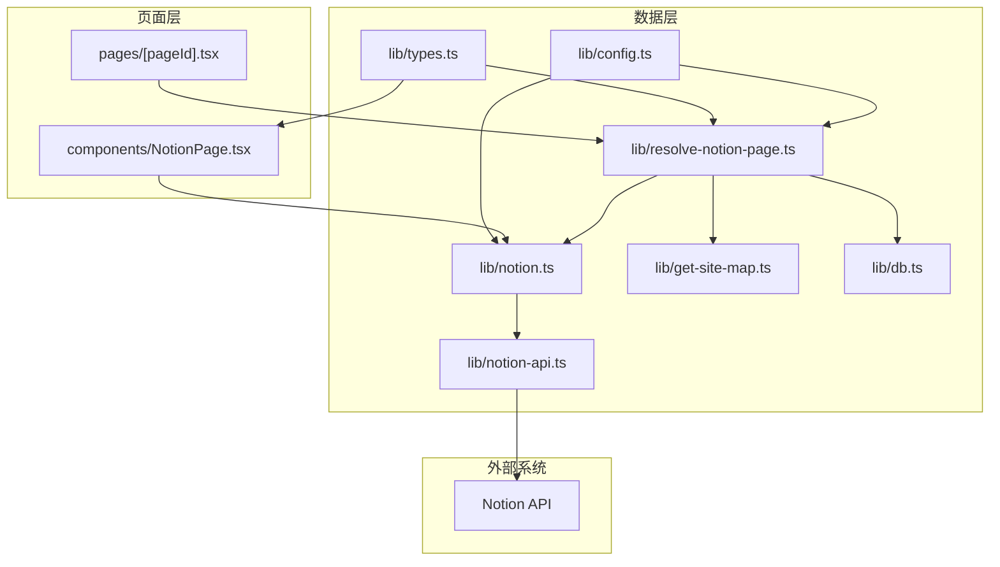
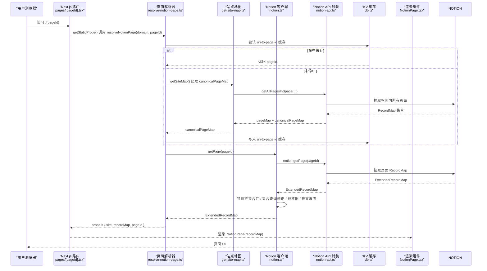
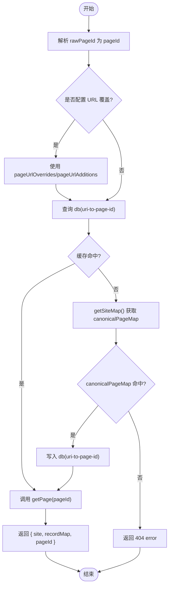
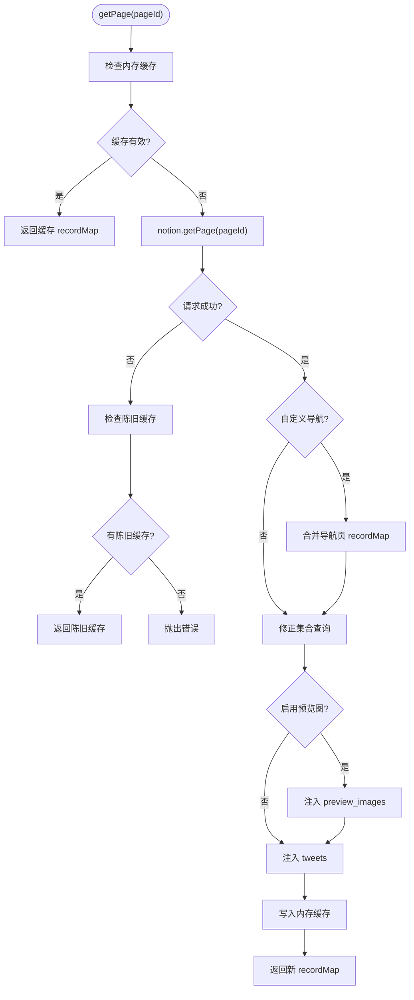
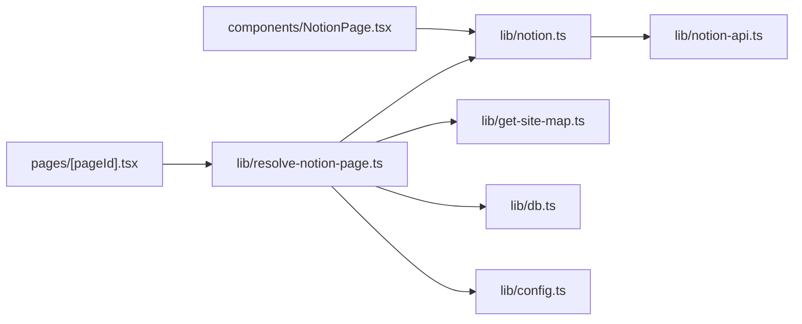
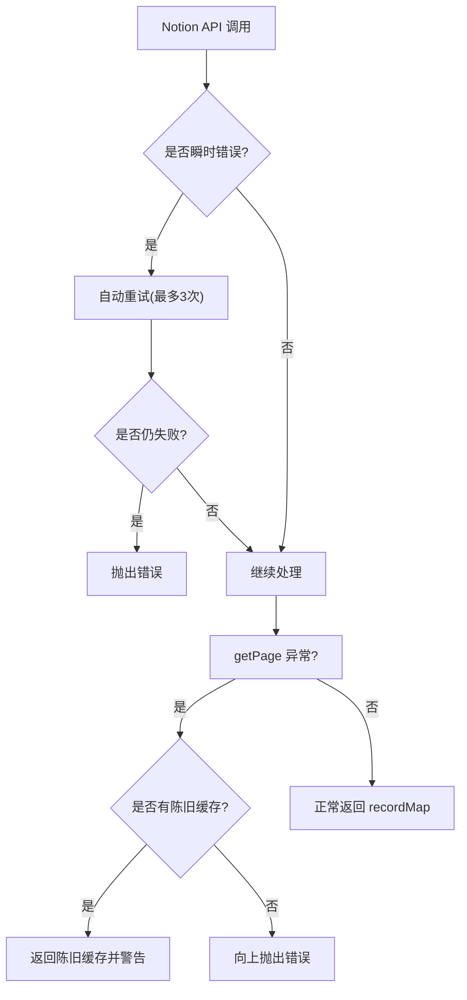

# 数据流设计

<cite>
**本文引用的文件**   
- [readme.md](file://readme.md)
- [site.config.ts](file://site.config.ts)
- [lib/config.ts](file://lib/config.ts)
- [lib/types.ts](file://lib/types.ts)
- [lib/notion-api.ts](file://lib/notion-api.ts)
- [lib/notion.ts](file://lib/notion.ts)
- [lib/resolve-notion-page.ts](file://lib/resolve-notion-page.ts)
- [lib/get-site-map.ts](file://lib/get-site-map.ts)
- [lib/db.ts](file://lib/db.ts)
- [pages/[pageId].tsx](file://pages/[pageId].tsx)
- [components/NotionPage.tsx](file://components/NotionPage.tsx)
</cite>

## 目录
1. [引言](#引言)
2. [项目结构](#项目结构)
3. [核心组件](#核心组件)
4. [架构总览](#架构总览)
5. [详细组件分析](#详细组件分析)
6. [依赖关系分析](#依赖关系分析)
7. [性能与缓存策略](#性能与缓存策略)
8. [错误处理与降级](#错误处理与降级)
9. [结论](#结论)

## 引言
本文面向“从用户请求到页面渲染”的完整数据流，围绕 Notion API 数据获取、RecordMap 数据处理、缓存机制与状态管理展开。目标是帮助读者理解以下关键路径：
- API 调用 → 数据转换 → 组件状态 → UI 渲染
- 站点地图与 URL 解析
- 服务端内存缓存与 URI→PageId 缓存
- ISR（增量静态再生）与过期重验证
- 集合查询修正、预览图与推文增强
- 错误处理与降级策略

该文档同时提供架构图、时序图与流程图，便于快速定位问题与优化点。

## 项目结构
本项目基于 Next.js Pages Router，采用“功能模块 + 分层职责”的组织方式：
- pages：Next.js 路由入口，负责构建期/运行期的数据获取与页面组装
- lib：数据层与工具层，封装 Notion API、站点地图、配置、类型定义等
- components：React 组件，负责将 RecordMap 渲染为 UI

图表来源
- [pages/[pageId].tsx:8-30](file://pages/[pageId].tsx#L8-L30)
- [lib/resolve-notion-page.ts:11-84](file://lib/resolve-notion-page.ts#L11-L84)
- [lib/notion.ts:161-213](file://lib/notion.ts#L161-L213)
- [lib/notion-api.ts:6-19](file://lib/notion-api.ts#L6-L19)
- [lib/get-site-map.ts:18-34](file://lib/get-site-map.ts#L18-L34)
- [lib/config.ts:23-98](file://lib/config.ts#L23-L98)
- [components/NotionPage.tsx:211-356](file://components/NotionPage.tsx#L211-L356)

章节来源
- [readme.md:81-92](file://readme.md#L81-L92)

## 核心组件
- 页面路由与构建期数据获取：[pages/[pageId].tsx](file://pages/[pageId].tsx)
- 页面解析与数据装配：[lib/resolve-notion-page.ts](file://lib/resolve-notion-page.ts)
- Notion 数据访问与缓存：[lib/notion.ts](file://lib/notion.ts)、[lib/notion-api.ts](file://lib/notion-api.ts)
- 站点地图与 URL 映射：[lib/get-site-map.ts](file://lib/get-site-map.ts)
- 运行时配置与站点元信息：[lib/config.ts](file://lib/config.ts)、[site.config.ts](file://site.config.ts)
- 类型定义：[lib/types.ts](file://lib/types.ts)
- 轻量 KV 缓存：[lib/db.ts](file://lib/db.ts)
- 前端渲染组件：[components/NotionPage.tsx](file://components/NotionPage.tsx)

章节来源
- [pages/[pageId].tsx:8-30](file://pages/[pageId].tsx#L8-L30)
- [lib/resolve-notion-page.ts:11-84](file://lib/resolve-notion-page.ts#L11-L84)
- [lib/notion.ts:161-213](file://lib/notion.ts#L161-L213)
- [lib/notion-api.ts:6-19](file://lib/notion-api.ts#L6-L19)
- [lib/get-site-map.ts:18-34](file://lib/get-site-map.ts#L18-L34)
- [lib/config.ts:23-98](file://lib/config.ts#L23-L98)
- [site.config.ts:3-61](file://site.config.ts#L3-L61)
- [lib/types.ts:9-23](file://lib/types.ts#L9-L23)
- [lib/db.ts:1-7](file://lib/db.ts#L1-L7)
- [components/NotionPage.tsx:211-356](file://components/NotionPage.tsx#L211-L356)

## 架构总览
下图展示一次典型请求的数据流转：URL 进入 Next.js 路由，解析出 PageId，读取站点地图或缓存，拉取 Notion 数据，合并增强字段，最终由 React 组件渲染。

图表来源
- [pages/[pageId].tsx:8-30](file://pages/[pageId].tsx#L8-L30)
- [lib/resolve-notion-page.ts:11-84](file://lib/resolve-notion-page.ts#L11-L84)
- [lib/get-site-map.ts:18-34](file://lib/get-site-map.ts#L18-L34)
- [lib/notion.ts:161-213](file://lib/notion.ts#L161-L213)
- [lib/notion-api.ts:6-19](file://lib/notion-api.ts#L6-L19)
- [lib/db.ts:1-7](file://lib/db.ts#L1-L7)
- [components/NotionPage.tsx:211-356](file://components/NotionPage.tsx#L211-L356)

## 详细组件分析

### 1) 页面路由与构建期数据获取
- 动态路由 `pages/[pageId].tsx` 在构建时通过 `getStaticPaths` 返回空路径，配合 `fallback` 控制首次访问行为；开发环境使用 blocking，生产环境使用 blocking 模式以触发按需生成。
- `getStaticProps` 中调用 `resolveNotionPage(domain, rawPageId)` 获取 props，并设置 `revalidate: revalidateSeconds` 实现 ISR 增量更新。
- 若解析失败，显式抛出错误，阻止发布错误版本页面。

章节来源
- [pages/[pageId].tsx:8-30](file://pages/[pageId].tsx#L8-L30)

### 2) 页面解析与数据装配
`resolveNotionPage` 是数据流的核心编排者：
- 优先解析 rawPageId 为 Notion PageId；若无效，则检查 `pageUrlOverrides` 与 `pageUrlAdditions` 是否提供映射。
- 使用 `db` 做 URI→PageId 缓存，键包含 domain 与 environment，TTL 为一天。
- 若仍无法解析，则通过 `getSiteMap()` 查找 canonicalPageMap；找到后再次调用 `getPage(pageId)` 获取 RecordMap，并回写 URI→PageId 缓存。
- 根路径直接取 `site.rootNotionPageId` 并拉取 RecordMap。
- 最后注入 ACL 权限结果，返回 `{ site, recordMap, pageId, ...acl }`。

图表来源
- [lib/resolve-notion-page.ts:11-84](file://lib/resolve-notion-page.ts#L11-L84)
- [lib/db.ts:1-7](file://lib/db.ts#L1-L7)
- [lib/get-site-map.ts:18-34](file://lib/get-site-map.ts#L18-L34)

章节来源
- [lib/resolve-notion-page.ts:11-84](file://lib/resolve-notion-page.ts#L11-L84)

### 3) Notion 数据获取与 RecordMap 处理
`lib/notion.ts` 暴露 `getPage(pageId)`，承担以下职责：
- 服务器端内存缓存：按 pageId 缓存 ExtendedRecordMap，TTL 60 秒；支持 stale-while-revalidate 降级。
- 导航链接增强：当非默认导航样式时，并发拉取导航链接对应页面的 RecordMap，并合并到当前 recordMap。
- 集合查询修正：针对 collection_view 的双层嵌套结构，重新执行 getCollectionData，应用真实的 sort/filter，并将结果合并回 recordMap。
- 预览图与推文增强：可选地注入 preview_images 与 tweets 字段。
- 异常降级：当 Notion 不可用时，返回最近一次缓存记录，避免全站 500。

图表来源
- [lib/notion.ts:29-55](file://lib/notion.ts#L29-L55)
- [lib/notion.ts:95-159](file://lib/notion.ts#L95-L159)
- [lib/notion.ts:161-213](file://lib/notion.ts#L161-L213)

章节来源
- [lib/notion.ts:29-55](file://lib/notion.ts#L29-L55)
- [lib/notion.ts:95-159](file://lib/notion.ts#L95-L159)
- [lib/notion.ts:161-213](file://lib/notion.ts#L161-L213)

### 4) Notion API 封装与重试
`lib/notion-api.ts` 基于 notion-client 创建实例，配置：
- 基础地址与认证令牌
- ofetchOptions：自动重试（含 408/429/5xx/504）、退避延迟、超时时间、User-Agent
- 用于屏蔽瞬时网络抖动与 Notion 限流

章节来源
- [lib/notion-api.ts:1-20](file://lib/notion-api.ts#L1-L20)

### 5) 站点地图与 URL 映射
`lib/get-site-map.ts`：
- 使用 notion-utils 的 `getAllPagesInSpace` 遍历空间内页面，过滤 Public=false 的页面。
- 计算 canonicalPageMap（友好 URL → Notion PageId），去重并告警重复项。
- 对 `getAllPages` 进行 p-memoize 缓存，TTL 5 分钟，保证站点地图变更可被及时感知。

章节来源
- [lib/get-site-map.ts:18-34](file://lib/get-site-map.ts#L18-L34)
- [lib/get-site-map.ts:46-106](file://lib/get-site-map.ts#L46-L106)

### 6) 配置与类型
- `site.config.ts`：站点级配置，包括 rootNotionPageId、域名、描述、ISR 间隔、导航风格等。
- `lib/config.ts`：统一导出运行时配置，如 rootNotionPageId、domain、isSearchEnabled、revalidateSeconds、site 对象等。
- `lib/types.ts`：定义 PageProps、Site、SiteMap、CanonicalPageMap 等类型，贯穿数据层与组件层。

章节来源
- [site.config.ts:3-61](file://site.config.ts#L3-L61)
- [lib/config.ts:23-98](file://lib/config.ts#L23-L98)
- [lib/types.ts:9-23](file://lib/types.ts#L9-L23)
- [lib/types.ts:29-55](file://lib/types.ts#L29-L55)

### 7) 前端渲染组件
`components/NotionPage.tsx`：
- 接收 server-side 注入的 site、recordMap、pageId、error。
- 根据 block 类型判断是否为博客文章，决定是否显示目录。
- 构造 SEO 元信息（标题、描述、图片、canonical URL、发布时间等）。
- 使用 react-notion-x 的 NotionRenderer 渲染 RecordMap，注入自定义组件（代码高亮、集合、公式、PDF、Modal、Tweet 等）。
- 支持 lite 模式与暗色模式，挂载 window 全局变量便于调试。

章节来源
- [components/NotionPage.tsx:211-356](file://components/NotionPage.tsx#L211-L356)

## 依赖关系分析
- 页面路由依赖页面解析器与配置。
- 页面解析器依赖 Notion 数据层、站点地图与 KV 缓存。
- Notion 数据层依赖 API 封装与配置。
- 渲染组件依赖 RecordMap 与站点配置。

图表来源
- [pages/[pageId].tsx:8-30](file://pages/[pageId].tsx#L8-L30)
- [lib/resolve-notion-page.ts:11-84](file://lib/resolve-notion-page.ts#L11-L84)
- [lib/notion.ts:161-213](file://lib/notion.ts#L161-L213)
- [lib/get-site-map.ts:18-34](file://lib/get-site-map.ts#L18-L34)
- [lib/db.ts:1-7](file://lib/db.ts#L1-L7)
- [lib/notion-api.ts:6-19](file://lib/notion-api.ts#L6-L19)
- [lib/config.ts:23-98](file://lib/config.ts#L23-L98)
- [components/NotionPage.tsx:211-356](file://components/NotionPage.tsx#L211-L356)

## 性能与缓存策略
- 服务器端内存缓存（ExtendedRecordMap）：TTL 60 秒，减少 Notion 调用频率，并在 Notion 故障时提供陈旧数据兜底。
- URI→PageId 缓存（Keyv）：TTL 一天，降低站点地图查询压力，提升友好 URL 解析速度。
- 站点地图缓存：p-memoize + ExpiryMap，TTL 5 分钟，平衡新鲜度与性能。
- ISR 增量静态再生：通过 `revalidateSeconds` 控制页面重建频率，默认 1 小时，站点配置为 1 天，显著降低函数调用成本。
- 并发优化：导航链接与集合查询修正使用并发限制，避免一次性大量请求。
- 可选特性开关：预览图与推文增强按需注入，减少不必要开销。

章节来源
- [lib/notion.ts:29-55](file://lib/notion.ts#L29-L55)
- [lib/resolve-notion-page.ts:32-65](file://lib/resolve-notion-page.ts#L32-L65)
- [lib/get-site-map.ts:30-34](file://lib/get-site-map.ts#L30-L34)
- [lib/config.ts:93-98](file://lib/config.ts#L93-L98)
- [site.config.ts:58-61](file://site.config.ts#L58-L61)

## 错误处理与降级
- Notion API 层：ofetchOptions 自动重试与超时保护，屏蔽瞬时错误。
- 页面解析层：URI→PageId 缓存读写异常仅警告，不阻断流程；找不到页面时返回 404。
- Notion 数据层：getPage 捕获异常，若存在陈旧缓存则返回旧数据并记录警告；否则抛出错误。
- 页面路由层：构建期失败时显式抛错，防止发布错误版本页面。
- 渲染层：当缺少 site/block/recordMap 或出现 error 时，渲染 404 页面。

图表来源
- [lib/notion-api.ts:6-19](file://lib/notion-api.ts#L6-L19)
- [lib/notion.ts:168-182](file://lib/notion.ts#L168-L182)
- [lib/resolve-notion-page.ts:36-42](file://lib/resolve-notion-page.ts#L36-L42)
- [lib/resolve-notion-page.ts:66-74](file://lib/resolve-notion-page.ts#L66-L74)
- [pages/[pageId].tsx:17-23](file://pages/[pageId].tsx#L17-L23)
- [components/NotionPage.tsx:255-261](file://components/NotionPage.tsx#L255-L261)

章节来源
- [lib/notion-api.ts:6-19](file://lib/notion-api.ts#L6-L19)
- [lib/notion.ts:168-182](file://lib/notion.ts#L168-L182)
- [lib/resolve-notion-page.ts:36-42](file://lib/resolve-notion-page.ts#L36-L42)
- [lib/resolve-notion-page.ts:66-74](file://lib/resolve-notion-page.ts#L66-L74)
- [pages/[pageId].tsx:17-23](file://pages/[pageId].tsx#L17-L23)
- [components/NotionPage.tsx:255-261](file://components/NotionPage.tsx#L255-L261)

## 结论
本项目的数据流以“解析 → 拉取 → 增强 → 渲染”为主线，通过多层缓存与 ISR 机制在保证一致性的前提下显著提升性能与可用性。关键点如下：
- 数据源：Notion API 通过 notion-client 稳定访问，具备自动重试与超时保护。
- 数据转换：RecordMap 在服务器端完成导航合并、集合查询修正、预览图与推文增强。
- 缓存体系：服务器内存缓存（60s）+ URI→PageId 缓存（1d）+ 站点地图缓存（5m），兼顾时效与吞吐。
- 一致性保障：stale-while-revalidate 与 ISR 重验证确保内容更新与容灾能力。
- 渲染链路：React 组件消费 RecordMap，结合 react-notion-x 高效渲染，支持暗色模式与 SEO 优化。

建议后续优化方向：
- 将 Keyv 后端替换为 Redis 以提升跨进程缓存命中率（需评估部署成本）。
- 对集合查询修正增加更细粒度的条件判断，减少不必要的 getCollectionData 调用。
- 为预览图与推文加载引入懒加载与占位骨架屏，进一步优化首屏体验。