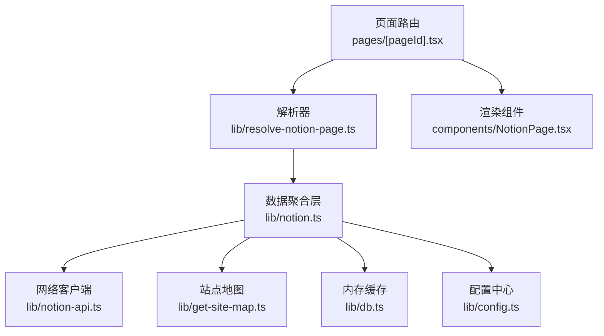
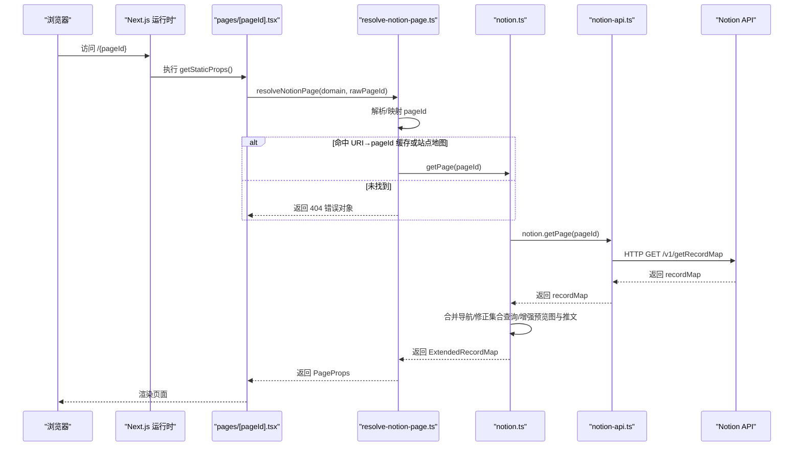
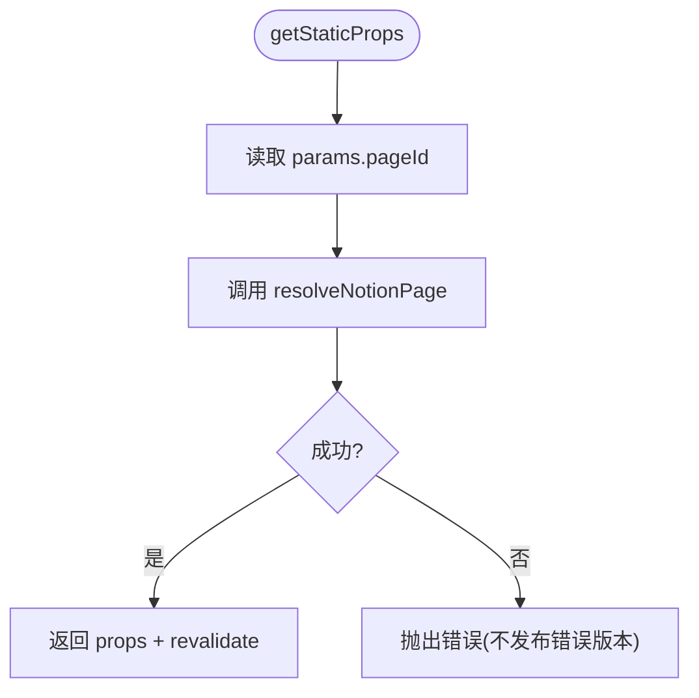
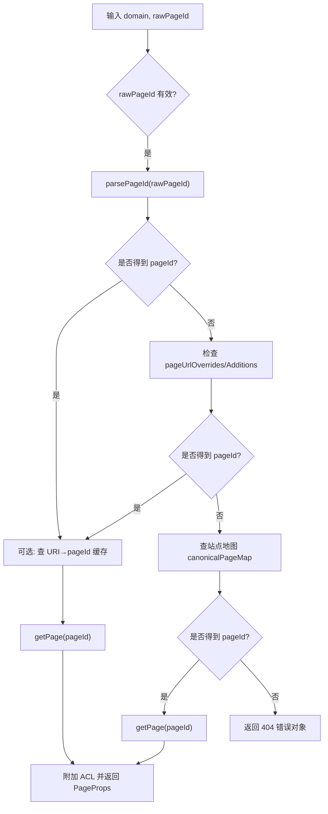
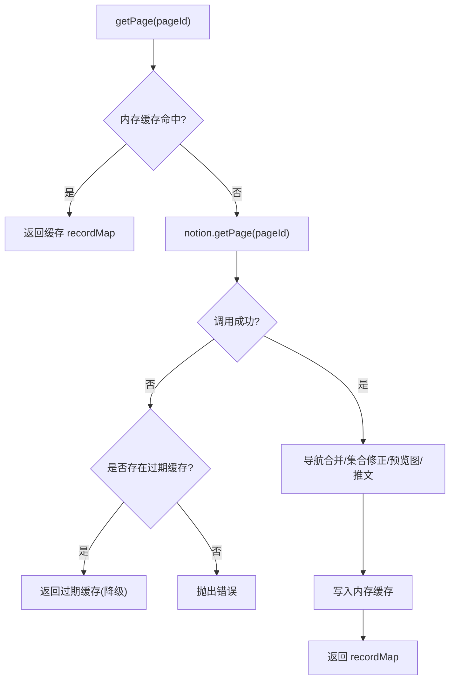
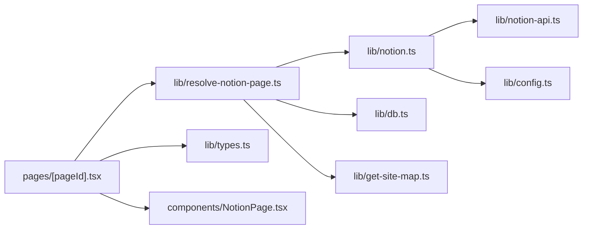

# 数据获取流程

<cite>
**本文引用的文件**   
- [pages/[pageId].tsx](file://pages/[pageId].tsx)
- [lib/resolve-notion-page.ts](file://lib/resolve-notion-page.ts)
- [lib/notion.ts](file://lib/notion.ts)
- [lib/notion-api.ts](file://lib/notion-api.ts)
- [components/NotionPage.tsx](file://components/NotionPage.tsx)
- [lib/types.ts](file://lib/types.ts)
- [lib/db.ts](file://lib/db.ts)
- [lib/get-site-map.ts](file://lib/get-site-map.ts)
- [lib/config.ts](file://lib/config.ts)
</cite>

## 目录
1. [引言](#引言)
2. [项目结构](#项目结构)
3. [核心组件](#核心组件)
4. [架构总览](#架构总览)
5. [详细组件分析](#详细组件分析)
6. [依赖关系分析](#依赖关系分析)
7. [性能与可靠性](#性能与可靠性)
8. [故障排查指南](#故障排查指南)
9. [结论](#结论)
10. [附录：API 调用时序、参数与响应](#附录api-调用时序参数与响应)

## 引言
本文面向“从页面请求到 Notion API 调用”的完整数据获取链路，重点说明动态路由如何解析页面 ID、resolveNotionPage 的职责边界、notion.ts 中的 getPage 实现（含缓存、降级与集合查询修正）、以及底层 notion-api.ts 的网络重试与超时策略。文档同时给出时序图、流程图和数据结构说明，帮助读者快速定位问题并掌握最佳实践。

## 项目结构
本项目基于 Next.js，采用“页面层 + 领域库”的分层组织方式：
- 页面层：处理路由、SSG/ISR 构建与渲染入口
- 领域库：封装 Notion 数据获取、站点地图、配置、类型定义等
- 组件层：负责 UI 渲染与交互

图表来源
- [pages/[pageId].tsx:8-31](file://pages/[pageId].tsx#L8-L31)
- [lib/resolve-notion-page.ts:11-84](file://lib/resolve-notion-page.ts#L11-L84)
- [lib/notion.ts:161-213](file://lib/notion.ts#L161-L213)
- [lib/notion-api.ts:6-19](file://lib/notion-api.ts#L6-L19)
- [lib/get-site-map.ts:18-44](file://lib/get-site-map.ts#L18-L44)
- [lib/db.ts:1-7](file://lib/db.ts#L1-L7)
- [lib/config.ts:48-98](file://lib/config.ts#L48-L98)

章节来源
- [pages/[pageId].tsx:1-36](file://pages/[pageId].tsx#L1-L36)
- [lib/resolve-notion-page.ts:1-85](file://lib/resolve-notion-page.ts#L1-L85)
- [lib/notion.ts:1-219](file://lib/notion.ts#L1-L219)
- [lib/notion-api.ts:1-20](file://lib/notion-api.ts#L1-L20)
- [components/NotionPage.tsx:211-356](file://components/NotionPage.tsx#L211-L356)

## 核心组件
- 动态路由页：负责提取 pageId、调用 resolveNotionPage、返回 props 与 ISR revalidate 配置
- 解析器 resolveNotionPage：将 URL 路径映射为 Notion pageId，必要时查站点地图或 URI→pageId 缓存
- 数据聚合层 notion.ts：提供 getPage，内置内存缓存、降级回退、导航链接合并、集合查询修正、预览图与推文增强
- 网络客户端 notion-api.ts：封装 NotionAPI，统一重试、超时、UA 头
- 渲染组件 NotionPage.tsx：消费 recordMap 进行页面渲染

章节来源
- [pages/[pageId].tsx:8-31](file://pages/[pageId].tsx#L8-L31)
- [lib/resolve-notion-page.ts:11-84](file://lib/resolve-notion-page.ts#L11-L84)
- [lib/notion.ts:161-213](file://lib/notion.ts#L161-L213)
- [lib/notion-api.ts:6-19](file://lib/notion-api.ts#L6-L19)
- [components/NotionPage.tsx:211-356](file://components/NotionPage.tsx#L211-L356)

## 架构总览
下图展示一次典型请求的数据流：Next.js 在 getStaticProps 中触发数据获取，最终通过 NotionAPI 拉取 ExtendedRecordMap，并在服务端完成缓存与增强后返回给组件渲染。

图表来源
- [pages/[pageId].tsx:8-23](file://pages/[pageId].tsx#L8-L23)
- [lib/resolve-notion-page.ts:11-84](file://lib/resolve-notion-page.ts#L11-L84)
- [lib/notion.ts:161-213](file://lib/notion.ts#L161-L213)
- [lib/notion-api.ts:6-19](file://lib/notion-api.ts#L6-L19)

## 详细组件分析

### 动态路由与 SSG/ISR
- 使用 getStaticPaths 返回空 paths，开发环境 fallback=true，生产环境 fallback='blocking'，按需生成页面
- getStaticProps 中读取 context.params.pageId，调用 resolveNotionPage 获取 props，并设置 revalidateSeconds 以启用增量静态再生成
- 异常时抛出错误，阻止发布包含错误的页面版本

图表来源
- [pages/[pageId].tsx:8-23](file://pages/[pageId].tsx#L8-L23)

章节来源
- [pages/[pageId].tsx:8-31](file://pages/[pageId].tsx#L8-L31)

### 解析器 resolveNotionPage
职责：
- 将 rawPageId 解析为标准 pageId；若失败则尝试 site.config 中的 pageUrlOverrides/pageUrlAdditions
- 使用 db（Keyv）缓存 URI→pageId 映射，TTL 约一天
- 若仍无法解析，回退到站点地图 canonicalPageMap 查找
- 找不到对应 pageId 时返回 404 错误对象
- 最终调用 notion.ts 的 getPage 获取 recordMap，并附加 ACL 信息

图表来源
- [lib/resolve-notion-page.ts:11-84](file://lib/resolve-notion-page.ts#L11-L84)
- [lib/db.ts:1-7](file://lib/db.ts#L1-L7)
- [lib/get-site-map.ts:18-44](file://lib/get-site-map.ts#L18-L44)

章节来源
- [lib/resolve-notion-page.ts:1-85](file://lib/resolve-notion-page.ts#L1-L85)
- [lib/db.ts:1-7](file://lib/db.ts#L1-L7)
- [lib/get-site-map.ts:18-44](file://lib/get-site-map.ts#L18-L44)

### 数据聚合层 notion.ts 的 getPage
关键点：
- 进程内内存缓存：按 pageId 缓存 ExtendedRecordMap，TTL 60 秒，用于吸收突发流量与短暂 Notion 不可用
- 降级策略：当 Notion 调用失败时，优先返回过期但可用的 stale 缓存，避免 500
- 导航链接增强：非默认导航样式下，并行拉取导航链接页面的 block 信息并合并
- 集合查询修正：对 collection_view 的排序/过滤进行二次查询并回填 reducerResults，确保前端显示与 Notion 一致
- 可选增强：根据配置注入 preview_images 与 tweets 映射
- 最终写入缓存并返回

图表来源
- [lib/notion.ts:29-55](file://lib/notion.ts#L29-L55)
- [lib/notion.ts:95-159](file://lib/notion.ts#L95-L159)
- [lib/notion.ts:161-213](file://lib/notion.ts#L161-L213)

章节来源
- [lib/notion.ts:1-219](file://lib/notion.ts#L1-L219)

### 网络客户端 notion-api.ts
- 基于 notion-client 的 NotionAPI，统一配置 apiBaseUrl、authToken、ofetchOptions
- ofetchOptions 关键参数：
  - retry: 3
  - retryDelay: 500ms
  - retryStatusCodes: [408, 429, 500, 502, 503, 504]
  - timeout: 30000ms
  - headers.User-Agent: 模拟浏览器 UA
- 该配置确保瞬态错误自动重试，避免单次抖动导致页面失败

章节来源
- [lib/notion-api.ts:1-20](file://lib/notion-api.ts#L1-L20)

### 渲染组件 NotionPage.tsx
- 接收 PageProps（site、recordMap、pageId、error），渲染 NotionRenderer
- 根据 recordMap 推导标题、描述、封面、发布时间等元信息
- 支持 lite 模式、暗色模式、目录、侧边栏、评论等
- 若 error 存在或缺少必要数据，回退到 404 页面

章节来源
- [components/NotionPage.tsx:211-356](file://components/NotionPage.tsx#L211-L356)
- [lib/types.ts:9-19](file://lib/types.ts#L9-L19)

## 依赖关系分析
- pages/[pageId].tsx 依赖 resolve-notion-page.ts 与 config.ts
- resolve-notion-page.ts 依赖 notion.ts、db.ts、get-site-map.ts、config.ts、acl.ts
- notion.ts 依赖 notion-api.ts、preview-images.ts、get-tweets.ts、config.ts
- notion-api.ts 依赖 notion-client 与环境变量
- components/NotionPage.tsx 依赖 types.ts、config.ts、map-page-url.ts、search-notion.ts 等

图表来源
- [pages/[pageId].tsx:1-36](file://pages/[pageId].tsx#L1-L36)
- [lib/resolve-notion-page.ts:1-85](file://lib/resolve-notion-page.ts#L1-L85)
- [lib/notion.ts:1-219](file://lib/notion.ts#L1-L219)
- [lib/notion-api.ts:1-20](file://lib/notion-api.ts#L1-L20)
- [lib/types.ts:1-78](file://lib/types.ts#L1-L78)

章节来源
- [lib/resolve-notion-page.ts:1-85](file://lib/resolve-notion-page.ts#L1-L85)
- [lib/notion.ts:1-219](file://lib/notion.ts#L1-L219)
- [lib/notion-api.ts:1-20](file://lib/notion-api.ts#L1-L20)

## 性能与可靠性
- 内存缓存（notion.ts）：TTL 60 秒，减少重复请求与后端压力，同时允许快速传播编辑变更
- 站点地图缓存（get-site-map.ts）：ExpiryMap 5 分钟，降低站点级扫描频率
- 并发控制：导航链接与集合查询修正使用 pMap 限制并发度，避免雪崩
- 网络重试与超时（notion-api.ts）：自动重试 3 次，指数/固定延迟 500ms，覆盖常见瞬态错误码，整体超时 30s
- 降级策略：Notion 不可用时返回过期缓存，保证可用性
- ISR 重验证（config.ts）：revalidateSeconds 默认 3600 秒，平衡新鲜度与函数调用成本

[本节为通用性能讨论，不直接分析具体代码行]

## 故障排查指南
常见问题与定位要点：
- 404 页面：检查 resolve-notion-page.ts 中 URI→pageId 映射、站点地图 canonicalPageMap 是否正确
- 内容顺序不一致：确认 fixCollectionQueries 是否被触发，检查 collection_view 的 query2 是否包含 sort/filter
- 页面加载缓慢：检查 notion.ts 内存缓存命中率、get-site-map.ts 缓存周期、pMap 并发度
- 网络错误：查看 notion-api.ts 的 retryStatusCodes 与 timeout 配置，确认 NOTION_API_BASE_URL 与 NOTION_API_TOKEN 环境变量
- 导航链接缺失：在非默认导航样式下，确认 getNavigationLinkPages 并发与合并逻辑

章节来源
- [lib/resolve-notion-page.ts:32-74](file://lib/resolve-notion-page.ts#L32-L74)
- [lib/notion.ts:95-159](file://lib/notion.ts#L95-L159)
- [lib/notion.ts:161-213](file://lib/notion.ts#L161-L213)
- [lib/notion-api.ts:6-19](file://lib/notion-api.ts#L6-L19)

## 结论
本项目的数据获取链路清晰分层：路由层触发、解析器负责 ID 映射、聚合层负责缓存与增强、网络层统一重试与超时。通过内存缓存、站点地图缓存与 ISR 重验证，系统在可用性与新鲜度之间取得良好平衡。对于集合视图的排序/过滤，通过二次查询修正确保前后端一致性。建议在部署时合理配置环境变量与站点地图，并根据业务需求调整缓存 TTL 与并发度。

[本节为总结性内容，不直接分析具体代码行]

## 附录：API 调用时序、参数与响应

### 请求参数格式（概念说明）
- 基础地址：由环境变量 NOTION_API_BASE_URL 决定
- 认证：NOTION_API_TOKEN
- 方法：GET /v1/getRecordMap
- 查询参数：page_id（字符串，Notion 页面 ID）
- 头部：User-Agent 由 notion-api.ts 统一设置

注意：以上为概念性说明，实际调用由 notion-client 内部发起。

### 响应数据结构（概念说明）
- 返回体：ExtendedRecordMap
- 主要字段：block、collection、collection_view、collection_query 等
- 增强字段：preview_images（可选）、tweets（可选）

章节来源
- [lib/notion-api.ts:6-19](file://lib/notion-api.ts#L6-L19)
- [lib/notion.ts:1-18](file://lib/notion.ts#L1-L18)
- [lib/notion.ts:161-213](file://lib/notion.ts#L161-L213)