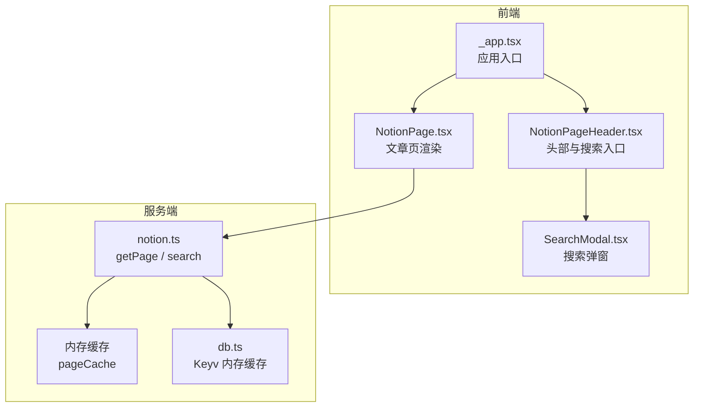
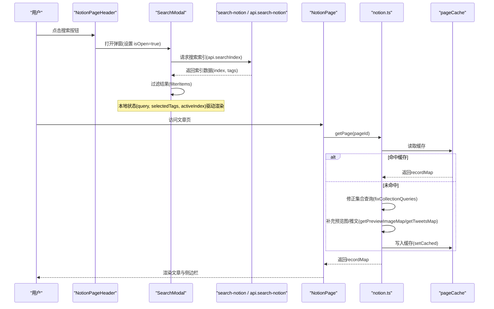
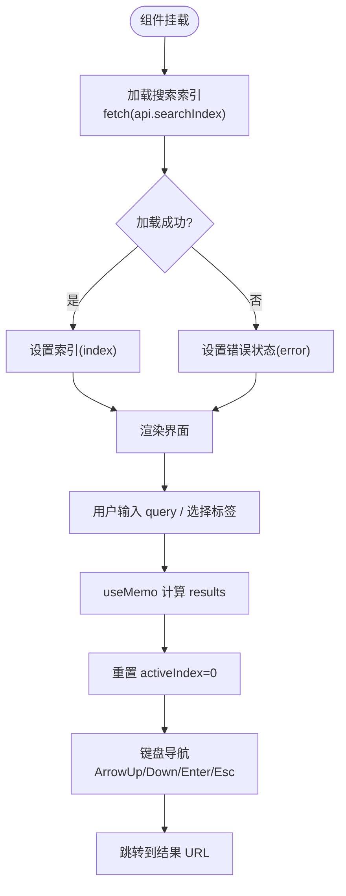
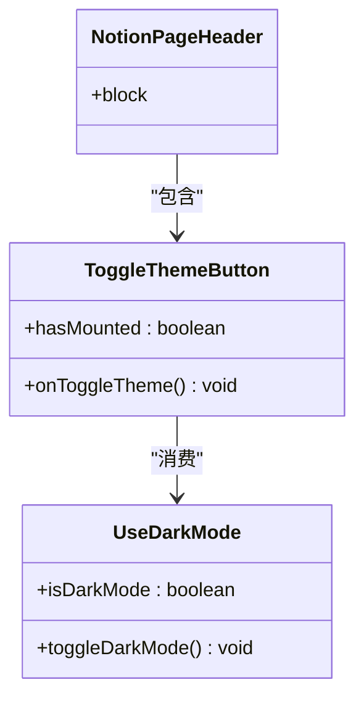
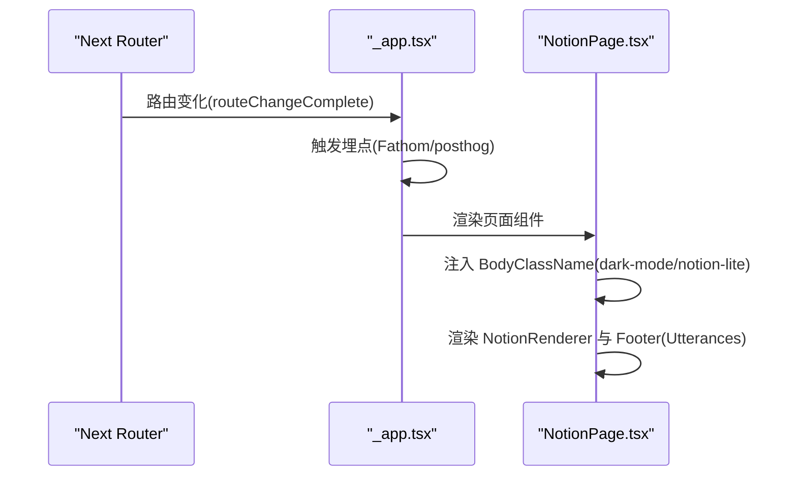
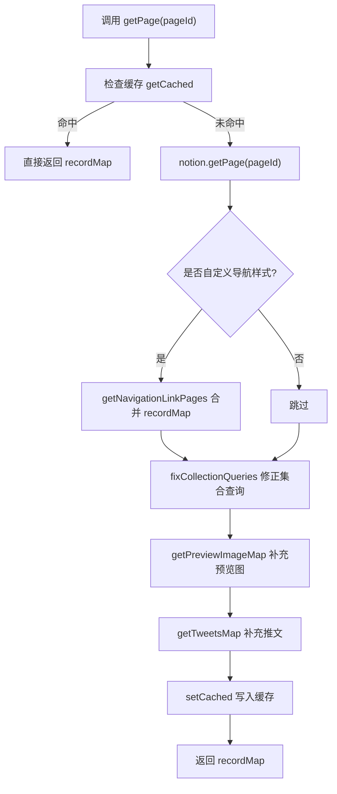
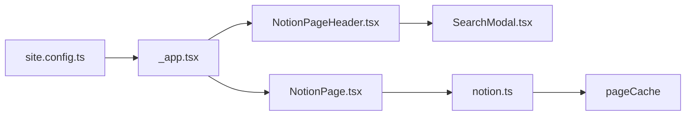

# 状态管理

<cite>
**本文引用的文件**   
- [SearchModal.tsx](file://components/SearchModal.tsx)
- [NotionPageHeader.tsx](file://components/NotionPageHeader.tsx)
- [use-dark-mode.ts](file://lib/use-dark-mode.ts)
- [NotionPage.tsx](file://components/NotionPage.tsx)
- [_app.tsx](file://pages/_app.tsx)
- [notion.ts](file://lib/notion.ts)
- [db.ts](file://lib/db.ts)
- [site.config.ts](file://site.config.ts)
- [oxlint.config.ts](file://oxlint.config.ts)
</cite>

## 目录
1. [引言](#引言)
2. [项目结构与状态边界](#项目结构与状态边界)
3. [核心状态模式与组件职责](#核心状态模式与组件职责)
4. [架构总览](#架构总览)
5. [关键组件深度分析](#关键组件深度分析)
6. [依赖关系与数据流](#依赖关系与数据流)
7. [性能优化与避免不必要重渲染](#性能优化与避免不必要重渲染)
8. [调试与排错指南](#调试与排错指南)
9. [结论](#结论)

## 引言
本文围绕 Next.js + React 的 Notion 博客站点，系统化梳理状态管理的模式与实践。重点覆盖：
- 组件内部状态、全局状态和持久化状态的划分与使用场景
- useState、useEffect 的使用模式，以及状态同步与更新机制
- 搜索状态、主题状态和用户交互状态的管理方式
- 状态流转图、组件通信模式和状态提升策略
- 状态调试工具与性能优化技巧，避免不必要的重渲染

本项目的状态管理以“局部状态为主、轻量全局能力为辅”为原则：大多数 UI 状态保留在组件内；主题等跨组件状态通过自定义 Hook 暴露；服务端数据通过缓存与增量静态再生（ISR）保证性能与一致性。

## 项目结构与状态边界
从仓库结构看，状态主要分布在以下位置：
- 组件内部状态：搜索弹窗、头部按钮、页面加载态等
- 全局能力：主题切换、路由事件埋点、客户端初始化
- 服务端状态：Notion 数据获取、集合查询修正、预览图与推文映射
- 内存缓存：页面级 recordMap 缓存、Keyv 内存数据库

**图表来源**
- [_app.tsx:41-68](file://pages/_app.tsx#L41-L68)
- [NotionPageHeader.tsx:78-128](file://components/NotionPageHeader.tsx#L78-L128)
- [SearchModal.tsx:57-106](file://components/SearchModal.tsx#L57-L106)
- [NotionPage.tsx:211-356](file://components/NotionPage.tsx#L211-L356)
- [notion.ts:161-213](file://lib/notion.ts#L161-L213)
- [db.ts:1-6](file://lib/db.ts#L1-L6)

**章节来源**
- [_app.tsx:41-68](file://pages/_app.tsx#L41-L68)
- [NotionPageHeader.tsx:78-128](file://components/NotionPageHeader.tsx#L78-L128)
- [SearchModal.tsx:57-106](file://components/SearchModal.tsx#L57-L106)
- [NotionPage.tsx:211-356](file://components/NotionPage.tsx#L211-L356)
- [notion.ts:161-213](file://lib/notion.ts#L161-L213)
- [db.ts:1-6](file://lib/db.ts#L1-L6)

## 核心状态模式与组件职责
- 组件内部状态
  - 搜索弹窗：查询词、标签筛选、结果集、加载与错误态、键盘导航索引、挂载标记
  - 头部按钮：主题开关显示、搜索弹窗打开关闭
- 全局状态
  - 主题状态：通过 useDarkMode 暴露 isDarkMode 与 toggleDarkMode，配合 BodyClassName 控制根节点类名
  - 应用级事件：路由变化时触发埋点统计
- 服务端状态
  - Notion 数据：getPage 返回 recordMap，包含块、集合、预览图等
  - 集合查询修正：根据视图 sort/filter 重新拉取并合并结果
  - 预览图与推文映射：按需补充 preview_images 与 tweets
- 内存缓存
  - pageCache：按 pageId 缓存 recordMap，TTL 为 60 秒，支持 stale-while-revalidate
  - Keyv：通用内存缓存，无需外部 Redis

**章节来源**
- [SearchModal.tsx:57-147](file://components/SearchModal.tsx#L57-L147)
- [NotionPageHeader.tsx:15-76](file://components/NotionPageHeader.tsx#L15-L76)
- [use-dark-mode.ts:1-11](file://lib/use-dark-mode.ts#L1-L11)
- [_app.tsx:41-68](file://pages/_app.tsx#L41-L68)
- [notion.ts:19-55](file://lib/notion.ts#L19-L55)
- [notion.ts:95-159](file://lib/notion.ts#L95-L159)
- [notion.ts:161-213](file://lib/notion.ts#L161-L213)
- [db.ts:1-6](file://lib/db.ts#L1-L6)

## 架构总览
下图展示从用户交互到数据渲染的状态流：

**图表来源**
- [NotionPageHeader.tsx:37-76](file://components/NotionPageHeader.tsx#L37-L76)
- [SearchModal.tsx:80-111](file://components/SearchModal.tsx#L80-L111)
- [notion.ts:161-213](file://lib/notion.ts#L161-L213)
- [notion.ts:95-159](file://lib/notion.ts#L95-L159)

## 关键组件深度分析

### 搜索状态管理（SearchModal）
SearchModal 是典型的多状态组合示例，涵盖：
- 数据加载：index、isLoading、error
- 用户输入：query、selectedTags
- 交互辅助：activeIndex、mounted
- 计算派生：results（useMemo）
- 副作用：挂载后聚焦、首次加载索引、重置 activeIndex

**图表来源**
- [SearchModal.tsx:57-147](file://components/SearchModal.tsx#L57-L147)
- [SearchModal.tsx:108-115](file://components/SearchModal.tsx#L108-L115)

**章节来源**
- [SearchModal.tsx:57-147](file://components/SearchModal.tsx#L57-L147)

### 主题状态管理（use-dark-mode 与 NotionPageHeader）
主题状态通过 useDarkMode 封装，提供 isDarkMode 与 toggleDarkMode。头部 ToggleThemeButton 使用 hasMounted 避免 SSR 闪烁，并通过 useCallback 稳定回调引用。

**图表来源**
- [use-dark-mode.ts:1-11](file://lib/use-dark-mode.ts#L1-L11)
- [NotionPageHeader.tsx:15-35](file://components/NotionPageHeader.tsx#L15-L35)

**章节来源**
- [use-dark-mode.ts:1-11](file://lib/use-dark-mode.ts#L1-L11)
- [NotionPageHeader.tsx:15-35](file://components/NotionPageHeader.tsx#L15-L35)

### 页面渲染与全局上下文（NotionPage 与 _app）
NotionPage 负责文章渲染、SEO 元信息、暗黑模式注入、评论组件挂载等；_app 负责应用级初始化、路由事件监听与第三方埋点。

**图表来源**
- [_app.tsx:41-68](file://pages/_app.tsx#L41-L68)
- [NotionPage.tsx:301-356](file://components/NotionPage.tsx#L301-L356)

**章节来源**
- [_app.tsx:41-68](file://pages/_app.tsx#L41-L68)
- [NotionPage.tsx:301-356](file://components/NotionPage.tsx#L301-L356)

### 服务端数据与缓存（notion.ts）
notion.ts 实现页面数据获取、集合查询修正、预览图与推文映射，并使用内存缓存 pageCache 提高性能与容错。

**图表来源**
- [notion.ts:161-213](file://lib/notion.ts#L161-L213)
- [notion.ts:57-81](file://lib/notion.ts#L57-L81)
- [notion.ts:95-159](file://lib/notion.ts#L95-L159)

**章节来源**
- [notion.ts:19-55](file://lib/notion.ts#L19-L55)
- [notion.ts:95-159](file://lib/notion.ts#L95-L159)
- [notion.ts:161-213](file://lib/notion.ts#L161-L213)

## 依赖关系与数据流
- 组件耦合
  - NotionPageHeader 依赖 useDarkMode 与 SearchModal
  - NotionPage 依赖 useDarkMode、NotionPageHeader、Footer、Utterances
  - SearchModal 依赖 Next Router 与搜索索引 API
- 数据流
  - 客户端：用户操作 → 组件状态更新 → 派生状态计算 → 渲染
  - 服务端：ISR 构建 → notion.ts 获取数据 → 缓存 → 返回 props
- 配置与常量
  - site.config.ts 定义站点信息与 ISR revalidateSeconds
  - _app.tsx 根据配置启用 Vercel Analytics/SpeedInsights 与埋点

**图表来源**
- [site.config.ts:1-78](file://site.config.ts#L1-L78)
- [_app.tsx:41-68](file://pages/_app.tsx#L41-L68)
- [NotionPageHeader.tsx:78-128](file://components/NotionPageHeader.tsx#L78-L128)
- [SearchModal.tsx:57-106](file://components/SearchModal.tsx#L57-L106)
- [NotionPage.tsx:211-356](file://components/NotionPage.tsx#L211-L356)
- [notion.ts:161-213](file://lib/notion.ts#L161-L213)

**章节来源**
- [site.config.ts:1-78](file://site.config.ts#L1-L78)
- [_app.tsx:41-68](file://pages/_app.tsx#L41-L68)
- [NotionPageHeader.tsx:78-128](file://components/NotionPageHeader.tsx#L78-L128)
- [SearchModal.tsx:57-106](file://components/SearchModal.tsx#L57-L106)
- [NotionPage.tsx:211-356](file://components/NotionPage.tsx#L211-L356)
- [notion.ts:161-213](file://lib/notion.ts#L161-L213)

## 性能优化与避免不必要重渲染
- 使用 useMemo 缓存派生数据
  - SearchModal.results 基于 index/query/selectedTags 计算，避免每次渲染重复过滤
  - NotionPage.siteMapPageUrl 与 pageAside 使用 useMemo 减少子树重渲染
- 使用 useCallback 稳定回调引用
  - SearchModal.toggleTag/goToResult/onKeyDown 使用 useCallback，降低子组件因函数引用变化导致的重渲染
  - NotionPageHeader.onToggleTheme/onOpen/onClose 使用 useCallback
- 条件渲染与 Suspense
  - NotionPage 对可选组件使用 dynamic 与 ssr:false，避免客户端不兼容
  - Tweet 使用 Suspense 包裹，提升首屏体验
- 服务端缓存与 ISR
  - notion.ts 的 pageCache TTL 为 60 秒，降低 Notion API 压力
  - pages/[pageId].tsx 使用 revalidateSeconds 控制增量再生频率
- 避免 SSR 闪烁
  - ToggleThemeButton 使用 hasMounted 标记，确保仅在客户端渲染图标
- 调试对象挂载
  - NotionPage 在开发环境将 window.pageId/window.recordMap/window.block 挂到全局，便于控制台调试

**章节来源**
- [SearchModal.tsx:108-147](file://components/SearchModal.tsx#L108-L147)
- [NotionPage.tsx:225-253](file://components/NotionPage.tsx#L225-L253)
- [NotionPage.tsx:144-153](file://components/NotionPage.tsx#L144-L153)
- [NotionPage.tsx:265-271](file://components/NotionPage.tsx#L265-L271)
- [notion.ts:19-55](file://lib/notion.ts#L19-L55)
- [pages/[pageId].tsx:8-16](file://pages/[pageId].tsx#L8-L16)

## 调试与排错指南
- 常见问题
  - 搜索索引加载失败：SearchModal 会设置 error 状态并显示失败提示；检查 api.searchIndex 是否可访问
  - 集合排序/过滤不一致：notion.ts 的 fixCollectionQueries 会重新执行集合查询并合并结果；若仍异常，检查视图 query2.sort/filter 是否正确
  - SSR 闪烁：ToggleThemeButton 的 hasMounted 逻辑确保仅在客户端渲染图标；确认 useEffect 仅用于副作用
  - 路由埋点未触发：_app.tsx 中 router.events.on('routeChangeComplete') 需正确注册与移除
- 调试建议
  - 使用 NotionPage 挂载的全局对象（window.pageId/window.recordMap/window.block）快速定位当前页面数据
  - 在浏览器控制台查看搜索结果过滤逻辑与 activeIndex 变化
  - 通过 site.config.ts 的 revalidateSeconds 调整 ISR 刷新频率，平衡新鲜度与性能

**章节来源**
- [SearchModal.tsx:80-106](file://components/SearchModal.tsx#L80-L106)
- [notion.ts:95-159](file://lib/notion.ts#L95-L159)
- [NotionPageHeader.tsx:15-35](file://components/NotionPageHeader.tsx#L15-L35)
- [_app.tsx:41-68](file://pages/_app.tsx#L41-L68)
- [NotionPage.tsx:265-271](file://components/NotionPage.tsx#L265-L271)
- [site.config.ts:58-61](file://site.config.ts#L58-L61)

## 结论
本项目采用“局部状态优先、全局能力最小化”的状态管理模式：
- 组件内部状态负责 UI 交互与临时数据
- 主题等跨组件状态通过自定义 Hook 暴露，保持简单与可测试
- 服务端数据通过缓存与 ISR 保证性能与稳定性
- 通过 useMemo/useCallback/Suspense/dynamic 等手段优化渲染性能
- 借助全局调试对象与日志输出，快速定位问题

该模式在中小型项目中具备良好的可读性与可维护性，同时为后续扩展（如引入更复杂的全局状态库）预留了空间。