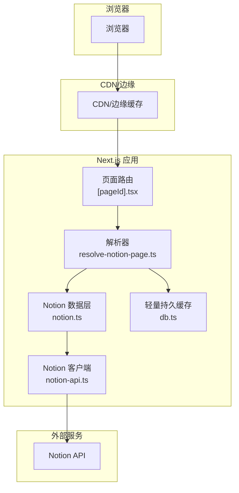
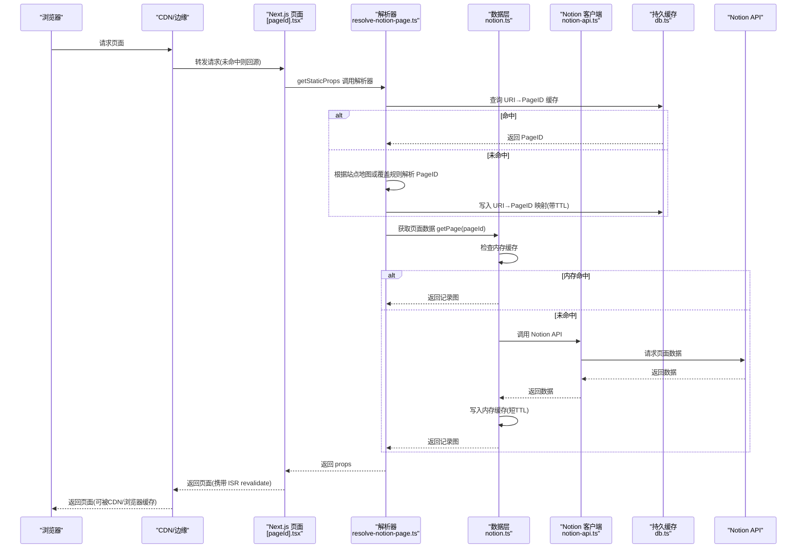
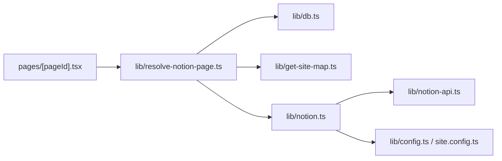
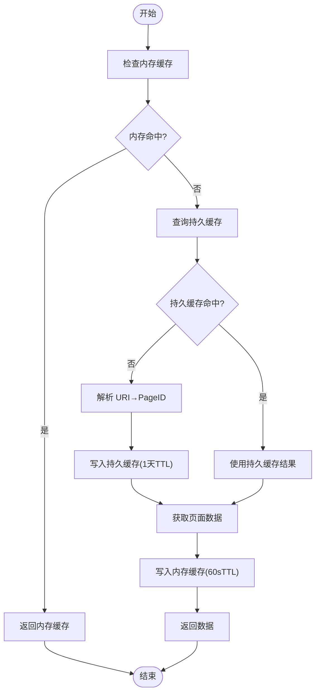

# 缓存策略

<cite>
**本文引用的文件**   
- [next.config.js](file://next.config.js)
- [site.config.ts](file://site.config.ts)
- [lib/notion-api.ts](file://lib/notion-api.ts)
- [lib/notion.ts](file://lib/notion.ts)
- [lib/resolve-notion-page.ts](file://lib/resolve-notion-page.ts)
- [pages/[pageId].tsx](file://pages/[pageId].tsx)
- [lib/db.ts](file://lib/db.ts)
- [pages/robots.txt.tsx](file://pages/robots.txt.tsx)
- [pages/sitemap.xml.tsx](file://pages/sitemap.xml.tsx)
</cite>

## 目录
1. [简介](#简介)
2. [项目结构与缓存定位](#项目结构与缓存定位)
3. [核心组件与职责](#核心组件与职责)
4. [架构总览](#架构总览)
5. [详细组件分析](#详细组件分析)
6. [依赖关系分析](#依赖关系分析)
7. [性能与命中率优化](#性能与命中率优化)
8. [ISR 增量静态再生配置与使用](#isr-增量静态再生配置与使用)
9. [缓存键、过期与失效机制](#缓存键过期与失效机制)
10. [缓存预热与更新策略](#缓存预热与更新策略)
11. [监控与调试指南](#监控与调试指南)
12. [结论](#结论)

## 简介
本缓存策略文档面向 Next.js + Notion 博客站点，系统性说明多级缓存的设计与实现，包括：
- 内存缓存（进程内）用于页面数据聚合与容灾降级
- 浏览器与 CDN 缓存通过响应头控制
- 服务器端轻量持久缓存用于 URI 到 Notion Page ID 的映射
- ISR（增量静态再生）控制页面重新生成频率
- 缓存键生成、过期时间、失效与回退策略
- 缓存预热与更新方案
- 缓存监控与调试方法

该设计在保障高可用性的同时，显著降低对 Notion API 的请求压力，提升首屏加载速度与整体稳定性。

## 项目结构与缓存定位
本项目采用“按功能域组织”的结构，缓存相关逻辑主要分布在以下位置：
- 应用层配置：Next.js 构建与图片优化配置
- 站点配置：ISR 重验证间隔等站点级参数
- 数据访问层：Notion API 客户端封装、页面数据获取与内存缓存
- 路由层：ISR 配置、SSG 路径与 fallback 行为
- 辅助存储：URI 到 Page ID 的轻量持久缓存
- 公共资源：robots.txt 与 sitemap.xml 的 CDN/浏览器缓存头

**图表来源**
- [pages/[pageId].tsx:8-31](file://pages/[pageId].tsx#L8-L31)
- [lib/resolve-notion-page.ts:11-84](file://lib/resolve-notion-page.ts#L11-L84)
- [lib/notion.ts:161-214](file://lib/notion.ts#L161-L214)
- [lib/notion-api.ts:1-20](file://lib/notion-api.ts#L1-L20)
- [lib/db.ts:1-7](file://lib/db.ts#L1-L7)

**章节来源**
- [next.config.js:1-43](file://next.config.js#L1-L43)
- [site.config.ts:58-61](file://site.config.ts#L58-L61)
- [pages/[pageId].tsx:8-31](file://pages/[pageId].tsx#L8-L31)

## 核心组件与职责
- 页面路由层：定义 ISR 的重验证间隔与 SSG 路径生成策略
- 解析器层：负责 URL 到 Notion Page ID 的解析与缓存命中
- 数据层：封装 Notion API 调用，提供内存缓存与容灾降级
- 持久缓存层：基于 Keyv 的轻量内存式持久缓存，用于 URI→PageID 映射
- 站点配置：集中管理 ISR 重验证间隔等关键参数
- 公共接口：为 robots.txt 和 sitemap.xml 设置合适的缓存头

**章节来源**
- [pages/[pageId].tsx:8-31](file://pages/[pageId].tsx#L8-L31)
- [lib/resolve-notion-page.ts:11-84](file://lib/resolve-notion-page.ts#L11-L84)
- [lib/notion.ts:19-214](file://lib/notion.ts#L19-L214)
- [lib/db.ts:1-7](file://lib/db.ts#L1-L7)
- [site.config.ts:58-61](file://site.config.ts#L58-L61)

## 架构总览
下图展示从浏览器请求到最终返回页面的完整缓存链路，包含浏览器、CDN、Next.js 应用、Notion API 以及内部缓存层。

**图表来源**
- [pages/[pageId].tsx:8-31](file://pages/[pageId].tsx#L8-L31)
- [lib/resolve-notion-page.ts:32-65](file://lib/resolve-notion-page.ts#L32-L65)
- [lib/notion.ts:161-214](file://lib/notion.ts#L161-L214)
- [lib/notion-api.ts:1-20](file://lib/notion-api.ts#L1-L20)
- [lib/db.ts:1-7](file://lib/db.ts#L1-L7)

## 详细组件分析

### 页面路由层（ISR 与 SSG）
- 使用 `getStaticProps` 返回 `revalidate` 字段，启用 ISR 增量静态再生
- `getStaticPaths` 返回空路径并设置 `fallback` 行为：开发环境为 true，生产环境为 blocking
- 重验证间隔由站点配置中的 `revalidateSeconds` 决定

关键点：
- ISR 允许在不重建全部页面的情况下按需重新生成页面
- 通过 `revalidate` 控制后台重新生成的频率，平衡新鲜度与成本
- `fallback` 在生产环境使用 blocking，确保首次访问时能正确生成页面

**章节来源**
- [pages/[pageId].tsx:8-31](file://pages/[pageId].tsx#L8-L31)
- [site.config.ts:58-61](file://site.config.ts#L58-L61)

### 解析器层（URL 到 Notion Page ID 解析与缓存）
- 优先尝试将 rawPageId 解析为 Notion Page ID
- 若无法解析，则检查站点配置的 URL 覆盖或补充映射
- 使用 `db.get` 查询 URI→PageID 的持久缓存，TTL 为一天
- 若仍无法解析，则根据站点地图查找 canonical 映射
- 成功解析后，调用 `getPage` 获取页面数据，并将 URI→PageID 映射写回持久缓存

关键点：
- 持久缓存用于减少重复解析开销
- 404 场景不缓存，避免错误映射长期生效
- 解析失败会返回明确的错误信息

**章节来源**
- [lib/resolve-notion-page.ts:11-84](file://lib/resolve-notion-page.ts#L11-L84)

### 数据层（Notion 页面数据与内存缓存）
- 提供 `getPage(pageId)` 函数，封装 Notion API 调用
- 内置内存缓存，TTL 为 60 秒，用于吸收突发流量与 Notion 抖动
- 当 Notion API 不可用时，回退到陈旧缓存（stale-while-revalidate 模式），保证可用性
- 处理导航链接页面数据的合并与集合查询修正
- 可选地注入预览图片与推文映射

关键点：
- 内存缓存键为 pageId，值包含 recordMap 与过期时间
- 容灾降级策略显著提升鲁棒性
- 并发控制用于导航链接与集合查询，避免过载

**章节来源**
- [lib/notion.ts:19-214](file://lib/notion.ts#L19-L214)

### 持久缓存层（URI→PageID 映射）
- 基于 Keyv 的轻量内存式持久缓存，无需 Redis
- 用于存储 URI→PageID 映射，TTL 为一天
- 读写异常时输出警告日志，不影响主流程

关键点：
- 简单可靠，适合小规模站点
- 可通过替换后端存储扩展为 Redis 等

**章节来源**
- [lib/db.ts:1-7](file://lib/db.ts#L1-L7)
- [lib/resolve-notion-page.ts:32-65](file://lib/resolve-notion-page.ts#L32-L65)

### 公共接口缓存头（robots.txt 与 sitemap.xml）
- robots.txt：设置 `Cache-Control` 为 `public, max-age=0, s-maxage=86400, stale-while-revalidate=86400`，CDN 缓存一天，浏览器可立即重验证
- sitemap.xml：设置 `Cache-Control` 为 `public, max-age=28800, stale-while-revalidate=28800`，CDN 缓存八小时

关键点：
- 合理区分浏览器与 CDN 缓存策略
- 使用 stale-while-revalidate 提升用户体验与后端负载平衡

**章节来源**
- [pages/robots.txt.tsx:17-21](file://pages/robots.txt.tsx#L17-L21)
- [pages/sitemap.xml.tsx:20-24](file://pages/sitemap.xml.tsx#L20-L24)

## 依赖关系分析
- 页面路由依赖解析器与站点配置
- 解析器依赖持久缓存与站点地图
- 数据层依赖 Notion 客户端与站点配置
- 持久缓存独立于业务逻辑，提供通用 KV 能力

**图表来源**
- [pages/[pageId].tsx:1-36](file://pages/[pageId].tsx#L1-L36)
- [lib/resolve-notion-page.ts:1-85](file://lib/resolve-notion-page.ts#L1-L85)
- [lib/notion.ts:1-219](file://lib/notion.ts#L1-L219)
- [lib/notion-api.ts:1-20](file://lib/notion-api.ts#L1-L20)
- [lib/db.ts:1-7](file://lib/db.ts#L1-L7)

**章节来源**
- [pages/[pageId].tsx:1-36](file://pages/[pageId].tsx#L1-L36)
- [lib/resolve-notion-page.ts:1-85](file://lib/resolve-notion-page.ts#L1-L85)
- [lib/notion.ts:1-219](file://lib/notion.ts#L1-L219)

## 性能与命中率优化
- 内存缓存 TTL 设置为 60 秒，快速吸收突发流量与 Notion 抖动
- 持久缓存 TTL 设置为一天，减少 URI→PageID 解析开销
- ISR revalidate 设置为 86400 秒（一天），平衡内容新鲜度与构建成本
- CDN 与浏览器缓存头合理配置，减少回源请求
- 并发控制用于导航链接与集合查询，避免后端过载
- 容灾降级策略在 Notion 不可用时返回陈旧缓存，保证可用性

建议指标：
- 内存缓存命中率：目标 > 80%
- 持久缓存命中率：目标 > 90%
- ISR 触发频率：根据内容更新频率调整
- CDN 命中率：目标 > 95%
- 平均响应时间：目标 < 200ms（含 CDN）

**章节来源**
- [lib/notion.ts:29-55](file://lib/notion.ts#L29-L55)
- [lib/resolve-notion-page.ts:32-65](file://lib/resolve-notion-page.ts#L32-L65)
- [site.config.ts:58-61](file://site.config.ts#L58-L61)
- [pages/robots.txt.tsx:17-21](file://pages/robots.txt.tsx#L17-L21)
- [pages/sitemap.xml.tsx:20-24](file://pages/sitemap.xml.tsx#L20-L24)

## ISR 增量静态再生配置与使用
- 在页面路由中通过 `getStaticProps` 返回 `revalidate` 字段启用 ISR
- `revalidateSeconds` 由站点配置统一控制，默认一天
- `getStaticPaths` 返回空路径，配合 `fallback` 行为：
  - 开发环境：true，便于本地调试
  - 生产环境：blocking，确保首次访问时正确生成页面

最佳实践：
- 根据内容更新频率调整 `revalidateSeconds`
- 对于高频更新内容，可适当缩短 revalidate 时间
- 对于低频内容，可延长 revalidate 时间以降低构建成本

**章节来源**
- [pages/[pageId].tsx:8-31](file://pages/[pageId].tsx#L8-L31)
- [site.config.ts:58-61](file://site.config.ts#L58-L61)

## 缓存键、过期与失效机制
- 内存缓存键：pageId
- 内存缓存过期：60 秒
- 持久缓存键：`uri-to-page-id:${domain}:${environment}:${rawPageId}`
- 持久缓存过期：86400000 毫秒（一天）
- 失效机制：
  - 内存缓存到期后自动失效
  - 持久缓存到期后自动失效
  - 404 场景不缓存 URI→PageID 映射

**图表来源**
- [lib/notion.ts:38-55](file://lib/notion.ts#L38-L55)
- [lib/resolve-notion-page.ts:32-65](file://lib/resolve-notion-page.ts#L32-L65)

**章节来源**
- [lib/notion.ts:38-55](file://lib/notion.ts#L38-L55)
- [lib/resolve-notion-page.ts:32-65](file://lib/resolve-notion-page.ts#L32-L65)

## 缓存预热与更新策略
- 预热策略：
  - 部署后触发 IndexNow 提交站点地图，加速搜索引擎收录
  - 可结合 Vercel Cron 定期调用 `/api/indexnow` 接口
- 更新策略：
  - 通过 ISR revalidate 控制页面重新生成频率
  - 内存缓存短 TTL 确保数据新鲜度
  - 持久缓存长 TTL 减少解析开销

注意事项：
- 预热不应频繁触发，避免不必要的 API 调用
- 更新策略应与内容发布流程对齐

**章节来源**
- [pages/api/indexnow.ts:1-52](file://pages/api/indexnow.ts#L1-L52)
- [site.config.ts:58-61](file://site.config.ts#L58-L61)

## 监控与调试指南
- 缓存状态查看：
  - 检查内存缓存是否命中（通过日志与性能分析工具）
  - 检查持久缓存是否命中（通过日志与性能分析工具）
  - 检查 CDN 命中率（通过 Vercel Analytics 或 CDN 控制台）
- 性能分析工具：
  - Vercel Web Analytics 与 Speed Insights 已启用
  - 可使用浏览器开发者工具查看网络请求与缓存头
- 调试建议：
  - 在开发环境启用 `fallback: true`，便于本地调试
  - 在生产环境使用 `fallback: 'blocking'`，确保首次访问正确生成页面
  - 关注 Notion API 错误日志，必要时调整重试策略

**章节来源**
- [site.config.ts:44-46](file://site.config.ts#L44-L46)
- [pages/[pageId].tsx:26-31](file://pages/[pageId].tsx#L26-L31)
- [lib/notion-api.ts:9-18](file://lib/notion-api.ts#L9-L18)

## 结论
本缓存策略通过多层缓存机制，有效提升了站点的性能与稳定性：
- 内存缓存吸收突发流量与 Notion 抖动
- 持久缓存减少 URI→PageID 解析开销
- ISR 控制页面重新生成频率，平衡新鲜度与成本
- CDN 与浏览器缓存头优化网络传输
- 容灾降级策略保障高可用性

建议持续监控缓存命中率与性能指标，并根据实际业务需求调整缓存策略与 ISR 配置。