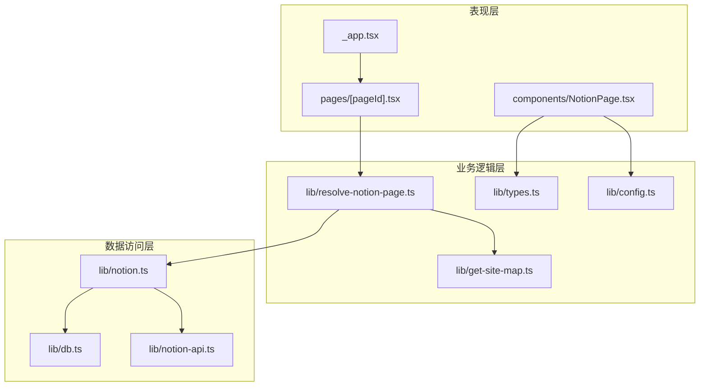
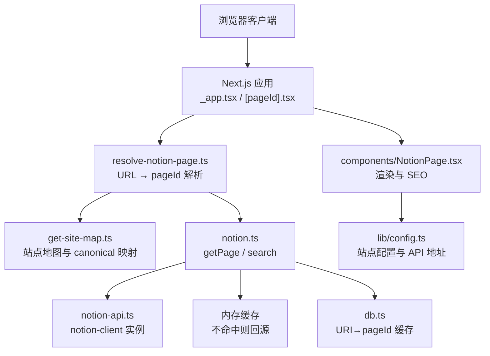
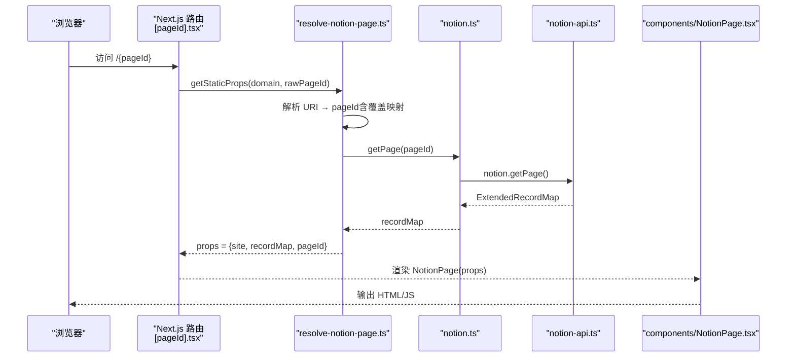
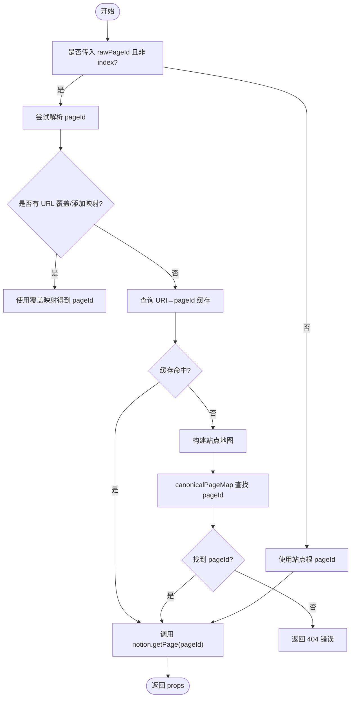
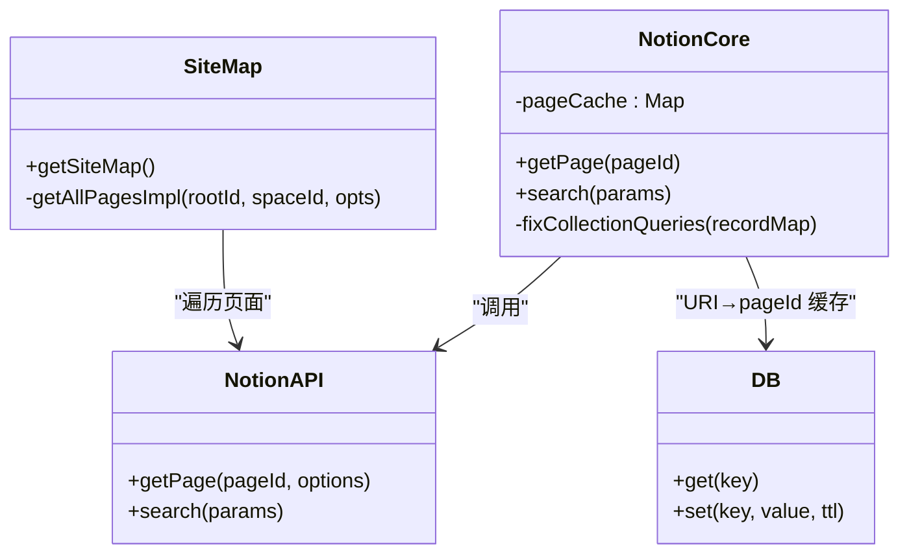
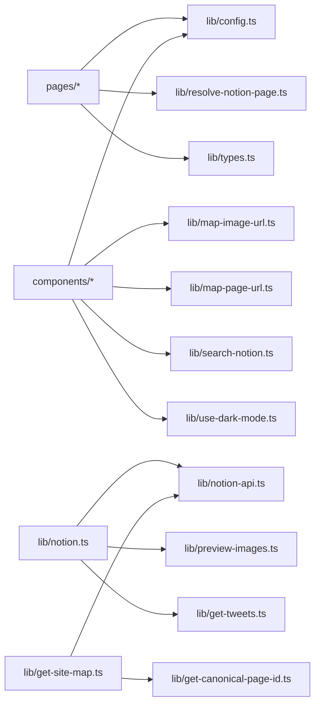

# 整体架构设计

<cite>
**本文引用的文件**   
- [readme.md](file://readme.md)
- [package.json](file://package.json)
- [next.config.js](file://next.config.js)
- [site.config.ts](file://site.config.ts)
- [lib/config.ts](file://lib/config.ts)
- [lib/types.ts](file://lib/types.ts)
- [lib/notion-api.ts](file://lib/notion-api.ts)
- [lib/notion.ts](file://lib/notion.ts)
- [lib/resolve-notion-page.ts](file://lib/resolve-notion-page.ts)
- [lib/get-site-map.ts](file://lib/get-site-map.ts)
- [lib/db.ts](file://lib/db.ts)
- [pages/_app.tsx](file://pages/_app.tsx)
- [pages/[pageId].tsx](file://pages/[pageId].tsx)
- [components/NotionPage.tsx](file://components/NotionPage.tsx)
</cite>

## 目录
1. [引言](#引言)
2. [项目结构](#项目结构)
3. [核心组件](#核心组件)
4. [架构总览](#架构总览)
5. [详细组件分析](#详细组件分析)
6. [依赖关系分析](#依赖关系分析)
7. [性能与缓存特性](#性能与缓存特性)
8. [故障排查指南](#故障排查指南)
9. [结论](#结论)

## 引言
本项目是一个基于 Next.js 与 Notion 的内容驱动型博客站点。内容在 Notion 中编辑，通过 Notion API 拉取数据，并在构建期或请求期渲染为静态页面；同时支持增量静态再生（ISR）以平衡更新频率与部署成本。系统采用分层架构：表现层由 React 组件构成，业务逻辑集中在 lib 模块，数据访问统一封装 Notion API 调用。关键架构决策包括：
- 使用 Next.js Pages Router 与 ISR，实现“构建时生成 + 按需回源”的混合模式。
- 组件化设计：将 Notion 内容渲染、SEO、导航、评论等能力拆分为独立组件。
- 配置驱动：站点信息、导航、URL 映射、分析工具开关等均通过 site.config.ts 与 lib/config.ts 集中管理。
- 可插拔的外部服务：分析、搜索、预览图、推文嵌入等均可按配置启用或禁用。

本设计文档面向开发者，提供从高层到代码级的系统视角，帮助快速理解边界、职责与扩展点。

**章节来源**
- [readme.md:9-17](file://readme.md#L9-L17)
- [readme.md:32-48](file://readme.md#L32-L48)
- [readme.md:81-96](file://readme.md#L81-L96)

## 项目结构
仓库采用清晰的三层组织方式：
- pages：Next.js 路由入口，包含页面与 API 端点。
- components：React 表现层组件，负责 UI 与交互。
- lib：业务与数据访问层，封装 Notion 数据获取、站点地图、配置解析、类型定义等。

**图表来源**
- [pages/_app.tsx:1-91](file://pages/_app.tsx#L1-L91)
- [pages/[pageId].tsx:1-36](file://pages/[pageId].tsx#L1-L36)
- [components/NotionPage.tsx:1-357](file://components/NotionPage.tsx#L1-L357)
- [lib/config.ts:1-224](file://lib/config.ts#L1-L224)
- [lib/resolve-notion-page.ts:1-85](file://lib/resolve-notion-page.ts#L1-L85)
- [lib/get-site-map.ts:1-107](file://lib/get-site-map.ts#L1-L107)
- [lib/notion-api.ts:1-20](file://lib/notion-api.ts#L1-L20)
- [lib/notion.ts:1-219](file://lib/notion.ts#L1-L219)
- [lib/db.ts:1-7](file://lib/db.ts#L1-L7)

**章节来源**
- [readme.md:81-92](file://readme.md#L81-L92)

## 核心组件
- 应用入口与全局样式/分析初始化：_app.tsx 负责注入全局样式、初始化第三方分析脚本，并挂载 Vercel Analytics 与 Speed Insights。
- 动态页面路由：[pageId].tsx 使用 getStaticProps 与 getStaticPaths 配合 ISR，根据 domain 与 rawPageId 解析 Notion 页面，返回 props 给 NotionPage 渲染。
- 内容渲染组件：NotionPage.tsx 组合 NotionRenderer 与自定义 Header/Footer/SideBar，处理 SEO、暗色模式、轻量模式、评论等。
- 配置中心：site.config.ts 暴露站点级配置；lib/config.ts 聚合环境变量与站点配置，导出统一的常量与 API 地址。
- 数据访问层：notion-api.ts 封装 notion-client 实例，设置重试策略与超时；notion.ts 提供 getPage/search 方法，内置内存缓存与集合查询修正；get-site-map.ts 构建站点地图与 canonical URL 映射。
- 类型定义：types.ts 定义 PageProps、Site、SiteMap、CanonicalPageMap 等跨层共享类型。

**章节来源**
- [pages/_app.tsx:1-91](file://pages/_app.tsx#L1-L91)
- [pages/[pageId].tsx:1-36](file://pages/[pageId].tsx#L1-L36)
- [components/NotionPage.tsx:1-357](file://components/NotionPage.tsx#L1-L357)
- [site.config.ts:1-78](file://site.config.ts#L1-L78)
- [lib/config.ts:1-224](file://lib/config.ts#L1-L224)
- [lib/notion-api.ts:1-20](file://lib/notion-api.ts#L1-L20)
- [lib/notion.ts:1-219](file://lib/notion.ts#L1-L219)
- [lib/get-site-map.ts:1-107](file://lib/get-site-map.ts#L1-L107)
- [lib/types.ts:1-78](file://lib/types.ts#L1-L78)

## 架构总览
系统采用“表现层 — 业务逻辑层 — 数据访问层”的分层架构，结合 Next.js 的 SSG/ISR 能力，形成“构建期静态生成 + 请求期增量再生”的数据流。

**图表来源**
- [pages/_app.tsx:1-91](file://pages/_app.tsx#L1-L91)
- [pages/[pageId].tsx:1-36](file://pages/[pageId].tsx#L1-L36)
- [lib/resolve-notion-page.ts:1-85](file://lib/resolve-notion-page.ts#L1-L85)
- [lib/get-site-map.ts:1-107](file://lib/get-site-map.ts#L1-L107)
- [lib/notion.ts:1-219](file://lib/notion.ts#L1-L219)
- [lib/notion-api.ts:1-20](file://lib/notion-api.ts#L1-L20)
- [lib/db.ts:1-7](file://lib/db.ts#L1-L7)
- [components/NotionPage.tsx:1-357](file://components/NotionPage.tsx#L1-L357)
- [lib/config.ts:1-224](file://lib/config.ts#L1-L224)

## 详细组件分析

### 表现层：React 组件与渲染流程
- _app.tsx 负责全局样式注入、第三方分析初始化（Fathom、PostHog、Vercel Analytics、Speed Insights、Clarity），以及路由变化时的埋点上报。
- [pageId].tsx 作为动态路由页，使用 getStaticProps 拉取 Notion 数据并通过 revalidateSeconds 控制 ISR 刷新周期；getStaticPaths 返回空路径，开发环境 fallback true，生产环境 fallback blocking，保证首次访问按需生成。
- NotionPage.tsx 是核心渲染组件，组合 NotionRenderer 与自定义 Header/Footer/SideBar，处理：
  - SEO 元数据（标题、描述、社交图片、canonical URL）。
  - 暗色模式与轻量模式（oembed 场景）。
  - 代码高亮、公式、PDF、Modal、Collection 等可选子组件的动态加载。
  - 评论组件（Utterances）与站点 Footer。

**图表来源**
- [pages/[pageId].tsx:1-36](file://pages/[pageId].tsx#L1-L36)
- [lib/resolve-notion-page.ts:1-85](file://lib/resolve-notion-page.ts#L1-L85)
- [lib/notion.ts:1-219](file://lib/notion.ts#L1-L219)
- [lib/notion-api.ts:1-20](file://lib/notion-api.ts#L1-L20)
- [components/NotionPage.tsx:1-357](file://components/NotionPage.tsx#L1-L357)

**章节来源**
- [pages/_app.tsx:1-91](file://pages/_app.tsx#L1-L91)
- [pages/[pageId].tsx:1-36](file://pages/[pageId].tsx#L1-L36)
- [components/NotionPage.tsx:1-357](file://components/NotionPage.tsx#L1-L357)

### 业务逻辑层：配置与页面解析
- 配置中心
  - site.config.ts 暴露站点级配置（根 Notion 页面 ID、域名、作者、描述、SEO、分析开关、ISR 间隔、导航风格等）。
  - lib/config.ts 聚合 site.config.ts 与环境变量，导出统一的常量（如 rootNotionPageId、domain、revalidateSeconds、api 地址等），并提供 URL 覆盖映射的清洗与反转逻辑。
- 页面解析
  - resolve-notion-page.ts 负责将用户友好的 URL 映射到 Notion pageId，优先检查配置覆盖与站点地图 canonical 映射，再调用 notion.ts 获取 recordMap，最后附加 ACL 权限信息。
  - 使用 db.ts 的 Keyv 内存缓存存储 URI→pageId 映射，TTL 为一天，减少重复解析开销。

**图表来源**
- [lib/resolve-notion-page.ts:1-85](file://lib/resolve-notion-page.ts#L1-L85)
- [lib/get-site-map.ts:1-107](file://lib/get-site-map.ts#L1-L107)
- [lib/db.ts:1-7](file://lib/db.ts#L1-L7)

**章节来源**
- [site.config.ts:1-78](file://site.config.ts#L1-L78)
- [lib/config.ts:1-224](file://lib/config.ts#L1-L224)
- [lib/resolve-notion-page.ts:1-85](file://lib/resolve-notion-page.ts#L1-L85)
- [lib/get-site-map.ts:1-107](file://lib/get-site-map.ts#L1-L107)
- [lib/db.ts:1-7](file://lib/db.ts#L1-L7)

### 数据访问层：Notion API 封装与缓存
- notion-api.ts 封装 notion-client 实例，配置重试策略（针对 408/429/5xx）、超时、User-Agent，提升稳定性。
- notion.ts 提供 getPage 与 search 方法：
  - 内置内存缓存（TTL 60s），在 Notion 不可用时降级为 stale-while-revalidate，避免全站 500。
  - 修复 collection 视图排序与过滤问题，确保渲染结果与 Notion 一致。
  - 可选增强：合并导航链接页面的 recordMap、注入预览图与推文数据。
- get-site-map.ts 遍历站点空间，构建 pageMap 与 canonicalPageMap，过滤未公开页面，并对 sitemap 进行短期缓存（5 分钟）。

**图表来源**
- [lib/notion-api.ts:1-20](file://lib/notion-api.ts#L1-L20)
- [lib/notion.ts:1-219](file://lib/notion.ts#L1-L219)
- [lib/get-site-map.ts:1-107](file://lib/get-site-map.ts#L1-L107)
- [lib/db.ts:1-7](file://lib/db.ts#L1-L7)

**章节来源**
- [lib/notion-api.ts:1-20](file://lib/notion-api.ts#L1-L20)
- [lib/notion.ts:1-219](file://lib/notion.ts#L1-L219)
- [lib/get-site-map.ts:1-107](file://lib/get-site-map.ts#L1-L107)

## 依赖关系分析
- 外部依赖
  - Next.js 16、React 19、TypeScript 7。
  - react-notion-x 8 及其依赖 notion-client、notion-types、notion-utils。
  - 分析与性能：@vercel/analytics、@vercel/speed-insights、fathom-client、posthog-js、clarity。
  - 内容渲染：katex、prismjs、react-tweet。
  - 缓存与并发：p-memoize、expiry-map、keyvhq/core。
- 内部依赖
  - pages 层依赖 lib 层的 config、resolve-notion-page、types。
  - components 层依赖 lib 层的 config、map-image-url、map-page-url、search-notion、use-dark-mode。
  - lib 层内部：notion.ts 依赖 notion-api.ts、config.ts、preview-images、get-tweets；get-site-map.ts 依赖 notion-api.ts、config.ts、get-canonical-page-id。

**图表来源**
- [pages/[pageId].tsx:1-36](file://pages/[pageId].tsx#L1-L36)
- [components/NotionPage.tsx:1-357](file://components/NotionPage.tsx#L1-L357)
- [lib/notion.ts:1-219](file://lib/notion.ts#L1-L219)
- [lib/get-site-map.ts:1-107](file://lib/get-site-map.ts#L1-L107)

**章节来源**
- [package.json:27-52](file://package.json#L27-L52)
- [package.json:54-66](file://package.json#L54-L66)

## 性能与缓存特性
- 静态生成与 ISR
  - 构建期：所有公开页面从 Notion 抓取并静态生成；若遭遇速率限制（HTTP 429），回退到缓存的站点地图。
  - 运行期：getStaticProps 返回 revalidateSeconds，默认 86400 秒（每天一次），降低函数调用成本。
- 多级缓存
  - 内存缓存（notion.ts）：记录每个 pageId 的 recordMap，TTL 60s，用于吸收突发流量与短暂 Notion 抖动。
  - URI→pageId 缓存（db.ts）：Keyv 内存缓存，TTL 一天，加速 URL 解析。
  - 站点地图缓存（get-site-map.ts）：ExpiryMap 5 分钟，避免频繁遍历空间。
- 网络优化
  - notion-api.ts 配置重试与超时，提高对 429/5xx 的容错能力。
  - next.config.js 允许远程图片域名，开启 AVIF/WebP 格式，提升图片加载性能。
- 组件懒加载
  - NotionPage.tsx 对 Code、Collection、Equation、Pdf、Modal 等使用 dynamic 导入，减少首屏体积。

**章节来源**
- [readme.md:94-96](file://readme.md#L94-L96)
- [pages/[pageId].tsx:1-36](file://pages/[pageId].tsx#L1-L36)
- [lib/notion.ts:1-219](file://lib/notion.ts#L1-L219)
- [lib/db.ts:1-7](file://lib/db.ts#L1-L7)
- [lib/get-site-map.ts:1-107](file://lib/get-site-map.ts#L1-L107)
- [lib/notion-api.ts:1-20](file://lib/notion-api.ts#L1-L20)
- [next.config.js:1-43](file://next.config.js#L1-L43)
- [components/NotionPage.tsx:43-142](file://components/NotionPage.tsx#L43-L142)

## 故障排查指南
- Notion API 不稳定或限流
  - 现象：构建期 429 或运行时 5xx。
  - 处理：notion-api.ts 已配置重试与超时；notion.ts 在失败时回退到 stale 缓存，避免全站 500。
  - 建议：适当增大 revalidateSeconds，减少函数调用；检查 NOTION_API_TOKEN 与 NOTION_API_BASE_URL。
- URL 无法解析到 pageId
  - 现象：访问 /foo 返回 404。
  - 处理：检查 site.config.ts 的 pageUrlOverrides/pageUrlAdditions；确认站点地图 canonicalPageMap 是否正确；查看 URI→pageId 缓存是否过期。
- 集合视图排序/过滤不一致
  - 现象：渲染顺序与 Notion 不一致。
  - 处理：notion.ts 的 fixCollectionQueries 会重新执行 collection_query，确保排序与过滤生效；检查 view.query2 是否存在。
- 图片加载失败
  - 现象：远程图片被 Next.js 优化器拒绝。
  - 处理：next.config.js 已允许 *.notion.* 与任意 https 主机；确认图片 URL 为 https。
- 分析未上报
  - 现象：Fathom/PostHog/Vercel Analytics 无数据。
  - 处理：检查 site.config.ts 的分析开关与对应 ID；确认 _app.tsx 中的初始化逻辑与 Script 注入。

**章节来源**
- [lib/notion-api.ts:1-20](file://lib/notion-api.ts#L1-L20)
- [lib/notion.ts:150-181](file://lib/notion.ts#L150-L181)
- [lib/resolve-notion-page.ts:18-74](file://lib/resolve-notion-page.ts#L18-L74)
- [lib/get-site-map.ts:64-100](file://lib/get-site-map.ts#L64-L100)
- [next.config.js:6-24](file://next.config.js#L6-L24)
- [pages/_app.tsx:44-87](file://pages/_app.tsx#L44-L87)

## 结论
本项目通过 Next.js + Notion 的组合，实现了“内容即代码”的博客站点：内容在 Notion 维护，前端以组件化与配置驱动的方式呈现。分层架构清晰，数据访问稳定可靠，缓存策略兼顾性能与一致性。对于扩展与维护而言：
- 新增页面：在 Notion 编辑后，ISR 会自动刷新。
- 新增功能：优先在 lib 层实现业务逻辑，再通过 components 层暴露 UI。
- 新增外部服务：在 site.config.ts 与 lib/config.ts 中增加开关与配置项，保持解耦。

该设计在保证高性能的同时，提供了良好的可维护性与可扩展性，适合持续迭代与团队协作。