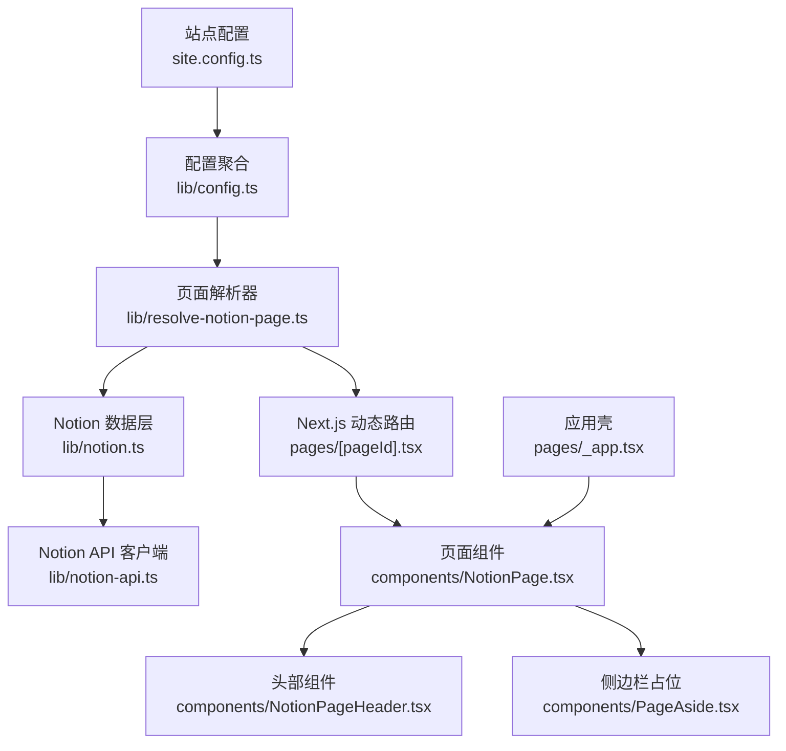
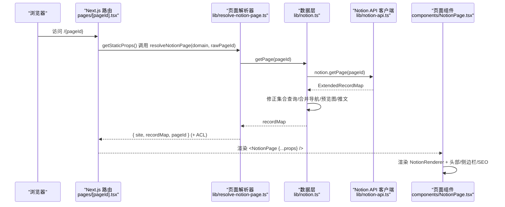
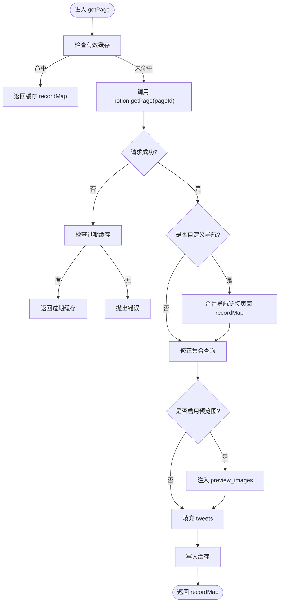
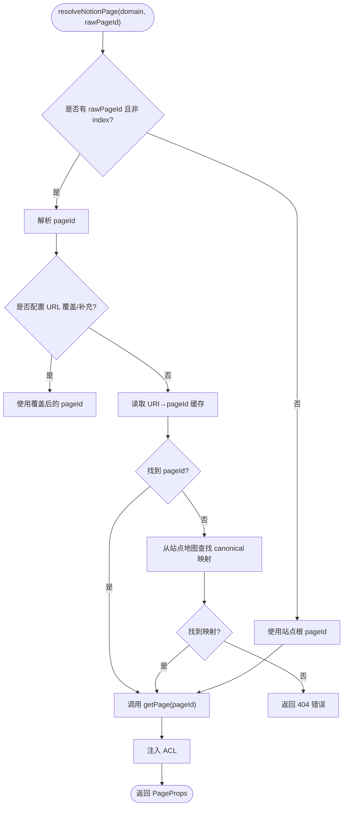
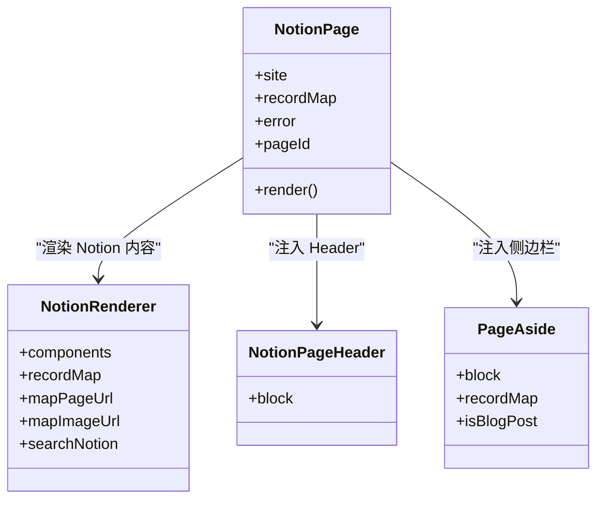
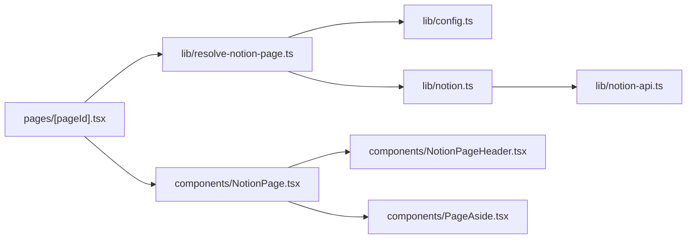

# 核心架构

<cite>
**本文引用的文件**   
- [readme.md](file://readme.md)
- [site.config.ts](file://site.config.ts)
- [lib/notion-api.ts](file://lib/notion-api.ts)
- [lib/notion.ts](file://lib/notion.ts)
- [lib/resolve-notion-page.ts](file://lib/resolve-notion-page.ts)
- [lib/config.ts](file://lib/config.ts)
- [lib/types.ts](file://lib/types.ts)
- [pages/[pageId].tsx](file://pages/[pageId].tsx)
- [components/NotionPage.tsx](file://components/NotionPage.tsx)
- [components/NotionPageHeader.tsx](file://components/NotionPageHeader.tsx)
- [components/PageAside.tsx](file://components/PageAside.tsx)
- [pages/_app.tsx](file://pages/_app.tsx)
</cite>

## 目录
1. [引言](#引言)
2. [项目结构](#项目结构)
3. [核心组件](#核心组件)
4. [架构总览](#架构总览)
5. [详细组件分析](#详细组件分析)
6. [依赖关系分析](#依赖关系分析)
7. [性能与缓存策略](#性能与缓存策略)
8. [故障排查指南](#故障排查指南)
9. [结论](#结论)

## 引言
本项目是一个基于 Next.js 的 Notion 驱动博客站点。内容在 Notion 中维护，通过服务端渲染和增量静态再生（ISR）生成高性能页面；前端使用 react-notion-x 渲染 Notion 数据模型。整体采用“数据层 + 路由层 + UI 层”的分层设计：
- 数据层负责封装 Notion API、构建 ExtendedRecordMap、处理集合查询修正、预览图与推文增强、以及内存级缓存。
- 路由层基于 Next.js Pages Router，将 URL 解析为 Notion Page ID，并组装页面 Props。
- UI 层通过 NotionPage 组合头部、正文、侧边栏、SEO 元信息、评论等子组件，完成最终渲染。

本架构文档聚焦于系统边界、组件层次、数据流、关键决策与扩展点，帮助开发者快速理解并安全扩展系统。

## 项目结构
仓库采用功能分层组织：
- site.config.ts：站点级配置入口，集中定义根 Notion 页、导航、SEO、ISR 间隔等。
- lib：数据层与工具库，包括 Notion API 客户端、页面解析、站点地图、搜索、ACL、URL 映射、预览图等。
- pages：Next.js 路由与 API 端点，包含动态页面 [pageId]、首页、feed、sitemap、robots、404 及若干 /api/* 接口。
- components：React UI 组件，如 NotionPage、NotionPageHeader、SearchModal、Footer 等。
- styles：全局样式与主题覆盖。
- public：静态资源与搜索引擎验证文件。

图表来源
- [site.config.ts:1-78](file://site.config.ts#L1-L78)
- [lib/config.ts:1-224](file://lib/config.ts#L1-L224)
- [lib/resolve-notion-page.ts:1-85](file://lib/resolve-notion-page.ts#L1-L85)
- [lib/notion.ts:1-219](file://lib/notion.ts#L1-L219)
- [lib/notion-api.ts:1-20](file://lib/notion-api.ts#L1-L20)
- [pages/[pageId].tsx:1-36](file://pages/[pageId].tsx#L1-L36)
- [components/NotionPage.tsx:1-357](file://components/NotionPage.tsx#L1-L357)
- [components/NotionPageHeader.tsx:1-129](file://components/NotionPageHeader.tsx#L1-L129)
- [components/PageAside.tsx:1-18](file://components/PageAside.tsx#L1-L18)
- [pages/_app.tsx:1-91](file://pages/_app.tsx#L1-L91)

章节来源
- [readme.md:81-92](file://readme.md#L81-L92)

## 核心组件
- 站点配置与运行时配置
  - site.config.ts：声明 rootNotionPageId、导航、SEO、ISR 重验证间隔等。
  - lib/config.ts：聚合站点配置与环境变量，导出 domain、revalidateSeconds、isServer、API 地址、site 对象等。
- 数据层
  - lib/notion-api.ts：封装 notion-client，设置重试、超时、UA 等网络参数。
  - lib/notion.ts：实现 getPage、search、内存缓存、集合查询修正、预览图与推文增强、导航链接合并。
  - lib/resolve-notion-page.ts：将 URL 或 rawPageId 解析为 pageId，加载 recordMap，注入 ACL。
- 路由层
  - pages/[pageId].tsx：Next.js 动态路由，getStaticProps 调用 resolveNotionPage，返回 props 并启用 ISR。
- UI 层
  - components/NotionPage.tsx：主页面组件，组装 SEO、NotionRenderer、头部、侧边栏、评论等。
  - components/NotionPageHeader.tsx：面包屑、自定义导航、主题切换、搜索弹窗。
  - components/PageAside.tsx：预留侧边栏扩展点。
- 应用壳
  - pages/_app.tsx：全局样式、第三方分析脚本、路由事件埋点。

章节来源
- [site.config.ts:1-78](file://site.config.ts#L1-L78)
- [lib/config.ts:1-224](file://lib/config.ts#L1-L224)
- [lib/notion-api.ts:1-20](file://lib/notion-api.ts#L1-L20)
- [lib/notion.ts:1-219](file://lib/notion.ts#L1-L219)
- [lib/resolve-notion-page.ts:1-85](file://lib/resolve-notion-page.ts#L1-L85)
- [pages/[pageId].tsx:1-36](file://pages/[pageId].tsx#L1-L36)
- [components/NotionPage.tsx:1-357](file://components/NotionPage.tsx#L1-L357)
- [components/NotionPageHeader.tsx:1-129](file://components/NotionPageHeader.tsx#L1-L129)
- [components/PageAside.tsx:1-18](file://components/PageAside.tsx#L1-L18)
- [pages/_app.tsx:1-91](file://pages/_app.tsx#L1-L91)

## 架构总览
系统分为三层：
- 数据层：notion-api.ts → notion.ts → 外部 Notion API
- 路由层：[pageId].tsx → resolve-notion-page.ts
- UI 层：NotionPage.tsx → NotionPageHeader.tsx / PageAside.tsx

图表来源
- [pages/[pageId].tsx:8-24](file://pages/[pageId].tsx#L8-L24)
- [lib/resolve-notion-page.ts:11-84](file://lib/resolve-notion-page.ts#L11-L84)
- [lib/notion.ts:161-214](file://lib/notion.ts#L161-L214)
- [lib/notion-api.ts:6-19](file://lib/notion-api.ts#L6-L19)
- [components/NotionPage.tsx:211-357](file://components/NotionPage.tsx#L211-L357)

## 详细组件分析

### 数据层：lib/notion.ts
职责
- 提供 getPage(pageId) 与 search(params)。
- 维护进程内内存缓存，TTL 短（60s），用于吸收突发流量与 Notion 抖动，并提供 stale-while-revalidate 回退。
- 修正 collection_query 的排序与过滤，确保渲染顺序与 Notion 视图一致。
- 可选增强：合并导航链接页面的 block/collection，注入 preview_images，填充 tweets。

关键流程
- getCached/getStaleCached/setCached：控制有效缓存与过期缓存。
- fixCollectionQueries：对每个 collection_view 实例重新执行 getCollectionData，并将结果合并回 recordMap。
- getPage：优先命中缓存；失败时尝试返回过期缓存；否则拉取 Notion，再执行导航合并、集合修正、预览图与推文增强，最后写回缓存。

复杂度与并发
- 导航链接页面并行获取（p-map 并发 4）。
- 集合查询修正并发 3，避免阻塞主路径。

错误处理
- Notion 不可达时，若存在过期缓存则降级返回，避免 500。
- 集合查询异常仅 warn，不影响主流程。

图表来源
- [lib/notion.ts:19-55](file://lib/notion.ts#L19-L55)
- [lib/notion.ts:95-159](file://lib/notion.ts#L95-L159)
- [lib/notion.ts:161-214](file://lib/notion.ts#L161-L214)

章节来源
- [lib/notion.ts:1-219](file://lib/notion.ts#L1-L219)

### 数据层：lib/notion-api.ts
职责
- 创建 NotionAPI 实例，统一配置 apiBaseUrl、authToken、ofetchOptions（重试次数、延迟、状态码、超时、User-Agent）。

设计要点
- 通过 ofetchOptions 自动重试 408/429/5xx 等瞬态错误，提升健壮性。
- 暴露 notion 单例供上层复用。

章节来源
- [lib/notion-api.ts:1-20](file://lib/notion-api.ts#L1-L20)

### 路由层：pages/[pageId].tsx 与 lib/resolve-notion-page.ts
职责
- [pageId].tsx：Next.js 动态路由，getStaticProps 调用 resolveNotionPage，返回 props 并开启 ISR（revalidateSeconds）。
- resolve-notion-page.ts：将 rawPageId 解析为 pageId，必要时从站点地图查找 canonical 映射，加载 recordMap，并注入 ACL。

关键逻辑
- URI 到 pageId 的缓存键 uri-to-page-id:{domain}:{environment}:{rawPageId}，TTL 一天。
- 支持 pageUrlOverrides/pageUrlAdditions 覆盖默认 URL 生成规则。
- 找不到 pageId 时返回 error 对象，由 UI 层展示 404。

图表来源
- [lib/resolve-notion-page.ts:11-84](file://lib/resolve-notion-page.ts#L11-L84)
- [pages/[pageId].tsx:8-24](file://pages/[pageId].tsx#L8-L24)

章节来源
- [pages/[pageId].tsx:1-36](file://pages/[pageId].tsx#L1-L36)
- [lib/resolve-notion-page.ts:1-85](file://lib/resolve-notion-page.ts#L1-L85)

### UI 层：components/NotionPage.tsx
职责
- 接收 PageProps，计算标题、描述、社交图片、canonical URL。
- 根据是否为博客文章决定是否显示目录。
- 注入 NotionRenderer 的 custom components（nextImage、nextLink、Code、Collection、Equation、Pdf、Modal、Tweet、Header、属性值格式化）。
- 集成搜索、暗黑模式、lite 模式、SEO、评论等。

交互与扩展点
- notionRendererComponents：可替换任意渲染器内置组件以定制行为。
- propertyLastEditedTimeValue/propertyDateValue/propertyTextValue：可定制属性渲染。
- mapImageUrl/mapPageUrl：统一图片与链接映射。
- searchNotion：按需注入搜索能力。

图表来源
- [components/NotionPage.tsx:196-209](file://components/NotionPage.tsx#L196-L209)
- [components/NotionPage.tsx:211-357](file://components/NotionPage.tsx#L211-L357)
- [components/NotionPageHeader.tsx:78-129](file://components/NotionPageHeader.tsx#L78-L129)
- [components/PageAside.tsx:1-18](file://components/PageAside.tsx#L1-L18)

章节来源
- [components/NotionPage.tsx:1-357](file://components/NotionPage.tsx#L1-L357)

### 头部与导航：components/NotionPageHeader.tsx
职责
- 渲染面包屑、自定义导航链接、主题切换按钮、搜索按钮。
- 使用 useNotionContext 提供的 components.PageLink/components.Link 与 mapPageUrl 进行导航。

扩展点
- navigationLinks 来自配置，支持内部 Notion 页面或外部 URL。
- 可在此接入更多顶部操作（例如语言切换、分享等）。

章节来源
- [components/NotionPageHeader.tsx:1-129](file://components/NotionPageHeader.tsx#L1-L129)

### 应用壳：pages/_app.tsx
职责
- 引入全局样式与主题。
- 初始化第三方分析（Fathom、PostHog、Vercel Analytics、Speed Insights、Clarity）。
- 监听路由变化上报 PV。

章节来源
- [pages/_app.tsx:1-91](file://pages/_app.tsx#L1-L91)

## 依赖关系分析
模块耦合与职责清晰：
- pages/[pageId].tsx 仅依赖 resolve-notion-page 与 NotionPage。
- resolve-notion-page 依赖 config、db、get-site-map、acl、notion。
- notion 依赖 notion-api、config、preview-images、get-tweets。
- NotionPage 依赖 config、map-image-url、map-page-url、search-notion、use-dark-mode 以及多个 UI 子组件。

图表来源
- [pages/[pageId].tsx:1-36](file://pages/[pageId].tsx#L1-L36)
- [lib/resolve-notion-page.ts:1-85](file://lib/resolve-notion-page.ts#L1-L85)
- [lib/notion.ts:1-219](file://lib/notion.ts#L1-L219)
- [lib/notion-api.ts:1-20](file://lib/notion-api.ts#L1-L20)
- [components/NotionPage.tsx:1-357](file://components/NotionPage.tsx#L1-L357)
- [components/NotionPageHeader.tsx:1-129](file://components/NotionPageHeader.tsx#L1-L129)
- [components/PageAside.tsx:1-18](file://components/PageAside.tsx#L1-L18)

章节来源
- [lib/types.ts:1-78](file://lib/types.ts#L1-L78)

## 性能与缓存策略
- ISR（增量静态再生）
  - pages/[pageId].tsx 返回 revalidateSeconds，结合 site.config.ts 中的 revalidateSeconds（默认 3600，示例站点设为 86400），降低函数调用频率。
- 进程内内存缓存
  - lib/notion.ts 维护 PAGE_CACHE_TTL_MS=60s 的内存缓存，减少重复请求 Notion 的频率，并在 Notion 不可用时提供过期缓存回退。
- 并发优化
  - 导航链接页面与集合查询修正均使用 p-map 控制并发度，避免雪崩。
- 懒加载与 SSR 控制
  - Code、Collection、Equation、Pdf、Modal 等重型组件通过 next/dynamic 与 ssr:false 控制加载时机，避免首屏阻塞与 hydration 不匹配。
- 图片与媒体
  - 可选 LQIP 预览图增强（preview_images），配合 mapImageUrl 统一图片处理。
- 代码高亮
  - PrismJS 语法按需动态导入，减少包体体积。

章节来源
- [pages/[pageId].tsx:8-30](file://pages/[pageId].tsx#L8-L30)
- [site.config.ts:58-61](file://site.config.ts#L58-L61)
- [lib/notion.ts:19-55](file://lib/notion.ts#L19-L55)
- [components/NotionPage.tsx:43-142](file://components/NotionPage.tsx#L43-L142)

## 故障排查指南
- Notion API 限流或不可用
  - 现象：getPage 抛错。
  - 机制：lib/notion.ts 捕获异常后尝试返回过期缓存；若无可用的过期缓存则向上抛出错误。
  - 建议：检查 NOTION_API_TOKEN、NOTION_API_BASE_URL；确认 rate limit；观察控制台警告日志。
- 集合排序/过滤不一致
  - 现象：列表未按 Notion 视图排序或过滤。
  - 机制：lib/notion.ts 的 fixCollectionQueries 会重新执行 getCollectionData 并合并结果；若仍异常，检查视图 query2.sort/filter 是否存在。
- 404 页面
  - 现象：访问不存在的路径。
  - 机制：resolve-notion-page.ts 无法找到 pageId 时返回 error.statusCode=404；UI 层渲染 404。
- 导航链接缺失标题或 slug
  - 现象：自定义导航项显示异常。
  - 机制：lib/notion.ts 在非默认导航模式下合并导航链接页面的 recordMap，确保块信息完整。
- 搜索不可用
  - 现象：点击搜索无效。
  - 机制：需启用 isSearchEnabled 并正确配置 /api/search-notion；检查 SearchModal 与 searchNotion 注入。

章节来源
- [lib/notion.ts:168-182](file://lib/notion.ts#L168-L182)
- [lib/notion.ts:95-159](file://lib/notion.ts#L95-L159)
- [lib/resolve-notion-page.ts:66-74](file://lib/resolve-notion-page.ts#L66-L74)
- [lib/notion.ts:184-197](file://lib/notion.ts#L184-L197)

## 结论
本项目的核心架构围绕“数据层抽象 Notion、路由层解析 URL、UI 层渲染 Notion 内容”展开。通过 ISR、内存缓存、并发控制与按需加载，系统在稳定性与性能之间取得平衡。扩展点集中在：
- 数据层：扩展集合查询修正、新增数据增强（如 tweets、preview_images）。
- 路由层：扩展 URL 覆盖与站点地图映射。
- UI 层：替换 NotionRenderer 组件、定制属性渲染、扩展头部与侧边栏。

这些设计使站点既易于维护，又具备良好的可扩展性与容错能力。