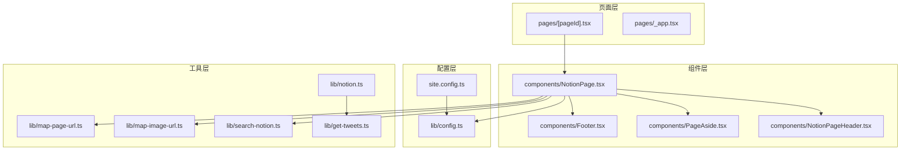
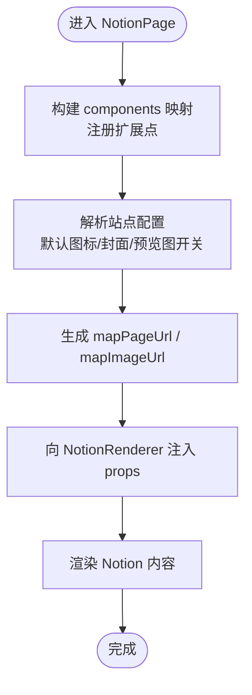
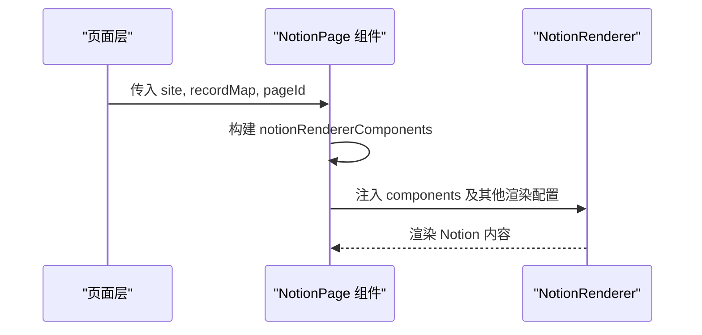
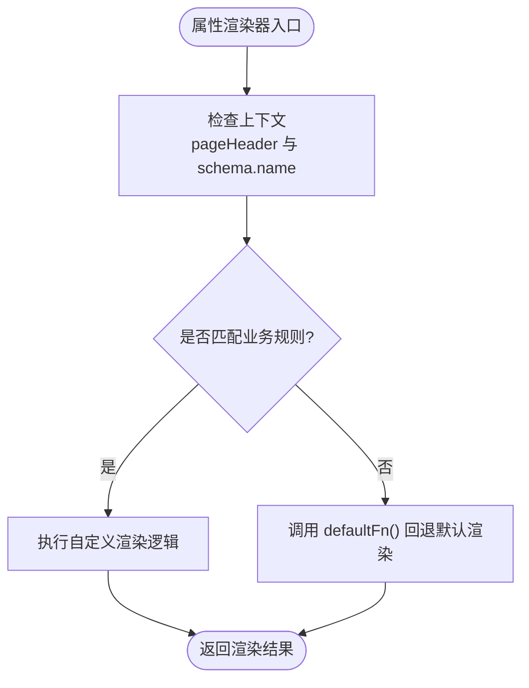
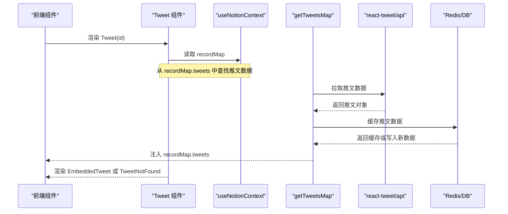
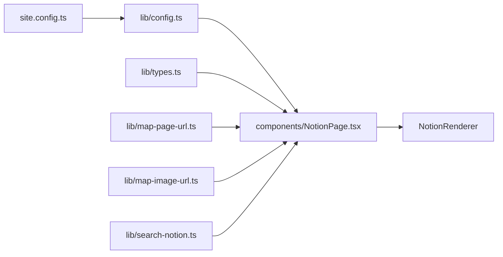

# 扩展机制

<cite>
**本文引用的文件**   
- [components/NotionPage.tsx](file://components/NotionPage.tsx)
- [lib/notion.ts](file://lib/notion.ts)
- [lib/get-tweets.ts](file://lib/get-tweets.ts)
- [lib/config.ts](file://lib/config.ts)
</cite>

## 目录
1. [引言](#引言)
2. [项目结构](#项目结构)
3. [核心组件与扩展点总览](#核心组件与扩展点总览)
4. [架构概览](#架构概览)
5. [详细扩展点分析](#详细扩展点分析)
6. [依赖关系分析](#依赖关系分析)
7. [性能与可维护性建议](#性能与可维护性建议)
8. [故障排查指南](#故障排查指南)
9. [结论](#结论)

## 引言
本文聚焦 react-notion-x 在本仓库中的扩展机制，重点说明如何通过 notionRendererComponents 替换默认组件、注入自定义组件、覆盖属性渲染器，并给出 Tweet 等典型业务组件的定制方案。文档同时解释 propertyLastEditedTimeValue、propertyTextValue、propertyDateValue 等属性渲染器的实现原理，帮助你在不侵入底层库的前提下，完成面向业务的 UI 与行为定制。

## 项目结构
本项目采用 Next.js + react-notion-x 的组合：
- 页面层负责获取 Notion 数据、组装站点信息、注入 SEO 元数据。
- 组件层通过 NotionPage 封装 NotionRenderer，集中注入渲染配置与扩展点。
- 配置层提供站点级默认值（如默认图标、封面、预览图开关等）。
- 工具层提供 URL 映射、图片映射、搜索能力以及推文数据增强等。

**图表来源**
- [components/NotionPage.tsx:1-356](file://components/NotionPage.tsx#L1-L356)
- [lib/config.ts:47-84](file://lib/config.ts#L47-L84)
- [lib/notion.ts:161-213](file://lib/notion.ts#L161-L213)
- [lib/get-tweets.ts:10-28](file://lib/get-tweets.ts#L10-L28)

**章节来源**
- [components/NotionPage.tsx:1-356](file://components/NotionPage.tsx#L1-L356)
- [lib/config.ts:47-84](file://lib/config.ts#L47-L84)

## 核心组件与扩展点总览
在 components/NotionPage.tsx 中，notionRendererComponents 是 react-notion-x 的扩展入口，用于替换或增强默认行为。当前已注册的扩展包括：
- 基础组件替换：nextImage、nextLink
- 第三方功能组件：Code、Collection、Equation、Pdf、Modal
- 业务组件：Tweet、Header
- 属性值渲染器：propertyLastEditedTimeValue、propertyTextValue、propertyDateValue

这些扩展点共同决定了 Notion 内容如何被渲染为最终页面。

**章节来源**
- [components/NotionPage.tsx:196-209](file://components/NotionPage.tsx#L196-L209)

## 架构概览
下图展示 NotionRenderer 在渲染流程中的位置以及关键依赖：

**图表来源**
- [components/NotionPage.tsx:196-209](file://components/NotionPage.tsx#L196-L209)
- [components/NotionPage.tsx:319-352](file://components/NotionPage.tsx#L319-L352)
- [lib/config.ts:58-84](file://lib/config.ts#L58-L84)

## 详细扩展点分析

### notionRendererComponents 配置方式
notionRendererComponents 是一个 Partial<NotionComponents> 对象，用于选择性覆盖 NotionRenderer 的内置组件与行为。你可以：
- 替换默认组件：例如 nextImage、nextLink
- 添加第三方组件：例如 Code、Collection、Equation、Pdf、Modal
- 注入业务组件：例如 Tweet、Header
- 覆盖属性渲染器：例如 propertyLastEditedTimeValue、propertyTextValue、propertyDateValue

该对象随后作为 components 属性传入 NotionRenderer，从而生效。

**图表来源**
- [components/NotionPage.tsx:196-209](file://components/NotionPage.tsx#L196-L209)
- [components/NotionPage.tsx:319-352](file://components/NotionPage.tsx#L319-L352)

**章节来源**
- [components/NotionPage.tsx:196-209](file://components/NotionPage.tsx#L196-L209)
- [components/NotionPage.tsx:319-352](file://components/NotionPage.tsx#L319-L352)

### 替换默认组件与添加自定义组件
- 替换默认组件：
  - nextImage：使用 Next.js Image 组件进行图片渲染
  - nextLink：使用 Next.js Link 组件进行链接跳转
- 添加自定义组件：
  - Code：动态加载 Prism 语法的高亮组件
  - Collection：客户端渲染集合视图，避免 SSR 水合不一致
  - Equation/Pdf/Modal：按需加载的第三方组件
  - Header：自定义页头组件

这些组件通过 dynamic 导入或本地定义后，统一注册到 notionRendererComponents，并在 NotionRenderer 中使用。

**章节来源**
- [components/NotionPage.tsx:43-142](file://components/NotionPage.tsx#L43-L142)
- [components/NotionPage.tsx:196-209](file://components/NotionPage.tsx#L196-L209)

### 属性渲染器覆盖机制
属性渲染器允许你根据 Notion 页面的属性类型和字段名，定制显示逻辑。当前实现的三个渲染器如下：

- propertyLastEditedTimeValue
  - 作用：在页面头部区域，若存在 last_edited_time，则返回格式化后的“最后更新时间”文本；否则回退到默认渲染器。
  - 关键点：仅在 pageHeader 为真且 block.last_edited_time 存在时生效。

- propertyDateValue
  - 作用：当属性名为 published 且处于页面头部区域时，提取 start_date 并格式化为月份名称；否则回退到默认渲染器。
  - 关键点：通过 schema.name 判断属性名，并从 data 结构中取出版本化日期。

- propertyTextValue
  - 作用：当属性名为 author 且处于页面头部区域时，对默认渲染结果加粗显示；否则回退到默认渲染器。
  - 关键点：通过 schema.name 判断属性名，并对默认渲染结果进行样式包装。

这三个渲染器均遵循“条件命中则自定义渲染，否则调用 defaultFn()”的模式，确保在不破坏默认行为的前提下进行局部覆盖。

**图表来源**
- [components/NotionPage.tsx:155-194](file://components/NotionPage.tsx#L155-L194)

**章节来源**
- [components/NotionPage.tsx:155-194](file://components/NotionPage.tsx#L155-L194)

### 业务特定组件定制示例：Tweet
Tweet 组件通过 useNotionContext 读取 recordMap，并从扩展字段 tweets 中查找对应推文数据。如果找到，则渲染 EmbeddedTweet；否则渲染 TweetNotFound。该组件通过 Suspense 包裹，配合 Skeleton 提升用户体验。

服务端在获取 Notion 数据后，会调用 getTweetsMap 将推文 ID 列表转换为推文数据映射，并挂载到 recordMap.tweets，供前端组件消费。

**图表来源**
- [components/NotionPage.tsx:144-153](file://components/NotionPage.tsx#L144-L153)
- [lib/get-tweets.ts:10-28](file://lib/get-tweets.ts#L10-L28)
- [lib/get-tweets.ts:30-62](file://lib/get-tweets.ts#L30-L62)
- [lib/notion.ts:203-213](file://lib/notion.ts#L203-L213)

**章节来源**
- [components/NotionPage.tsx:144-153](file://components/NotionPage.tsx#L144-L153)
- [lib/get-tweets.ts:10-62](file://lib/get-tweets.ts#L10-L62)
- [lib/notion.ts:203-213](file://lib/notion.ts#L203-L213)

### 完整配置示例与最佳实践
- 替换默认组件：
  - 使用 nextImage 与 nextLink 替换默认图片与链接组件，以利用 Next.js 的性能优化。
- 添加第三方组件：
  - 使用 dynamic 导入 Code、Collection、Equation、Pdf、Modal，减少首屏体积。
  - 对需要客户端能力的组件设置 ssr:false，避免水合不一致。
- 注入业务组件：
  - 注册 Tweet 与 Header，满足业务展示需求。
- 覆盖属性渲染器：
  - 针对 published、author、last_edited_time 等业务字段，实现定制化显示逻辑。
  - 始终保留 defaultFn() 回退路径，确保默认行为不被破坏。
- 性能与可维护性：
  - 按需懒加载重型组件。
  - 合理设置 previewImages，平衡加载速度与视觉体验。
  - 使用 mapImageUrl 对接 CDN 与图片优化。
  - 通过 showTableOfContents 与 minTableOfContentsItems 控制目录显示。

**章节来源**
- [components/NotionPage.tsx:43-142](file://components/NotionPage.tsx#L43-L142)
- [components/NotionPage.tsx:155-209](file://components/NotionPage.tsx#L155-L209)
- [components/NotionPage.tsx:319-352](file://components/NotionPage.tsx#L319-L352)
- [lib/config.ts:58-84](file://lib/config.ts#L58-L84)

## 依赖关系分析
NotionRenderer 的配置依赖站点配置与工具函数，形成清晰的解耦结构：

**图表来源**
- [lib/config.ts:47-84](file://lib/config.ts#L47-L84)
- [components/NotionPage.tsx:319-352](file://components/NotionPage.tsx#L319-L352)

**章节来源**
- [lib/config.ts:47-84](file://lib/config.ts#L47-L84)
- [components/NotionPage.tsx:319-352](file://components/NotionPage.tsx#L319-L352)

## 性能与可维护性建议
- 按需加载重型组件（Code、Collection、Equation、Pdf、Modal），减少首屏体积。
- 合理设置 previewImages，平衡加载速度与视觉体验。
- 使用 mapImageUrl 对接 CDN 与图片优化，降低带宽成本。
- 通过 showTableOfContents 与 minTableOfContentsItems 控制目录显示，提升可读性。
- 统一站点默认图标与封面，减少重复配置与维护成本。

[本节为通用建议，不直接分析具体文件]

## 故障排查指南
- 深色模式无效：检查 useDarkMode 返回值与 body 类名是否正确注入。
- 预览图不显示：确认 isPreviewImageSupportEnabled 已启用，且 recordMap.preview_images 存在。
- 集合视图顺序异常：检查服务端 fixCollectionQueries 逻辑与 collection_query/collection_view 数据完整性。
- 搜索不可用：确认 config.isSearchEnabled 与 searchNotion 注入正确，后端搜索接口可达。
- 目录不显示：检查 isBlogPost 判断逻辑与 showTableOfContents 设置。
- Tweet 不显示：确认 recordMap.tweets 是否存在，以及 getTweetsMap 是否成功执行。

**章节来源**
- [components/NotionPage.tsx:316-352](file://components/NotionPage.tsx#L316-L352)
- [lib/config.ts:68-72](file://lib/config.ts#L68-L72)
- [lib/notion.ts:199-213](file://lib/notion.ts#L199-L213)
- [lib/get-tweets.ts:10-28](file://lib/get-tweets.ts#L10-L28)

## 结论
通过 notionRendererComponents，你可以在不修改 react-notion-x 源码的情况下，灵活替换默认组件、注入业务组件、覆盖属性渲染器，从而实现面向业务的 UI 与行为定制。结合动态导入、站点配置与工具函数，既能保证性能与可维护性，又能快速响应业务变化。建议在保持代码解耦的前提下，按需扩展 components 与属性值渲染逻辑，并结合 CDN 与缓存策略优化整体体验。