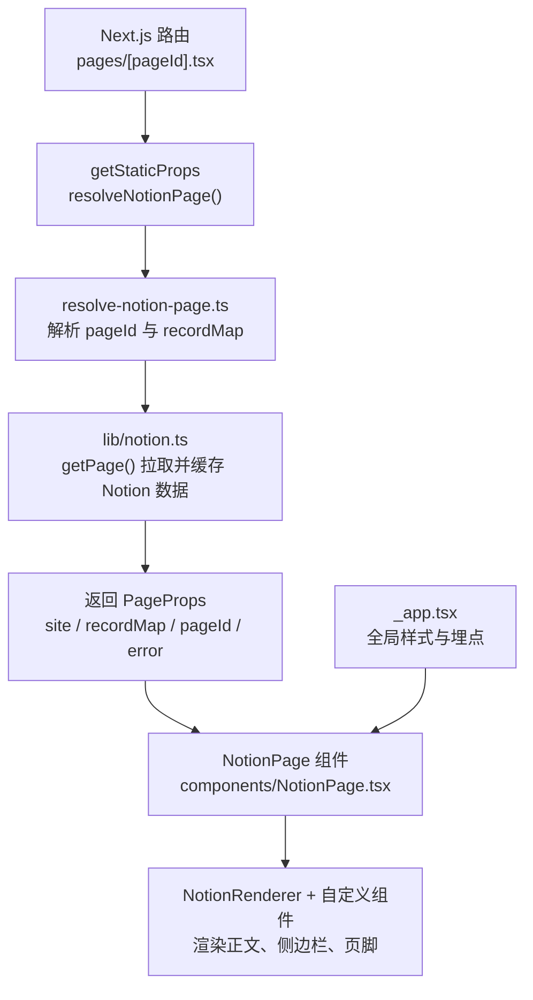
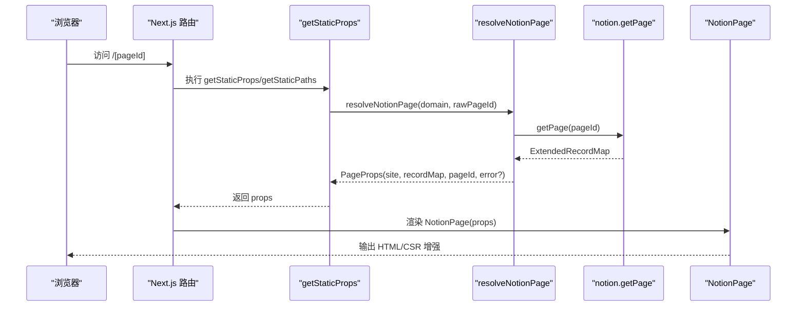
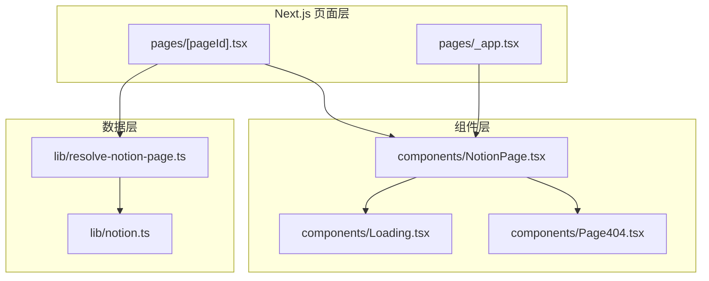
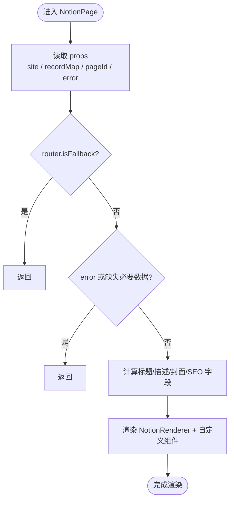
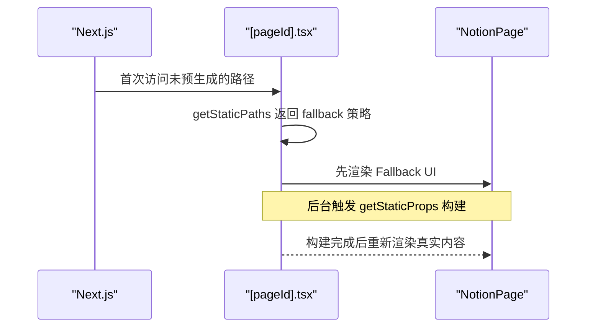
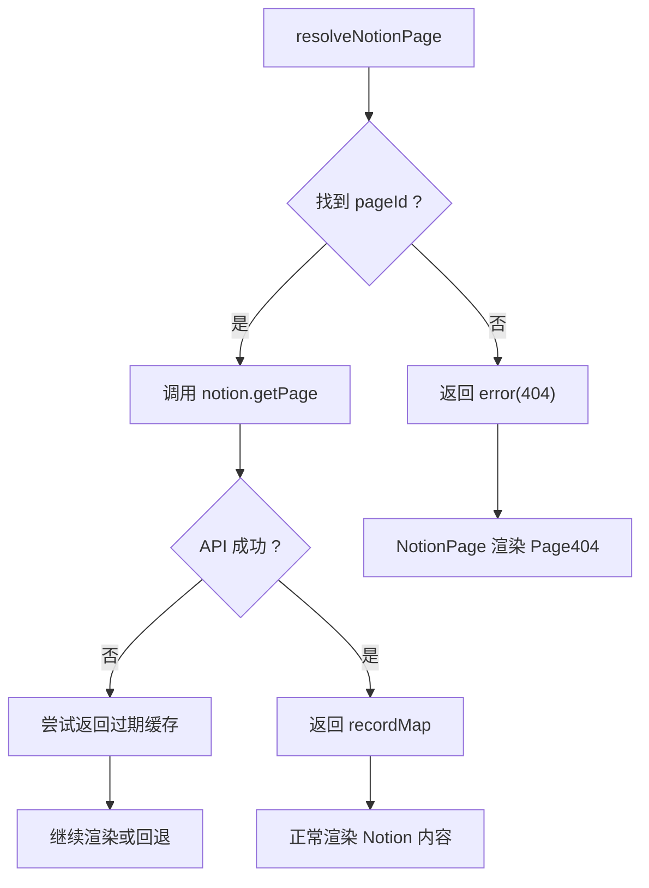
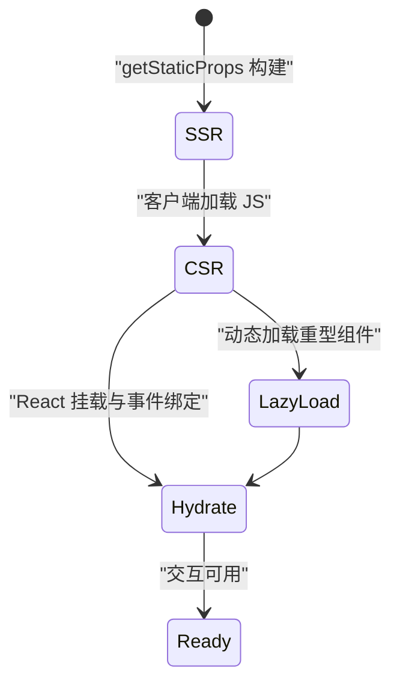
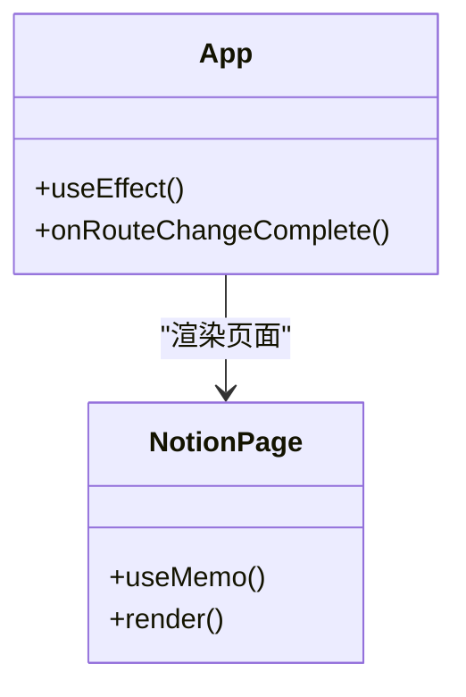
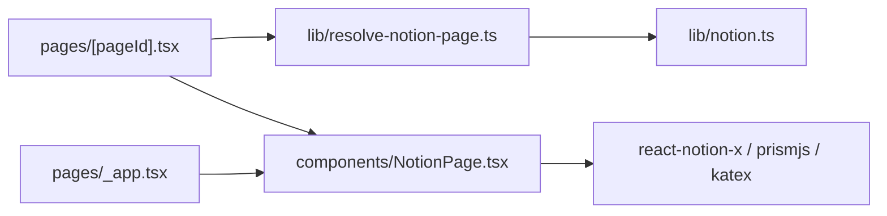

# 生命周期管理

<cite>
**本文引用的文件**   
- [components/NotionPage.tsx](file://components/NotionPage.tsx)
- [pages/[pageId].tsx](file://pages/[pageId].tsx)
- [lib/resolve-notion-page.ts](file://lib/resolve-notion-page.ts)
- [lib/notion.ts](file://lib/notion.ts)
- [pages/_app.tsx](file://pages/_app.tsx)
- [components/Page404.tsx](file://components/Page404.tsx)
- [components/Loading.tsx](file://components/Loading.tsx)
- [lib/types.ts](file://lib/types.ts)
- [pages/_error.tsx](file://pages/_error.tsx)
</cite>

## 目录
1. [引言](#引言)
2. [项目结构与生命周期入口](#项目结构与生命周期入口)
3. [核心组件与数据流](#核心组件与数据流)
4. [架构总览](#架构总览)
5. [详细组件分析](#详细组件分析)
6. [依赖关系分析](#依赖关系分析)
7. [性能优化与最佳实践](#性能优化与最佳实践)
8. [故障排查指南](#故障排查指南)
9. [结论](#结论)

## 引言
本文围绕 Notion 驱动的 Next.js 站点，系统性说明 React 组件生命周期与 Next.js 页面生命周期的协作方式。重点包括：
- NotionPage 组件从数据获取到渲染的完整流程
- useEffect、useMemo、useCallback 等钩子在当前代码中的实际使用场景
- 路由变化时的组件更新机制、Fallback 状态处理与错误边界
- SSR 与 CSR 的生命周期差异，以及 hydration 过程的处理策略
- 性能优化相关的生命周期管理最佳实践

## 项目结构与生命周期入口
本项目的页面入口采用 Next.js 动态路由 `[pageId].tsx`，在构建期或请求期通过 `getStaticProps` 和 `getStaticPaths` 完成数据预取与路径生成；运行时由 `NotionPage` 组件负责渲染 Notion 内容。全局应用入口 `_app.tsx` 负责样式注入、埋点初始化与路由事件监听。

**图表来源**
- [pages/[pageId].tsx:8-31](file://pages/[pageId].tsx#L8-L31)
- [lib/resolve-notion-page.ts:11-84](file://lib/resolve-notion-page.ts#L11-L84)
- [lib/notion.ts:161-213](file://lib/notion.ts#L161-L213)
- [components/NotionPage.tsx:211-356](file://components/NotionPage.tsx#L211-L356)
- [pages/_app.tsx:41-90](file://pages/_app.tsx#L41-L90)

**章节来源**
- [pages/[pageId].tsx:8-31](file://pages/[pageId].tsx#L8-L31)
- [pages/_app.tsx:41-90](file://pages/_app.tsx#L41-L90)

## 核心组件与数据流
- 页面层：`[pageId].tsx` 暴露 `getStaticProps` 与 `getStaticPaths`，决定 SSG 行为与 fallback 策略。
- 数据解析层：`resolve-notion-page.ts` 将 URL 映射为 Notion pageId，调用 `notion.getPage` 获取 `recordMap`，并附加 ACL 权限信息。
- 数据访问层：`notion.ts` 提供内存级缓存、集合查询修正、预览图与推文合并等逻辑。
- 渲染层：`NotionPage.tsx` 根据 props 渲染 SEO、主题、正文、侧边栏与评论。

**图表来源**
- [pages/[pageId].tsx:8-31](file://pages/[pageId].tsx#L8-L31)
- [lib/resolve-notion-page.ts:11-84](file://lib/resolve-notion-page.ts#L11-L84)
- [lib/notion.ts:161-213](file://lib/notion.ts#L161-L213)
- [components/NotionPage.tsx:211-356](file://components/NotionPage.tsx#L211-L356)

**章节来源**
- [lib/resolve-notion-page.ts:11-84](file://lib/resolve-notion-page.ts#L11-L84)
- [lib/notion.ts:161-213](file://lib/notion.ts#L161-L213)
- [components/NotionPage.tsx:211-356](file://components/NotionPage.tsx#L211-L356)

## 架构总览
下图展示从 Next.js 路由到 Notion 数据再到 React 渲染的整体架构，标注了关键文件与职责。

**图表来源**
- [pages/[pageId].tsx:1-36](file://pages/[pageId].tsx#L1-L36)
- [pages/_app.tsx:1-91](file://pages/_app.tsx#L1-L91)
- [lib/resolve-notion-page.ts:1-85](file://lib/resolve-notion-page.ts#L1-L85)
- [lib/notion.ts:1-219](file://lib/notion.ts#L1-L219)
- [components/NotionPage.tsx:1-357](file://components/NotionPage.tsx#L1-L357)
- [components/Loading.tsx:1-11](file://components/Loading.tsx#L1-L11)
- [components/Page404.tsx:1-38](file://components/Page404.tsx#L1-L38)

## 详细组件分析

### NotionPage 组件生命周期与渲染流程
NotionPage 是页面渲染的核心组件，接收来自页面的 props（site、recordMap、pageId、error），并根据不同状态渲染 Loading、404 或正式内容。

- 路由与模式判断
  - 使用 `useRouter` 读取 `isFallback`，用于显示 Fallback 占位。
  - 使用 `useSearchParam('lite')` 判断 lite 模式，影响渲染范围与样式类名。
  - 使用 `useDarkMode` 控制深色模式样式。

- 计算属性与子树缓存
  - 使用 `React.useMemo` 计算站点地图链接函数 `siteMapPageUrl`，避免重复构造。
  - 使用 `React.useMemo` 包裹侧边栏 `pageAside`，减少不必要的子树重建。

- 条件渲染与错误处理
  - 当 `router.isFallback` 为真时，直接返回 `<Loading />`。
  - 当存在 `error` 或缺少必要数据（site、block、recordMap）时，返回 `<Page404 ... />`。

- 元信息与 SEO
  - 根据博客文章类型与 Notion 属性，计算标题、描述、封面图、发布时间、修改时间、作者等，并通过 `PageHead` 注入。

- 内容渲染
  - 使用 `NotionRenderer` 渲染 Notion 内容，并注入自定义组件（Code、Collection、Equation、Pdf、Modal、Tweet、Header 等）。
  - 针对 Collection、Pdf、Modal 等组件使用 `next/dynamic` 与 `ssr: false` 避免 SSR/CSR 不匹配。

**图表来源**
- [components/NotionPage.tsx:211-356](file://components/NotionPage.tsx#L211-L356)

**章节来源**
- [components/NotionPage.tsx:211-356](file://components/NotionPage.tsx#L211-L356)

### 页面路由与 Fallback 机制
- `getStaticPaths` 返回空 paths，并在开发环境启用 `fallback: true`，生产环境使用 `fallback: 'blocking'`，以支持增量静态再生与按需构建。
- `getStaticProps` 中若发生异常，会记录日志并抛出错误，通知 Next.js 该页面增量 SSG 失败，避免发布错误版本。
- 组件内通过 `router.isFallback` 显示 Loading，确保首次访问或增量构建期间用户体验。

**图表来源**
- [pages/[pageId].tsx:26-31](file://pages/[pageId].tsx#L26-L31)
- [components/NotionPage.tsx:255-257](file://components/NotionPage.tsx#L255-L257)

**章节来源**
- [pages/[pageId].tsx:8-31](file://pages/[pageId].tsx#L8-L31)
- [components/NotionPage.tsx:255-257](file://components/NotionPage.tsx#L255-L257)

### 错误边界与 404 处理
- 页面级错误：`_error.tsx` 复用 `ErrorPage` 组件作为默认错误页面。
- 业务级 404：当 `resolveNotionPage` 无法找到对应 Notion 页面时，返回 `{ error: { message, statusCode } }`，`NotionPage` 据此渲染 `Page404`。
- 网络异常降级：`notion.getPage` 在 Notion API 不可用时尝试返回过期缓存，保证站点可用性。

**图表来源**
- [lib/resolve-notion-page.ts:44-75](file://lib/resolve-notion-page.ts#L44-L75)
- [lib/notion.ts:168-182](file://lib/notion.ts#L168-L182)
- [components/Page404.tsx:6-37](file://components/Page404.tsx#L6-L37)

**章节来源**
- [lib/resolve-notion-page.ts:44-75](file://lib/resolve-notion-page.ts#L44-L75)
- [lib/notion.ts:168-182](file://lib/notion.ts#L168-L182)
- [components/Page404.tsx:6-37](file://components/Page404.tsx#L6-L37)
- [pages/_error.tsx:1-2](file://pages/_error.tsx#L1-L2)

### SSR 与 CSR 的差异与 Hydration
- SSR 阶段
  - `getStaticProps` 在服务端拉取 Notion 数据，生成静态 HTML。
  - 部分重型或易产生 SSR/CSR 不匹配的组件（如 Collection、Pdf、Modal）通过 `dynamic({ ssr: false })` 仅在客户端加载。
- CSR 阶段
  - `_app.tsx` 在客户端初始化埋点与全局样式。
  - `NotionPage` 在客户端挂载后，可注入调试对象到 `window`，便于调试。
- Hydration
  - 由于部分组件被延迟到客户端加载，避免了首屏 SSR/CSR 不一致导致的 hydration 警告。
  - 对于需要客户端交互的第三方库（如 Modal），在动态导入后设置根容器，确保正确挂载。

**图表来源**
- [components/NotionPage.tsx:114-142](file://components/NotionPage.tsx#L114-L142)
- [pages/_app.tsx:37-39](file://pages/_app.tsx#L37-L39)
- [components/NotionPage.tsx:265-271](file://components/NotionPage.tsx#L265-L271)

**章节来源**
- [components/NotionPage.tsx:114-142](file://components/NotionPage.tsx#L114-L142)
- [pages/_app.tsx:37-39](file://pages/_app.tsx#L37-L39)
- [components/NotionPage.tsx:265-271](file://components/NotionPage.tsx#L265-L271)

### 钩子使用场景与注意事项
- useEffect
  - 在 `_app.tsx` 中使用 `useEffect` 初始化埋点（Fathom、PostHog）并订阅路由变化事件，实现页面浏览统计。
- useMemo
  - 在 `NotionPage` 中用于缓存站点地图链接函数与侧边栏子树，减少重复计算与子组件重渲染。
- useCallback
  - 当前代码未直接使用 `useCallback`。建议在将来为回调型事件处理器（如搜索、评论提交）使用，以避免子组件因引用变化而重渲染。

**图表来源**
- [pages/_app.tsx:44-68](file://pages/_app.tsx#L44-L68)
- [components/NotionPage.tsx:225-253](file://components/NotionPage.tsx#L225-L253)

**章节来源**
- [pages/_app.tsx:44-68](file://pages/_app.tsx#L44-L68)
- [components/NotionPage.tsx:225-253](file://components/NotionPage.tsx#L225-L253)

## 依赖关系分析
- 页面层依赖数据解析层，数据解析层依赖 Notion 数据访问层。
- 渲染层依赖多个第三方库（react-notion-x、prismjs、katex 等），并通过 dynamic 与 ssr:false 控制加载时机。
- 全局应用层依赖埋点与分析工具，并在客户端初始化。

**图表来源**
- [pages/[pageId].tsx:1-36](file://pages/[pageId].tsx#L1-L36)
- [lib/resolve-notion-page.ts:1-85](file://lib/resolve-notion-page.ts#L1-L85)
- [lib/notion.ts:1-219](file://lib/notion.ts#L1-L219)
- [components/NotionPage.tsx:1-357](file://components/NotionPage.tsx#L1-L357)
- [pages/_app.tsx:1-91](file://pages/_app.tsx#L1-L91)

**章节来源**
- [lib/types.ts:9-19](file://lib/types.ts#L9-L19)
- [lib/types.ts:29-45](file://lib/types.ts#L29-L45)

## 性能优化与最佳实践
- 服务端缓存
  - `notion.ts` 使用内存级 Map 缓存 `ExtendedRecordMap`，TTL 为 60 秒，降低 Notion API 压力并提供 stale-while-revalidate 能力。
- 动态导入与 SSR 规避
  - 对重型或易导致 hydration 不匹配的组件使用 `next/dynamic` 与 `ssr: false`，提升首屏性能与稳定性。
- 计算结果缓存
  - 使用 `useMemo` 缓存站点地图链接函数与侧边栏子树，减少重复计算与子组件重渲染。
- 路由事件与埋点
  - 在 `_app.tsx` 中集中处理路由变化埋点，避免在每个页面重复初始化。
- 建议补充
  - 对频繁变化的回调函数使用 `useCallback`，配合子组件的 `React.memo` 进一步减少重渲染。
  - 对长列表或复杂 Notion 集合视图考虑分页或虚拟滚动，避免一次性渲染过多节点。
  - 对图片资源使用懒加载与合适的尺寸策略，结合 Notion 预览图优化首屏体验。

**章节来源**
- [lib/notion.ts:29-55](file://lib/notion.ts#L29-L55)
- [components/NotionPage.tsx:114-142](file://components/NotionPage.tsx#L114-L142)
- [components/NotionPage.tsx:225-253](file://components/NotionPage.tsx#L225-L253)
- [pages/_app.tsx:44-68](file://pages/_app.tsx#L44-L68)

## 故障排查指南
- 页面 404
  - 检查 `resolve-notion-page.ts` 是否返回 `error.statusCode === 404`，确认 URL 到 pageId 的映射是否正确。
  - 查看 `Page404` 组件是否按预期渲染错误信息。
- 构建失败
  - 检查 `getStaticProps` 中的异常处理逻辑，确认是否在失败时抛出错误，阻止发布错误版本。
- 运行时崩溃
  - 检查 `_error.tsx` 是否正确导出 `ErrorPage`，确保全局错误边界生效。
- 数据异常
  - 检查 `notion.ts` 的缓存与降级逻辑，确认在 Notion API 不可用时的回退行为是否符合预期。

**章节来源**
- [lib/resolve-notion-page.ts:66-75](file://lib/resolve-notion-page.ts#L66-L75)
- [components/Page404.tsx:6-37](file://components/Page404.tsx#L6-L37)
- [pages/[pageId].tsx:17-23](file://pages/[pageId].tsx#L17-L23)
- [pages/_error.tsx:1-2](file://pages/_error.tsx#L1-L2)
- [lib/notion.ts:168-182](file://lib/notion.ts#L168-L182)

## 结论
本项目通过 Next.js 的 SSG 与动态路由机制，结合 Notion 数据服务，实现了高效的内容渲染与良好的用户体验。NotionPage 组件在 SSR/CSR 环境下合理分配渲染职责，利用 useMemo 优化计算与子树，通过 dynamic 与 ssr:false 规避 hydration 问题。数据层提供内存缓存与降级策略，保障站点在高并发与外部服务不稳定时的可用性。未来可在回调函数层面引入 useCallback，并结合子组件 memo 化进一步提升渲染性能。