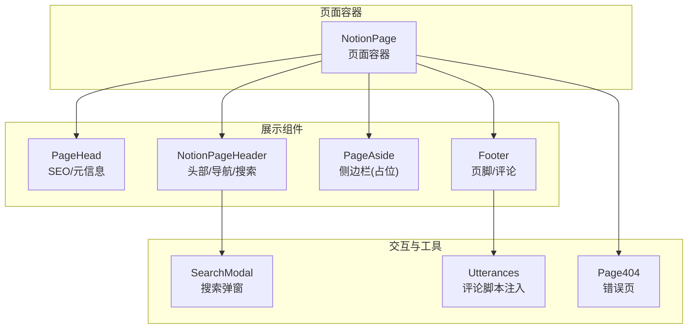
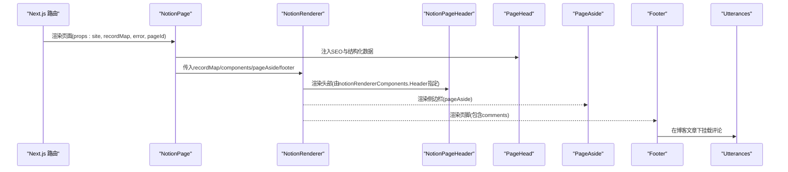
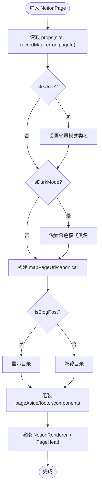
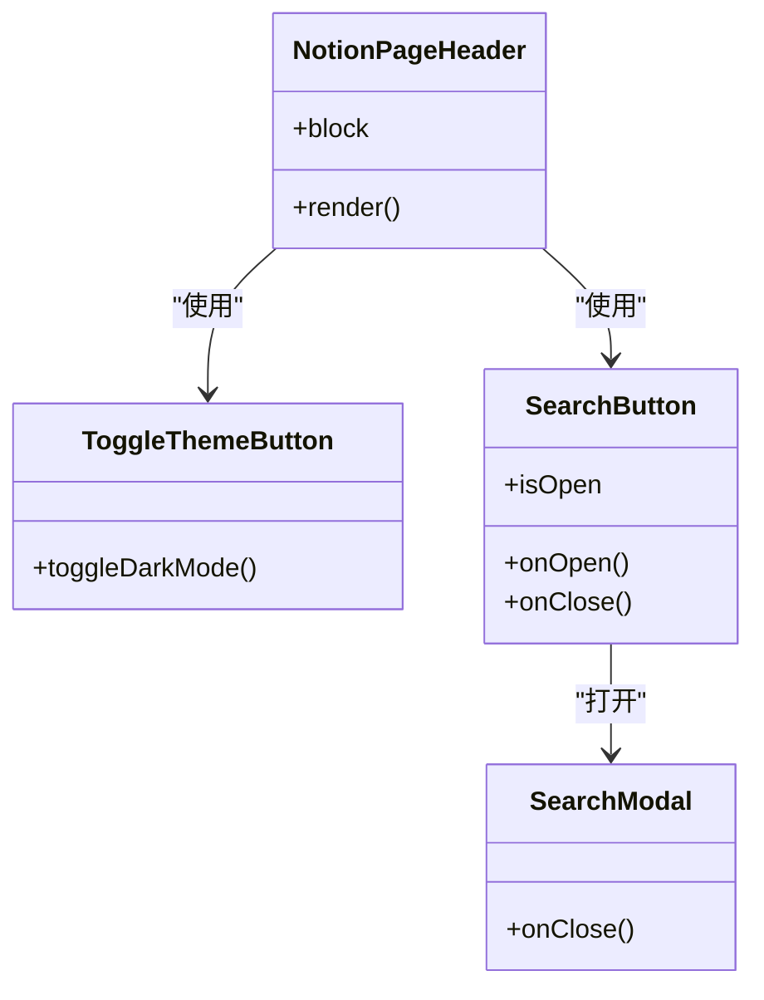
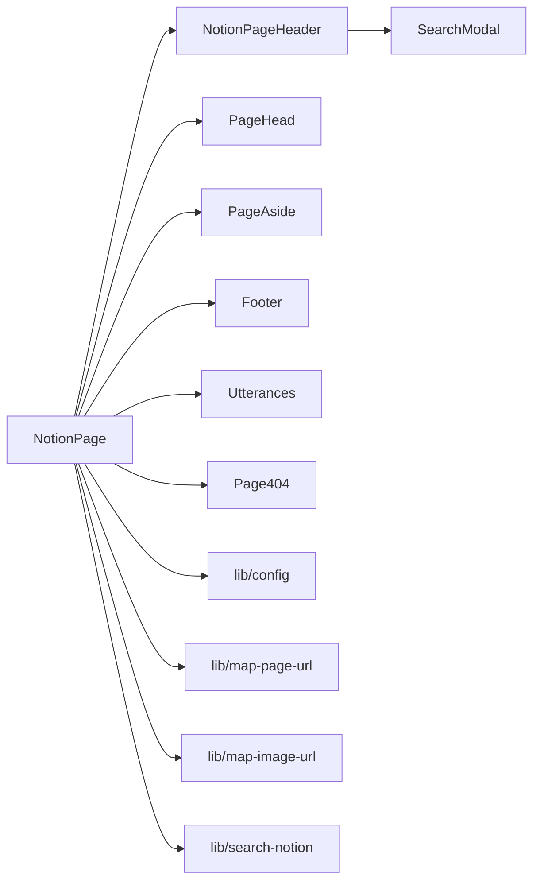
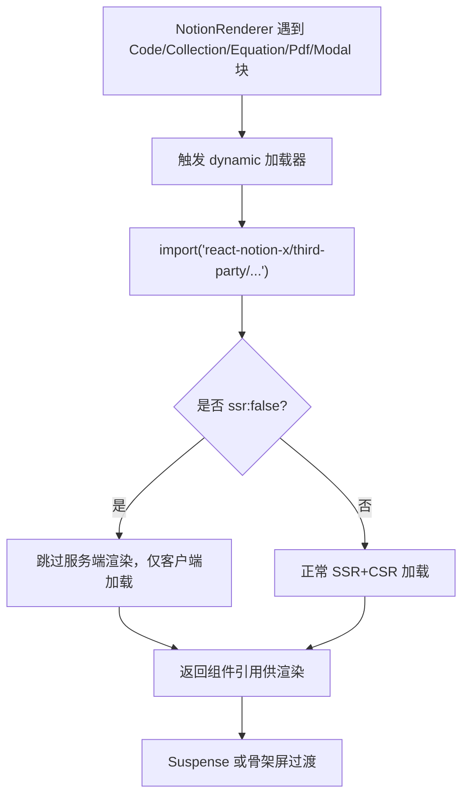

# 组件层次结构

<cite>
**本文引用的文件**   
- [components/NotionPage.tsx](file://components/NotionPage.tsx)
- [components/NotionPageHeader.tsx](file://components/NotionPageHeader.tsx)
- [components/PageHead.tsx](file://components/PageHead.tsx)
- [components/PageAside.tsx](file://components/PageAside.tsx)
- [components/Footer.tsx](file://components/Footer.tsx)
- [components/SearchModal.tsx](file://components/SearchModal.tsx)
- [components/Utterances.tsx](file://components/Utterances.tsx)
- [components/Page404.tsx](file://components/Page404.tsx)
- [lib/config.ts](file://lib/config.ts)
</cite>

## 目录
1. [简介](#简介)
2. [项目结构与职责划分](#项目结构与职责划分)
3. [核心组件与层级关系](#核心组件与层级关系)
4. [架构总览](#架构总览)
5. [详细组件分析](#详细组件分析)
6. [依赖关系分析](#依赖关系分析)
7. [动态导入与懒加载策略](#动态导入与懒加载策略)
8. [性能与可维护性建议](#性能与可维护性建议)
9. [故障排查指南](#故障排查指南)
10. [结论](#结论)

## 简介
本文件聚焦于 React 组件的层次结构与组织方式，重点说明页面容器组件 NotionPage 如何编排子组件（如 NotionPageHeader、Footer、PageHead、PageAside），以及数据流向与状态管理。同时，文档深入解析动态导入与懒加载机制，包括 Code、Collection、Equation 等第三方渲染组件的按需加载实现，帮助读者快速理解整体架构与扩展点。

## 项目结构与职责划分
- 页面容器层：NotionPage 作为页面级容器，负责路由参数处理、SEO 元信息注入、主题模式切换、Notion 内容渲染配置，以及子组件装配。
- 展示层：
  - PageHead：负责 SEO、Open Graph、Twitter Card、结构化数据等元信息渲染。
  - NotionPageHeader：页面头部导航、面包屑、主题切换按钮、搜索入口。
  - PageAside：侧边栏占位（当前为空实现）。
  - Footer：页脚区域，支持评论模块挂载。
- 交互与工具层：
  - SearchModal：搜索弹窗，基于服务端索引进行本地过滤与导航。
  - Utterances：评论组件，通过脚本注入第三方评论系统。
  - Page404：错误与未找到页面的统一展示。

图表来源
- [components/NotionPage.tsx:211-356](file://components/NotionPage.tsx#L211-L356)
- [components/NotionPageHeader.tsx:78-128](file://components/NotionPageHeader.tsx#L78-L128)
- [components/PageHead.tsx:7-187](file://components/PageHead.tsx#L7-L187)
- [components/PageAside.tsx:3-17](file://components/PageAside.tsx#L3-L17)
- [components/Footer.tsx:5-13](file://components/Footer.tsx#L5-L13)
- [components/SearchModal.tsx:57-253](file://components/SearchModal.tsx#L57-L253)
- [components/Utterances.tsx:3-30](file://components/Utterances.tsx#L3-L30)
- [components/Page404.tsx:6-37](file://components/Page404.tsx#L6-L37)

章节来源
- [components/NotionPage.tsx:211-356](file://components/NotionPage.tsx#L211-L356)
- [components/NotionPageHeader.tsx:78-128](file://components/NotionPageHeader.tsx#L78-L128)
- [components/PageHead.tsx:7-187](file://components/PageHead.tsx#L7-L187)
- [components/PageAside.tsx:3-17](file://components/PageAside.tsx#L3-L17)
- [components/Footer.tsx:5-13](file://components/Footer.tsx#L5-L13)
- [components/SearchModal.tsx:57-253](file://components/SearchModal.tsx#L57-L253)
- [components/Utterances.tsx:3-30](file://components/Utterances.tsx#L3-L30)
- [components/Page404.tsx:6-37](file://components/Page404.tsx#L6-L37)

## 核心组件与层级关系
- NotionPage 是页面根容器，负责：
  - 读取路由参数 lite 并切换轻量模式；
  - 使用 useDarkMode 控制全局深色模式；
  - 计算站点 URL 映射函数 mapPageUrl；
  - 判断是否为博客文章（isBlogPost）以决定是否显示目录；
  - 组装 pageAside 与 footer；
  - 将 notionRendererComponents 注入到 NotionRenderer，覆盖默认行为；
  - 根据条件渲染 Loading 或 Page404。
- NotionPageHeader 提供：
  - Breadcrumbs 面包屑；
  - 导航链接（来自 site.config）；
  - 主题切换按钮；
  - 搜索按钮（打开 SearchModal）。
- PageHead 负责：
  - 设置 title、description、canonical、OG/Twitter 卡片；
  - 生成结构化数据（WebSite/BlogPosting）；
  - 输出 RSS 订阅链接。
- PageAside 当前为空实现，预留侧边栏扩展点。
- Footer 支持 comments 插槽，用于挂载 Utterances 评论。
- SearchModal 负责：
  - 从 API 拉取搜索索引；
  - 本地过滤与标签筛选；
  - 键盘导航与结果跳转。
- Utterances 通过动态注入脚本集成第三方评论系统。
- Page404 在 NotionPage 校验失败时展示。

章节来源
- [components/NotionPage.tsx:211-356](file://components/NotionPage.tsx#L211-L356)
- [components/NotionPageHeader.tsx:78-128](file://components/NotionPageHeader.tsx#L78-L128)
- [components/PageHead.tsx:7-187](file://components/PageHead.tsx#L7-L187)
- [components/PageAside.tsx:3-17](file://components/PageAside.tsx#L3-L17)
- [components/Footer.tsx:5-13](file://components/Footer.tsx#L5-L13)
- [components/SearchModal.tsx:57-253](file://components/SearchModal.tsx#L57-L253)
- [components/Utterances.tsx:3-30](file://components/Utterances.tsx#L3-L30)
- [components/Page404.tsx:6-37](file://components/Page404.tsx#L6-L37)

## 架构总览
下图展示了页面渲染时的关键调用链与组件协作关系。

图表来源
- [components/NotionPage.tsx:301-353](file://components/NotionPage.tsx#L301-L353)
- [components/NotionPageHeader.tsx:78-128](file://components/NotionPageHeader.tsx#L78-L128)
- [components/PageHead.tsx:7-187](file://components/PageHead.tsx#L7-L187)
- [components/PageAside.tsx:3-17](file://components/PageAside.tsx#L3-L17)
- [components/Footer.tsx:5-13](file://components/Footer.tsx#L5-L13)
- [components/Utterances.tsx:3-30](file://components/Utterances.tsx#L3-L30)

## 详细组件分析

### NotionPage（页面容器）
- 职责
  - 解析 lite 查询参数，启用轻量模式；
  - 获取 isDarkMode 并注入 BodyClassName；
  - 计算 mapPageUrl 与 canonical 地址；
  - 判断 isBlogPost，决定是否显示目录；
  - 组装 pageAside 与 footer（含 Utterances）；
  - 构建 notionRendererComponents，覆盖默认渲染器行为；
  - 条件渲染 Loading 或 Page404。
- 数据流
  - 输入 props：site、recordMap、error、pageId；
  - 内部派生：title、socialDescription、publishedTime、modifiedTime、author；
  - 输出：向 NotionRenderer 传递 components、recordMap、mapPageUrl、searchNotion、pageAside、footer。
- 关键点
  - 通过 notionRendererComponents 注入自定义 Header、Code、Collection、Equation、Pdf、Modal、Tweet 等；
  - 对属性值渲染进行定制（propertyLastEditedTimeValue、propertyDateValue、propertyTextValue）。

图表来源
- [components/NotionPage.tsx:211-356](file://components/NotionPage.tsx#L211-L356)

章节来源
- [components/NotionPage.tsx:211-356](file://components/NotionPage.tsx#L211-L356)

### NotionPageHeader（页面头部）
- 职责
  - 渲染面包屑（Breadcrumbs）；
  - 渲染导航链接（navigationLinks）；
  - 主题切换按钮（ToggleThemeButton）；
  - 搜索按钮（SearchButton）打开 SearchModal。
- 数据流
  - 接收 block 作为上下文；
  - 通过 useNotionContext 获取 components 与 mapPageUrl；
  - 通过 config.navigationLinks 渲染导航项。
- 关键点
  - 搜索功能受 isSearchEnabled 控制；
  - 主题切换通过 useDarkMode 切换全局样式。

图表来源
- [components/NotionPageHeader.tsx:15-76](file://components/NotionPageHeader.tsx#L15-L76)
- [components/SearchModal.tsx:57-253](file://components/SearchModal.tsx#L57-L253)

章节来源
- [components/NotionPageHeader.tsx:78-128](file://components/NotionPageHeader.tsx#L78-L128)
- [components/SearchModal.tsx:57-253](file://components/SearchModal.tsx#L57-L253)

### PageHead（SEO 与元信息）
- 职责
  - 设置 charset、viewport、theme-color、robots、author；
  - 输出 OG/Twitter 卡片相关 meta；
  - 根据 isBlogPost 输出 article 时间戳与作者；
  - 生成 WebSite/BlogPosting 结构化数据；
  - 输出 RSS 订阅链接。
- 数据流
  - 输入：site、title、description、image、url、isBlogPost、publishedTime、modifiedTime、author；
  - 内部计算：pageTitle、pageDescription、socialImageUrl、pageType、pageLanguage、structuredData。
- 关键点
  - 当存在 socialImageUrl 时启用大图片卡片；
  - 为博客文章输出更丰富的结构化数据。

章节来源
- [components/PageHead.tsx:7-187](file://components/PageHead.tsx#L7-L187)

### PageAside（侧边栏）
- 职责
  - 当前返回 null，作为扩展点预留。
- 数据流
  - 接收 block、recordMap、isBlogPost，但暂不渲染任何内容。

章节来源
- [components/PageAside.tsx:3-17](file://components/PageAside.tsx#L3-L17)

### Footer（页脚）
- 职责
  - 渲染 comments 插槽（用于挂载 Utterances）。
- 数据流
  - 输入 comments（可选），在博客文章下渲染评论。

章节来源
- [components/Footer.tsx:5-13](file://components/Footer.tsx#L5-L13)

### SearchModal（搜索弹窗）
- 职责
  - 从 api.searchIndex 拉取索引；
  - 本地过滤标题、描述、标签；
  - 支持标签多选过滤；
  - 键盘导航（Esc 关闭、上下键移动、Enter 跳转）；
  - 通过 createPortal 挂载到 document.body。
- 数据流
  - 状态：index、isLoading、error、query、selectedTags、activeIndex、mounted；
  - 事件：onClose、goToResult、toggleTag、onKeyDown。
- 关键点
  - 首次打开才加载索引，避免首屏开销；
  - 防抖式本地过滤，提升交互体验。

章节来源
- [components/SearchModal.tsx:57-253](file://components/SearchModal.tsx#L57-L253)

### Utterances（评论）
- 职责
  - 动态注入 utteranc.es 脚本，按主题切换重新注入。
- 数据流
  - 输入 theme（github-light/github-dark）；
  - 副作用：创建 script 节点并 append。
- 关键点
  - 主题变化时清理旧内容并重新注入脚本。

章节来源
- [components/Utterances.tsx:3-30](file://components/Utterances.tsx#L3-L30)

### Page404（错误页）
- 职责
  - 在 NotionPage 校验失败时展示错误信息或提示。
- 数据流
  - 输入 site、pageId、error；
  - 输出 PageHead 与错误展示 UI。

章节来源
- [components/Page404.tsx:6-37](file://components/Page404.tsx#L6-L37)

## 依赖关系分析
- NotionPage 依赖：
  - next/dynamic 实现懒加载；
  - react-notion-x 的 NotionRenderer、useNotionContext；
  - lib/config、lib/map-page-url、lib/map-image-url、lib/search-notion；
  - 子组件：Footer、Loading、NotionPageHeader、Page404、PageAside、PageHead、Utterances。
- NotionPageHeader 依赖：
  - react-notion-x 的 Breadcrumbs、useNotionContext；
  - lib/config.navigationLinks、isSearchEnabled；
  - 子组件：SearchModal。
- PageHead 依赖：
  - Next.js Head；
  - lib/get-social-image-url、lib/config。
- Footer 依赖：
  - 样式模块。
- SearchModal 依赖：
  - Next.js Router；
  - lib/config.api.searchIndex；
  - lib/get-search-index 类型定义。
- Utterances 依赖：
  - 外部评论服务 utteranc.es。

图表来源
- [components/NotionPage.tsx:211-356](file://components/NotionPage.tsx#L211-L356)
- [components/NotionPageHeader.tsx:78-128](file://components/NotionPageHeader.tsx#L78-L128)
- [components/PageHead.tsx:7-187](file://components/PageHead.tsx#L7-L187)
- [components/SearchModal.tsx:57-253](file://components/SearchModal.tsx#L57-L253)
- [lib/config.ts:48-88](file://lib/config.ts#L48-L88)

章节来源
- [components/NotionPage.tsx:211-356](file://components/NotionPage.tsx#L211-L356)
- [components/NotionPageHeader.tsx:78-128](file://components/NotionPageHeader.tsx#L78-L128)
- [components/PageHead.tsx:7-187](file://components/PageHead.tsx#L7-L187)
- [components/SearchModal.tsx:57-253](file://components/SearchModal.tsx#L57-L253)
- [lib/config.ts:48-88](file://lib/config.ts#L48-L88)

## 动态导入与懒加载策略
- 目标
  - 减少首屏体积，按需加载重型或仅客户端运行的组件；
  - 避免 SSR/CSR 水合不一致问题。
- 已实现的动态组件
  - Code：动态加载 react-notion-x/third-party/code，并在加载后并行引入多种 prismjs 语法高亮模块；
  - Collection：动态加载 react-notion-x/third-party/collection，且 ssr:false，仅在客户端渲染以避免水合差异；
  - Equation：动态加载 react-notion-x/third-party/equation；
  - Pdf：动态加载 react-notion-x/third-party/pdf，ssr:false；
  - Modal：动态加载 react-notion-x/third-party/modal，ssr:false，并在加载后设置应用根元素。
- 注入位置
  - 通过 notionRendererComponents 将这些动态组件注册到 NotionRenderer，使 Notion 内容块按需触发加载。
- 执行流程

图表来源
- [components/NotionPage.tsx:43-142](file://components/NotionPage.tsx#L43-L142)
- [components/NotionPage.tsx:196-209](file://components/NotionPage.tsx#L196-L209)

章节来源
- [components/NotionPage.tsx:43-142](file://components/NotionPage.tsx#L43-L142)
- [components/NotionPage.tsx:196-209](file://components/NotionPage.tsx#L196-L209)

## 性能与可维护性建议
- 继续优化首屏体积
  - 保持 Code 的 Prism 语法按需引入，避免一次性加载所有语言；
  - 对非首屏可见的区块（如 PDF、Equation）继续使用 ssr:false 与 Suspense。
- 提升交互流畅度
  - 为 SearchModal 增加请求去重与缓存；
  - 对搜索结果列表使用虚拟滚动（若条目较多）。
- 增强可维护性
  - 将 notionRendererComponents 的配置抽取为独立模块，便于扩展与测试；
  - 为 PageAside 预留可扩展的数据源与渲染逻辑。

[本节为通用建议，不涉及具体文件分析]

## 故障排查指南
- 页面空白或报错
  - 检查 NotionPage 的条件分支：router.isFallback、error/site/block/recordMap 缺失时是否渲染 Page404；
  - 确认 recordMap 与 site 数据是否正确传入。
- 代码高亮不生效
  - 检查 Code 的动态加载是否成功；
  - 确认对应 prismjs 语法模块是否被引入。
- 集合/公式/PDF 不渲染
  - 确认 ssr:false 的组件是否在客户端正确加载；
  - 检查浏览器控制台是否有模块加载错误。
- 搜索无结果
  - 检查 api.searchIndex 接口是否可用；
  - 确认 SearchModal 的 index 数据是否加载成功。
- 评论不显示
  - 检查 Utterances 的脚本注入是否成功；
  - 确认博客文章模式下是否传入了 comments。

章节来源
- [components/NotionPage.tsx:255-261](file://components/NotionPage.tsx#L255-L261)
- [components/NotionPage.tsx:43-142](file://components/NotionPage.tsx#L43-L142)
- [components/SearchModal.tsx:80-106](file://components/SearchModal.tsx#L80-L106)
- [components/Utterances.tsx:6-27](file://components/Utterances.tsx#L6-L27)

## 结论
NotionPage 作为页面容器，通过组合 PageHead、NotionPageHeader、PageAside、Footer 等展示组件，并结合 NotionRenderer 的 components 覆盖机制，实现了灵活的页面布局与内容渲染。动态导入与懒加载策略有效降低了首屏体积，提升了用户体验。SearchModal 与 Utterances 分别提供了搜索与评论能力，进一步增强了站点的交互性与可维护性。建议在后续迭代中持续优化首屏性能与组件扩展点，以提升整体质量与可维护性。