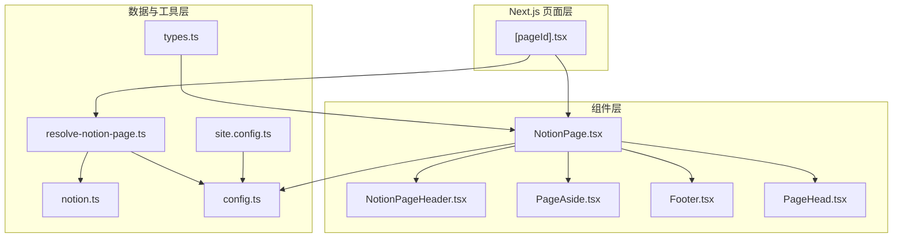
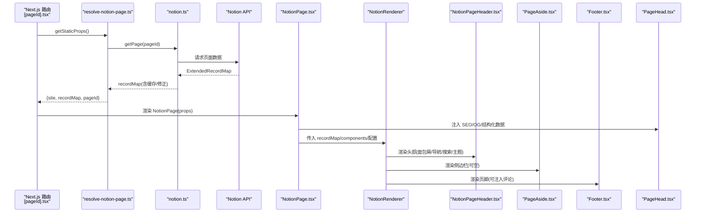
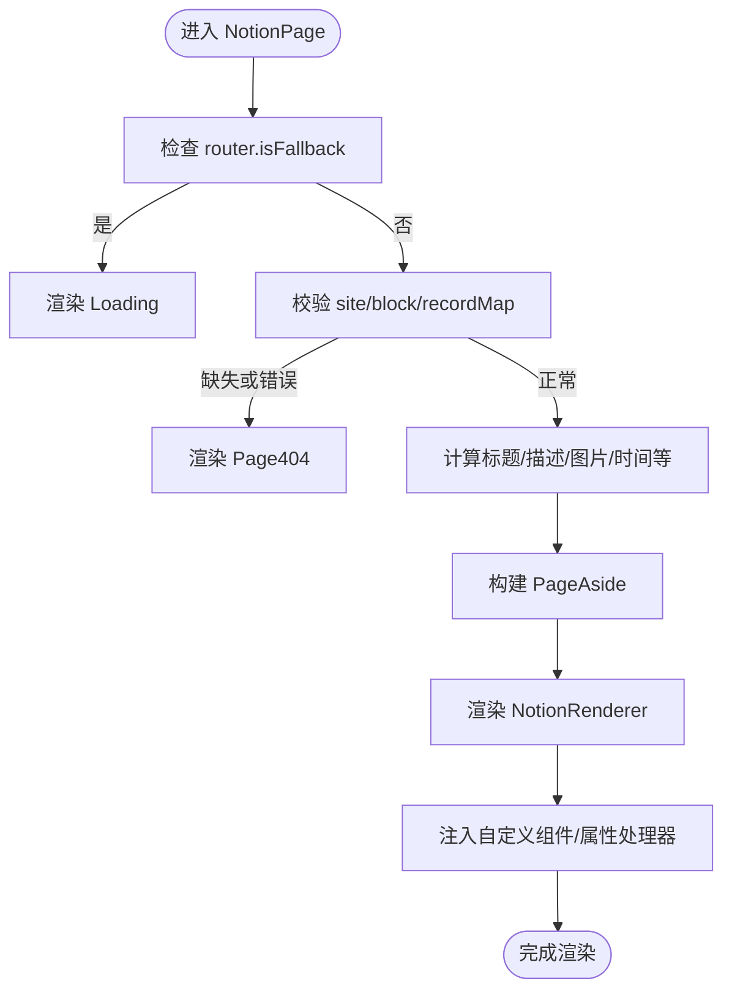
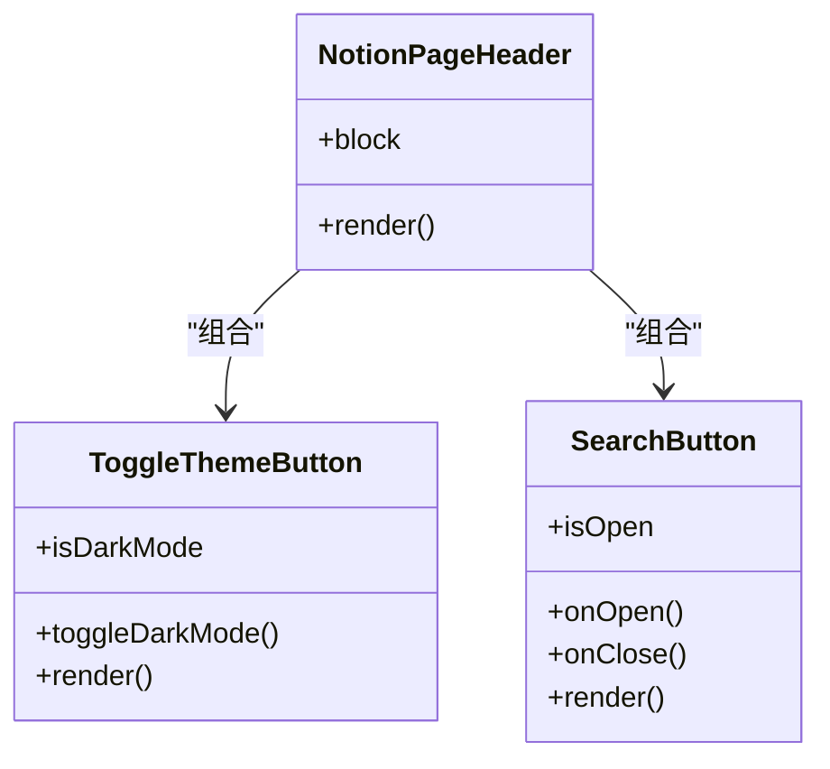
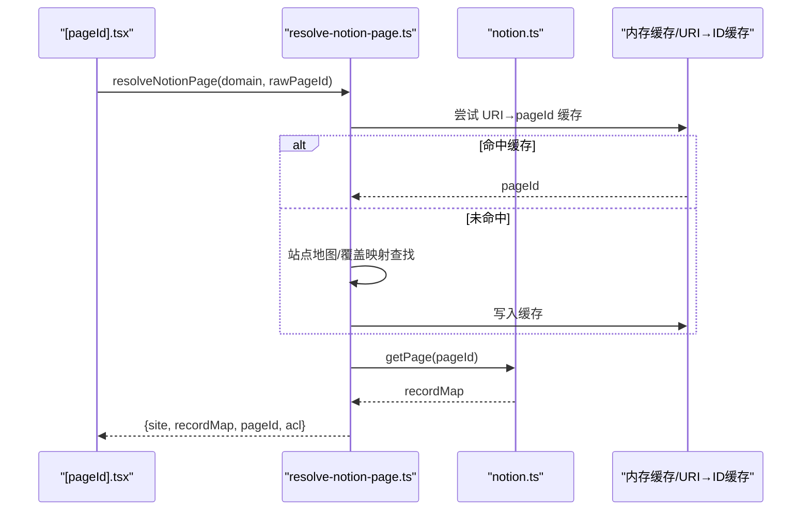
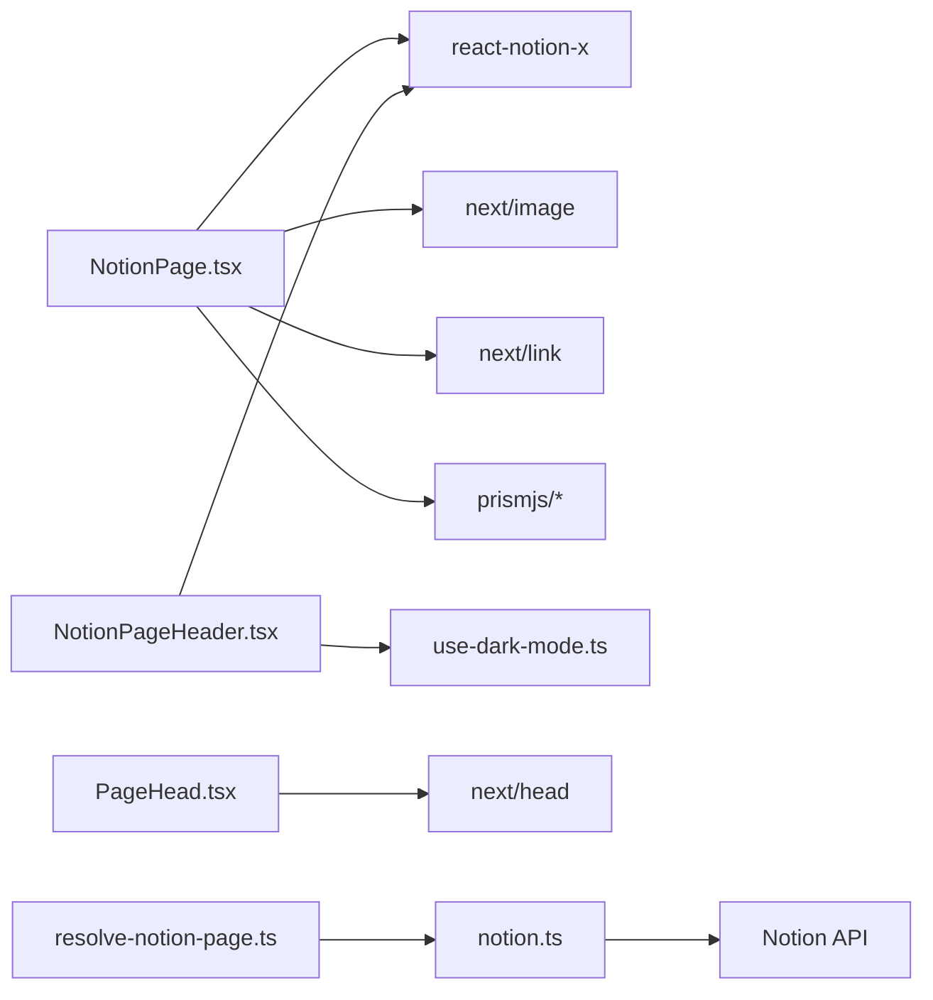

# 组件架构

<cite>
**本文引用的文件**   
- [components/NotionPage.tsx](file://components/NotionPage.tsx)
- [components/NotionPageHeader.tsx](file://components/NotionPageHeader.tsx)
- [components/PageAside.tsx](file://components/PageAside.tsx)
- [components/Footer.tsx](file://components/Footer.tsx)
- [components/PageHead.tsx](file://components/PageHead.tsx)
- [pages/[pageId].tsx](file://pages/[pageId].tsx)
- [lib/resolve-notion-page.ts](file://lib/resolve-notion-page.ts)
- [lib/notion.ts](file://lib/notion.ts)
- [lib/config.ts](file://lib/config.ts)
- [lib/types.ts](file://lib/types.ts)
- [site.config.ts](file://site.config.ts)
</cite>

## 目录
1. [引言](#引言)
2. [项目结构](#项目结构)
3. [核心组件](#核心组件)
4. [架构总览](#架构总览)
5. [详细组件分析](#详细组件分析)
6. [依赖关系分析](#依赖关系分析)
7. [性能与扩展性](#性能与扩展性)
8. [故障排查指南](#故障排查指南)
9. [结论](#结论)

## 引言
本文件面向 React + Next.js 的 Notion 博客站点，系统化说明组件分层、职责边界与通信模式。重点覆盖：
- 页面容器组件、展示组件、业务组件的职责划分
- 父子关系、兄弟组件通信、上下文使用
- NotionRenderer 的扩展机制、自定义组件注入、动态导入策略
- 组件层次结构图、交互时序图与生命周期管理要点

## 项目结构
本项目采用“页面路由 → 页面容器 → 渲染器 → 展示组件”的分层组织方式：
- pages 层负责路由与数据获取（SSG/ISR）
- components 层按职责拆分为页面容器、布局与展示组件
- lib 层提供数据获取、配置、类型等横切能力
- site.config.ts 作为站点级配置入口

图表来源
- [pages/[pageId].tsx:1-36](file://pages/[pageId].tsx#L1-L36)
- [components/NotionPage.tsx:211-356](file://components/NotionPage.tsx#L211-L356)
- [lib/resolve-notion-page.ts:11-84](file://lib/resolve-notion-page.ts#L11-L84)
- [lib/notion.ts:161-214](file://lib/notion.ts#L161-L214)
- [lib/config.ts:157-163](file://lib/config.ts#L157-L163)
- [lib/types.ts:14-19](file://lib/types.ts#L14-L19)
- [site.config.ts:1-78](file://site.config.ts#L1-L78)

章节来源
- [pages/[pageId].tsx:1-36](file://pages/[pageId].tsx#L1-L36)
- [components/NotionPage.tsx:1-356](file://components/NotionPage.tsx#L1-L356)
- [lib/resolve-notion-page.ts:1-85](file://lib/resolve-notion-page.ts#L1-L85)
- [lib/notion.ts:1-219](file://lib/notion.ts#L1-L219)
- [lib/config.ts:1-224](file://lib/config.ts#L1-L224)
- [lib/types.ts:1-78](file://lib/types.ts#L1-L78)
- [site.config.ts:1-78](file://site.config.ts#L1-L78)

## 核心组件
- 页面容器组件
  - NotionPage：聚合页面元信息、SEO、主题、内容渲染与侧边栏/页脚；通过 NotionRenderer 渲染 Notion 内容。
  - [pageId] 路由：负责 SSG/ISR 数据获取与错误处理，将 props 传递给 NotionPage。
- 展示组件
  - NotionPageHeader：面包屑、导航链接、主题切换、搜索入口。
  - PageAside：预留右侧边栏占位，当前返回空节点。
  - Footer：页脚容器，支持注入评论组件。
  - PageHead：统一 SEO、Open Graph、结构化数据注入。
- 业务组件
  - 无独立业务组件；业务逻辑集中在 lib 层（数据获取、缓存、URL 映射、权限）。

章节来源
- [components/NotionPage.tsx:211-356](file://components/NotionPage.tsx#L211-L356)
- [components/NotionPageHeader.tsx:78-128](file://components/NotionPageHeader.tsx#L78-L128)
- [components/PageAside.tsx:1-18](file://components/PageAside.tsx#L1-L18)
- [components/Footer.tsx:1-14](file://components/Footer.tsx#L1-L14)
- [components/PageHead.tsx:1-188](file://components/PageHead.tsx#L1-L188)
- [pages/[pageId].tsx:1-36](file://pages/[pageId].tsx#L1-L36)

## 架构总览
下图展示了从路由到渲染的关键调用链与数据流：

图表来源
- [pages/[pageId].tsx:8-34](file://pages/[pageId].tsx#L8-L34)
- [lib/resolve-notion-page.ts:11-84](file://lib/resolve-notion-page.ts#L11-L84)
- [lib/notion.ts:161-214](file://lib/notion.ts#L161-L214)
- [components/NotionPage.tsx:301-353](file://components/NotionPage.tsx#L301-L353)
- [components/NotionPageHeader.tsx:78-128](file://components/NotionPageHeader.tsx#L78-L128)
- [components/PageAside.tsx:1-18](file://components/PageAside.tsx#L1-L18)
- [components/Footer.tsx:1-14](file://components/Footer.tsx#L1-L14)
- [components/PageHead.tsx:1-188](file://components/PageHead.tsx#L1-L188)

## 详细组件分析

### 页面容器组件：NotionPage
职责
- 解析 lite 模式、深色模式、是否为博客文章
- 计算站点 URL 映射、标题、描述、社交图片、发布时间等
- 组装 PageHead、NotionRenderer、PageAside、Footer
- 通过 useNotionContext 与 react-notion-x 生态协作

关键实现要点
- 动态导入可选重型组件（代码高亮、集合视图、公式、PDF、Modal），按需加载并减少首屏体积
- 通过 notionRendererComponents 注入 nextImage、nextLink、Code、Collection、Equation、Pdf、Modal、Tweet、Header 以及属性值格式化函数
- 根据 isBlogPost 决定是否显示目录、是否启用 Utterances 评论

图表来源
- [components/NotionPage.tsx:211-356](file://components/NotionPage.tsx#L211-L356)

章节来源
- [components/NotionPage.tsx:1-356](file://components/NotionPage.tsx#L1-L356)

### 展示组件：NotionPageHeader
职责
- 渲染面包屑、导航链接、主题切换按钮、搜索入口
- 通过 useNotionContext 获取 components 与 mapPageUrl，保证链接与页面跳转一致

通信模式
- 父组件 NotionPage 通过 NotionRenderer.Header 注入该组件
- 内部 ToggleThemeButton 使用 useDarkMode 状态切换主题
- SearchButton 控制 SearchModal 打开/关闭

图表来源
- [components/NotionPageHeader.tsx:15-76](file://components/NotionPageHeader.tsx#L15-L76)
- [components/NotionPageHeader.tsx:78-128](file://components/NotionPageHeader.tsx#L78-L128)

章节来源
- [components/NotionPageHeader.tsx:1-129](file://components/NotionPageHeader.tsx#L1-L129)

### 展示组件：PageAside
职责
- 接收 block、recordMap、isBlogPost，当前为占位实现，返回 null
- 便于后续扩展右侧目录、相关文章等

章节来源
- [components/PageAside.tsx:1-18](file://components/PageAside.tsx#L1-L18)

### 展示组件：Footer
职责
- 渲染页脚区域，支持注入 comments 子节点（如 Utterances）
- 使用 React.memo 优化重渲染

章节来源
- [components/Footer.tsx:1-14](file://components/Footer.tsx#L1-L14)

### 展示组件：PageHead
职责
- 统一设置 meta、Open Graph、Twitter Card、canonical、RSS、JSON-LD 结构化数据
- 根据 isBlogPost 决定 BlogPosting schema

章节来源
- [components/PageHead.tsx:1-188](file://components/PageHead.tsx#L1-L188)

### 页面路由与数据获取：[pageId].tsx 与 resolve-notion-page.ts
职责
- [pageId].tsx：定义 getStaticProps/getStaticPaths，调用 resolveNotionPage 获取 props，并将错误透传
- resolve-notion-page.ts：解析 rawPageId → pageId，读取站点地图/缓存，调用 notion.getPage 获取 recordMap，最后附加 ACL 权限信息

图表来源
- [pages/[pageId].tsx:8-34](file://pages/[pageId].tsx#L8-L34)
- [lib/resolve-notion-page.ts:11-84](file://lib/resolve-notion-page.ts#L11-L84)
- [lib/notion.ts:161-214](file://lib/notion.ts#L161-L214)

章节来源
- [pages/[pageId].tsx:1-36](file://pages/[pageId].tsx#L1-L36)
- [lib/resolve-notion-page.ts:1-85](file://lib/resolve-notion-page.ts#L1-L85)

## 依赖关系分析
- 组件耦合
  - NotionPage 强依赖 NotionRenderer 与 react-notion-x 上下文；通过 components 注入点松耦合地替换默认行为
  - NotionPageHeader 依赖 useNotionContext 与 useDarkMode，避免直接耦合全局状态
  - Footer 与 PageAside 为纯展示组件，低耦合
- 外部依赖
  - notion-types / notion-utils：类型与工具函数
  - react-notion-x：Notion 内容渲染与扩展点
  - next/image、next/link、next/head：平台能力
  - prismjs：代码高亮语言包（动态按需加载）

图表来源
- [components/NotionPage.tsx:1-356](file://components/NotionPage.tsx#L1-L356)
- [components/NotionPageHeader.tsx:1-129](file://components/NotionPageHeader.tsx#L1-L129)
- [components/PageHead.tsx:1-188](file://components/PageHead.tsx#L1-L188)
- [lib/resolve-notion-page.ts:1-85](file://lib/resolve-notion-page.ts#L1-L85)
- [lib/notion.ts:1-219](file://lib/notion.ts#L1-L219)

章节来源
- [components/NotionPage.tsx:1-356](file://components/NotionPage.tsx#L1-L356)
- [components/NotionPageHeader.tsx:1-129](file://components/NotionPageHeader.tsx#L1-L129)
- [components/PageHead.tsx:1-188](file://components/PageHead.tsx#L1-L188)
- [lib/resolve-notion-page.ts:1-85](file://lib/resolve-notion-page.ts#L1-L85)
- [lib/notion.ts:1-219](file://lib/notion.ts#L1-L219)

## 性能与扩展性

### 动态导入策略
- 对 Code、Collection、Equation、Pdf、Modal 等重型组件使用 next/dynamic 延迟加载
- Code 在首次加载时并行按需引入多种 prismjs 语法插件，平衡首屏体积与功能完整性
- Collection/Pdf/Modal 禁用 SSR，避免服务端/客户端水合不一致

章节来源
- [components/NotionPage.tsx:43-142](file://components/NotionPage.tsx#L43-L142)

### NotionRenderer 扩展机制
- 通过 notionRendererComponents 注入：
  - 平台组件：nextImage、nextLink
  - 第三方组件：Code、Collection、Equation、Pdf、Modal
  - 业务组件：Header=NotionPageHeader、Tweet
  - 属性值处理器：propertyLastEditedTimeValue、propertyTextValue、propertyDateValue
- 通过 mapImageUrl、mapPageUrl、searchNotion、pageAside、footer 等回调/插槽定制渲染行为

章节来源
- [components/NotionPage.tsx:196-209](file://components/NotionPage.tsx#L196-L209)
- [components/NotionPage.tsx:319-353](file://components/NotionPage.tsx#L319-L353)

### 数据缓存与 ISR
- notion.ts 维护服务器端内存缓存（TTL 60s），在 Notion 不可用时回退 stale 数据
- 对 collection_query 进行二次查询修正排序/过滤，确保与 Notion 视图一致
- 站点级 revalidateSeconds 控制 ISR 刷新频率

章节来源
- [lib/notion.ts:19-55](file://lib/notion.ts#L19-L55)
- [lib/notion.ts:95-159](file://lib/notion.ts#L95-L159)
- [lib/notion.ts:161-214](file://lib/notion.ts#L161-L214)
- [lib/config.ts:93-98](file://lib/config.ts#L93-L98)
- [site.config.ts:58-61](file://site.config.ts#L58-L61)

### 主题与 SEO
- 深色模式通过 useDarkMode 与 BodyClassName 注入 body 类名
- PageHead 集中管理 OG/Twitter/Schema.org 数据，提升分享与 SEO 效果

章节来源
- [components/NotionPage.tsx:316-317](file://components/NotionPage.tsx#L316-L317)
- [components/PageHead.tsx:50-89](file://components/PageHead.tsx#L50-L89)
- [components/PageHead.tsx:91-188](file://components/PageHead.tsx#L91-L188)

## 故障排查指南
- 页面无法渲染
  - 检查 resolve-notion-page 是否正确解析 pageId，必要时查看 URI→pageId 缓存键与站点地图映射
  - 确认 notion.getPage 是否抛出异常；若 Notion 不可用，系统会尝试返回 stale 缓存
- 集合视图排序/过滤异常
  - fixCollectionQueries 会对 collection_query 重新执行查询并合并结果；检查 view.query2.sort/filter 是否存在
- 代码高亮缺失
  - 确认 dynamic(Code) 已触发且 prismjs 各语言模块成功加载
- 主题不生效
  - 检查 useDarkMode 状态与 body 类名注入；确认 NotionPageHeader 中的 ToggleThemeButton 事件绑定
- SEO 信息不正确
  - 核对 PageHead 中 title/description/image/url 参数来源；确认 isBlogPost 分支下的 BlogPosting schema

章节来源
- [lib/resolve-notion-page.ts:11-84](file://lib/resolve-notion-page.ts#L11-L84)
- [lib/notion.ts:161-214](file://lib/notion.ts#L161-L214)
- [lib/notion.ts:95-159](file://lib/notion.ts#L95-L159)
- [components/NotionPage.tsx:43-142](file://components/NotionPage.tsx#L43-L142)
- [components/NotionPageHeader.tsx:15-35](file://components/NotionPageHeader.tsx#L15-L35)
- [components/PageHead.tsx:91-188](file://components/PageHead.tsx#L91-L188)

## 结论
本项目以 NotionPage 为核心容器，结合 NotionRenderer 的扩展点与动态导入策略，实现了高性能、可扩展的 Notion 内容渲染体系。页面容器负责编排与配置，展示组件专注 UI 呈现，业务逻辑下沉至 lib 层。通过上下文注入、回调插槽与缓存策略，系统在保持简洁的同时具备良好的可定制性与鲁棒性。