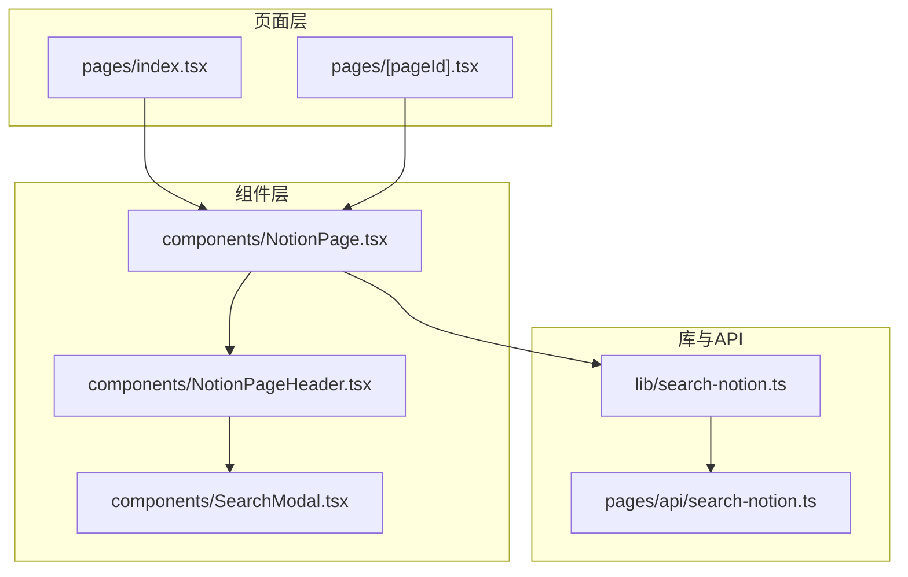
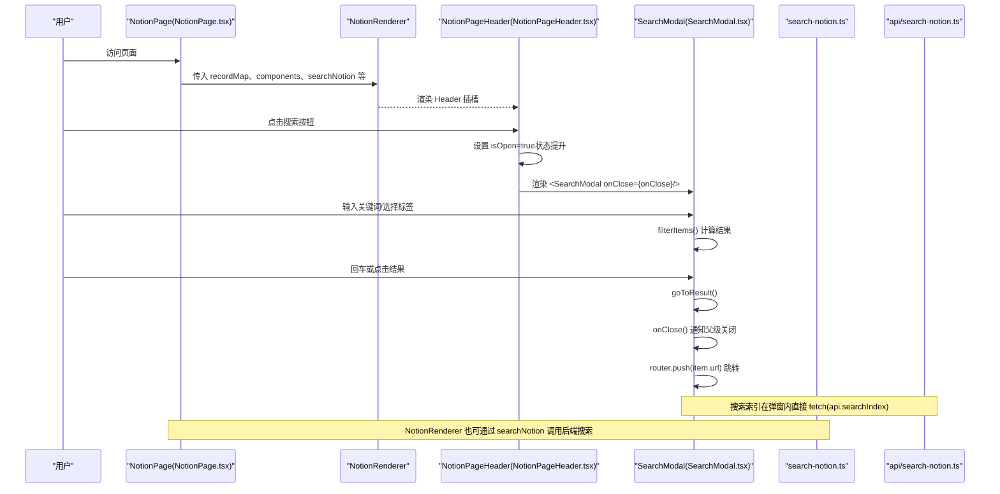
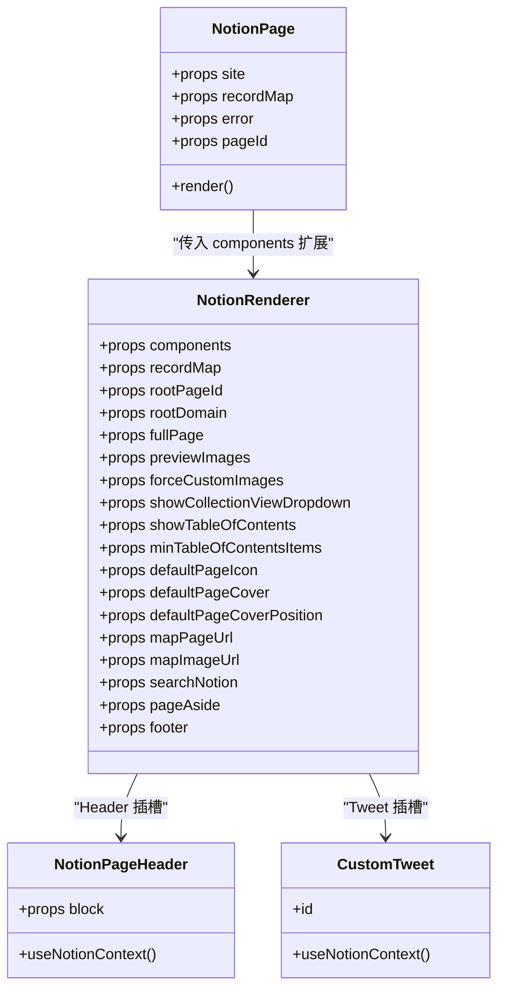
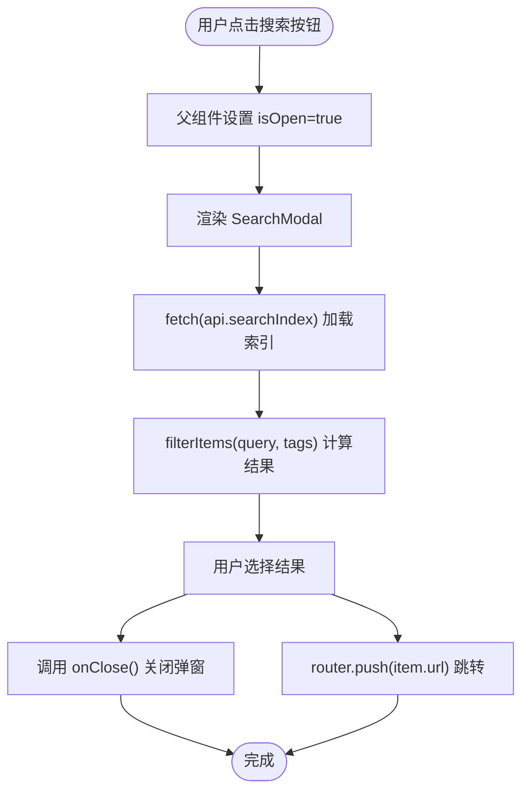
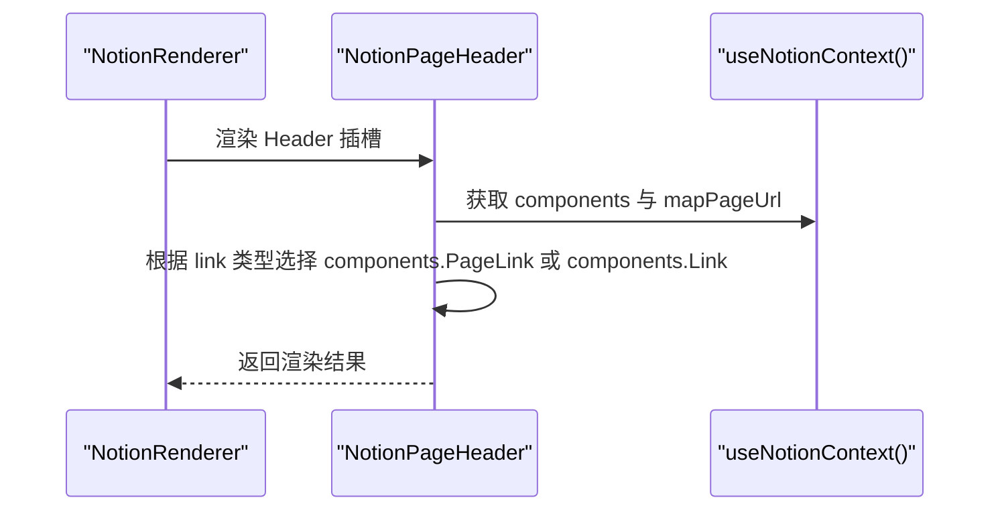
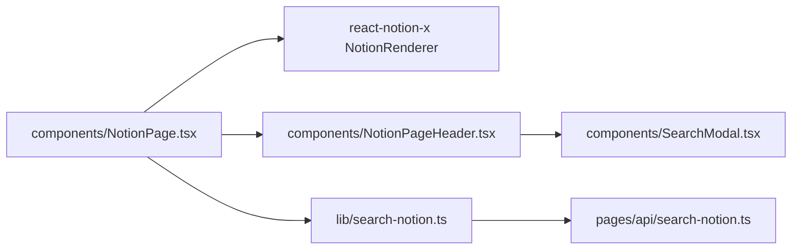

# 组件通信模式

<cite>
**本文引用的文件**   
- [components/NotionPage.tsx](file://components/NotionPage.tsx)
- [components/NotionPageHeader.tsx](file://components/NotionPageHeader.tsx)
- [components/SearchModal.tsx](file://components/SearchModal.tsx)
- [pages/index.tsx](file://pages/index.tsx)
- [pages/[pageId].tsx](file://pages/[pageId].tsx)
- [lib/search-notion.ts](file://lib/search-notion.ts)
- [pages/api/search-notion.ts](file://pages/api/search-notion.ts)
</cite>

## 目录
1. [简介](#简介)
2. [项目结构](#项目结构)
3. [核心组件与通信入口](#核心组件与通信入口)
4. [架构总览](#架构总览)
5. [详细组件分析](#详细组件分析)
6. [依赖关系分析](#依赖关系分析)
7. [性能与可维护性建议](#性能与可维护性建议)
8. [故障排查指南](#故障排查指南)
9. [结论](#结论)

## 简介
本文聚焦于本项目中的“组件通信模式”，系统梳理并解释以下通信方式：
- Props 传递（父到子、回调函数）
- Context API（通过 react-notion-x 的上下文扩展渲染行为）
- 事件回调（打开/关闭弹窗、导航跳转等）
- NotionRenderer 与自定义组件之间的通信机制，特别是 components 属性的扩展方式
- 搜索功能中 SearchModal 与主页面的通信实现
- 状态提升、事件冒泡等高级技巧在本项目中的体现

目标是帮助读者快速理解代码中各组件如何协作，并在需要时进行扩展或定制。

## 项目结构
本项目的页面层由 Next.js 路由驱动，内容渲染由 react-notion-x 提供，UI 交互集中在 components 目录。关键路径如下：
- pages/index.tsx 与 pages/[pageId].tsx：Next.js 页面入口，负责获取数据并渲染 NotionPage
- components/NotionPage.tsx：封装 NotionRenderer，注入主题、图片映射、搜索能力、页眉/页脚等
- components/NotionPageHeader.tsx：作为 NotionRenderer 的 Header 插槽，集成面包屑、导航链接、主题切换与搜索按钮
- components/SearchModal.tsx：搜索弹窗，独立管理自身状态并通过 onClose 回调通知父级
- lib/search-notion.ts 与 pages/api/search-notion.ts：前端搜索请求封装与服务端接口

图表来源
- [pages/index.tsx:1-23](file://pages/index.tsx#L1-L23)
- [pages/[pageId].tsx:1-36](file://pages/[pageId].tsx#L1-L36)
- [components/NotionPage.tsx:301-353](file://components/NotionPage.tsx#L301-L353)
- [components/NotionPageHeader.tsx:78-129](file://components/NotionPageHeader.tsx#L78-L129)
- [components/SearchModal.tsx:57-129](file://components/SearchModal.tsx#L57-L129)
- [lib/search-notion.ts:1-39](file://lib/search-notion.ts#L1-L39)
- [pages/api/search-notion.ts:1-25](file://pages/api/search-notion.ts#L1-L25)

章节来源
- [pages/index.tsx:1-23](file://pages/index.tsx#L1-L23)
- [pages/[pageId].tsx:1-36](file://pages/[pageId].tsx#L1-L36)

## 核心组件与通信入口
- NotionPage：作为页面容器，负责将站点配置、recordMap、主题、搜索能力等以 props 形式传递给 NotionRenderer，并通过 components 属性注入自定义渲染器与 UI 组件。
- NotionPageHeader：作为 NotionRenderer 的 Header 插槽，使用 useNotionContext 获取 components 与 mapPageUrl，渲染面包屑、导航链接、主题切换与搜索按钮；同时通过本地状态控制 SearchModal 的显示。
- SearchModal：独立弹窗组件，内部维护查询、标签过滤、结果列表等状态，通过 onClose 回调通知父级关闭弹窗，并使用 router.push 进行页面跳转。

章节来源
- [components/NotionPage.tsx:196-209](file://components/NotionPage.tsx#L196-L209)
- [components/NotionPage.tsx:319-353](file://components/NotionPage.tsx#L319-L353)
- [components/NotionPageHeader.tsx:78-129](file://components/NotionPageHeader.tsx#L78-L129)
- [components/SearchModal.tsx:57-129](file://components/SearchModal.tsx#L57-L129)

## 架构总览
下图展示了从页面加载到搜索结果跳转的完整流程，包括 NotionRenderer 的渲染与扩展、SearchButton 的状态提升、SearchModal 的事件回调以及搜索 API 调用。

图表来源
- [components/NotionPage.tsx:319-353](file://components/NotionPage.tsx#L319-L353)
- [components/NotionPageHeader.tsx:37-76](file://components/NotionPageHeader.tsx#L37-L76)
- [components/SearchModal.tsx:57-129](file://components/SearchModal.tsx#L57-L129)
- [lib/search-notion.ts:1-39](file://lib/search-notion.ts#L1-L39)
- [pages/api/search-notion.ts:1-25](file://pages/api/search-notion.ts#L1-L25)

## 详细组件分析

### NotionRenderer 与自定义组件通信（components 属性扩展）
NotionPage 通过 notionRendererComponents 对象对 NotionRenderer 的 components 进行扩展，从而在不侵入第三方库的前提下定制渲染行为。扩展点包括：
- nextImage、nextLink：替换为 Next.js 的 Image 与 Link，优化图片与路由体验
- Code、Collection、Equation、Pdf、Modal：按需动态导入第三方渲染器
- Tweet：自定义推文渲染，基于 useNotionContext 读取 recordMap 中的 tweets
- Header：替换为 NotionPageHeader，集成面包屑、导航、主题切换与搜索
- propertyLastEditedTimeValue、propertyTextValue、propertyDateValue：自定义属性值渲染逻辑

图表来源
- [components/NotionPage.tsx:196-209](file://components/NotionPage.tsx#L196-L209)
- [components/NotionPage.tsx:319-353](file://components/NotionPage.tsx#L319-L353)
- [components/NotionPageHeader.tsx:78-129](file://components/NotionPageHeader.tsx#L78-L129)

章节来源
- [components/NotionPage.tsx:196-209](file://components/NotionPage.tsx#L196-L209)
- [components/NotionPage.tsx:319-353](file://components/NotionPage.tsx#L319-L353)

### 搜索功能：SearchModal 与主页面的通信
SearchModal 与主页面（通过 NotionPageHeader）之间采用“状态提升 + 事件回调”的模式：
- 状态提升：SearchButton 在父组件中维护 isOpen 状态，控制是否渲染 SearchModal
- 事件回调：SearchModal 通过 onClose 回调通知父组件关闭弹窗
- 导航跳转：SearchModal 内部使用 router.push 跳转到目标页面
- 搜索数据：SearchModal 在挂载后直接 fetch 搜索索引（api.searchIndex），并在本地进行关键词与标签过滤

图表来源
- [components/NotionPageHeader.tsx:37-76](file://components/NotionPageHeader.tsx#L37-L76)
- [components/SearchModal.tsx:57-129](file://components/SearchModal.tsx#L57-L129)
- [components/SearchModal.tsx:153-252](file://components/SearchModal.tsx#L153-L252)

章节来源
- [components/NotionPageHeader.tsx:37-76](file://components/NotionPageHeader.tsx#L37-L76)
- [components/SearchModal.tsx:57-129](file://components/SearchModal.tsx#L57-L129)
- [components/SearchModal.tsx:153-252](file://components/SearchModal.tsx#L153-L252)

### 使用 Context API 扩展渲染行为
NotionPageHeader 通过 useNotionContext 获取 components 与 mapPageUrl，用于：
- 渲染导航链接：根据 link.pageId 或 link.url 决定使用 components.PageLink 或 components.Link
- 保持与 NotionRenderer 的上下文一致，确保路由映射与组件替换生效

图表来源
- [components/NotionPageHeader.tsx:78-129](file://components/NotionPageHeader.tsx#L78-L129)

章节来源
- [components/NotionPageHeader.tsx:78-129](file://components/NotionPageHeader.tsx#L78-L129)

### 事件回调与状态提升的高级用法
- 状态提升：SearchButton 在父组件中维护 isOpen，避免在子组件中直接操作 DOM 或全局状态
- 事件冒泡：SearchModal 的 overlay 点击触发 onClose，内部 modal 区域阻止事件冒泡以避免误关闭
- 键盘事件：SearchModal 支持 Esc 关闭、上下键移动高亮、Enter 选择结果，提升可访问性与用户体验

章节来源
- [components/NotionPageHeader.tsx:37-76](file://components/NotionPageHeader.tsx#L37-L76)
- [components/SearchModal.tsx:131-147](file://components/SearchModal.tsx#L131-L147)
- [components/SearchModal.tsx:153-164](file://components/SearchModal.tsx#L153-L164)

## 依赖关系分析
- NotionPage 依赖 NotionRenderer 与多个自定义组件（Code、Collection、Equation、Pdf、Modal、Tweet、Header）
- NotionPageHeader 依赖 react-notion-x 的 Breadcrumbs 与 useNotionContext，并引入 SearchModal
- SearchModal 依赖 Next.js Router 与 React DOM Portal，直接调用 api.searchIndex
- 搜索链路：NotionPage 可通过 searchNotion 调用 lib/search-notion.ts，后者再调用 pages/api/search-notion.ts

图表来源
- [components/NotionPage.tsx:319-353](file://components/NotionPage.tsx#L319-L353)
- [components/NotionPageHeader.tsx:78-129](file://components/NotionPageHeader.tsx#L78-L129)
- [components/SearchModal.tsx:57-129](file://components/SearchModal.tsx#L57-L129)
- [lib/search-notion.ts:1-39](file://lib/search-notion.ts#L1-L39)
- [pages/api/search-notion.ts:1-25](file://pages/api/search-notion.ts#L1-L25)

章节来源
- [components/NotionPage.tsx:319-353](file://components/NotionPage.tsx#L319-L353)
- [components/NotionPageHeader.tsx:78-129](file://components/NotionPageHeader.tsx#L78-L129)
- [components/SearchModal.tsx:57-129](file://components/SearchModal.tsx#L57-L129)
- [lib/search-notion.ts:1-39](file://lib/search-notion.ts#L1-L39)
- [pages/api/search-notion.ts:1-25](file://pages/api/search-notion.ts#L1-L25)

## 性能与可维护性建议
- 按需动态导入：Code、Collection、Equation、Pdf、Modal 等重型组件通过 dynamic 延迟加载，减少首屏体积
- 缓存策略：searchNotion 使用 pMemoize 与 ExpiryMap 进行短期缓存，降低重复请求开销
- 服务端渲染与客户端渲染分离：Collection 与 Pdf 等组件仅在客户端渲染，避免 SSR 不匹配
- 可访问性：SearchModal 提供 aria-modal、aria-label、键盘导航等特性，提升无障碍体验

[本节为通用指导，不直接分析具体文件]

## 故障排查指南
- 搜索索引加载失败：检查 api.searchIndex 是否可达，确认 fetch 响应状态码与错误信息
- 非 2xx 响应处理：lib/search-notion.ts 会将非成功响应转换为错误对象，便于上层捕获
- 弹窗无法关闭：确认 onClose 回调是否正确传递至 SearchModal，且 overlay 点击未阻止默认行为
- 主题切换无效：检查 useDarkMode 的 toggleDarkMode 是否被正确调用，并确保 body 类名更新

章节来源
- [lib/search-notion.ts:12-32](file://lib/search-notion.ts#L12-L32)
- [components/SearchModal.tsx:80-106](file://components/SearchModal.tsx#L80-L106)
- [components/SearchModal.tsx:153-164](file://components/SearchModal.tsx#L153-L164)

## 结论
本项目通过 Props 传递、Context API 与事件回调等多种通信模式，实现了 NotionRenderer 的灵活扩展与搜索功能的解耦。NotionPage 作为中心枢纽，将站点配置与渲染能力注入 NotionRenderer；NotionPageHeader 通过 useNotionContext 与 components 扩展点统一渲染导航与搜索入口；SearchModal 则以状态提升与回调的方式与父组件协作，保证状态清晰与职责单一。这些模式共同构成了一个可扩展、易维护的组件通信体系。