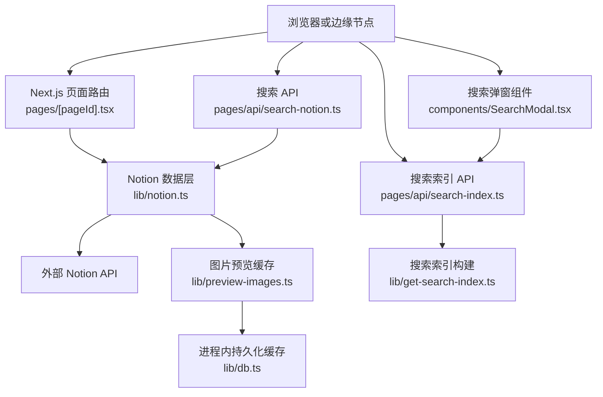
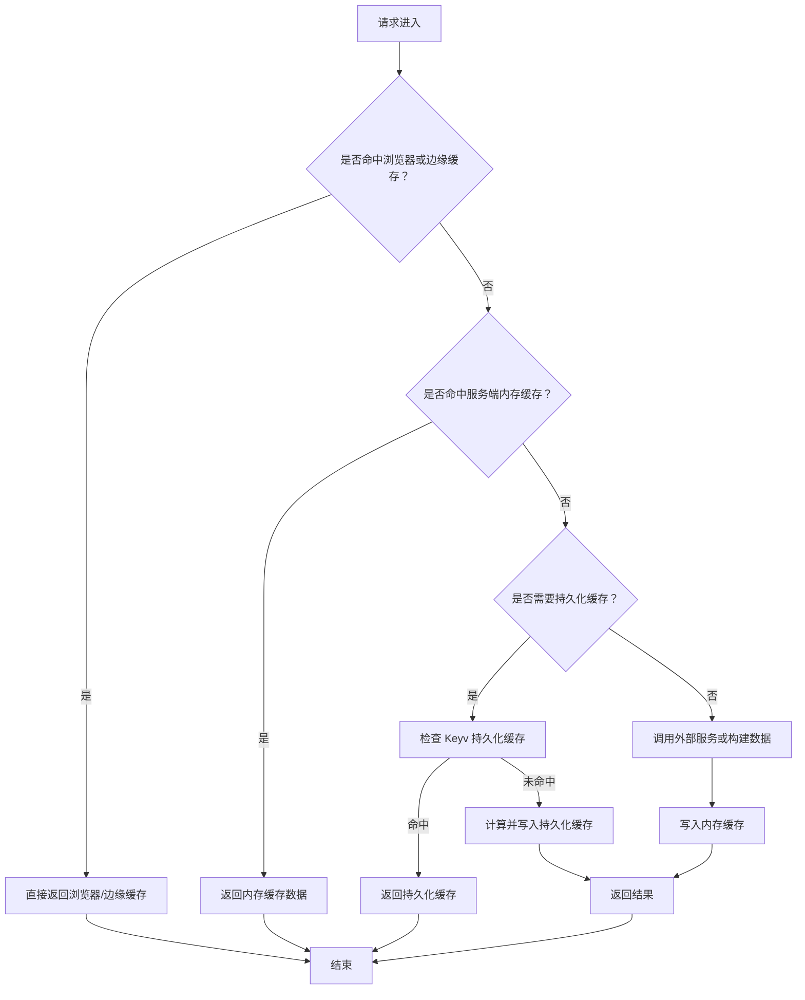
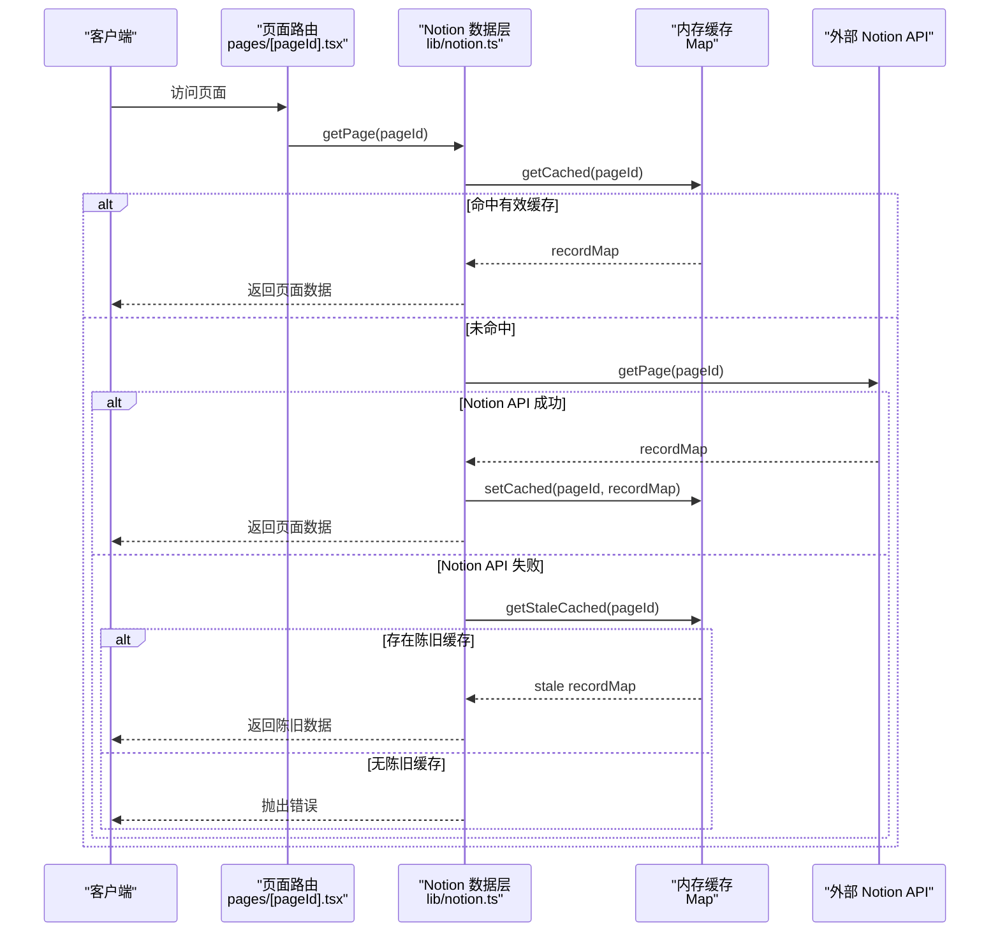
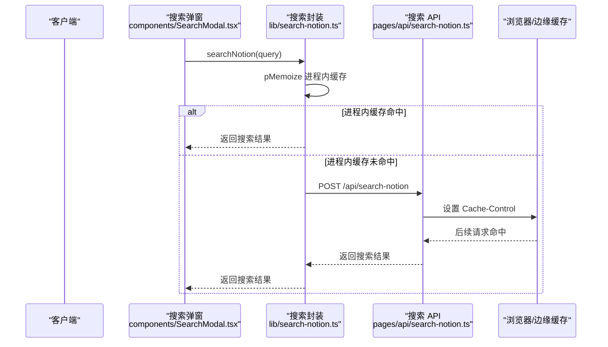
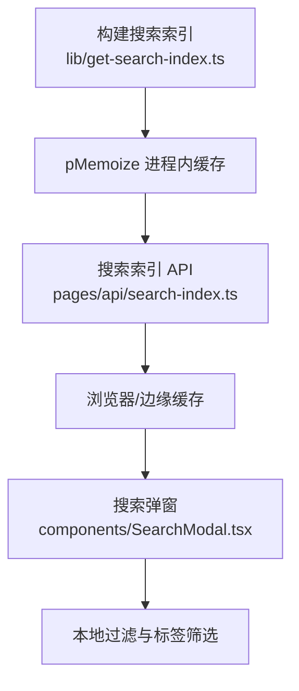
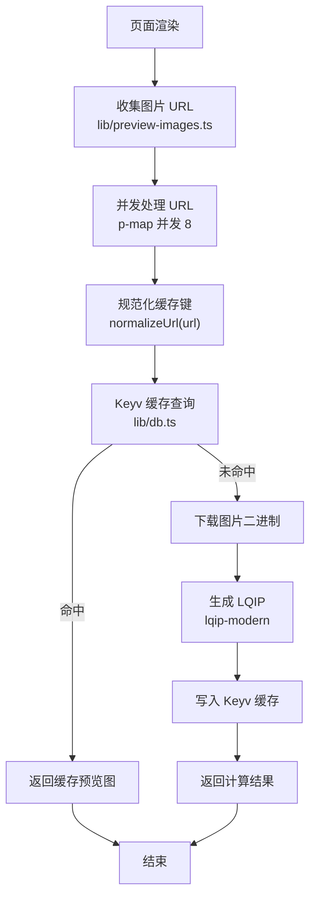
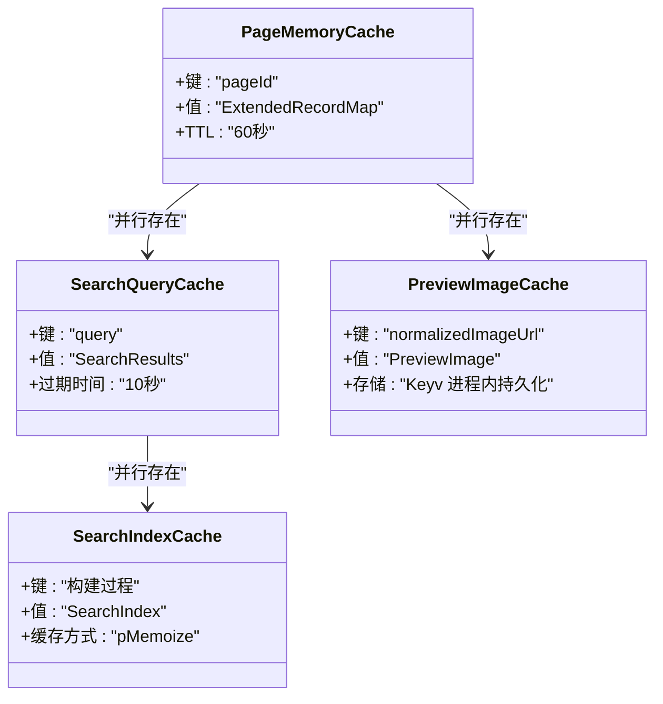
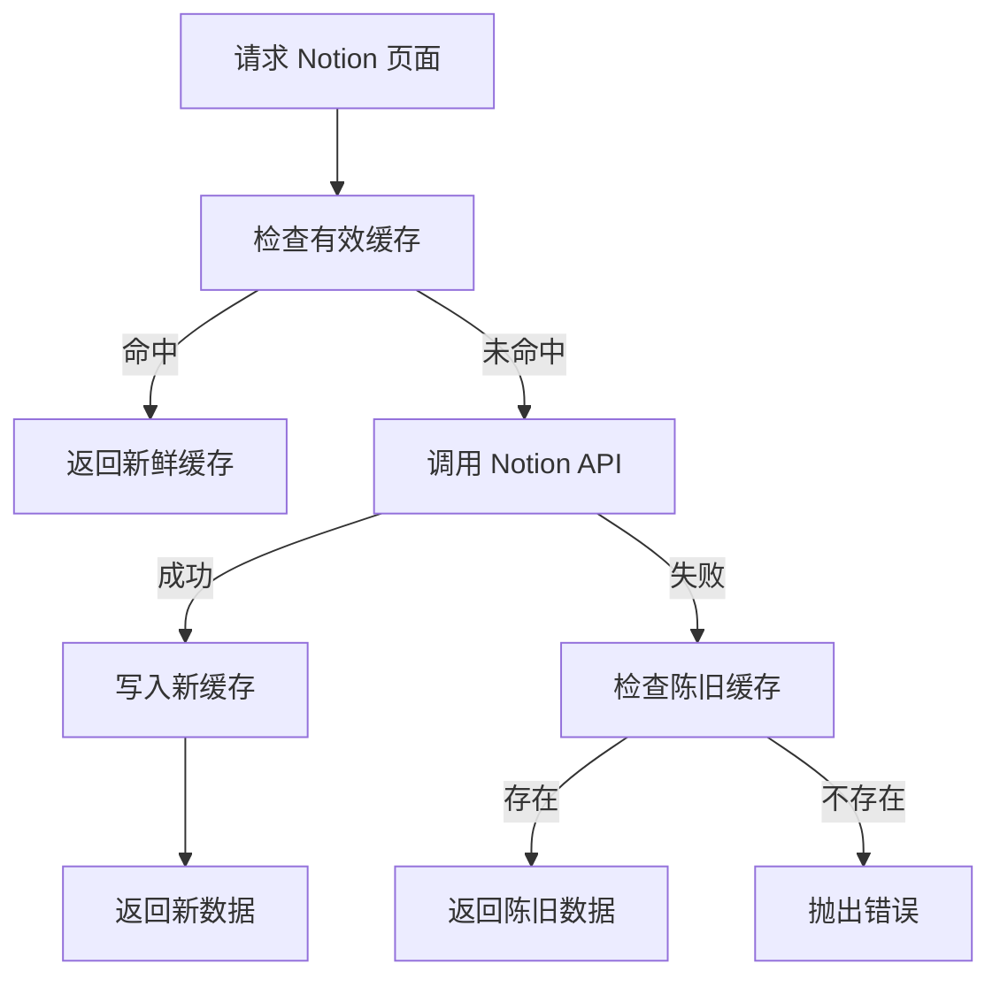

# 缓存策略

<cite>
**本文引用的文件**   
- [lib/notion.ts](file://lib/notion.ts)
- [lib/search-notion.ts](file://lib/search-notion.ts)
- [lib/preview-images.ts](file://lib/preview-images.ts)
- [lib/db.ts](file://lib/db.ts)
- [lib/config.ts](file://lib/config.ts)
- [lib/get-search-index.ts](file://lib/get-search-index.ts)
- [pages/api/search-notion.ts](file://pages/api/search-notion.ts)
- [pages/api/search-index.ts](file://pages/api/search-index.ts)
- [components/SearchModal.tsx](file://components/SearchModal.tsx)
- [pages/[pageId].tsx](file://pages/[pageId].tsx)
- [next.config.js](file://next.config.js)
</cite>

## 目录
1. [引言](#引言)
2. [项目结构与缓存边界](#项目结构与缓存边界)
3. [多级缓存架构总览](#多级缓存架构总览)
4. [内存缓存层：Notion 页面数据缓存](#内存缓存层notion-页面数据缓存)
5. [浏览器与边缘缓存层：搜索接口与搜索索引](#浏览器与边缘缓存层搜索接口与搜索索引)
6. [服务器端持久化缓存层：图片预览缓存](#服务器端持久化缓存层图片预览缓存)
7. [缓存键生成策略](#缓存键生成策略)
8. [缓存失效与更新机制](#缓存失效与更新机制)
9. [性能特征与对比建议](#性能特征与对比建议)
10. [最佳实践与排错指南](#最佳实践与排错指南)
11. [结论](#结论)

## 引言
本缓存策略文档面向 Notion 站点中的多级缓存设计，重点说明以下层次：
- 内存缓存层：用于快速返回已组装的 Notion 页面数据，并支持短暂过期后的“陈旧可用”回退。
- 浏览器与边缘缓存层：通过 HTTP `Cache-Control` 对搜索接口和搜索索引进行短期缓存，降低重复请求压力。
- 服务器端持久化缓存层：对图片低质量占位图（LQIP）结果做进程内持久化缓存，避免重复解码和压缩计算。

同时，文档会解释缓存键生成、缓存失效、缓存更新策略，并结合代码路径给出流程图、依赖关系图和可操作的最佳实践。

## 项目结构与缓存边界
该仓库采用 Next.js 结构，缓存相关逻辑主要分布在以下位置：
- 服务端内存缓存与 Notion 数据获取：`lib/notion.ts`
- 客户端搜索封装与进程内搜索查询缓存：`lib/search-notion.ts`
- 图片预览 LQIP 生成与持久化缓存：`lib/preview-images.ts`、`lib/db.ts`
- 搜索索引构建与缓存：`lib/get-search-index.ts`
- 搜索 API 响应头缓存控制：`pages/api/search-notion.ts`、`pages/api/search-index.ts`
- 前端搜索弹窗加载索引：`components/SearchModal.tsx`
- 页面级增量静态再生配置：`pages/[pageId].tsx`
- 全局站点配置与缓存相关开关：`lib/config.ts`
- 图片优化与远程域名白名单：`next.config.js`

**图表来源**
- [pages/[pageId].tsx:8-23](file://pages/[pageId].tsx#L8-L23)
- [lib/notion.ts:161-213](file://lib/notion.ts#L161-L213)
- [lib/preview-images.ts:33-101](file://lib/preview-images.ts#L33-L101)
- [lib/db.ts:1-7](file://lib/db.ts#L1-L7)
- [pages/api/search-notion.ts:6-24](file://pages/api/search-notion.ts#L6-L24)
- [pages/api/search-index.ts:5-20](file://pages/api/search-index.ts#L5-L20)
- [lib/get-search-index.ts:42-98](file://lib/get-search-index.ts#L42-L98)
- [components/SearchModal.tsx:80-106](file://components/SearchModal.tsx#L80-L106)

**章节来源**
- [lib/notion.ts:19-55](file://lib/notion.ts#L19-L55)
- [lib/preview-images.ts:1-15](file://lib/preview-images.ts#L1-L15)
- [lib/db.ts:1-7](file://lib/db.ts#L1-L7)
- [lib/config.ts:68-72](file://lib/config.ts#L68-L72)
- [pages/api/search-notion.ts:20-24](file://pages/api/search-notion.ts#L20-L24)
- [pages/api/search-index.ts:12-16](file://pages/api/search-index.ts#L12-L16)

## 多级缓存架构总览
整体缓存体系分为三层：
1. **浏览器与边缘缓存层**：由 Next.js 和 CDN 根据 `Cache-Control` 响应头进行缓存，适用于搜索接口和搜索索引等相对稳定的数据。
2. **服务端内存缓存层**：基于进程内 Map 和 p-memoize 的轻量缓存，用于 Notion 页面数据和搜索查询结果，减少对外部 Notion API 的调用。
3. **服务器端持久化缓存层**：基于 Keyv 的进程内持久化存储，用于图片预览 LQIP 结果，避免重复图像解码与压缩。

[本图为概念性流程，不直接映射具体源码文件]

## 内存缓存层：Notion 页面数据缓存
### 设计目标
- 在 TTL 窗口内，同一 pageId 的请求直接返回已组装的 `ExtendedRecordMap`，不再访问 Notion API。
- 当 Notion API 不可用时，返回“陈旧但可用”的缓存数据，保证站点可用性。
- 对导航链接页面和集合视图排序过滤进行补充处理，确保渲染顺序与 Notion 一致。

### 关键实现要点
- 使用进程内 `Map` 作为内存缓存，TTL 为 60 秒。
- 提供三个核心函数：读取有效缓存、读取陈旧缓存、写入缓存。
- `getPage` 方法优先返回有效缓存；若失败则尝试陈旧缓存；成功后再执行导航链接合并、集合查询修正、预览图注入、推文信息注入，最后写回缓存。

**图表来源**
- [lib/notion.ts:31-55](file://lib/notion.ts#L31-L55)
- [lib/notion.ts:161-213](file://lib/notion.ts#L161-L213)
- [pages/[pageId].tsx:8-23](file://pages/[pageId].tsx#L8-L23)

**章节来源**
- [lib/notion.ts:19-55](file://lib/notion.ts#L19-L55)
- [lib/notion.ts:95-159](file://lib/notion.ts#L95-L159)
- [lib/notion.ts:161-213](file://lib/notion.ts#L161-L213)

## 浏览器与边缘缓存层：搜索接口与搜索索引
### 搜索接口缓存
- 客户端通过 `lib/search-notion.ts` 发起搜索请求，并使用 `pMemoize` 对相同查询参数进行进程内缓存。
- 服务端 API `pages/api/search-notion.ts` 设置 `Cache-Control` 为公共缓存，短时效 + 陈旧重验证，适合频繁搜索场景。

**图表来源**
- [lib/search-notion.ts:7-10](file://lib/search-notion.ts#L7-L10)
- [lib/search-notion.ts:12-32](file://lib/search-notion.ts#L12-L32)
- [pages/api/search-notion.ts:6-24](file://pages/api/search-notion.ts#L6-L24)
- [components/SearchModal.tsx:80-106](file://components/SearchModal.tsx#L80-L106)

**章节来源**
- [lib/search-notion.ts:1-39](file://lib/search-notion.ts#L1-L39)
- [pages/api/search-notion.ts:6-24](file://pages/api/search-notion.ts#L6-L24)

### 搜索索引缓存
- 搜索索引由 `lib/get-search-index.ts` 构建，并通过 `pMemoize` 进行进程内缓存。
- API `pages/api/search-index.ts` 设置更长的 `Cache-Control`，适合低频更新的索引数据。
- 前端 `components/SearchModal.tsx` 在打开搜索时拉取一次索引，并在本地进行过滤和标签筛选。

**图表来源**
- [lib/get-search-index.ts:42-98](file://lib/get-search-index.ts#L42-L98)
- [pages/api/search-index.ts:5-20](file://pages/api/search-index.ts#L5-L20)
- [components/SearchModal.tsx:80-106](file://components/SearchModal.tsx#L80-L106)
- [components/SearchModal.tsx:29-55](file://components/SearchModal.tsx#L29-L55)

**章节来源**
- [lib/get-search-index.ts:11-23](file://lib/get-search-index.ts#L11-L23)
- [lib/get-search-index.ts:42-98](file://lib/get-search-index.ts#L42-L98)
- [pages/api/search-index.ts:5-20](file://pages/api/search-index.ts#L5-L20)
- [components/SearchModal.tsx:29-55](file://components/SearchModal.tsx#L29-L55)

## 服务器端持久化缓存层：图片预览缓存
### 设计目标
- 对页面中需要展示的图片提取 URL，生成低质量占位图（LQIP），并将结果持久化到进程内 Keyv 缓存。
- 使用 `normalizeUrl` 作为缓存键，避免重复计算。
- 对 Notion 托管图片和 data URL 做特殊处理，确保 next/image 能正确渲染尺寸。

### 关键实现要点
- `getPreviewImageMap` 收集所有可预览图片 URL，并发调用 `getPreviewImage`。
- `createPreviewImage` 先查 Keyv 缓存，未命中则下载图片、生成 LQIP、写回 Keyv。
- `getPreviewImage` 使用 `pMemoize` 对同一次请求内的重复 URL 去重。

**图表来源**
- [lib/preview-images.ts:33-57](file://lib/preview-images.ts#L33-L57)
- [lib/preview-images.ts:59-101](file://lib/preview-images.ts#L59-L101)
- [lib/db.ts:1-7](file://lib/db.ts#L1-L7)

**章节来源**
- [lib/preview-images.ts:16-31](file://lib/preview-images.ts#L16-L31)
- [lib/preview-images.ts:33-57](file://lib/preview-images.ts#L33-L57)
- [lib/preview-images.ts:59-101](file://lib/preview-images.ts#L59-L101)
- [lib/db.ts:1-7](file://lib/db.ts#L1-L7)

## 缓存键生成策略
不同缓存层的键生成策略如下：
- **Notion 页面内存缓存**：以 `pageId` 作为键，区分不同页面。
- **搜索查询进程内缓存**：以查询字符串 `query` 作为键，使用 `ExpiryMap` 设置 10 秒过期。
- **图片预览持久化缓存**：以规范化后的图片 URL `normalizeUrl(url)` 作为键，避免协议、大小写、路径差异导致的重复计算。
- **搜索索引进程内缓存**：以整个构建过程为单元，通过 `pMemoize` 缓存 `getSearchIndexImpl` 的结果。

**图表来源**
- [lib/notion.ts:31-55](file://lib/notion.ts#L31-L55)
- [lib/search-notion.ts:7-10](file://lib/search-notion.ts#L7-L10)
- [lib/preview-images.ts:43-54](file://lib/preview-images.ts#L43-L54)
- [lib/get-search-index.ts:42-42](file://lib/get-search-index.ts#L42-L42)

**章节来源**
- [lib/notion.ts:31-55](file://lib/notion.ts#L31-L55)
- [lib/search-notion.ts:7-10](file://lib/search-notion.ts#L7-L10)
- [lib/preview-images.ts:43-54](file://lib/preview-images.ts#L43-L54)
- [lib/get-search-index.ts:42-42](file://lib/get-search-index.ts#L42-L42)

## 缓存失效与更新机制
### Notion 页面缓存失效
- 内存缓存 TTL 为 60 秒，超过后视为陈旧但仍保留用于回退。
- 当 Notion API 不可用时，优先返回陈旧缓存，避免全站 500。
- 页面级增量静态再生（ISR）通过 `revalidateSeconds` 控制重新构建周期，默认 3600 秒。

**图表来源**
- [lib/notion.ts:31-55](file://lib/notion.ts#L31-L55)
- [lib/notion.ts:161-213](file://lib/notion.ts#L161-L213)
- [pages/[pageId].tsx:8-23](file://pages/[pageId].tsx#L8-L23)
- [lib/config.ts:93-98](file://lib/config.ts#L93-L98)

**章节来源**
- [lib/notion.ts:31-55](file://lib/notion.ts#L31-L55)
- [lib/notion.ts:161-213](file://lib/notion.ts#L161-L213)
- [pages/[pageId].tsx:8-23](file://pages/[pageId].tsx#L8-L23)
- [lib/config.ts:93-98](file://lib/config.ts#L93-L98)

### 搜索查询缓存失效
- 使用 `ExpiryMap(10_000)`，查询结果在 10 秒后过期。
- 适合高频搜索场景，避免短时间内重复网络请求。

**章节来源**
- [lib/search-notion.ts:1-10](file://lib/search-notion.ts#L1-L10)

### 图片预览缓存失效
- 当前实现未显式设置过期时间，Keyv 默认行为取决于底层存储配置。
- 建议在部署环境启用 Redis 后端以实现分布式共享和可控过期。

**章节来源**
- [lib/db.ts:1-7](file://lib/db.ts#L1-L7)
- [lib/preview-images.ts:67-91](file://lib/preview-images.ts#L67-L91)

### 搜索索引缓存失效
- 通过 `pMemoize` 缓存构建结果，进程重启后重建。
- API 层设置较长 `Cache-Control`，适合低频更新场景。

**章节来源**
- [lib/get-search-index.ts:42-98](file://lib/get-search-index.ts#L42-L98)
- [pages/api/search-index.ts:12-16](file://pages/api/search-index.ts#L12-L16)

## 性能特征与对比建议
### 各层缓存性能特征
- **浏览器与边缘缓存**：延迟最低，带宽占用最小，适合稳定且频繁访问的数据，如搜索索引。
- **服务端内存缓存**：延迟极低，适合进程内高频访问数据，如 Notion 页面数据。
- **服务器端持久化缓存**：避免重复 I/O 和 CPU 计算，适合图片 LQIP 等耗时操作。

### 建议的性能对比维度
- 首次请求延迟：比较未命中缓存 vs 命中缓存。
- 重复请求延迟：评估缓存命中率对平均延迟的影响。
- 资源占用：监控进程内存、Keyv 存储大小、外部 API 调用次数。
- 错误恢复：观察 Notion API 故障时陈旧缓存的可用性。

[本节为通用性能讨论，不直接分析具体源码文件]

## 最佳实践与排错指南
### 最佳实践
- 合理设置 TTL：Notion 页面缓存 60 秒平衡新鲜度与稳定性；搜索索引缓存更长；搜索查询缓存较短。
- 使用规范化键：图片 URL 使用 `normalizeUrl` 避免键不一致。
- 启用陈旧重验证：搜索接口和索引接口使用 `stale-while-revalidate` 提升用户体验。
- 限制并发：图片预览并发设为 8，导航链接并发设为 4，集合查询并发设为 3，避免过载。
- 配置重试与超时：Notion API 使用 ofetch 重试 3 次，状态码覆盖 408、429、500、502、503、504，超时 30 秒。

**章节来源**
- [lib/notion.ts:57-81](file://lib/notion.ts#L57-L81)
- [lib/notion.ts:111-158](file://lib/notion.ts#L111-L158)
- [lib/preview-images.ts:43-54](file://lib/preview-images.ts#L43-L54)
- [lib/notion-api.ts:6-19](file://lib/notion-api.ts#L6-L19)

### 排错指南
- 如果 Notion API 频繁失败，检查重试配置和超时设置。
- 如果图片预览未生效，确认 `isPreviewImageSupportEnabled` 配置和 `next.config.js` 中远程域名白名单。
- 如果搜索索引为空，检查 `getSearchIndex` 构建逻辑和 `public` 页面属性过滤。
- 如果浏览器缓存未生效，检查 API 响应头 `Cache-Control` 是否正确设置。

**章节来源**
- [lib/notion-api.ts:6-19](file://lib/notion-api.ts#L6-L19)
- [lib/config.ts:68-72](file://lib/config.ts#L68-L72)
- [next.config.js:6-25](file://next.config.js#L6-L25)
- [lib/get-search-index.ts:49-88](file://lib/get-search-index.ts#L49-L88)
- [pages/api/search-notion.ts:20-24](file://pages/api/search-notion.ts#L20-L24)
- [pages/api/search-index.ts:12-16](file://pages/api/search-index.ts#L12-L16)

## 结论
该缓存策略通过多层缓存设计，在不牺牲数据新鲜度的前提下显著降低了外部 API 调用压力和前端渲染延迟。内存缓存保障页面数据快速返回，浏览器与边缘缓存优化搜索体验，持久化缓存避免重复图像处理。结合合理的键生成、失效策略和并发控制，系统在高负载下仍能保持稳定和高效。

[本节为总结性内容，不直接分析具体源码文件]