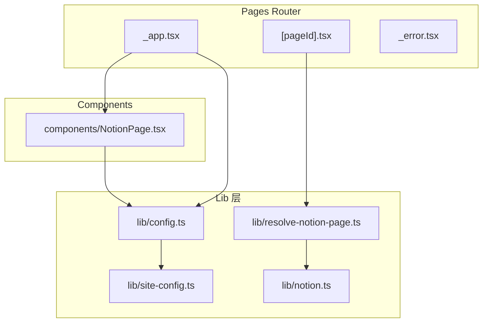
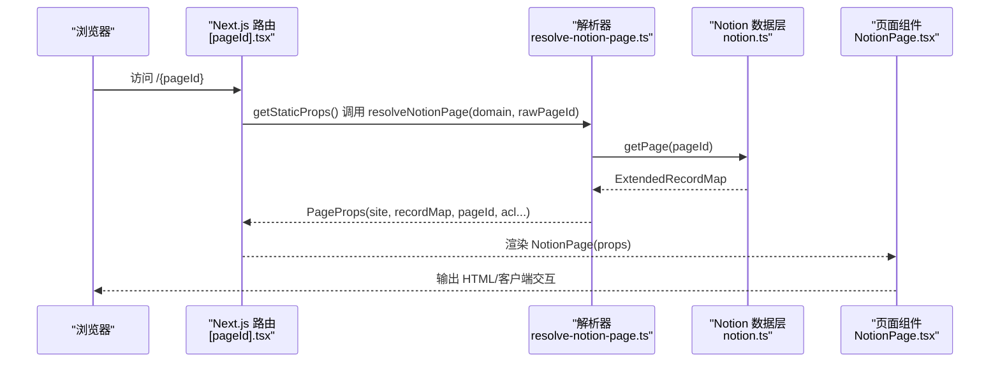
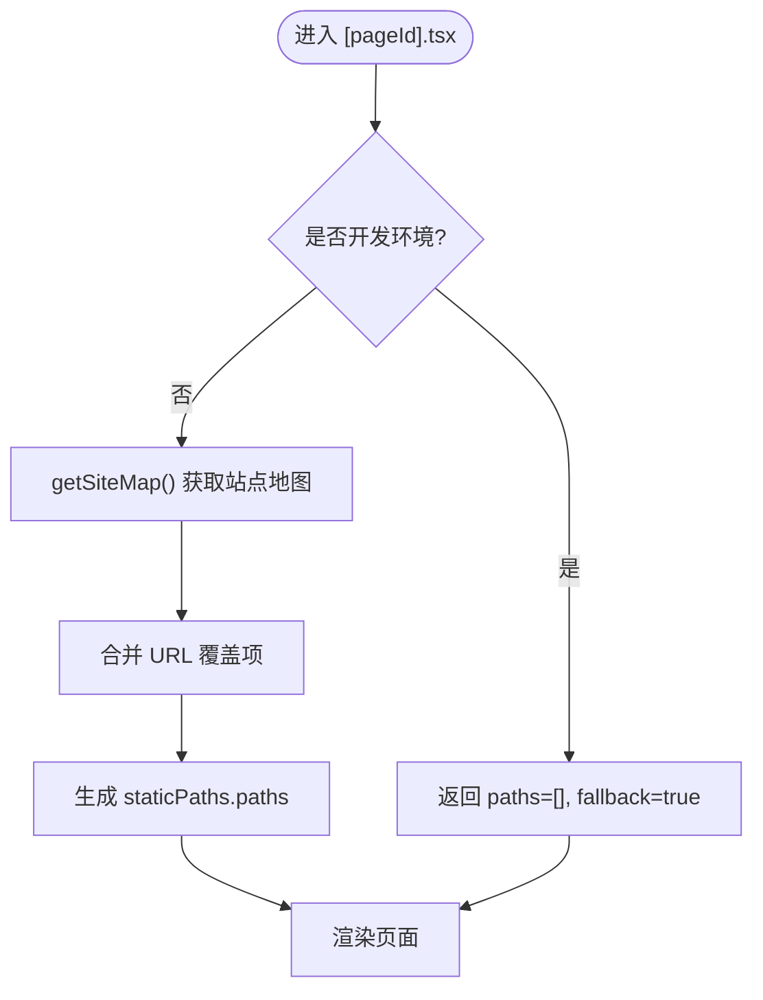
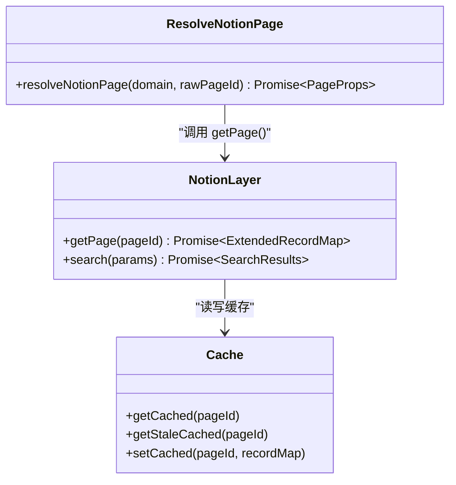
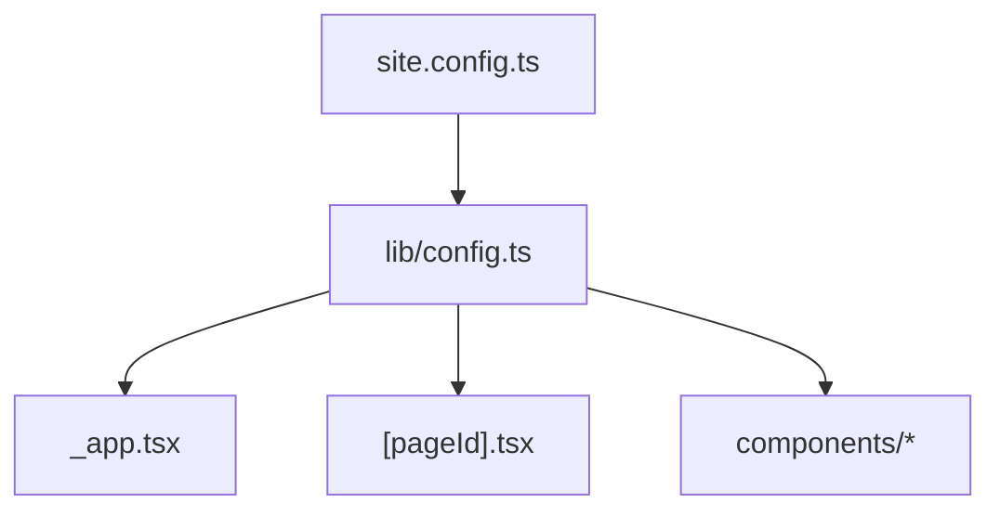
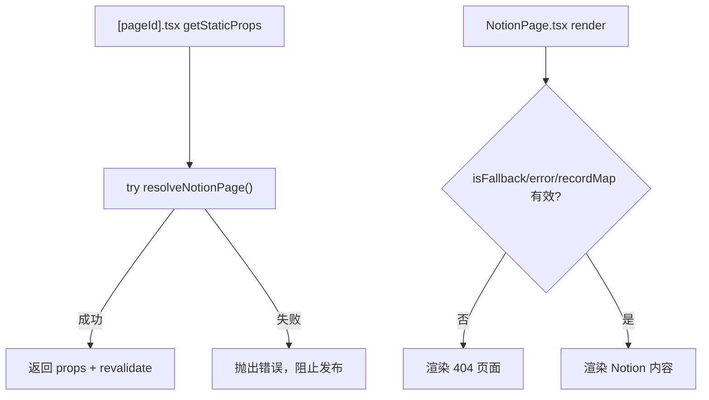
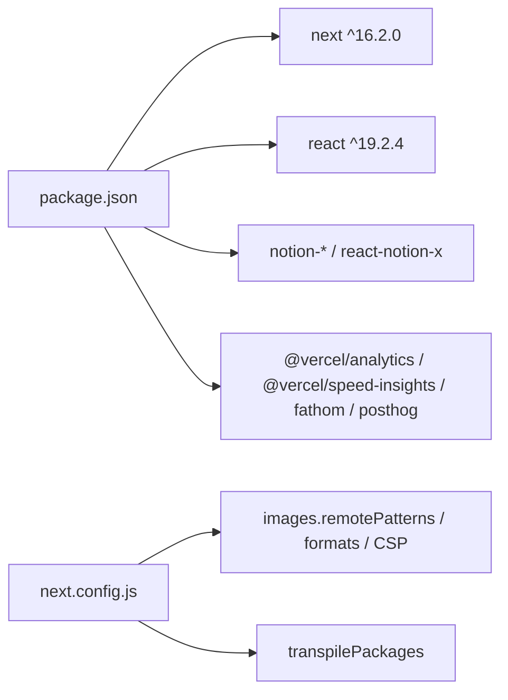
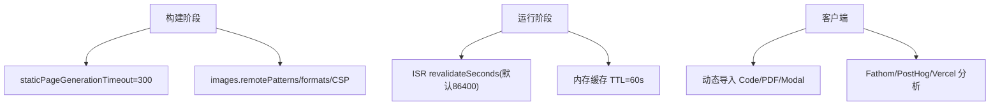

# Next.js 架构模式

<cite>
**本文引用的文件**   
- [package.json](file://package.json)
- [next.config.js](file://next.config.js)
- [site.config.ts](file://site.config.ts)
- [lib/site-config.ts](file://lib/site-config.ts)
- [lib/config.ts](file://lib/config.ts)
- [pages/_app.tsx](file://pages/_app.tsx)
- [pages/[pageId].tsx](file://pages/[pageId].tsx)
- [components/NotionPage.tsx](file://components/NotionPage.tsx)
- [lib/resolve-notion-page.ts](file://lib/resolve-notion-page.ts)
- [lib/notion.ts](file://lib/notion.ts)
- [pages/_error.tsx](file://pages/_error.tsx)
</cite>

## 目录
1. [简介](#简介)
2. [项目结构](#项目结构)
3. [核心组件](#核心组件)
4. [架构总览](#架构总览)
5. [详细组件分析](#详细组件分析)
6. [依赖关系分析](#依赖关系分析)
7. [性能与缓存](#性能与缓存)
8. [故障排查指南](#故障排查指南)
9. [结论](#结论)
10. [附录：扩展实践示例](#附录扩展实践示例)

## 简介
本项目基于 Next.js 构建，使用 Pages Router 将 Notion 内容渲染为高性能、可搜索的静态站点。项目采用“配置驱动 + 服务端数据获取 + 增量静态再生成”的模式，结合全局应用入口、中间层解析逻辑和组件化渲染，形成清晰的职责分层。

- 路由选择：项目使用 Pages Router（`pages/` 目录），而非 App Router。原因包括：成熟的 SSG/ISR 能力、稳定的 API 契约、以及当前业务对服务端数据获取和静态生成的强依赖。
- 动态路由：通过 `[pageId].tsx` 实现任意 Notion 页面到 URL 的动态映射，并配合 `getStaticPaths` 预生成站点地图中的路径。
- 静态与增量：默认启用 ISR，在构建时生成静态页面，并在运行时按配置的间隔进行增量再生成。
- 全局配置：通过 `site.config.ts` 与 `lib/config.ts` 集中管理站点元信息、SEO、分析工具开关、ISR 重验证周期等。
- 错误处理：通过 `_error.tsx` 统一捕获并渲染错误页。
- 中间件机制：当前仓库未包含 Next.js 中间件；如需请求拦截、鉴权或重写，可在根目录新增 `middleware.ts`。

## 项目结构
项目采用功能与层次混合的组织方式：
- `pages/`：Next.js 路由入口，包含动态路由、API 路由、全局布局与错误页。
- `components/`：UI 组件，如 Notion 页面渲染、头部、侧边栏、评论等。
- `lib/`：领域逻辑与工具，包括配置、Notion 数据访问、URL 映射、站点地图、搜索等。
- `styles/`：全局样式与主题。
- `public/`：静态资源。

**图表来源**
- [pages/_app.tsx:1-91](file://pages/_app.tsx#L1-L91)
- [pages/[pageId].tsx:1-58](file://pages/[pageId].tsx#L1-L58)
- [pages/_error.tsx:1-2](file://pages/_error.tsx#L1-L2)
- [lib/config.ts:1-221](file://lib/config.ts#L1-L221)
- [lib/site-config.ts:1-56](file://lib/site-config.ts#L1-L56)
- [lib/resolve-notion-page.ts:1-85](file://lib/resolve-notion-page.ts#L1-L85)
- [lib/notion.ts:1-219](file://lib/notion.ts#L1-L219)
- [components/NotionPage.tsx:1-356](file://components/NotionPage.tsx#L1-L356)

**章节来源**
- [package.json:1-93](file://package.json#L1-L93)
- [next.config.js:1-36](file://next.config.js#L1-L36)

## 核心组件
- 全局应用入口 `_app.tsx`：注入全局样式、第三方分析脚本、路由事件监听、Vercel Analytics/Speed Insights 等。
- 动态路由 `[pageId].tsx`：定义 `getStaticProps` 与 `getStaticPaths`，负责从 Notion 拉取数据、设置 ISR revalidate、预生成路径。
- Notion 页面组件 `components/NotionPage.tsx`：封装 Notion 渲染上下文、SEO 元信息、表格目录、评论、图片映射、深色模式等。
- 配置中心 `lib/config.ts` 与 `lib/site-config.ts`：聚合站点配置、环境变量、域名、SEO、分析开关、ISR 周期等。
- 数据解析 `lib/resolve-notion-page.ts`：根据 URL 解析 Notion pageId，支持 URL 覆盖、URI-to-pageId 缓存、ACL 权限控制。
- Notion 数据层 `lib/notion.ts`：封装 Notion API 调用、内存缓存、集合查询修正、预览图与推文合并等。

**章节来源**
- [pages/_app.tsx:1-91](file://pages/_app.tsx#L1-L91)
- [pages/[pageId].tsx:1-58](file://pages/[pageId].tsx#L1-L58)
- [components/NotionPage.tsx:1-356](file://components/NotionPage.tsx#L1-L356)
- [lib/config.ts:1-221](file://lib/config.ts#L1-L221)
- [lib/site-config.ts:1-56](file://lib/site-config.ts#L1-L56)
- [lib/resolve-notion-page.ts:1-85](file://lib/resolve-notion-page.ts#L1-L85)
- [lib/notion.ts:1-219](file://lib/notion.ts#L1-L219)

## 架构总览
下图展示一次典型请求的数据流：浏览器访问动态路由 → Next.js 执行 `getStaticProps` → 解析 URL 到 Notion pageId → 读取 Notion 数据 → 返回 props 给页面组件渲染。

**图表来源**
- [pages/[pageId].tsx:9-25](file://pages/[pageId].tsx#L9-L25)
- [lib/resolve-notion-page.ts:11-84](file://lib/resolve-notion-page.ts#L11-L84)
- [lib/notion.ts:161-214](file://lib/notion.ts#L161-L214)
- [components/NotionPage.tsx:211-355](file://components/NotionPage.tsx#L211-L355)

## 详细组件分析

### 路由与动态路由机制
- 使用 Pages Router 的 `[pageId].tsx` 作为动态路由。
- `getStaticPaths`：
  - 开发环境返回空路径并开启 fallback，按需生成。
  - 生产环境通过站点地图 `getSiteMap()` 收集所有 canonical pageId，并与 URL 覆盖项合并，生成静态路径列表。
- `getStaticProps`：
  - 调用 `resolveNotionPage` 获取页面数据。
  - 返回 `{ props, revalidate }` 以启用 ISR。
  - 异常时抛出错误，避免发布错误版本页面。

**图表来源**
- [pages/[pageId].tsx:27-52](file://pages/[pageId].tsx#L27-L52)

**章节来源**
- [pages/[pageId].tsx:1-58](file://pages/[pageId].tsx#L1-L58)

### 页面数据解析与 Notion 集成
- `resolve-notion-page.ts`：
  - 优先解析 rawPageId，若无效则尝试 URL 覆盖或 URI-to-pageId 缓存。
  - 回退到站点地图 canonical 映射。
  - 最终调用 `getPage` 获取记录，并附加 ACL 权限结果。
- `notion.ts`：
  - 提供内存级缓存（TTL 60s），用于吸收突发流量与 Notion 抖动。
  - 当 Notion 不可用时，返回过期缓存以保证可用性。
  - 修正集合视图排序与过滤，确保与 Notion 所见即所得。
  - 可选地合并预览图与推文数据。

**图表来源**
- [lib/resolve-notion-page.ts:11-84](file://lib/resolve-notion-page.ts#L11-L84)
- [lib/notion.ts:19-55](file://lib/notion.ts#L19-L55)
- [lib/notion.ts:161-214](file://lib/notion.ts#L161-L214)

**章节来源**
- [lib/resolve-notion-page.ts:1-85](file://lib/resolve-notion-page.ts#L1-L85)
- [lib/notion.ts:1-219](file://lib/notion.ts#L1-L219)

### 全局应用配置与中间件机制
- 全局配置：
  - `site.config.ts` 暴露站点元信息、SEO、分析开关、导航样式、ISR 周期等。
  - `lib/config.ts` 将配置与环境变量融合，导出统一的配置对象供全仓使用。
- 中间件机制：
  - 当前仓库未包含 Next.js 中间件（`middleware.ts`）。
  - 如需实现鉴权、重写、重定向或请求头注入，可在根目录新增 `middleware.ts`，并在其中使用 Next.js 提供的 `NextRequest` 与 `NextResponse`。

**图表来源**
- [site.config.ts:1-77](file://site.config.ts#L1-L77)
- [lib/config.ts:1-221](file://lib/config.ts#L1-L221)
- [pages/_app.tsx:1-91](file://pages/_app.tsx#L1-L91)
- [pages/[pageId].tsx:1-58](file://pages/[pageId].tsx#L1-L58)

**章节来源**
- [site.config.ts:1-77](file://site.config.ts#L1-L77)
- [lib/config.ts:1-221](file://lib/config.ts#L1-L221)

### 错误处理策略
- 全局错误页：`pages/_error.tsx` 复用 `components/ErrorPage` 统一渲染错误。
- 页面级错误：`[pageId].tsx` 在 `getStaticProps` 中捕获异常并抛出，阻止发布错误版本页面。
- 组件级错误：`NotionPage.tsx` 在渲染前检查 `router.isFallback`、`error`、`recordMap` 等状态，必要时降级到 404 页面。

**图表来源**
- [pages/[pageId].tsx:9-25](file://pages/[pageId].tsx#L9-L25)
- [components/NotionPage.tsx:255-261](file://components/NotionPage.tsx#L255-L261)
- [pages/_error.tsx:1-2](file://pages/_error.tsx#L1-L2)

**章节来源**
- [pages/_error.tsx:1-2](file://pages/_error.tsx#L1-L2)
- [pages/[pageId].tsx:9-25](file://pages/[pageId].tsx#L9-L25)
- [components/NotionPage.tsx:255-261](file://components/NotionPage.tsx#L255-L261)

## 依赖关系分析
- 包依赖：
  - Next.js 16.x，React 19.x，Notion 相关库（notion-client、notion-types、notion-utils、react-notion-x）。
  - 分析与监控：@vercel/analytics、@vercel/speed-insights、fathom-client、posthog-js。
- 构建与优化：
  - `next.config.js` 配置远程图片白名单、图片格式（AVIF/WebP）、SVG 安全策略、transpilePackages 等。
  - 静态页面生成超时时间设置为 300 秒，适应大型站点构建。

**图表来源**
- [package.json:30-55](file://package.json#L30-L55)
- [next.config.js:4-18](file://next.config.js#L4-L18)
- [next.config.js:33-35](file://next.config.js#L33-L35)

**章节来源**
- [package.json:1-93](file://package.json#L1-L93)
- [next.config.js:1-36](file://next.config.js#L1-L36)

## 性能与缓存
- 构建期性能：
  - `staticPageGenerationTimeout: 300` 提升大型站点的构建稳定性。
  - 图片优化：启用 AVIF/WebP，限制远程域名，减少带宽与加载时间。
- 运行期缓存：
  - Notion 数据层内存缓存（TTL 60s）降低外部 API 压力，并提供 stale-while-revalidate 容错。
  - ISR 重验证周期由 `site.config.ts` 的 `revalidateSeconds` 控制，默认 86400 秒（一天），可减少函数调用次数。
- 客户端优化：
  - 动态导入代码高亮、PDF、模态框等重型组件，减小首屏体积。
  - 按需加载分析脚本，避免阻塞关键渲染路径。

**图表来源**
- [next.config.js:4-18](file://next.config.js#L4-L18)
- [site.config.ts:57-60](file://site.config.ts#L57-L60)
- [lib/notion.ts:29-55](file://lib/notion.ts#L29-L55)
- [components/NotionPage.tsx:43-142](file://components/NotionPage.tsx#L43-L142)
- [pages/_app.tsx:17-23](file://pages/_app.tsx#L17-L23)

## 故障排查指南
- 构建失败或超时：
  - 检查 `staticPageGenerationTimeout` 是否足够大。
  - 确认 Notion API 可用性与网络连通性。
- 页面 404：
  - 检查 `pageUrlOverrides` 与站点地图 canonical 映射是否正确。
  - 确认 `resolve-notion-page.ts` 的 URI-to-pageId 缓存键是否命中。
- 内容顺序不一致：
  - 查看 `fixCollectionQueries` 是否已正确应用 Notion 的排序与过滤。
- 图片无法显示：
  - 核对 `next.config.js` 的 `images.remotePatterns` 是否包含对应域名。
- 分析数据未上报：
  - 检查 `_app.tsx` 中 Fathom/PostHog/Vercel 初始化条件与 ID 配置。

**章节来源**
- [next.config.js:4-18](file://next.config.js#L4-L18)
- [lib/resolve-notion-page.ts:32-65](file://lib/resolve-notion-page.ts#L32-L65)
- [lib/notion.ts:95-159](file://lib/notion.ts#L95-L159)
- [pages/_app.tsx:44-68](file://pages/_app.tsx#L44-L68)

## 结论
该项目以 Pages Router 为核心，结合 Notion 数据源与 ISR 静态生成，实现了高性能、易维护的内容型站点。通过集中式配置、清晰的分层与组件化设计，既保证了 SEO 与用户体验，又提供了良好的可扩展性。未来如需引入更复杂的客户端状态或嵌套路由，可评估迁移至 App Router，但需权衡现有 SSG/ISR 工作流的适配成本。

## 附录：扩展实践示例
以下示例仅描述步骤与目标，不直接粘贴代码。请根据所在文件路径参考实现。

- 扩展全局应用行为
  - 在 `pages/_app.tsx` 中添加自定义全局样式或第三方 SDK 初始化。
  - 在路由变化时埋点统计，参考现有 Fathom/PostHog 的事件监听模式。
  - 参考路径：[pages/_app.tsx:44-68](file://pages/_app.tsx#L44-L68)

- 扩展动态路由与 ISR
  - 在 `pages/[pageId].tsx` 中调整 `revalidate` 值以改变 ISR 频率。
  - 在 `getStaticPaths` 中增加新的路径来源（例如额外页面别名）。
  - 参考路径：[pages/[pageId].tsx:9-52](file://pages/[pageId].tsx#L9-L52)

- 扩展 Notion 数据层
  - 在 `lib/notion.ts` 中增加新的字段合并逻辑（如自定义属性）。
  - 调整内存缓存 TTL 或并发度以平衡实时性与性能。
  - 参考路径：[lib/notion.ts:29-55](file://lib/notion.ts#L29-L55), [lib/notion.ts:161-214](file://lib/notion.ts#L161-L214)

- 扩展站点配置
  - 在 `site.config.ts` 中添加新字段（如品牌色、社交链接）。
  - 在 `lib/config.ts` 中导出该字段，并在组件中使用。
  - 参考路径：[site.config.ts:1-77](file://site.config.ts#L1-L77), [lib/config.ts:51-95](file://lib/config.ts#L51-L95)

- 添加 Next.js 中间件（可选）
  - 在根目录创建 `middleware.ts`，实现请求拦截、鉴权或重写。
  - 使用 `NextRequest` 与 `NextResponse` 修改响应头或重定向。
  - 注意：当前仓库未包含中间件，新增后需在部署平台启用。