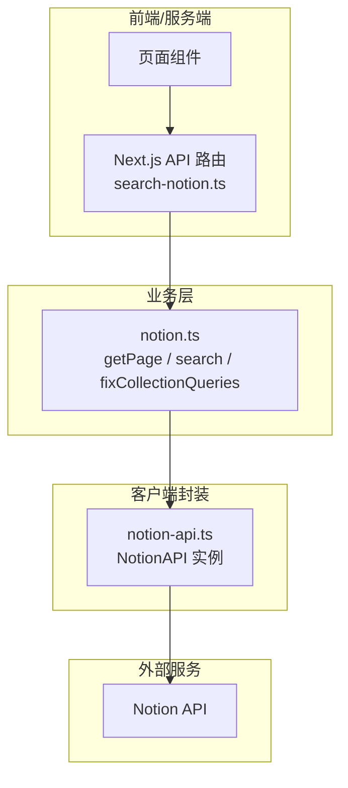
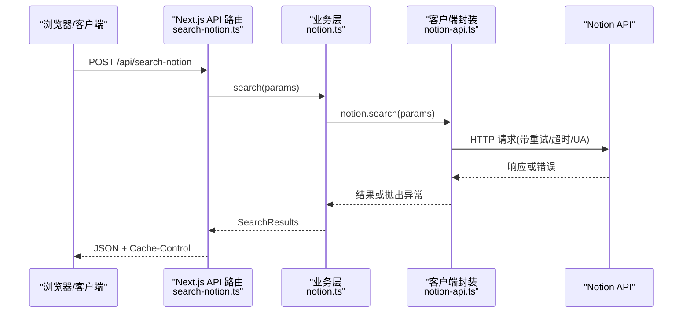
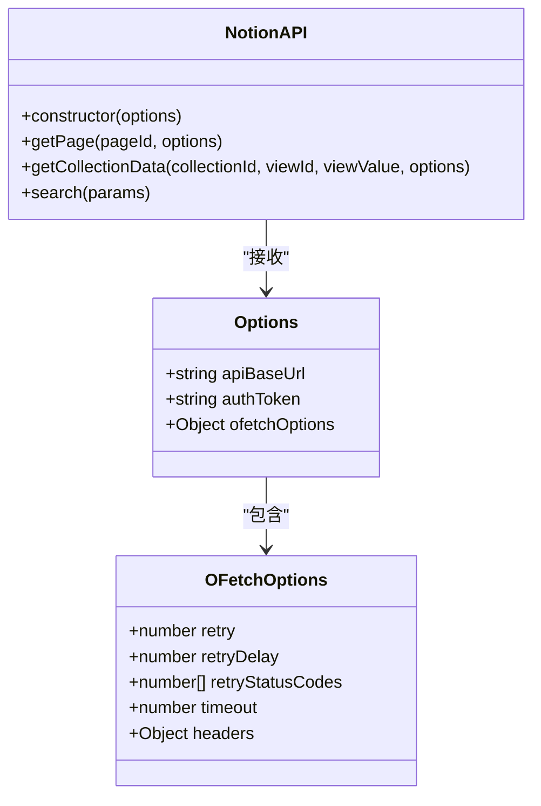
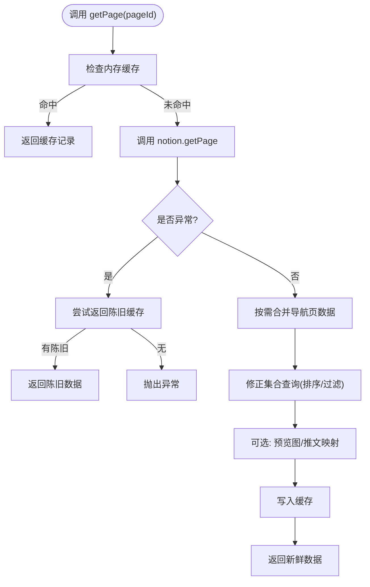
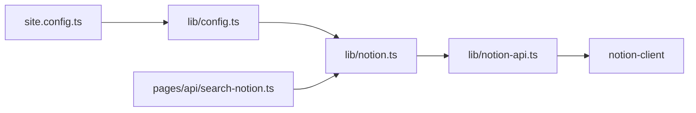
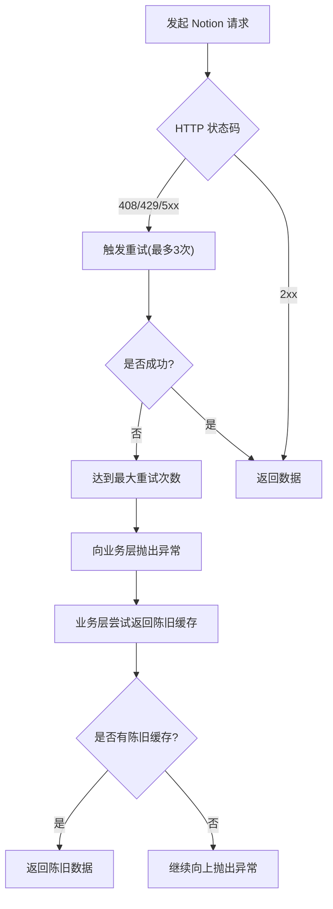

# Notion API 客户端封装

<cite>
**本文引用的文件**   
- [lib/notion-api.ts](file://lib/notion-api.ts)
- [lib/notion.ts](file://lib/notion.ts)
- [lib/config.ts](file://lib/config.ts)
- [site.config.ts](file://site.config.ts)
- [pages/api/search-notion.ts](file://pages/api/search-notion.ts)
</cite>

## 目录
1. [简介](#简介)
2. [项目结构](#项目结构)
3. [核心组件](#核心组件)
4. [架构总览](#架构总览)
5. [详细组件分析](#详细组件分析)
6. [依赖关系分析](#依赖关系分析)
7. [性能与并发优化](#性能与并发优化)
8. [错误处理、重试与超时](#错误处理重试与超时)
9. [扩展自定义 API 方法与参数配置](#扩展自定义-api-方法与参数配置)
10. [调用示例与最佳实践](#调用示例与最佳实践)
11. [故障排查指南](#故障排查指南)
12. [结论](#结论)

## 简介
本文件系统性说明本项目对 Notion API 的客户端封装实现，包括：
- 客户端初始化与认证机制
- 基础请求封装（重试、超时、User-Agent）
- 页面数据获取、集合查询修正、搜索能力
- 服务端内存缓存与过期策略
- 并发控制与性能优化
- 错误处理与降级策略
- 如何扩展自定义 API 方法与参数配置

## 项目结构
围绕 Notion API 的关键代码主要分布在以下位置：
- lib/notion-api.ts：NotionAPI 客户端实例化与网络层配置
- lib/notion.ts：业务层封装（页面读取、集合查询修正、搜索、缓存）
- lib/config.ts：站点级配置导出（包含 API 路由前缀等）
- site.config.ts：站点默认配置（根页面 ID、导航样式等）
- pages/api/search-notion.ts：Next.js API 路由，暴露搜索接口

图表来源
- [lib/notion-api.ts:1-20](file://lib/notion-api.ts#L1-L20)
- [lib/notion.ts:16-218](file://lib/notion.ts#L16-L218)
- [pages/api/search-notion.ts:1-26](file://pages/api/search-notion.ts#L1-L26)

章节来源
- [lib/notion-api.ts:1-20](file://lib/notion-api.ts#L1-L20)
- [lib/notion.ts:1-219](file://lib/notion.ts#L1-L219)
- [lib/config.ts:145-150](file://lib/config.ts#L145-L150)
- [site.config.ts:1-77](file://site.config.ts#L1-L77)
- [pages/api/search-notion.ts:1-26](file://pages/api/search-notion.ts#L1-L26)

## 核心组件
- NotionAPI 客户端实例：集中管理认证、重试、超时、User-Agent 等网络层选项。
- 业务封装层：提供 getPage、search 等方法，并内置服务端内存缓存、集合查询修正、并发控制等逻辑。
- API 路由层：对外暴露搜索接口，统一返回格式与缓存头。

章节来源
- [lib/notion-api.ts:1-20](file://lib/notion-api.ts#L1-L20)
- [lib/notion.ts:16-218](file://lib/notion.ts#L16-L218)
- [pages/api/search-notion.ts:1-26](file://pages/api/search-notion.ts#L1-L26)

## 架构总览
下图展示从浏览器到 Notion API 的完整调用链路，以及关键中间层职责。

图表来源
- [pages/api/search-notion.ts:6-24](file://pages/api/search-notion.ts#L6-L24)
- [lib/notion.ts:216-218](file://lib/notion.ts#L216-L218)
- [lib/notion-api.ts:6-19](file://lib/notion-api.ts#L6-L19)

## 详细组件分析

### NotionAPI 客户端封装（lib/notion-api.ts）
- 使用 notion-client 提供的 NotionAPI 类创建全局实例 notion。
- 通过环境变量注入 apiBaseUrl 与 authToken，实现认证与可选代理基地址。
- 通过 ofetchOptions 配置底层请求行为：
  - retry：自动重试次数
  - retryDelay：重试间隔
  - retryStatusCodes：可重试状态码集合
  - timeout：单次请求超时时间
  - headers.User-Agent：模拟常见浏览器 UA，降低被限流概率

图表来源
- [lib/notion-api.ts:1-20](file://lib/notion-api.ts#L1-L20)

章节来源
- [lib/notion-api.ts:1-20](file://lib/notion-api.ts#L1-L20)

### 业务层封装（lib/notion.ts）
- 服务端内存缓存：
  - 以 pageId 为键，缓存 ExtendedRecordMap 及过期时间。
  - TTL 较短（60s），兼顾新鲜度与容灾（stale-while-revalidate）。
- getPage：
  - 优先命中缓存；未命中则调用 notion.getPage。
  - 捕获异常时尝试返回“陈旧缓存”作为降级，避免全站 500。
  - 根据导航样式合并导航链接页面的 recordMap。
  - 修正集合查询（fixCollectionQueries），确保排序与过滤生效。
  - 可选生成预览图映射与推文映射，最后落盘缓存。
- search：
  - 直接委托 notion.search，保持简单透明。

图表来源
- [lib/notion.ts:38-55](file://lib/notion.ts#L38-L55)
- [lib/notion.ts:161-213](file://lib/notion.ts#L161-L213)
- [lib/notion.ts:95-159](file://lib/notion.ts#L95-L159)

章节来源
- [lib/notion.ts:1-219](file://lib/notion.ts#L1-L219)

### API 路由层（pages/api/search-notion.ts）
- 仅接受 POST 请求，其他方法返回 405。
- 解析请求体为 SearchParams，调用业务层 search。
- 设置统一的 Cache-Control 头，启用 CDN/边缘缓存与 stale-while-revalidate。

章节来源
- [pages/api/search-notion.ts:1-26](file://pages/api/search-notion.ts#L1-L26)

## 依赖关系分析
- notion-api.ts 依赖 notion-client 的 NotionAPI 类，负责网络层配置。
- notion.ts 依赖 notion-api.ts 导出的 notion 实例，同时依赖 notion-types、notion-utils、p-map、p-memoize 等库。
- config.ts 导出站点级配置，供 notion.ts 在渲染阶段判断导航样式、是否启用预览图等。
- site.config.ts 提供站点默认值（如 rootNotionPageId、revalidateSeconds、navigationStyle 等）。

图表来源
- [site.config.ts:1-77](file://site.config.ts#L1-L77)
- [lib/config.ts:1-221](file://lib/config.ts#L1-L221)
- [lib/notion.ts:1-219](file://lib/notion.ts#L1-L219)
- [lib/notion-api.ts:1-20](file://lib/notion-api.ts#L1-L20)
- [pages/api/search-notion.ts:1-26](file://pages/api/search-notion.ts#L1-L26)

章节来源
- [lib/notion.ts:1-219](file://lib/notion.ts#L1-L219)
- [lib/notion-api.ts:1-20](file://lib/notion-api.ts#L1-L20)
- [lib/config.ts:1-221](file://lib/config.ts#L1-L221)
- [site.config.ts:1-77](file://site.config.ts#L1-L77)
- [pages/api/search-notion.ts:1-26](file://pages/api/search-notion.ts#L1-L26)

## 性能与并发优化
- 服务端内存缓存：
  - 页面级缓存 TTL 为 60s，减少重复请求 Notion 的频率。
  - 支持“陈旧可用”，在网络异常时仍能提供内容。
- 并发控制：
  - 导航链接页面批量加载使用 p-map，并发度为 4。
  - 集合查询修正使用 p-map，并发度为 3，避免一次性压垮 Notion。
- 网络层优化：
  - 自动重试与退避，缓解瞬时抖动。
  - 合理 User-Agent，降低被限流风险。
- 构建期/运行期缓存：
  - ISR revalidateSeconds 可在站点配置中调整，平衡更新频率与函数调用成本。

章节来源
- [lib/notion.ts:29-55](file://lib/notion.ts#L29-L55)
- [lib/notion.ts:57-81](file://lib/notion.ts#L57-L81)
- [lib/notion.ts:111-158](file://lib/notion.ts#L111-L158)
- [lib/notion-api.ts:9-18](file://lib/notion-api.ts#L9-L18)
- [site.config.ts:57-60](file://site.config.ts#L57-L60)

## 错误处理、重试与超时
- 重试策略：
  - 针对 408、429、500、502、503、504 进行自动重试，最多 3 次，间隔 500ms。
- 超时策略：
  - 单次请求默认 30s，防止长尾阻塞。
- 业务层降级：
  - getPage 捕获异常后尝试返回陈旧缓存，避免全站不可用。
  - 集合查询修正失败仅记录警告，不影响主流程。
- API 路由：
  - 非 POST 请求直接返回 405，快速失败。

图表来源
- [lib/notion-api.ts:9-18](file://lib/notion-api.ts#L9-L18)
- [lib/notion.ts:168-182](file://lib/notion.ts#L168-L182)
- [lib/notion.ts:149-155](file://lib/notion.ts#L149-L155)
- [pages/api/search-notion.ts:10-12](file://pages/api/search-notion.ts#L10-L12)

章节来源
- [lib/notion-api.ts:9-18](file://lib/notion-api.ts#L9-L18)
- [lib/notion.ts:149-182](file://lib/notion.ts#L149-L182)
- [pages/api/search-notion.ts:10-12](file://pages/api/search-notion.ts#L10-L12)

## 扩展自定义 API 方法与参数配置
- 新增业务方法建议遵循现有模式：
  - 在 lib/notion.ts 中定义新方法，复用 notion 实例与缓存策略。
  - 如需并发，使用 p-map 控制并发度。
  - 如需对外暴露，新增 Next.js API 路由并在 lib/config.ts 中维护路由常量。
- 参数配置建议：
  - 将可变参数放入站点配置 site.config.ts，并通过 lib/config.ts 导出。
  - 敏感信息（如 NOTION_API_TOKEN）通过环境变量注入，不硬编码。
- 示例思路（概念性说明）：
  - 新增 getBlockContent(blockId, options)：基于 notion.getBlock 封装，加入本地缓存与重试。
  - 新增 listDatabaseItems(databaseId, query)：基于 notion.getCollectionData 封装，结合分页与并发限制。

[本节为概念性指导，不直接分析具体文件]

## 调用示例与最佳实践

### 示例一：获取页面数据
- 调用入口：lib/notion.ts 的 getPage。
- 关键点：
  - 优先命中内存缓存。
  - 异常时回退陈旧缓存。
  - 按需合并导航页数据与集合查询修正。
- 适用场景：页面渲染、SSR/ISR 预取。

章节来源
- [lib/notion.ts:161-213](file://lib/notion.ts#L161-L213)

### 示例二：执行搜索
- 调用入口：lib/notion.ts 的 search，最终委托 notion.search。
- 对外暴露：pages/api/search-notion.ts 提供 REST 接口。
- 关键点：
  - 统一设置 Cache-Control，利于边缘缓存。
  - 仅允许 POST，非法方法快速失败。

章节来源
- [lib/notion.ts:216-218](file://lib/notion.ts#L216-L218)
- [pages/api/search-notion.ts:6-24](file://pages/api/search-notion.ts#L6-L24)

### 最佳实践清单
- 认证与代理：
  - 通过环境变量配置 NOTION_API_BASE_URL 与 NOTION_API_TOKEN。
- 重试与超时：
  - 保持默认重试策略与 30s 超时，必要时按业务调整。
- 并发控制：
  - 批量请求使用 p-map 控制并发度，避免雪崩。
- 缓存策略：
  - 合理使用内存缓存与 ISR 重验证周期，平衡新鲜度与成本。
- 错误降级：
  - 在关键路径上实现“陈旧可用”，提升可用性。
- 可观测性：
  - 对集合查询修正等易错点增加日志告警。

[本节为通用实践总结，不直接分析具体文件]

## 故障排查指南
- 现象：页面频繁 500
  - 排查：检查 notion.getPage 是否抛错；确认陈旧缓存是否存在。
  - 参考：lib/notion.ts 中的异常捕获与陈旧缓存回退逻辑。
- 现象：集合排序/过滤不正确
  - 排查：确认 fixCollectionQueries 是否被执行；查看相关日志。
  - 参考：lib/notion.ts 中的集合查询修正逻辑。
- 现象：搜索接口不稳定
  - 排查：检查 API 路由是否仅允许 POST；观察 Cache-Control 是否生效。
  - 参考：pages/api/search-notion.ts。
- 现象：请求超时或被限流
  - 排查：检查 ofetchOptions 的重试状态码与超时时间；确认 User-Agent 是否被识别为正常浏览器。
  - 参考：lib/notion-api.ts。

章节来源
- [lib/notion.ts:149-182](file://lib/notion.ts#L149-L182)
- [pages/api/search-notion.ts:10-24](file://pages/api/search-notion.ts#L10-L24)
- [lib/notion-api.ts:9-18](file://lib/notion-api.ts#L9-L18)

## 结论
本项目通过 notion-client 的 NotionAPI 进行统一封装，结合业务层的内存缓存、并发控制与错误降级，形成稳定高效的 Notion 数据访问层。配合 Next.js API 路由与站点配置，既保证了可扩展性，也提供了良好的性能与可用性保障。在实际使用中，建议遵循本文的最佳实践，并根据业务需求适度调整重试、超时与缓存策略。