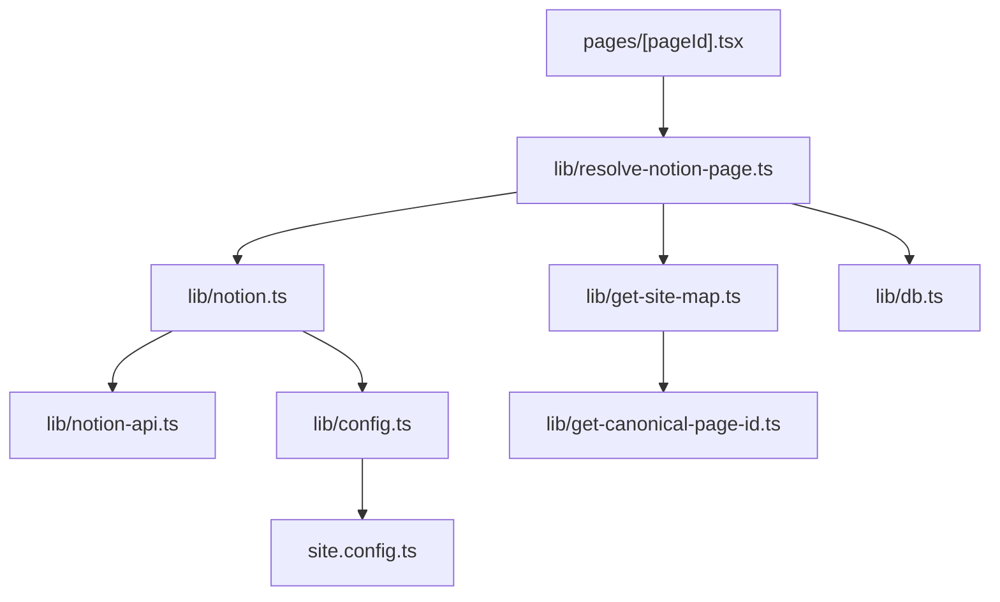
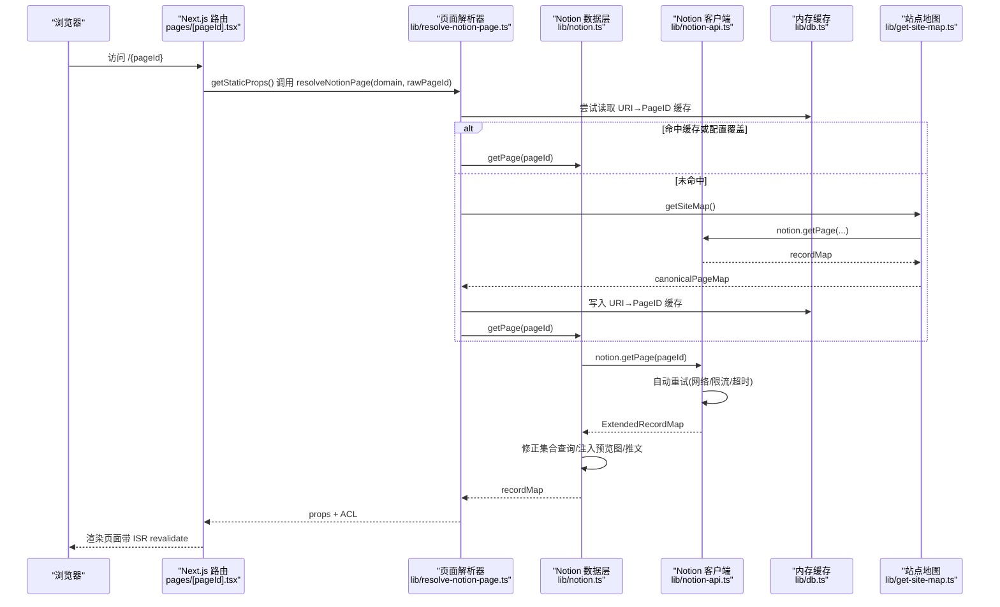
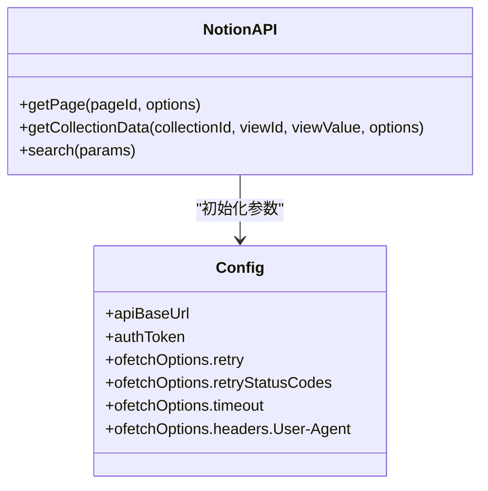
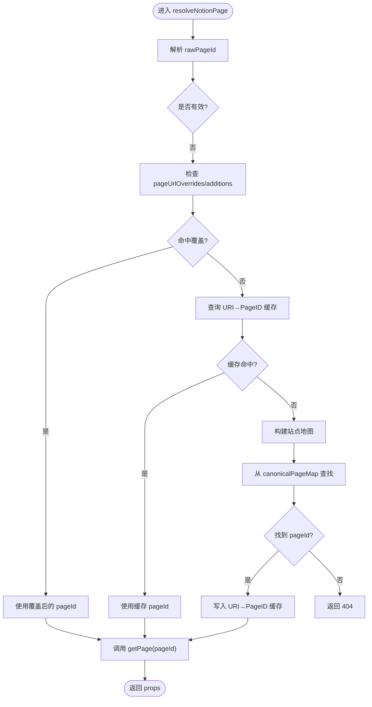
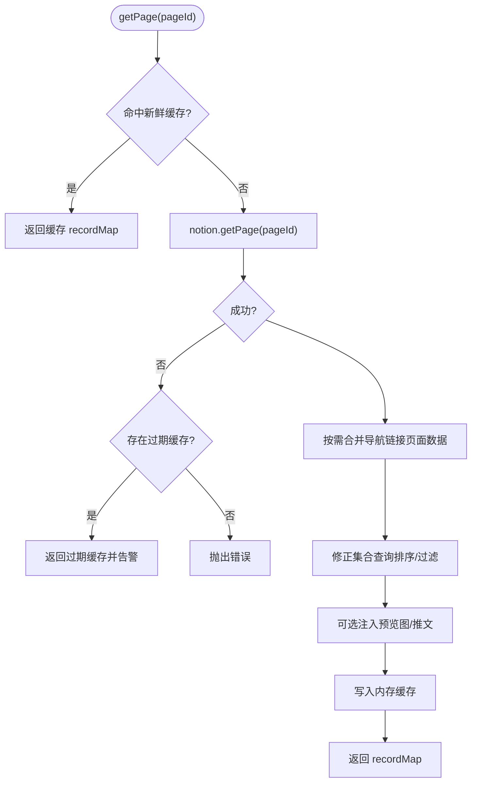
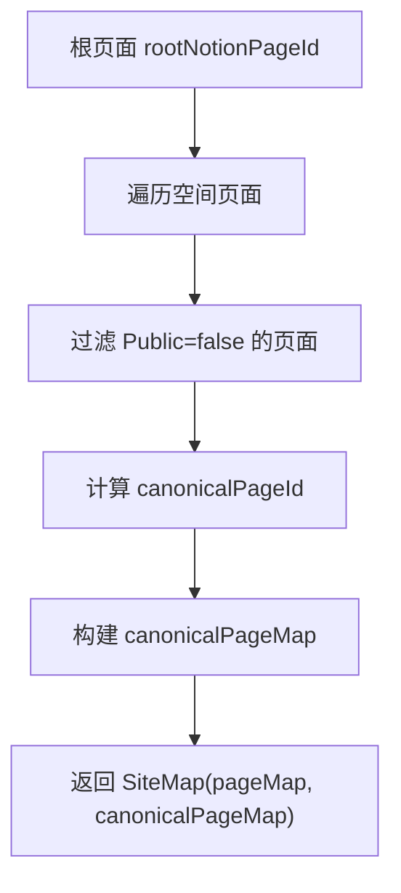
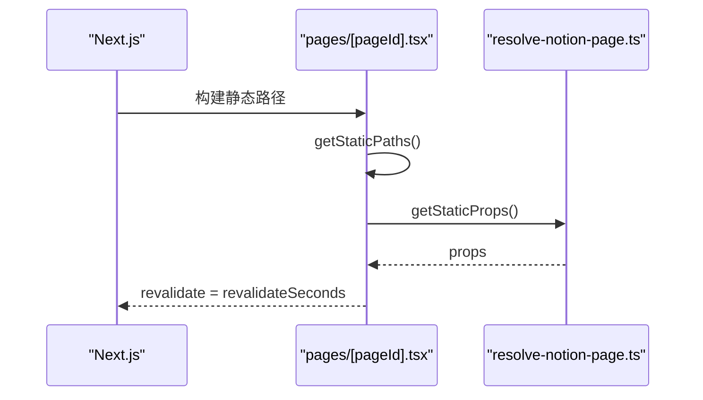
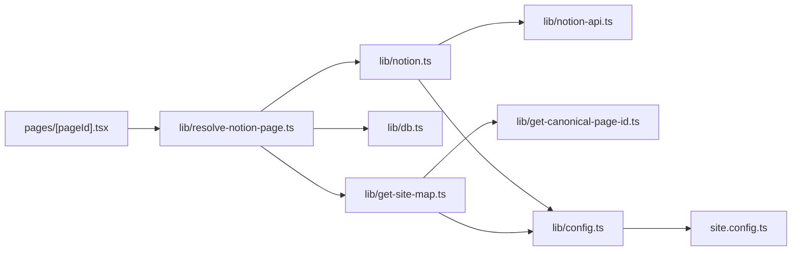
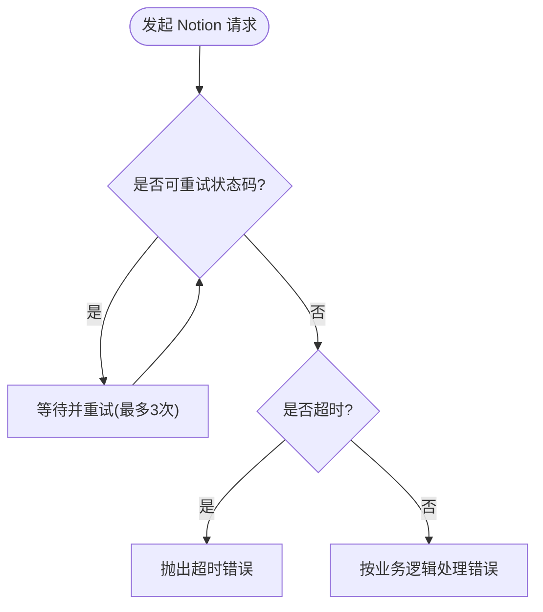

# Notion API 集成机制

<cite>
**本文引用的文件**   
- [lib/notion.ts](file://lib/notion.ts)
- [lib/notion-api.ts](file://lib/notion-api.ts)
- [lib/resolve-notion-page.ts](file://lib/resolve-notion-page.ts)
- [lib/get-canonical-page-id.ts](file://lib/get-canonical-page-id.ts)
- [lib/config.ts](file://lib/config.ts)
- [site.config.ts](file://site.config.ts)
- [lib/db.ts](file://lib/db.ts)
- [pages/[pageId].tsx](file://pages/[pageId].tsx)
- [lib/get-site-map.ts](file://lib/get-site-map.ts)
- [lib/types.ts](file://lib/types.ts)
</cite>

## 目录
1. [简介](#简介)
2. [项目结构](#项目结构)
3. [核心组件](#核心组件)
4. [架构总览](#架构总览)
5. [详细组件分析](#详细组件分析)
6. [依赖关系分析](#依赖关系分析)
7. [性能与缓存策略](#性能与缓存策略)
8. [错误处理与重试机制](#错误处理与重试机制)
9. [API 调用示例与最佳实践](#api-调用示例与最佳实践)
10. [故障排查指南](#故障排查指南)
11. [结论](#结论)

## 简介
本文件深入解析 Next.js + Notion 站点中 Notion API 的集成机制与数据流，重点覆盖以下方面：
- Notion 客户端初始化、认证方式与请求封装
- URL 到 Notion Page ID 的映射与页面解析流程
- 内存缓存与 ISR revalidation 机制
- 错误处理与自动重试策略
- 典型 API 调用路径与最佳实践

该方案通过服务端内存缓存、Keyv 轻量键值存储、Next.js ISR 增量静态再生成以及 notion-client 的重试能力，构建出高可用、低延迟且可维护的 Notion 内容渲染管线。

## 项目结构
围绕 Notion 集成的关键代码分布在 lib 层与 pages 路由层：
- lib/notion-api.ts：Notion 客户端实例化与全局重试配置
- lib/notion.ts：页面数据获取、内存缓存、集合查询修正、预览图与推文增强
- lib/resolve-notion-page.ts：URL 到 Notion Page ID 解析、ACL 权限合并
- lib/get-site-map.ts：站点地图生成、canonicalPageMap 构建
- lib/get-canonical-page-id.ts：规范化页面 ID 与 URL 反向映射
- lib/config.ts / site.config.ts：站点配置、ISR 重验证间隔等
- lib/db.ts：基于 Keyv 的内存级缓存
- pages/[pageId].tsx：Next.js 动态路由，触发 getStaticProps 并启用 ISR

**图表来源**
- [pages/[pageId].tsx:9-24](file://pages/[pageId].tsx#L9-L24)
- [lib/resolve-notion-page.ts:11-84](file://lib/resolve-notion-page.ts#L11-L84)
- [lib/notion.ts:161-213](file://lib/notion.ts#L161-L213)
- [lib/notion-api.ts:6-19](file://lib/notion-api.ts#L6-L19)
- [lib/get-site-map.ts:17-27](file://lib/get-site-map.ts#L17-L27)
- [lib/get-canonical-page-id.ts:9-29](file://lib/get-canonical-page-id.ts#L9-L29)
- [lib/db.ts:1-7](file://lib/db.ts#L1-L7)
- [lib/config.ts:93-95](file://lib/config.ts#L93-L95)
- [site.config.ts:57-60](file://site.config.ts#L57-L60)

**章节来源**
- [pages/[pageId].tsx:9-53](file://pages/[pageId].tsx#L9-L53)
- [lib/resolve-notion-page.ts:11-84](file://lib/resolve-notion-page.ts#L11-L84)
- [lib/notion.ts:19-213](file://lib/notion.ts#L19-L213)
- [lib/notion-api.ts:1-21](file://lib/notion-api.ts#L1-L21)
- [lib/get-site-map.ts:17-105](file://lib/get-site-map.ts#L17-L105)
- [lib/get-canonical-page-id.ts:9-29](file://lib/get-canonical-page-id.ts#L9-L29)
- [lib/config.ts:23-95](file://lib/config.ts#L23-L95)
- [site.config.ts:1-77](file://site.config.ts#L1-L77)
- [lib/db.ts:1-7](file://lib/db.ts#L1-L7)

## 核心组件
- Notion 客户端封装：统一认证、重试、超时与 User-Agent 设置
- 页面数据获取与缓存：内存级 TTL 缓存、过期回退、集合查询修正
- URL 到 Page ID 解析：支持直接 ID、URI 覆盖、站点地图映射与本地缓存
- 站点地图构建：遍历空间、过滤公开页、生成 canonicalPageMap
- 配置与 ISR：集中式站点配置与增量静态再生成间隔

**章节来源**
- [lib/notion-api.ts:1-21](file://lib/notion-api.ts#L1-L21)
- [lib/notion.ts:19-213](file://lib/notion.ts#L19-L213)
- [lib/resolve-notion-page.ts:11-84](file://lib/resolve-notion-page.ts#L11-L84)
- [lib/get-site-map.ts:17-105](file://lib/get-site-map.ts#L17-L105)
- [lib/config.ts:93-95](file://lib/config.ts#L93-L95)
- [site.config.ts:57-60](file://site.config.ts#L57-L60)

## 架构总览
下图展示了从 Next.js 路由到 Notion API 的完整数据流，包括缓存、重试与 ISR 重验证点。

**图表来源**
- [pages/[pageId].tsx:9-24](file://pages/[pageId].tsx#L9-L24)
- [lib/resolve-notion-page.ts:11-84](file://lib/resolve-notion-page.ts#L11-L84)
- [lib/notion.ts:161-213](file://lib/notion.ts#L161-L213)
- [lib/notion-api.ts:6-19](file://lib/notion-api.ts#L6-L19)
- [lib/get-site-map.ts:34-42](file://lib/get-site-map.ts#L34-L42)
- [lib/db.ts:1-7](file://lib/db.ts#L1-L7)

## 详细组件分析

### Notion 客户端初始化与认证
- 使用 notion-client 的 NotionAPI 实例，传入环境变量中的 API Base URL 与 Token
- 通过 ofetchOptions 配置自动重试、重试状态码、超时与 User-Agent
- 该实例在多处被复用，保证一致的认证与重试行为

**图表来源**
- [lib/notion-api.ts:6-19](file://lib/notion-api.ts#L6-L19)

**章节来源**
- [lib/notion-api.ts:1-21](file://lib/notion-api.ts#L1-L21)

### 页面解析流程与 URL→PageID 映射
- 优先解析 rawPageId；若无效则检查 pageUrlOverrides/pageUrlAdditions
- 使用 db 缓存 URI→PageID 映射，TTL 为一天
- 未命中时通过 getSiteMap().canonicalPageMap 查找
- 最终调用 getPage(pageId) 获取数据并返回 props

**图表来源**
- [lib/resolve-notion-page.ts:11-84](file://lib/resolve-notion-page.ts#L11-L84)
- [lib/get-site-map.ts:62-98](file://lib/get-site-map.ts#L62-L98)
- [lib/db.ts:1-7](file://lib/db.ts#L1-L7)

**章节来源**
- [lib/resolve-notion-page.ts:11-84](file://lib/resolve-notion-page.ts#L11-L84)
- [lib/get-site-map.ts:62-98](file://lib/get-site-map.ts#L62-L98)
- [lib/db.ts:1-7](file://lib/db.ts#L1-L7)

### 页面数据获取与内存缓存
- 内存缓存以 pageId 为键，记录 recordMap 与过期时间
- getCached 返回新鲜缓存；getStaleCached 用于失败回退
- 首次请求失败时，若存在过期缓存则降级返回，避免 500
- 根据导航样式预取导航链接页面的 block 信息并合并
- 修正集合视图排序/过滤，确保与 Notion 一致
- 可选注入预览图与推文数据

**图表来源**
- [lib/notion.ts:29-55](file://lib/notion.ts#L29-L55)
- [lib/notion.ts:161-213](file://lib/notion.ts#L161-L213)
- [lib/notion.ts:95-159](file://lib/notion.ts#L95-L159)

**章节来源**
- [lib/notion.ts:29-55](file://lib/notion.ts#L29-L55)
- [lib/notion.ts:95-159](file://lib/notion.ts#L95-L159)
- [lib/notion.ts:161-213](file://lib/notion.ts#L161-L213)

### 站点地图与规范化页面 ID
- getAllPagesInSpace 遍历空间，过滤“Public”属性为 false 的页面
- 对每个页面计算 canonicalPageId，构建 canonicalPageMap
- getCanonicalPageId 支持 inversePageUrlOverrides 反向覆盖
- 站点地图结果包含 pageMap 与 canonicalPageMap，供路由与 SEO 使用

**图表来源**
- [lib/get-site-map.ts:44-105](file://lib/get-site-map.ts#L44-L105)
- [lib/get-canonical-page-id.ts:9-29](file://lib/get-canonical-page-id.ts#L9-L29)

**章节来源**
- [lib/get-site-map.ts:44-105](file://lib/get-site-map.ts#L44-L105)
- [lib/get-canonical-page-id.ts:9-29](file://lib/get-canonical-page-id.ts#L9-L29)

### Next.js 路由与 ISR 重验证
- getStaticPaths 收集 canonicalPageMap 与 pageUrlOverrides 作为静态路径
- getStaticProps 调用 resolveNotionPage 获取 props，并返回 revalidateSeconds
- 生产环境 fallback=true，开发环境按需生成

**图表来源**
- [pages/[pageId].tsx:9-53](file://pages/[pageId].tsx#L9-L53)
- [lib/config.ts:93-95](file://lib/config.ts#L93-L95)
- [site.config.ts:57-60](file://site.config.ts#L57-L60)

**章节来源**
- [pages/[pageId].tsx:9-53](file://pages/[pageId].tsx#L9-L53)
- [lib/config.ts:93-95](file://lib/config.ts#L93-L95)
- [site.config.ts:57-60](file://site.config.ts#L57-L60)

## 依赖关系分析
- pages/[pageId].tsx 依赖 resolve-notion-page、config、get-site-map
- resolve-notion-page 依赖 notion、db、acl、config、get-site-map
- notion 依赖 notion-api、config、preview-images、get-tweets
- get-site-map 依赖 notion-api、get-canonical-page-id、config
- config 聚合 site.config.ts 与环境变量

**图表来源**
- [pages/[pageId].tsx:1-58](file://pages/[pageId].tsx#L1-L58)
- [lib/resolve-notion-page.ts:1-84](file://lib/resolve-notion-page.ts#L1-L84)
- [lib/notion.ts:1-213](file://lib/notion.ts#L1-L213)
- [lib/notion-api.ts:1-21](file://lib/notion-api.ts#L1-L21)
- [lib/get-site-map.ts:1-105](file://lib/get-site-map.ts#L1-L105)
- [lib/get-canonical-page-id.ts:1-29](file://lib/get-canonical-page-id.ts#L1-L29)
- [lib/config.ts:1-221](file://lib/config.ts#L1-L221)
- [site.config.ts:1-77](file://site.config.ts#L1-L77)

**章节来源**
- [pages/[pageId].tsx:1-58](file://pages/[pageId].tsx#L1-L58)
- [lib/resolve-notion-page.ts:1-84](file://lib/resolve-notion-page.ts#L1-L84)
- [lib/notion.ts:1-213](file://lib/notion.ts#L1-L213)
- [lib/notion-api.ts:1-21](file://lib/notion-api.ts#L1-L21)
- [lib/get-site-map.ts:1-105](file://lib/get-site-map.ts#L1-L105)
- [lib/get-canonical-page-id.ts:1-29](file://lib/get-canonical-page-id.ts#L1-L29)
- [lib/config.ts:1-221](file://lib/config.ts#L1-L221)
- [site.config.ts:1-77](file://site.config.ts#L1-L77)

## 性能与缓存策略
- 内存缓存（lib/notion.ts）
  - 以 pageId 为键，TTL 60 秒，减少重复请求与应对 Notion 抖动
  - 失败时回退到过期缓存，提升可用性
- URI→PageID 缓存（lib/db.ts）
  - 使用 Keyv 内存缓存，TTL 一天，加速 URL 解析
- 站点地图缓存（lib/get-site-map.ts）
  - p-memoize 缓存 5 分钟，平衡新页面发现与性能
- ISR 重验证（lib/config.ts 与 site.config.ts）
  - revalidateSeconds 默认 3600，站点配置为 86400，降低函数调用频率

优化建议：
- 在高并发场景下，考虑将 Keyv 后端替换为 Redis，提高命中率与持久性
- 合理调整 PAGE_CACHE_TTL_MS 与 revalidateSeconds，平衡实时性与成本
- 对集合视图较多的页面，控制 fixCollectionQueries 并发度，避免瞬时压力

**章节来源**
- [lib/notion.ts:29-55](file://lib/notion.ts#L29-L55)
- [lib/db.ts:1-7](file://lib/db.ts#L1-L7)
- [lib/get-site-map.ts:29-32](file://lib/get-site-map.ts#L29-L32)
- [lib/config.ts:93-95](file://lib/config.ts#L93-L95)
- [site.config.ts:57-60](file://site.config.ts#L57-L60)

## 错误处理与重试机制
- 客户端重试（lib/notion-api.ts）
  - 针对 408、429、500、502、503、504 进行最多 3 次重试，间隔 500ms
  - 请求超时 30s，User-Agent 模拟主流浏览器
- 页面获取失败回退（lib/notion.ts）
  - 当 Notion 不可用时，返回过期缓存，避免 500
  - 集合查询修正失败仅告警，不影响主流程
- 路由层错误（pages/[pageId].tsx）
  - getStaticProps 捕获异常并抛出，阻止发布错误版本页面

**图表来源**
- [lib/notion-api.ts:6-19](file://lib/notion-api.ts#L6-L19)
- [lib/notion.ts:168-182](file://lib/notion.ts#L168-L182)
- [lib/notion.ts:149-155](file://lib/notion.ts#L149-L155)
- [pages/[pageId].tsx:18-24](file://pages/[pageId].tsx#L18-L24)

**章节来源**
- [lib/notion-api.ts:6-19](file://lib/notion-api.ts#L6-L19)
- [lib/notion.ts:168-182](file://lib/notion.ts#L168-L182)
- [lib/notion.ts:149-155](file://lib/notion.ts#L149-L155)
- [pages/[pageId].tsx:18-24](file://pages/[pageId].tsx#L18-L24)

## API 调用示例与最佳实践
- 初始化 Notion 客户端
  - 通过环境变量 NOTION_API_BASE_URL 与 NOTION_API_TOKEN 配置认证
  - 开启自动重试与超时保护，统一 User-Agent
- 获取页面数据
  - 调用 notion.getPage(pageId)，由 lib/notion.ts 提供内存缓存与失败回退
  - 如需导航链接块信息，在非默认导航模式下会预取并合并
- 修正集合查询
  - 对含排序/过滤的集合视图，重新执行 queryCollection 并合并结果
- 站点地图与 URL 映射
  - 使用 getSiteMap() 获取 canonicalPageMap，结合 pageUrlOverrides 实现自定义 URL
  - 使用 db 缓存 URI→PageID 映射，缩短后续解析时间
- ISR 配置
  - 在 site.config.ts 中设置 revalidateSeconds，控制增量静态再生成频率

最佳实践：
- 将敏感令牌置于环境变量，不提交至仓库
- 合理设置 revalidateSeconds 与 PAGE_CACHE_TTL_MS，兼顾时效与成本
- 对集合视图多的页面，关注 fixCollectionQueries 的性能影响
- 使用 pageUrlOverrides 管理重要页面的友好 URL，并在 sitemap 中暴露

**章节来源**
- [lib/notion-api.ts:6-19](file://lib/notion-api.ts#L6-L19)
- [lib/notion.ts:161-213](file://lib/notion.ts#L161-L213)
- [lib/notion.ts:95-159](file://lib/notion.ts#L95-L159)
- [lib/get-site-map.ts:62-98](file://lib/get-site-map.ts#L62-L98)
- [lib/resolve-notion-page.ts:32-65](file://lib/resolve-notion-page.ts#L32-L65)
- [site.config.ts:57-60](file://site.config.ts#L57-L60)

## 故障排查指南
- 无法访问 Notion API
  - 检查 NOTION_API_BASE_URL 与 NOTION_API_TOKEN 是否正确
  - 查看日志中是否出现重试与超时提示
- 页面返回 404
  - 确认 rawPageId 是否有效，或是否在 pageUrlOverrides 中正确映射
  - 检查 canonicalPageMap 是否包含对应条目
- 集合视图顺序/过滤不一致
  - 确认视图是否定义了 query2.sort/filter，必要时检查 fixCollectionQueries 日志
- 性能问题
  - 调整 revalidateSeconds 与 PAGE_CACHE_TTL_MS
  - 评估集合视图数量与并发修正次数

**章节来源**
- [lib/notion-api.ts:6-19](file://lib/notion-api.ts#L6-L19)
- [lib/resolve-notion-page.ts:66-74](file://lib/resolve-notion-page.ts#L66-L74)
- [lib/notion.ts:149-155](file://lib/notion.ts#L149-L155)
- [lib/config.ts:93-95](file://lib/config.ts#L93-L95)
- [site.config.ts:57-60](file://site.config.ts#L57-L60)

## 结论
该集成方案通过 notion-client 的统一客户端封装、多层缓存（内存与 Keyv）、集合查询修正与 ISR 重验证，实现了稳定高效的 Notion 内容渲染管线。配合合理的配置与错误处理策略，可在高并发与外部服务波动环境下保持良好用户体验。建议在大规模部署时评估持久化缓存与更细粒度的缓存失效策略，以进一步优化性能与成本。