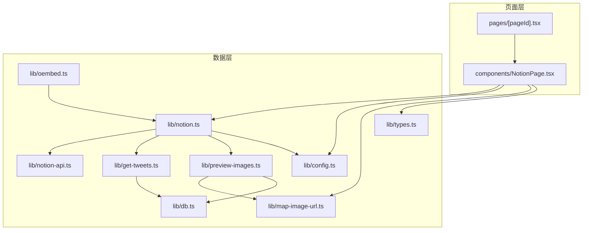
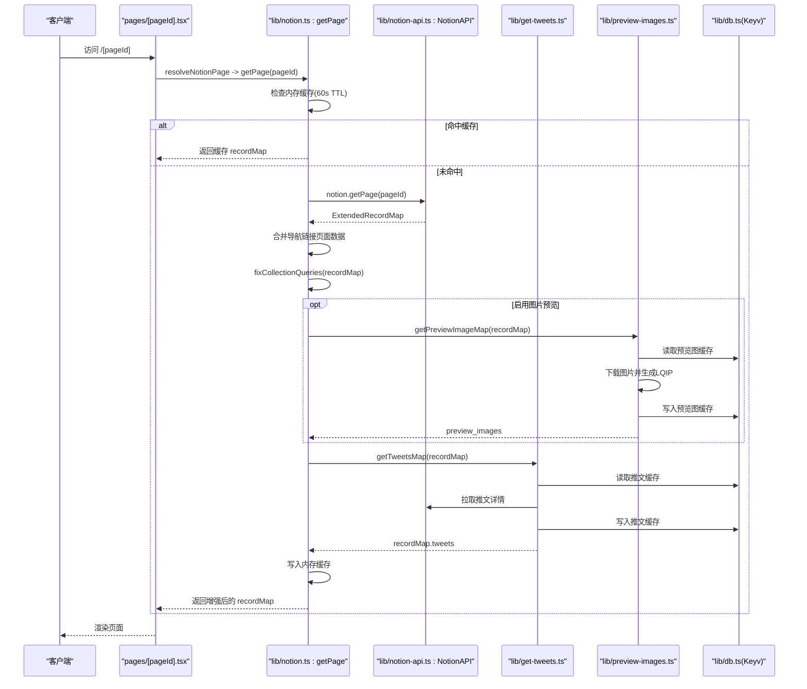
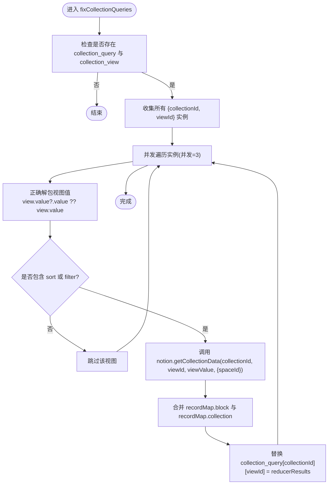
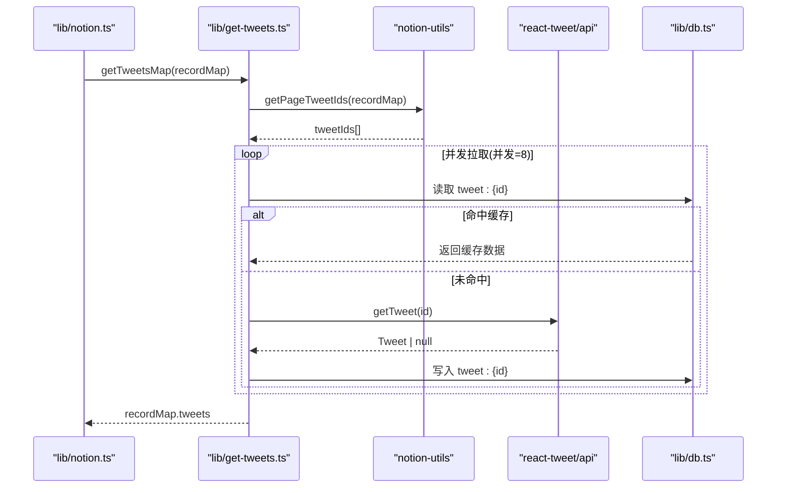
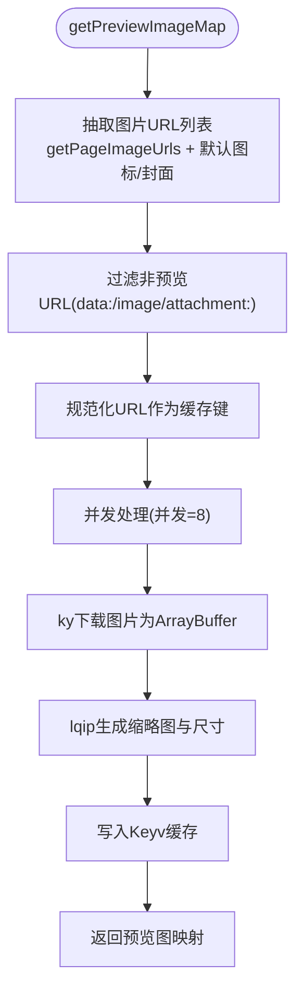
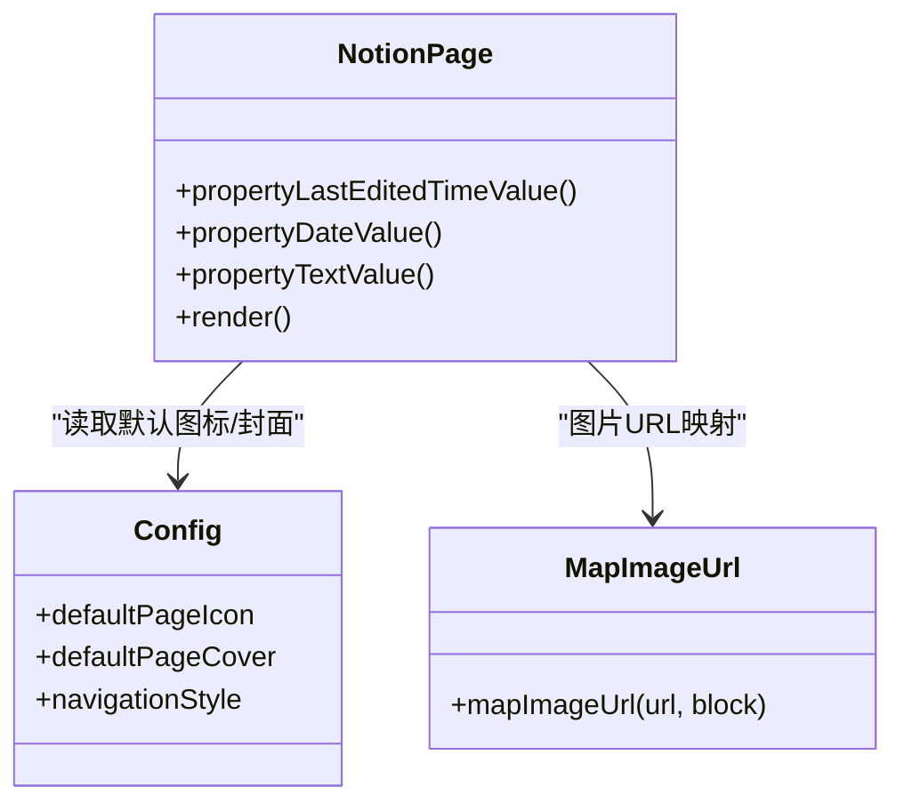
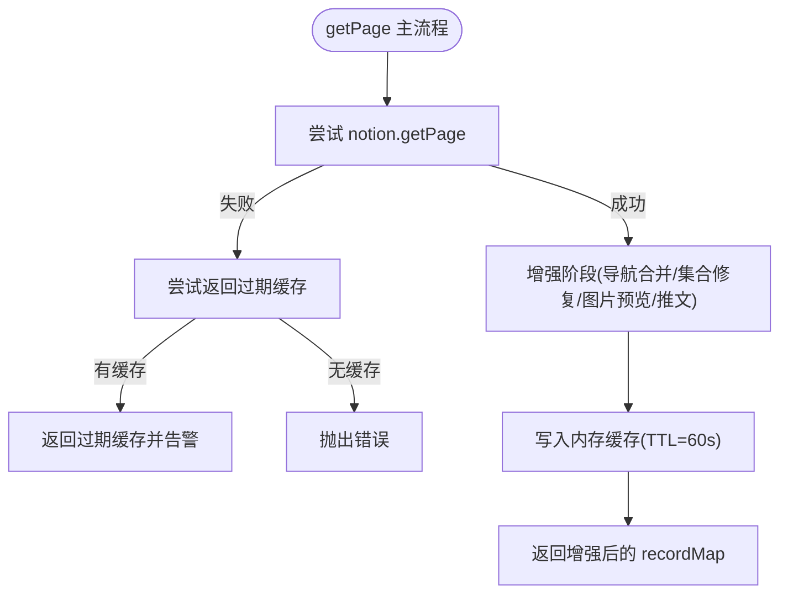
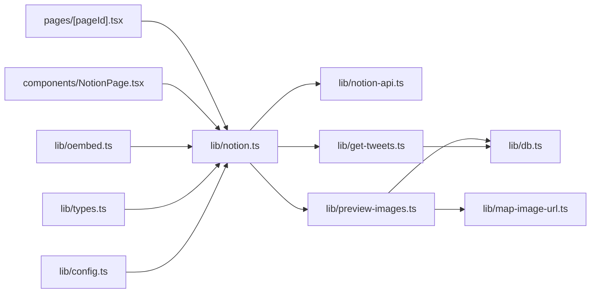

# 数据处理与增强

<cite>
**本文引用的文件**   
- [lib/notion.ts](file://lib/notion.ts)
- [lib/get-tweets.ts](file://lib/get-tweets.ts)
- [lib/preview-images.ts](file://lib/preview-images.ts)
- [lib/types.ts](file://lib/types.ts)
- [lib/config.ts](file://lib/config.ts)
- [lib/map-image-url.ts](file://lib/map-image-url.ts)
- [lib/oembed.ts](file://lib/oembed.ts)
- [lib/notion-api.ts](file://lib/notion-api.ts)
- [lib/db.ts](file://lib/db.ts)
- [pages/[pageId].tsx](file://pages/[pageId].tsx)
- [components/NotionPage.tsx](file://components/NotionPage.tsx)
</cite>

## 目录
1. [引言](#引言)
2. [项目结构](#项目结构)
3. [核心组件](#核心组件)
4. [架构总览](#架构总览)
5. [详细组件分析](#详细组件分析)
6. [依赖关系分析](#依赖关系分析)
7. [性能考量](#性能考量)
8. [故障排查指南](#故障排查指南)
9. [结论](#结论)
10. [附录：扩展点与集成方法](#附录扩展点与集成方法)

## 引言
本文面向 Notion 原始数据的处理流程与增强机制，重点说明以下方面：
- 集合查询修复逻辑：解决通过代理返回的集合视图排序与过滤丢失问题。
- 推文数据获取：并发拉取、缓存与错误降级。
- 图片预览处理：低质量图像占位图（LQIP）生成与缓存。
- 数据合并策略：导航链接页面数据合并、块与集合元信息回填。
- 格式转换与字段映射：图片 URL 映射、属性值渲染定制。
- 异步并发控制与错误处理：p-map 并发限制、重试与降级策略。
- 自定义扩展点：如何接入自定义数据源或渲染逻辑。

## 项目结构
本项目采用 Next.js + react-notion-x 的站点模板，数据层围绕 lib 目录中的工具模块组织，页面层负责静态构建与渲染入口，组件层负责 UI 渲染与交互。

**图表来源**
- [pages/[pageId].tsx:9-25](file://pages/[pageId].tsx#L9-L25)
- [components/NotionPage.tsx:211-355](file://components/NotionPage.tsx#L211-L355)
- [lib/notion.ts:161-213](file://lib/notion.ts#L161-L213)
- [lib/get-tweets.ts:10-28](file://lib/get-tweets.ts#L10-L28)
- [lib/preview-images.ts:30-54](file://lib/preview-images.ts#L30-L54)
- [lib/notion-api.ts:1-21](file://lib/notion-api.ts#L1-L21)
- [lib/db.ts:1-7](file://lib/db.ts#L1-L7)
- [lib/config.ts:51-95](file://lib/config.ts#L51-L95)
- [lib/map-image-url.ts:1-13](file://lib/map-image-url.ts#L1-L13)
- [lib/oembed.ts:6-66](file://lib/oembed.ts#L6-L66)
- [lib/types.ts:21-23](file://lib/types.ts#L21-L23)

**章节来源**
- [pages/[pageId].tsx:9-58](file://pages/[pageId].tsx#L9-L58)
- [components/NotionPage.tsx:1-356](file://components/NotionPage.tsx#L1-L356)
- [lib/notion.ts:1-219](file://lib/notion.ts#L1-L219)

## 核心组件
- 页面数据获取与增强管线：lib/notion.ts 提供 getPage 主流程，串联缓存、导航数据合并、集合查询修复、图片预览与推文数据注入。
- 推文数据增强：lib/get-tweets.ts 提取页面中的推文 ID，并发拉取并写入 recordMap.tweets。
- 图片预览增强：lib/preview-images.ts 抽取页面图片 URL，生成 LQIP 并缓存，最终挂载到 recordMap.preview_images。
- Notion API 客户端封装：lib/notion-api.ts 配置重试、超时与请求头。
- 站点配置与常量：lib/config.ts 暴露站点开关、默认图标/封面、导航样式等。
- 图片 URL 映射：lib/map-image-url.ts 统一处理默认图标/封面与默认映射逻辑。
- oEmbed 嵌入支持：lib/oembed.ts 根据 pageId 生成可嵌入 HTML。
- 类型定义：lib/types.ts 扩展 ExtendedRecordMap 以承载 tweets。
- 内存缓存：lib/db.ts 基于 Keyv 的轻量内存缓存，用于推文与预览图的二级缓存。

**章节来源**
- [lib/notion.ts:161-213](file://lib/notion.ts#L161-L213)
- [lib/get-tweets.ts:10-28](file://lib/get-tweets.ts#L10-L28)
- [lib/preview-images.ts:30-54](file://lib/preview-images.ts#L30-L54)
- [lib/notion-api.ts:1-21](file://lib/notion-api.ts#L1-L21)
- [lib/config.ts:51-95](file://lib/config.ts#L51-L95)
- [lib/map-image-url.ts:1-13](file://lib/map-image-url.ts#L1-L13)
- [lib/oembed.ts:6-66](file://lib/oembed.ts#L6-L66)
- [lib/types.ts:21-23](file://lib/types.ts#L21-L23)
- [lib/db.ts:1-7](file://lib/db.ts#L1-L7)

## 架构总览
下图展示从页面请求到数据增强的完整链路，包括缓存、并发拉取、错误降级与结果回写。

**图表来源**
- [pages/[pageId].tsx:9-25](file://pages/[pageId].tsx#L9-L25)
- [lib/notion.ts:38-55](file://lib/notion.ts#L38-L55)
- [lib/notion.ts:161-213](file://lib/notion.ts#L161-L213)
- [lib/get-tweets.ts:10-28](file://lib/get-tweets.ts#L10-L28)
- [lib/preview-images.ts:30-54](file://lib/preview-images.ts#L30-L54)
- [lib/notion-api.ts:1-21](file://lib/notion-api.ts#L1-L21)
- [lib/db.ts:1-7](file://lib/db.ts#L1-L7)

## 详细组件分析

### 集合查询修复逻辑
背景：通过代理返回的集合视图存在双层嵌套结构，导致 notion-client 读取到的视图值缺少 query2（排序与过滤），从而渲染顺序与过滤条件不符合预期。修复逻辑会针对每个视图重新发起 getCollectionData，并将正确的 reducerResults 回填至 collection_query，同时合并新增的 block/collection 元信息。

**图表来源**
- [lib/notion.ts:95-159](file://lib/notion.ts#L95-L159)

**章节来源**
- [lib/notion.ts:83-159](file://lib/notion.ts#L83-L159)

### 推文数据获取与缓存
流程要点：
- 使用 notion-utils 的 getPageTweetIds 提取页面中所有推文 ID。
- 使用 p-map 并发拉取推文数据（并发=8）。
- 对每条推文进行 Keyv 缓存读写；若缓存不可用则忽略错误继续执行。
- 将 tweets 对象挂载到 recordMap.tweets，供前端组件渲染。

**图表来源**
- [lib/get-tweets.ts:10-28](file://lib/get-tweets.ts#L10-L28)
- [lib/get-tweets.ts:30-62](file://lib/get-tweets.ts#L30-L62)
- [lib/db.ts:1-7](file://lib/db.ts#L1-L7)

**章节来源**
- [lib/get-tweets.ts:1-63](file://lib/get-tweets.ts#L1-L63)

### 图片预览处理（LQIP）
流程要点：
- 使用 notion-utils 的 getPageImageUrls 抽取页面图片 URL，并结合 mapImageUrl 与默认图标/封面。
- 过滤 data:、/image/、attachment: 等非预览 URL。
- 并发下载图片并生成 LQIP（lqip-modern），结果包含宽高与 base64 缩略图。
- 将预览图结果缓存到 Keyv，并在 recordMap.preview_images 中挂载。

**图表来源**
- [lib/preview-images.ts:30-54](file://lib/preview-images.ts#L30-L54)
- [lib/preview-images.ts:56-98](file://lib/preview-images.ts#L56-L98)
- [lib/map-image-url.ts:1-13](file://lib/map-image-url.ts#L1-L13)
- [lib/db.ts:1-7](file://lib/db.ts#L1-L7)

**章节来源**
- [lib/preview-images.ts:1-99](file://lib/preview-images.ts#L1-L99)
- [lib/map-image-url.ts:1-13](file://lib/map-image-url.ts#L1-L13)

### 数据合并策略与字段映射
- 导航链接页面数据合并：当 navigationStyle 不为 default 时，并行拉取导航链接对应页面的 recordMap，并使用 notion-utils 的 mergeRecordMaps 合并到当前 recordMap，确保标题、slug 等信息可用。
- 块与集合元信息回填：集合查询修复后，将新的 block 与 collection 元信息合并进 recordMap，保证标题、封面等元数据一致。
- 图片 URL 映射：mapImageUrl 在遇到默认图标/封面时直接返回原值，否则走默认映射逻辑，避免被误处理。
- 属性值渲染定制：NotionPage 组件中定义了 propertyLastEditedTimeValue、propertyDateValue、propertyTextValue 等，用于在页面头部显示“最后更新时间”、“发布日期”、“作者”等字段的格式化文本。

**图表来源**
- [components/NotionPage.tsx:155-209](file://components/NotionPage.tsx#L155-L209)
- [lib/config.ts:59-66](file://lib/config.ts#L59-L66)
- [lib/map-image-url.ts:1-13](file://lib/map-image-url.ts#L1-L13)

**章节来源**
- [lib/notion.ts:184-197](file://lib/notion.ts#L184-L197)
- [lib/notion.ts:137-148](file://lib/notion.ts#L137-L148)
- [components/NotionPage.tsx:155-209](file://components/NotionPage.tsx#L155-L209)
- [lib/map-image-url.ts:1-13](file://lib/map-image-url.ts#L1-L13)

### 异步数据加载的并发控制与错误处理
- 并发控制：
  - 导航链接页面拉取：并发=4。
  - 集合查询修复：并发=3。
  - 推文拉取：并发=8。
  - 图片预览生成：并发=8。
- 错误处理：
  - Notion API 失败时，优先返回过期缓存（stale-while-revalidate），避免全站 500。
  - 推文与预览图缓存读写异常时，记录警告日志并继续执行，不阻断主流程。
  - 集合查询修复异常时，仅记录警告，不影响其他视图处理。
- 重试与超时：
  - NotionAPI 客户端配置了自动重试（最多3次）、退避延迟（500ms）、超时（30s）以及特定状态码重试（408/429/500/502/503/504）。

**图表来源**
- [lib/notion.ts:161-213](file://lib/notion.ts#L161-L213)
- [lib/notion-api.ts:1-21](file://lib/notion-api.ts#L1-L21)

**章节来源**
- [lib/notion.ts:161-213](file://lib/notion.ts#L161-L213)
- [lib/notion-api.ts:1-21](file://lib/notion-api.ts#L1-L21)

## 依赖关系分析
- 页面层依赖数据层：
  - pages/[pageId].tsx 通过 resolveNotionPage 调用 lib/notion.ts 的 getPage。
  - components/NotionPage.tsx 消费 recordMap，并通过 mapImageUrl 与 config 进行渲染定制。
- 数据层内部依赖：
  - lib/notion.ts 依赖 notion-api、get-tweets、preview-images、config。
  - lib/get-tweets.ts 依赖 notion-utils、react-tweet/api、db。
  - lib/preview-images.ts 依赖 notion-utils、ky、lqip-modern、map-image-url、db。
  - lib/oembed.ts 依赖 notion、config。
  - lib/types.ts 扩展 ExtendedRecordMap 以承载 tweets。

**图表来源**
- [pages/[pageId].tsx:9-25](file://pages/[pageId].tsx#L9-L25)
- [components/NotionPage.tsx:211-355](file://components/NotionPage.tsx#L211-L355)
- [lib/notion.ts:1-219](file://lib/notion.ts#L1-L219)
- [lib/get-tweets.ts:1-63](file://lib/get-tweets.ts#L1-L63)
- [lib/preview-images.ts:1-99](file://lib/preview-images.ts#L1-L99)
- [lib/map-image-url.ts:1-13](file://lib/map-image-url.ts#L1-L13)
- [lib/oembed.ts:1-67](file://lib/oembed.ts#L1-L67)
- [lib/types.ts:1-78](file://lib/types.ts#L1-L78)
- [lib/config.ts:1-221](file://lib/config.ts#L1-L221)

**章节来源**
- [lib/notion.ts:1-219](file://lib/notion.ts#L1-L219)
- [lib/get-tweets.ts:1-63](file://lib/get-tweets.ts#L1-L63)
- [lib/preview-images.ts:1-99](file://lib/preview-images.ts#L1-L99)
- [lib/map-image-url.ts:1-13](file://lib/map-image-url.ts#L1-L13)
- [lib/oembed.ts:1-67](file://lib/oembed.ts#L1-L67)
- [lib/types.ts:1-78](file://lib/types.ts#L1-L78)
- [lib/config.ts:1-221](file://lib/config.ts#L1-L221)

## 性能考量
- 内存缓存（TTL=60s）：减少重复请求 Notion 的频率，提升高并发下的稳定性。
- 并发拉取：推文与图片预览分别设置合理并发上限，避免资源耗尽。
- 二级缓存（Keyv）：推文与预览图结果持久化到内存缓存，降低外部依赖压力。
- 重试与超时：NotionAPI 客户端自动重试与超时保护，提高容错能力。
- ISR 重验证：Next.js 的 revalidateSeconds 控制增量静态再生成频率，平衡新鲜度与成本。

[本节为通用指导，无需具体文件引用]

## 故障排查指南
- 集合视图排序/过滤不正确：
  - 检查是否启用了代理且视图包含 query2.sort/filter；确认 fixCollectionQueries 已执行。
  - 查看控制台是否有 “NotionAPI fixCollectionQueries error” 警告。
- 推文无法显示：
  - 检查推文 ID 是否正确提取；查看 Keyv 缓存是否可用；确认 react-tweet/api 是否返回有效数据。
  - 关注 “redis error get/set” 与 “failed to get tweet” 警告。
- 图片预览缺失：
  - 确认 isPreviewImageSupportEnabled 已开启；检查 URL 是否被过滤（data:/image/attachment:）。
  - 查看 lqip 日志与 “cache error get/set” 警告。
- Notion API 不稳定：
  - 检查 NOTION_API_BASE_URL 与 NOTION_API_TOKEN 配置；观察重试与超时行为。
  - 若频繁失败，考虑延长 PAGE_CACHE_TTL_MS 或调整重试策略。

**章节来源**
- [lib/notion.ts:149-155](file://lib/notion.ts#L149-L155)
- [lib/get-tweets.ts:41-58](file://lib/get-tweets.ts#L41-L58)
- [lib/preview-images.ts:70-94](file://lib/preview-images.ts#L70-L94)
- [lib/notion-api.ts:1-21](file://lib/notion-api.ts#L1-L21)

## 结论
本项目的数据处理与增强机制围绕 Notion 原始数据展开，通过集合查询修复、推文与图片预览增强、数据合并与字段映射，实现了稳定、高性能的站点渲染。并发控制与错误处理确保了在外部依赖不稳定时的可用性。通过明确的扩展点，开发者可以便捷地接入自定义数据源与渲染逻辑。

[本节为总结性内容，无需具体文件引用]

## 附录：扩展点与集成方法
- 自定义图片 URL 映射：
  - 在 lib/map-image-url.ts 中实现自定义逻辑，例如添加 CDN 前缀或鉴权参数。
- 自定义属性值渲染：
  - 在 components/NotionPage.tsx 中添加更多 propertyXxxValue 函数，覆盖默认渲染行为。
- 自定义数据增强：
  - 在 lib/notion.ts 的 getPage 流程中插入新的增强步骤，例如拉取第三方数据并挂载到 recordMap。
- 自定义缓存策略：
  - 替换 lib/db.ts 的 Keyv 实现，接入 Redis 或其他分布式缓存。
- oEmbed 集成：
  - 使用 lib/oembed.ts 提供的 oembed 函数，生成可嵌入的 HTML 与元信息。

**章节来源**
- [lib/map-image-url.ts:1-13](file://lib/map-image-url.ts#L1-L13)
- [components/NotionPage.tsx:155-209](file://components/NotionPage.tsx#L155-L209)
- [lib/notion.ts:161-213](file://lib/notion.ts#L161-L213)
- [lib/db.ts:1-7](file://lib/db.ts#L1-L7)
- [lib/oembed.ts:6-66](file://lib/oembed.ts#L6-L66)