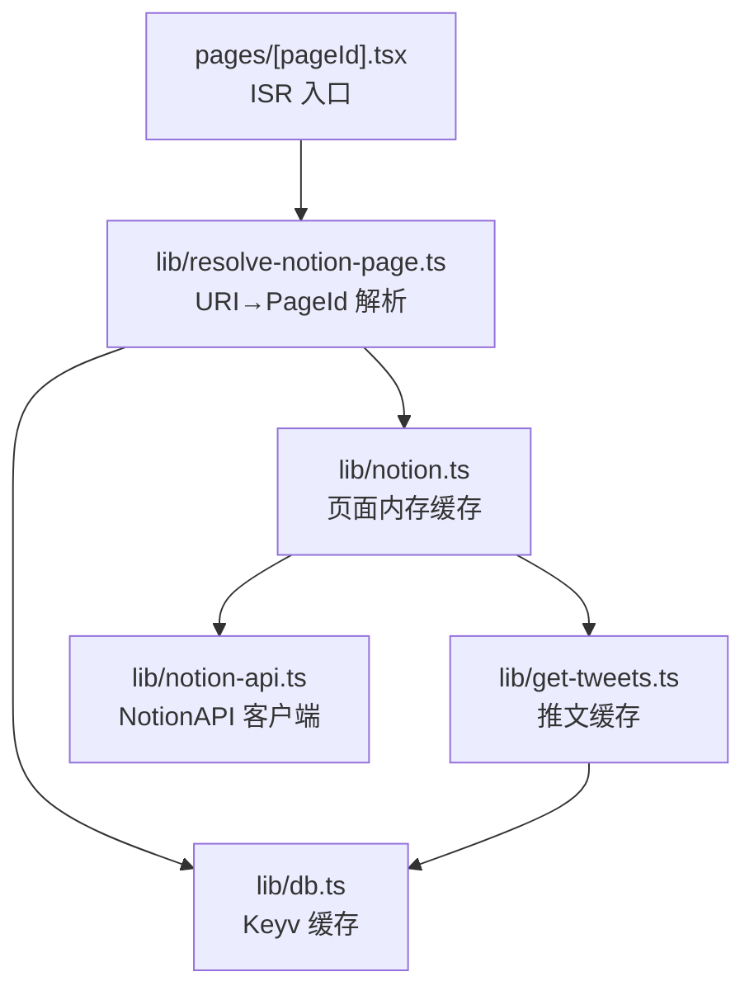
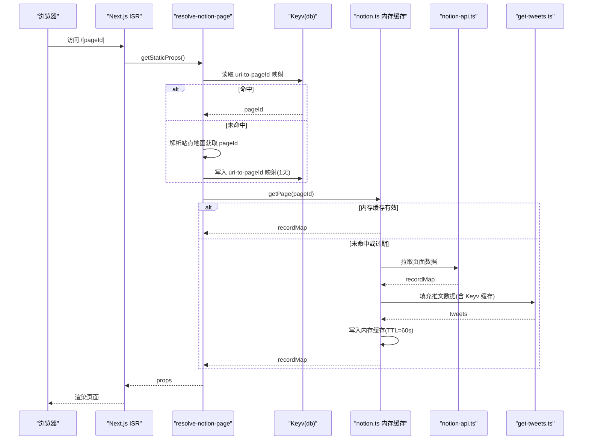
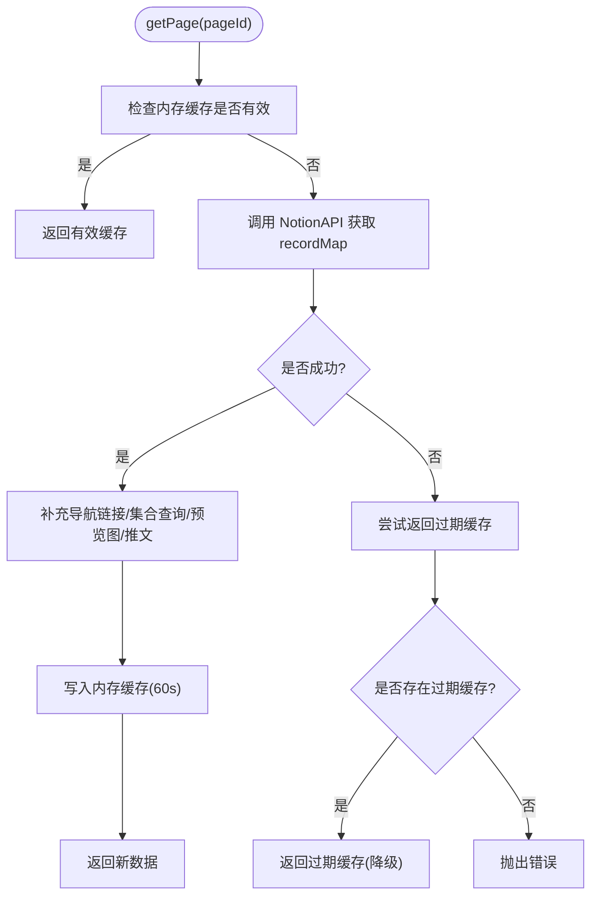
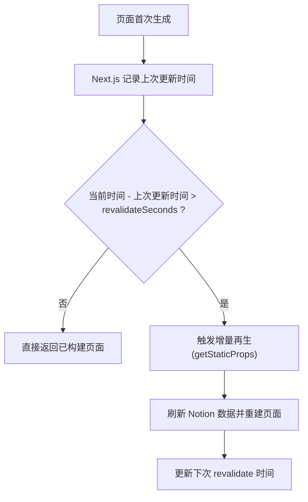
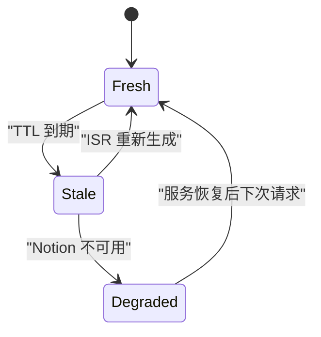
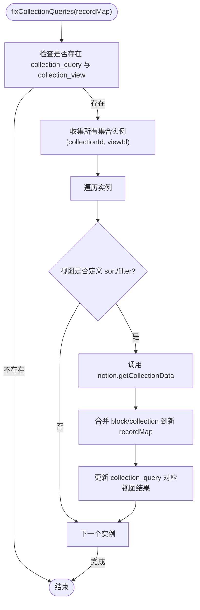
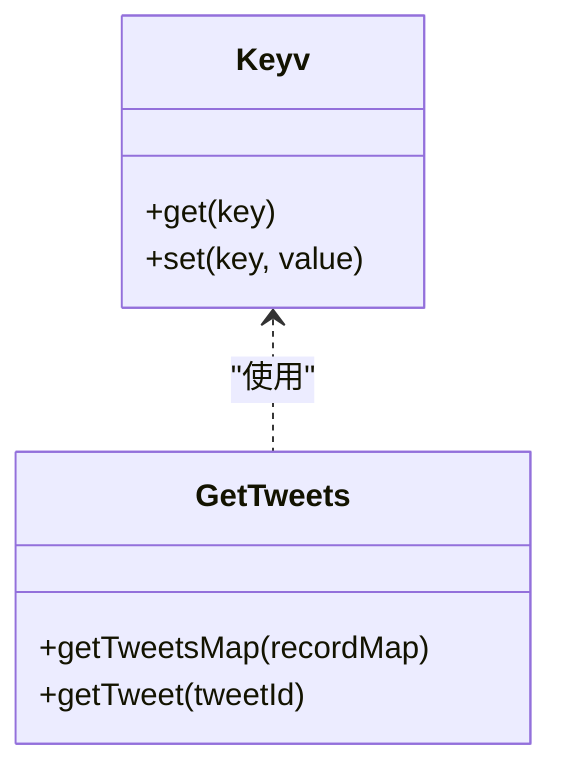
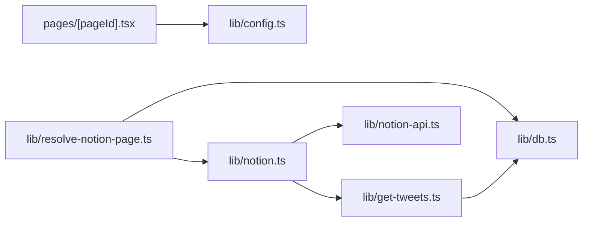

# 数据缓存策略

<cite>
**本文引用的文件**   
- [lib/db.ts](file://lib/db.ts)
- [lib/notion.ts](file://lib/notion.ts)
- [lib/get-tweets.ts](file://lib/get-tweets.ts)
- [lib/resolve-notion-page.ts](file://lib/resolve-notion-page.ts)
- [lib/config.ts](file://lib/config.ts)
- [site.config.ts](file://site.config.ts)
- [pages/[pageId].tsx](file://pages/[pageId].tsx)
- [lib/notion-api.ts](file://lib/notion-api.ts)
</cite>

## 目录
1. [引言](#引言)
2. [项目结构](#项目结构)
3. [核心组件](#核心组件)
4. [架构总览](#架构总览)
5. [详细组件分析](#详细组件分析)
6. [依赖关系分析](#依赖关系分析)
7. [性能与容量规划](#性能与容量规划)
8. [故障恢复与一致性](#故障恢复与一致性)
9. [监控与可观测性](#监控与可观测性)
10. [调优与最佳实践](#调优与最佳实践)
11. [结论](#结论)

## 引言
本仓库实现了一个面向 Notion 内容源的多级缓存体系，涵盖：
- 进程内内存缓存：用于页面级 ExtendedRecordMap 的短时缓存与降级兜底。
- Keyv 键值缓存：用于 URI-to-pageId 映射、推文等外部数据的持久化缓存（默认内存存储）。
- ISR 增量静态再生：通过 Next.js revalidate 配置周期性重建页面，降低函数调用成本并提升数据新鲜度。
- 外部 API 重试与容错：对 Notion API 进行自动重试与超时控制，保障服务可用性。

该方案在“高并发、低延迟”和“数据新鲜度”之间取得平衡，并通过过期策略与失效触发条件保证一致性与稳定性。

## 项目结构
与缓存相关的关键路径如下：
- lib/notion.ts：页面级内存缓存、TTL 管理、stale-while-revalidate 降级逻辑、集合查询修正与增量合并。
- lib/db.ts：基于 Keyv 的通用缓存实例（默认内存）。
- lib/get-tweets.ts：推文数据缓存与 p-memoize 进程内去重。
- lib/resolve-notion-page.ts：URI-to-pageId 映射缓存与站点地图解析。
- pages/[pageId].tsx：ISR revalidate 入口。
- lib/config.ts 与 site.config.ts：revalidateSeconds 配置来源。
- lib/notion-api.ts：Notion API 客户端与重试策略。

**图表来源**
- [pages/[pageId].tsx:9-24](file://pages/[pageId].tsx#L9-L24)
- [lib/resolve-notion-page.ts:11-84](file://lib/resolve-notion-page.ts#L11-L84)
- [lib/db.ts:1-7](file://lib/db.ts#L1-L7)
- [lib/notion.ts:161-213](file://lib/notion.ts#L161-L213)
- [lib/get-tweets.ts:10-62](file://lib/get-tweets.ts#L10-L62)
- [lib/notion-api.ts:1-21](file://lib/notion-api.ts#L1-L21)

**章节来源**
- [pages/[pageId].tsx:9-24](file://pages/[pageId].tsx#L9-L24)
- [lib/resolve-notion-page.ts:11-84](file://lib/resolve-notion-page.ts#L11-L84)
- [lib/notion.ts:161-213](file://lib/notion.ts#L161-L213)
- [lib/get-tweets.ts:10-62](file://lib/get-tweets.ts#L10-L62)
- [lib/db.ts:1-7](file://lib/db.ts#L1-L7)
- [lib/notion-api.ts:1-21](file://lib/notion-api.ts#L1-L21)

## 核心组件
- 页面级内存缓存（lib/notion.ts）
  - 维护每个 pageId 的 ExtendedRecordMap，带 expiresAt 时间戳。
  - getCached 返回有效缓存；getStaleCached 提供过期后仍可使用的旧数据。
  - setCached 写入新数据并设置 TTL。
- Keyv 缓存（lib/db.ts）
  - 提供 get/set 接口，默认使用内存存储，无需 Redis。
  - 被 resolve-notion-page.ts 与 get-tweets.ts 复用。
- 推文缓存（lib/get-tweets.ts）
  - 以 tweetId 为 key 缓存推文数据，失败时回退到 null。
  - 使用 p-memoize 做进程内请求去重。
- URI-to-pageId 映射缓存（lib/resolve-notion-page.ts）
  - 将用户友好的 URL 映射到 Notion pageId，缓存一天。
- ISR 配置（lib/config.ts, site.config.ts, pages/[pageId].tsx）
  - revalidateSeconds 决定页面最大再生频率。

**章节来源**
- [lib/notion.ts:19-55](file://lib/notion.ts#L19-L55)
- [lib/db.ts:1-7](file://lib/db.ts#L1-L7)
- [lib/get-tweets.ts:10-62](file://lib/get-tweets.ts#L10-L62)
- [lib/resolve-notion-page.ts:32-65](file://lib/resolve-notion-page.ts#L32-L65)
- [lib/config.ts:93-95](file://lib/config.ts#L93-L95)
- [site.config.ts:57-60](file://site.config.ts#L57-L60)
- [pages/[pageId].tsx:9-17](file://pages/[pageId].tsx#L9-L17)

## 架构总览
下图展示了从请求进入页面渲染到多级缓存命中与回源的完整流程。

**图表来源**
- [pages/[pageId].tsx:9-24](file://pages/[pageId].tsx#L9-L24)
- [lib/resolve-notion-page.ts:11-84](file://lib/resolve-notion-page.ts#L11-L84)
- [lib/db.ts:1-7](file://lib/db.ts#L1-L7)
- [lib/notion.ts:161-213](file://lib/notion.ts#L161-L213)
- [lib/get-tweets.ts:10-62](file://lib/get-tweets.ts#L10-L62)
- [lib/notion-api.ts:1-21](file://lib/notion-api.ts#L1-L21)

## 详细组件分析

### 内存缓存与 TTL 管理机制（lib/notion.ts）
- 数据结构
  - pageCache：Map<pageId, {recordMap, expiresAt}>
  - PAGE_CACHE_TTL_MS：固定 60 秒
- 行为
  - getCached：若存在且未过期则直接返回 recordMap
  - getStaleCached：即使过期也返回最后已知数据，用于降级
  - setCached：写入 recordMap 并设置 expiresAt
- 设计要点
  - 短 TTL 兼顾新鲜度与突发流量吸收
  - 过期条目保留作为 fallback，实现 stale-while-revalidate

**图表来源**
- [lib/notion.ts:31-55](file://lib/notion.ts#L31-L55)
- [lib/notion.ts:161-213](file://lib/notion.ts#L161-L213)

**章节来源**
- [lib/notion.ts:19-55](file://lib/notion.ts#L19-L55)
- [lib/notion.ts:161-213](file://lib/notion.ts#L161-L213)

### ISR revalidation 与增量更新机制
- 触发点
  - pages/[pageId].tsx 中 getStaticProps 返回 revalidate: revalidateSeconds
  - revalidateSeconds 来自 lib/config.ts，默认 3600 秒，可在 site.config.ts 覆盖
- 效果
  - Next.js 在 revalidate 间隔内不会重新构建页面，减少函数调用
  - 超过间隔后，下一次请求会触发增量再生，确保数据最终一致
- 注意
  - 内存缓存 TTL（60s）远小于 ISR revalidate（默认 1h），因此 ISR 负责长期一致性，内存缓存负责短期高频访问优化

**图表来源**
- [pages/[pageId].tsx:9-17](file://pages/[pageId].tsx#L9-L17)
- [lib/config.ts:93-95](file://lib/config.ts#L93-L95)
- [site.config.ts:57-60](file://site.config.ts#L57-L60)

**章节来源**
- [pages/[pageId].tsx:9-17](file://pages/[pageId].tsx#L9-L17)
- [lib/config.ts:93-95](file://lib/config.ts#L93-L95)
- [site.config.ts:57-60](file://site.config.ts#L57-L60)

### 缓存失效触发条件与数据一致性
- 失效条件
  - 内存缓存：expiresAt 到达即视为过期，但仍可作为降级数据
  - Keyv 缓存：按各自 TTL 失效（如 URI-to-pageId 为 1 天）
  - ISR：revalidateSeconds 到期触发增量再生
- 一致性保证
  - 短 TTL 内存缓存 + 长周期 ISR 双重保障
  - Notion API 不可用时返回过期缓存，避免 5xx
  - 推文缓存失败时返回 null，不影响主流程

**图表来源**
- [lib/notion.ts:31-55](file://lib/notion.ts#L31-L55)
- [lib/notion.ts:161-213](file://lib/notion.ts#L161-L213)
- [pages/[pageId].tsx:9-17](file://pages/[pageId].tsx#L9-L17)

**章节来源**
- [lib/notion.ts:31-55](file://lib/notion.ts#L31-L55)
- [lib/notion.ts:161-213](file://lib/notion.ts#L161-L213)
- [pages/[pageId].tsx:9-17](file://pages/[pageId].tsx#L9-L17)

### 增量更新与集合查询修正（lib/notion.ts）
- fixCollectionQueries
  - 针对 collection_view 的双层嵌套结构，重新执行集合查询以应用真实排序与过滤
  - 仅当视图定义了 sort/filter 时才发起请求
  - 将结果 reducerResults 合并回 recordMap，确保展示顺序与 Notion 一致
- 并发控制
  - 使用 p-map 限制并发，避免瞬时压力过大

**图表来源**
- [lib/notion.ts:95-159](file://lib/notion.ts#L95-L159)

**章节来源**
- [lib/notion.ts:95-159](file://lib/notion.ts#L95-L159)

### Keyv 缓存与推文缓存（lib/db.ts, lib/get-tweets.ts）
- db.ts
  - 初始化 Keyv 实例，默认内存存储，无外部依赖
- get-tweets.ts
  - 以 tweetId 为 key 缓存推文数据
  - 读写异常均捕获并记录警告，不中断主流程
  - 使用 p-memoize 对同一进程内的重复请求进行去重

**图表来源**
- [lib/db.ts:1-7](file://lib/db.ts#L1-L7)
- [lib/get-tweets.ts:10-62](file://lib/get-tweets.ts#L10-L62)

**章节来源**
- [lib/db.ts:1-7](file://lib/db.ts#L1-L7)
- [lib/get-tweets.ts:10-62](file://lib/get-tweets.ts#L10-L62)

### URI-to-pageId 映射缓存（lib/resolve-notion-page.ts）
- 作用
  - 将用户友好的 URL 映射到 Notion pageId，避免每次请求都解析站点地图
- 策略
  - 使用 Keyv 缓存，TTL 为 1 天
  - 写失败时忽略错误，继续走站点地图解析路径
- 影响
  - 显著降低频繁 URL 解析开销，同时允许改名后在 1 天内自然过渡

**章节来源**
- [lib/resolve-notion-page.ts:32-65](file://lib/resolve-notion-page.ts#L32-L65)

## 依赖关系分析
- 模块耦合
  - pages/[pageId].tsx 依赖 config 中的 revalidateSeconds
  - resolve-notion-page.ts 依赖 db、notion、config
  - notion.ts 依赖 notion-api、get-tweets、config
  - get-tweets.ts 依赖 db
- 外部依赖
  - notion-client（通过 notion-api.ts）
  - Keyv（通过 db.ts）
  - p-map/p-memoize（并发与去重）

**图表来源**
- [pages/[pageId].tsx:9-17](file://pages/[pageId].tsx#L9-L17)
- [lib/resolve-notion-page.ts:11-84](file://lib/resolve-notion-page.ts#L11-L84)
- [lib/notion.ts:161-213](file://lib/notion.ts#L161-L213)
- [lib/get-tweets.ts:10-62](file://lib/get-tweets.ts#L10-L62)
- [lib/db.ts:1-7](file://lib/db.ts#L1-L7)
- [lib/notion-api.ts:1-21](file://lib/notion-api.ts#L1-L21)

**章节来源**
- [pages/[pageId].tsx:9-17](file://pages/[pageId].tsx#L9-L17)
- [lib/resolve-notion-page.ts:11-84](file://lib/resolve-notion-page.ts#L11-L84)
- [lib/notion.ts:161-213](file://lib/notion.ts#L161-L213)
- [lib/get-tweets.ts:10-62](file://lib/get-tweets.ts#L10-L62)
- [lib/db.ts:1-7](file://lib/db.ts#L1-L7)
- [lib/notion-api.ts:1-21](file://lib/notion-api.ts#L1-L21)

## 性能与容量规划
- 内存缓存
  - 优点：极低延迟，适合热点页面
  - 风险：进程重启丢失；需关注内存占用
  - 建议：合理设置 PAGE_CACHE_TTL_MS，结合业务 QPS 评估内存峰值
- Keyv 缓存
  - 默认内存存储，适合轻量场景；如需跨实例共享，可替换为 Redis 后端
  - 建议：为不同用途设置独立前缀与 TTL，避免相互污染
- ISR revalidate
  - 增大 revalidateSeconds 可降低函数调用次数，但会增加数据延迟
  - 建议：根据内容更新频率与业务 SLA 调整，例如低频站点可使用 86400
- 并发与限流
  - 集合查询与推文抓取使用 p-map 控制并发，避免下游过载
  - 建议：根据上游 API 限流策略调整并发度

[本节为通用指导，不涉及具体代码片段]

## 故障恢复与一致性
- Notion API 不可用
  - getPage 捕获异常后尝试返回过期缓存，避免 5xx
  - 建议在日志中记录降级事件以便排查
- 缓存读写异常
  - Keyv 读写异常被捕获并输出警告，不影响主流程
  - 建议：在生产环境接入统一日志系统，统计缓存命中率与异常率
- 数据一致性
  - 短 TTL 内存缓存 + 长周期 ISR 组合，确保最终一致
  - 集合查询修正确保展示顺序与 Notion 一致

**章节来源**
- [lib/notion.ts:161-213](file://lib/notion.ts#L161-L213)
- [lib/get-tweets.ts:30-62](file://lib/get-tweets.ts#L30-L62)
- [lib/notion.ts:95-159](file://lib/notion.ts#L95-L159)

## 监控与可观测性
- 指标建议
  - 内存缓存命中率、过期率
  - Keyv 命中率、读写延迟、异常率
  - ISR 触发次数、平均构建耗时
  - Notion API 成功率、重试次数、超时率
- 日志建议
  - 记录降级事件（stale cache served）
  - 记录 Keyv 读写异常与推文抓取失败
  - 记录集合查询修正的实例数量与耗时
- 告警建议
  - 缓存命中率低于阈值
  - Notion API 错误率升高
  - ISR 构建失败或耗时异常

[本节为通用指导，不涉及具体代码片段]

## 调优与最佳实践
- 内存缓存
  - 保持较短 TTL（如 60s）以快速响应变化
  - 监控内存使用，必要时拆分缓存空间或引入淘汰策略
- Keyv 缓存
  - 为不同用途设置独立 TTL（如 URI-to-pageId 为 1 天）
  - 生产环境考虑迁移至 Redis 以获得跨实例共享与持久化
- ISR revalidate
  - 根据内容更新频率调整 revalidateSeconds（默认 3600，示例站点设置为 86400）
  - 对热点页面可配合 CDN 缓存头进一步加速
- 外部 API
  - 利用 notion-api.ts 的重试与超时配置，提高鲁棒性
  - 对关键路径增加熔断与降级策略

**章节来源**
- [lib/config.ts:93-95](file://lib/config.ts#L93-L95)
- [site.config.ts:57-60](file://site.config.ts#L57-L60)
- [lib/notion-api.ts:1-21](file://lib/notion-api.ts#L1-L21)

## 结论
本项目通过“内存缓存 + Keyv + ISR”的多级缓存架构，在保证数据新鲜度的同时显著降低了外部依赖压力与函数调用成本。短 TTL 内存缓存提供毫秒级响应与降级能力，Keyv 承担跨请求的轻量持久化，ISR 负责周期性增量更新。配合合理的并发控制、重试策略与监控告警，可在复杂网络与上游不稳定环境下维持高可用与良好用户体验。