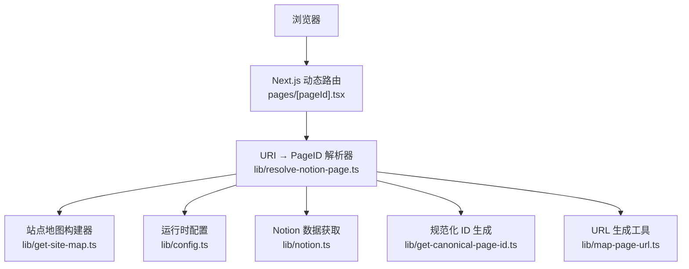
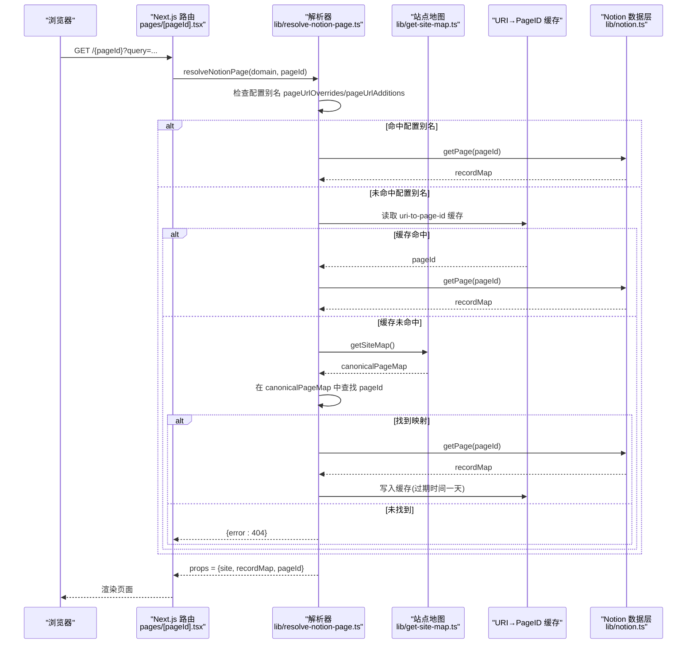
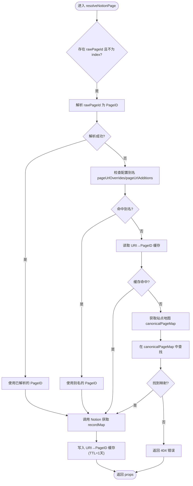
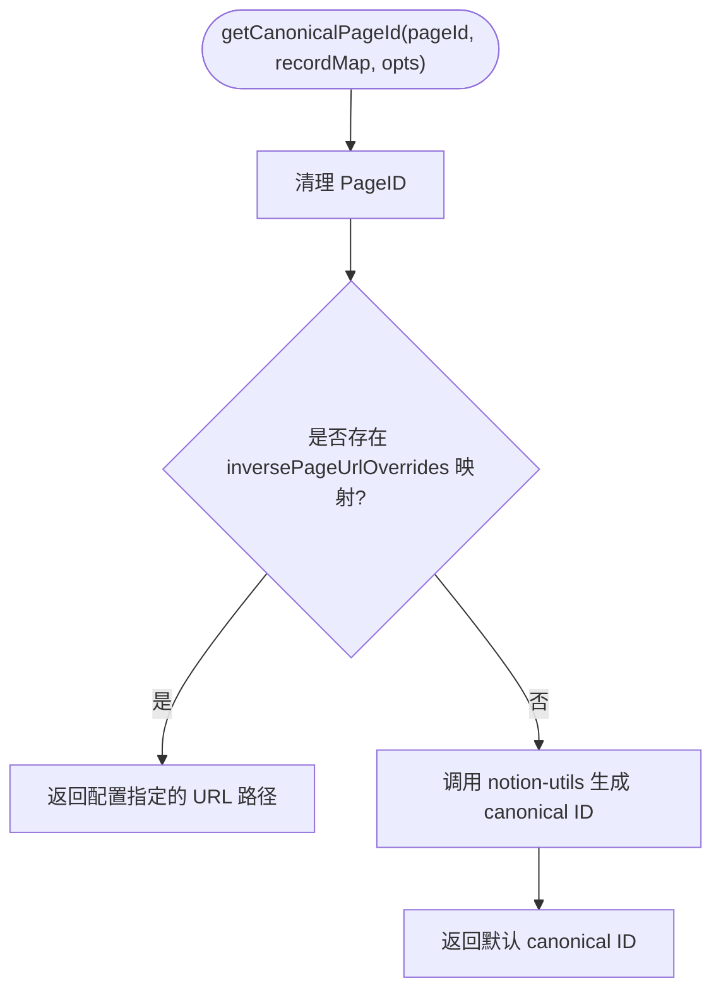
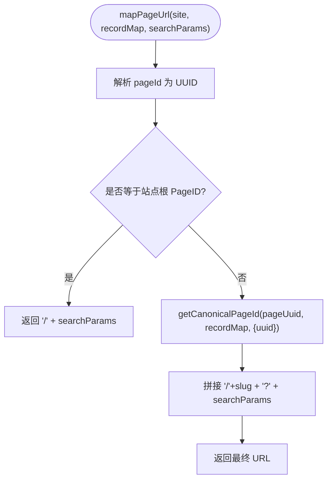
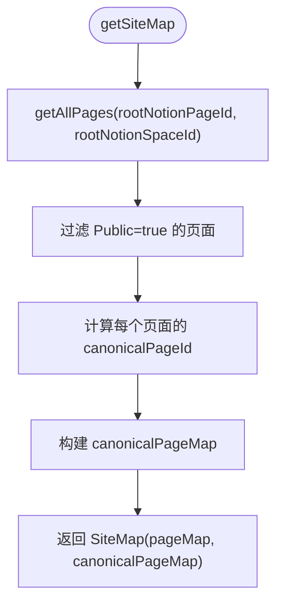
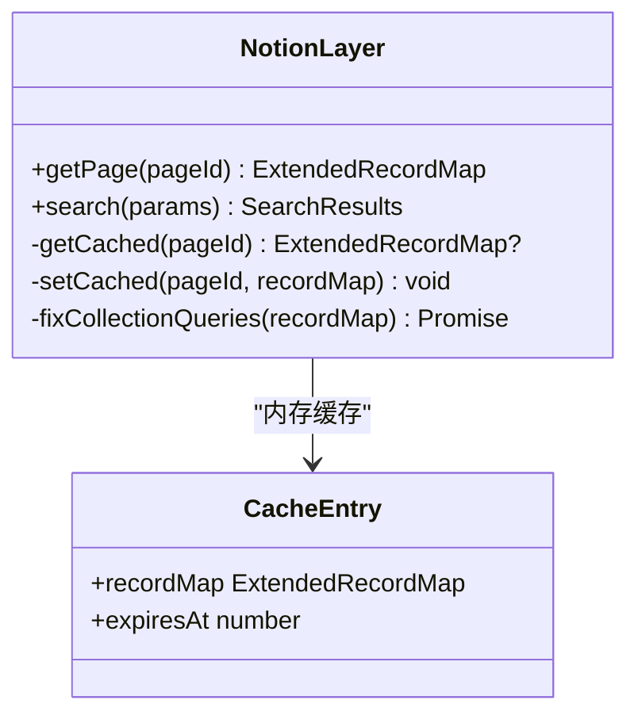
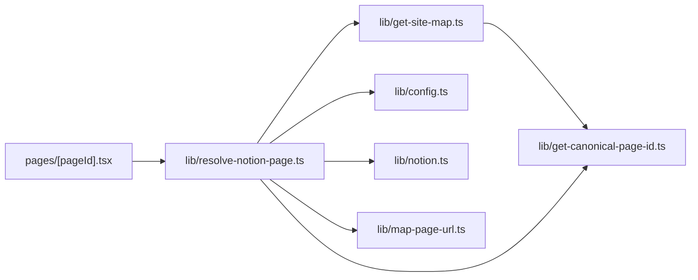
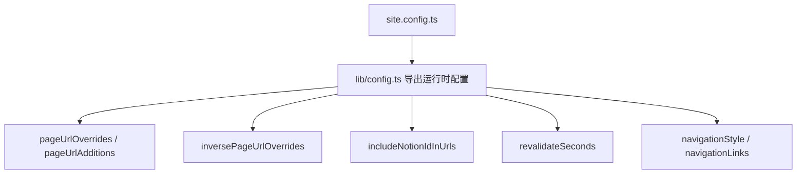

# 页面解析与映射

<cite>
**本文引用的文件**   
- [lib/map-page-url.ts](file://lib/map-page-url.ts)
- [lib/get-canonical-page-id.ts](file://lib/get-canonical-page-id.ts)
- [lib/resolve-notion-page.ts](file://lib/resolve-notion-page.ts)
- [pages/[pageId].tsx](file://pages/[pageId].tsx)
- [site.config.ts](file://site.config.ts)
- [lib/config.ts](file://lib/config.ts)
- [lib/get-site-map.ts](file://lib/get-site-map.ts)
- [lib/notion.ts](file://lib/notion.ts)
- [lib/types.ts](file://lib/types.ts)
</cite>

## 目录
1. [引言](#引言)
2. [项目结构](#项目结构)
3. [核心组件](#核心组件)
4. [架构总览](#架构总览)
5. [详细组件分析](#详细组件分析)
6. [依赖关系分析](#依赖关系分析)
7. [性能与缓存策略](#性能与缓存策略)
8. [动态路由与查询字符串处理](#动态路由与查询字符串处理)
9. [配置项与自定义映射规则](#配置项与自定义映射规则)
10. [故障排查指南](#故障排查指南)
11. [结论](#结论)

## 引言
本文聚焦于“URL 到 Notion Page ID”的映射机制，系统梳理从 Next.js 动态路由入口开始，如何解析用户请求路径、查找别名与重定向、生成规范化页面 ID，并最终加载对应 Notion 页面数据。文档同时覆盖缓存策略、动态路由参数与查询字符串的处理方式，以及可配置的映射规则与扩展点，帮助读者在不深入源码的情况下也能理解并定制该能力。

## 项目结构
本项目采用 Next.js App Router 风格的动态路由与库函数分层：
- 路由层：`pages/[pageId].tsx` 接收 URL 中的 `pageId` 段，调用解析逻辑。
- 解析层：`lib/resolve-notion-page.ts` 负责 URI 到 Notion Page ID 的反查、缓存与错误处理。
- 映射层：`lib/get-canonical-page-id.ts` 与 `lib/map-page-url.ts` 负责规范化 ID 与 URL 生成。
- 站点地图层：`lib/get-site-map.ts` 构建 canonicalPageMap，将规范路径映射回 Notion Page ID。
- 配置层：`site.config.ts` 提供站点级配置，`lib/config.ts` 统一导出运行时配置。
- 数据层：`lib/notion.ts` 封装 Notion API 访问与页面级缓存。

**图表来源**
- [pages/[pageId].tsx:9-25](file://pages/[pageId].tsx#L9-L25)
- [lib/resolve-notion-page.ts:11-84](file://lib/resolve-notion-page.ts#L11-L84)
- [lib/get-site-map.ts:17-27](file://lib/get-site-map.ts#L17-L27)
- [lib/config.ts:36-47](file://lib/config.ts#L36-L47)
- [lib/get-canonical-page-id.ts:9-29](file://lib/get-canonical-page-id.ts#L9-L29)
- [lib/map-page-url.ts:12-39](file://lib/map-page-url.ts#L12-L39)
- [lib/notion.ts:161-214](file://lib/notion.ts#L161-L214)

**章节来源**
- [pages/[pageId].tsx:9-58](file://pages/[pageId].tsx#L9-L58)
- [lib/resolve-notion-page.ts:11-84](file://lib/resolve-notion-page.ts#L11-L84)
- [lib/get-site-map.ts:17-105](file://lib/get-site-map.ts#L17-L105)
- [lib/config.ts:36-47](file://lib/config.ts#L36-L47)
- [lib/get-canonical-page-id.ts:9-29](file://lib/get-canonical-page-id.ts#L9-L29)
- [lib/map-page-url.ts:12-43](file://lib/map-page-url.ts#L12-L43)
- [lib/notion.ts:161-214](file://lib/notion.ts#L161-L214)

## 核心组件
- 动态路由处理器：读取 `context.params.pageId`，调用解析器，返回页面属性并启用 ISR 增量再生。
- URI 到 PageID 解析器：优先使用配置别名，其次使用站点地图映射，最后返回 404；支持 URI→PageID 缓存。
- 规范化 ID 生成器：基于 Notion 提供的 canonical slug 或 UUID，允许通过反向映射覆盖。
- URL 生成器：根据根页面与规范化路径拼接最终 URL，保留查询字符串。
- 站点地图构建器：遍历 Notion 空间，过滤公开页面，生成 canonicalPageMap（规范路径→PageID）。
- Notion 数据层：封装 getPage，内置内存缓存与集合视图查询修正。

**章节来源**
- [pages/[pageId].tsx:9-25](file://pages/[pageId].tsx#L9-L25)
- [lib/resolve-notion-page.ts:11-84](file://lib/resolve-notion-page.ts#L11-L84)
- [lib/get-canonical-page-id.ts:9-29](file://lib/get-canonical-page-id.ts#L9-L29)
- [lib/map-page-url.ts:12-43](file://lib/map-page-url.ts#L12-L43)
- [lib/get-site-map.ts:44-105](file://lib/get-site-map.ts#L44-L105)
- [lib/notion.ts:161-214](file://lib/notion.ts#L161-L214)

## 架构总览
下图展示一次典型请求从 URL 到 Notion 页面数据的完整流程，包括别名解析、站点地图查找、缓存命中与 Notion API 调用。

**图表来源**
- [pages/[pageId].tsx:9-25](file://pages/[pageId].tsx#L9-L25)
- [lib/resolve-notion-page.ts:11-84](file://lib/resolve-notion-page.ts#L11-L84)
- [lib/get-site-map.ts:17-27](file://lib/get-site-map.ts#L17-L27)
- [lib/notion.ts:161-214](file://lib/notion.ts#L161-L214)

## 详细组件分析

### 动态路由处理器 pages/[pageId].tsx
- 职责：
  - 从路由上下文提取 `rawPageId`。
  - 调用 `resolveNotionPage` 获取页面属性。
  - 设置 ISR 重新验证间隔 `revalidateSeconds`。
  - 开发环境使用 fallback true，生产环境预生成所有静态路径（包含 sitemap 与 URL 覆盖）。
- 关键点：
  - 错误时抛出异常，避免发布错误版本页面。
  - 静态路径由 `getSiteMap().canonicalPageMap` 与 `pageUrlOverrides` 合并去重生成。

**章节来源**
- [pages/[pageId].tsx:9-58](file://pages/[pageId].tsx#L9-L58)

### URI 到 PageID 解析器 lib/resolve-notion-page.ts
- 解析优先级：
  1. 若传入 rawPageId 且非 index，尝试直接解析为 Notion PageID。
  2. 若解析失败，检查配置别名 `pageUrlOverrides` 与 `pageUrlAdditions`，将其转换为 PageID。
  3. 尝试从 URI→PageID 缓存读取（键含 domain、environment、rawPageId），TTL 为一天。
  4. 若仍无结果，从站点地图 `canonicalPageMap` 查找规范路径对应的 PageID。
  5. 成功映射后调用 Notion 获取 recordMap，并将映射写入缓存。
  6. 若始终无法映射，返回 404 错误对象。
- 根页面处理：
  - 当 rawPageId 为空或为 index 时，直接使用站点根 Notion PageID 并拉取数据。
- 权限控制：
  - 最终通过 ACL 模块注入权限相关属性。

**图表来源**
- [lib/resolve-notion-page.ts:11-84](file://lib/resolve-notion-page.ts#L11-L84)

**章节来源**
- [lib/resolve-notion-page.ts:11-84](file://lib/resolve-notion-page.ts#L11-L84)

### 规范化页面 ID 生成 lib/get-canonical-page-id.ts
- 输入：原始 PageID、recordMap、是否包含 UUID 的选项。
- 行为：
  - 先清理 PageID（去除 UUID 前缀等）。
  - 若存在反向映射 `inversePageUrlOverrides`（即某个 PageID 被显式指定了 URL 路径），则直接返回该路径作为“规范化 ID”。
  - 否则调用 notion-utils 的 canonical 生成逻辑，结合 recordMap 计算 slug。
- 用途：
  - 用于生成规范的 URL 路径，保证 SEO 友好与一致性。

**图表来源**
- [lib/get-canonical-page-id.ts:9-29](file://lib/get-canonical-page-id.ts#L9-L29)
- [lib/config.ts:209-220](file://lib/config.ts#L209-L220)

**章节来源**
- [lib/get-canonical-page-id.ts:9-29](file://lib/get-canonical-page-id.ts#L9-L29)
- [lib/config.ts:209-220](file://lib/config.ts#L209-L220)

### URL 生成与别名处理 lib/map-page-url.ts
- mapPageUrl：
  - 根据 site.rootNotionPageId 判断是否为根页面，若是则返回 `/`。
  - 否则使用 `getCanonicalPageId` 生成规范路径，并拼接查询字符串。
- getCanonicalPageUrl：
  - 生成绝对 URL（包含域名），同样区分根页面与非根页面。
- includeNotionIdInUrls：
  - 开发环境默认开启，便于调试；生产环境默认关闭，仅使用 slug。

**图表来源**
- [lib/map-page-url.ts:12-43](file://lib/map-page-url.ts#L12-L43)

**章节来源**
- [lib/map-page-url.ts:12-43](file://lib/map-page-url.ts#L12-L43)

### 站点地图构建 lib/get-site-map.ts
- 作用：
  - 遍历 Notion 空间中的所有页面，过滤出公开页面（Public 属性为真）。
  - 对每个公开页面计算 canonicalPageId，并建立 canonicalPageMap（规范路径→PageID）。
  - 使用 p-memoize 缓存站点地图，每 5 分钟刷新，以兼顾新鲜度与性能。
- 输出：
  - pageMap：PageID→recordMap。
  - canonicalPageMap：规范路径→PageID。

**图表来源**
- [lib/get-site-map.ts:17-27](file://lib/get-site-map.ts#L17-L27)
- [lib/get-site-map.ts:44-105](file://lib/get-site-map.ts#L44-L105)

**章节来源**
- [lib/get-site-map.ts:17-105](file://lib/get-site-map.ts#L17-L105)

### Notion 数据层 lib/notion.ts
- getPage：
  - 优先返回内存缓存中的 recordMap（TTL 60 秒）。
  - 若 Notion API 不可用，尝试返回陈旧缓存以避免全站 500。
  - 根据导航样式决定是否预取导航链接页面的数据并合并。
  - 修正集合视图查询（排序与过滤）以确保渲染顺序与 Notion 一致。
  - 可选地注入预览图片映射与推文映射。
- 缓存策略：
  - 内存 Map 存储，按 PageID 分桶，带过期时间。
  - 支持 stale-while-revalidate 模式，提升容错性。

**图表来源**
- [lib/notion.ts:161-214](file://lib/notion.ts#L161-L214)
- [lib/notion.ts:29-55](file://lib/notion.ts#L29-L55)

**章节来源**
- [lib/notion.ts:29-55](file://lib/notion.ts#L29-L55)
- [lib/notion.ts:161-214](file://lib/notion.ts#L161-L214)

## 依赖关系分析
- 路由层依赖解析器与配置。
- 解析器依赖站点地图、配置、缓存与 Notion 数据层。
- 站点地图依赖 Notion API 与规范化 ID 生成。
- 规范化 ID 生成依赖配置中的反向映射。
- URL 生成依赖规范化 ID 生成与配置开关。

**图表来源**
- [pages/[pageId].tsx:9-25](file://pages/[pageId].tsx#L9-L25)
- [lib/resolve-notion-page.ts:11-84](file://lib/resolve-notion-page.ts#L11-L84)
- [lib/get-site-map.ts:17-27](file://lib/get-site-map.ts#L17-L27)
- [lib/get-canonical-page-id.ts:9-29](file://lib/get-canonical-page-id.ts#L9-L29)
- [lib/map-page-url.ts:12-43](file://lib/map-page-url.ts#L12-L43)
- [lib/notion.ts:161-214](file://lib/notion.ts#L161-L214)

**章节来源**
- [pages/[pageId].tsx:9-58](file://pages/[pageId].tsx#L9-L58)
- [lib/resolve-notion-page.ts:11-84](file://lib/resolve-notion-page.ts#L11-L84)
- [lib/get-site-map.ts:17-105](file://lib/get-site-map.ts#L17-L105)
- [lib/get-canonical-page-id.ts:9-29](file://lib/get-canonical-page-id.ts#L9-L29)
- [lib/map-page-url.ts:12-43](file://lib/map-page-url.ts#L12-L43)
- [lib/notion.ts:161-214](file://lib/notion.ts#L161-L214)

## 性能与缓存策略
- URI→PageID 缓存：
  - 键格式：`uri-to-page-id:{domain}:{environment}:{rawPageId}`。
  - TTL：86400000 毫秒（一天），平衡速度与更新频率。
  - 仅在成功映射后写入，404 不缓存。
- 站点地图缓存：
  - 使用 p-memoize，每 5 分钟刷新，减少频繁遍历 Notion 空间。
- Notion 页面数据缓存：
  - 内存 Map，TTL 60 秒，支持陈旧缓存降级，提高可用性。
- ISR 增量再生：
  - 页面级 revalidateSeconds 控制 Next.js 增量重建频率，降低函数调用成本。

**章节来源**
- [lib/resolve-notion-page.ts:32-65](file://lib/resolve-notion-page.ts#L32-L65)
- [lib/get-site-map.ts:29-32](file://lib/get-site-map.ts#L29-L32)
- [lib/notion.ts:29-55](file://lib/notion.ts#L29-L55)
- [pages/[pageId].tsx:17-17](file://pages/[pageId].tsx#L17-L17)

## 动态路由与查询字符串处理
- 动态路由参数：
  - `pages/[pageId].tsx` 通过 `context.params.pageId` 获取 URL 路径段。
  - 解析器接受任意 rawPageId，既可以是 Notion PageID，也可以是规范路径（slug）。
- 查询字符串：
  - URL 生成器在构造路径时保留 searchParams，确保如 `?q=...` 等参数不被丢弃。
- 根页面：
  - 当 PageID 匹配站点根 Notion PageID 时，返回 `/` 而非具体 slug。

**章节来源**
- [pages/[pageId].tsx:9-25](file://pages/[pageId].tsx#L9-L25)
- [lib/map-page-url.ts:12-43](file://lib/map-page-url.ts#L12-L43)

## 配置项与自定义映射规则
- 站点根 PageID 与空间 ID：
  - `rootNotionPageId`、`rootNotionSpaceId` 定义站点根与可选的工作区范围。
- URL 覆盖与新增：
  - `pageUrlOverrides`：将特定 URL 路径映射到指定 Notion PageID，覆盖默认 slug 生成。
  - `pageUrlAdditions`：额外添加 URL 到 PageID 的映射，常用于别名或聚合页。
- 反向映射：
  - 运行时自动生成 `inversePageUrlOverrides`，供规范化 ID 生成器优先使用。
- 是否包含 Notion ID 在 URL：
  - `includeNotionIdInUrls`：开发环境默认开启，便于调试；生产环境默认关闭。
- ISR 重新验证间隔：
  - `revalidateSeconds`：控制页面增量重建频率。
- 导航样式与链接：
  - `navigationStyle`、`navigationLinks`：影响导航数据预取与合并。

**图表来源**
- [site.config.ts:47-60](file://site.config.ts#L47-L60)
- [lib/config.ts:36-47](file://lib/config.ts#L36-L47)
- [lib/config.ts:74-78](file://lib/config.ts#L74-L78)
- [lib/config.ts:93-95](file://lib/config.ts#L93-L95)
- [lib/config.ts:80-88](file://lib/config.ts#L80-L88)

**章节来源**
- [site.config.ts:47-60](file://site.config.ts#L47-L60)
- [lib/config.ts:36-47](file://lib/config.ts#L36-L47)
- [lib/config.ts:74-78](file://lib/config.ts#L74-L78)
- [lib/config.ts:93-95](file://lib/config.ts#L93-L95)
- [lib/config.ts:80-88](file://lib/config.ts#L80-L88)

## 故障排查指南
- 404 未找到：
  - 当 rawPageId 无法解析为 PageID，且在配置别名与站点地图中均无映射时，解析器返回 404。
  - 建议检查：
    - 是否在 `pageUrlOverrides` 或 `pageUrlAdditions` 中正确配置。
    - Notion 页面是否标记为公开（Public=true）。
    - 站点地图是否已刷新（p-memoize 每 5 分钟刷新）。
- 缓存相关问题：
  - URI→PageID 缓存 TTL 为一天，若修改别名后未生效，可等待缓存过期或调整缓存策略。
  - Notion 页面数据缓存 TTL 为 60 秒，频繁编辑时可关注陈旧缓存降级日志。
- Notion API 不可用：
  - 若 Notion 服务异常，getPage 会尝试返回陈旧缓存，避免全站 500。
  - 检查网络与 API 密钥配置，观察控制台警告信息。

**章节来源**
- [lib/resolve-notion-page.ts:66-74](file://lib/resolve-notion-page.ts#L66-L74)
- [lib/get-site-map.ts:62-98](file://lib/get-site-map.ts#L62-L98)
- [lib/notion.ts:168-182](file://lib/notion.ts#L168-L182)

## 结论
本项目的 URL 到 Notion PageID 映射机制通过“配置别名优先、站点地图兜底、URI→PageID 缓存加速”的策略，实现了灵活、高效且可定制的页面解析流程。规范化 ID 生成与 URL 生成解耦，既保证了 SEO 友好，又提供了开发期可观测性。配合站点地图缓存、Notion 页面数据缓存与 ISR 增量再生，系统在性能与可用性之间取得良好平衡。通过 `pageUrlOverrides`、`pageUrlAdditions` 与 `includeNotionIdInUrls` 等配置项，用户可以轻松实现别名、重定向与调试需求，满足复杂业务场景下的页面映射要求。