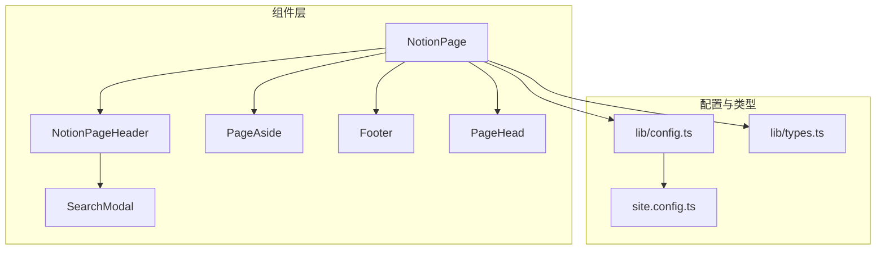
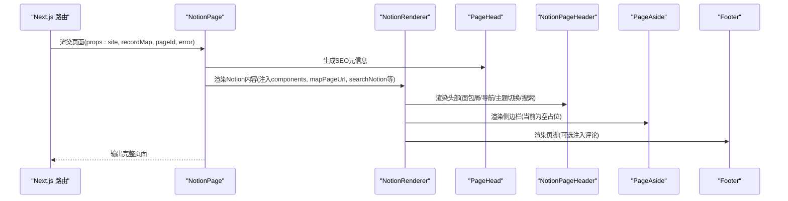
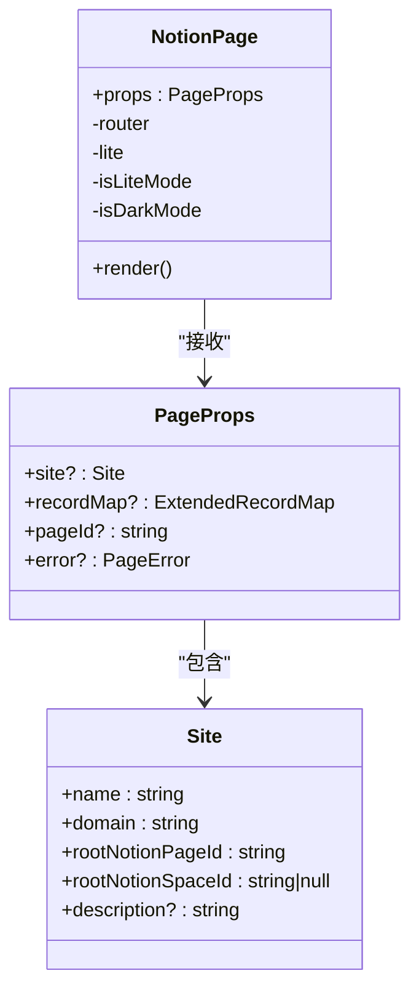
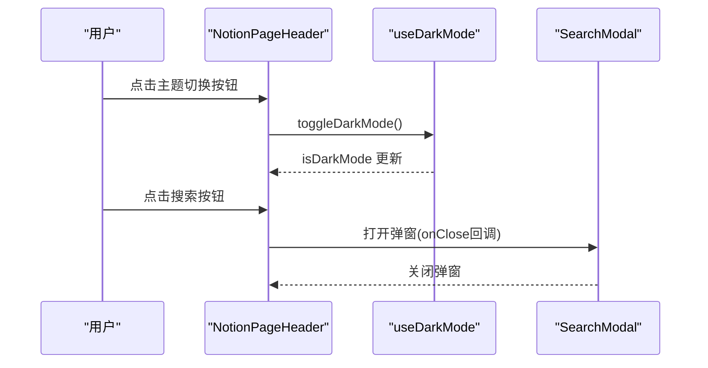
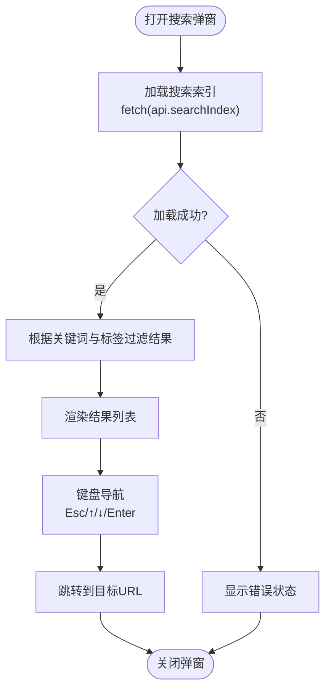
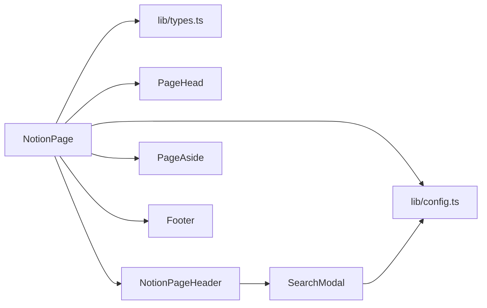

# React 组件组合模式

<cite>
**本文引用的文件**   
- [components/NotionPage.tsx](file://components/NotionPage.tsx)
- [components/NotionPageHeader.tsx](file://components/NotionPageHeader.tsx)
- [components/PageAside.tsx](file://components/PageAside.tsx)
- [components/SearchModal.tsx](file://components/SearchModal.tsx)
- [components/Footer.tsx](file://components/Footer.tsx)
- [components/PageHead.tsx](file://components/PageHead.tsx)
- [lib/types.ts](file://lib/types.ts)
- [lib/config.ts](file://lib/config.ts)
- [lib/site-config.ts](file://lib/site-config.ts)
- [site.config.ts](file://site.config.ts)
</cite>

## 目录
1. [简介](#简介)
2. [项目结构](#项目结构)
3. [核心组件](#核心组件)
4. [架构总览](#架构总览)
5. [详细组件分析](#详细组件分析)
6. [依赖关系分析](#依赖关系分析)
7. [性能与可维护性](#性能与可维护性)
8. [故障排查指南](#故障排查指南)
9. [结论](#结论)

## 简介
本文聚焦于项目中基于 Next.js 的 React 组件组合模式与架构设计，重点解析主页面组件 NotionPage 的组合结构、子组件职责、通信机制、Props 设计与类型定义、可复用性原则，以及状态管理与副作用处理的最佳实践。文档同时提供组件树图与交互流程图，帮助读者快速理解整体架构。

## 项目结构
本项目采用“功能域 + 页面”的组织方式：
- components：UI 组件层，包含页面容器、头部、侧边栏、搜索弹窗、页脚、SEO 头信息等
- lib：业务逻辑与配置，包括站点配置、类型定义、API 地址、工具函数等
- pages：Next.js 路由入口（本说明不深入）
- site.config.ts：站点级配置入口

图表来源
- [components/NotionPage.tsx:211-355](file://components/NotionPage.tsx#L211-L355)
- [components/NotionPageHeader.tsx:82-132](file://components/NotionPageHeader.tsx#L82-L132)
- [components/SearchModal.tsx:57-253](file://components/SearchModal.tsx#L57-L253)
- [components/Footer.tsx:5-13](file://components/Footer.tsx#L5-L13)
- [components/PageHead.tsx:7-187](file://components/PageHead.tsx#L7-L187)
- [lib/config.ts:104-160](file://lib/config.ts#L104-L160)
- [lib/types.ts:14-45](file://lib/types.ts#L14-L45)
- [site.config.ts:1-77](file://site.config.ts#L1-L77)

章节来源
- [components/NotionPage.tsx:211-355](file://components/NotionPage.tsx#L211-L355)
- [lib/config.ts:104-160](file://lib/config.ts#L104-L160)
- [lib/types.ts:14-45](file://lib/types.ts#L14-L45)
- [site.config.ts:1-77](file://site.config.ts#L1-L77)

## 核心组件
- NotionPage：页面容器，负责渲染 Notion 内容、SEO 元信息、主题切换、lite 模式、评论与页脚等
- NotionPageHeader：页面头部导航、面包屑、主题切换按钮、站内搜索入口
- PageAside：文章侧边栏占位（当前返回空节点，预留扩展点）
- SearchModal：站内搜索弹窗，加载索引、过滤结果、键盘导航
- Footer：页脚，支持注入评论模块
- PageHead：SEO 元信息与结构化数据注入

章节来源
- [components/NotionPage.tsx:211-355](file://components/NotionPage.tsx#L211-L355)
- [components/NotionPageHeader.tsx:82-132](file://components/NotionPageHeader.tsx#L82-L132)
- [components/PageAside.tsx:1-18](file://components/PageAside.tsx#L1-L18)
- [components/SearchModal.tsx:57-253](file://components/SearchModal.tsx#L57-L253)
- [components/Footer.tsx:5-13](file://components/Footer.tsx#L5-L13)
- [components/PageHead.tsx:7-187](file://components/PageHead.tsx#L7-L187)

## 架构总览
NotionPage 作为页面根组件，组合以下能力：
- 通过 NotionRenderer 渲染 Notion 内容，并注入自定义组件映射（Code、Collection、Equation、Pdf、Modal、Tweet、Header、属性值处理器等）
- 使用 PageHead 注入 SEO 元数据与结构化数据
- 根据 lite 参数与深色模式开关，动态设置 body class
- 将 PageAside 作为右侧边栏传入 NotionRenderer
- 在博客文章场景下，将 Utterances 评论组件注入到 Footer

图表来源
- [components/NotionPage.tsx:211-355](file://components/NotionPage.tsx#L211-L355)
- [components/NotionPageHeader.tsx:82-132](file://components/NotionPageHeader.tsx#L82-L132)
- [components/Footer.tsx:5-13](file://components/Footer.tsx#L5-L13)
- [components/PageHead.tsx:7-187](file://components/PageHead.tsx#L7-L187)

## 详细组件分析

### NotionPage 主组件
职责与组合要点：
- 接收 props：site、recordMap、pageId、error，类型为 types.PageProps
- 根据 URL 查询参数 lite 判断是否进入 lite 模式（用于 oembed）
- 使用 useDarkMode 获取深色模式状态，并通过 BodyClassName 注入 body class
- 计算站点级 mapPageUrl，结合 lite 参数拼接 searchParams
- 从 recordMap 中取首个 block，判断是否为博客文章（isBlogPost），决定是否显示目录
- 构造 PageAside 并传入 NotionRenderer
- 错误与加载中状态分别渲染 Loading 与 Page404
- 构建 SEO 所需标题、描述、图片、canonical URL、发布时间、修改时间、作者等
- 注入 NotionRenderer 的 components 映射，覆盖 Header、Code、Collection、Equation、Pdf、Modal、Tweet 等
- 注入 searchNotion（当启用搜索时）
- 在博客文章场景下，将 Utterances 评论组件注入 Footer

关键实现路径
- Props 类型定义：[types.PageProps:14-19](file://lib/types.ts#L14-L19)
- 站点配置导出 site：[lib/config.ts:154-160](file://lib/config.ts#L154-L160)
- 渲染 NotionRenderer 与组件映射：[components/NotionPage.tsx:196-209](file://components/NotionPage.tsx#L196-L209), [components/NotionPage.tsx:319-351](file://components/NotionPage.tsx#L319-L351)
- Lite 模式与深色模式：[components/NotionPage.tsx:217-223](file://components/NotionPage.tsx#L217-L223), [components/NotionPage.tsx:316-317](file://components/NotionPage.tsx#L316-L317)
- SEO 元信息：[components/PageHead.tsx:7-187](file://components/PageHead.tsx#L7-L187)

图表来源
- [components/NotionPage.tsx:211-355](file://components/NotionPage.tsx#L211-L355)
- [lib/types.ts:14-45](file://lib/types.ts#L14-L45)

章节来源
- [components/NotionPage.tsx:211-355](file://components/NotionPage.tsx#L211-L355)
- [lib/types.ts:14-45](file://lib/types.ts#L14-L45)

### NotionPageHeader 头部组件
职责与组合要点：
- 使用 useNotionContext 获取 components 与 mapPageUrl
- 渲染 Breadcrumbs 面包屑，并根据 navigationLinks 渲染导航链接（内部跳转或外链）
- 提供 ToggleThemeButton 切换深色模式
- 提供 SearchButton 打开 SearchModal

交互流程（主题切换与搜索）：

图表来源
- [components/NotionPageHeader.tsx:15-35](file://components/NotionPageHeader.tsx#L15-L35)
- [components/NotionPageHeader.tsx:37-80](file://components/NotionPageHeader.tsx#L37-L80)
- [components/NotionPageHeader.tsx:82-132](file://components/NotionPageHeader.tsx#L82-L132)

章节来源
- [components/NotionPageHeader.tsx:82-132](file://components/NotionPageHeader.tsx#L82-L132)

### SearchModal 搜索弹窗
职责与组合要点：
- 首次挂载时通过 fetch(api.searchIndex) 加载搜索索引
- 本地过滤：支持关键词与标签筛选（AND语义）
- 键盘导航：Esc 关闭、上下键移动高亮项、Enter 跳转
- 使用 createPortal 渲染到 document.body，避免层级问题
- 状态管理：index、isLoading、error、query、selectedTags、activeIndex、mounted

图表来源
- [components/SearchModal.tsx:57-106](file://components/SearchModal.tsx#L57-L106)
- [components/SearchModal.tsx:108-147](file://components/SearchModal.tsx#L108-L147)
- [components/SearchModal.tsx:153-253](file://components/SearchModal.tsx#L153-L253)

章节来源
- [components/SearchModal.tsx:57-253](file://components/SearchModal.tsx#L57-L253)

### PageAside 侧边栏
- 当前为占位组件，返回 null，预留扩展点以承载目录、相关文章等

章节来源
- [components/PageAside.tsx:1-18](file://components/PageAside.tsx#L1-L18)

### Footer 页脚
- 支持注入 comments 节点（如 Utterances）
- 使用 React.memo 包裹以提升渲染性能

章节来源
- [components/Footer.tsx:5-13](file://components/Footer.tsx#L5-L13)

### PageHead SEO 头信息
- 注入 meta、OG/Twitter 卡片、canonical、RSS、JSON-LD 结构化数据
- 根据 isBlogPost 决定 schema 类型（WebSite 或 BlogPosting）

章节来源
- [components/PageHead.tsx:7-187](file://components/PageHead.tsx#L7-L187)

## 依赖关系分析
- NotionPage 依赖：
  - lib/config.ts：站点配置、API 地址、环境判断
  - lib/types.ts：类型定义（PageProps、Site 等）
  - components/PageHead、NotionPageHeader、PageAside、Footer
  - react-notion-x：NotionRenderer、useNotionContext、NotionComponents
  - next/router、next/dynamic、next/image、next/link
- NotionPageHeader 依赖：
  - react-notion-x：Breadcrumbs、useNotionContext
  - components/SearchModal
  - lib/config：navigationLinks、isSearchEnabled
- SearchModal 依赖：
  - lib/config：api.searchIndex
  - next/router：页面跳转

图表来源
- [components/NotionPage.tsx:211-355](file://components/NotionPage.tsx#L211-L355)
- [components/NotionPageHeader.tsx:82-132](file://components/NotionPageHeader.tsx#L82-L132)
- [components/SearchModal.tsx:57-253](file://components/SearchModal.tsx#L57-L253)
- [lib/config.ts:104-160](file://lib/config.ts#L104-L160)
- [lib/types.ts:14-45](file://lib/types.ts#L14-L45)

章节来源
- [components/NotionPage.tsx:211-355](file://components/NotionPage.tsx#L211-L355)
- [components/NotionPageHeader.tsx:82-132](file://components/NotionPageHeader.tsx#L82-L132)
- [components/SearchModal.tsx:57-253](file://components/SearchModal.tsx#L57-L253)
- [lib/config.ts:104-160](file://lib/config.ts#L104-L160)
- [lib/types.ts:14-45](file://lib/types.ts#L14-L45)

## 性能与可维护性
- 动态导入与按需加载：
  - Code、Collection、Equation、Pdf、Modal 等通过 next/dynamic 动态引入，减少首屏体积
  - Collection、Pdf、Modal 禁用 SSR，避免服务端/客户端水合不一致
- 预渲染与缓存：
  - NotionRenderer 在服务端渲染文章内容，保证 SEO；集合视图在客户端渲染
- 状态与副作用：
  - SearchModal 使用 useEffect 加载索引，并在卸载时取消请求，避免内存泄漏
  - useDarkMode 与 BodyClassName 控制全局样式类名，避免重复渲染
- 可复用性与扩展点：
  - NotionRenderer.components 映射允许替换默认组件，便于二次开发
  - PageAside 作为占位组件，便于后续扩展目录、相关文章等
- 配置驱动：
  - site.config.ts 与 lib/config.ts 集中管理站点配置，便于环境与部署差异

章节来源
- [components/NotionPage.tsx:43-142](file://components/NotionPage.tsx#L43-L142)
- [components/SearchModal.tsx:80-106](file://components/SearchModal.tsx#L80-L106)
- [lib/config.ts:104-160](file://lib/config.ts#L104-L160)
- [site.config.ts:1-77](file://site.config.ts#L1-L77)

## 故障排查指南
- 页面空白或报错：
  - 检查 NotionPage 的错误分支与 loading 分支是否正确渲染
  - 确认 site、recordMap、block 是否存在
- 搜索不可用：
  - 检查 api.searchIndex 是否可达，SearchModal 的加载与错误状态是否正常
- 主题切换无效：
  - 检查 useDarkMode 与 BodyClassName 的类名注入是否生效
- 评论未显示：
  - 确认 isBlogPost 条件成立且 Footer.comments 已注入 Utterances

章节来源
- [components/NotionPage.tsx:255-261](file://components/NotionPage.tsx#L255-L261)
- [components/SearchModal.tsx:80-106](file://components/SearchModal.tsx#L80-L106)
- [components/NotionPage.tsx:316-317](file://components/NotionPage.tsx#L316-L317)
- [components/NotionPage.tsx:341-351](file://components/NotionPage.tsx#L341-L351)

## 结论
本项目通过 NotionPage 作为组合中心，将 Notion 内容渲染、SEO、主题、搜索、评论等能力解耦为独立组件，借助 NotionRenderer.components 映射实现高度可定制。配置集中在 lib/config.ts 与 site.config.ts，类型定义清晰，便于扩展与维护。组件间通信以 props 为主，局部状态由各自组件管理，副作用通过 useEffect 与 Suspense 合理组织，兼顾性能与可维护性。