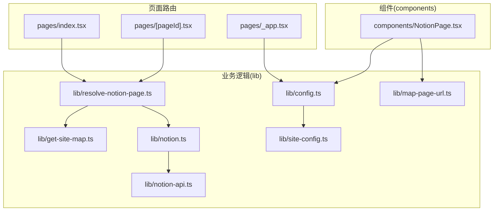
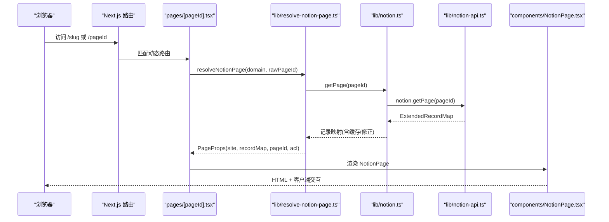
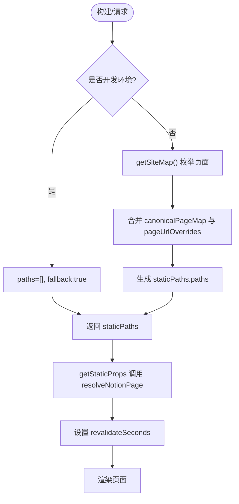
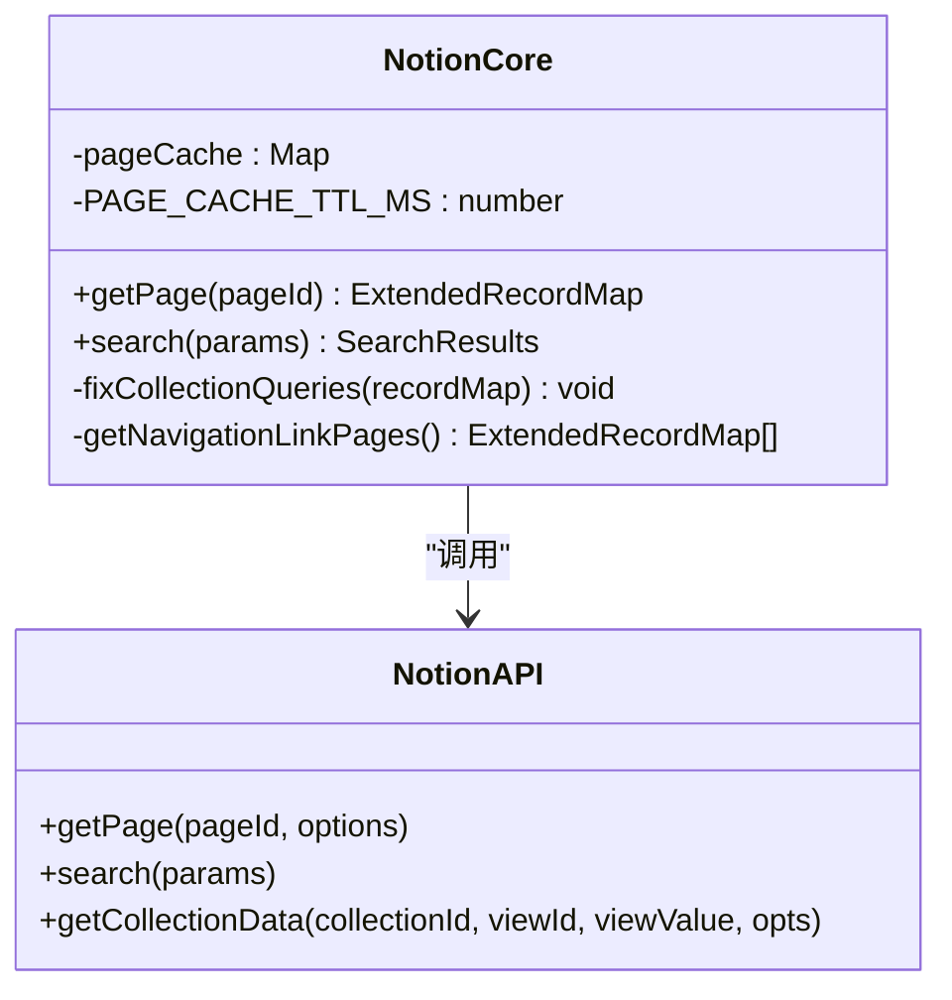
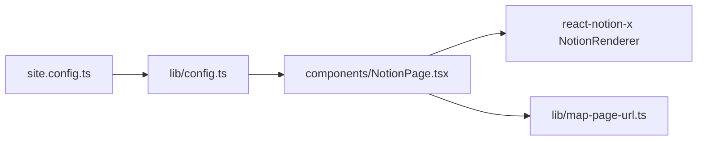
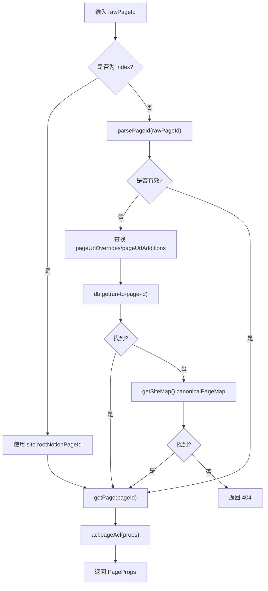
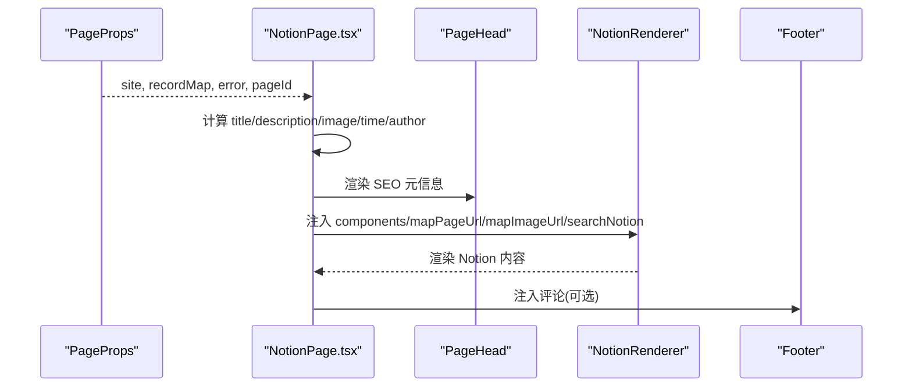
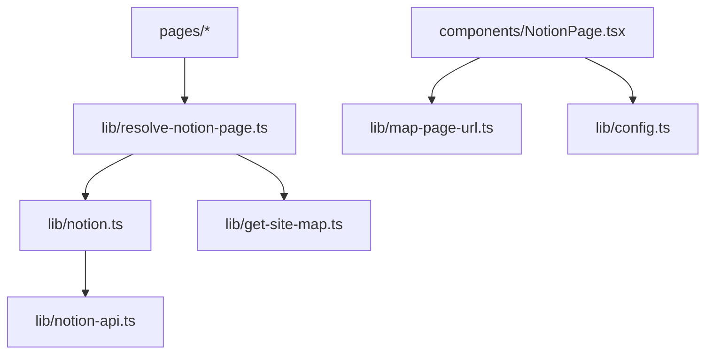

# 核心概念

<cite>
**本文引用的文件**   
- [site.config.ts](file://site.config.ts)
- [next.config.js](file://next.config.js)
- [pages/_app.tsx](file://pages/_app.tsx)
- [pages/index.tsx](file://pages/index.tsx)
- [pages/[pageId].tsx](file://pages/[pageId].tsx)
- [lib/config.ts](file://lib/config.ts)
- [lib/site-config.ts](file://lib/site-config.ts)
- [lib/types.ts](file://lib/types.ts)
- [lib/notion-api.ts](file://lib/notion-api.ts)
- [lib/notion.ts](file://lib/notion.ts)
- [lib/resolve-notion-page.ts](file://lib/resolve-notion-page.ts)
- [lib/get-site-map.ts](file://lib/get-site-map.ts)
- [lib/map-page-url.ts](file://lib/map-page-url.ts)
- [components/NotionPage.tsx](file://components/NotionPage.tsx)
</cite>

## 目录
1. [简介](#简介)
2. [项目结构](#项目结构)
3. [核心组件](#核心组件)
4. [架构总览](#架构总览)
5. [详细组件分析](#详细组件分析)
6. [依赖关系分析](#依赖关系分析)
7. [性能与缓存](#性能与缓存)
8. [故障排查指南](#故障排查指南)
9. [结论](#结论)

## 简介
本项目基于 Next.js，将 Notion 内容作为站点数据源，通过静态站点生成（SSG）与增量静态再生成（ISR）构建高性能、可维护的内容站点。其核心设计包括：
- 配置驱动：站点元信息、导航、SEO、分析等均由 site.config.ts 提供，运行时由 lib/config.ts 统一装配。
- 数据获取与缓存：封装 notion-client 的 NotionAPI，结合内存缓存与 ISR 策略，兼顾稳定性与时效性。
- URL 映射：将用户友好的路径映射到 Notion 页面 ID，支持覆盖与新增映射。
- 渲染组合：使用 react-notion-x 的 NotionRenderer 并注入自定义组件，实现 SEO、图片优化、代码高亮、评论等能力。

## 项目结构
- pages：Next.js 路由入口，包含首页 index.tsx 与动态路由 [pageId].tsx，负责 SSG/ISR 的数据获取与页面组装。
- lib：业务逻辑层，包含配置装配、Notion API 封装、站点地图生成、URL 映射、权限控制等。
- components：React 组件层，核心为 NotionPage.tsx，负责渲染 Notion 内容与站点 UI 组合。
- styles：全局样式与主题。
- next.config.js：Next.js 构建与图片优化配置。
- site.config.ts：站点级配置入口。

图表来源
- [pages/index.tsx:6-10](file://pages/index.tsx#L6-L10)
- [pages/[pageId].tsx:9-25](file://pages/[pageId].tsx#L9-L25)
- [lib/resolve-notion-page.ts:11-84](file://lib/resolve-notion-page.ts#L11-L84)
- [lib/notion.ts:161-213](file://lib/notion.ts#L161-L213)
- [lib/notion-api.ts:1-21](file://lib/notion-api.ts#L1-L21)
- [lib/get-site-map.ts:17-27](file://lib/get-site-map.ts#L17-L27)
- [lib/map-page-url.ts:12-39](file://lib/map-page-url.ts#L12-L39)
- [components/NotionPage.tsx:196-209](file://components/NotionPage.tsx#L196-L209)
- [lib/config.ts:154-160](file://lib/config.ts#L154-L160)
- [pages/_app.tsx:41-90](file://pages/_app.tsx#L41-L90)

章节来源
- [pages/index.tsx:1-23](file://pages/index.tsx#L1-L23)
- [pages/[pageId].tsx:1-58](file://pages/[pageId].tsx#L1-L58)
- [lib/config.ts:1-221](file://lib/config.ts#L1-L221)
- [lib/site-config.ts:1-56](file://lib/site-config.ts#L1-L56)
- [lib/types.ts:1-78](file://lib/types.ts#L1-L78)
- [lib/notion-api.ts:1-21](file://lib/notion-api.ts#L1-L21)
- [lib/notion.ts:1-219](file://lib/notion.ts#L1-L219)
- [lib/resolve-notion-page.ts:1-85](file://lib/resolve-notion-page.ts#L1-L85)
- [lib/get-site-map.ts:1-105](file://lib/get-site-map.ts#L1-L105)
- [lib/map-page-url.ts:1-44](file://lib/map-page-url.ts#L1-L44)
- [components/NotionPage.tsx:1-356](file://components/NotionPage.tsx#L1-L356)
- [pages/_app.tsx:1-91](file://pages/_app.tsx#L1-L91)

## 核心组件
- 站点配置与装配
  - site.config.ts：定义站点根 Notion 页、域名、作者、描述、预览图开关、SEO 校验码、IndexNow Key、分析 ID、导航风格、ISR 重验证间隔等。
  - lib/config.ts：从 site.config.ts 与环境变量中读取配置，输出统一的 site 对象与运行时常量（如 revalidateSeconds、isSearchEnabled、api 端点等）。
  - lib/site-config.ts：类型定义与 siteConfig 包装函数。
- 数据获取与缓存
  - lib/notion-api.ts：封装 notion-client 的 NotionAPI，设置重试策略、超时、UA 头与可选代理 base URL。
  - lib/notion.ts：服务端内存缓存 ExtendedRecordMap，处理集合视图排序/过滤修正、导航链接合并、预览图与推文扩展，并提供 getPage/search。
  - lib/get-site-map.ts：递归遍历 Notion 空间，生成 pageMap 与 canonicalPageMap，用于 SSG 路径枚举与 URL 映射。
- 路由与解析
  - pages/index.tsx：首页 SSG/ISR，调用 resolveNotionPage(domain)。
  - pages/[pageId].tsx：动态路由 SSG/ISR，getStaticPaths 使用 getSiteMap 枚举所有页面；getStaticProps 调用 resolveNotionPage 并返回 revalidate。
  - lib/resolve-notion-page.ts：URI → Notion PageId 解析，支持 pageUrlOverrides/pageUrlAdditions、URI→PageId 缓存、ACL 权限检查。
- 渲染与组合
  - components/NotionPage.tsx：注入 NotionRenderer 组件（Code/Collection/Equation/Pdf/Modal/Tweet/Header 等），处理 SEO、暗色模式、侧边栏、评论等。
  - lib/map-page-url.ts：根据 rootNotionPageId 与 canonicalPageId 生成站点内链接与 canonical URL。

章节来源
- [site.config.ts:1-77](file://site.config.ts#L1-L77)
- [lib/config.ts:1-221](file://lib/config.ts#L1-L221)
- [lib/site-config.ts:1-56](file://lib/site-config.ts#L1-L56)
- [lib/notion-api.ts:1-21](file://lib/notion-api.ts#L1-L21)
- [lib/notion.ts:1-219](file://lib/notion.ts#L1-L219)
- [lib/get-site-map.ts:1-105](file://lib/get-site-map.ts#L1-L105)
- [pages/index.tsx:1-23](file://pages/index.tsx#L1-L23)
- [pages/[pageId].tsx:1-58](file://pages/[pageId].tsx#L1-L58)
- [lib/resolve-notion-page.ts:1-85](file://lib/resolve-notion-page.ts#L1-L85)
- [components/NotionPage.tsx:1-356](file://components/NotionPage.tsx#L1-L356)
- [lib/map-page-url.ts:1-44](file://lib/map-page-url.ts#L1-L44)

## 架构总览
系统采用“配置驱动 + 数据层封装 + 渲染组合”的分层架构。Next.js 在构建期或请求期触发 SSG/ISR，通过 resolve-notion-page 解析 URI 到 Notion 页面，notion.ts 负责数据聚合与缓存，最终由 NotionPage 渲染。

图表来源
- [pages/[pageId].tsx:9-25](file://pages/[pageId].tsx#L9-L25)
- [lib/resolve-notion-page.ts:11-84](file://lib/resolve-notion-page.ts#L11-L84)
- [lib/notion.ts:161-213](file://lib/notion.ts#L161-L213)
- [lib/notion-api.ts:1-21](file://lib/notion-api.ts#L1-L21)
- [components/NotionPage.tsx:319-352](file://components/NotionPage.tsx#L319-L352)

## 详细组件分析

### Next.js SSG 与 ISR 工作原理
- 首页 pages/index.tsx：getStaticProps 调用 resolveNotionPage(domain)，返回 props 并设置 revalidateSeconds，触发 ISR。
- 动态路由 pages/[pageId].tsx：
  - getStaticPaths：开发环境 fallback:true；生产环境通过 getSiteMap() 枚举 canonicalPageMap 与 pageUrlOverrides，生成 paths，fallback:true 以按需构建。
  - getStaticProps：调用 resolveNotionPage(domain, rawPageId)，返回 props 并设置 revalidateSeconds。
- 错误处理：当 getStaticProps 抛出异常时，显式告知 Next.js ISR 失败，避免发布错误版本。

图表来源
- [pages/[pageId].tsx:27-53](file://pages/[pageId].tsx#L27-L53)
- [pages/[pageId].tsx:9-25](file://pages/[pageId].tsx#L9-L25)
- [lib/get-site-map.ts:17-27](file://lib/get-site-map.ts#L17-L27)

章节来源
- [pages/index.tsx:6-17](file://pages/index.tsx#L6-L17)
- [pages/[pageId].tsx:9-53](file://pages/[pageId].tsx#L9-L53)

### Notion API 集成机制
- 客户端封装 lib/notion-api.ts：
  - 使用 notion-client 的 NotionAPI，支持环境变量 NOTION_API_BASE_URL 与 NOTION_API_TOKEN。
  - ofetchOptions 配置自动重试（408/429/500/502/503/504）、超时 30s、UA 头，提升健壮性。
- 服务层封装 lib/notion.ts：
  - 内存缓存 ExtendedRecordMap，TTL 60s，支持 stale-while-revalidate 回退。
  - fixCollectionQueries：针对 collection_view 的双层嵌套问题，重新执行查询以应用真实排序/过滤，并合并结果。
  - 导航链接合并：当 navigationStyle !== 'default' 时，预取导航链接页面的 block 信息并入 recordMap。
  - 预览图与推文扩展：可选启用 preview_images 与 tweets 映射。
  - getPage：优先命中缓存；若 Notion 不可用，尝试返回过期缓存；否则抛错。

图表来源
- [lib/notion-api.ts:1-21](file://lib/notion-api.ts#L1-L21)
- [lib/notion.ts:19-55](file://lib/notion.ts#L19-L55)
- [lib/notion.ts:95-159](file://lib/notion.ts#L95-L159)
- [lib/notion.ts:161-213](file://lib/notion.ts#L161-L213)

章节来源
- [lib/notion-api.ts:1-21](file://lib/notion-api.ts#L1-L21)
- [lib/notion.ts:1-219](file://lib/notion.ts#L1-L219)

### React 组件组合模式与配置驱动
- 组件组合：
  - components/NotionPage.tsx 通过 NotionRenderer 的 components 属性注入 Code、Collection、Equation、Pdf、Modal、Tweet、Header 等第三方组件，并使用 dynamic 按需加载，减少首屏体积。
  - 自定义 property 渲染器（propertyLastEditedTimeValue、propertyDateValue、propertyTextValue）增强页面头部展示。
  - 注入 mapImageUrl、mapPageUrl、searchNotion、pageAside、footer 等，形成完整的渲染上下文。
- 配置驱动：
  - site.config.ts 集中声明站点元信息、SEO、分析、导航、ISR 间隔等。
  - lib/config.ts 统一导出 site 对象与运行时常量，供组件与逻辑层消费。
  - lib/map-page-url.ts 根据 rootNotionPageId 与 canonicalPageId 生成站内链接与 canonical URL。

图表来源
- [site.config.ts:1-77](file://site.config.ts#L1-L77)
- [lib/config.ts:154-160](file://lib/config.ts#L154-L160)
- [components/NotionPage.tsx:196-209](file://components/NotionPage.tsx#L196-L209)
- [lib/map-page-url.ts:12-39](file://lib/map-page-url.ts#L12-L39)

章节来源
- [components/NotionPage.tsx:1-356](file://components/NotionPage.tsx#L1-L356)
- [lib/config.ts:1-221](file://lib/config.ts#L1-L221)
- [lib/map-page-url.ts:1-44](file://lib/map-page-url.ts#L1-L44)

### URL 到 Notion 页面的映射机制
- 优先级：
  1) 直接传入的 rawPageId（非 index）经 parsePageId 解析；若无效，则查找 pageUrlOverrides 或 pageUrlAdditions。
  2) 若仍无 pageId，尝试 URI→PageId 缓存（db.get）。
  3) 通过 getSiteMap().canonicalPageMap[rawPageId] 查找。
  4) 未找到则返回 404 error。
- 缓存：
  - URI→PageId 映射缓存 key 包含 domain 与 environment，TTL 一天，降低重复解析成本。
- ACL：
  - 最终 props 会附加 acl.pageAcl(props) 的结果，用于权限控制。

图表来源
- [lib/resolve-notion-page.ts:11-84](file://lib/resolve-notion-page.ts#L11-L84)
- [lib/get-site-map.ts:62-103](file://lib/get-site-map.ts#L62-L103)

章节来源
- [lib/resolve-notion-page.ts:1-85](file://lib/resolve-notion-page.ts#L1-L85)
- [lib/get-site-map.ts:1-105](file://lib/get-site-map.ts#L1-L105)

### 内容渲染流程
- NotionPage 接收 site、recordMap、error、pageId，计算标题、描述、社交图片、发布时间、修改时间、作者等元数据。
- 根据 block 类型判断是否为博客文章，决定是否显示目录与侧边栏。
- 注入 NotionRenderer 的 components、mapPageUrl、mapImageUrl、searchNotion、pageAside、footer 等，完成渲染。
- 客户端侧开启暗色模式、lite 模式、调试全局对象等。

图表来源
- [components/NotionPage.tsx:211-356](file://components/NotionPage.tsx#L211-L356)

章节来源
- [components/NotionPage.tsx:1-356](file://components/NotionPage.tsx#L1-L356)

## 依赖关系分析
- 模块耦合：
  - pages/* 依赖 lib/resolve-notion-page 与 lib/config。
  - lib/resolve-notion-page 依赖 lib/notion、lib/get-site-map、lib/acl、lib/db。
  - lib/notion 依赖 lib/notion-api、lib/get-tweets、lib/preview-images。
  - components/NotionPage 依赖 lib/config、lib/map-page-url、lib/search-notion、lib/use-dark-mode。
- 外部依赖：
  - notion-client：Notion API 客户端。
  - react-notion-x：Notion 内容渲染引擎。
  - next/image：图片优化。
  - 分析工具：@vercel/analytics、@vercel/speed-insights、posthog-js、fathom-client、Microsoft Clarity。

图表来源
- [pages/[pageId].tsx:1-58](file://pages/[pageId].tsx#L1-L58)
- [lib/resolve-notion-page.ts:1-85](file://lib/resolve-notion-page.ts#L1-L85)
- [lib/notion.ts:1-219](file://lib/notion.ts#L1-L219)
- [lib/notion-api.ts:1-21](file://lib/notion-api.ts#L1-L21)
- [lib/get-site-map.ts:1-105](file://lib/get-site-map.ts#L1-L105)
- [components/NotionPage.tsx:1-356](file://components/NotionPage.tsx#L1-L356)
- [lib/map-page-url.ts:1-44](file://lib/map-page-url.ts#L1-L44)
- [lib/config.ts:1-221](file://lib/config.ts#L1-L221)

章节来源
- [pages/[pageId].tsx:1-58](file://pages/[pageId].tsx#L1-L58)
- [lib/resolve-notion-page.ts:1-85](file://lib/resolve-notion-page.ts#L1-L85)
- [lib/notion.ts:1-219](file://lib/notion.ts#L1-L219)
- [lib/notion-api.ts:1-21](file://lib/notion-api.ts#L1-L21)
- [lib/get-site-map.ts:1-105](file://lib/get-site-map.ts#L1-L105)
- [components/NotionPage.tsx:1-356](file://components/NotionPage.tsx#L1-L356)
- [lib/map-page-url.ts:1-44](file://lib/map-page-url.ts#L1-L44)
- [lib/config.ts:1-221](file://lib/config.ts#L1-L221)

## 性能与缓存
- 构建期与运行期缓存
  - 站点地图缓存：getSiteMap 内部 pMemoize，每 5 分钟刷新，避免频繁遍历 Notion 空间。
  - 页面数据缓存：notion.ts 内存缓存 ExtendedRecordMap，TTL 60s，支持过期回退。
  - URI→PageId 缓存：resolve-notion-page 使用 db 存储映射，TTL 一天。
- ISR 重验证
  - revalidateSeconds 由 site.config.ts 配置，默认 3600s，示例站点设置为 86400s，降低函数调用频率。
- 图片与资源优化
  - next.config.js 配置 remotePatterns 允许 Notion 与 Twitter 等域名图片，启用 AVIF/WebP 格式，SVG 安全策略。
  - transpilePackages 确保 react-tweet 正确编译。
- 客户端体验
  - _app.tsx 初始化分析工具与 Fathom/PostHog 事件监听，按需注入 Microsoft Clarity。

章节来源
- [lib/get-site-map.ts:29-32](file://lib/get-site-map.ts#L29-L32)
- [lib/notion.ts:29-55](file://lib/notion.ts#L29-L55)
- [lib/resolve-notion-page.ts:32-42](file://lib/resolve-notion-page.ts#L32-L42)
- [site.config.ts:57-60](file://site.config.ts#L57-L60)
- [next.config.js:4-18](file://next.config.js#L4-L18)
- [next.config.js:33-35](file://next.config.js#L33-L35)
- [pages/_app.tsx:41-90](file://pages/_app.tsx#L41-L90)

## 故障排查指南
- Notion API 不稳定
  - 现象：构建或请求时报 429/5xx 或网络超时。
  - 处理：notion-api.ts 已配置自动重试与超时；notion.ts 在 getPage 失败时尝试返回过期缓存，避免全站 500。
  - 建议：检查 NOTION_API_TOKEN 与 NOTION_API_BASE_URL 是否正确；适当增大 revalidateSeconds 以降低频率。
- 集合视图排序/过滤不一致
  - 现象：集合列表顺序与 Notion 不一致。
  - 处理：notion.ts 的 fixCollectionQueries 会重新执行 queryCollection 并合并结果，确保排序/过滤生效。
- 404 页面
  - 现象：访问不存在的路径返回 404。
  - 处理：resolve-notion-page 在未找到 pageId 时返回 error.statusCode=404；NotionPage 在 error 存在时渲染 Page404。
- 图片无法加载
  - 现象：Notion 或 Twitter 图片不显示。
  - 处理：确认 next.config.js 的 remotePatterns 包含对应域名；必要时调整 images.contentSecurityPolicy。
- 搜索不可用
  - 现象：搜索框无结果。
  - 处理：确认 isSearchEnabled 为 true；检查 pages/api/search-notion.ts 与 search-index 是否正常部署。

章节来源
- [lib/notion-api.ts:6-18](file://lib/notion-api.ts#L6-L18)
- [lib/notion.ts:168-182](file://lib/notion.ts#L168-L182)
- [lib/notion.ts:95-159](file://lib/notion.ts#L95-L159)
- [lib/resolve-notion-page.ts:66-74](file://lib/resolve-notion-page.ts#L66-L74)
- [components/NotionPage.tsx:259-261](file://components/NotionPage.tsx#L259-L261)
- [next.config.js:6-18](file://next.config.js#L6-L18)

## 结论
该项目通过清晰的配置驱动与分层架构，将 Notion 内容高效地转换为高性能的静态站点。SSG/ISR 保证首屏速度与更新效率；内存缓存与重试策略提升鲁棒性；组件组合与 URL 映射机制使渲染灵活且可扩展。开发者可在 site.config.ts 与 lib/config.ts 中集中管理站点行为，并通过 NotionPage 的组件注入扩展功能。