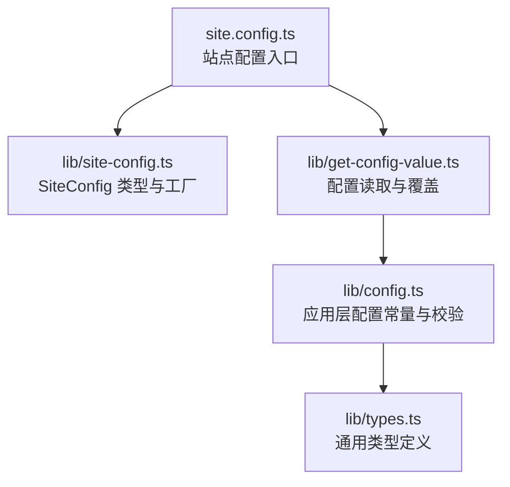
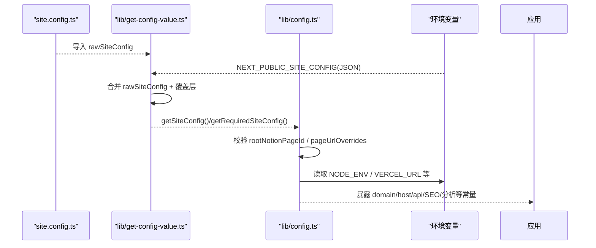
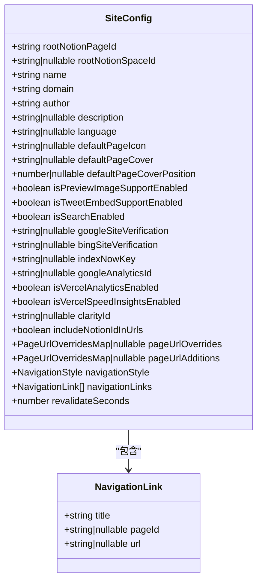
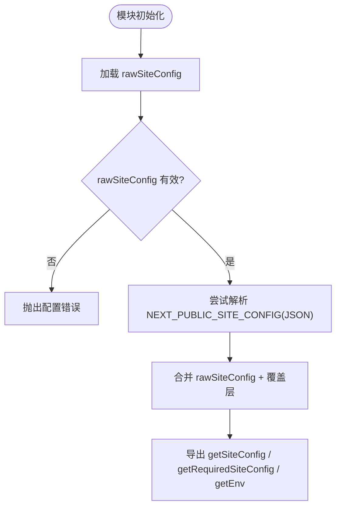
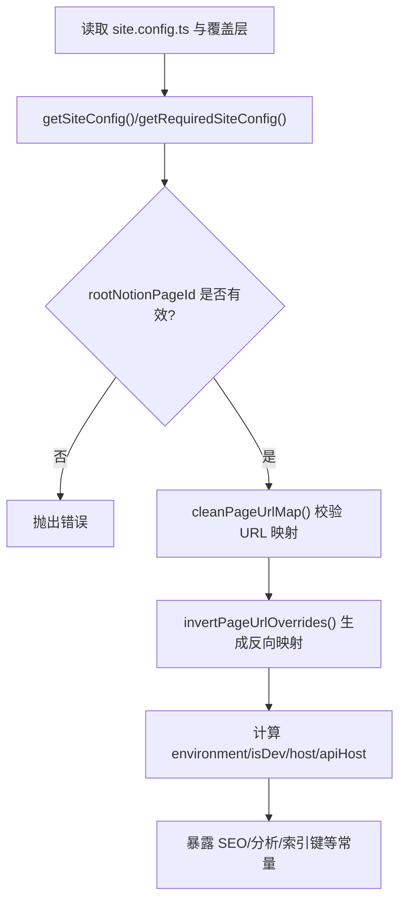
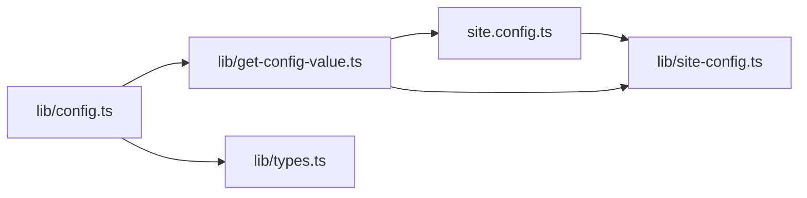

# 配置系统架构

<cite>
**本文引用的文件**   
- [site.config.ts](file://site.config.ts)
- [lib/site-config.ts](file://lib/site-config.ts)
- [lib/get-config-value.ts](file://lib/get-config-value.ts)
- [lib/config.ts](file://lib/config.ts)
- [lib/types.ts](file://lib/types.ts)
</cite>

## 目录
1. [简介](#简介)
2. [项目结构](#项目结构)
3. [核心组件](#核心组件)
4. [架构总览](#架构总览)
5. [详细组件分析](#详细组件分析)
6. [依赖关系分析](#依赖关系分析)
7. [性能与运行时特性](#性能与运行时特性)
8. [故障排查指南](#故障排查指南)
9. [结论](#结论)
10. [附录：环境变量与优先级清单](#附录环境变量与优先级清单)

## 简介
本项目的配置系统围绕“站点配置文件 + 环境变量覆盖 + 类型化默认值”的三层模型构建。根级 site.config.ts 定义站点元数据、SEO、分析与行为开关；lib/site-config.ts 提供 SiteConfig 类型约束；lib/get-config-value.ts 负责合并原始配置与环境变量覆盖，并提供 getSiteConfig / getRequiredSiteConfig / getEnv 等统一访问器；lib/config.ts 将配置解析为应用可直接使用的常量，并实现 URL 映射校验、环境判断、API 地址拼装等逻辑。该设计兼顾可维护性、可扩展性与多环境部署的安全性。

## 项目结构
配置相关的关键文件与职责如下：
- site.config.ts：站点配置入口，导出站点元信息、SEO、分析与导航等选项。
- lib/site-config.ts：SiteConfig 接口定义与 siteConfig 工厂函数（当前仅透传）。
- lib/get-config-value.ts：读取 site.config.ts，支持 NEXT_PUBLIC_SITE_CONFIG 环境变量覆盖，提供统一的配置读取 API。
- lib/config.ts：聚合与校验配置，暴露应用层常量（如 domain、host、api 路由等），并进行 URL 映射清洗与反转。
- lib/types.ts：通用类型定义，包括 PageUrlOverridesMap、NavigationStyle 等。

**图表来源**
- [site.config.ts:1-77](file://site.config.ts#L1-L77)
- [lib/site-config.ts:1-56](file://lib/site-config.ts#L1-L56)
- [lib/get-config-value.ts:1-73](file://lib/get-config-value.ts#L1-L73)
- [lib/config.ts:1-221](file://lib/config.ts#L1-L221)
- [lib/types.ts:1-78](file://lib/types.ts#L1-L78)

**章节来源**
- [site.config.ts:1-77](file://site.config.ts#L1-L77)
- [lib/site-config.ts:1-56](file://lib/site-config.ts#L1-L56)
- [lib/get-config-value.ts:1-73](file://lib/get-config-value.ts#L1-L73)
- [lib/config.ts:1-221](file://lib/config.ts#L1-L221)
- [lib/types.ts:1-78](file://lib/types.ts#L1-L78)

## 核心组件
- 站点配置入口 site.config.ts：集中声明站点基础信息、Notion 页面 ID、SEO 验证码、索引键、分析 ID、ISR 重验证间隔、导航样式与链接等。
- 类型与工厂 lib/site-config.ts：通过 SiteConfig 接口对配置项进行强类型约束，并通过 siteConfig 工厂函数返回配置对象。
- 配置读取与覆盖 lib/get-config-value.ts：
  - 加载 rawSiteConfig（来自 site.config.ts）
  - 尝试从 NEXT_PUBLIC_SITE_CONFIG 环境变量解析 JSON 作为覆盖层
  - 合并得到最终 siteConfig
  - 提供 getSiteConfig(key, default?)、getRequiredSiteConfig(key)、getEnv(key, default?, env?)
- 应用层配置 lib/config.ts：
  - 使用 getSiteConfig / getRequiredSiteConfig 获取配置，并赋予业务默认值
  - 校验 rootNotionPageId、pageUrlOverrides/pageUrlAdditions 等关键配置
  - 根据 NODE_ENV 推导 environment、isDev
  - 计算 host/apiHost/apiBaseUrl 等运行时地址
  - 暴露 SEO 验证码、IndexNow key、分析 ID 等常量
  - 提供 cleanPageUrlMap 与 invertPageUrlOverrides 工具函数

**章节来源**
- [site.config.ts:1-77](file://site.config.ts#L1-L77)
- [lib/site-config.ts:1-56](file://lib/site-config.ts#L1-L56)
- [lib/get-config-value.ts:1-73](file://lib/get-config-value.ts#L1-L73)
- [lib/config.ts:1-221](file://lib/config.ts#L1-L221)

## 架构总览
下图展示了配置在运行时的装配流程：从站点配置文件到环境变量覆盖，再到应用层常量生成与校验。

**图表来源**
- [lib/get-config-value.ts:1-73](file://lib/get-config-value.ts#L1-L73)
- [lib/config.ts:1-221](file://lib/config.ts#L1-L221)
- [site.config.ts:1-77](file://site.config.ts#L1-L77)

## 详细组件分析

### 站点配置文件 site.config.ts
- 作用：集中管理站点元信息、Notion 根页面与工作区、SEO 验证与索引、分析服务开关与 ID、URL 重写、ISR 重验证间隔、导航样式与自定义导航链接等。
- 组织方式：以键值对形式声明，所有字段均对应 SiteConfig 接口中的可选或必填项。
- 典型字段分组：
  - Notion 集成：rootNotionPageId、rootNotionSpaceId
  - 站点信息：name、domain、author、description
  - 媒体与预览：defaultPageIcon、defaultPageCover、defaultPageCoverPosition、isPreviewImageSupportEnabled
  - SEO：googleSiteVerification、bingSiteVerification、indexNowKey
  - 分析：googleAnalyticsId、clarityId、isVercelAnalyticsEnabled、isVercelSpeedInsightsEnabled
  - URL 与 ISR：pageUrlOverrides、revalidateSeconds
  - 导航：navigationStyle、navigationLinks

**章节来源**
- [site.config.ts:1-77](file://site.config.ts#L1-L77)

### 类型与工厂 lib/site-config.ts
- SiteConfig 接口：严格定义所有站点配置项的类型与可选性，确保 TypeScript 类型安全。
- siteConfig 工厂：当前实现为透传，便于未来扩展（例如在工厂中注入默认值、校验或转换逻辑）。

**图表来源**
- [lib/site-config.ts:1-56](file://lib/site-config.ts#L1-L56)
- [lib/types.ts:57-67](file://lib/types.ts#L57-L67)

**章节来源**
- [lib/site-config.ts:1-56](file://lib/site-config.ts#L1-L56)
- [lib/types.ts:1-78](file://lib/types.ts#L1-L78)

### 配置读取与覆盖 lib/get-config-value.ts
- 加载与校验：
  - 若未正确导出 site.config.ts，直接抛出错误。
- 环境变量覆盖：
  - 如果存在 NEXT_PUBLIC_SITE_CONFIG，则将其解析为 JSON 并与原始配置合并，后者优先。
- 统一访问器：
  - getSiteConfig(key, defaultValue?)：当 key 不存在时返回默认值。
  - getRequiredSiteConfig(key)：当 key 不存在时抛出错误，用于必填项校验。
  - getEnv(key, defaultValue?, env?)：读取环境变量；服务器端缺失且无默认值时抛错；客户端缺失时返回 null。

**图表来源**
- [lib/get-config-value.ts:1-73](file://lib/get-config-value.ts#L1-L73)

**章节来源**
- [lib/get-config-value.ts:1-73](file://lib/get-config-value.ts#L1-L73)

### 应用层配置 lib/config.ts
- 必填项校验：
  - rootNotionPageId 必须存在且格式合法，否则抛错。
- URL 映射处理：
  - cleanPageUrlMap：校验并规范化 pageUrlOverrides/pageUrlAdditions，要求路径以 "/" 开头，值为 Notion 页 ID。
  - invertPageUrlOverrides：生成反向映射（页 ID -> URL 路径）。
- 环境与主机名：
  - environment = NODE_ENV，isDev 由 environment 推导。
  - host 在开发环境为本地地址，生产环境基于域名或 VERCEL_URL。
  - apiHost 在开发环境同 host，生产环境优先 VERCEL_URL。
- SEO 与分析：
  - 支持从 site.config.ts 与同名环境变量同时读取，环境变量具有更高优先级。
  - 暴露 Google/Bing 站点验证、IndexNow key、Google Analytics、Vercel 分析与速度洞察开关等。
- 其他：
  - includeNotionIdInUrls 默认在开发环境启用，便于调试。
  - 聚合 site 对象供上层使用。

**图表来源**
- [lib/config.ts:1-221](file://lib/config.ts#L1-L221)

**章节来源**
- [lib/config.ts:1-221](file://lib/config.ts#L1-L221)

## 依赖关系分析
- site.config.ts 依赖 lib/site-config.ts 的类型定义。
- lib/get-config-value.ts 依赖 site.config.ts 的实际配置与 lib/site-config.ts 的类型。
- lib/config.ts 依赖 lib/get-config-value.ts 提供的读取 API，以及 lib/types.ts 中的类型。

**图表来源**
- [site.config.ts:1-77](file://site.config.ts#L1-L77)
- [lib/site-config.ts:1-56](file://lib/site-config.ts#L1-L56)
- [lib/get-config-value.ts:1-73](file://lib/get-config-value.ts#L1-L73)
- [lib/config.ts:1-221](file://lib/config.ts#L1-L221)
- [lib/types.ts:1-78](file://lib/types.ts#L1-L78)

**章节来源**
- [site.config.ts:1-77](file://site.config.ts#L1-L77)
- [lib/site-config.ts:1-56](file://lib/site-config.ts#L1-L56)
- [lib/get-config-value.ts:1-73](file://lib/get-config-value.ts#L1-L73)
- [lib/config.ts:1-221](file://lib/config.ts#L1-L221)
- [lib/types.ts:1-78](file://lib/types.ts#L1-L78)

## 性能与运行时特性
- ISR 重验证间隔：revalidateSeconds 控制页面再生频率，默认 3600 秒，可在 site.config.ts 调整以降低函数调用次数。
- 预览图支持：isPreviewImageSupportEnabled 控制 LQIP 预览图能力，默认关闭，按需开启。
- 开发模式优化：includeNotionIdInUrls 在开发环境默认启用，便于调试页面 ID 与路径映射。
- 主机名与 API 地址：根据环境自动选择 localhost 或域名/VERCEL_URL，避免硬编码。

[本节为通用指导，不直接分析具体文件]

## 故障排查指南
- 缺少必填配置：
  - 现象：启动时报错提示缺少 required site config value。
  - 原因：未在 site.config.ts 或环境变量覆盖中提供必填项。
  - 解决：补充对应字段，或使用 getRequiredSiteConfig 明确必填语义。
- NEXT_PUBLIC_SITE_CONFIG 解析失败：
  - 现象：控制台报错提示 JSON 解析失败。
  - 原因：环境变量值不是合法 JSON。
  - 解决：检查并修正环境变量值的 JSON 格式。
- URL 映射无效：
  - 现象：启动时报错提示 Invalid page id 或缺少路径。
  - 原因：pageUrlOverrides/pageUrlAdditions 的值不是有效的 Notion 页 ID，或路径不以 "/" 开头。
  - 解决：修正映射值与路径格式。
- 环境变量缺失：
  - 现象：服务器端读取环境变量时抛错。
  - 原因：必需的环境变量未设置且未提供默认值。
  - 解决：在部署平台设置相应环境变量，或在调用处提供默认值。

**章节来源**
- [lib/get-config-value.ts:4-20](file://lib/get-config-value.ts#L4-L20)
- [lib/config.ts:23-44](file://lib/config.ts#L23-L44)
- [lib/config.ts:174-207](file://lib/config.ts#L174-L207)

## 结论
本项目采用“配置文件 + 环境变量覆盖 + 类型化默认值”的分层配置体系，既保证了配置的集中管理与可读性，又提供了灵活的多环境适配能力。通过严格的校验与统一的读取 API，降低了配置错误的风险，提升了可维护性与扩展性。建议在新增配置项时遵循以下原则：
- 在 SiteConfig 中声明类型，并在 site.config.ts 中提供合理默认值。
- 敏感或环境相关字段优先通过环境变量注入，保持代码库干净。
- 使用 getRequiredSiteConfig 表达必填语义，使用 getSiteConfig 表达可选语义。
- 对复杂结构（如 URL 映射）提供清洗与校验逻辑，确保运行时稳定性。

[本节为总结性内容，不直接分析具体文件]

## 附录：环境变量与优先级清单
- 优先级顺序（从高到低）：
  1. 环境变量覆盖（NEXT_PUBLIC_SITE_CONFIG 的 JSON 覆盖层）
  2. site.config.ts 中的显式配置
  3. 各字段在 lib/config.ts 中的默认值
- 常见环境变量：
  - NEXT_PUBLIC_SITE_CONFIG：JSON 字符串，覆盖站点配置
  - GOOGLE_SITE_VERIFICATION：Google 站点验证
  - BING_SITE_VERIFICATION：Bing 站点验证
  - INDEXNOW_KEY：IndexNow 索引键
  - NEXT_PUBLIC_GOOGLE_ANALYTICS_ID：Google Analytics 测量 ID
  - VERCEL_URL：生产环境域名（用于构造 apiHost）
  - NODE_ENV：运行环境（development/production 等）
  - PORT：本地开发端口
  - NOTION_API_BASE_URL / NOTION_API_TOKEN：Notion API 集成（在其他模块中使用）

**章节来源**
- [lib/get-config-value.ts:8-25](file://lib/get-config-value.ts#L8-L25)
- [lib/config.ts:106-143](file://lib/config.ts#L106-L143)