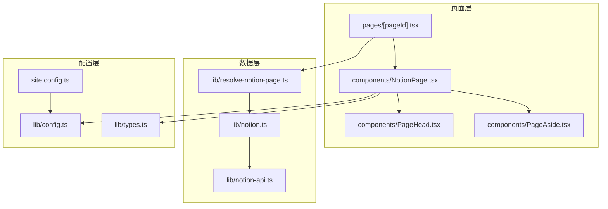
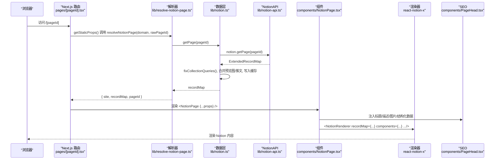
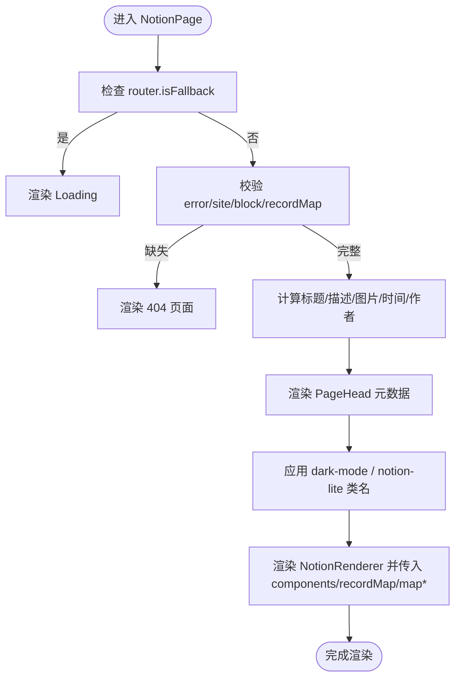
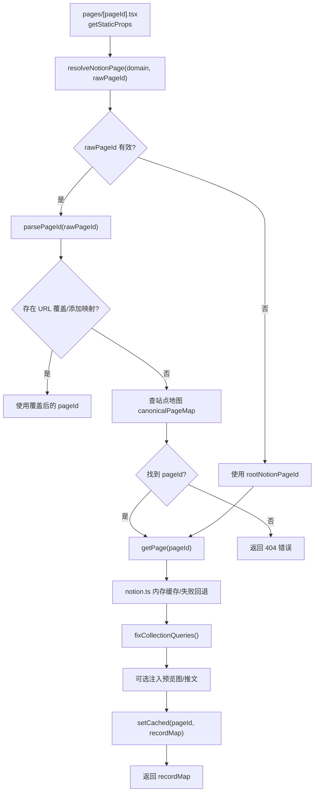
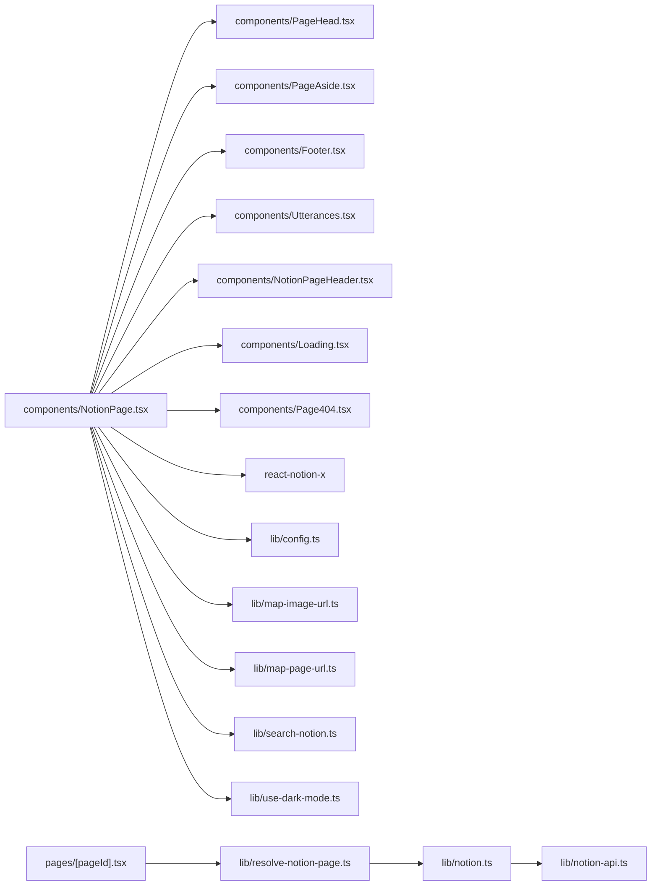

# NotionPage 组件

<cite>
**本文引用的文件**   
- [components/NotionPage.tsx](file://components/NotionPage.tsx)
- [lib/notion.ts](file://lib/notion.ts)
- [lib/notion-api.ts](file://lib/notion-api.ts)
- [pages/[pageId].tsx](file://pages/[pageId].tsx)
- [site.config.ts](file://site.config.ts)
- [lib/config.ts](file://lib/config.ts)
- [lib/types.ts](file://lib/types.ts)
- [components/PageHead.tsx](file://components/PageHead.tsx)
- [components/PageAside.tsx](file://components/PageAside.tsx)
- [lib/resolve-notion-page.ts](file://lib/resolve-notion-page.ts)
</cite>

## 目录
1. [简介](#简介)
2. [项目结构](#项目结构)
3. [核心组件](#核心组件)
4. [架构总览](#架构总览)
5. [详细组件分析](#详细组件分析)
6. [依赖关系分析](#依赖关系分析)
7. [性能与优化](#性能与优化)
8. [故障排查指南](#故障排查指南)
9. [结论](#结论)
10. [附录：使用示例与扩展方法](#附录使用示例与扩展方法)

## 简介
NotionPage 是本项目渲染 Notion 内容的核心页面组件。它负责：
- 接收服务端解析出的 Notion 数据（recordMap）并渲染为前端页面
- 通过动态导入按需加载代码高亮、集合视图、公式、PDF、弹窗等重型或仅客户端可用的第三方组件
- 组合自定义组件（如 Header、Footer、Tweet、属性值处理器）以定制渲染行为
- 管理 SEO 元数据、主题切换（深色模式）、Lite 模式以及侧边栏与目录
- 与站点配置、URL 映射、搜索、图片映射等能力集成

该组件基于 react-notion-x 的 NotionRenderer，结合 Next.js 的动态导入与 SSR/CSR 策略，实现高性能、可定制的 Notion 内容展示。

## 项目结构
围绕 NotionPage 的关键文件职责如下：
- components/NotionPage.tsx：页面级组件，组合渲染逻辑、动态导入、SEO、主题、侧边栏与评论
- lib/notion.ts：服务端获取 Notion 数据、缓存、集合查询修正、预览图与推文合并
- lib/notion-api.ts：封装 notion-client 的 NotionAPI，配置重试、超时与 UA
- pages/[pageId].tsx：Next.js 路由页，负责 SSG/ISR 构建与 props 注入
- site.config.ts：站点基础配置（根页面、域名、默认图标/封面、SEO 验证、分析等）
- lib/config.ts：将站点配置标准化为运行时配置对象，导出 site、host、api 等
- lib/types.ts：类型定义（PageProps、Site、ExtendedTweetRecordMap 等）
- components/PageHead.tsx：SEO 元数据与结构化数据注入
- components/PageAside.tsx：右侧边栏占位（可扩展目录/导航）
- lib/resolve-notion-page.ts：根据 URL 解析 pageId 并获取 recordMap，处理 404 与缓存

**图表来源**
- [pages/[pageId].tsx:1-58](file://pages/[pageId].tsx#L1-L58)
- [components/NotionPage.tsx:1-356](file://components/NotionPage.tsx#L1-L356)
- [components/PageHead.tsx:1-188](file://components/PageHead.tsx#L1-L188)
- [components/PageAside.tsx:1-18](file://components/PageAside.tsx#L1-L18)
- [lib/resolve-notion-page.ts:1-85](file://lib/resolve-notion-page.ts#L1-L85)
- [lib/notion.ts:1-219](file://lib/notion.ts#L1-L219)
- [lib/notion-api.ts:1-21](file://lib/notion-api.ts#L1-L21)
- [site.config.ts:1-77](file://site.config.ts#L1-L77)
- [lib/config.ts:1-221](file://lib/config.ts#L1-L221)
- [lib/types.ts:1-78](file://lib/types.ts#L1-L78)

**章节来源**
- [pages/[pageId].tsx:1-58](file://pages/[pageId].tsx#L1-L58)
- [components/NotionPage.tsx:1-356](file://components/NotionPage.tsx#L1-L356)
- [lib/notion.ts:1-219](file://lib/notion.ts#L1-L219)
- [lib/notion-api.ts:1-21](file://lib/notion-api.ts#L1-L21)
- [site.config.ts:1-77](file://site.config.ts#L1-L77)
- [lib/config.ts:1-221](file://lib/config.ts#L1-L221)
- [lib/types.ts:1-78](file://lib/types.ts#L1-L78)
- [components/PageHead.tsx:1-188](file://components/PageHead.tsx#L1-L188)
- [components/PageAside.tsx:1-18](file://components/PageAside.tsx#L1-L18)
- [lib/resolve-notion-page.ts:1-85](file://lib/resolve-notion-page.ts#L1-L85)

## 核心组件
NotionPage 组件的职责包括：
- 动态导入可选组件（Code、Collection、Equation、Pdf、Modal），减少首屏体积
- 组合自定义组件（Header、Tweet、属性值处理器）以定制渲染
- 根据记录块判断是否为博客文章，决定是否显示目录
- 计算 canonical URL、社交图片、描述等 SEO 信息
- 注入 PageHead 元数据，并根据 lite 模式与深色模式添加 body class
- 渲染 NotionRenderer，传入 recordMap、mapPageUrl、mapImageUrl、searchNotion、pageAside、footer 等

关键实现要点：
- 动态导入 Code 时并行加载多种 Prism 语法，按需启用
- Collection、Pdf、Modal 禁用 SSR，避免水合不一致
- Tweet 组件在 Suspense 下异步加载 EmbeddedTweet，未找到时回退到 NotFound
- 属性值处理器覆盖 lastEditedTime、date、text 的默认渲染，用于头部信息美化
- notionRendererComponents 集中注册 nextLegacyImage、nextLink、Code、Collection、Equation、Pdf、Modal、Tweet、Header 及属性处理器

**章节来源**
- [components/NotionPage.tsx:43-142](file://components/NotionPage.tsx#L43-L142)
- [components/NotionPage.tsx:144-209](file://components/NotionPage.tsx#L144-L209)
- [components/NotionPage.tsx:211-356](file://components/NotionPage.tsx#L211-L356)

## 架构总览
下图展示了从路由到 Notion 数据再到页面渲染的整体流程：

**图表来源**
- [pages/[pageId].tsx:9-25](file://pages/[pageId].tsx#L9-L25)
- [lib/resolve-notion-page.ts:11-84](file://lib/resolve-notion-page.ts#L11-L84)
- [lib/notion.ts:161-213](file://lib/notion.ts#L161-L213)
- [lib/notion-api.ts:6-19](file://lib/notion-api.ts#L6-L19)
- [components/NotionPage.tsx:301-352](file://components/NotionPage.tsx#L301-L352)
- [components/PageHead.tsx:91-184](file://components/PageHead.tsx#L91-L184)

## 详细组件分析

### NotionPage 组件
- 动态导入机制
  - Code：动态加载 react-notion-x/third-party/code，并在首次使用时并行加载多种 Prism 语法，提升首屏性能
  - Collection、Pdf、Modal：ssr=false，仅在客户端渲染，避免 SSR/CSR 水合不一致
  - Equation：按需加载公式渲染
- 组件组合模式
  - 通过 notionRendererComponents 注册 nextLegacyImage、nextLink、Code、Collection、Equation、Pdf、Modal、Tweet、Header
  - 自定义属性值处理器 propertyLastEditedTimeValue、propertyDateValue、propertyTextValue，用于头部信息的格式化与样式增强
- 状态管理与数据流
  - 读取 useSearchParam('lite') 控制 Lite 模式
  - 使用 useDarkMode 控制深色模式
  - 根据 block 类型判断是否为博客文章，决定是否显示目录
  - 计算 canonical URL、social image、description、published/modified time、author
- SEO 元数据处理
  - 通过 PageHead 注入 title、description、image、canonical、OG/Twitter 标签、JSON-LD 结构化数据
- 错误处理与加载状态
  - router.isFallback 返回 Loading
  - error 或缺少必要数据时返回 404 页面
- 主题切换功能
  - 根据 isDarkMode 给 BodyClassName 添加 'dark-mode'
  - Lite 模式下添加 'notion-lite'

**图表来源**
- [components/NotionPage.tsx:255-352](file://components/NotionPage.tsx#L255-L352)

**章节来源**
- [components/NotionPage.tsx:43-142](file://components/NotionPage.tsx#L43-L142)
- [components/NotionPage.tsx:144-209](file://components/NotionPage.tsx#L144-L209)
- [components/NotionPage.tsx:211-356](file://components/NotionPage.tsx#L211-L356)

### NotionRenderer 的配置选项与自定义组件注册
- 基础配置
  - bodyClassName：注入样式类，首页额外添加 index-page
  - darkMode：跟随 useDarkMode 状态
  - components：注册自定义组件与属性处理器
  - recordMap：Notion 数据源
  - rootPageId/rootDomain：站点根页面与域名
  - fullPage：非 lite 模式显示完整页面
  - previewImages：是否启用预览图
  - showCollectionViewDropdown：隐藏集合视图下拉
  - showTableOfContents/minTableOfContentsItems：目录开关与最小条目数
  - defaultPageIcon/defaultPageCover/defaultPageCoverPosition：默认图标/封面/位置
  - mapPageUrl/mapImageUrl：URL 与图片映射函数
  - searchNotion：条件启用搜索
  - pageAside/footer：侧边栏与底部（含评论 Utterances）

- 自定义组件注册
  - nextLegacyImage：Next.js 图片组件
  - nextLink：Next.js Link
  - Code/Collection/Equation/Pdf/Modal：动态导入的第三方组件
  - Tweet：嵌入推文，支持 Skeleton/NotFound
  - Header：NotionPageHeader
  - 属性值处理器：lastEditedTime/date/text

**章节来源**
- [components/NotionPage.tsx:196-209](file://components/NotionPage.tsx#L196-L209)
- [components/NotionPage.tsx:319-352](file://components/NotionPage.tsx#L319-L352)

### 数据流与服务端缓存
- 路由层
  - pages/[pageId].tsx 通过 getStaticProps 调用 resolveNotionPage，返回 props 并设置 revalidate（ISR）
  - getStaticPaths 生成所有 pageId 路径，开发环境 fallback=true
- 解析层
  - resolve-notion-page.ts 根据 rawPageId 解析 pageId，优先使用 URL 覆盖映射，其次查站点地图，最后回退到根页面
  - 若无法解析则返回 404 错误
- 数据层
  - notion.ts 提供 getPage：
    - 内存缓存（TTL=60s）
    - 失败时尝试返回过期缓存（stale-while-revalidate）
    - 合并导航链接页面的 recordMap
    - 修正集合查询（sort/filter）
    - 可选注入预览图与推文
    - 最终写入缓存并返回
- API 层
  - notion-api.ts 封装 NotionAPI，配置重试策略、超时与 UA

**图表来源**
- [pages/[pageId].tsx:9-52](file://pages/[pageId].tsx#L9-L52)
- [lib/resolve-notion-page.ts:11-84](file://lib/resolve-notion-page.ts#L11-L84)
- [lib/notion.ts:161-213](file://lib/notion.ts#L161-L213)

**章节来源**
- [pages/[pageId].tsx:9-52](file://pages/[pageId].tsx#L9-L52)
- [lib/resolve-notion-page.ts:11-84](file://lib/resolve-notion-page.ts#L11-L84)
- [lib/notion.ts:161-213](file://lib/notion.ts#L161-L213)

### SEO 元数据处理
- PageHead 组件负责：
  - 设置 charset、viewport、移动端与主题色 meta
  - robots/googlebot/bingbot 爬虫指令
  - author、og:type、og:locale、og:site_name、twitter:domain
  - article:published_time/article:modified_time/article:author
  - description、og:description、twitter:description
  - twitter:card、og:image/twitter:image
  - canonical、og:url/twitter:url
  - RSS feed link
  - og:title/twitter:title/title
  - JSON-LD 结构化数据（WebSite/BlogPosting）

- NotionPage 向 PageHead 传递：
  - pageId、site、title、description、image、url
  - isBlogPost、publishedTime、modifiedTime、author

**章节来源**
- [components/PageHead.tsx:7-184](file://components/PageHead.tsx#L7-L184)
- [components/NotionPage.tsx:273-314](file://components/NotionPage.tsx#L273-L314)

### 主题切换与 Lite 模式
- 深色模式
  - 使用 useDarkMode 获取 isDarkMode
  - 通过 BodyClassName 添加 'dark-mode'
- Lite 模式
  - 通过 URL 参数 lite=true 开启
  - 通过 BodyClassName 添加 'notion-lite'
  - 关闭 fullPage，适合 oembed 场景

**章节来源**
- [components/NotionPage.tsx:217-231](file://components/NotionPage.tsx#L217-L231)
- [components/NotionPage.tsx:316-330](file://components/NotionPage.tsx#L316-L330)

### 错误处理与加载状态
- 加载中
  - router.isFallback 返回 Loading 组件
- 错误与缺失数据
  - error 或 site/block/recordMap 缺失时返回 404 页面
- 服务端数据获取失败
  - notion.ts 在 Notion API 不可用时尝试返回过期缓存，避免全站 500

**章节来源**
- [components/NotionPage.tsx:255-261](file://components/NotionPage.tsx#L255-L261)
- [lib/notion.ts:168-182](file://lib/notion.ts#L168-L182)

## 依赖关系分析
- 组件耦合
  - NotionPage 依赖 PageHead、PageAside、Footer、Utterances、NotionPageHeader、Loading、Page404
  - NotionPage 依赖 react-notion-x 的 NotionRenderer、useNotionContext、NotionComponents 类型
  - NotionPage 依赖 lib/config、lib/map-image-url、lib/map-page-url、lib/search-notion、lib/use-dark-mode
- 数据依赖
  - resolve-notion-page.ts 依赖 config、acl、db、get-site-map、notion
  - notion.ts 依赖 notion-api、config、get-tweets、preview-images
  - notion-api.ts 依赖 notion-client 的 NotionAPI

**图表来源**
- [components/NotionPage.tsx:30-37](file://components/NotionPage.tsx#L30-L37)
- [components/NotionPage.tsx:14-21](file://components/NotionPage.tsx#L14-L21)
- [components/NotionPage.tsx:23-28](file://components/NotionPage.tsx#L23-L28)
- [pages/[pageId].tsx:3-7](file://pages/[pageId].tsx#L3-L7)
- [lib/resolve-notion-page.ts:4-9](file://lib/resolve-notion-page.ts#L4-L9)
- [lib/notion.ts:10-17](file://lib/notion.ts#L10-L17)
- [lib/notion-api.ts:1-2](file://lib/notion-api.ts#L1-L2)

**章节来源**
- [components/NotionPage.tsx:30-37](file://components/NotionPage.tsx#L30-L37)
- [components/NotionPage.tsx:14-21](file://components/NotionPage.tsx#L14-L21)
- [components/NotionPage.tsx:23-28](file://components/NotionPage.tsx#L23-L28)
- [pages/[pageId].tsx:3-7](file://pages/[pageId].tsx#L3-L7)
- [lib/resolve-notion-page.ts:4-9](file://lib/resolve-notion-page.ts#L4-L9)
- [lib/notion.ts:10-17](file://lib/notion.ts#L10-L17)
- [lib/notion-api.ts:1-2](file://lib/notion-api.ts#L1-L2)

## 性能与优化
- 动态导入与按需加载
  - Code 组件在首次使用时并行加载多种 Prism 语法，减少初始包体
  - Collection、Pdf、Modal 禁用 SSR，避免水合不一致与不必要的服务器渲染
- 服务端缓存
  - notion.ts 使用内存缓存（TTL=60s），降低重复请求对 Notion API 的压力
  - 失败时返回过期缓存，提高可用性
- ISR 增量静态再生成
  - pages/[pageId].tsx 设置 revalidateSeconds，平衡更新频率与函数调用成本
- 集合查询修正
  - fixCollectionQueries 重新执行 collection 查询，确保排序与过滤与 Notion 一致，避免错误的默认排序
- 图片与预览图
  - 可选启用预览图（LQIP），提升首屏体验
- 搜索与外部资源
  - 条件启用 searchNotion，减少不必要依赖
  - 推文与预览图在服务端合并，减少客户端额外请求

**章节来源**
- [components/NotionPage.tsx:43-142](file://components/NotionPage.tsx#L43-L142)
- [lib/notion.ts:29-55](file://lib/notion.ts#L29-L55)
- [lib/notion.ts:95-159](file://lib/notion.ts#L95-L159)
- [lib/notion.ts:203-213](file://lib/notion.ts#L203-L213)
- [pages/[pageId].tsx:9-17](file://pages/[pageId].tsx#L9-L17)

## 故障排查指南
- 页面始终显示 Loading
  - 检查 router.isFallback 是否为 true，确认 getStaticPaths 是否正确生成路径
  - 开发环境下 fallback=true，生产环境应预构建所有路径
- 页面显示 404
  - 检查 resolve-notion-page.ts 是否能解析 pageId（URL 覆盖/站点地图）
  - 确认 site.config.ts 中 rootNotionPageId 正确
- Notion API 报错导致页面不可用
  - 查看 notion.ts 的失败回退逻辑，确认是否返回了过期缓存
  - 检查 notion-api.ts 的重试配置与超时设置
- 集合视图顺序不正确
  - 确认 fixCollectionQueries 是否执行成功，查看控制台警告
- 推文未显示或显示异常
  - 检查 get-tweets 合并逻辑与 Tweet 组件的 Suspense 回退
- SEO 元数据缺失
  - 检查 PageHead 的传入参数（title/description/image/url/isBlogPost/publishedTime/modifiedTime/author）
  - 确认 site.config.ts 与 lib/config.ts 中的站点信息与语言设置

**章节来源**
- [components/NotionPage.tsx:255-261](file://components/NotionPage.tsx#L255-L261)
- [lib/resolve-notion-page.ts:66-74](file://lib/resolve-notion-page.ts#L66-L74)
- [lib/notion.ts:168-182](file://lib/notion.ts#L168-L182)
- [lib/notion.ts:149-158](file://lib/notion.ts#L149-L158)
- [components/PageHead.tsx:7-184](file://components/PageHead.tsx#L7-L184)

## 结论
NotionPage 组件通过动态导入、组件组合、状态管理与数据流处理，实现了高效、可定制的 Notion 内容渲染。配合服务端缓存、ISR、集合查询修正与 SEO 元数据处理，保证了良好的用户体验与搜索引擎友好性。开发者可通过注册自定义组件、属性值处理器与扩展 PageAside/PageHead 来满足多样化需求。

## 附录：使用示例与扩展方法

### 基本用法
- 在 pages/[pageId].tsx 中渲染 NotionPage，并通过 getStaticProps 注入 site、recordMap、pageId
- 在 site.config.ts 中配置 rootNotionPageId、domain、name、description、默认图标/封面等

**章节来源**
- [pages/[pageId].tsx:9-25](file://pages/[pageId].tsx#L9-L25)
- [site.config.ts:3-23](file://site.config.ts#L3-L23)

### 自定义组件注册
- 在 notionRendererComponents 中添加自定义组件，例如替换 Header、Code、Tweet 等
- 通过 nextLegacyImage/nextLink 使用 Next.js 内置组件

**章节来源**
- [components/NotionPage.tsx:196-209](file://components/NotionPage.tsx#L196-L209)

### 属性值处理器
- 重写 propertyLastEditedTimeValue/propertyDateValue/propertyTextValue，定制头部信息显示格式与样式

**章节来源**
- [components/NotionPage.tsx:155-194](file://components/NotionPage.tsx#L155-L194)

### 主题切换与 Lite 模式
- 使用 useDarkMode 控制深色模式
- 通过 URL 参数 lite=true 开启 Lite 模式

**章节来源**
- [components/NotionPage.tsx:217-231](file://components/NotionPage.tsx#L217-L231)
- [components/NotionPage.tsx:316-330](file://components/NotionPage.tsx#L316-L330)

### SEO 元数据扩展
- 在 PageHead 中增加自定义 meta 或结构化数据
- 在 NotionPage 中计算并传递更多字段（如 authorImage、detail）

**章节来源**
- [components/PageHead.tsx:7-184](file://components/PageHead.tsx#L7-L184)
- [components/NotionPage.tsx:273-314](file://components/NotionPage.tsx#L273-L314)

### 侧边栏与目录
- 在 PageAside 中实现目录或导航逻辑
- 通过 showTableOfContents/minTableOfContentsItems 控制目录显示

**章节来源**
- [components/PageAside.tsx:1-18](file://components/PageAside.tsx#L1-L18)
- [components/NotionPage.tsx:233-253](file://components/NotionPage.tsx#L233-L253)