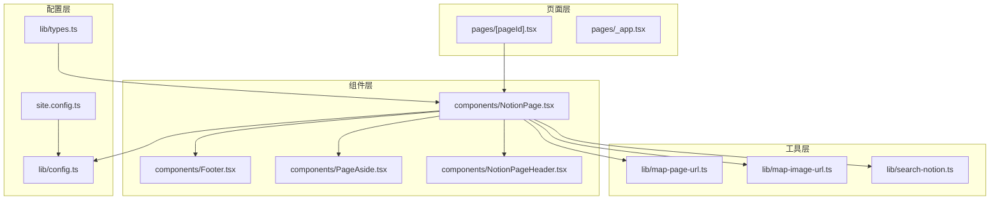
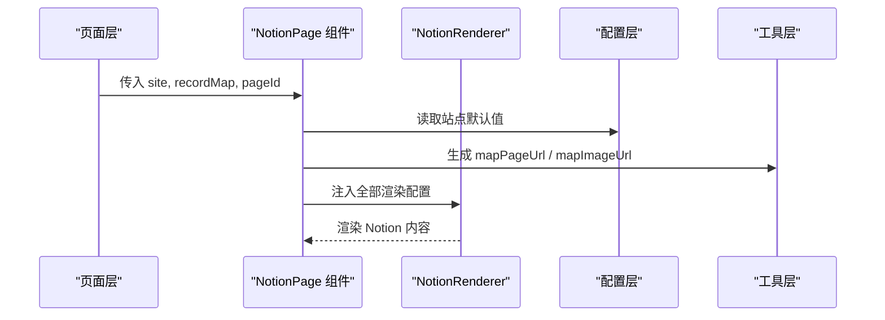
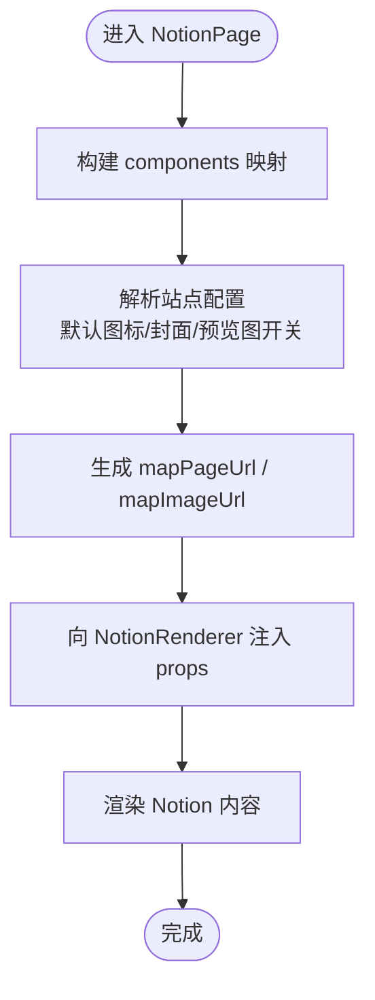
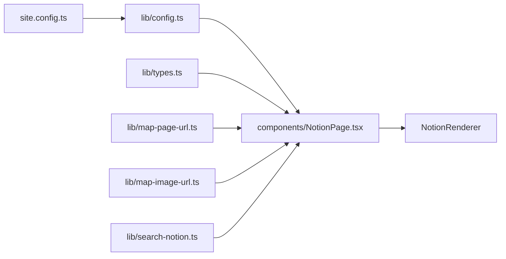

# NotionRenderer 配置

<cite>
**本文引用的文件**   
- [components/NotionPage.tsx](file://components/NotionPage.tsx)
- [lib/config.ts](file://lib/config.ts)
- [lib/types.ts](file://lib/types.ts)
- [site.config.ts](file://site.config.ts)
</cite>

## 目录
1. [简介](#简介)
2. [项目结构](#项目结构)
3. [核心组件与渲染入口](#核心组件与渲染入口)
4. [架构总览](#架构总览)
5. [详细配置项说明](#详细配置项说明)
6. [依赖关系分析](#依赖关系分析)
7. [性能与可维护性建议](#性能与可维护性建议)
8. [故障排查指南](#故障排查指南)
9. [结论](#结论)

## 简介
本文围绕 NotionRenderer 的配置选项展开，结合仓库中的实际实现，逐项解释 bodyClassName、darkMode、components、recordMap、rootPageId、rootDomain、fullPage、previewImages、showCollectionViewDropdown、showTableOfContents、minTableOfContentsItems、defaultPageIcon、defaultPageCover、defaultPageCoverPosition、mapPageUrl、mapImageUrl、searchNotion、pageAside、footer 等属性的作用、默认行为与最佳实践。文档同时给出如何根据业务需求调整渲染行为的指导，并附带可视化图示帮助理解整体数据流与组件交互。

## 项目结构
本项目采用 Next.js + react-notion-x 的架构：
- 页面层负责获取 Notion 数据、组装站点信息、注入 SEO 元数据。
- 组件层通过 NotionPage 封装 NotionRenderer，集中注入渲染配置。
- 配置层提供站点级默认值（如默认图标、封面、预览图开关等）。
- 工具层提供 URL 映射、图片映射、搜索能力等。

**图表来源**
- [components/NotionPage.tsx:1-356](file://components/NotionPage.tsx#L1-L356)
- [lib/config.ts:47-84](file://lib/config.ts#L47-L84)
- [lib/types.ts:29-45](file://lib/types.ts#L29-L45)
- [site.config.ts:1-77](file://site.config.ts#L1-L77)

**章节来源**
- [components/NotionPage.tsx:1-356](file://components/NotionPage.tsx#L1-L356)
- [lib/config.ts:47-84](file://lib/config.ts#L47-L84)
- [lib/types.ts:29-45](file://lib/types.ts#L29-L45)
- [site.config.ts:1-77](file://site.config.ts#L1-L77)

## 核心组件与渲染入口
NotionRenderer 在 NotionPage 中被实例化，所有渲染相关配置均在此处注入：
- components：注入自定义或第三方组件（代码高亮、集合视图、公式、PDF、弹窗、推文、页头、属性值渲染器等）。
- recordMap：由服务端拉取并缓存后的 Notion 数据对象。
- rootPageId/rootDomain/fullPage：站点根页面、域名与是否全屏模式。
- previewImages/showCollectionViewDropdown/showTableOfContents/minTableOfContentsItems：预览图、集合下拉、目录显示控制。
- defaultPageIcon/defaultPageCover/defaultPageCoverPosition：站点级默认图标与封面。
- mapPageUrl/mapImageUrl：URL 与图片地址映射函数。
- searchNotion/pageAside/footer：搜索、侧边栏、页脚插槽。

**图表来源**
- [components/NotionPage.tsx:319-352](file://components/NotionPage.tsx#L319-L352)
- [lib/config.ts:58-84](file://lib/config.ts#L58-L84)

**章节来源**
- [components/NotionPage.tsx:319-352](file://components/NotionPage.tsx#L319-L352)

## 架构总览
下图展示 NotionRenderer 在渲染流程中的位置以及关键依赖：

**图表来源**
- [components/NotionPage.tsx:196-209](file://components/NotionPage.tsx#L196-L209)
- [components/NotionPage.tsx:319-352](file://components/NotionPage.tsx#L319-L352)
- [lib/config.ts:58-84](file://lib/config.ts#L58-L84)

## 详细配置项说明

### bodyClassName
- 作用：为 NotionRenderer 根节点添加 CSS 类名，便于全局样式覆盖与主题切换。
- 当前实现：
  - 始终包含一个基础类名（用于 notion.css 等样式）。
  - 当当前页面等于站点根页面时，额外添加 index-page 类名，便于首页特殊样式。
- 使用建议：
  - 如需针对特定页面类型定制样式，可通过判断 rootPageId 或 block 类型追加类名。
  - 避免过度拆分类名，保持样式选择器简洁。

**章节来源**
- [components/NotionPage.tsx:319-323](file://components/NotionPage.tsx#L319-L323)

### darkMode
- 作用：启用 NotionRenderer 的深色模式。
- 当前实现：
  - 通过 useDarkMode 获取 isDarkMode，并直接传递给 NotionRenderer。
  - 同时在 <body> 上添加 dark-mode 类名以支持全局深色样式。
- 使用建议：
  - 若需强制开启/关闭深色模式，可在 useDarkMode 或上层逻辑中统一处理。
  - 注意与站点主题系统保持一致，避免样式冲突。

**章节来源**
- [components/NotionPage.tsx:316-325](file://components/NotionPage.tsx#L316-L325)

### components
- 作用：替换或扩展 NotionRenderer 内置组件，实现代码高亮、集合视图、公式、PDF、弹窗、推文、页头、属性值渲染等。
- 当前实现：
  - nextLegacyImage：Next.js 图片组件。
  - nextLink：Next.js 链接组件。
  - Code：动态加载 Prism 语法的高亮组件。
  - Collection：客户端渲染集合视图，避免 SSR 水合不一致。
  - Equation/Pdf/Modal：按需加载的第三方组件。
  - Tweet：集成 react-tweet 的推文渲染。
  - Header：自定义页头组件。
  - propertyLastEditedTimeValue/propertyTextValue/propertyDateValue：重写属性值渲染逻辑。
- 使用建议：
  - 按需懒加载重型组件，减少首屏体积。
  - 对需要客户端能力的组件（如 Modal）设置 ssr:false。
  - 通过 property*Value 钩子精细控制属性显示格式。

**章节来源**
- [components/NotionPage.tsx:43-142](file://components/NotionPage.tsx#L43-L142)
- [components/NotionPage.tsx:155-209](file://components/NotionPage.tsx#L155-L209)
- [components/NotionPage.tsx:319-326](file://components/NotionPage.tsx#L319-L326)

### recordMap
- 作用：Notion 页面的完整数据结构，包含块、集合、用户等信息。
- 当前实现：
  - 由服务端获取并缓存，随后注入到 NotionRenderer。
  - 若启用预览图，会在 recordMap 上附加 preview_images。
- 使用建议：
  - 不要在前端重新请求 Notion API，优先复用服务端 recordMap。
  - 如需扩展字段（如 tweets），请遵循 ExtendedRecordMap 类型约定。

**章节来源**
- [components/NotionPage.tsx:319-327](file://components/NotionPage.tsx#L319-L327)
- [lib/types.ts:21-23](file://lib/types.ts#L21-L23)

### rootPageId
- 作用：站点根 Notion 页面 ID，用于导航、SEO、首页样式等。
- 当前实现：
  - 从站点配置 site.rootNotionPageId 读取。
  - 用于判断是否为首页（index-page 类名）。
- 使用建议：
  - 确保与 site.config.ts 中的 rootNotionPageId 一致。
  - 多站点部署时，按环境注入不同 rootPageId。

**章节来源**
- [components/NotionPage.tsx:327-328](file://components/NotionPage.tsx#L327-L328)
- [site.config.ts:3-9](file://site.config.ts#L3-L9)

### rootDomain
- 作用：站点域名，用于生成绝对链接、社交分享图等。
- 当前实现：
  - 从站点配置 site.domain 读取。
- 使用建议：
  - 生产环境务必配置正确的域名。
  - 本地开发可使用 localhost，但需注意跨域与资源路径。

**章节来源**
- [components/NotionPage.tsx:328-329](file://components/NotionPage.tsx#L328-L329)
- [site.config.ts:11-14](file://site.config.ts#L11-L14)

### fullPage
- 作用：是否以全屏模式渲染 Notion 内容。
- 当前实现：
  - 非 lite 模式下为 true；lite 模式（oembed）下为 false。
- 使用建议：
  - 嵌入场景（如 oembed）使用 lite/fullPage=false 以减少冗余布局。
  - 正常文章页保持 fullPage=true。

**章节来源**
- [components/NotionPage.tsx:316-330](file://components/NotionPage.tsx#L316-L330)

### previewImages
- 作用：是否启用低质量图片占位（LQIP）预览图。
- 当前实现：
  - 基于 recordMap.preview_images 是否存在决定。
  - 服务端在启用预览图功能时会填充该字段。
- 使用建议：
  - 在站点配置中开启 isPreviewImageSupportEnabled 以启用。
  - 注意 CDN 与图片优化策略配合。

**章节来源**
- [components/NotionPage.tsx:330-331](file://components/NotionPage.tsx#L330-L331)
- [lib/config.ts:68-72](file://lib/config.ts#L68-L72)
- [site.config.ts:25-27](file://site.config.ts#L25-L27)

### showCollectionViewDropdown
- 作用：是否显示集合视图的下拉菜单。
- 当前实现：
  - 固定为 false，隐藏集合视图下拉。
- 使用建议：
  - 如需允许用户切换视图，可改为 true 并在集合视图中实现相应逻辑。

**章节来源**
- [components/NotionPage.tsx:331-332](file://components/NotionPage.tsx#L331-L332)

### showTableOfContents
- 作用：是否显示目录。
- 当前实现：
  - 仅当页面是博客文章（block.type === 'page' 且 parent_table === 'collection'）时显示。
- 使用建议：
  - 对于长文博客推荐开启，提升阅读体验。
  - 短内容或非文章页可关闭以减少干扰。

**章节来源**
- [components/NotionPage.tsx:238-242](file://components/NotionPage.tsx#L238-L242)
- [components/NotionPage.tsx:332-333](file://components/NotionPage.tsx#L332-L333)

### minTableOfContentsItems
- 作用：目录的最小条目数阈值，低于该数量不显示目录。
- 当前实现：
  - 固定为 3。
- 使用建议：
  - 根据文章内容长度调整，避免目录过于稀疏。

**章节来源**
- [components/NotionPage.tsx:242-243](file://components/NotionPage.tsx#L242-L243)
- [components/NotionPage.tsx:333-334](file://components/NotionPage.tsx#L333-L334)

### defaultPageIcon
- 作用：站点级默认页面图标，可被页面级设置覆盖。
- 当前实现：
  - 从站点配置读取，未设置则为 undefined。
- 使用建议：
  - 为全站提供一致的默认图标，提升品牌一致性。

**章节来源**
- [components/NotionPage.tsx:334-335](file://components/NotionPage.tsx#L334-L335)
- [lib/config.ts:58-60](file://lib/config.ts#L58-L60)
- [site.config.ts:19-23](file://site.config.ts#L19-L23)

### defaultPageCover
- 作用：站点级默认页面封面，可被页面级设置覆盖。
- 当前实现：
  - 从站点配置读取，未设置则为 undefined。
- 使用建议：
  - 搭配 defaultPageCoverPosition 使用，保证封面裁剪效果。

**章节来源**
- [components/NotionPage.tsx:335-336](file://components/NotionPage.tsx#L335-L336)
- [lib/config.ts:61-62](file://lib/config.ts#L61-L62)
- [site.config.ts:19-23](file://site.config.ts#L19-L23)

### defaultPageCoverPosition
- 作用：默认封面裁剪位置（百分比），影响封面显示区域。
- 当前实现：
  - 从站点配置读取，默认值为 0.5。
- 使用建议：
  - 根据封面图构图调整，突出主体。

**章节来源**
- [components/NotionPage.tsx:336-337](file://components/NotionPage.tsx#L336-L337)
- [lib/config.ts:63-66](file://lib/config.ts#L63-L66)
- [site.config.ts:19-23](file://site.config.ts#L19-L23)

### mapPageUrl
- 作用：将 Notion 页面 ID 映射为站点 URL 的函数。
- 当前实现：
  - 使用 lib/map-page-url 生成的函数，支持 lite 参数传递。
- 使用建议：
  - 如需自定义路由规则，重写 mapPageUrl 逻辑。
  - 注意 SEO 友好性与 canonical URL 的一致性。

**章节来源**
- [components/NotionPage.tsx:225-231](file://components/NotionPage.tsx#L225-L231)
- [components/NotionPage.tsx:337-338](file://components/NotionPage.tsx#L337-L338)

### mapImageUrl
- 作用：将 Notion 图片 URL 映射为站点可用的图片地址。
- 当前实现：
  - 使用 lib/map-image-url 提供的映射函数。
- 使用建议：
  - 接入 CDN、图片压缩、懒加载等优化策略。
  - 注意跨域与安全策略（CSP）。

**章节来源**
- [components/NotionPage.tsx:338-339](file://components/NotionPage.tsx#L338-L339)

### searchNotion
- 作用：注入搜索能力，使 NotionRenderer 支持站内搜索。
- 当前实现：
  - 根据 config.isSearchEnabled 决定是否注入 searchNotion。
- 使用建议：
  - 在生产环境启用搜索，提升用户体验。
  - 确保后端搜索接口可用且性能良好。

**章节来源**
- [components/NotionPage.tsx:339-340](file://components/NotionPage.tsx#L339-L340)
- [lib/config.ts:47-84](file://lib/config.ts#L47-L84)

### pageAside
- 作用：注入页面右侧边栏内容。
- 当前实现：
  - 使用 PageAside 组件，传入 block、recordMap、isBlogPost 等上下文。
- 使用建议：
  - 在侧边栏展示作者、标签、相关文章等元信息。
  - 根据页面类型（博客/非博客）差异化展示。

**章节来源**
- [components/NotionPage.tsx:244-253](file://components/NotionPage.tsx#L244-L253)
- [components/NotionPage.tsx:340-341](file://components/NotionPage.tsx#L340-L341)

### footer
- 作用：注入页脚内容，支持评论等扩展。
- 当前实现：
  - 使用 Footer 组件，博客文章页注入 Utterances 评论。
- 使用建议：
  - 根据页面类型决定是否显示评论。
  - 支持深色/浅色主题切换。

**章节来源**
- [components/NotionPage.tsx:341-352](file://components/NotionPage.tsx#L341-L352)

## 依赖关系分析
NotionRenderer 的配置依赖站点配置与工具函数，形成清晰的解耦结构：

**图表来源**
- [site.config.ts:1-77](file://site.config.ts#L1-L77)
- [lib/config.ts:47-84](file://lib/config.ts#L47-L84)
- [lib/types.ts:29-45](file://lib/types.ts#L29-L45)
- [components/NotionPage.tsx:319-352](file://components/NotionPage.tsx#L319-L352)

**章节来源**
- [site.config.ts:1-77](file://site.config.ts#L1-L77)
- [lib/config.ts:47-84](file://lib/config.ts#L47-L84)
- [lib/types.ts:29-45](file://lib/types.ts#L29-L45)
- [components/NotionPage.tsx:319-352](file://components/NotionPage.tsx#L319-L352)

## 性能与可维护性建议
- 按需加载重型组件（Code、Collection、Equation、Pdf、Modal），减少首屏体积。
- 合理设置 previewImages，平衡加载速度与视觉体验。
- 使用 mapImageUrl 对接 CDN 与图片优化，降低带宽成本。
- 通过 showTableOfContents 与 minTableOfContentsItems 控制目录显示，提升可读性。
- 统一站点默认图标与封面，减少重复配置与维护成本。

[本节为通用建议，不直接分析具体文件]

## 故障排查指南
- 深色模式无效：检查 useDarkMode 返回值与 body 类名是否正确注入。
- 预览图不显示：确认 isPreviewImageSupportEnabled 已启用，且 recordMap.preview_images 存在。
- 集合视图顺序异常：检查服务端 fixCollectionQueries 逻辑与 collection_query/collection_view 数据完整性。
- 搜索不可用：确认 config.isSearchEnabled 与 searchNotion 注入正确，后端搜索接口可达。
- 目录不显示：检查 isBlogPost 判断逻辑与 showTableOfContents 设置。

**章节来源**
- [components/NotionPage.tsx:316-352](file://components/NotionPage.tsx#L316-L352)
- [lib/config.ts:68-72](file://lib/config.ts#L68-L72)

## 结论
NotionRenderer 的配置集中在 NotionPage 组件中，通过站点配置与工具函数提供统一的渲染行为。开发者可根据业务需求灵活调整各配置项，以实现更丰富的视觉效果与更好的用户体验。建议在保持代码解耦的前提下，按需扩展 components 与属性值渲染逻辑，并结合 CDN 与缓存策略优化性能。

[本节为总结性内容，不直接分析具体文件]