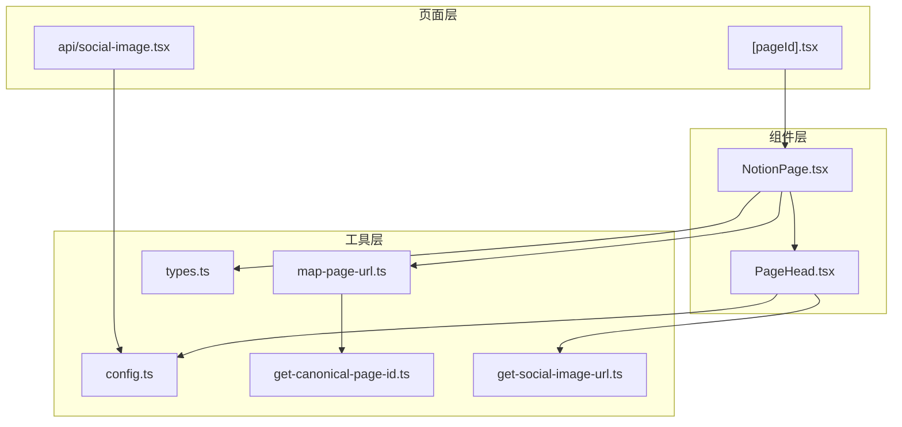
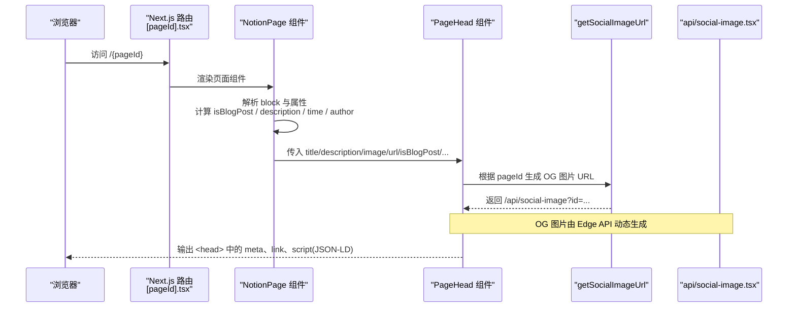
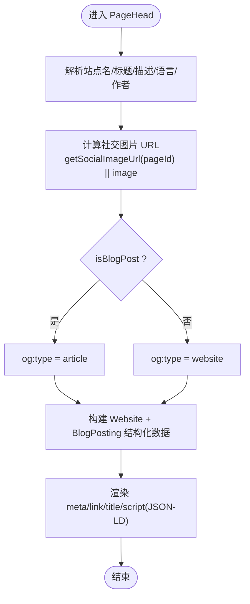
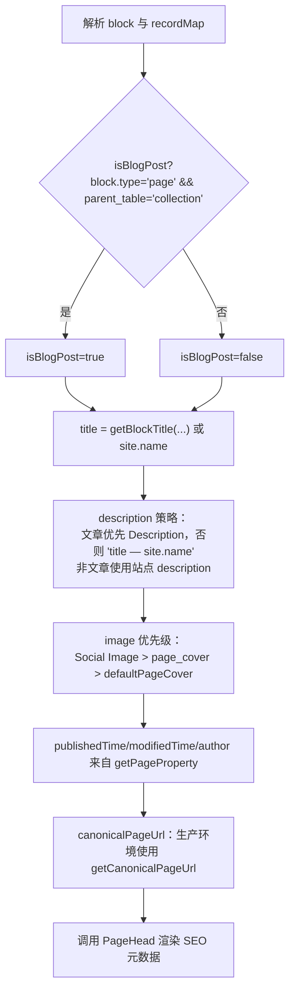
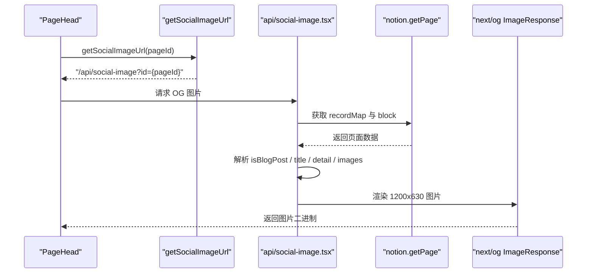
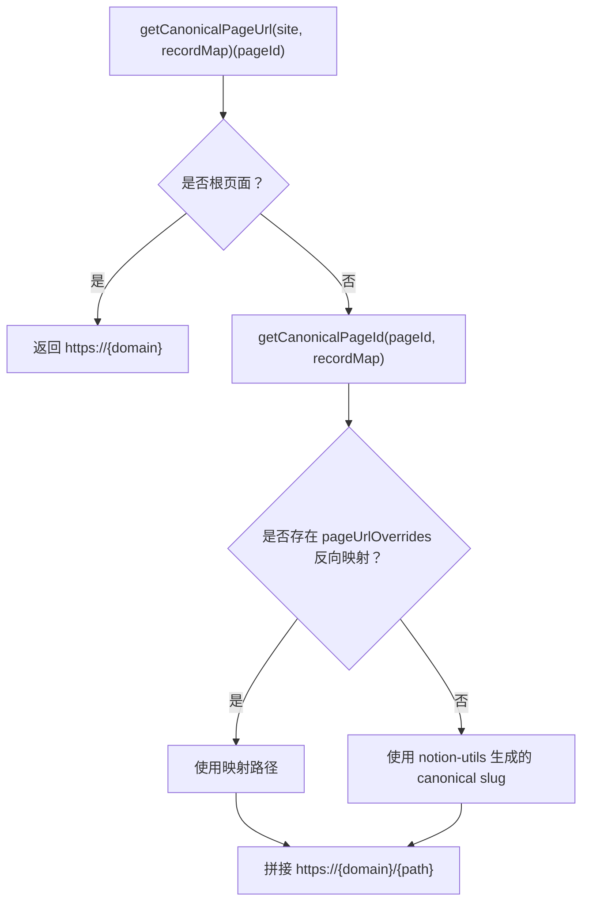
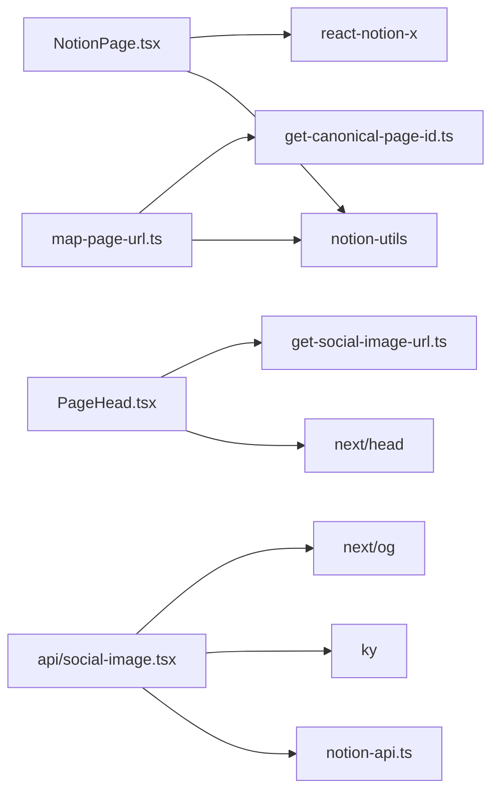

# SEO 元数据处理

<cite>
**本文引用的文件**   
- [components/PageHead.tsx](file://components/PageHead.tsx)
- [components/NotionPage.tsx](file://components/NotionPage.tsx)
- [lib/get-social-image-url.ts](file://lib/get-social-image-url.ts)
- [pages/api/social-image.tsx](file://pages/api/social-image.tsx)
- [lib/map-page-url.ts](file://lib/map-page-url.ts)
- [lib/get-canonical-page-id.ts](file://lib/get-canonical-page-id.ts)
- [lib/config.ts](file://lib/config.ts)
- [site.config.ts](file://site.config.ts)
- [lib/types.ts](file://lib/types.ts)
- [pages/[pageId].tsx](file://pages/[pageId].tsx)
</cite>

## 目录
1. [引言](#引言)
2. [项目结构](#项目结构)
3. [核心组件](#核心组件)
4. [架构总览](#架构总览)
5. [详细组件分析](#详细组件分析)
6. [依赖关系分析](#依赖关系分析)
7. [性能与可维护性](#性能与可维护性)
8. [故障排查指南](#故障排查指南)
9. [SEO 优化最佳实践](#seo-优化最佳实践)
10. [结论](#结论)

## 引言
本文围绕 Next.js + Notion 博客的 SEO 元数据生成链路展开，重点说明：
- 标题、描述、图片、URL 等元数据的获取与处理流程
- getPageProperty 的使用方式
- isBlogPost 的判断逻辑
- canonicalPageUrl 的生成机制
- PageHead 组件的参数传递与渲染机制
- 社交媒体预览图（OG 图片）的生成与 Open Graph 标签设置
- 结构化数据（Schema.org）的生成
- SEO 配置示例与优化建议

## 项目结构
本项目采用“页面 + 组件 + 工具库”的分层组织方式：
- pages 层负责路由与数据获取
- components 层负责 UI 与头部元信息渲染
- lib 层提供站点配置、URL 映射、Notion 数据解析、社交图片生成等能力

图表来源
- [pages/[pageId].tsx:9-25](file://pages/[pageId].tsx#L9-L25)
- [components/NotionPage.tsx:211-314](file://components/NotionPage.tsx#L211-L314)
- [components/PageHead.tsx:7-36](file://components/PageHead.tsx#L7-L36)
- [lib/get-social-image-url.ts:3-16](file://lib/get-social-image-url.ts#L3-L16)
- [lib/map-page-url.ts:12-39](file://lib/map-page-url.ts#L12-L39)
- [lib/get-canonical-page-id.ts:9-29](file://lib/get-canonical-page-id.ts#L9-L29)
- [lib/config.ts:145-150](file://lib/config.ts#L145-L150)

章节来源
- [pages/[pageId].tsx:9-25](file://pages/[pageId].tsx#L9-L25)
- [components/NotionPage.tsx:211-314](file://components/NotionPage.tsx#L211-L314)
- [components/PageHead.tsx:7-36](file://components/PageHead.tsx#L7-L36)
- [lib/get-social-image-url.ts:3-16](file://lib/get-social-image-url.ts#L3-L16)
- [lib/map-page-url.ts:12-39](file://lib/map-page-url.ts#L12-L39)
- [lib/get-canonical-page-id.ts:9-29](file://lib/get-canonical-page-id.ts#L9-L29)
- [lib/config.ts:145-150](file://lib/config.ts#L145-L150)

## 核心组件
- PageHead：负责将传入的站点与页面级元数据渲染为 HTML head 标签，包括 og:title/description/image/url、twitter 卡片、canonical link、RSS 订阅链接以及 JSON-LD 结构化数据。
- NotionPage：从 Notion recordMap 中解析页面属性，计算 isBlogPost、socialDescription、publishedTime/modifiedTime/author 等，并调用 PageHead 完成 SEO 元数据注入。
- social-image API：根据 pageId 拉取 Notion 页面数据，动态生成社交媒体预览图（Open Graph Image）。
- map-page-url / get-canonical-page-id：负责将 Notion pageId 转换为人类可读的 canonical URL。
- config / site.config：集中管理站点名称、域名、默认封面、语言、API 地址等全局配置。

章节来源
- [components/PageHead.tsx:7-188](file://components/PageHead.tsx#L7-L188)
- [components/NotionPage.tsx:211-314](file://components/NotionPage.tsx#L211-L314)
- [pages/api/social-image.tsx:21-171](file://pages/api/social-image.tsx#L21-L171)
- [lib/map-page-url.ts:12-39](file://lib/map-page-url.ts#L12-L39)
- [lib/get-canonical-page-id.ts:9-29](file://lib/get-canonical-page-id.ts#L9-L29)
- [lib/config.ts:52-78](file://lib/config.ts#L52-L78)
- [site.config.ts:1-77](file://site.config.ts#L1-L77)

## 架构总览
下图展示了从页面请求到 SEO 元数据渲染的关键路径：

图表来源
- [pages/[pageId].tsx:9-25](file://pages/[pageId].tsx#L9-L25)
- [components/NotionPage.tsx:233-314](file://components/NotionPage.tsx#L233-L314)
- [components/PageHead.tsx:7-36](file://components/PageHead.tsx#L7-L36)
- [lib/get-social-image-url.ts:3-16](file://lib/get-social-image-url.ts#L3-L16)
- [pages/api/social-image.tsx:21-49](file://pages/api/social-image.tsx#L21-L49)

## 详细组件分析

### PageHead 组件：参数与渲染机制
- 入参
  - site：站点信息（name、domain、description 等）
  - title/description/image/url：页面级标题、描述、图片、URL
  - isBlogPost：是否为博客文章
  - publishedTime/modifiedTime：发布时间与修改时间
  - author：作者名
- 关键处理
  - 站点名、标题、描述存在优先级覆盖：title > site.name；description > site.description > config.description
  - 社交图片优先使用 getSocialImageUrl(pageId)，否则回退到 image
  - 根据 isBlogPost 决定 og:type 是 article 还是 website
  - 统一语言与作者信息
  - 构建 Website 与 BlogPosting 两种结构化数据（JSON-LD），仅在 isBlogPost 时追加 BlogPosting
  - 输出 meta：robots、googlebot、bingbot、author、og:*、twitter:*、article:*、canonical、rss feed、title 等
  - 输出 script[type="application/ld+json"] 结构化数据

图表来源
- [components/PageHead.tsx:7-89](file://components/PageHead.tsx#L7-L89)
- [components/PageHead.tsx:91-188](file://components/PageHead.tsx#L91-L188)
- [lib/get-social-image-url.ts:3-16](file://lib/get-social-image-url.ts#L3-L16)

章节来源
- [components/PageHead.tsx:7-188](file://components/PageHead.tsx#L7-L188)

### NotionPage 组件：元数据准备与 isBlogPost 判断
- isBlogPost 判断
  - 当 block.type === 'page' 且 block.parent_table === 'collection' 时视为博客文章
- 标题与描述
  - 标题优先使用 Notion 块标题，否则回退站点名
  - 描述策略：
    - 博客文章：优先使用 Notion 的 Description 属性；若为空，则使用 “标题 — 站点名”，保证每篇文章有唯一描述
    - 非文章：使用站点级 description
- 社交图片
  - 优先使用 Notion 的 Social Image 属性，其次使用 page_cover，最后回退站点默认封面
- 时间与作者
  - 通过 getPageProperty 读取 Published、Last Edited、Author 等属性
- canonicalPageUrl
  - 开发环境不注入 canonical URL；生产环境使用 getCanonicalPageUrl(site, recordMap)(pageId)
- 渲染
  - 将上述值传给 PageHead，完成 SEO 元数据注入

图表来源
- [components/NotionPage.tsx:233-314](file://components/NotionPage.tsx#L233-L314)

章节来源
- [components/NotionPage.tsx:233-314](file://components/NotionPage.tsx#L233-L314)

### 社交媒体预览图（OG 图片）生成
- 前端侧
  - PageHead 通过 getSocialImageUrl(pageId) 生成 /api/social-image?id={pageId} 作为 og:image 与 twitter:image
- 后端侧（Edge API）
  - 接收 id 参数，校验 workspace（rootNotionSpaceId）
  - 动态加载字体资源，避免打包体积超限
  - 调用 notion.getPage 获取 recordMap，解析 block 与属性
  - 计算 isBlogPost、title、detail（日期/作者/域名）、authorImage、image（封面）
  - 对 Unsplash 图片进行尺寸参数增强（w=1200&fit=max）
  - 使用 next/og 的 ImageResponse 渲染 1200x630 的图片

图表来源
- [components/PageHead.tsx:33-34](file://components/PageHead.tsx#L33-L34)
- [lib/get-social-image-url.ts:3-16](file://lib/get-social-image-url.ts#L3-L16)
- [pages/api/social-image.tsx:21-49](file://pages/api/social-image.tsx#L21-L49)
- [pages/api/social-image.tsx:173-276](file://pages/api/social-image.tsx#L173-L276)
- [pages/api/social-image.tsx:293-312](file://pages/api/social-image.tsx#L293-L312)

章节来源
- [components/PageHead.tsx:33-34](file://components/PageHead.tsx#L33-L34)
- [lib/get-social-image-url.ts:3-16](file://lib/get-social-image-url.ts#L3-L16)
- [pages/api/social-image.tsx:21-49](file://pages/api/social-image.tsx#L21-L49)
- [pages/api/social-image.tsx:173-276](file://pages/api/social-image.tsx#L173-L276)
- [pages/api/social-image.tsx:293-312](file://pages/api/social-image.tsx#L293-L312)

### getPageProperty 的使用
- 在 NotionPage 中用于提取 Description、Published、Last Edited、Author、Social Image 等页面属性
- 在 social-image API 中用于提取 Author、Published 等属性以生成 OG 图片细节
- 在 feed 生成中也使用 Description、Published、Last Updated 等属性

章节来源
- [components/NotionPage.tsx:277-299](file://components/NotionPage.tsx#L277-L299)
- [pages/api/social-image.tsx:217-248](file://pages/api/social-image.tsx#L217-L248)

### isBlogPost 的判断逻辑
- 判断条件：block.type === 'page' 且 block.parent_table === 'collection'
- 影响范围：
  - NotionPage：决定是否显示目录、是否使用文章型描述策略
  - PageHead：决定 og:type 为 article 还是 website，以及是否包含 BlogPosting 结构化数据
  - social-image API：决定是否展示发布日期细节

章节来源
- [components/NotionPage.tsx:238-241](file://components/NotionPage.tsx#L238-L241)
- [components/PageHead.tsx:35-36](file://components/PageHead.tsx#L35-L36)
- [components/PageHead.tsx:86-89](file://components/PageHead.tsx#L86-L89)
- [pages/api/social-image.tsx:206-208](file://pages/api/social-image.tsx#L206-L208)

### canonicalPageUrl 的生成
- 入口：getCanonicalPageUrl(site, recordMap)(pageId)
- 内部逻辑：
  - 根页面直接返回站点域名
  - 其他页面拼接 https://{domain}/{canonicalPath}
  - canonicalPath 由 getCanonicalPageId 计算，支持 pageUrlOverrides 反向映射
- 行为差异：
  - 开发环境：不注入 canonical URL
  - 生产环境：注入 canonical URL 到 <link rel="canonical"> 与 og:url/twitter:url

图表来源
- [lib/map-page-url.ts:27-39](file://lib/map-page-url.ts#L27-L39)
- [lib/get-canonical-page-id.ts:9-29](file://lib/get-canonical-page-id.ts#L9-L29)
- [components/NotionPage.tsx:273-276](file://components/NotionPage.tsx#L273-L276)

章节来源
- [lib/map-page-url.ts:27-39](file://lib/map-page-url.ts#L27-L39)
- [lib/get-canonical-page-id.ts:9-29](file://lib/get-canonical-page-id.ts#L9-L29)
- [components/NotionPage.tsx:273-276](file://components/NotionPage.tsx#L273-L276)

### Open Graph 标签与 Twitter 卡片
- og:title/og:description/og:image/og:url/og:type/og:locale/og:site_name
- twitter:card（summary_large_image 或 summary）、twitter:title/twitter:description/twitter:image/twitter:url/twitter:domain
- 当存在社交图片时启用 summary_large_image，否则降级为 summary

章节来源
- [components/PageHead.tsx:127-169](file://components/PageHead.tsx#L127-L169)

### 结构化数据（Schema.org）
- 始终输出 WebSite 结构化数据
- 当 isBlogPost 为真时，额外输出 BlogPosting 结构化数据，包含 headline、description、author、publisher、image、datePublished、dateModified、inLanguage 等字段

章节来源
- [components/PageHead.tsx:50-89](file://components/PageHead.tsx#L50-L89)
- [components/PageHead.tsx:182-184](file://components/PageHead.tsx#L182-L184)

## 依赖关系分析
- NotionPage 依赖 notion-utils 的 getBlockTitle/getBlockValue/getPageProperty 与 react-notion-x 的 NotionRenderer
- PageHead 依赖 next/head 与 getSocialImageUrl
- social-image API 依赖 notion-api、ky、next/og
- URL 映射依赖 notion-utils 的 parsePageId/uuidToId 与自定义 getCanonicalPageId

图表来源
- [components/NotionPage.tsx:1-37](file://components/NotionPage.tsx#L1-L37)
- [components/PageHead.tsx:1-6](file://components/PageHead.tsx#L1-L6)
- [pages/api/social-image.tsx:1-17](file://pages/api/social-image.tsx#L1-L17)
- [lib/map-page-url.ts:1-6](file://lib/map-page-url.ts#L1-L6)
- [lib/get-canonical-page-id.ts:1-8](file://lib/get-canonical-page-id.ts#L1-L8)

章节来源
- [components/NotionPage.tsx:1-37](file://components/NotionPage.tsx#L1-L37)
- [components/PageHead.tsx:1-6](file://components/PageHead.tsx#L1-L6)
- [pages/api/social-image.tsx:1-17](file://pages/api/social-image.tsx#L1-L17)
- [lib/map-page-url.ts:1-6](file://lib/map-page-url.ts#L1-L6)
- [lib/get-canonical-page-id.ts:1-8](file://lib/get-canonical-page-id.ts#L1-L8)

## 性能与可维护性
- OG 图片生成使用 Edge Runtime，避免主包体积过大，提升首屏速度
- 字体按需 fetch，减少函数包大小
- 对 Unsplash 图片自动添加 w=1200&fit=max，提高大图渲染效率
- ISR revalidateSeconds 控制页面再生频率，平衡更新时效与函数调用成本
- 开发环境禁用 canonical URL，便于调试

章节来源
- [pages/api/social-image.tsx:19-39](file://pages/api/social-image.tsx#L19-L39)
- [pages/api/social-image.tsx:293-312](file://pages/api/social-image.tsx#L293-L312)
- [site.config.ts:57-60](file://site.config.ts#L57-L60)
- [components/NotionPage.tsx:273-276](file://components/NotionPage.tsx#L273-L276)

## 故障排查指南
- OG 图片无法显示
  - 检查 pageId 是否正确传入 getSocialImageUrl
  - 确认 api.getSocialImage 地址可用
  - 验证 Notion 页面是否存在且属于允许的 workspace
- 描述重复或缺失
  - 文章页未设置 Description 时会自动使用 “标题 — 站点名”
  - 非文章页使用站点级 description
- canonical URL 不正确
  - 检查 pageUrlOverrides 反向映射是否配置正确
  - 开发环境不会注入 canonical URL，属预期行为
- 结构化数据缺失
  - 确认 isBlogPost 判断是否符合预期
  - 检查 PageHead 渲染的 script[type="application/ld+json"] 内容

章节来源
- [lib/get-social-image-url.ts:3-16](file://lib/get-social-image-url.ts#L3-L16)
- [pages/api/social-image.tsx:27-45](file://pages/api/social-image.tsx#L27-L45)
- [components/NotionPage.tsx:284-295](file://components/NotionPage.tsx#L284-L295)
- [lib/get-canonical-page-id.ts:9-29](file://lib/get-canonical-page-id.ts#L9-L29)
- [components/PageHead.tsx:86-89](file://components/PageHead.tsx#L86-L89)

## SEO 优化最佳实践
- 标题与描述
  - 为每篇博客设置 Description 属性，确保搜索引擎摘要独特且相关
  - 保持 og:title 与 title 一致，提升分享效果
- 图片与预览
  - 为每篇文章设置 Social Image 属性，确保 og:image 与 twitter:image 有效
  - 使用 1200x630 比例图片以获得最佳预览效果
- URL 与规范化
  - 合理配置 pageUrlOverrides，使 canonical URL 简洁且语义化
  - 生产环境务必注入 canonical link，避免重复内容问题
- 结构化数据
  - 文章页确保 BlogPosting 结构化数据完整，包含作者、发布时间、图片等
  - 站点级 WebSite 结构化数据应包含 name、url、description、publisher
- 站点配置
  - 在 site.config.ts 中完善 name、domain、author、description、language 等基础信息
  - 配置搜索引擎验证码（Google/Bing）与 IndexNow key，加速收录

章节来源
- [site.config.ts:1-77](file://site.config.ts#L1-L77)
- [components/NotionPage.tsx:277-299](file://components/NotionPage.tsx#L277-L299)
- [components/PageHead.tsx:50-89](file://components/PageHead.tsx#L50-L89)
- [lib/map-page-url.ts:27-39](file://lib/map-page-url.ts#L27-L39)

## 结论
本项目的 SEO 元数据体系以 Notion 页面属性为核心，结合 Next.js 组件与 Edge API，实现了标题、描述、图片、URL 与结构化数据的自动化生成与渲染。通过 getPageProperty 灵活读取页面属性、isBlogPost 区分内容类型、canonicalPageUrl 规范 URL，以及 PageHead 统一输出 meta 与 JSON-LD，整体方案兼顾了可维护性与 SEO 效果。配合合理的站点配置与页面属性设置，可获得良好的搜索引擎表现与社交媒体预览体验。