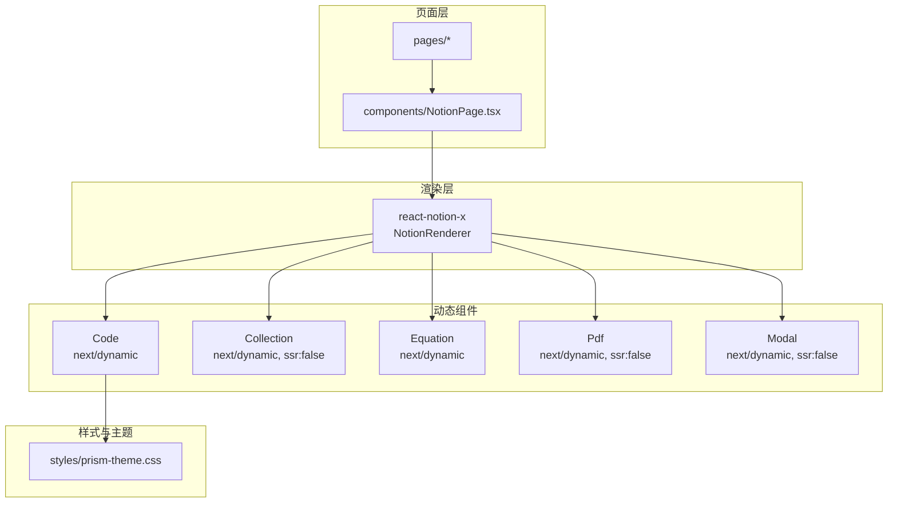
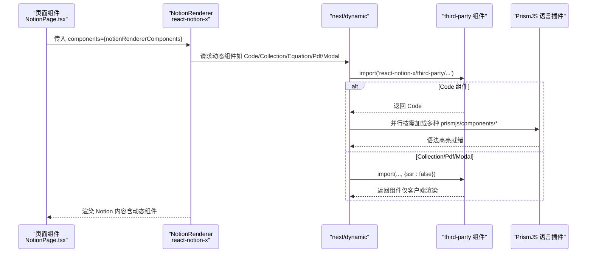
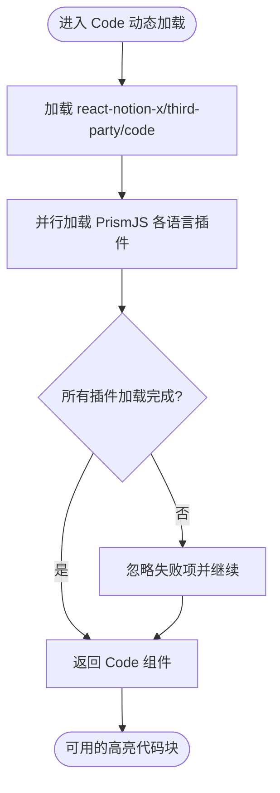
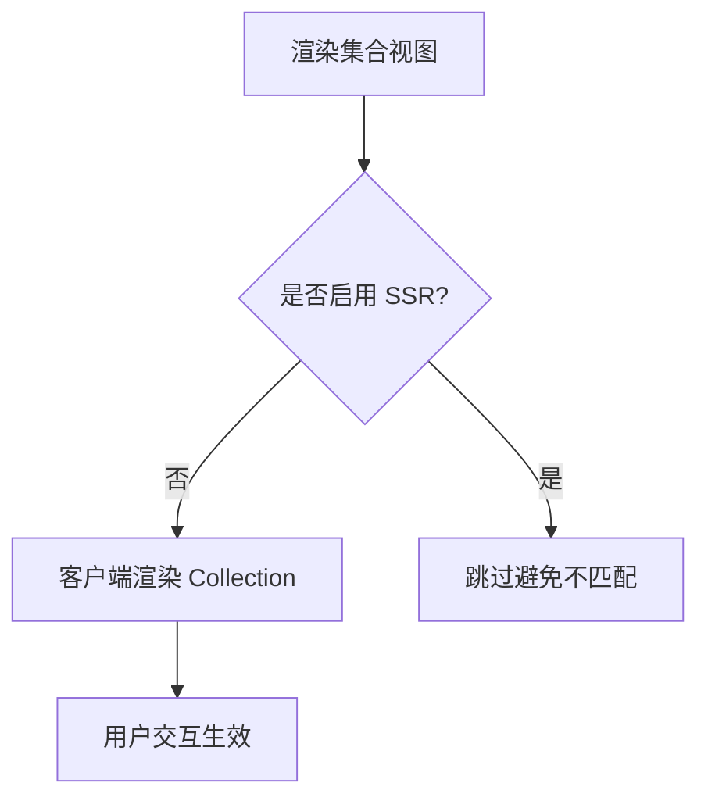
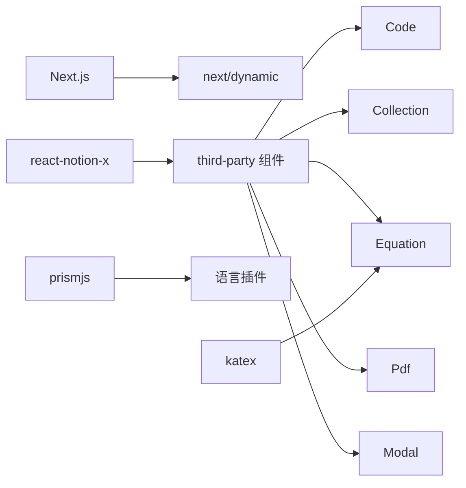

# 动态组件加载

<cite>
**本文引用的文件**   
- [components/NotionPage.tsx](file://components/NotionPage.tsx)
- [styles/prism-theme.css](file://styles/prism-theme.css)
- [package.json](file://package.json)
</cite>

## 目录
1. [简介](#简介)
2. [项目结构](#项目结构)
3. [核心组件与动态导入策略](#核心组件与动态导入策略)
4. [架构总览](#架构总览)
5. [详细组件分析](#详细组件分析)
6. [依赖关系分析](#依赖关系分析)
7. [性能优化建议](#性能优化建议)
8. [常见问题与排错](#常见问题与排错)
9. [结论](#结论)

## 简介
本文件系统性说明本项目中“动态组件加载机制”的实现原理与使用方法，重点覆盖以下方面：
- 使用 next/dynamic 对 Code、Collection、Equation、Pdf、Modal 等组件进行按需加载
- ssr 选项的作用与取舍（何时开启或关闭服务端渲染）
- PrismJS 语法高亮库的按需加载方式与扩展方法
- 为什么某些组件需要客户端渲染（ssr: false）
- 如何添加自定义的动态组件
- 性能优化建议与常见问题解决方案

## 项目结构
本项目采用 Next.js + react-notion-x 的技术栈。动态组件加载逻辑集中在 Notion 页面渲染组件中，通过 next/dynamic 将重型或仅客户端可用的第三方能力延迟到浏览器端加载；同时，PrismJS 的各语言插件按需引入，避免一次性打包全部语法支持。

图表来源
- [components/NotionPage.tsx:196-209](file://components/NotionPage.tsx#L196-L209)
- [styles/prism-theme.css:1-125](file://styles/prism-theme.css#L1-L125)

章节来源
- [components/NotionPage.tsx:1-356](file://components/NotionPage.tsx#L1-L356)
- [styles/prism-theme.css:1-125](file://styles/prism-theme.css#L1-L125)

## 核心组件与动态导入策略
本节聚焦五个关键组件的动态导入策略及其行为差异。

- Code（代码块与语法高亮）
  - 动态导入 react-notion-x/third-party/code
  - 在加载后并行按需引入多种 PrismJS 语言插件，减少首屏体积
  - 默认允许 SSR（未显式设置 ssr），由 NotionRenderer 在服务端渲染基础 HTML，再在客户端完成高亮增强

- Collection（内联数据库集合视图）
  - 动态导入 react-notion-x/third-party/collection
  - 配置 ssr: false，仅在客户端渲染，避免与服务端输出不一致导致的 hydration mismatch
  - 不影响文章正文的服务端渲染，SEO 不受影响

- Equation（数学公式）
  - 动态导入 react-notion-x/third-party/equation
  - 默认允许 SSR，按需加载公式渲染能力

- Pdf（PDF 预览）
  - 动态导入 react-notion-x/third-party/pdf
  - 配置 ssr: false，避免 PDF 相关 DOM/Canvas 操作在服务端执行导致错误或不一致

- Modal（弹窗容器）
  - 动态导入 react-notion-x/third-party/modal
  - 配置 ssr: false，并在加载时调用 setAppElement 绑定滚动容器，确保弹窗滚动正确
  - 避免服务端环境缺少 DOM API 导致的异常

这些组件统一注入到 notionRendererComponents，供 NotionRenderer 按需使用。

章节来源
- [components/NotionPage.tsx:43-142](file://components/NotionPage.tsx#L43-L142)
- [components/NotionPage.tsx:196-209](file://components/NotionPage.tsx#L196-L209)

## 架构总览
下图展示了从页面入口到 Notion 内容渲染，再到动态组件按需加载的整体流程。

图表来源
- [components/NotionPage.tsx:43-142](file://components/NotionPage.tsx#L43-L142)
- [components/NotionPage.tsx:196-209](file://components/NotionPage.tsx#L196-L209)

## 详细组件分析

### Code 组件与 PrismJS 按需加载
- 动态导入 react-notion-x/third-party/code
- 在模块加载完成后，使用 Promise.allSettled 并行加载多种 PrismJS 语言插件，保证即使某个语言插件失败也不会阻塞其他插件加载
- 按需加载的语言包括前端、后端、脚本、标记语言、配置文件等多种常见类型
- 样式层面通过 styles/prism-theme.css 定制代码块与 token 颜色，适配明暗主题

图表来源
- [components/NotionPage.tsx:43-112](file://components/NotionPage.tsx#L43-L112)
- [styles/prism-theme.css:1-125](file://styles/prism-theme.css#L1-L125)

章节来源
- [components/NotionPage.tsx:43-112](file://components/NotionPage.tsx#L43-L112)
- [styles/prism-theme.css:1-125](file://styles/prism-theme.css#L1-L125)

### Collection 组件（ssr: false）
- 使用 next/dynamic 动态导入 react-notion-x/third-party/collection
- 配置 ssr: false，避免在服务端渲染集合视图，从而规避与服务端输出的 hydration mismatch
- 文章正文仍可在服务端渲染，SEO 不受影响

图表来源
- [components/NotionPage.tsx:114-123](file://components/NotionPage.tsx#L114-L123)

章节来源
- [components/NotionPage.tsx:114-123](file://components/NotionPage.tsx#L114-L123)

### Equation 组件
- 动态导入 react-notion-x/third-party/equation
- 默认允许 SSR，按需加载公式渲染能力

章节来源
- [components/NotionPage.tsx:124-126](file://components/NotionPage.tsx#L124-L126)

### Pdf 组件（ssr: false）
- 动态导入 react-notion-x/third-party/pdf
- 配置 ssr: false，避免在服务端执行 PDF 相关逻辑

章节来源
- [components/NotionPage.tsx:127-132](file://components/NotionPage.tsx#L127-L132)

### Modal 组件（ssr: false）
- 动态导入 react-notion-x/third-party/modal
- 配置 ssr: false，并在加载时调用 setAppElement 绑定滚动容器
- 避免服务端环境缺少 DOM API 导致的异常

章节来源
- [components/NotionPage.tsx:133-142](file://components/NotionPage.tsx#L133-L142)

### 组件注册与使用
- 上述动态组件被统一放入 notionRendererComponents 对象
- 该对象作为 components 属性传递给 NotionRenderer，实现按需替换与注入

章节来源
- [components/NotionPage.tsx:196-209](file://components/NotionPage.tsx#L196-L209)

## 依赖关系分析
- 运行时依赖
  - next：提供 next/dynamic 与页面路由能力
  - react-notion-x：提供 Notion 内容渲染与 third-party 组件
  - prismjs：提供语法高亮能力，按语言插件按需加载
  - katex：用于公式渲染（Equation 组件依赖）
- 开发依赖
  - @types/prismjs：为 PrismJS 提供类型定义

图表来源
- [package.json:30-55](file://package.json#L30-L55)
- [components/NotionPage.tsx:43-142](file://components/NotionPage.tsx#L43-L142)

章节来源
- [package.json:30-55](file://package.json#L30-L55)
- [components/NotionPage.tsx:43-142](file://components/NotionPage.tsx#L43-L142)

## 性能优化建议
- 保持按需加载
  - 继续使用 next/dynamic 包裹重型组件，避免首屏体积膨胀
  - 对 Code 组件内的 PrismJS 语言插件，仅保留业务需要的语言，移除冗余插件
- 合理设置 ssr
  - 对涉及 DOM/Canvas/BOM 的组件（如 Pdf、Modal、Collection）使用 ssr: false，避免服务端报错与 hydration mismatch
  - 对可安全在服务端渲染的组件（如 Equation、Code 的基础 HTML）保持默认 SSR，提升首屏 SEO 与速度
- 并行加载与容错
  - 使用 Promise.allSettled 并行加载多个 PrismJS 插件，提高加载效率且具备容错能力
- 样式与主题
  - 通过 styles/prism-theme.css 定制代码块与 token 颜色，确保明暗主题一致性
- 资源缓存
  - 利用浏览器缓存与 CDN 缓存静态资源，减少重复下载
- 监控与度量
  - 结合 Vercel Speed Insights 等工具监控关键指标，定位性能瓶颈

[本节为通用指导，不直接分析具体文件]

## 常见问题与排错

- 问题：Hydration 不匹配警告
  - 现象：控制台出现 hydration mismatch 提示
  - 原因：服务端与客户端渲染结果不一致
  - 解决：对可能产生差异的组件（Collection、Pdf、Modal）设置 ssr: false

- 问题：代码块无高亮或高亮不完整
  - 现象：代码块显示但无颜色或语言识别失败
  - 原因：未按需加载对应 PrismJS 语言插件
  - 解决：在 Code 动态加载回调中添加缺失的语言插件 import

- 问题：Modal 滚动异常或无法打开
  - 现象：弹窗滚动位置不正确或无法弹出
  - 原因：未设置应用根元素
  - 解决：在 Modal 动态加载回调中调用 setAppElement 绑定滚动容器

- 问题：PDF 预览报错
  - 现象：服务端构建或运行时报错
  - 原因：PDF 组件依赖浏览器环境
  - 解决：为 Pdf 组件设置 ssr: false

- 问题：公式渲染失败
  - 现象：数学公式不显示或报错
  - 原因：katex 依赖缺失或版本冲突
  - 解决：确认 katex 已安装且版本兼容

章节来源
- [components/NotionPage.tsx:114-142](file://components/NotionPage.tsx#L114-L142)
- [components/NotionPage.tsx:43-112](file://components/NotionPage.tsx#L43-L112)

## 结论
本项目通过 next/dynamic 与 react-notion-x 的 third-party 组件体系，实现了 Code、Collection、Equation、Pdf、Modal 等能力的按需加载与客户端渲染控制。配合 PrismJS 的语言插件按需引入与样式主题定制，既保证了首屏性能与 SEO，又提供了丰富的交互与展示能力。遵循本文的策略与建议，可以稳定地扩展更多动态组件，并在复杂场景中保持良好的性能与可维护性。

[本节为总结性内容，不直接分析具体文件]