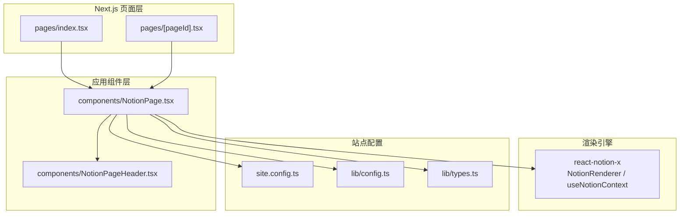
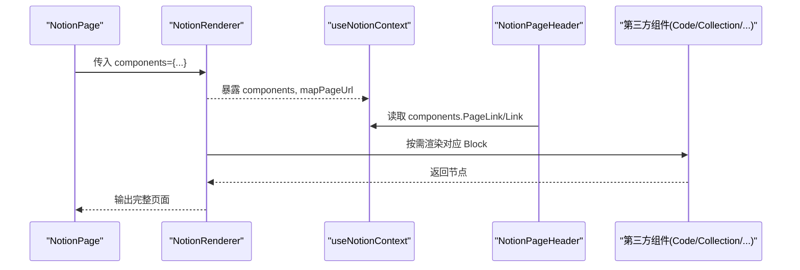
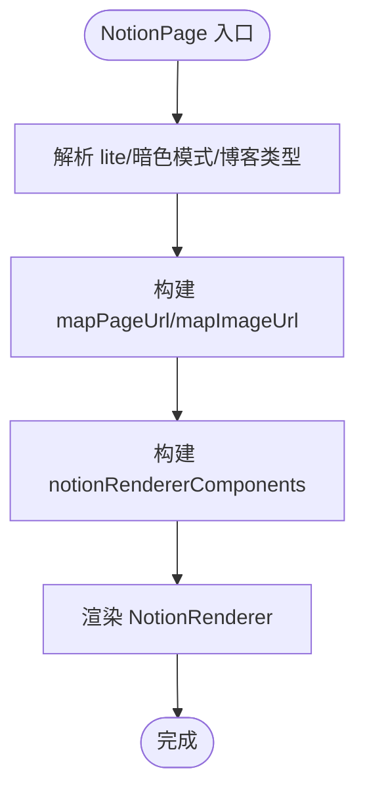
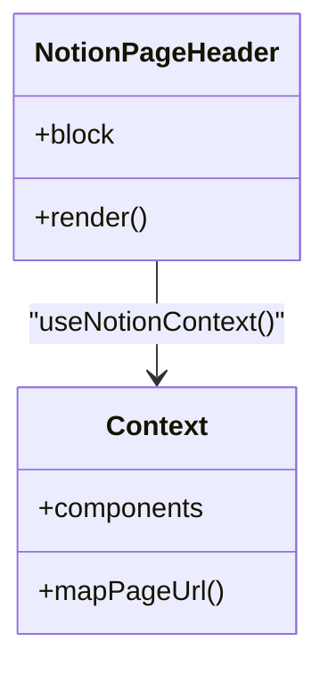
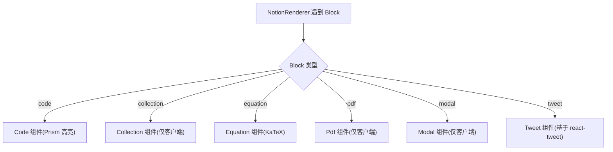
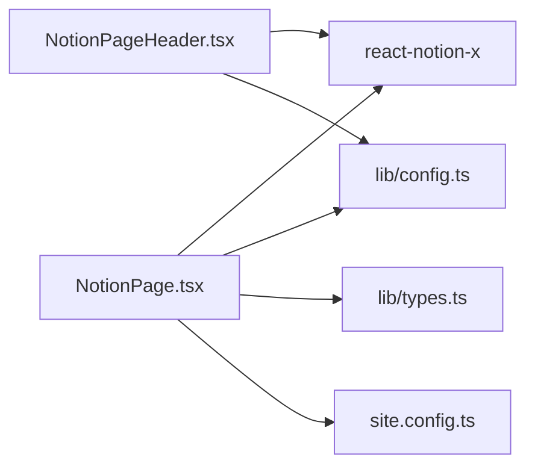

# 组件组合模式

<cite>
**本文引用的文件**   
- [components/NotionPage.tsx](file://components/NotionPage.tsx)
- [components/NotionPageHeader.tsx](file://components/NotionPageHeader.tsx)
- [lib/config.ts](file://lib/config.ts)
- [lib/types.ts](file://lib/types.ts)
- [lib/site-config.ts](file://lib/site-config.ts)
- [site.config.ts](file://site.config.ts)
- [pages/index.tsx](file://pages/index.tsx)
- [pages/[pageId].tsx](file://pages/[pageId].tsx)
</cite>

## 目录
1. [简介](#简介)
2. [项目结构](#项目结构)
3. [核心组件](#核心组件)
4. [架构总览](#架构总览)
5. [详细组件分析](#详细组件分析)
6. [依赖关系分析](#依赖关系分析)
7. [性能与渲染特性](#性能与渲染特性)
8. [扩展与替换指南](#扩展与替换指南)
9. [常见问题排查](#常见问题排查)
10. [结论](#结论)

## 简介
本文围绕 NotionPage 组件的组合模式与架构设计展开，重点说明如何通过 components 对象注册自定义组件，包括 Header、Code、Collection、Equation、Pdf、Modal、Tweet 等组件的集成方式。文档将解释组件层次结构、数据流向、状态管理、默认组件的扩展与替换策略，以及组件间的通信机制，并给出最佳实践建议。

## 项目结构
本项目采用 Next.js + react-notion-x 的技术栈，NotionPage 作为页面级容器组件，负责：
- 组装 SEO、主题、布局与侧边栏
- 注入 NotionRenderer 所需的 components 配置
- 根据记录映射 recordMap 渲染 Notion 内容块

图表来源
- [pages/index.tsx:20-22](file://pages/index.tsx#L20-L22)
- [pages/[pageId].tsx:55-57](file://pages/[pageId].tsx#L55-L57)
- [components/NotionPage.tsx:211-355](file://components/NotionPage.tsx#L211-L355)
- [components/NotionPageHeader.tsx:82-132](file://components/NotionPageHeader.tsx#L82-L132)
- [site.config.ts:1-77](file://site.config.ts#L1-L77)
- [lib/config.ts:23-26](file://lib/config.ts#L23-L26)
- [lib/types.ts:69-77](file://lib/types.ts#L69-L77)

章节来源
- [pages/index.tsx:20-22](file://pages/index.tsx#L20-L22)
- [pages/[pageId].tsx:55-57](file://pages/[pageId].tsx#L55-L57)
- [components/NotionPage.tsx:211-355](file://components/NotionPage.tsx#L211-L355)
- [components/NotionPageHeader.tsx:82-132](file://components/NotionPageHeader.tsx#L82-L132)
- [site.config.ts:1-77](file://site.config.ts#L1-L77)
- [lib/config.ts:23-26](file://lib/config.ts#L23-L26)
- [lib/types.ts:69-77](file://lib/types.ts#L69-L77)

## 核心组件
- NotionPage：页面容器，负责上下文装配、SEO、主题切换、NotionRenderer 注入与子组件挂载。
- NotionPageHeader：头部导航与面包屑，使用 useNotionContext 获取 components 与 mapPageUrl，实现可插拔链接渲染。
- NotionRenderer（来自 react-notion-x）：核心渲染器，接收 components、recordMap、mapPageUrl 等配置，按 Notion 数据结构渲染页面。

章节来源
- [components/NotionPage.tsx:211-355](file://components/NotionPage.tsx#L211-L355)
- [components/NotionPageHeader.tsx:82-132](file://components/NotionPageHeader.tsx#L82-L132)

## 架构总览
NotionPage 通过 components 对象向 NotionRenderer 提供“可插拔”的 UI 能力，形成“配置驱动的组合模式”。关键要点：
- 所有第三方或业务组件以键值对形式注入 components，如 Code、Collection、Equation、Pdf、Modal、Tweet、Header。
- 通过 useNotionContext 在子组件中访问 components 与 mapPageUrl，保证路由与链接的统一处理。
- 通过 property*Value 钩子函数定制属性渲染，例如作者、发布日期、最后编辑时间。

图表来源
- [components/NotionPage.tsx:196-209](file://components/NotionPage.tsx#L196-L209)
- [components/NotionPage.tsx:319-352](file://components/NotionPage.tsx#L319-L352)
- [components/NotionPageHeader.tsx:87-123](file://components/NotionPageHeader.tsx#L87-L123)

## 详细组件分析

### NotionPage 组件
职责与行为：
- 解析 lite 模式、暗色模式、博客文章判断、目录显示策略。
- 计算站点 URL 映射 mapPageUrl，统一图片映射 mapImageUrl。
- 构造 notionRendererComponents 对象，集中注册所有可插拔组件与属性渲染器。
- 渲染 NotionRenderer，并注入 pageAside、footer、searchNotion 等高级选项。

关键点：
- components 注册表包含 nextLegacyImage、nextLink、Code、Collection、Equation、Pdf、Modal、Tweet、Header 及多个 property*Value 钩子。
- 通过 dynamic 动态导入重型模块，避免首屏体积过大；部分组件禁用 SSR 以避免水合不一致。
- 针对 Tweet 组件，从 useNotionContext 的 recordMap 中读取 tweets 数据，并提供 Suspense fallback。

图表来源
- [components/NotionPage.tsx:211-355](file://components/NotionPage.tsx#L211-L355)

章节来源
- [components/NotionPage.tsx:196-209](file://components/NotionPage.tsx#L196-L209)
- [components/NotionPage.tsx:211-355](file://components/NotionPage.tsx#L211-L355)

### NotionPageHeader 组件
职责与行为：
- 使用 Breadcrumbs 展示面包屑导航。
- 通过 useNotionContext 获取 components 与 mapPageUrl，渲染 navigationLinks。
- 支持主题切换按钮与搜索弹窗开关。

关键点：
- 通过 components.PageLink 与 components.Link 渲染内部页面与外部链接，确保路由策略一致。
- 与 NotionPage 的 components 注册表解耦，体现组合模式的“消费方”视角。

图表来源
- [components/NotionPageHeader.tsx:82-132](file://components/NotionPageHeader.tsx#L82-L132)

章节来源
- [components/NotionPageHeader.tsx:82-132](file://components/NotionPageHeader.tsx#L82-L132)

### 第三方组件集成
- Code：动态导入 react-notion-x/third-party/code，并在加载时按需引入多种 Prism 语法高亮语言。
- Collection：动态导入 react-notion-x/third-party/collection，禁用 SSR 以避免客户端与服务端水合不一致。
- Equation：动态导入 react-notion-x/third-party/equation。
- Pdf：动态导入 react-notion-x/third-party/pdf，禁用 SSR。
- Modal：动态导入 react-notion-x/third-party/modal，初始化 Modal.setAppElement 为 .notion-viewport，禁用 SSR。
- Tweet：本地封装，从 useNotionContext.recordMap.tweets 中取数据，使用 react-tweet 的 EmbeddedTweet/TweetNotFound/TweetSkeleton。

图表来源
- [components/NotionPage.tsx:43-142](file://components/NotionPage.tsx#L43-L142)
- [components/NotionPage.tsx:144-153](file://components/NotionPage.tsx#L144-L153)

章节来源
- [components/NotionPage.tsx:43-142](file://components/NotionPage.tsx#L43-L142)
- [components/NotionPage.tsx:144-153](file://components/NotionPage.tsx#L144-L153)

### 属性渲染钩子
- propertyLastEditedTimeValue：在页头场景下格式化 last_edited_time。
- propertyDateValue：当属性名为 published 时，格式化 start_date。
- propertyTextValue：当属性名为 author 时，加粗显示。

这些钩子通过 notionRendererComponents 注入，供 NotionRenderer 在渲染页面属性时使用。

章节来源
- [components/NotionPage.tsx:155-194](file://components/NotionPage.tsx#L155-L194)
- [components/NotionPage.tsx:196-209](file://components/NotionPage.tsx#L196-L209)

## 依赖关系分析
- NotionPage 依赖 react-notion-x 的 NotionRenderer 与 useNotionContext。
- NotionPageHeader 依赖 useNotionContext 提供的 components 与 mapPageUrl。
- 站点配置 site.config.ts 提供 rootNotionPageId、domain、name 等基础信息。
- lib/config.ts 提供运行时配置（如 isServer、isDev、isSearchEnabled）。
- lib/types.ts 定义类型约束，如 NotionPageInfo、ExtendedTweetRecordMap 等。

图表来源
- [components/NotionPage.tsx:1-37](file://components/NotionPage.tsx#L1-L37)
- [components/NotionPageHeader.tsx:1-13](file://components/NotionPageHeader.tsx#L1-L13)
- [lib/config.ts:23-26](file://lib/config.ts#L23-L26)
- [lib/types.ts:69-77](file://lib/types.ts#L69-L77)
- [site.config.ts:1-77](file://site.config.ts#L1-L77)

章节来源
- [components/NotionPage.tsx:1-37](file://components/NotionPage.tsx#L1-L37)
- [components/NotionPageHeader.tsx:1-13](file://components/NotionPageHeader.tsx#L1-L13)
- [lib/config.ts:23-26](file://lib/config.ts#L23-L26)
- [lib/types.ts:69-77](file://lib/types.ts#L69-L77)
- [site.config.ts:1-77](file://site.config.ts#L1-L77)

## 性能与渲染特性
- 动态导入：Code、Collection、Equation、Pdf、Modal 均通过 dynamic 延迟加载，减少首屏体积。
- 禁用 SSR：Collection、Pdf、Modal 设置 ssr:false，避免服务端与客户端水合不一致。
- 代码高亮按需加载：在 Code 组件加载后并行加载多种 Prism 语言包，提升渲染效率与灵活性。
- 懒加载 Tweet：使用 React.Suspense 包裹，提供骨架屏与未找到提示。

章节来源
- [components/NotionPage.tsx:43-142](file://components/NotionPage.tsx#L43-L142)
- [components/NotionPage.tsx:144-153](file://components/NotionPage.tsx#L144-L153)

## 扩展与替换指南

### 如何注册自定义组件
- 在 NotionPage 中维护 notionRendererComponents 对象，将自定义组件以键名注入。
- 支持的键名包括但不限于：nextLegacyImage、nextLink、Code、Collection、Equation、Pdf、Modal、Tweet、Header。
- 对于需要全局初始化的组件（如 Modal），可在动态导入回调中进行一次性设置。

示例路径
- [components/NotionPage.tsx:196-209](file://components/NotionPage.tsx#L196-L209)

### 如何替换默认组件
- 覆盖已有键名即可替换默认实现，例如替换 Header 为自定义头部组件。
- 若需保持原有行为，可在自定义组件中调用默认实现或复用 useNotionContext 的能力。

示例路径
- [components/NotionPage.tsx:196-209](file://components/NotionPage.tsx#L196-L209)

### 如何扩展属性渲染
- 新增或覆盖 property*Value 钩子，用于定制特定属性的显示逻辑。
- 注意区分 pageHeader 场景与非 pageHeader 场景，避免影响非头部区域。

示例路径
- [components/NotionPage.tsx:155-194](file://components/NotionPage.tsx#L155-L194)

### 组件间通信机制
- 通过 useNotionContext 共享 components、mapPageUrl、recordMap 等上下文。
- 子组件（如 NotionPageHeader、Tweet）从 context 读取所需数据与工具方法，避免 props 透传。

示例路径
- [components/NotionPageHeader.tsx:87-123](file://components/NotionPageHeader.tsx#L87-L123)
- [components/NotionPage.tsx:144-153](file://components/NotionPage.tsx#L144-L153)

### 最佳实践与设计模式
- 组合优于继承：通过 components 对象注入能力，保持组件低耦合、高内聚。
- 关注点分离：NotionPage 负责装配与配置，具体渲染由 NotionRenderer 与第三方组件承担。
- 渐进增强：优先保证 SSR 正确性，再在客户端启用交互能力（如 Collection、Pdf、Modal）。
- 可观测性：在开发环境将 pageId、recordMap、block 挂到 window，便于调试。

章节来源
- [components/NotionPage.tsx:265-271](file://components/NotionPage.tsx#L265-L271)

## 常见问题排查
- 水合不一致：Collection、Pdf、Modal 等组件禁用 SSR，避免服务端与客户端差异。
- 链接跳转异常：确保使用 components.PageLink/Link 与 mapPageUrl，不要直接拼接 URL。
- 主题切换无效：确认 useDarkMode 与 BodyClassName 的使用位置与条件。
- 搜索不可用：检查 config.isSearchEnabled 与 searchNotion 是否传入 NotionRenderer。

章节来源
- [components/NotionPage.tsx:114-142](file://components/NotionPage.tsx#L114-L142)
- [components/NotionPage.tsx:319-352](file://components/NotionPage.tsx#L319-L352)

## 结论
NotionPage 通过 components 对象实现了高度可组合的渲染架构，将 Notion 的内容结构与前端 UI 能力解耦。借助 useNotionContext 的上下文共享机制，各组件可以灵活地消费路由、数据与工具方法。结合动态导入与 SSR 控制，项目在性能与体验之间取得平衡。遵循本文的扩展与替换指南，可以在不侵入核心逻辑的前提下，快速定制与增强页面能力。