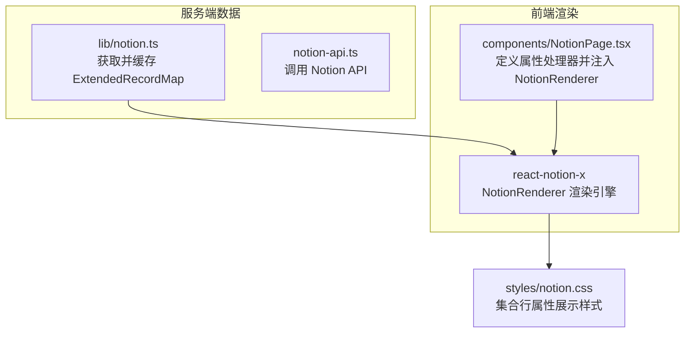
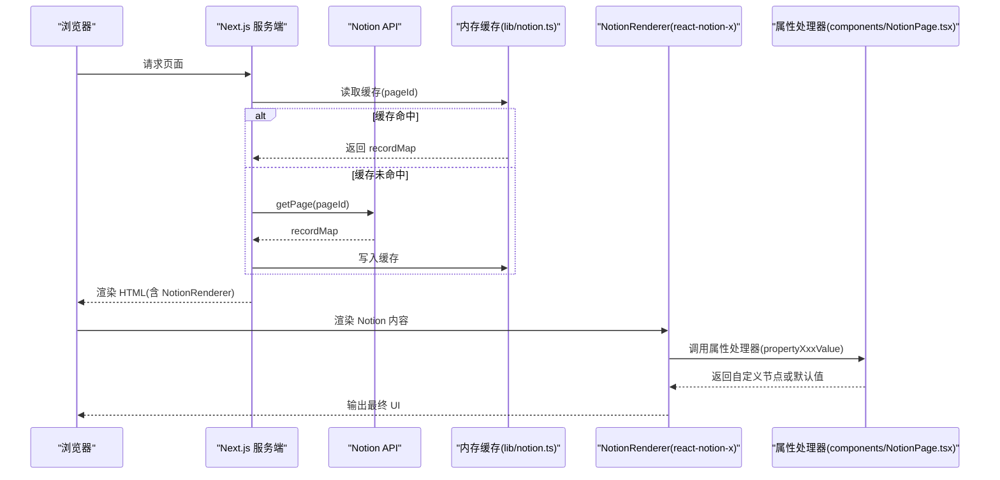
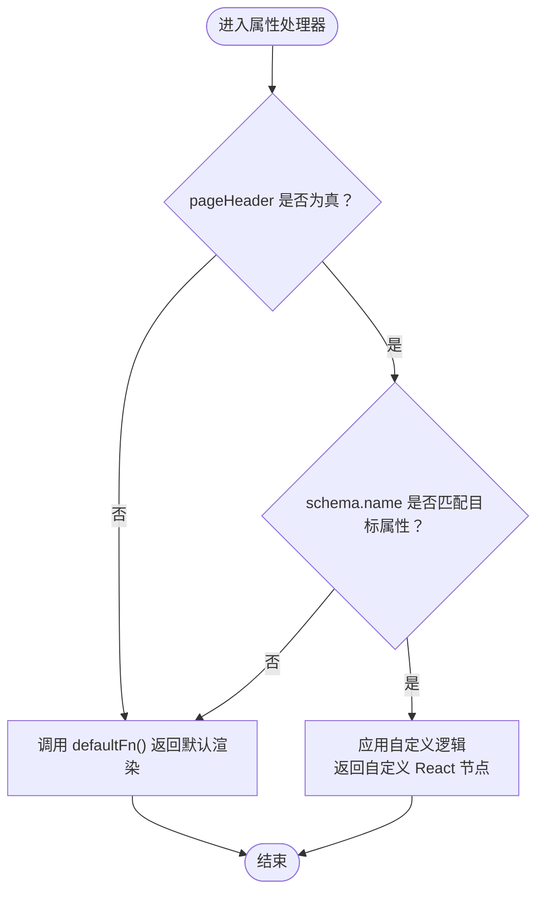
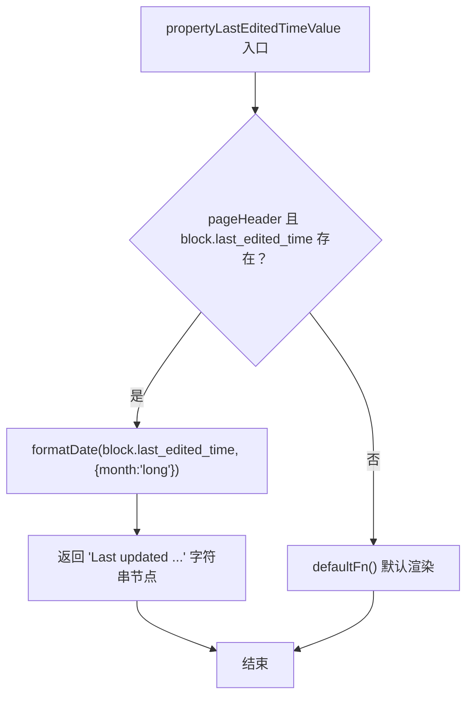
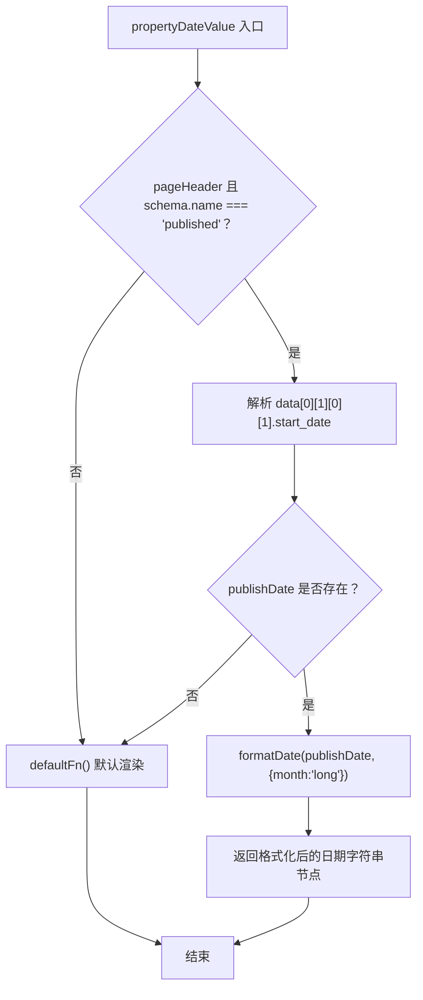
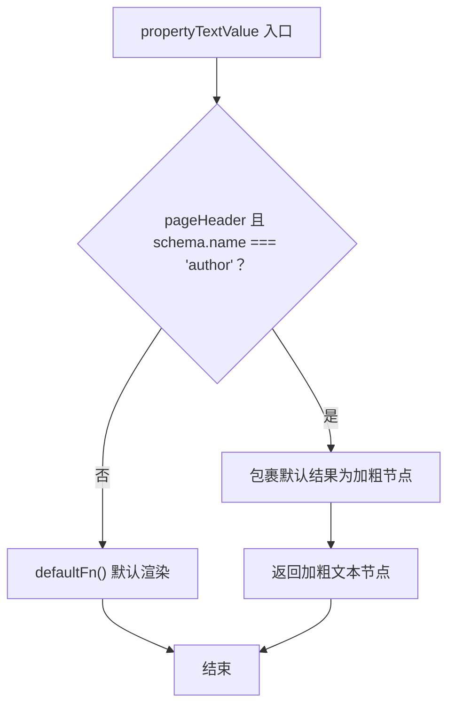
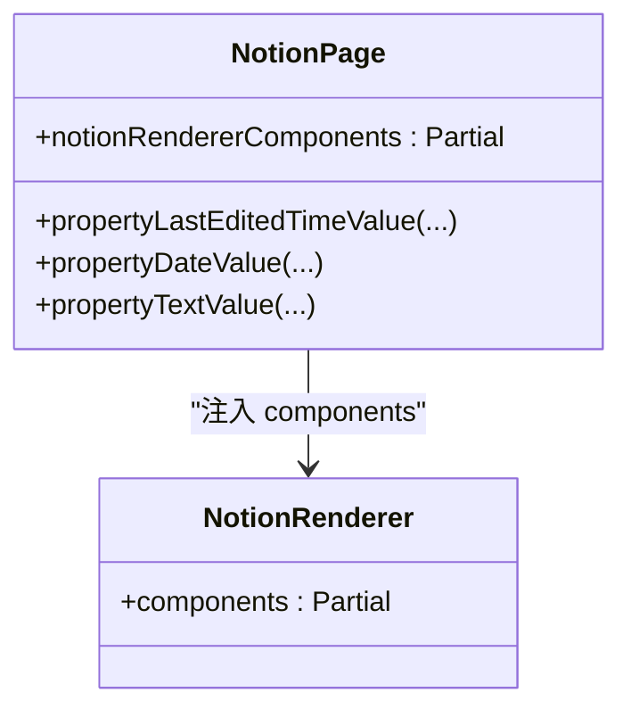
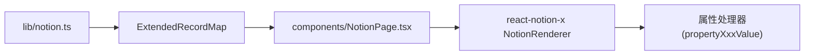
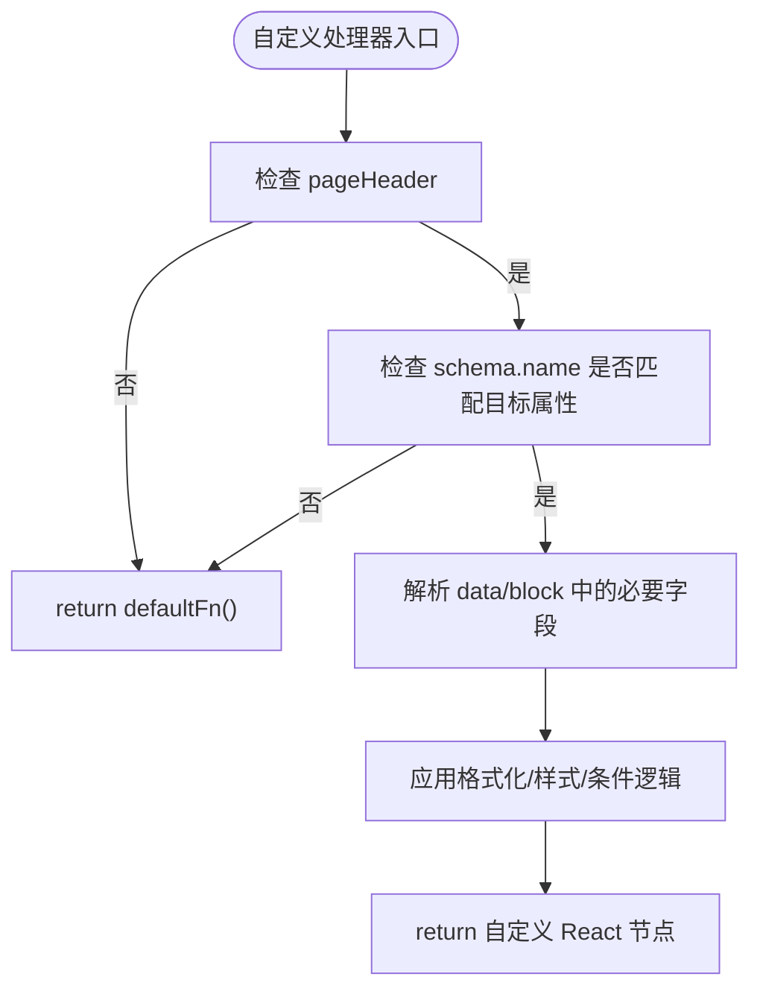

# 自定义属性处理器

<cite>
**本文引用的文件**   
- [components/NotionPage.tsx](file://components/NotionPage.tsx)
- [lib/notion.ts](file://lib/notion.ts)
- [styles/notion.css](file://styles/notion.css)
- [lib/types.ts](file://lib/types.ts)
</cite>

## 目录
1. [引言](#引言)
2. [项目结构](#项目结构)
3. [核心组件](#核心组件)
4. [架构总览](#架构总览)
5. [详细组件分析](#详细组件分析)
6. [依赖关系分析](#依赖关系分析)
7. [性能与渲染特性](#性能与渲染特性)
8. [故障排查指南](#故障排查指南)
9. [结论](#结论)
10. [附录：扩展开发指南](#附录扩展开发指南)

## 引言
本文聚焦于 Notion 页面“属性值”的自定义处理机制，详细说明以下三个内置处理器的实现与作用：
- propertyLastEditedTimeValue：在页面头部显示“最后编辑时间”，并进行本地化日期格式化。
- propertyDateValue：针对特定属性（如 Published）进行日期格式化处理。
- propertyTextValue：对特定文本属性（如 Author）进行样式定制（例如加粗）。

同时，本文提供扩展自定义属性处理器的方法、函数签名约定、参数结构与返回值类型说明，并给出实际使用示例与扩展模式。

## 项目结构
本项目基于 Next.js + react-notion-x 构建，Notion 数据通过服务端拉取后注入到前端渲染器。属性值的渲染由 react-notion-x 的 NotionRenderer 驱动，并通过 components 配置项注入自定义处理器。

图表来源
- [components/NotionPage.tsx:196-209](file://components/NotionPage.tsx#L196-L209)
- [lib/notion.ts:161-214](file://lib/notion.ts#L161-L214)
- [styles/notion.css:479-528](file://styles/notion.css#L479-L528)

章节来源
- [components/NotionPage.tsx:196-209](file://components/NotionPage.tsx#L196-L209)
- [lib/notion.ts:161-214](file://lib/notion.ts#L161-L214)

## 核心组件
- 属性处理器定义与注册：
  - 在 components/NotionPage.tsx 中定义了三个属性处理器，并将它们注入到 notionRendererComponents 对象中，最终传递给 NotionRenderer。
- 数据源：
  - lib/notion.ts 负责从 Notion API 获取 ExtendedRecordMap，并在服务端进行缓存与集合查询修正，确保前端渲染时具备正确的排序与过滤结果。
- 样式支持：
  - styles/notion.css 中对集合行属性进行了布局与顺序调整，保证 Description、Tags、Author、Published 等属性的展示顺序与可读性。

章节来源
- [components/NotionPage.tsx:155-209](file://components/NotionPage.tsx#L155-L209)
- [lib/notion.ts:161-214](file://lib/notion.ts#L161-L214)
- [styles/notion.css:479-528](file://styles/notion.css#L479-L528)

## 架构总览
下图展示了 Notion 页面属性从数据获取到前端渲染的关键流程，以及自定义处理器如何介入属性值渲染。

图表来源
- [lib/notion.ts:161-214](file://lib/notion.ts#L161-L214)
- [components/NotionPage.tsx:196-209](file://components/NotionPage.tsx#L196-L209)

## 详细组件分析

### 属性处理器概览
- 作用范围：仅当 pageHeader 为真时生效，用于页面头部属性展示场景。
- 通用模式：
  - 根据 schema.name 判断具体属性名（不区分大小写）。
  - 若匹配目标属性，则返回自定义 React 节点；否则回退到 defaultFn() 的默认渲染逻辑。
  - 使用 notion-utils 的 formatDate 进行本地化日期格式化。

图表来源
- [components/NotionPage.tsx:155-194](file://components/NotionPage.tsx#L155-L194)

#### propertyLastEditedTimeValue
- 功能：在页面头部显示“最后更新时间”，并以本地化月份格式呈现。
- 触发条件：
  - pageHeader 为真。
  - block.last_edited_time 存在。
- 行为：
  - 若满足条件，返回包含格式化日期的字符串节点。
  - 否则回退到默认渲染。

图表来源
- [components/NotionPage.tsx:155-166](file://components/NotionPage.tsx#L155-L166)

章节来源
- [components/NotionPage.tsx:155-166](file://components/NotionPage.tsx#L155-L166)

#### propertyDateValue
- 功能：针对名为 “Published” 的属性进行日期格式化。
- 触发条件：
  - pageHeader 为真。
  - schema.name 小写后等于 “published”。
- 行为：
  - 从 data 结构中解析 start_date。
  - 若存在，则使用 formatDate 以本地化月份格式输出。
  - 否则回退到默认渲染。

图表来源
- [components/NotionPage.tsx:168-183](file://components/NotionPage.tsx#L168-L183)

章节来源
- [components/NotionPage.tsx:168-183](file://components/NotionPage.tsx#L168-L183)

#### propertyTextValue
- 功能：对名为 “Author” 的文本属性进行样式定制（加粗）。
- 触发条件：
  - pageHeader 为真。
  - schema.name 小写后等于 “author”。
- 行为：
  - 若满足条件，将默认渲染结果包裹为加粗节点。
  - 否则回退到默认渲染。

图表来源
- [components/NotionPage.tsx:185-194](file://components/NotionPage.tsx#L185-L194)

章节来源
- [components/NotionPage.tsx:185-194](file://components/NotionPage.tsx#L185-L194)

### 处理器注册与注入
- 所有自定义处理器被集中放入 notionRendererComponents 对象，并作为 components 参数传入 NotionRenderer。
- 该对象还包含其他替换组件（如 nextLegacyImage、nextLink、Code、Collection、Equation、Pdf、Modal、Tweet、Header），体现 react-notion-x 的可插拔设计。

图表来源
- [components/NotionPage.tsx:196-209](file://components/NotionPage.tsx#L196-L209)

章节来源
- [components/NotionPage.tsx:196-209](file://components/NotionPage.tsx#L196-L209)

## 依赖关系分析
- 组件耦合：
  - components/NotionPage.tsx 依赖 notion-utils 的 formatDate、getBlockTitle、getBlockValue、getPageProperty。
  - 依赖 react-notion-x 的 NotionRenderer、useNotionContext、NotionComponents 类型。
  - 依赖 lib/config、lib/map-image-url、lib/map-page-url、lib/search-notion、lib/use-dark-mode 等站点级工具。
- 数据流：
  - lib/notion.ts 在服务端获取 ExtendedRecordMap，并进行缓存与集合查询修正，确保前端渲染的数据一致性。
  - NotionRenderer 在前端消费 recordMap，并根据 components 配置调用属性处理器。

图表来源
- [lib/notion.ts:161-214](file://lib/notion.ts#L161-L214)
- [components/NotionPage.tsx:196-209](file://components/NotionPage.tsx#L196-L209)

章节来源
- [lib/notion.ts:161-214](file://lib/notion.ts#L161-L214)
- [components/NotionPage.tsx:196-209](file://components/NotionPage.tsx#L196-L209)

## 性能与渲染特性
- 服务端缓存：
  - lib/notion.ts 使用内存缓存（TTL 60 秒）减少 Notion API 压力，并在 Notion 不可用时回退到陈旧缓存，提升可用性。
- 集合查询修正：
  - fixCollectionQueries 重新执行集合查询，确保排序与过滤与 Notion 视图一致，避免前端展示错序或包含被过滤的行。
- 客户端渲染：
  - NotionRenderer 按需动态加载 Code、Collection、Equation、Pdf、Modal 等第三方组件，降低首屏体积。
- 样式优化：
  - styles/notion.css 对集合行属性进行顺序重排与样式微调，提升可读性与一致性。

章节来源
- [lib/notion.ts:29-55](file://lib/notion.ts#L29-L55)
- [lib/notion.ts:95-159](file://lib/notion.ts#L95-L159)
- [components/NotionPage.tsx:43-142](file://components/NotionPage.tsx#L43-L142)
- [styles/notion.css:479-528](file://styles/notion.css#L479-L528)

## 故障排查指南
- 属性未生效：
  - 检查 pageHeader 是否为真；仅在页面头部场景中生效。
  - 确认 schema.name 是否与目标属性名一致（不区分大小写）。
- 日期显示异常：
  - 确认 data 结构中 start_date 路径是否正确；不同 Notion 版本可能略有差异。
  - 检查 formatDate 的 locale 设置是否符合预期。
- 集合排序/过滤不一致：
  - 查看 fixCollectionQueries 是否成功合并了 collection_query 的结果。
  - 确认 Notion 视图的 query2.sort 与 query2.filter 是否已正确传递。

章节来源
- [components/NotionPage.tsx:155-194](file://components/NotionPage.tsx#L155-L194)
- [lib/notion.ts:95-159](file://lib/notion.ts#L95-L159)

## 结论
本项目通过 react-notion-x 的 NotionRenderer 提供了强大的属性值自定义能力。三个内置处理器分别实现了“最后编辑时间”、“发布日期”和“作者文本”的定制化渲染，遵循统一的 pageHeader 与 schema.name 判定模式，并通过 defaultFn 保持向后兼容。结合服务端的缓存与集合查询修正，整体渲染性能与一致性得到保障。

## 附录：扩展开发指南

### 自定义属性处理器开发要点
- 函数签名约定：
  - 第一个参数：包含上下文信息的对象，常见字段包括：
    - pageHeader：布尔值，表示当前是否在页面头部渲染。
    - schema：属性元信息，包含 name 等字段。
    - data：属性原始数据，结构因属性类型而异。
    - block：块级数据，可用于访问 last_edited_time 等字段。
  - 第二个参数：defaultFn，一个无参函数，返回默认渲染结果（React 节点或字符串）。
- 返回值类型：
  - React.ReactNode：可以是字符串、JSX 元素或其他可渲染节点。
- 条件渲染逻辑：
  - 通常先判断 pageHeader 是否为真。
  - 再根据 schema.name 匹配目标属性（建议统一转为小写比较）。
  - 若匹配，返回自定义节点；否则调用 defaultFn() 回退。

图表来源
- [components/NotionPage.tsx:155-194](file://components/NotionPage.tsx#L155-L194)

### 注册与注入
- 将自定义处理器添加到 notionRendererComponents 对象中，并作为 components 参数传给 NotionRenderer。
- 可同时替换其他组件（如 Header、Code、Collection 等），实现更全面的渲染定制。

章节来源
- [components/NotionPage.tsx:196-209](file://components/NotionPage.tsx#L196-L209)

### 实际使用示例与扩展模式
- 日期格式化扩展：
  - 参考 propertyDateValue，针对新的日期属性（如 Due Date）添加格式化逻辑。
  - 使用 notion-utils 的 formatDate 进行本地化输出。
- 文本样式定制：
  - 参考 propertyTextValue，为特定文本属性（如 Role、Status）添加颜色、图标或标签样式。
- 条件渲染：
  - 根据 schema.name 与 data 中的状态字段，动态决定渲染分支（例如：已发布/草稿）。
- 组合处理器：
  - 在同一页面中注册多个处理器，分别处理不同属性，互不干扰。

章节来源
- [components/NotionPage.tsx:155-209](file://components/NotionPage.tsx#L155-L209)