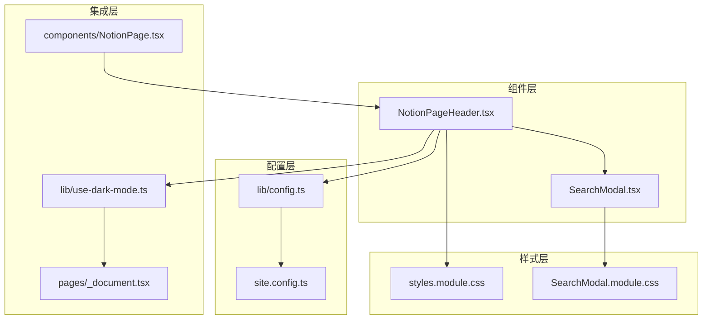
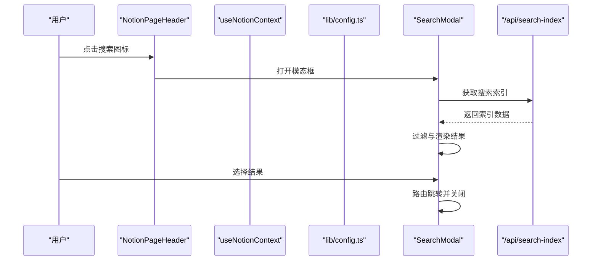
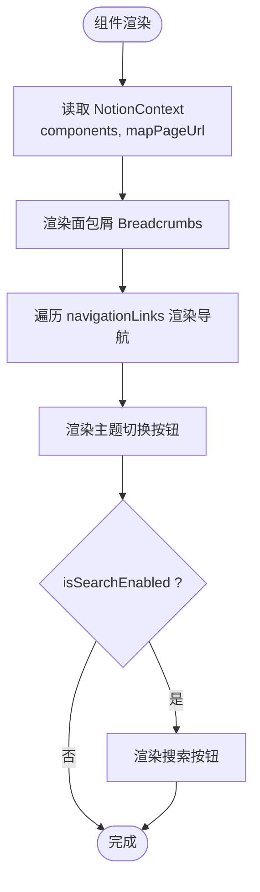
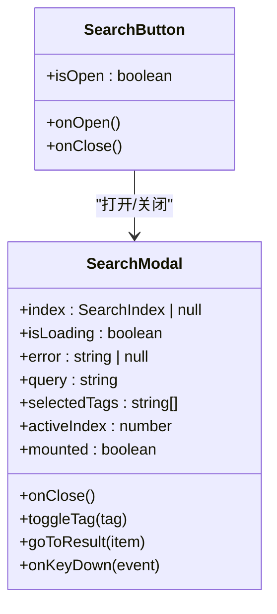
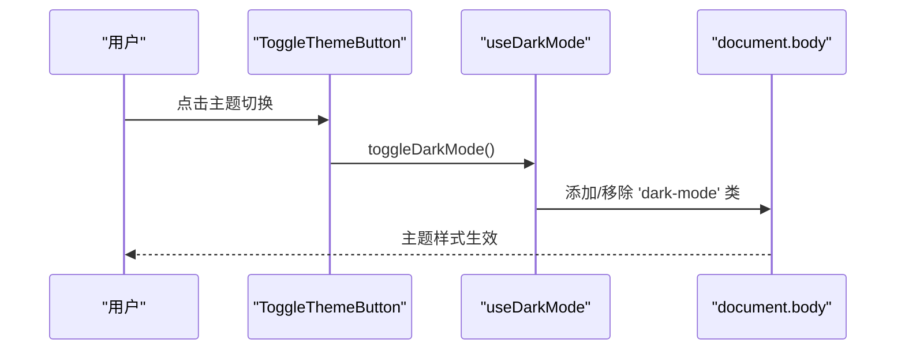
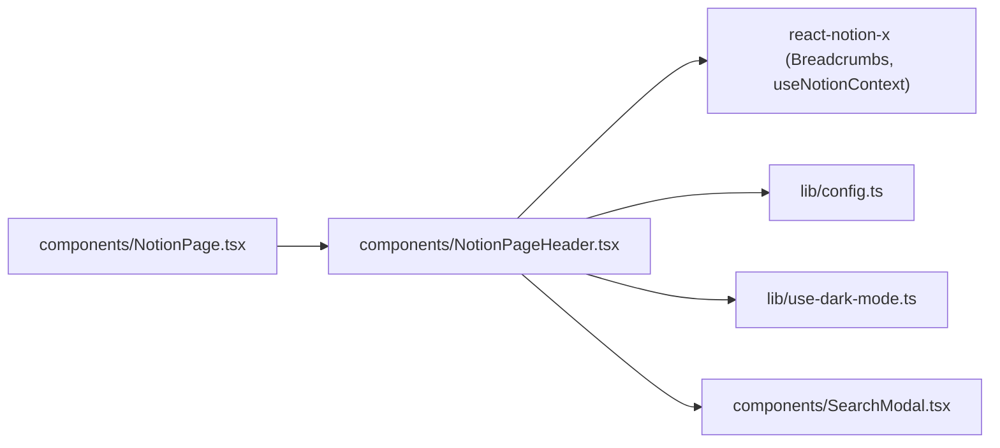
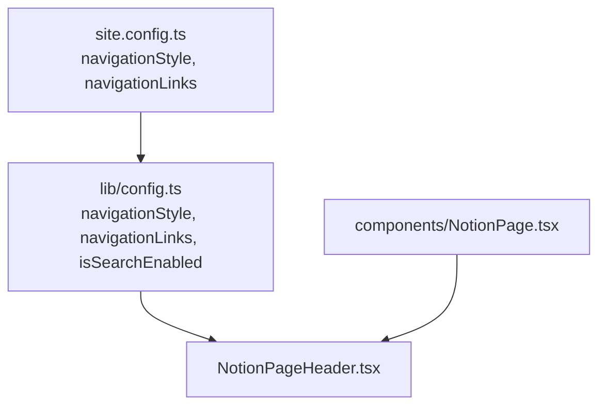

# NotionPageHeader 页面头部

<cite>
**本文引用的文件**   
- [components/NotionPageHeader.tsx](file://components/NotionPageHeader.tsx)
- [components/SearchModal.tsx](file://components/SearchModal.tsx)
- [components/SearchModal.module.css](file://components/SearchModal.module.css)
- [components/styles.module.css](file://components/styles.module.css)
- [components/NotionPage.tsx](file://components/NotionPage.tsx)
- [lib/config.ts](file://lib/config.ts)
- [site.config.ts](file://site.config.ts)
- [lib/use-dark-mode.ts](file://lib/use-dark-mode.ts)
- [pages/_document.tsx](file://pages/_document.tsx)
</cite>

## 目录
1. [简介](#简介)
2. [项目结构](#项目结构)
3. [核心组件](#核心组件)
4. [架构总览](#架构总览)
5. [详细组件分析](#详细组件分析)
6. [依赖关系分析](#依赖关系分析)
7. [性能与可访问性](#性能与可访问性)
8. [样式定制与响应式适配](#样式定制与响应式适配)
9. [配置项与集成方式](#配置项与集成方式)
10. [常见问题排查](#常见问题排查)
11. [结论](#结论)

## 简介
NotionPageHeader 是站点页面头部的核心组件，负责渲染面包屑导航、自定义导航链接、主题切换按钮以及搜索入口。它与 NotionRenderer 的 Header 插槽集成，配合 SearchModal 提供站内检索能力，并通过 useDarkMode 实现明暗主题切换。该组件同时关注可访问性与移动端体验，通过语义化标签、键盘交互和模态框无障碍属性提升可用性。

## 项目结构
NotionPageHeader 位于 components 目录，与 SearchModal、样式模块及站点配置协同工作：
- 组件层：NotionPageHeader.tsx、SearchModal.tsx
- 样式层：styles.module.css、SearchModal.module.css
- 配置层：lib/config.ts、site.config.ts
- 运行时集成：components/NotionPage.tsx（注入 Header 插槽）
- 主题系统：lib/use-dark-mode.ts、pages/_document.tsx（首屏无闪烁策略）

图表来源
- [components/NotionPageHeader.tsx:82-132](file://components/NotionPageHeader.tsx#L82-L132)
- [components/SearchModal.tsx:57-253](file://components/SearchModal.tsx#L57-L253)
- [components/NotionPage.tsx:196-209](file://components/NotionPage.tsx#L196-L209)
- [lib/config.ts:80-91](file://lib/config.ts#L80-L91)
- [site.config.ts:62-76](file://site.config.ts#L62-L76)
- [lib/use-dark-mode.ts:1-10](file://lib/use-dark-mode.ts#L1-L10)
- [pages/_document.tsx:52-92](file://pages/_document.tsx#L52-L92)

章节来源
- [components/NotionPageHeader.tsx:1-133](file://components/NotionPageHeader.tsx#L1-L133)
- [components/NotionPage.tsx:196-209](file://components/NotionPage.tsx#L196-L209)

## 核心组件
- NotionPageHeader：渲染页面头部区域，包含面包屑、导航链接、主题切换与搜索入口。
- SearchButton：封装搜索入口按钮，控制 SearchModal 的打开与关闭，并提供键盘与无障碍支持。
- ToggleThemeButton：基于 useDarkMode 切换明暗主题，避免服务端渲染闪烁。
- SearchModal：全屏搜索模态框，加载本地索引、过滤结果、键盘导航与标签筛选。

章节来源
- [components/NotionPageHeader.tsx:15-80](file://components/NotionPageHeader.tsx#L15-L80)
- [components/SearchModal.tsx:57-253](file://components/SearchModal.tsx#L57-L253)

## 架构总览
NotionPageHeader 作为 NotionRenderer 的 Header 插槽被注入到页面中，读取 NotionContext 提供的 components 与 mapPageUrl，结合站点配置的 navigationLinks 渲染导航。搜索功能通过 isSearchEnabled 开关控制，点击后打开 SearchModal，后者从 API 拉取 search-index 并展示结果。主题切换通过 useDarkMode 管理状态，并在 body 上添加 dark-mode 类名以驱动全局样式。

图表来源
- [components/NotionPageHeader.tsx:37-80](file://components/NotionPageHeader.tsx#L37-L80)
- [components/SearchModal.tsx:80-106](file://components/SearchModal.tsx#L80-L106)
- [components/SearchModal.tsx:123-147](file://components/SearchModal.tsx#L123-L147)
- [lib/config.ts:145-150](file://lib/config.ts#L145-L150)

## 详细组件分析

### NotionPageHeader 组件
- 布局结构
  - 外层 header.notion-header 包裹整个头部。
  - 内部 notion-nav-header 分为左侧 Breadcrumbs 与右侧 notion-nav-header-rhs。
  - 右侧区域包含：
    - 导航链接列表：根据 navigationLinks 配置渲染 PageLink 或 Link。
    - 主题切换按钮：ToggleThemeButton。
    - 搜索按钮：SearchButton（受 isSearchEnabled 控制）。
- 数据来源
  - useNotionContext 提供 components 与 mapPageUrl，用于统一路由与链接渲染。
  - navigationLinks 来自 lib/config.ts，由 site.config.ts 定义。
- 交互逻辑
  - 主题切换：调用 toggleDarkMode，避免 SSR 闪烁。
  - 搜索入口：打开 SearchModal，支持键盘 Enter/Space 触发。
- 可访问性
  - 搜索按钮设置 role='button'、tabIndex={0}、aria-label 与 title。
  - 搜索 SVG 使用 aria-hidden='true' 避免重复朗读。

图表来源
- [components/NotionPageHeader.tsx:82-132](file://components/NotionPageHeader.tsx#L82-L132)
- [lib/config.ts:80-91](file://lib/config.ts#L80-L91)

章节来源
- [components/NotionPageHeader.tsx:82-132](file://components/NotionPageHeader.tsx#L82-L132)
- [lib/config.ts:80-91](file://lib/config.ts#L80-L91)

### SearchButton 与 SearchModal
- SearchButton
  - 控制 isOpen 状态，打开时渲染 SearchModal。
  - 支持键盘 Enter/Space 触发打开，具备 aria-label 与 tabIndex。
- SearchModal
  - 首次挂载时通过 createPortal 渲染至 document.body，避免层级问题。
  - 自动聚焦输入框，便于键盘操作。
  - 异步加载 /api/search-index，处理 loading/error 状态。
  - 支持标签筛选（AND 语义）、关键词过滤、键盘上下导航与回车跳转。
  - 模态框具备 role='dialog'、aria-modal='true'、aria-label 等无障碍属性。

图表来源
- [components/NotionPageHeader.tsx:37-80](file://components/NotionPageHeader.tsx#L37-L80)
- [components/SearchModal.tsx:57-253](file://components/SearchModal.tsx#L57-L253)

章节来源
- [components/NotionPageHeader.tsx:37-80](file://components/NotionPageHeader.tsx#L37-L80)
- [components/SearchModal.tsx:57-253](file://components/SearchModal.tsx#L57-L253)

### 主题切换与深色模式
- ToggleThemeButton 使用 useDarkMode 暴露 isDarkMode 与 toggleDarkMode。
- useDarkMode 基于 @fisch0920/use-dark-mode，在 body 上添加/移除 'dark-mode' 类。
- pages/_document.tsx 内联脚本在首屏即应用主题，避免闪烁。

图表来源
- [components/NotionPageHeader.tsx:15-35](file://components/NotionPageHeader.tsx#L15-L35)
- [lib/use-dark-mode.ts:1-10](file://lib/use-dark-mode.ts#L1-L10)
- [pages/_document.tsx:52-92](file://pages/_document.tsx#L52-L92)

章节来源
- [components/NotionPageHeader.tsx:15-35](file://components/NotionPageHeader.tsx#L15-L35)
- [lib/use-dark-mode.ts:1-10](file://lib/use-dark-mode.ts#L1-L10)
- [pages/_document.tsx:52-92](file://pages/_document.tsx#L52-L92)

## 依赖关系分析
- NotionPageHeader 依赖：
  - react-notion-x 的 Breadcrumbs 与 useNotionContext。
  - 站点配置 navigationLinks、isSearchEnabled。
  - 主题 hook useDarkMode。
  - 搜索组件 SearchModal。
- NotionPage 将 NotionPageHeader 注入为 Header 插槽，从而让每个页面都拥有统一的头部。

图表来源
- [components/NotionPage.tsx:196-209](file://components/NotionPage.tsx#L196-L209)
- [components/NotionPageHeader.tsx:1-14](file://components/NotionPageHeader.tsx#L1-L14)
- [lib/config.ts:80-91](file://lib/config.ts#L80-L91)
- [lib/use-dark-mode.ts:1-10](file://lib/use-dark-mode.ts#L1-L10)
- [components/SearchModal.tsx:1-9](file://components/SearchModal.tsx#L1-L9)

章节来源
- [components/NotionPage.tsx:196-209](file://components/NotionPage.tsx#L196-L209)
- [components/NotionPageHeader.tsx:1-14](file://components/NotionPageHeader.tsx#L1-L14)

## 性能与可访问性
- 性能
  - SearchModal 仅在打开时加载索引，避免首屏开销。
  - 使用 useMemo 缓存搜索结果，减少重算。
  - 使用 createPortal 渲染模态框，避免 DOM 层级导致的重绘问题。
- 可访问性
  - 搜索按钮具备 role、tabIndex、aria-label、title。
  - 搜索模态框具备 role='dialog'、aria-modal、aria-label。
  - 输入框与标签按钮具备合适的语义与键盘事件处理。
  - 主题切换按钮在 SSR 阶段隐藏以避免闪烁，客户端再显示。

章节来源
- [components/SearchModal.tsx:68-78](file://components/SearchModal.tsx#L68-L78)
- [components/SearchModal.tsx:108-115](file://components/SearchModal.tsx#L108-L115)
- [components/SearchModal.tsx:153-160](file://components/SearchModal.tsx#L153-L160)
- [components/NotionPageHeader.tsx:15-35](file://components/NotionPageHeader.tsx#L15-L35)
- [components/NotionPageHeader.tsx:45-75](file://components/NotionPageHeader.tsx#L45-L75)

## 样式定制与响应式适配
- 头部样式
  - 使用 notion-header、notion-nav-header、notion-nav-header-rhs 等类名组织布局。
  - 导航链接复用 breadcrumb、button 通用样式，并通过 styles.navLink 进行局部定制。
  - 隐藏初始渲染的主题按钮，避免 SSR 闪烁（styles.hidden）。
- 搜索模态框样式
  - overlay/modal/searchHeader/input/closeButton/tagsSection/tagList/tag/resultItem/resultTitle/resultDescription/resultTags/status 等类名提供完整 UI 风格。
  - 使用 CSS 变量 --bg-color、--fg-color、--fg-color-0 等适配明暗主题。
- 响应式适配
  - 搜索模态框在移动端通过 padding、max-width、overflow-y 自适应。
  - 其他样式如 footer 在小屏幕下采用纵向排列（styles.module.css 中的媒体查询），可作为参考扩展头部布局。

章节来源
- [components/NotionPageHeader.tsx:27-35](file://components/NotionPageHeader.tsx#L27-L35)
- [components/NotionPageHeader.tsx:90-130](file://components/NotionPageHeader.tsx#L90-L130)
- [components/SearchModal.module.css:1-182](file://components/SearchModal.module.css#L1-L182)
- [components/styles.module.css:132-150](file://components/styles.module.css#L132-L150)

## 配置项与集成方式
- 导航链接
  - 在 site.config.ts 中启用 custom 导航样式并配置 navigationLinks，每项可包含 pageId 或 url。
  - lib/config.ts 导出 navigationStyle 与 navigationLinks，供 NotionPageHeader 使用。
- 搜索开关
  - isSearchEnabled 默认开启，可在 site.config.ts 中关闭以隐藏搜索入口。
- 集成方式
  - components/NotionPage.tsx 将 NotionPageHeader 注入为 Header 插槽，所有页面自动继承。
  - 如需替换 Header，修改 notionRendererComponents.Header 即可。

图表来源
- [site.config.ts:62-76](file://site.config.ts#L62-L76)
- [lib/config.ts:80-91](file://lib/config.ts#L80-L91)
- [components/NotionPage.tsx:196-209](file://components/NotionPage.tsx#L196-L209)
- [components/NotionPageHeader.tsx:94-127](file://components/NotionPageHeader.tsx#L94-L127)

章节来源
- [site.config.ts:62-76](file://site.config.ts#L62-L76)
- [lib/config.ts:80-91](file://lib/config.ts#L80-L91)
- [components/NotionPage.tsx:196-209](file://components/NotionPage.tsx#L196-L209)
- [components/NotionPageHeader.tsx:94-127](file://components/NotionPageHeader.tsx#L94-L127)

## 常见问题排查
- 搜索入口不显示
  - 检查 isSearchEnabled 是否为 true；若为 false，SearchButton 不会渲染。
  - 确认 /api/search-index 接口可用且返回有效索引数据。
- 主题切换无效
  - 确认 useDarkMode 已正确引入，body 是否添加了 dark-mode 类。
  - 检查 _document.tsx 的首屏脚本是否正确执行。
- 导航链接无法跳转
  - 检查 navigationLinks 配置是否包含有效的 pageId 或 url。
  - 确认 mapPageUrl 能生成正确的 URL。
- 搜索模态框不可用
  - 确认 mounted 状态为 true，createPortal 已渲染至 document.body。
  - 检查键盘事件 onKeyDown 是否正确绑定。

章节来源
- [components/NotionPageHeader.tsx:125-127](file://components/NotionPageHeader.tsx#L125-L127)
- [components/SearchModal.tsx:68-78](file://components/SearchModal.tsx#L68-L78)
- [components/SearchModal.tsx:80-106](file://components/SearchModal.tsx#L80-L106)
- [lib/config.ts:91](file://lib/config.ts#L91)
- [lib/config.ts:145-150](file://lib/config.ts#L145-L150)

## 结论
NotionPageHeader 提供了简洁而强大的页面头部能力：面包屑导航、可配置的导航链接、主题切换与站内搜索。它通过 NotionRenderer 的 Header 插槽无缝集成，借助 useDarkMode 与 _document.tsx 的首屏脚本确保主题一致性，并通过 SearchModal 提供完整的搜索体验。组件注重可访问性与性能优化，适合在各类 Notion 驱动的站点中复用与扩展。