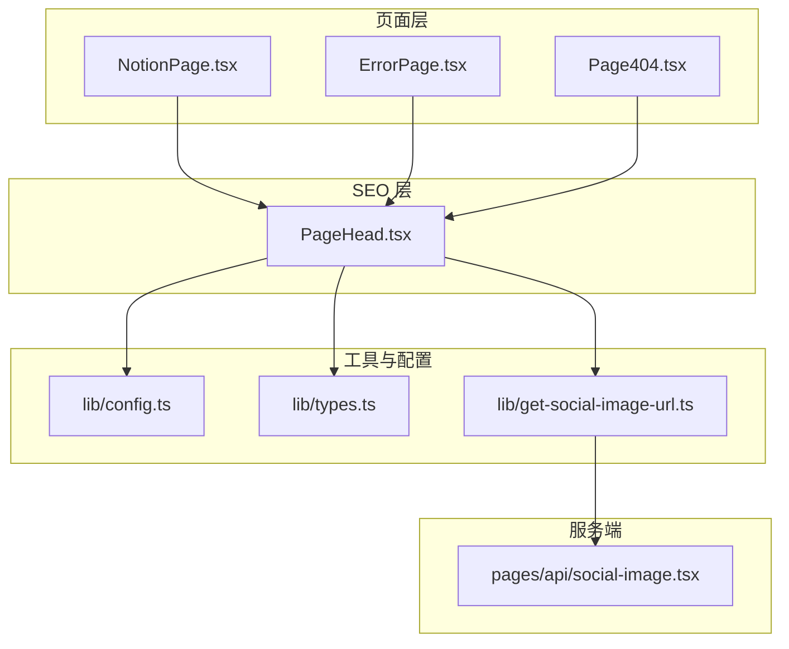
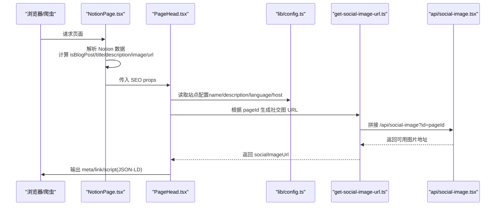
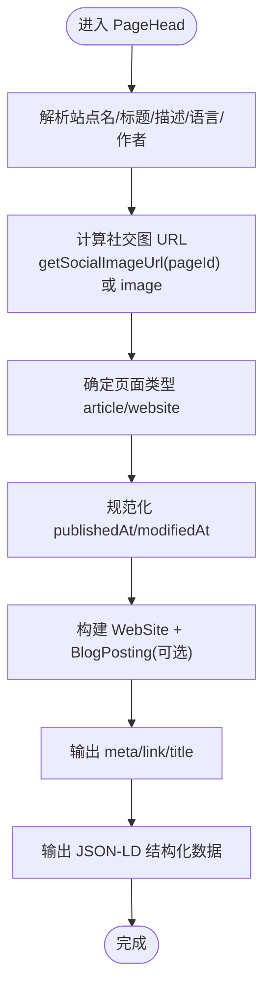
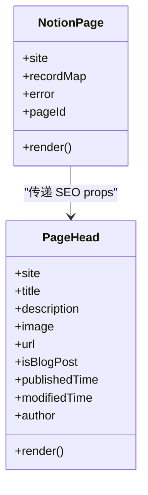
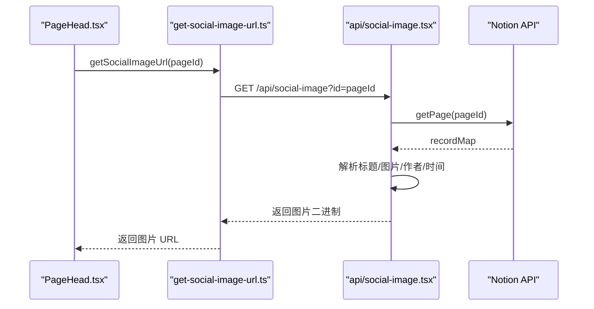
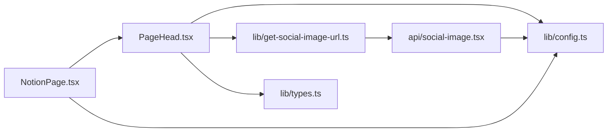

# PageHead SEO 组件

<cite>
**本文引用的文件**   
- [components/PageHead.tsx](file://components/PageHead.tsx)
- [components/NotionPage.tsx](file://components/NotionPage.tsx)
- [lib/get-social-image-url.ts](file://lib/get-social-image-url.ts)
- [pages/api/social-image.tsx](file://pages/api/social-image.tsx)
- [lib/config.ts](file://lib/config.ts)
- [lib/types.ts](file://lib/types.ts)
- [site.config.ts](file://site.config.ts)
- [components/ErrorPage.tsx](file://components/ErrorPage.tsx)
- [components/Page404.tsx](file://components/Page404.tsx)
</cite>

## 目录
1. [简介](#简介)
2. [项目结构](#项目结构)
3. [核心组件](#核心组件)
4. [架构总览](#架构总览)
5. [详细组件分析](#详细组件分析)
6. [依赖关系分析](#依赖关系分析)
7. [性能与可维护性](#性能与可维护性)
8. [SEO 最佳实践](#seo-最佳实践)
9. [故障排查](#故障排查)
10. [结论](#结论)

## 简介
PageHead 是一个专注于 SEO 的头部元数据组件，负责为页面注入标题、描述、Open Graph 标签、Twitter Card、结构化数据（JSON-LD）、canonical URL、RSS 订阅链接以及搜索引擎爬虫指令。它与 Notion 内容模型和站点配置联动，支持动态标题生成、社交媒体图片自动生成、文章类型判断与时间字段标准化，从而在不同页面类型下提供一致的 SEO 体验。

## 项目结构
围绕 PageHead 的关键文件与职责如下：
- components/PageHead.tsx：渲染所有 SEO 相关的 meta、link 与 JSON-LD。
- components/NotionPage.tsx：从 Notion 数据中抽取标题、描述、作者、发布时间等，并调用 PageHead。
- lib/get-social-image-url.ts：根据 pageId 生成社交分享图 API 地址。
- pages/api/social-image.tsx：Edge 函数，基于 Notion 页面信息动态生成社交分享图。
- lib/config.ts：站点级配置（域名、语言、默认值、API 地址等）。
- lib/types.ts：类型定义（Site、PageProps、NotionPageInfo 等）。
- site.config.ts：站点基础配置（名称、域名、作者、描述、验证信息等）。
- components/ErrorPage.tsx、components/Page404.tsx：错误页使用 PageHead 统一 SEO。

图表来源
- [components/PageHead.tsx:1-187](file://components/PageHead.tsx#L1-L187)
- [components/NotionPage.tsx:301-314](file://components/NotionPage.tsx#L301-L314)
- [lib/get-social-image-url.ts:1-17](file://lib/get-social-image-url.ts#L1-L17)
- [pages/api/social-image.tsx:1-313](file://pages/api/social-image.tsx#L1-L313)
- [lib/config.ts:145-150](file://lib/config.ts#L145-L150)

章节来源
- [components/PageHead.tsx:1-187](file://components/PageHead.tsx#L1-L187)
- [components/NotionPage.tsx:211-356](file://components/NotionPage.tsx#L211-L356)
- [lib/get-social-image-url.ts:1-17](file://lib/get-social-image-url.ts#L1-L17)
- [pages/api/social-image.tsx:1-313](file://pages/api/social-image.tsx#L1-L313)
- [lib/config.ts:1-221](file://lib/config.ts#L1-L221)
- [lib/types.ts:1-78](file://lib/types.ts#L1-L78)
- [site.config.ts:1-77](file://site.config.ts#L1-L77)

## 核心组件
PageHead 通过 Next.js 的 Head 组件注入以下 SEO 能力：
- 字符集与视口设置、移动端适配、主题色。
- 搜索引擎爬虫指令（robots、googlebot、bingbot）。
- Open Graph 标签（title、description、image、url、type、locale、site_name）。
- Twitter Card 标签（card、title、description、image、url）。
- canonical URL 与 og:url/twitter:url 一致性。
- RSS 订阅链接（alternate）。
- 结构化数据（WebSite、BlogPosting）以 JSON-LD 输出。
- 文章相关属性（published_time、modified_time、author）。

章节来源
- [components/PageHead.tsx:91-184](file://components/PageHead.tsx#L91-L184)

## 架构总览
PageHead 的 SEO 数据来源于三部分：
- 站点配置：站点名、域名、语言、默认描述、作者等。
- 页面传入 props：标题、描述、图片、URL、是否博客文章、发布时间、修改时间、作者。
- 社交分享图 API：根据 pageId 生成图片 URL；若未提供则回退到传入 image。

图表来源
- [components/NotionPage.tsx:263-314](file://components/NotionPage.tsx#L263-L314)
- [components/PageHead.tsx:28-36](file://components/PageHead.tsx#L28-L36)
- [lib/get-social-image-url.ts:1-17](file://lib/get-social-image-url.ts#L1-L17)
- [pages/api/social-image.tsx:21-49](file://pages/api/social-image.tsx#L21-L49)

## 详细组件分析

### PageHead 组件
- 输入参数（props）
  - site：站点对象，包含 name、domain、description 等。
  - title：页面标题，未提供时回退到站点名。
  - description：页面描述，未提供时回退到站点描述或全局配置。
  - pageId：用于生成社交分享图 URL。
  - image：可选的图片 URL，作为社交图的备用。
  - url：canonical URL，同时写入 og:url 与 twitter:url。
  - isBlogPost：是否为博客文章，决定 OG type 与结构化数据类型。
  - publishedTime/modifiedTime：ISO 字符串或时间戳，自动规范化为 ISO 格式。
  - author：作者名，未提供时使用站点配置中的作者。

- 关键处理逻辑
  - 标题与描述优先级：title > site.name；description > site.description > config.description。
  - 社交图优先顺序：getSocialImageUrl(pageId) > image。
  - 文章类型：isBlogPost ? 'article' : 'website'。
  - 语言：config.language || 'en'。
  - 日期规范化：toIsoDate 将无效日期过滤掉。
  - 结构化数据：始终输出 WebSite；当 isBlogPost 为真时追加 BlogPosting。
  - 搜索引擎指令：robots/googlebot/bingbot 允许索引与大预览。
  - RSS：注入 alternate RSS 链接。

图表来源
- [components/PageHead.tsx:28-89](file://components/PageHead.tsx#L28-L89)
- [components/PageHead.tsx:91-184](file://components/PageHead.tsx#L91-L184)

章节来源
- [components/PageHead.tsx:1-187](file://components/PageHead.tsx#L1-L187)

### NotionPage 与 PageHead 的协作
- NotionPage 从 recordMap 中提取：
  - 标题：getBlockTitle(block, recordMap)。
  - 描述：优先取 Notion 的 Description 属性；若是博客文章且未设置，则回退为“标题 — 站点名”。
  - 图片：优先 Social Image 属性，其次 page_cover，最后 defaultPageCover。
  - 作者/时间：Author、Published、Last Edited。
  - canonical URL：非开发环境使用 getCanonicalPageUrl。
- 随后将这些值传给 PageHead，确保 SEO 元数据与页面内容一致。

图表来源
- [components/NotionPage.tsx:263-314](file://components/NotionPage.tsx#L263-L314)
- [components/PageHead.tsx:7-27](file://components/PageHead.tsx#L7-L27)

章节来源
- [components/NotionPage.tsx:211-356](file://components/NotionPage.tsx#L211-L356)

### 社交分享图 API
- getSocialImageUrl：根据 pageId 拼接 /api/social-image?id=pageId。
- api/social-image.tsx：
  - Edge Runtime，拉取 Notion 页面信息。
  - 校验 workspace（rootNotionSpaceId）。
  - 动态渲染 1200x630 图片，包含标题、作者头像、背景图与细节文本。
  - 对 Unsplash 图片进行尺寸优化（w=1200, fit=max）。
  - 失败时返回错误响应。

图表来源
- [lib/get-social-image-url.ts:1-17](file://lib/get-social-image-url.ts#L1-L17)
- [pages/api/social-image.tsx:21-49](file://pages/api/social-image.tsx#L21-L49)
- [pages/api/social-image.tsx:173-276](file://pages/api/social-image.tsx#L173-L276)

章节来源
- [lib/get-social-image-url.ts:1-17](file://lib/get-social-image-url.ts#L1-L17)
- [pages/api/social-image.tsx:1-313](file://pages/api/social-image.tsx#L1-L313)

### 结构化数据（JSON-LD）
- WebSite：站点名称、URL、描述、发布者组织。
- BlogPosting（仅博客文章）：
  - @id、mainEntityOfPage、headline/name、description、author、publisher、image、datePublished、dateModified、inLanguage。
- 通过 script[type="application/ld+json"] 注入。

章节来源
- [components/PageHead.tsx:50-89](file://components/PageHead.tsx#L50-L89)
- [components/PageHead.tsx:182-184](file://components/PageHead.tsx#L182-L184)

### 不同页面类型的 SEO 配置示例
- 首页/普通页面
  - isBlogPost=false，OG type=website。
  - description 使用站点描述。
  - 不输出 article:* 属性。
- 博客文章
  - isBlogPost=true，OG type=article。
  - description 优先 Notion Description，否则“标题 — 站点名”。
  - 输出 article:published_time、article:modified_time、article:author。
  - 结构化数据追加 BlogPosting。
- 错误页/404
  - ErrorPage 与 Page404 均使用 PageHead，title 为固定文案或站点名。
  - 通常不提供 canonical URL 与社交图。

章节来源
- [components/PageHead.tsx:127-143](file://components/PageHead.tsx#L127-L143)
- [components/ErrorPage.tsx:1-22](file://components/ErrorPage.tsx#L1-L22)
- [components/Page404.tsx:1-38](file://components/Page404.tsx#L1-L38)

### 自定义元数据的添加方法
- 在 NotionPage 中扩展获取逻辑，例如新增自定义属性（如 keywords、customDescription），然后传递给 PageHead。
- 在 PageHead 中增加对应的 meta 标签与结构化数据字段。
- 如需覆盖站点级配置，可在 site.config.ts 中添加新字段，并在 lib/config.ts 中暴露。

[本节为通用指导，不直接分析具体代码片段]

## 依赖关系分析
- PageHead 依赖：
  - next/head：注入 head 元素。
  - lib/config：站点配置与 host。
  - lib/get-social-image-url：社交图 URL 生成。
  - lib/types：类型定义。
- NotionPage 依赖：
  - notion-utils：解析 Notion 数据。
  - lib/map-page-url：canonical URL 生成。
  - lib/config：站点配置。
- social-image API 依赖：
  - next/og：Edge 渲染图片。
  - notion-api/notion-utils：获取 Notion 页面信息。
  - lib/config：站点根 ID、域名等。

图表来源
- [components/PageHead.tsx:1-5](file://components/PageHead.tsx#L1-L5)
- [components/NotionPage.tsx:1-37](file://components/NotionPage.tsx#L1-L37)
- [lib/get-social-image-url.ts:1-17](file://lib/get-social-image-url.ts#L1-L17)
- [pages/api/social-image.tsx:1-18](file://pages/api/social-image.tsx#L1-L18)

章节来源
- [components/PageHead.tsx:1-187](file://components/PageHead.tsx#L1-L187)
- [components/NotionPage.tsx:1-356](file://components/NotionPage.tsx#L1-L356)
- [lib/get-social-image-url.ts:1-17](file://lib/get-social-image-url.ts#L1-L17)
- [pages/api/social-image.tsx:1-313](file://pages/api/social-image.tsx#L1-L313)

## 性能与可维护性
- 社交图渲染采用 Edge Runtime，避免冷启动延迟，提升分享图生成速度。
- 社交图 URL 生成与图片渲染分离，便于缓存与复用。
- 结构化数据仅在必要条件下输出（如 BlogPosting），减少冗余。
- 日期规范化避免无效 ISO 字符串污染 SEO。
- 建议：
  - 保持 OG 与 Twitter 元数据一致，避免不一致导致平台展示异常。
  - 合理设置 revalidateSeconds，平衡更新频率与函数调用成本。
  - 对社交图进行 CDN 缓存，降低重复渲染开销。

[本节为通用指导，不直接分析具体代码片段]

## SEO 最佳实践
- 标题与描述
  - 标题唯一且简洁，描述准确概括页面内容。
  - 博客文章优先使用 Notion Description，否则回退为“标题 — 站点名”，保证每个文章有独立描述。
- Open Graph 与 Twitter Card
  - 始终设置 og:title、og:description、og:image、og:url、og:type、og:locale。
  - 对应设置 twitter:title、twitter:description、twitter:image、twitter:url、twitter:card。
  - 社交图建议使用 1200x630，清晰可读。
- Canonical URL
  - 非开发环境设置 canonical，避免重复内容问题。
- 结构化数据
  - 网站级 WebSite 与文章级 BlogPosting 配合，增强搜索引擎理解。
- 爬虫指令
  - robots/googlebot/bingbot 允许索引与大预览，利于富媒体展示。
- RSS 订阅
  - 提供 alternate RSS 链接，便于订阅与聚合。

章节来源
- [components/PageHead.tsx:116-184](file://components/PageHead.tsx#L116-L184)
- [components/NotionPage.tsx:284-299](file://components/NotionPage.tsx#L284-L299)

## 故障排查
- 社交图无法显示
  - 检查 pageId 是否正确，social-image API 是否返回有效图片。
  - 确认 rootNotionSpaceId 与页面所属工作区一致。
  - 查看 Unsplash 图片是否被正确优化（w=1200, fit=max）。
- OG/Twitter 预览异常
  - 核对 og:url/twitter:url 与 canonical 是否一致。
  - 确认 og:image/twitter:image 指向可达的绝对 URL。
- 结构化数据缺失
  - 确认 isBlogPost 是否正确标记。
  - 检查 JSON-LD 是否被注入。
- 描述为空或不准确
  - 检查 Notion Description 属性是否存在。
  - 若非博客文章，确认站点描述已配置。

章节来源
- [pages/api/social-image.tsx:27-45](file://pages/api/social-image.tsx#L27-L45)
- [pages/api/social-image.tsx:192-204](file://pages/api/social-image.tsx#L192-L204)
- [pages/api/social-image.tsx:293-312](file://pages/api/social-image.tsx#L293-L312)
- [components/PageHead.tsx:145-169](file://components/PageHead.tsx#L145-L169)

## 结论
PageHead 组件集中管理了页面的 SEO 元数据与结构化数据，结合 Notion 内容与站点配置，实现了动态标题、描述、社交图与 canonical URL 的统一处理。配合 Edge 社交图 API，系统在分享场景下具备良好的展示效果与性能表现。遵循本文的最佳实践与排障指南，可进一步提升搜索引擎收录质量与社交平台分享体验。