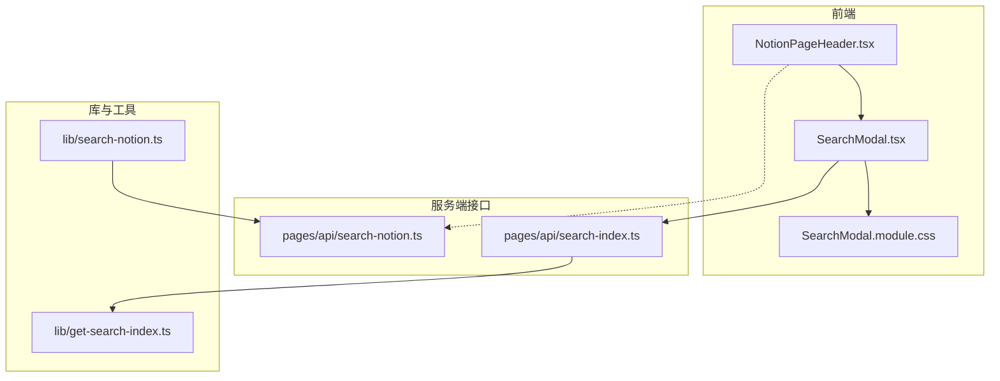
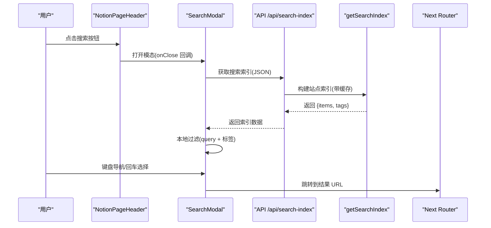
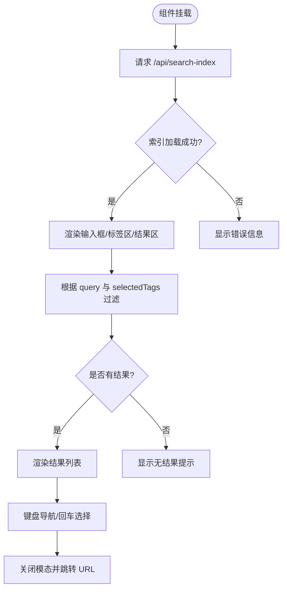
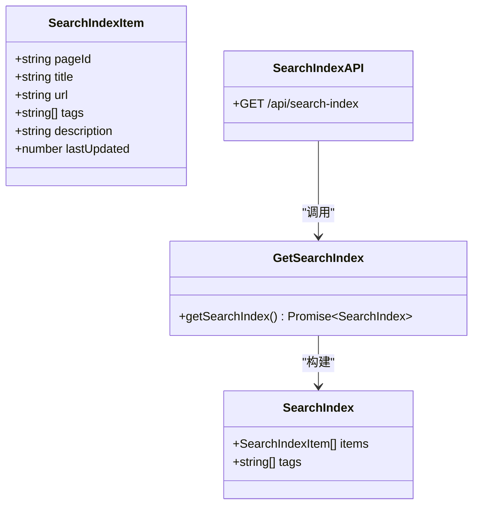
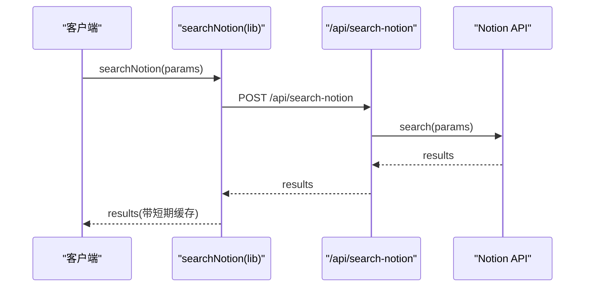
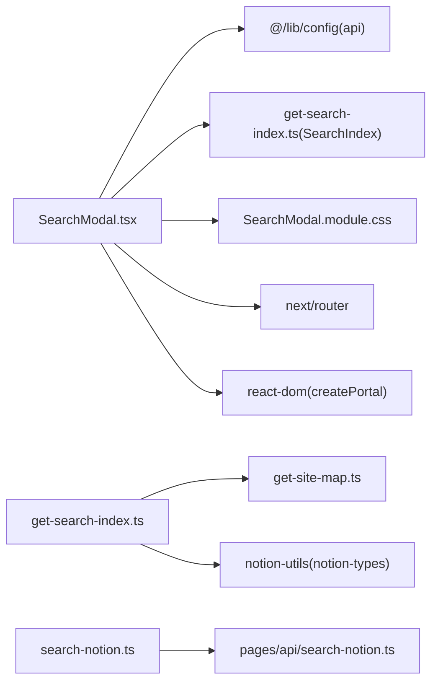
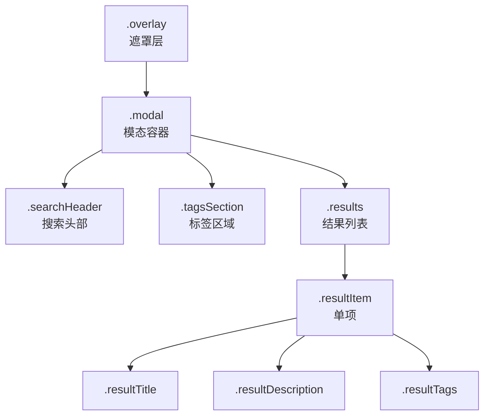
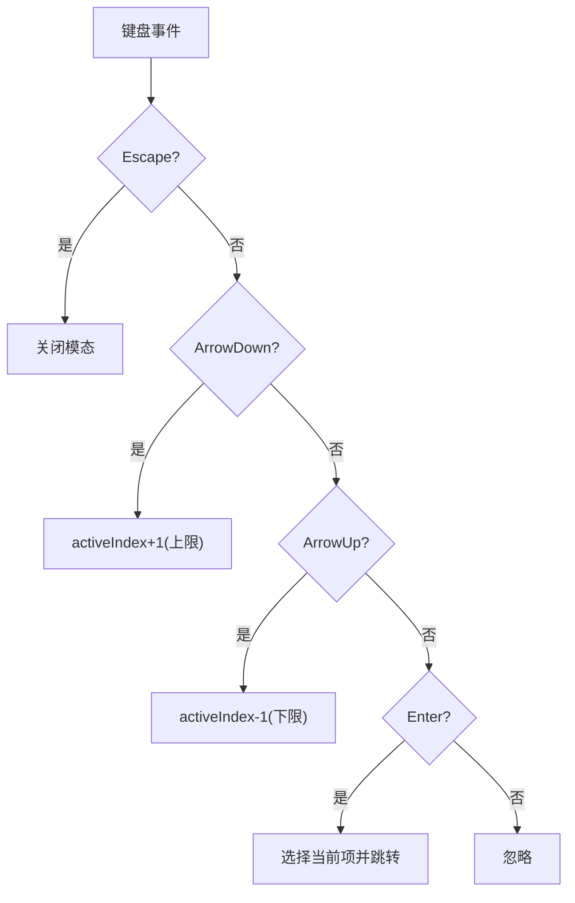

# SearchModal 搜索模态框

<cite>
**本文引用的文件**   
- [components/SearchModal.tsx](file://components/SearchModal.tsx)
- [components/SearchModal.module.css](file://components/SearchModal.module.css)
- [components/NotionPageHeader.tsx](file://components/NotionPageHeader.tsx)
- [lib/get-search-index.ts](file://lib/get-search-index.ts)
- [pages/api/search-index.ts](file://pages/api/search-index.ts)
- [lib/search-notion.ts](file://lib/search-notion.ts)
- [pages/api/search-notion.ts](file://pages/api/search-notion.ts)
</cite>

## 目录
1. [简介](#简介)
2. [项目结构](#项目结构)
3. [核心组件与职责](#核心组件与职责)
4. [架构总览](#架构总览)
5. [详细组件分析](#详细组件分析)
6. [依赖关系分析](#依赖关系分析)
7. [性能优化策略](#性能优化策略)
8. [样式定制指南](#样式定制指南)
9. [事件处理与键盘导航](#事件处理与键盘导航)
10. [集成示例与扩展指南](#集成示例与扩展指南)
11. [故障排查](#故障排查)
12. [结论](#结论)

## 简介
SearchModal 是一个基于 React 的搜索模态框组件，提供即时客户端搜索、标签过滤、键盘导航和可访问性支持。它通过加载站点构建的轻量级搜索索引实现“零延迟”搜索体验，同时保留与 Notion API 的后端搜索能力作为补充。该组件采用 CSS Modules 进行样式隔离，并通过 createPortal 渲染到 body，确保模态层叠与焦点管理符合最佳实践。

## 项目结构
SearchModal 相关代码分布在以下位置：
- 组件与样式：components/SearchModal.tsx、components/SearchModal.module.css
- 入口集成点：components/NotionPageHeader.tsx
- 搜索索引构建与接口：lib/get-search-index.ts、pages/api/search-index.ts
- 后端搜索（可选）：lib/search-notion.ts、pages/api/search-notion.ts

图表来源
- [components/NotionPageHeader.tsx:42-78](file://components/NotionPageHeader.tsx#L42-L78)
- [components/SearchModal.tsx:57-254](file://components/SearchModal.tsx#L57-L254)
- [pages/api/search-index.ts:5-21](file://pages/api/search-index.ts#L5-L21)
- [lib/get-search-index.ts:35-94](file://lib/get-search-index.ts#L35-L94)
- [lib/search-notion.ts:7-39](file://lib/search-notion.ts#L7-L39)
- [pages/api/search-notion.ts:6-25](file://pages/api/search-notion.ts#L6-L25)

章节来源
- [components/SearchModal.tsx:1-254](file://components/SearchModal.tsx#L1-L254)
- [components/SearchModal.module.css:1-182](file://components/SearchModal.module.css#L1-L182)
- [components/NotionPageHeader.tsx:42-78](file://components/NotionPageHeader.tsx#L42-L78)
- [lib/get-search-index.ts:1-95](file://lib/get-search-index.ts#L1-L95)
- [pages/api/search-index.ts:1-22](file://pages/api/search-index.ts#L1-L22)
- [lib/search-notion.ts:1-40](file://lib/search-notion.ts#L1-L40)
- [pages/api/search-notion.ts:1-26](file://pages/api/search-notion.ts#L1-L26)

## 核心组件与职责
- SearchModal 组件
  - 负责模态 UI、输入状态、标签选择、结果列表渲染、键盘导航、错误与加载状态展示。
  - 通过 createPortal 将内容挂载到 document.body，避免父容器 overflow 影响。
  - 使用 useMemo 对搜索结果进行缓存计算，减少重复过滤开销。
- NotionPageHeader 集成点
  - 提供触发按钮，控制模态显示/隐藏，并将 onClose 回调传递给 SearchModal。
- 搜索索引服务
  - getSearchIndex 构建轻量级站点索引，包含页面标题、描述、标签、URL 等字段，并缓存结果。
  - pages/api/search-index.ts 暴露 GET 接口供前端加载索引。
- 后端搜索（可选）
  - lib/search-notion.ts 封装 POST 调用，配合 pages/api/search-notion.ts 实现基于 Notion 的搜索能力，具备短期内存缓存。

章节来源
- [components/SearchModal.tsx:57-254](file://components/SearchModal.tsx#L57-L254)
- [components/NotionPageHeader.tsx:42-78](file://components/NotionPageHeader.tsx#L42-L78)
- [lib/get-search-index.ts:35-94](file://lib/get-search-index.ts#L35-L94)
- [pages/api/search-index.ts:5-21](file://pages/api/search-index.ts#L5-L21)
- [lib/search-notion.ts:7-39](file://lib/search-notion.ts#L7-L39)
- [pages/api/search-notion.ts:6-25](file://pages/api/search-notion.ts#L6-L25)

## 架构总览
SearchModal 的搜索流程以“客户端索引优先”为主，必要时可扩展为后端搜索。

图表来源
- [components/NotionPageHeader.tsx:42-78](file://components/NotionPageHeader.tsx#L42-L78)
- [components/SearchModal.tsx:80-111](file://components/SearchModal.tsx#L80-L111)
- [pages/api/search-index.ts:5-21](file://pages/api/search-index.ts#L5-L21)
- [lib/get-search-index.ts:35-94](file://lib/get-search-index.ts#L35-L94)

## 详细组件分析

### SearchModal 组件
- 生命周期与渲染
  - mounted 标志确保仅在客户端渲染 Portal，避免 SSR 环境报错。
  - 首次渲染后自动聚焦输入框，提升可用性。
- 数据加载
  - 组件挂载时请求 api.searchIndex，设置 loading/error/index 状态。
  - 使用取消标记防止卸载后的状态更新。
- 搜索与过滤
  - filterItems 实现“AND 语义”的标签过滤，并在无查询词时直接返回所有项。
  - 查询词匹配标题、描述与标签拼接后的字符串（不区分大小写）。
- 结果展示
  - 根据 activeIndex 高亮当前项，鼠标悬停也会更新 activeIndex。
  - 支持空结果、加载中、错误状态的友好提示。
- 路由跳转
  - 选择结果后关闭模态并跳转到 item.url。

图表来源
- [components/SearchModal.tsx:80-111](file://components/SearchModal.tsx#L80-L111)
- [components/SearchModal.tsx:108-147](file://components/SearchModal.tsx#L108-L147)
- [components/SearchModal.tsx:153-254](file://components/SearchModal.tsx#L153-L254)

章节来源
- [components/SearchModal.tsx:57-254](file://components/SearchModal.tsx#L57-L254)

### 搜索索引构建与接口
- getSearchIndex
  - 遍历站点地图中的公开页面，提取标题、描述、标签、最后更新时间等元数据。
  - 按 lastUpdated 降序排序，便于优先展示最近更新的内容。
  - 使用 p-memoize 缓存构建结果，避免重复 IO。
- /api/search-index
  - 返回 { items, tags } 结构，附带 CDN/边缘缓存头，提高响应速度。
  - 异常时返回空索引，保证前端降级可用。

图表来源
- [lib/get-search-index.ts:11-23](file://lib/get-search-index.ts#L11-L23)
- [lib/get-search-index.ts:35-94](file://lib/get-search-index.ts#L35-L94)
- [pages/api/search-index.ts:5-21](file://pages/api/search-index.ts#L5-L21)

章节来源
- [lib/get-search-index.ts:1-95](file://lib/get-search-index.ts#L1-L95)
- [pages/api/search-index.ts:1-22](file://pages/api/search-index.ts#L1-L22)

### 后端搜索（可选）
- lib/search-notion.ts
  - 封装 POST 请求至 /api/search-notion，返回统一的结构。
  - 使用 p-memoize 与 ExpiryMap 做短期内存缓存，键为 query，过期时间 10s。
- /api/search-notion
  - 校验方法为 POST，转发参数到 notion.search，设置缓存头。

图表来源
- [lib/search-notion.ts:7-39](file://lib/search-notion.ts#L7-L39)
- [pages/api/search-notion.ts:6-25](file://pages/api/search-notion.ts#L6-L25)

章节来源
- [lib/search-notion.ts:1-40](file://lib/search-notion.ts#L1-L40)
- [pages/api/search-notion.ts:1-26](file://pages/api/search-notion.ts#L1-L26)

## 依赖关系分析
- 组件耦合
  - SearchModal 仅依赖 Next Router、React DOM Portal、CSS Modules 与配置常量。
  - 通过类型定义 SearchIndex/SearchIndexItem 解耦数据结构。
- 外部依赖
  - p-memoize 用于函数级缓存（索引构建与后端搜索）。
  - expiry-map 用于短时效内存缓存。
- 潜在循环依赖
  - 组件与库之间单向依赖，未发现循环引用。

图表来源
- [components/SearchModal.tsx:1-10](file://components/SearchModal.tsx#L1-L10)
- [lib/get-search-index.ts:1-8](file://lib/get-search-index.ts#L1-L8)
- [lib/search-notion.ts:1-5](file://lib/search-notion.ts#L1-L5)

章节来源
- [components/SearchModal.tsx:1-10](file://components/SearchModal.tsx#L1-L10)
- [lib/get-search-index.ts:1-8](file://lib/get-search-index.ts#L1-L8)
- [lib/search-notion.ts:1-5](file://lib/search-notion.ts#L1-L5)

## 性能优化策略
- 客户端索引优先
  - 一次性加载轻量索引，后续过滤在内存中进行，避免每次按键都请求后端。
- 结果计算缓存
  - 使用 useMemo 缓存过滤结果，依赖 index/query/tags 变化才重新计算。
- 索引构建缓存
  - getSearchIndex 使用 p-memoize 缓存构建结果，减少站点扫描与 Notion 读取。
- 接口缓存头
  - /api/search-index 设置 s-maxage/max-age/stale-while-revalidate，利于 CDN/边缘缓存。
- 后端搜索短期缓存
  - searchNotion 使用 ExpiryMap 缓存最近查询，降低瞬时重复请求压力。

[本节为通用性能建议，未直接分析具体文件]

## 样式定制指南
SearchModal 使用 CSS Modules，可通过覆盖 CSS 变量或类名进行主题化：
- 颜色与背景
  - --bg-color、--fg-color、--fg-color-0 控制模态背景与文字色。
- 布局与尺寸
  - .overlay 控制遮罩层定位与模糊效果；.modal 控制最大宽度与高度。
- 交互反馈
  - .tagActive 高亮选中标签；.resultItem:hover/.resultItemActive 高亮结果项。
- 字体与排版
  - .input、.resultTitle、.resultDescription 控制字号与透明度。

图表来源
- [components/SearchModal.module.css:12-38](file://components/SearchModal.module.css#L12-L38)
- [components/SearchModal.module.css:40-83](file://components/SearchModal.module.css#L40-L83)
- [components/SearchModal.module.css:85-126](file://components/SearchModal.module.css#L85-L126)
- [components/SearchModal.module.css:128-182](file://components/SearchModal.module.css#L128-L182)

章节来源
- [components/SearchModal.module.css:1-182](file://components/SearchModal.module.css#L1-L182)

## 事件处理与键盘导航
- 键盘支持
  - Escape：关闭模态。
  - ArrowDown/ArrowUp：在结果列表中上下移动高亮项。
  - Enter：选择当前高亮项并跳转。
- 无障碍
  - role="dialog"、aria-modal="true"、aria-label 提升屏幕阅读器体验。
  - 标签按钮 aria-pressed 反映选中状态。
- 焦点管理
  - 模态打开后自动聚焦输入框，提升键盘操作效率。

图表来源
- [components/SearchModal.tsx:131-147](file://components/SearchModal.tsx#L131-L147)
- [components/SearchModal.tsx:153-165](file://components/SearchModal.tsx#L153-L165)

章节来源
- [components/SearchModal.tsx:131-147](file://components/SearchModal.tsx#L131-L147)
- [components/SearchModal.tsx:153-165](file://components/SearchModal.tsx#L153-L165)

## 集成示例与扩展指南
- 基础集成
  - 在页面头部引入 SearchModal，并提供 onOpen/onClose 状态控制。
  - 参考 NotionPageHeader 中按钮与条件渲染逻辑。
- 自定义触发器
  - 可在任意组件中引入 SearchModal，传入 onClose 回调即可。
- 自定义搜索结果展示
  - 若需扩展结果字段，可在 SearchIndexItem 中添加新属性，并在 SearchModal 的渲染逻辑中对应展示。
  - 注意同步更新 filterItems 的匹配逻辑，确保新字段参与搜索。
- 启用后端搜索
  - 如需结合 Notion 实时搜索，可在组件内调用 searchNotion，并根据返回结果渲染。
  - 注意与客户端索引的优先级与降级策略。

章节来源
- [components/NotionPageHeader.tsx:42-78](file://components/NotionPageHeader.tsx#L42-L78)
- [components/SearchModal.tsx:108-147](file://components/SearchModal.tsx#L108-L147)
- [lib/search-notion.ts:7-39](file://lib/search-notion.ts#L7-L39)

## 故障排查
- 索引加载失败
  - 现象：显示“Failed to load: ...”。
  - 排查：检查 /api/search-index 是否返回 2xx；确认 getSearchIndex 是否抛出异常。
  - 处理：接口已捕获异常并返回空索引，前端会显示错误信息。
- 无搜索结果
  - 现象：显示“No matching results found”。
  - 排查：确认 query 与 selectedTags 是否正确；检查 index.items 是否为空。
- 键盘导航无效
  - 现象：上下键或回车无响应。
  - 排查：确认模态容器 onKeyDown 是否绑定；检查 activeIndex 边界处理。
- 样式异常
  - 现象：模态背景或文本颜色不正确。
  - 排查：检查 CSS 变量是否被正确注入；确认 CSS Modules 类名未被覆盖。

章节来源
- [components/SearchModal.tsx:80-111](file://components/SearchModal.tsx#L80-L111)
- [components/SearchModal.tsx:131-147](file://components/SearchModal.tsx#L131-L147)
- [pages/api/search-index.ts:9-20](file://pages/api/search-index.ts#L9-L20)

## 结论
SearchModal 通过客户端索引与本地过滤实现了高性能、低延迟的搜索体验，同时提供完善的键盘导航与无障碍支持。其模块化设计与清晰的职责划分便于扩展与主题定制。在需要更复杂搜索场景时，可结合后端搜索能力，形成前后端协同的完整方案。