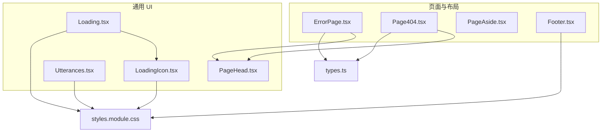
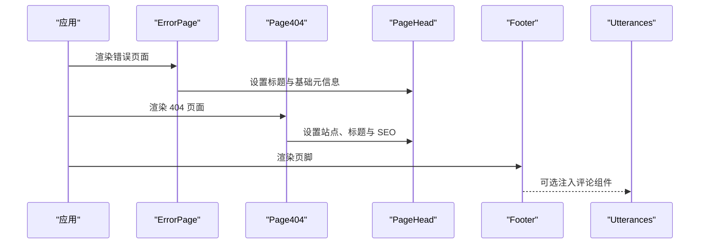
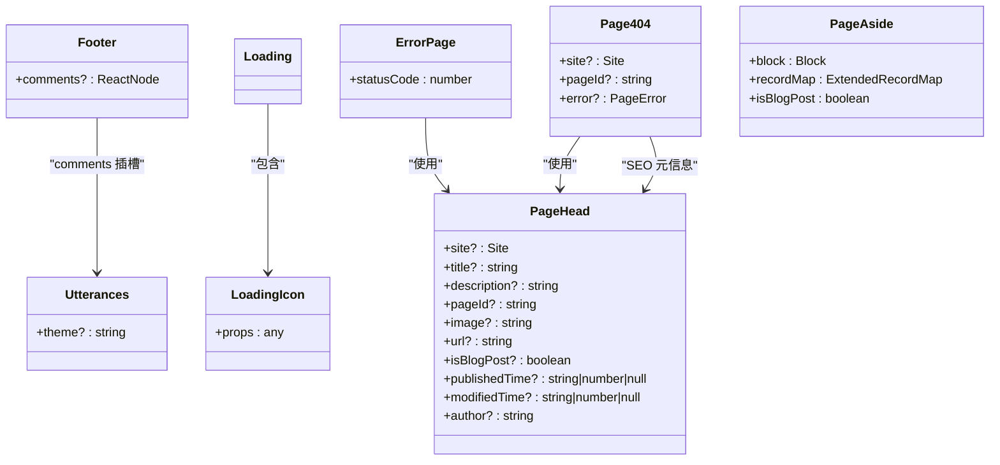

# 工具类组件

<cite>
**本文引用的文件**   
- [components/Footer.tsx](file://components/Footer.tsx)
- [components/Loading.tsx](file://components/Loading.tsx)
- [components/LoadingIcon.tsx](file://components/LoadingIcon.tsx)
- [components/ErrorPage.tsx](file://components/ErrorPage.tsx)
- [components/Page404.tsx](file://components/Page404.tsx)
- [components/PageAside.tsx](file://components/PageAside.tsx)
- [components/Utterances.tsx](file://components/Utterances.tsx)
- [components/PageHead.tsx](file://components/PageHead.tsx)
- [components/styles.module.css](file://components/styles.module.css)
- [lib/types.ts](file://lib/types.ts)
</cite>

## 目录
1. [简介](#简介)
2. [项目结构](#项目结构)
3. [核心组件总览](#核心组件总览)
4. [架构总览](#架构总览)
5. [组件详解](#组件详解)
6. [依赖关系分析](#依赖关系分析)
7. [性能与可访问性](#性能与可访问性)
8. [故障排查](#故障排查)
9. [结论](#结论)

## 简介
本章节面向项目中一系列“工具类”UI 与页面级组件，包括：
- Footer 页脚组件
- Loading 加载组件（含 LoadingIcon）
- ErrorPage 错误页面
- Page404 404 页面
- PageAside 侧边栏占位组件
- Utterances 评论组件

这些组件的职责明确、接口简洁，主要用于在 Notion 驱动的 Next.js 站点中提供统一的页面骨架、错误展示、加载态、SEO 元数据以及评论能力。它们通过共享的样式模块与类型定义保持风格一致与类型安全。

## 项目结构
下图展示了与本文相关的组件及其依赖关系，便于快速理解各组件的职责边界与协作方式。

图表来源
- [components/ErrorPage.tsx:1-23](file://components/ErrorPage.tsx#L1-L23)
- [components/Page404.tsx:1-38](file://components/Page404.tsx#L1-L38)
- [components/Footer.tsx:1-14](file://components/Footer.tsx#L1-L14)
- [components/Loading.tsx:1-11](file://components/Loading.tsx#L1-L11)
- [components/LoadingIcon.tsx:1-62](file://components/LoadingIcon.tsx#L1-L62)
- [components/Utterances.tsx:1-33](file://components/Utterances.tsx#L1-L33)
- [components/PageHead.tsx:1-188](file://components/PageHead.tsx#L1-L188)
- [components/styles.module.css:1-226](file://components/styles.module.css#L1-L226)
- [lib/types.ts:1-78](file://lib/types.ts#L1-L78)

## 核心组件总览
- Footer：页脚容器，支持注入评论区域。
- Loading + LoadingIcon：轻量加载指示器，使用 CSS 动画旋转图标。
- ErrorPage：统一错误页面，显示错误码与提示图。
- Page404：Notion 页面未找到时的 404 页面，支持传入站点信息与错误对象。
- PageAside：侧边栏占位组件，当前返回空节点，预留扩展点。
- Utterances：基于 GitHub Issues 的评论组件，动态注入脚本并支持主题切换。
- PageHead：SEO 与结构化数据元信息组件，被 ErrorPage 与 Page404 复用。

章节来源
- [components/Footer.tsx:1-14](file://components/Footer.tsx#L1-L14)
- [components/Loading.tsx:1-11](file://components/Loading.tsx#L1-L11)
- [components/LoadingIcon.tsx:1-62](file://components/LoadingIcon.tsx#L1-L62)
- [components/ErrorPage.tsx:1-23](file://components/ErrorPage.tsx#L1-L23)
- [components/Page404.tsx:1-38](file://components/Page404.tsx#L1-L38)
- [components/PageAside.tsx:1-18](file://components/PageAside.tsx#L1-L18)
- [components/Utterances.tsx:1-33](file://components/Utterances.tsx#L1-L33)
- [components/PageHead.tsx:1-188](file://components/PageHead.tsx#L1-L188)

## 架构总览
下图展示了页面渲染时，工具类组件如何协同工作：

图表来源
- [components/ErrorPage.tsx:1-23](file://components/ErrorPage.tsx#L1-L23)
- [components/Page404.tsx:1-38](file://components/Page404.tsx#L1-L38)
- [components/Footer.tsx:1-14](file://components/Footer.tsx#L1-L14)
- [components/Utterances.tsx:1-33](file://components/Utterances.tsx#L1-L33)
- [components/PageHead.tsx:1-188](file://components/PageHead.tsx#L1-L188)

## 组件详解

### Footer 页脚组件
职责
- 作为页脚容器，负责承载评论区域等尾部内容。
- 通过 props 控制是否渲染评论区块。

Props 接口
- comments?: React.ReactNode
  - 可选，用于插入评论组件或其他自定义内容。

样式定制
- 使用 styles.module.css 中的 .footer 与 .comments 类名进行布局与分隔线样式控制。
- 移动端适配：在小屏下自动纵向排列，调整顺序与间距。

配置选项
- 无额外配置项；通过 children/comments 插槽注入内容。

使用示例
- 在页面底部引入 Footer，并将 Utterances 作为 comments 传入以启用评论。

扩展方法
- 可在 comments 插槽中注入任意 ReactNode，例如版权信息、社交链接或第三方评论系统。

章节来源
- [components/Footer.tsx:1-14](file://components/Footer.tsx#L1-L14)
- [components/styles.module.css:48-130](file://components/styles.module.css#L48-L130)

### Loading 与 LoadingIcon 加载组件
职责
- Loading：提供全屏居中加载容器。
- LoadingIcon：提供 SVG 旋转加载图标，支持外部 className 覆盖。

Props 接口
- Loading：无 props。
- LoadingIcon：接受任意属性（className 等），内部合并到 SVG 元素。

样式定制
- 容器使用 .container 居中布局，背景色使用 CSS 变量 --bg-color。
- 图标使用 .loadingIcon 实现旋转动画，尺寸 24px。

性能与可访问性
- 纯 CSS 动画，开销极低。
- 建议在真实业务中结合 Suspense 或状态管理控制显隐时机。

使用示例
- 在数据加载中包裹 Loading 组件，或在路由切换时短暂显示。

扩展方法
- 通过 LoadingIcon 的 className 与 rest props 自定义颜色、尺寸与事件。

章节来源
- [components/Loading.tsx:1-11](file://components/Loading.tsx#L1-L11)
- [components/LoadingIcon.tsx:1-62](file://components/LoadingIcon.tsx#L1-L62)
- [components/styles.module.css:1-34](file://components/styles.module.css#L1-L34)

### ErrorPage 错误页面
职责
- 统一错误展示页面，显示错误标题、错误码与错误图。

Props 接口
- statusCode: number
  - 可选显示的错误状态码。

样式定制
- 使用 .container 与 .main 布局，.errorImage 控制错误图片尺寸。

SEO 与元信息
- 通过 PageHead 设置页面标题为“Error”。

使用示例
- 在 Next.js 全局错误处理或自定义 _error 页面中使用。

扩展方法
- 可结合 PageHead 的其他字段（如 description、image）丰富 SEO。

章节来源
- [components/ErrorPage.tsx:1-23](file://components/ErrorPage.tsx#L1-L23)
- [components/PageHead.tsx:1-188](file://components/PageHead.tsx#L1-L188)
- [components/styles.module.css:7-46](file://components/styles.module.css#L7-L46)

### Page404 404 页面
职责
- 当 Notion 页面不存在或不可访问时，展示友好的 404 页面。

Props 接口
- site?: Site
- pageId?: string
- error?: PageError

样式定制
- 使用 .container 与 .main 布局，.errorImage 控制 404 图片尺寸。

SEO 与元信息
- 通过 PageHead 设置站点名称、标题与描述。

使用示例
- 在路由解析失败或 Notion API 报错时渲染该组件。

扩展方法
- 根据 error.message 或 pageId 提供更具体的提示信息。

章节来源
- [components/Page404.tsx:1-38](file://components/Page404.tsx#L1-L38)
- [components/PageHead.tsx:1-188](file://components/PageHead.tsx#L1-L188)
- [lib/types.ts:9-19](file://lib/types.ts#L9-L19)
- [lib/types.ts:29-45](file://lib/types.ts#L29-L45)
- [components/styles.module.css:7-46](file://components/styles.module.css#L7-L46)

### PageAside 侧边栏占位组件
职责
- 作为侧边栏的占位组件，当前不渲染任何内容，预留扩展点。

Props 接口
- block: Block
- recordMap: ExtendedRecordMap
- isBlogPost: boolean

行为说明
- 若 block 为空则返回 null。
- 当前实现直接返回 null，便于后续扩展为目录、相关文章或广告位。

扩展方法
- 可根据 isBlogPost 与 block 类型渲染不同的侧边栏内容。

章节来源
- [components/PageAside.tsx:1-18](file://components/PageAside.tsx#L1-L18)

### Utterances 评论组件
职责
- 动态注入 utterances.es 评论脚本，并根据主题属性更新评论外观。

Props 接口
- theme?: string
  - 默认 'github-light'，用于控制评论主题。

实现要点
- 使用 useRef 获取容器 DOM。
- useEffect 监听 theme 变化，清空容器并重新注入 script。
- 脚本属性：
  - repo: PhysicalMouse/NotionBlogComment
  - issue-term: pathname
  - theme: 传入的主题值
  - crossorigin: anonymous

样式定制
- 组件本身仅渲染一个 div 容器，具体样式由 utterances.es 脚本注入。

使用示例
- 将 Utterances 作为 Footer.comments 传入，即可在页脚显示评论。

注意事项
- 主题变更会触发脚本重建，确保主题同步。
- 清理函数会在卸载时清空容器内容，避免内存泄漏。

章节来源
- [components/Utterances.tsx:1-33](file://components/Utterances.tsx#L1-L33)

## 依赖关系分析
- Footer 依赖样式模块，并通过 comments 插槽组合 Utterances。
- Loading 依赖 LoadingIcon 与样式模块。
- ErrorPage 与 Page404 均依赖 PageHead 以设置 SEO。
- Page404 依赖 types.ts 中的 PageProps、Site、PageError 等类型。
- PageAside 依赖 notion-types 的类型定义，但当前未渲染内容。

图表来源
- [components/Footer.tsx:1-14](file://components/Footer.tsx#L1-L14)
- [components/Loading.tsx:1-11](file://components/Loading.tsx#L1-L11)
- [components/LoadingIcon.tsx:1-62](file://components/LoadingIcon.tsx#L1-L62)
- [components/ErrorPage.tsx:1-23](file://components/ErrorPage.tsx#L1-L23)
- [components/Page404.tsx:1-38](file://components/Page404.tsx#L1-L38)
- [components/PageAside.tsx:1-18](file://components/PageAside.tsx#L1-L18)
- [components/Utterances.tsx:1-33](file://components/Utterances.tsx#L1-L33)
- [components/PageHead.tsx:1-188](file://components/PageHead.tsx#L1-L188)

## 性能与可访问性
- Loading 与 LoadingIcon：纯 CSS 动画，性能开销低；建议仅在必要场景显示。
- Utterances：按需注入脚本，主题变更时重建脚本，注意避免频繁切换主题。
- PageHead：集中管理 SEO 与结构化数据，减少重复逻辑。
- 可访问性：所有图片均提供 alt 文本；错误与 404 页面语义清晰，利于无障碍阅读。

[本节为通用指导，无需引用具体文件]

## 故障排查
- 评论不显示
  - 检查 Utterances 的 theme 是否正确传入。
  - 确认仓库地址 PhysicalMouse/NotionBlogComment 是否存在且公开。
  - 查看浏览器控制台是否有跨域或脚本加载错误。
- 404 页面提示异常
  - 校验传入的 pageId 是否为有效的 Notion 页面 ID。
  - 检查 error.message 是否包含更详细的错误原因。
- 样式错乱
  - 确认 styles.module.css 已正确引入。
  - 检查 CSS 变量（如 --bg-color、--fg-color-0）是否在根样式中定义。

章节来源
- [components/Utterances.tsx:1-33](file://components/Utterances.tsx#L1-L33)
- [components/Page404.tsx:1-38](file://components/Page404.tsx#L1-L38)
- [components/styles.module.css:1-226](file://components/styles.module.css#L1-L226)

## 结论
上述工具类组件提供了稳定的页面骨架、错误与加载体验、SEO 元信息管理以及评论集成能力。它们接口简洁、样式统一、易于扩展。在实际项目中，推荐：
- 在数据加载阶段使用 Loading 组件提升用户体验。
- 在 Notion 页面缺失或 API 出错时展示 ErrorPage 或 Page404。
- 通过 Footer.comments 注入 Utterances 以启用评论。
- 利用 PageHead 统一管理 SEO 与结构化数据，保证搜索引擎友好。

[本节为总结性内容，无需引用具体文件]