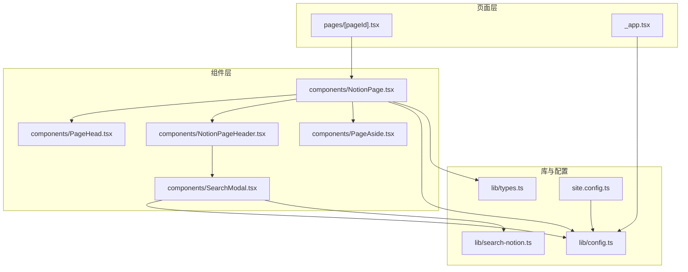
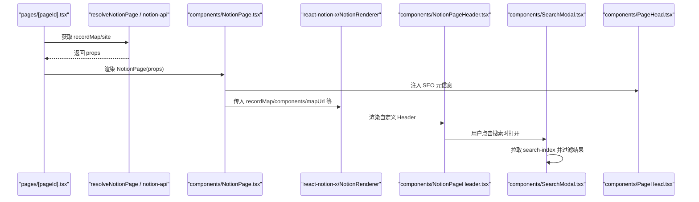
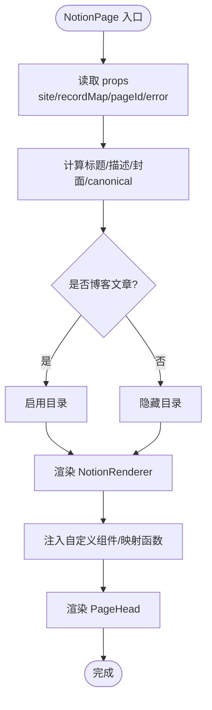
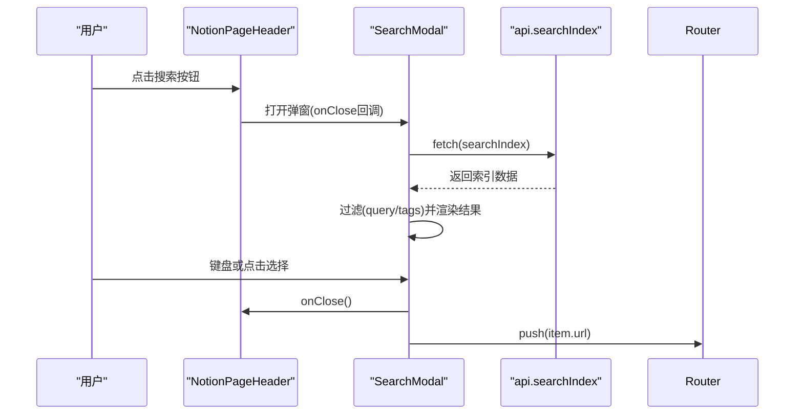
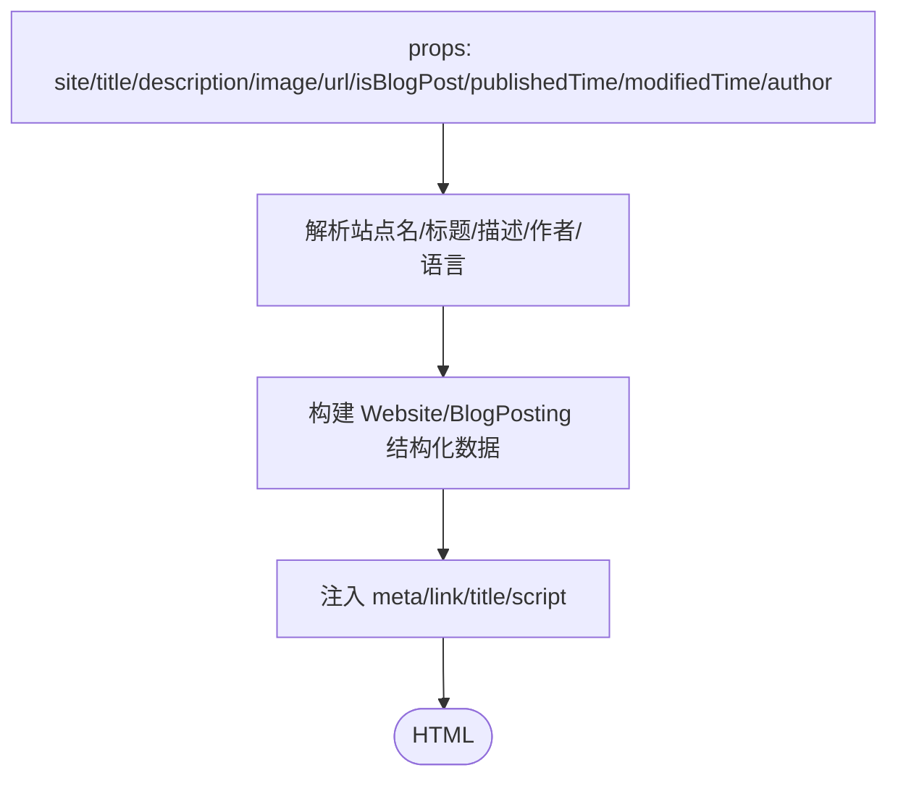
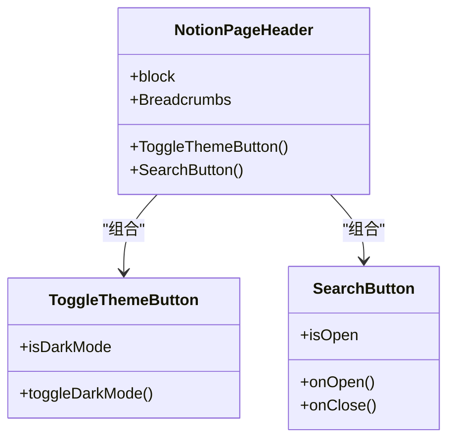
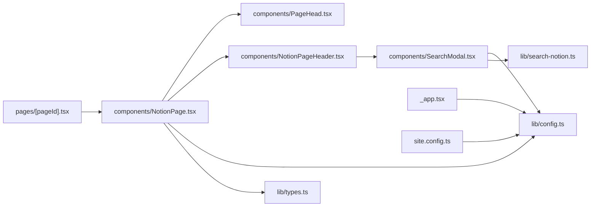

# 组件架构

<cite>
**本文引用的文件**   
- [components/NotionPage.tsx](file://components/NotionPage.tsx)
- [components/SearchModal.tsx](file://components/SearchModal.tsx)
- [components/PageHead.tsx](file://components/PageHead.tsx)
- [components/NotionPageHeader.tsx](file://components/NotionPageHeader.tsx)
- [components/PageAside.tsx](file://components/PageAside.tsx)
- [pages/[pageId].tsx](file://pages/[pageId].tsx)
- [pages/_app.tsx](file://pages/_app.tsx)
- [lib/types.ts](file://lib/types.ts)
- [lib/config.ts](file://lib/config.ts)
- [lib/search-notion.ts](file://lib/search-notion.ts)
- [site.config.ts](file://site.config.ts)
</cite>

## 目录
1. [引言](#引言)
2. [项目结构](#项目结构)
3. [核心组件](#核心组件)
4. [架构总览](#架构总览)
5. [详细组件分析](#详细组件分析)
6. [依赖关系分析](#依赖关系分析)
7. [性能与可维护性](#性能与可维护性)
8. [故障排查指南](#故障排查指南)
9. [结论](#结论)
10. [附录：扩展与定制指南](#附录扩展与定制指南)

## 引言
本文件面向希望深入理解本项目 React 组件架构与设计模式的读者，重点说明 NotionPage、SearchModal、PageHead 等核心组件的职责、相互关系、通信机制、状态管理方式与数据流向。同时提供组件自定义与扩展的实践指导，包括 props 接口约定、事件处理模式与样式定制方法，并给出使用示例与最佳实践建议。

## 项目结构
项目采用 Next.js App Router 的页面路由组织方式，结合 react-notion-x 渲染 Notion 内容。关键目录与职责如下：
- components：React 组件（页面容器、头部、侧边栏、搜索弹窗、SEO 元信息）
- pages：Next.js 页面入口与 API 路由
- lib：配置、类型定义、工具函数、Notion 数据获取与搜索封装
- styles：全局样式与主题覆盖

图表来源
- [pages/[pageId].tsx:1-58](file://pages/[pageId].tsx#L1-L58)
- [components/NotionPage.tsx:211-355](file://components/NotionPage.tsx#L211-L355)
- [components/NotionPageHeader.tsx:82-132](file://components/NotionPageHeader.tsx#L82-L132)
- [components/SearchModal.tsx:57-253](file://components/SearchModal.tsx#L57-L253)
- [components/PageHead.tsx:7-187](file://components/PageHead.tsx#L7-L187)
- [lib/config.ts:145-150](file://lib/config.ts#L145-L150)
- [lib/search-notion.ts:1-40](file://lib/search-notion.ts#L1-L40)
- [pages/_app.tsx:41-90](file://pages/_app.tsx#L41-L90)
- [site.config.ts:1-77](file://site.config.ts#L1-L77)

章节来源
- [pages/[pageId].tsx:1-58](file://pages/[pageId].tsx#L1-L58)
- [pages/_app.tsx:1-91](file://pages/_app.tsx#L1-L91)

## 核心组件
- NotionPage：页面级容器，负责解析 Notion 数据、构建 SEO、注入主题与布局、渲染 NotionRenderer 及其扩展组件。
- SearchModal：站点内搜索弹窗，加载本地索引并进行前端过滤与键盘导航。
- PageHead：SEO 元信息与结构化数据注入，支持 Open Graph、Twitter Card、Schema.org。
- NotionPageHeader：Notion 页面头部，集成面包屑、导航链接、主题切换与搜索入口。
- PageAside：预留侧边栏占位，当前返回空节点，便于后续扩展。

章节来源
- [components/NotionPage.tsx:211-355](file://components/NotionPage.tsx#L211-L355)
- [components/SearchModal.tsx:57-253](file://components/SearchModal.tsx#L57-L253)
- [components/PageHead.tsx:7-187](file://components/PageHead.tsx#L7-L187)
- [components/NotionPageHeader.tsx:82-132](file://components/NotionPageHeader.tsx#L82-L132)
- [components/PageAside.tsx:1-18](file://components/PageAside.tsx#L1-L18)

## 架构总览
整体数据流从 Next.js 页面到 Notion 数据，再到 UI 渲染与交互：
- 页面路由通过 getStaticProps/getStaticPaths 预取 Notion 数据，并以 ISR 增量再生成。
- NotionPage 接收 recordMap 与 site 等 props，计算标题、描述、封面图、canonical URL 等，并渲染 PageHead、NotionRenderer、Footer 等。
- NotionRenderer 通过 components 注入自定义组件（如 Code、Collection、Equation、Pdf、Modal、Tweet、Header）。
- NotionPageHeader 作为 NotionRenderer 的 Header 组件，承载导航、主题切换与搜索按钮；点击搜索打开 SearchModal。
- SearchModal 在客户端拉取 search-index 并通过前端过滤实现快速检索。
- PageHead 统一注入 SEO 元信息与结构化数据。

图表来源
- [pages/[pageId].tsx:9-25](file://pages/[pageId].tsx#L9-L25)
- [components/NotionPage.tsx:211-355](file://components/NotionPage.tsx#L211-L355)
- [components/NotionPageHeader.tsx:82-132](file://components/NotionPageHeader.tsx#L82-L132)
- [components/SearchModal.tsx:80-111](file://components/SearchModal.tsx#L80-L111)
- [components/PageHead.tsx:7-187](file://components/PageHead.tsx#L7-L187)

## 详细组件分析

### NotionPage
职责与关键点：
- 接收 PageProps（site、recordMap、pageId、error），根据 block 类型判断是否为博客文章，决定是否显示目录。
- 构造 mapPageUrl 与 canonical URL，计算社交图片与描述。
- 注入 BodyClassName 控制 lite 模式与暗色模式。
- 通过 NotionRenderer 渲染内容，并注入自定义 components（Code、Collection、Equation、Pdf、Modal、Tweet、Header）、mapImageUrl、searchNotion、pageAside、footer 等。
- 将 PageHead 与 Footer 整合进页面结构。

图表来源
- [components/NotionPage.tsx:211-355](file://components/NotionPage.tsx#L211-L355)

章节来源
- [components/NotionPage.tsx:211-355](file://components/NotionPage.tsx#L211-L355)

### SearchModal
职责与关键点：
- 使用 createPortal 挂载至 document.body，避免层级问题。
- 首次打开时异步拉取 search-index，缓存 index 并展示标签筛选区。
- 基于 query 与 selectedTags 进行前端过滤，支持键盘导航（Esc/上下箭头/Enter）。
- 选择结果后调用 router.push 跳转，并关闭弹窗。

图表来源
- [components/NotionPageHeader.tsx:37-79](file://components/NotionPageHeader.tsx#L37-L79)
- [components/SearchModal.tsx:57-253](file://components/SearchModal.tsx#L57-L253)
- [lib/config.ts:145-150](file://lib/config.ts#L145-L150)

章节来源
- [components/SearchModal.tsx:57-253](file://components/SearchModal.tsx#L57-L253)
- [components/NotionPageHeader.tsx:37-79](file://components/NotionPageHeader.tsx#L37-L79)

### PageHead
职责与关键点：
- 根据 isBlogPost 动态生成 Schema.org 的 WebSite/BlogPosting。
- 设置 meta（charset、viewport、theme-color、robots、author、og/twitter 系列）、canonical、RSS link、title。
- 通过 getSocialImageUrl 优先使用生成的社交图片，否则回退到传入 image。

图表来源
- [components/PageHead.tsx:7-187](file://components/PageHead.tsx#L7-L187)

章节来源
- [components/PageHead.tsx:7-187](file://components/PageHead.tsx#L7-L187)

### NotionPageHeader
职责与关键点：
- 使用 useNotionContext 提供的 components 与 mapPageUrl 渲染 Breadcrumbs 与导航链接。
- 集成主题切换（useDarkMode）与搜索按钮（SearchModal）。
- 支持外部链接与内部 Notion 页面链接的统一渲染。

图表来源
- [components/NotionPageHeader.tsx:15-80](file://components/NotionPageHeader.tsx#L15-L80)
- [components/NotionPageHeader.tsx:82-132](file://components/NotionPageHeader.tsx#L82-L132)

章节来源
- [components/NotionPageHeader.tsx:15-132](file://components/NotionPageHeader.tsx#L15-L132)

### PageAside
职责与关键点：
- 当前为占位组件，返回 null，便于后续扩展侧边栏（如目录、相关文章等）。

章节来源
- [components/PageAside.tsx:1-18](file://components/PageAside.tsx#L1-L18)

## 依赖关系分析
- 页面层依赖：
  - pages/[pageId].tsx 依赖 resolveNotionPage 与 getSiteMap，输出 PageProps 给 NotionPage。
  - pages/_app.tsx 初始化分析脚本与全局样式。
- 组件层依赖：
  - NotionPage 依赖 config、types、map-image-url、map-page-url、search-notion、use-dark-mode，以及子组件 PageHead、NotionPageHeader、PageAside、Footer、Loading、Page404、Utterances。
  - NotionPageHeader 依赖 config、use-dark-mode、SearchModal。
  - SearchModal 依赖 config.api、get-search-index 类型、next/router、react-dom。
  - PageHead 依赖 types、config、get-social-image-url。
- 配置与类型：
  - lib/config.ts 暴露站点配置、API 地址、环境标志等。
  - lib/types.ts 定义 PageProps、Site、ExtendedTweetRecordMap 等通用类型。
  - site.config.ts 提供站点根 ID、名称、域名、默认图标/封面、SEO 验证、分析配置等。

图表来源
- [pages/[pageId].tsx:1-58](file://pages/[pageId].tsx#L1-L58)
- [components/NotionPage.tsx:211-355](file://components/NotionPage.tsx#L211-L355)
- [components/NotionPageHeader.tsx:82-132](file://components/NotionPageHeader.tsx#L82-L132)
- [components/SearchModal.tsx:57-253](file://components/SearchModal.tsx#L57-L253)
- [components/PageHead.tsx:7-187](file://components/PageHead.tsx#L7-L187)
- [lib/config.ts:145-150](file://lib/config.ts#L145-L150)
- [lib/types.ts:14-23](file://lib/types.ts#L14-L23)
- [lib/search-notion.ts:1-40](file://lib/search-notion.ts#L1-L40)
- [pages/_app.tsx:41-90](file://pages/_app.tsx#L41-L90)
- [site.config.ts:1-77](file://site.config.ts#L1-L77)

章节来源
- [lib/config.ts:145-150](file://lib/config.ts#L145-L150)
- [lib/types.ts:14-23](file://lib/types.ts#L14-L23)
- [lib/search-notion.ts:1-40](file://lib/search-notion.ts#L1-L40)
- [site.config.ts:1-77](file://site.config.ts#L1-L77)

## 性能与可维护性
- 按需加载与 SSR 优化：
  - NotionPage 使用 next/dynamic 对 Code、Collection、Equation、Pdf、Modal 等进行懒加载，减少首屏体积。
  - Collection/Pdf/Modal 禁用 SSR，避免 hydration 不匹配。
- 搜索性能：
  - SearchModal 使用前端过滤，避免频繁请求后端；index 仅在弹窗打开时拉取一次。
  - lib/search-notion.ts 对外部搜索 API 调用做了 p-memoize 与过期缓存，降低重复请求。
- SEO 与可访问性：
  - PageHead 统一注入 og/twitter/schema.org 数据，提升分享与搜索引擎体验。
  - SearchModal 使用 role/dialog、aria-modal、aria-label 等属性提升可访问性。
- 主题与样式：
  - 通过 use-dark-mode 与 BodyClassName 切换暗色模式，配合 CSS Modules 与全局样式覆盖。

[本节为通用性能讨论，无需具体文件引用]

## 故障排查指南
- 页面空白或报错：
  - 检查 pages/[pageId].tsx 的 getStaticProps 是否正确抛出错误，确保 ISR 失败路径正确。
  - 确认 site.config.ts 中 rootNotionPageId 与 domain 配置正确。
- 搜索无结果：
  - 确认 api.searchIndex 接口可用且返回正确的 SearchIndex 结构。
  - 检查 SearchModal 的 filterItems 逻辑是否符合预期（query/tags 大小写与 AND 语义）。
- SEO 异常：
  - 核对 PageHead 传入的 title/description/image/url 是否有效。
  - 确认 getSocialImageUrl 能生成有效的社交图片 URL。
- 主题切换无效：
  - 检查 use-dark-mode 的状态与 BodyClassName 是否正确应用。
  - 确认 NotionPageHeader 的 ToggleThemeButton 已触发 toggleDarkMode。

章节来源
- [pages/[pageId].tsx:9-25](file://pages/[pageId].tsx#L9-L25)
- [components/SearchModal.tsx:29-55](file://components/SearchModal.tsx#L29-L55)
- [components/PageHead.tsx:7-187](file://components/PageHead.tsx#L7-L187)
- [components/NotionPageHeader.tsx:15-35](file://components/NotionPageHeader.tsx#L15-L35)

## 结论
本项目以 NotionPage 为核心容器，结合 NotionRenderer 的扩展能力与 Next.js 的 SSG/ISR 能力，实现了高性能、可扩展的 Notion 博客站点。SearchModal 提供轻量前端搜索体验，PageHead 保障 SEO 质量，NotionPageHeader 统一导航与交互入口。通过清晰的 props 接口、集中式配置与模块化组件设计，项目具备良好的可维护性与扩展性。

[本节为总结性内容，无需具体文件引用]

## 附录：扩展与定制指南

### 组件 Props 接口与类型
- PageProps（用于 NotionPage 与 PageHead）：
  - site?: Site
  - recordMap?: ExtendedRecordMap
  - pageId?: string
  - error?: PageError
- Site（站点配置）：
  - name, domain, rootNotionPageId, rootNotionSpaceId, html, fontFamily, darkMode, previewImages, description, image
- ExtendedTweetRecordMap：
  - tweets: Record<string, any>

章节来源
- [lib/types.ts:14-23](file://lib/types.ts#L14-L23)
- [lib/types.ts:29-45](file://lib/types.ts#L29-L45)
- [lib/types.ts:21-23](file://lib/types.ts#L21-L23)

### 事件处理与状态管理
- 主题切换：NotionPageHeader 中的 ToggleThemeButton 调用 use-dark-mode 的 toggleDarkMode，并在 NotionPage 中通过 BodyClassName 应用 dark-mode 类名。
- 搜索交互：SearchModal 使用 useState 管理 query、selectedTags、activeIndex、isLoading、error 等状态，并提供键盘导航与点击跳转。
- 页面导航：SearchModal 使用 next/router 的 push 进行页面跳转，并在完成后调用 onClose 关闭弹窗。

章节来源
- [components/NotionPageHeader.tsx:15-35](file://components/NotionPageHeader.tsx#L15-L35)
- [components/SearchModal.tsx:57-147](file://components/SearchModal.tsx#L57-L147)
- [components/NotionPage.tsx:301-355](file://components/NotionPage.tsx#L301-L355)

### 样式定制
- CSS Modules：SearchModal.module.css 与 components/styles.module.css 提供模块化的样式隔离。
- 全局样式：styles/global.css、styles/notion.css、styles/prism-theme.css 提供全局主题与代码高亮样式。
- 主题类名：通过 BodyClassName 注入 notion-lite 与 dark-mode 类名，配合 CSS 变量或媒体查询实现主题切换。

章节来源
- [components/SearchModal.tsx:153-253](file://components/SearchModal.tsx#L153-L253)
- [components/NotionPage.tsx:316-355](file://components/NotionPage.tsx#L316-L355)
- [pages/_app.tsx:1-14](file://pages/_app.tsx#L1-L14)

### 组件自定义与扩展
- 自定义 Notion 渲染组件：
  - 在 NotionPage 的 notionRendererComponents 中添加或替换 Code、Collection、Equation、Pdf、Modal、Tweet、Header 等组件。
  - 可通过 propertyLastEditedTimeValue、propertyTextValue、propertyDateValue 自定义属性渲染。
- 自定义导航与外链：
  - 在 site.config.ts 中配置 navigationStyle 与 navigationLinks，或在 NotionPageHeader 中扩展导航项。
- 自定义 SEO：
  - 在 PageHead 中扩展 meta 与结构化数据，或根据 isBlogPost 调整 schema 字段。
- 自定义侧边栏：
  - 在 PageAside 中实现目录、相关文章、评论等逻辑，并通过 NotionPage 的 pageAside 注入。

章节来源
- [components/NotionPage.tsx:196-209](file://components/NotionPage.tsx#L196-L209)
- [components/NotionPage.tsx:155-194](file://components/NotionPage.tsx#L155-L194)
- [components/NotionPageHeader.tsx:95-123](file://components/NotionPageHeader.tsx#L95-L123)
- [components/PageAside.tsx:1-18](file://components/PageAside.tsx#L1-L18)

### 使用示例与最佳实践
- 页面渲染流程：
  - 在 pages/[pageId].tsx 中使用 getStaticProps 获取 Notion 数据，并将 props 传递给 NotionPage。
  - 在 NotionPage 中注入 PageHead、NotionRenderer、Footer 等组件，并根据 isLiteMode 与 isDarkMode 调整样式。
- 搜索功能：
  - 在 NotionPageHeader 中引入 SearchModal，并通过 onClick/onKeyDown 触发打开与键盘操作。
  - 在 SearchModal 中实现 query 与 tags 的前端过滤，并使用 createPortal 挂载至 body。
- SEO 最佳实践：
  - 为每篇文章设置 Description、Published、Author 等 Notion 属性，以便 PageHead 生成更丰富的元信息。
  - 使用 getSocialImageUrl 生成统一的社交图片，提升分享效果。

章节来源
- [pages/[pageId].tsx:9-25](file://pages/[pageId].tsx#L9-L25)
- [components/NotionPage.tsx:301-355](file://components/NotionPage.tsx#L301-L355)
- [components/NotionPageHeader.tsx:37-79](file://components/NotionPageHeader.tsx#L37-L79)
- [components/SearchModal.tsx:57-253](file://components/SearchModal.tsx#L57-L253)
- [components/PageHead.tsx:7-187](file://components/PageHead.tsx#L7-L187)