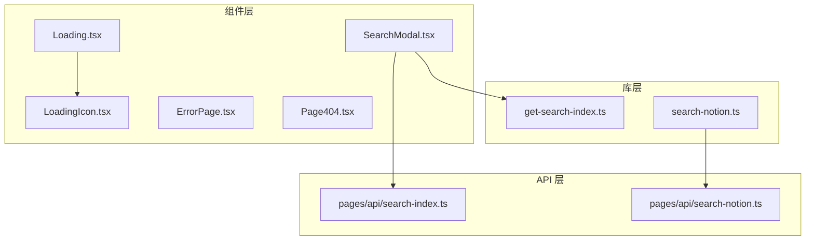
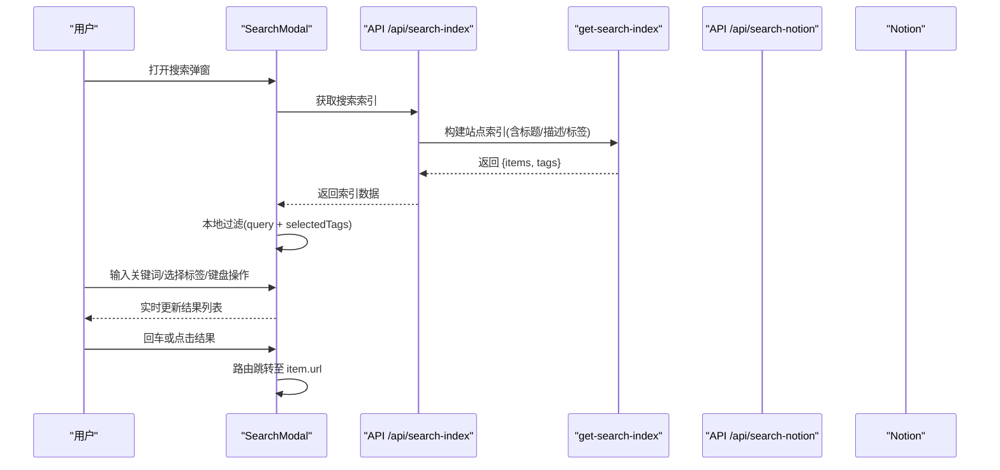
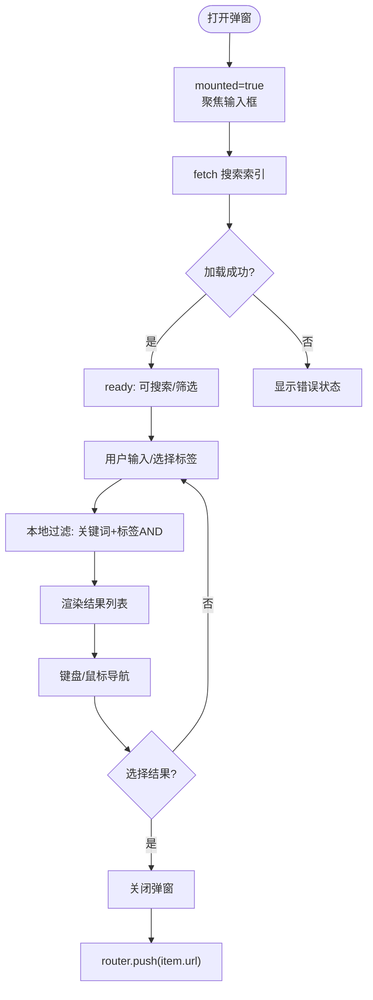
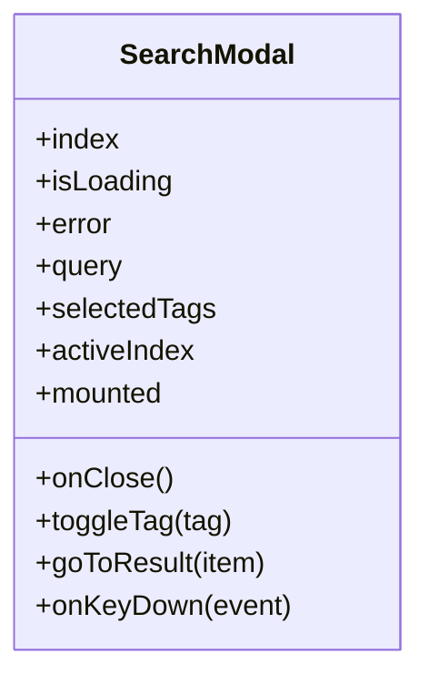
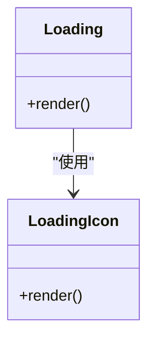
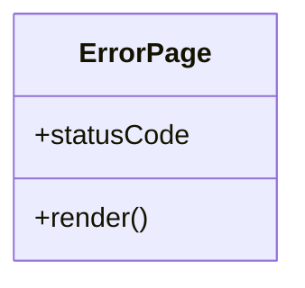
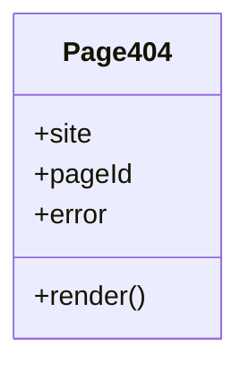
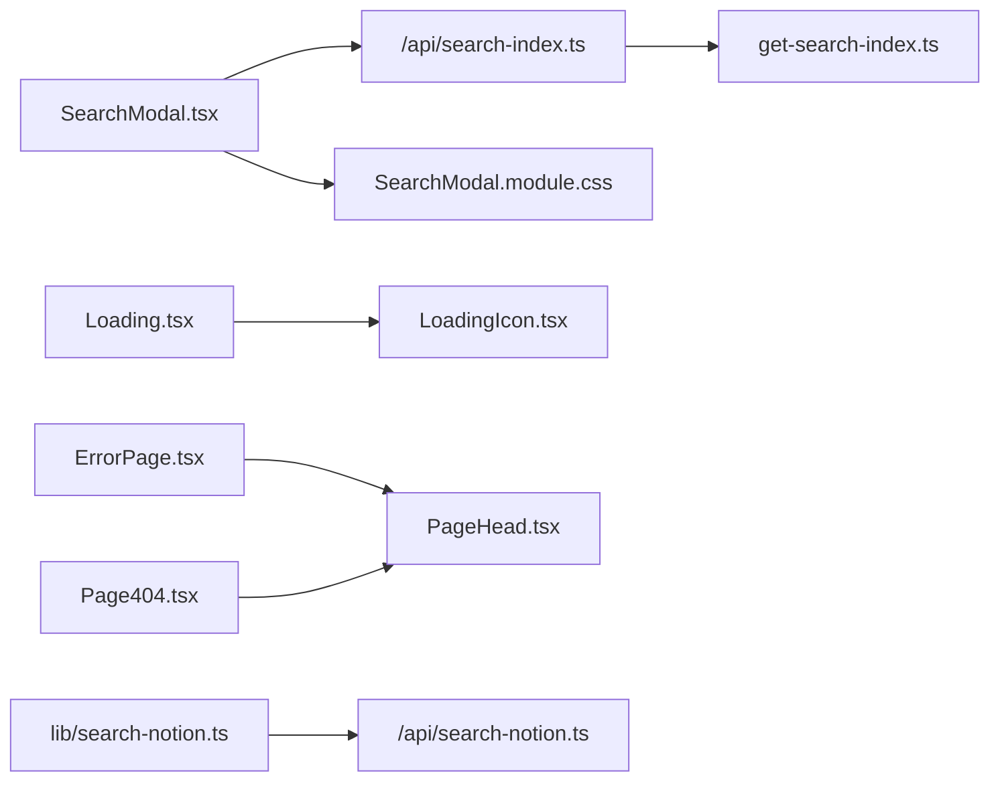

# 交互组件

<cite>
**本文引用的文件**   
- [SearchModal.tsx](file://components/SearchModal.tsx)
- [SearchModal.module.css](file://components/SearchModal.module.css)
- [Loading.tsx](file://components/Loading.tsx)
- [LoadingIcon.tsx](file://components/LoadingIcon.tsx)
- [ErrorPage.tsx](file://components/ErrorPage.tsx)
- [Page404.tsx](file://components/Page404.tsx)
- [get-search-index.ts](file://lib/get-search-index.ts)
- [search-notion.ts](file://lib/search-notion.ts)
- [search-index.ts](file://pages/api/search-index.ts)
- [search-notion.ts](file://pages/api/search-notion.ts)
</cite>

## 目录
1. [简介](#简介)
2. [项目结构](#项目结构)
3. [核心组件](#核心组件)
4. [架构总览](#架构总览)
5. [详细组件分析](#详细组件分析)
6. [依赖关系分析](#依赖关系分析)
7. [性能考虑](#性能考虑)
8. [故障排查指南](#故障排查指南)
9. [结论](#结论)

## 简介
本章节聚焦于用户交互相关的关键组件：SearchModal（搜索弹窗）、Loading（加载状态）、ErrorPage（通用错误页）与 Page404（未找到页面）。文档将系统阐述这些组件的职责边界、交互流程、状态管理、事件处理、键盘导航与无障碍访问支持，并结合后端接口说明数据流与缓存策略。

## 项目结构
交互组件位于 components 目录下，样式通过 CSS Modules 组织；搜索能力由 lib 层提供索引构建与实时搜索封装，并由 pages/api 暴露服务端接口。

图表来源
- [SearchModal.tsx:1-254](file://components/SearchModal.tsx#L1-L254)
- [Loading.tsx:1-11](file://components/Loading.tsx#L1-L11)
- [LoadingIcon.tsx:1-62](file://components/LoadingIcon.tsx#L1-L62)
- [ErrorPage.tsx:1-23](file://components/ErrorPage.tsx#L1-L23)
- [Page404.tsx:1-38](file://components/Page404.tsx#L1-L38)
- [get-search-index.ts:1-99](file://lib/get-search-index.ts#L1-L99)
- [search-notion.ts:1-40](file://lib/search-notion.ts#L1-L40)
- [search-index.ts:1-22](file://pages/api/search-index.ts#L1-L22)
- [search-notion.ts:1-26](file://pages/api/search-notion.ts#L1-L26)

章节来源
- [SearchModal.tsx:1-254](file://components/SearchModal.tsx#L1-L254)
- [Loading.tsx:1-11](file://components/Loading.tsx#L1-L11)
- [LoadingIcon.tsx:1-62](file://components/LoadingIcon.tsx#L1-L62)
- [ErrorPage.tsx:1-23](file://components/ErrorPage.tsx#L1-L23)
- [Page404.tsx:1-38](file://components/Page404.tsx#L1-L38)
- [get-search-index.ts:1-99](file://lib/get-search-index.ts#L1-L99)
- [search-notion.ts:1-40](file://lib/search-notion.ts#L1-L40)
- [search-index.ts:1-22](file://pages/api/search-index.ts#L1-L22)
- [search-notion.ts:1-26](file://pages/api/search-notion.ts#L1-L26)

## 核心组件
- SearchModal：提供客户端即时搜索、标签筛选、键盘导航与无障碍访问，渲染结果列表并跳转至目标页面。
- Loading：统一的加载占位组件，内部使用 LoadingIcon 展示动画图标。
- ErrorPage：通用错误展示页，显示错误码与错误图。
- Page404：未找到页面，根据传入的站点信息与错误信息给出引导文案。

章节来源
- [SearchModal.tsx:57-254](file://components/SearchModal.tsx#L57-L254)
- [Loading.tsx:4-10](file://components/Loading.tsx#L4-L10)
- [ErrorPage.tsx:4-22](file://components/ErrorPage.tsx#L4-L22)
- [Page404.tsx:6-37](file://components/Page404.tsx#L6-L37)

## 架构总览
SearchModal 在打开时从服务端获取轻量级搜索索引，随后在客户端进行关键词匹配与标签过滤；同时，lib 层提供对 Notion 的实时搜索封装，调用后端 API 返回搜索结果。

图表来源
- [SearchModal.tsx:80-111](file://components/SearchModal.tsx#L80-L111)
- [get-search-index.ts:44-98](file://lib/get-search-index.ts#L44-L98)
- [search-index.ts:5-21](file://pages/api/search-index.ts#L5-L21)

## 详细组件分析

### SearchModal 组件
职责与特性
- 打开后自动聚焦输入框，避免重复请求，仅在挂载后渲染 Portal。
- 首次加载搜索索引，失败时展示错误状态。
- 支持关键词模糊匹配与多标签“与”语义筛选。
- 支持键盘导航：Esc 关闭、上下键移动高亮项、Enter 跳转。
- 提供无障碍属性：aria-modal、aria-label、aria-pressed 等。
- 结果项支持鼠标悬停高亮与点击跳转。

状态与数据流
- index：搜索索引对象，包含 items 与 tags。
- isLoading/error：加载与错误状态。
- query：用户输入的关键词。
- selectedTags：选中的标签数组。
- activeIndex：当前高亮结果索引。
- mounted：控制是否渲染 Portal 内容。

交互逻辑
- 输入变更触发本地过滤，结果列表即时更新。
- 切换标签会重置 activeIndex 到首项。
- 点击结果或按 Enter 时关闭弹窗并跳转到对应 URL。

图表来源
- [SearchModal.tsx:68-115](file://components/SearchModal.tsx#L68-L115)
- [SearchModal.tsx:117-147](file://components/SearchModal.tsx#L117-L147)
- [SearchModal.tsx:153-252](file://components/SearchModal.tsx#L153-L252)

组件类图（概念映射）

图表来源
- [SearchModal.tsx:57-147](file://components/SearchModal.tsx#L57-L147)

章节来源
- [SearchModal.tsx:1-254](file://components/SearchModal.tsx#L1-L254)
- [SearchModal.module.css:12-182](file://components/SearchModal.module.css#L12-L182)

### Loading 与 LoadingIcon
职责与特性
- Loading 作为容器组件，居中展示 LoadingIcon。
- LoadingIcon 使用 SVG 绘制旋转进度指示器，并通过 CSS 控制动画效果。
- 适合用于数据加载、初始化等场景，保持视觉一致性。

图表来源
- [Loading.tsx:4-10](file://components/Loading.tsx#L4-L10)
- [LoadingIcon.tsx:5-61](file://components/LoadingIcon.tsx#L5-L61)

章节来源
- [Loading.tsx:1-11](file://components/Loading.tsx#L1-L11)
- [LoadingIcon.tsx:1-62](file://components/LoadingIcon.tsx#L1-L62)

### ErrorPage
职责与特性
- 展示通用错误页面，包含标题、可选的错误码与错误图。
- 通过 PageHead 设置页面元信息。

图表来源
- [ErrorPage.tsx:4-22](file://components/ErrorPage.tsx#L4-L22)

章节来源
- [ErrorPage.tsx:1-23](file://components/ErrorPage.tsx#L1-L23)

### Page404
职责与特性
- 展示“未找到”页面，根据传入的 site 与 pageId 动态设置标题与提示文案。
- 当存在 error 时显示错误信息，否则提示确保 Notion 页面公开可见。

图表来源
- [Page404.tsx:6-37](file://components/Page404.tsx#L6-L37)

章节来源
- [Page404.tsx:1-38](file://components/Page404.tsx#L1-L38)

## 依赖关系分析
- SearchModal 依赖：
  - 搜索索引 API：/api/search-index
  - 索引构建库：get-search-index
  - 路由：Next.js Router
  - 样式：SearchModal.module.css
- Loading 依赖：
  - LoadingIcon 组件
  - 全局样式 styles.module.css
- ErrorPage/Page404 依赖：
  - PageHead 组件
  - 全局样式 styles.module.css
- 实时搜索链路：
  - lib/search-notion.ts 封装 fetch 调用 pages/api/search-notion.ts
  - 服务端接口调用 notion.search 并返回结果

图表来源
- [SearchModal.tsx:1-10](file://components/SearchModal.tsx#L1-L10)
- [SearchModal.module.css:1-182](file://components/SearchModal.module.css#L1-L182)
- [Loading.tsx:1-11](file://components/Loading.tsx#L1-L11)
- [LoadingIcon.tsx:1-62](file://components/LoadingIcon.tsx#L1-L62)
- [ErrorPage.tsx:1-23](file://components/ErrorPage.tsx#L1-L23)
- [Page404.tsx:1-38](file://components/Page404.tsx#L1-L38)
- [search-notion.ts:1-40](file://lib/search-notion.ts#L1-L40)
- [search-notion.ts:1-26](file://pages/api/search-notion.ts#L1-L26)
- [search-index.ts:1-22](file://pages/api/search-index.ts#L1-L22)
- [get-search-index.ts:1-99](file://lib/get-search-index.ts#L1-L99)

章节来源
- [SearchModal.tsx:1-254](file://components/SearchModal.tsx#L1-L254)
- [Loading.tsx:1-11](file://components/Loading.tsx#L1-L11)
- [LoadingIcon.tsx:1-62](file://components/LoadingIcon.tsx#L1-L62)
- [ErrorPage.tsx:1-23](file://components/ErrorPage.tsx#L1-L23)
- [Page404.tsx:1-38](file://components/Page404.tsx#L1-L38)
- [search-notion.ts:1-40](file://lib/search-notion.ts#L1-L40)
- [search-notion.ts:1-26](file://pages/api/search-notion.ts#L1-L26)
- [search-index.ts:1-22](file://pages/api/search-index.ts#L1-L22)
- [get-search-index.ts:1-99](file://lib/get-search-index.ts#L1-L99)

## 性能考虑
- 客户端即时搜索：
  - 通过一次性拉取搜索索引并在客户端进行关键词与标签过滤，避免每次按键都请求后端，显著降低网络开销与延迟。
- 索引构建缓存：
  - get-search-index 使用 p-memoize 对索引构建进行缓存，减少重复计算。
- API 响应缓存：
  - /api/search-index 与 /api/search-notion 均设置了 Cache-Control，启用 CDN/浏览器缓存与 stale-while-revalidate，提升整体吞吐与稳定性。
- 渲染优化：
  - SearchModal 使用 useMemo 计算结果列表，避免不必要的重渲染。
  - 仅在 mounted 后渲染 Portal，避免 SSR 阶段 DOM 访问异常。

章节来源
- [get-search-index.ts:39-42](file://lib/get-search-index.ts#L39-L42)
- [search-index.ts:12-16](file://pages/api/search-index.ts#L12-L16)
- [search-notion.ts:20-24](file://pages/api/search-notion.ts#L20-L24)
- [SearchModal.tsx:108-115](file://components/SearchModal.tsx#L108-L115)
- [SearchModal.tsx:68-78](file://components/SearchModal.tsx#L68-L78)

## 故障排查指南
常见问题与定位思路
- 搜索弹窗无法打开或空白：
  - 检查 mounted 状态与 createPortal 渲染时机，确认 document 可用后再渲染。
  - 查看 /api/search-index 是否返回有效索引数据。
- 搜索无结果：
  - 确认关键词与标签过滤逻辑是否正确，尤其是大小写与空格处理。
  - 检查 Notion 页面是否标记为 Public，以及 Tags/Description 字段是否存在。
- 键盘导航无效：
  - 确认 onKeyDown 绑定在模态容器上，且阻止默认行为（如滚动）。
  - 验证 activeIndex 边界处理是否正确。
- 错误状态展示：
  - 若索引加载失败，组件会进入错误分支，检查网络与后端日志。
  - ErrorPage 与 Page404 分别用于通用错误与未找到场景，确保传入参数正确。

章节来源
- [SearchModal.tsx:80-106](file://components/SearchModal.tsx#L80-L106)
- [SearchModal.tsx:131-147](file://components/SearchModal.tsx#L131-L147)
- [ErrorPage.tsx:4-22](file://components/ErrorPage.tsx#L4-L22)
- [Page404.tsx:6-37](file://components/Page404.tsx#L6-L37)

## 结论
SearchModal、Loading、ErrorPage 与 Page404 共同构成了项目的关键交互体验层。SearchModal 以客户端索引为核心，实现高性能的即时搜索与标签筛选，并提供完善的键盘导航与无障碍支持；Loading 提供一致的加载反馈；ErrorPage 与 Page404 则负责错误与未找到的友好展示。配合 lib 层的缓存与 API 层的响应缓存，整体方案在保证用户体验的同时兼顾了性能与可维护性。