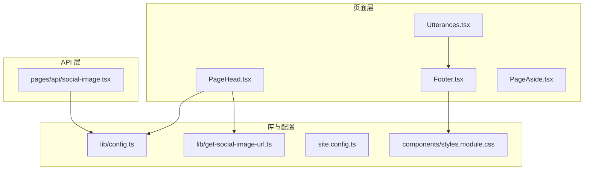
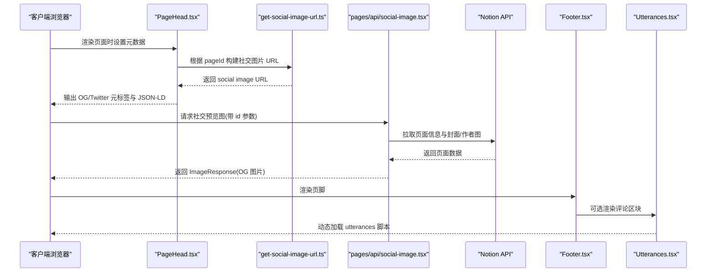
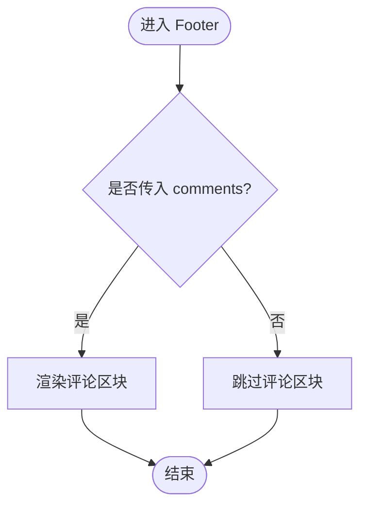
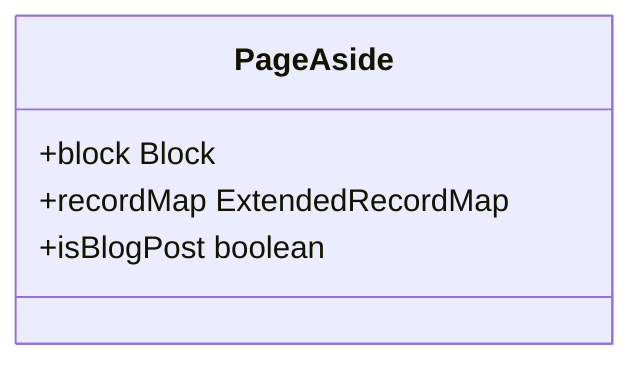
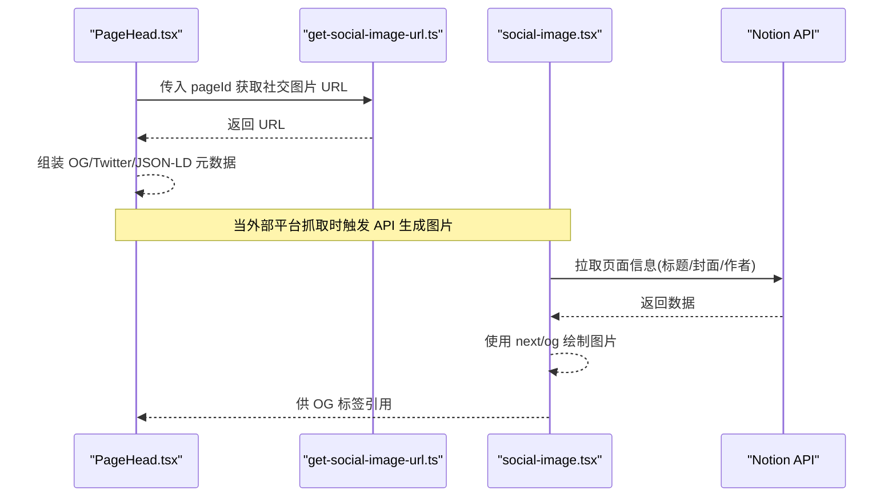
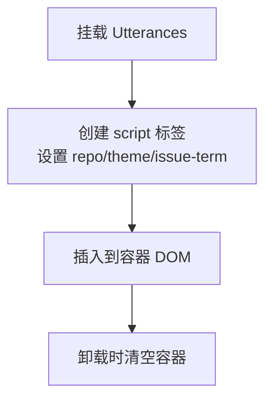
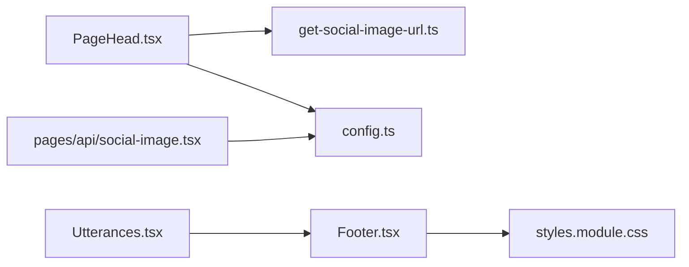

# 布局组件

<cite>
**本文引用的文件**   
- [components/Footer.tsx](file://components/Footer.tsx)
- [components/PageAside.tsx](file://components/PageAside.tsx)
- [components/PageHead.tsx](file://components/PageHead.tsx)
- [components/Utterances.tsx](file://components/Utterances.tsx)
- [components/styles.module.css](file://components/styles.module.css)
- [lib/get-social-image-url.ts](file://lib/get-social-image-url.ts)
- [lib/config.ts](file://lib/config.ts)
- [pages/api/social-image.tsx](file://pages/api/social-image.tsx)
- [site.config.ts](file://site.config.ts)
</cite>

## 目录
1. [简介](#简介)
2. [项目结构](#项目结构)
3. [核心组件](#核心组件)
4. [架构总览](#架构总览)
5. [详细组件分析](#详细组件分析)
6. [依赖关系分析](#依赖关系分析)
7. [性能与可访问性](#性能与可访问性)
8. [样式定制指南](#样式定制指南)
9. [故障排查](#故障排查)
10. [结论](#结论)

## 简介
本文件聚焦于站点布局相关组件，系统性说明以下组件的职责、实现要点与扩展方式：
- Footer：页脚容器、评论系统集成入口、响应式布局。
- PageAside：侧边栏占位组件（当前为预留扩展点）。
- PageHead：SEO 元数据管理、社交媒体预览图生成链路、动态标题与结构化数据注入。

同时给出响应式设计、可访问性与样式定制建议，帮助读者快速理解并二次开发。

## 项目结构
布局相关代码主要分布在 components 与 pages/api 下，配合 lib 配置模块与 site.config.ts 完成站点级行为控制。

图表来源
- [components/PageHead.tsx:1-188](file://components/PageHead.tsx#L1-L188)
- [components/Footer.tsx:1-14](file://components/Footer.tsx#L1-L14)
- [components/PageAside.tsx:1-18](file://components/PageAside.tsx#L1-L18)
- [components/Utterances.tsx:1-33](file://components/Utterances.tsx#L1-L33)
- [pages/api/social-image.tsx:1-313](file://pages/api/social-image.tsx#L1-L313)
- [lib/get-social-image-url.ts:1-17](file://lib/get-social-image-url.ts#L1-L17)
- [lib/config.ts:1-224](file://lib/config.ts#L1-L224)
- [site.config.ts:1-78](file://site.config.ts#L1-L78)
- [components/styles.module.css:1-226](file://components/styles.module.css#L1-L226)

章节来源
- [components/PageHead.tsx:1-188](file://components/PageHead.tsx#L1-L188)
- [components/Footer.tsx:1-14](file://components/Footer.tsx#L1-L14)
- [components/PageAside.tsx:1-18](file://components/PageAside.tsx#L1-L18)
- [components/Utterances.tsx:1-33](file://components/Utterances.tsx#L1-L33)
- [pages/api/social-image.tsx:1-313](file://pages/api/social-image.tsx#L1-L313)
- [lib/get-social-image-url.ts:1-17](file://lib/get-social-image-url.ts#L1-L17)
- [lib/config.ts:1-224](file://lib/config.ts#L1-L224)
- [site.config.ts:1-78](file://site.config.ts#L1-L78)
- [components/styles.module.css:1-226](file://components/styles.module.css#L1-L226)

## 核心组件
- Footer：页脚容器，支持可选的评论区块渲染；通过 CSS 提供基础布局与响应式断点。
- PageAside：侧边栏占位组件，当前返回 null，便于后续扩展目录导航、相关文章等。
- PageHead：负责注入 SEO 元信息、Open Graph/Twitter Card、RSS 订阅链接、JSON-LD 结构化数据，以及动态标题。
- Utterances：评论系统集成组件，动态加载第三方脚本以渲染评论。

章节来源
- [components/Footer.tsx:1-14](file://components/Footer.tsx#L1-L14)
- [components/PageAside.tsx:1-18](file://components/PageAside.tsx#L1-L18)
- [components/PageHead.tsx:1-188](file://components/PageHead.tsx#L1-L188)
- [components/Utterances.tsx:1-33](file://components/Utterances.tsx#L1-L33)

## 架构总览
下图展示从页面到 API 的社交预览图生成链路，以及各布局组件之间的协作关系。

图表来源
- [components/PageHead.tsx:1-188](file://components/PageHead.tsx#L1-L188)
- [lib/get-social-image-url.ts:1-17](file://lib/get-social-image-url.ts#L1-L17)
- [pages/api/social-image.tsx:1-313](file://pages/api/social-image.tsx#L1-L313)
- [components/Footer.tsx:1-14](file://components/Footer.tsx#L1-L14)
- [components/Utterances.tsx:1-33](file://components/Utterances.tsx#L1-L33)

## 详细组件分析

### Footer 组件
职责与特性
- 作为页脚容器，包裹可选的评论区域。
- 通过 CSS 类名 footer/comments 提供布局与间距。
- 使用 React.memo 优化重渲染。

关键实现要点
- 接收 comments 节点，条件渲染评论区块。
- 样式由 styles.module.css 中的 .footer/.comments 控制。

响应式与可访问性
- 在窄屏下通过媒体查询切换为纵向排列，保证移动端可读性。
- 评论区块默认具备上边框与内边距，利于视觉分隔。

扩展建议
- 可在 FooterImpl 中增加版权信息、站点链接、语言切换等元素。
- 将评论系统（如 Utterances）作为 children 或 props 传入，保持解耦。

图表来源
- [components/Footer.tsx:1-14](file://components/Footer.tsx#L1-L14)
- [components/styles.module.css:48-150](file://components/styles.module.css#L48-L150)

章节来源
- [components/Footer.tsx:1-14](file://components/Footer.tsx#L1-L14)
- [components/styles.module.css:48-150](file://components/styles.module.css#L48-L150)

### PageAside 组件
职责与特性
- 当前为占位组件，未渲染任何内容，便于后续扩展目录导航、相关文章推荐、侧边工具等。

扩展建议
- 基于 block 与 recordMap 解析目录（例如基于 heading blocks），生成 TOC。
- 结合 notion-types 的类型定义，安全地读取页面属性与块类型。
- 可加入“最近文章”“标签云”“阅读进度”等增强功能。

图表来源
- [components/PageAside.tsx:1-18](file://components/PageAside.tsx#L1-L18)

章节来源
- [components/PageAside.tsx:1-18](file://components/PageAside.tsx#L1-L18)

### PageHead 组件
职责与特性
- 动态设置文档标题、描述、作者、语言。
- 注入 Open Graph 与 Twitter Card 元数据，支持大图卡片。
- 根据 isBlogPost 切换 schema.org 类型（WebSite/BlogPosting）。
- 注入 RSS 订阅链接与 canonical URL。
- 输出 JSON-LD 结构化数据，提升搜索引擎理解能力。

关键流程
- 计算站点名称、页面标题、描述、社交图片 URL、作者、语言、页面类型。
- 构造 websiteSchema 与 blogPostingSchema，合并为 structuredData。
- 通过 Next.js Head 组件注入 meta/link/script 标签。

社交预览图生成链路
- getSocialImageUrl 根据 pageId 拼接 API 地址。
- pages/api/social-image.tsx 拉取 Notion 页面信息，动态绘制 OG 图片。

图表来源
- [components/PageHead.tsx:1-188](file://components/PageHead.tsx#L1-L188)
- [lib/get-social-image-url.ts:1-17](file://lib/get-social-image-url.ts#L1-L17)
- [pages/api/social-image.tsx:1-313](file://pages/api/social-image.tsx#L1-L313)

章节来源
- [components/PageHead.tsx:1-188](file://components/PageHead.tsx#L1-L188)
- [lib/get-social-image-url.ts:1-17](file://lib/get-social-image-url.ts#L1-L17)
- [pages/api/social-image.tsx:1-313](file://pages/api/social-image.tsx#L1-L313)

### Utterances 评论组件
职责与特性
- 动态加载 utterances.es 脚本，按 pathname 绑定 GitHub Issue 作为评论源。
- 支持主题切换，通过重新注入脚本确保主题生效。
- 在卸载时清理容器内容，避免内存泄漏。

集成方式
- 将 Utterances 作为 Footer 的 comments 子节点传入，即可在页脚渲染评论区。

图表来源
- [components/Utterances.tsx:1-33](file://components/Utterances.tsx#L1-L33)

章节来源
- [components/Utterances.tsx:1-33](file://components/Utterances.tsx#L1-L33)

## 依赖关系分析
- PageHead 依赖 lib/config.ts 提供的站点常量与 API 路径，依赖 lib/get-social-image-url.ts 构建社交图片 URL。
- social-image API 依赖 lib/config.ts 校验工作区、读取默认值，并通过 notion-api 拉取页面数据。
- Footer 依赖样式模块 styles.module.css 进行布局与响应式处理。
- Utterances 与 Footer 组合形成评论系统的最终呈现。

图表来源
- [components/PageHead.tsx:1-188](file://components/PageHead.tsx#L1-L188)
- [lib/get-social-image-url.ts:1-17](file://lib/get-social-image-url.ts#L1-L17)
- [lib/config.ts:1-224](file://lib/config.ts#L1-L224)
- [pages/api/social-image.tsx:1-313](file://pages/api/social-image.tsx#L1-L313)
- [components/Footer.tsx:1-14](file://components/Footer.tsx#L1-L14)
- [components/Utterances.tsx:1-33](file://components/Utterances.tsx#L1-L33)
- [components/styles.module.css:1-226](file://components/styles.module.css#L1-L226)

章节来源
- [components/PageHead.tsx:1-188](file://components/PageHead.tsx#L1-L188)
- [lib/get-social-image-url.ts:1-17](file://lib/get-social-image-url.ts#L1-L17)
- [lib/config.ts:1-224](file://lib/config.ts#L1-L224)
- [pages/api/social-image.tsx:1-313](file://pages/api/social-image.tsx#L1-L313)
- [components/Footer.tsx:1-14](file://components/Footer.tsx#L1-L14)
- [components/Utterances.tsx:1-33](file://components/Utterances.tsx#L1-L33)
- [components/styles.module.css:1-226](file://components/styles.module.css#L1-L226)

## 性能与可访问性
- 性能
  - PageHead 仅在渲染时注入必要元数据，避免多余计算。
  - social-image API 运行在 edge runtime，减少冷启动开销；按需拉取字体，避免包体过大。
  - Footer 使用 React.memo 包裹，降低无变化时的重渲染成本。
- 可访问性
  - 通过语义化标签 <footer> 与合适的 meta 信息提升可访问性与 SEO。
  - 评论组件在主题切换时重新注入脚本，确保视觉一致性。
  - 建议在扩展 Footer 时补充 aria-label、role 等语义属性，提高屏幕阅读器友好度。

[本节为通用指导，不直接分析具体文件]

## 样式定制指南
- 页脚布局
  - 修改 .footer 的 flex-direction、gap、padding 等属性调整整体布局。
  - 在窄屏断点下，.footer 会切换为纵向排列，可通过媒体查询覆盖默认行为。
- 评论区块
  - 通过 .comments 控制宽度、边距与上边框，适配不同评论系统。
- 主题色与交互
  - 可使用 CSS 变量与 :hover 伪类定制图标颜色与过渡动画。
- 全局样式
  - 站点级字体、背景色等可在 styles.module.css 的根类中进行统一调整。

章节来源
- [components/styles.module.css:48-150](file://components/styles.module.css#L48-L150)

## 故障排查
- 社交预览图不显示
  - 检查 site.config.ts 中 rootNotionPageId 是否正确。
  - 确认 lib/config.ts 中 api.getSocialImage 指向正确的 API 路由。
  - 验证 pages/api/social-image.tsx 是否能成功拉取 Notion 页面数据。
- 评论无法加载
  - 检查 Utterances 组件的 repo 与 issue-term 配置是否与 GitHub 仓库一致。
  - 确认网络环境可访问 https://utteranc.es/client.js。
- 移动端布局异常
  - 检查 styles.module.css 中的媒体查询断点与 flex 方向设置是否符合预期。

章节来源
- [site.config.ts:1-78](file://site.config.ts#L1-L78)
- [lib/config.ts:148-153](file://lib/config.ts#L148-L153)
- [pages/api/social-image.tsx:21-46](file://pages/api/social-image.tsx#L21-L46)
- [components/Utterances.tsx:1-33](file://components/Utterances.tsx#L1-L33)
- [components/styles.module.css:132-150](file://components/styles.module.css#L132-L150)

## 结论
- Footer 提供了简洁的页脚容器与评论集成入口，具备良好的可扩展性与响应式表现。
- PageAside 目前为占位组件，适合未来扩展目录导航、相关文章等功能。
- PageHead 实现了完善的 SEO 元数据管理与社交预览图生成链路，配合 social-image API 可产出高质量的分享图。
- 通过合理的样式定制与可访问性实践，可进一步提升用户体验与搜索引擎收录质量。

[本节为总结性内容，不直接分析具体文件]