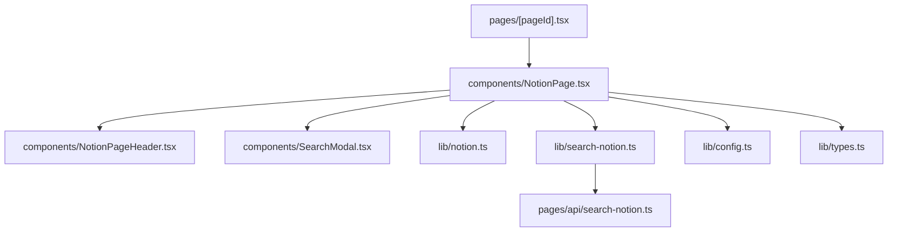
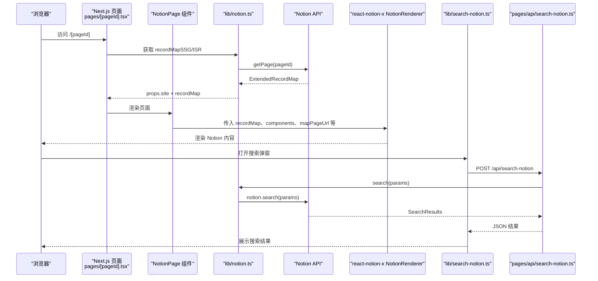
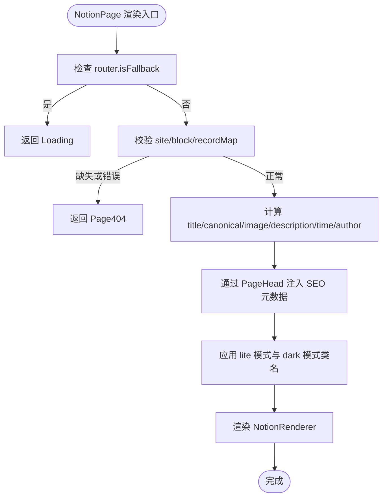
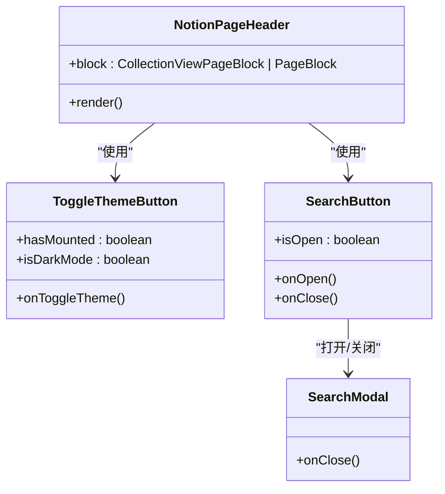
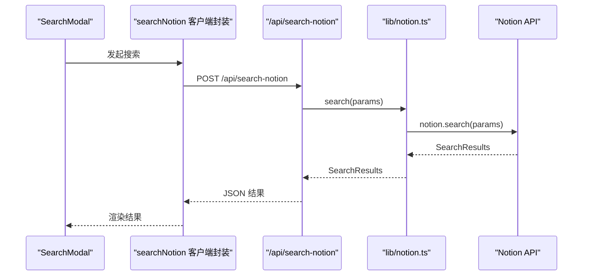
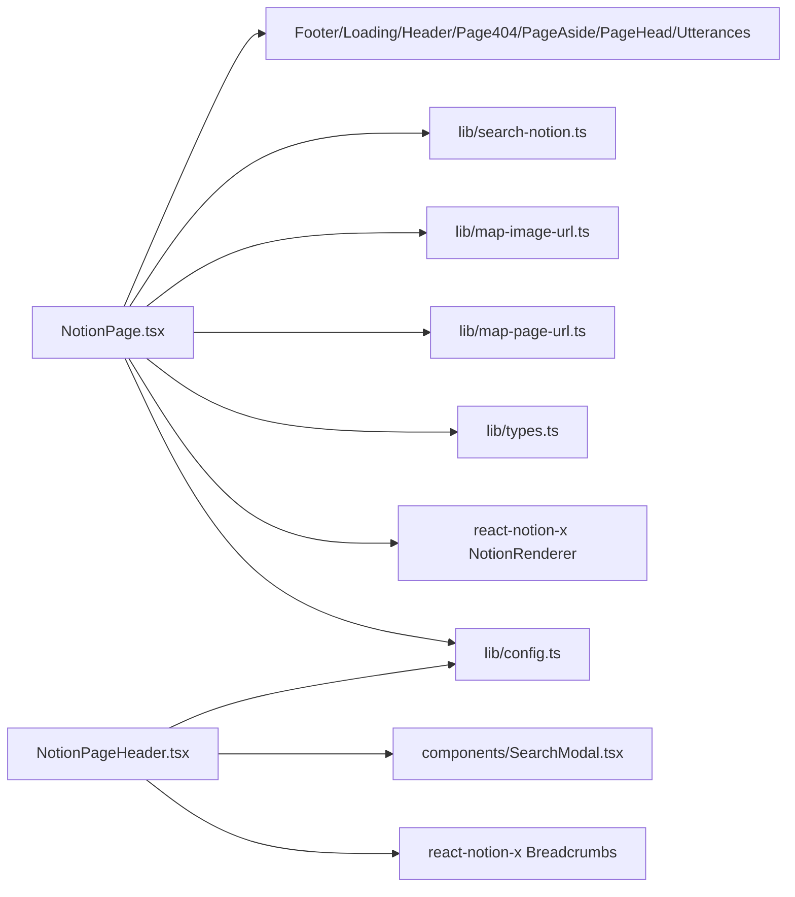

# 核心组件

<cite>
**本文引用的文件**   
- [components/NotionPage.tsx](file://components/NotionPage.tsx)
- [components/NotionPageHeader.tsx](file://components/NotionPageHeader.tsx)
- [components/SearchModal.tsx](file://components/SearchModal.tsx)
- [lib/notion.ts](file://lib/notion.ts)
- [lib/search-notion.ts](file://lib/search-notion.ts)
- [pages/[pageId].tsx](file://pages/[pageId].tsx)
- [pages/api/search-notion.ts](file://pages/api/search-notion.ts)
- [lib/config.ts](file://lib/config.ts)
- [lib/types.ts](file://lib/types.ts)
</cite>

## 目录
1. [引言](#引言)
2. [项目结构](#项目结构)
3. [核心组件](#核心组件)
4. [架构总览](#架构总览)
5. [详细组件分析](#详细组件分析)
6. [依赖关系分析](#依赖关系分析)
7. [性能考虑](#性能考虑)
8. [故障排查指南](#故障排查指南)
9. [结论](#结论)

## 引言
本文聚焦 Notion 内容站点中的两个核心前端组件：NotionPage 与 NotionPageHeader。文档将系统阐述 NotionPage 如何渲染 Notion 数据、管理页面状态、注入 SEO 元数据、集成搜索能力；同时解析 NotionPageHeader 的布局结构、导航逻辑与用户交互。文末提供组件属性接口、事件处理、生命周期管理与性能优化策略，并给出组件间通信机制和数据流向说明。

## 项目结构
本仓库采用 Next.js App Router 风格的页面组织方式，核心视图由 pages 路由驱动，业务逻辑集中在 lib 目录，UI 组件位于 components 目录。与本文相关的文件包括：
- 页面入口：[pages/[pageId].tsx](file://pages/[pageId].tsx)
- 核心渲染组件：[components/NotionPage.tsx](file://components/NotionPage.tsx)
- 页面头部组件：[components/NotionPageHeader.tsx](file://components/NotionPageHeader.tsx)
- 搜索弹窗：[components/SearchModal.tsx](file://components/SearchModal.tsx)
- Notion 数据获取与缓存：[lib/notion.ts](file://lib/notion.ts)
- 客户端搜索封装：[lib/search-notion.ts](file://lib/search-notion.ts)
- 站点配置：[lib/config.ts](file://lib/config.ts)
- 类型定义：[lib/types.ts](file://lib/types.ts)
- 服务端搜索 API：[pages/api/search-notion.ts](file://pages/api/search-notion.ts)

**图表来源**
- [pages/[pageId].tsx:1-36](file://pages/[pageId].tsx#L1-L36)
- [components/NotionPage.tsx:1-357](file://components/NotionPage.tsx#L1-L357)
- [components/NotionPageHeader.tsx:1-129](file://components/NotionPageHeader.tsx#L1-L129)
- [components/SearchModal.tsx:1-254](file://components/SearchModal.tsx#L1-L254)
- [lib/notion.ts:1-219](file://lib/notion.ts#L1-L219)
- [lib/search-notion.ts:1-40](file://lib/search-notion.ts#L1-L40)
- [pages/api/search-notion.ts:1-26](file://pages/api/search-notion.ts#L1-L26)
- [lib/config.ts:1-224](file://lib/config.ts#L1-L224)
- [lib/types.ts:1-78](file://lib/types.ts#L1-L78)

**章节来源**
- [pages/[pageId].tsx:1-36](file://pages/[pageId].tsx#L1-L36)
- [components/NotionPage.tsx:1-357](file://components/NotionPage.tsx#L1-L357)

## 核心组件
本节概述 NotionPage 与 NotionPageHeader 的职责边界与协作关系：
- NotionPage：负责页面级渲染、SEO 元数据注入、主题模式切换、Notion 内容渲染、侧边栏与页脚挂载、搜索能力接入。
- NotionPageHeader：作为 NotionRenderer 的 Header 组件，负责面包屑导航、自定义导航链接、主题切换按钮、搜索入口。

**章节来源**
- [components/NotionPage.tsx:196-357](file://components/NotionPage.tsx#L196-L357)
- [components/NotionPageHeader.tsx:78-129](file://components/NotionPageHeader.tsx#L78-L129)

## 架构总览
下图展示从页面请求到 Notion 内容渲染与搜索的端到端流程。

**图表来源**
- [pages/[pageId].tsx:8-35](file://pages/[pageId].tsx#L8-L35)
- [lib/notion.ts:161-214](file://lib/notion.ts#L161-L214)
- [components/NotionPage.tsx:319-353](file://components/NotionPage.tsx#L319-L353)
- [lib/search-notion.ts:12-39](file://lib/search-notion.ts#L12-L39)
- [pages/api/search-notion.ts:6-24](file://pages/api/search-notion.ts#L6-L24)

## 详细组件分析

### NotionPage 组件
NotionPage 是页面级容器组件，承担以下职责：
- 渲染 Notion 内容：通过 react-notion-x 的 NotionRenderer 渲染 recordMap，并注入自定义组件（代码高亮、集合、公式、PDF、模态框、推文）。
- 页面状态管理：根据 URL 参数 lite 切换精简模式；根据 useDarkMode 切换深色模式；根据 block 类型判断是否为博客文章以决定是否显示目录。
- SEO 元数据：计算 canonical URL、社交图片、描述、作者、发布时间、修改时间，并通过 PageHead 注入。
- 搜索集成：当启用搜索时，向 NotionRenderer 注入 searchNotion 函数，使内部搜索可用。
- 侧边栏与页脚：挂载 PageAside 与 Footer，并在博客文章中挂载 Utterances 评论。

#### 关键实现要点
- 动态导入可选组件：使用 next/dynamic 按需加载 Code、Collection、Equation、Pdf、Modal 等，减少首屏体积。
- 自定义 NotionComponents：覆盖 nextImage、nextLink、Code、Collection、Equation、Pdf、Modal、Tweet、Header、propertyLastEditedTimeValue、propertyTextValue、propertyDateValue。
- Lite 模式：当 URL 包含 lite=true 时，为 body 添加 notion-lite 类名，用于 oembed 场景。
- SEO 元数据：
  - canonical URL：非开发环境通过 getCanonicalPageUrl 生成。
  - 社交图片：优先使用页面“Social Image”属性或封面图，否则回退默认值。
  - 描述：博客文章优先使用页面“Description”属性，否则使用“标题 — 站点名”；其他页面使用站点描述。
  - 作者/时间：从页面属性读取 Author、Published、Last Edited。
- 搜索能力：当 config.isSearchEnabled 为真时，注入 searchNotion 函数，供 NotionRenderer 内部调用。

**图表来源**
- [components/NotionPage.tsx:211-357](file://components/NotionPage.tsx#L211-L357)

#### 属性接口
- 输入属性（来自 types.PageProps）：
  - site?: Site
  - recordMap?: ExtendedRecordMap
  - pageId?: string
  - error?: PageError
- 内部状态：
  - lite 模式：useSearchParam('lite')
  - 深色模式：useDarkMode()
  - 是否博客文章：block.type === 'page' && block.parent_table === 'collection'
  - 目录开关：showTableOfContents = isBlogPost，minTableOfContentsItems = 3

**章节来源**
- [components/NotionPage.tsx:211-357](file://components/NotionPage.tsx#L211-L357)
- [lib/types.ts:14-19](file://lib/types.ts#L14-L19)

### NotionPageHeader 组件
NotionPageHeader 作为 NotionRenderer 的 Header 组件，负责：
- 面包屑导航：使用 react-notion-x 的 Breadcrumbs，rootOnly=true 仅显示根级路径。
- 自定义导航链接：遍历 navigationLinks，若 link.pageId 则使用 components.PageLink 跳转站内页面；否则使用 components.Link 跳转外部链接。
- 主题切换：ToggleThemeButton 基于 useDarkMode 切换深色模式，避免 SSR 闪烁。
- 搜索入口：SearchButton 打开 SearchModal，支持键盘操作与无障碍属性。

**图表来源**
- [components/NotionPageHeader.tsx:15-76](file://components/NotionPageHeader.tsx#L15-L76)
- [components/SearchModal.tsx:57-129](file://components/SearchModal.tsx#L57-L129)

#### 布局结构与交互
- 布局：header.notion-header > div.notion-nav-header > (Breadcrumbs + 右侧导航区)
- 右侧导航区：navigationLinks 列表 + 主题切换按钮 + 搜索按钮（受 isSearchEnabled 控制）
- 交互：
  - 点击主题按钮触发 toggleDarkMode
  - 点击搜索按钮打开 SearchModal，支持 Enter/Space/Esc/方向键导航

**章节来源**
- [components/NotionPageHeader.tsx:78-129](file://components/NotionPageHeader.tsx#L78-L129)

### 搜索功能集成
搜索链路分为客户端与服务端两部分：
- 客户端：
  - SearchModal 在打开时拉取搜索索引（/api/search-index），本地过滤标题、描述、标签。
  - 当 NotionRenderer 内部需要实时搜索时，调用注入的 searchNotion 函数。
- 服务端：
  - pages/api/search-notion.ts 接收 POST 请求，调用 lib/notion.ts 的 search 方法，最终转发至 Notion API。
  - 响应设置 Cache-Control 缓存头，提升重复查询性能。

**图表来源**
- [components/SearchModal.tsx:80-106](file://components/SearchModal.tsx#L80-L106)
- [lib/search-notion.ts:12-39](file://lib/search-notion.ts#L12-L39)
- [pages/api/search-notion.ts:6-24](file://pages/api/search-notion.ts#L6-L24)
- [lib/notion.ts:216-218](file://lib/notion.ts#L216-L218)

**章节来源**
- [components/SearchModal.tsx:57-254](file://components/SearchModal.tsx#L57-L254)
- [lib/search-notion.ts:1-40](file://lib/search-notion.ts#L1-L40)
- [pages/api/search-notion.ts:1-26](file://pages/api/search-notion.ts#L1-L26)

## 依赖关系分析
- NotionPage 依赖：
  - react-notion-x：NotionRenderer、useNotionContext、NotionComponents
  - next/dynamic：按需加载可选组件
  - next/link、next/image：替换默认 Link/Image
  - notion-utils：getBlockTitle、getPageProperty、formatDate
  - 站点配置：config.isSearchEnabled、defaultPageIcon/defaultPageCover 等
  - 工具模块：mapImageUrl、getCanonicalPageUrl、mapPageUrl
  - 子组件：Footer、Loading、NotionPageHeader、Page404、PageAside、PageHead、Utterances
- NotionPageHeader 依赖：
  - react-notion-x：Breadcrumbs、useNotionContext
  - 站点配置：navigationLinks、isSearchEnabled
  - 子组件：SearchModal、图标组件、样式模块

**图表来源**
- [components/NotionPage.tsx:1-38](file://components/NotionPage.tsx#L1-L38)
- [components/NotionPageHeader.tsx:1-14](file://components/NotionPageHeader.tsx#L1-L14)

**章节来源**
- [components/NotionPage.tsx:1-357](file://components/NotionPage.tsx#L1-L357)
- [components/NotionPageHeader.tsx:1-129](file://components/NotionPageHeader.tsx#L1-L129)

## 性能考虑
- 组件懒加载：
  - Code、Collection、Equation、Pdf、Modal 使用 next/dynamic 异步加载，减少首屏体积。
  - Collection/Pdf/Modal 设置 ssr:false，避免服务端/客户端水合不一致。
- 客户端搜索缓存：
  - searchNotion 使用 p-memoize 与 ExpiryMap 进行短期缓存，降低重复请求压力。
- 服务端记录映射缓存：
  - lib/notion.ts 维护内存级 pageCache（TTL 60s），在 Notion 不可用时提供 stale-while-revalidate 兜底。
- 集合查询修正：
  - fixCollectionQueries 重新执行 collection 查询，确保排序与过滤与 Notion 一致，避免额外渲染开销。
- 预览图与推文：
  - 可选开启 preview_images，合并预览图映射；getTweetsMap 预取推文数据，减少二次请求。

**章节来源**
- [components/NotionPage.tsx:43-142](file://components/NotionPage.tsx#L43-L142)
- [lib/search-notion.ts:1-10](file://lib/search-notion.ts#L1-L10)
- [lib/notion.ts:19-55](file://lib/notion.ts#L19-L55)
- [lib/notion.ts:95-159](file://lib/notion.ts#L95-L159)
- [lib/notion.ts:203-211](file://lib/notion.ts#L203-L211)

## 故障排查指南
- 页面无法渲染：
  - 检查 resolveNotionPage 是否正确返回 site 与 recordMap；若失败，会返回 Page404。
  - 确认 Notion API 可达；若不可达，lib/notion.ts 会尝试返回过期缓存，避免 500。
- 搜索无结果：
  - 确认 isSearchEnabled 已启用；检查 /api/search-notion 是否正常返回；查看 SearchModal 的错误状态提示。
- 集合排序/过滤异常：
  - 检查 fixCollectionQueries 是否成功合并 reducerResults；关注控制台警告日志。
- 主题切换闪烁：
  - ToggleThemeButton 通过 hasMounted 避免 SSR 闪烁；确认 useDarkMode 初始化正确。

**章节来源**
- [pages/[pageId].tsx:8-24](file://pages/[pageId].tsx#L8-L24)
- [lib/notion.ts:161-182](file://lib/notion.ts#L161-L182)
- [components/SearchModal.tsx:80-106](file://components/SearchModal.tsx#L80-L106)
- [components/NotionPageHeader.tsx:15-35](file://components/NotionPageHeader.tsx#L15-L35)

## 结论
NotionPage 与 NotionPageHeader 共同构成了 Notion 内容站点的核心渲染与导航层。NotionPage 通过 NotionRenderer 高效渲染 Notion 数据，结合 SEO 元数据注入、主题模式与搜索集成，提供完整的页面体验；NotionPageHeader 则在头部区域提供清晰的面包屑导航、可配置的站点链接、主题切换与搜索入口。配合 lib/notion.ts 的服务端缓存与 lib/search-notion.ts 的客户端缓存，系统在性能与可用性之间取得良好平衡。