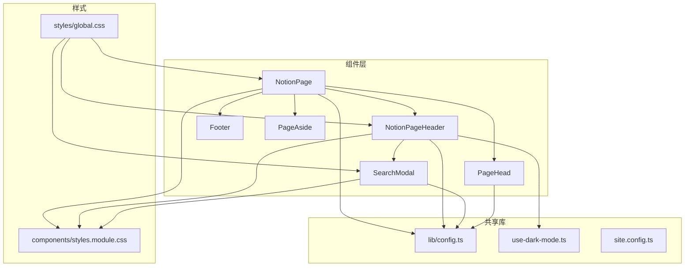
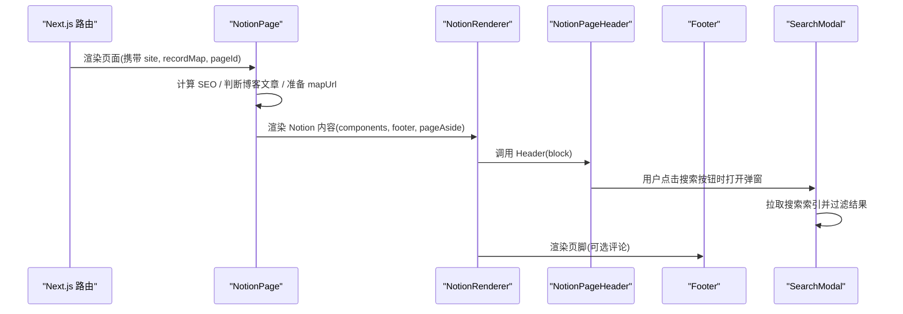
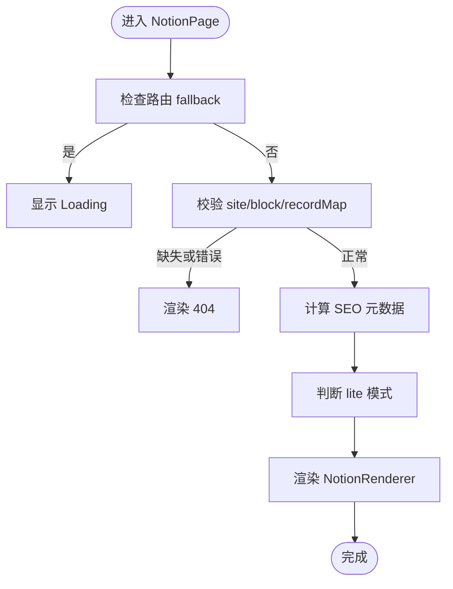
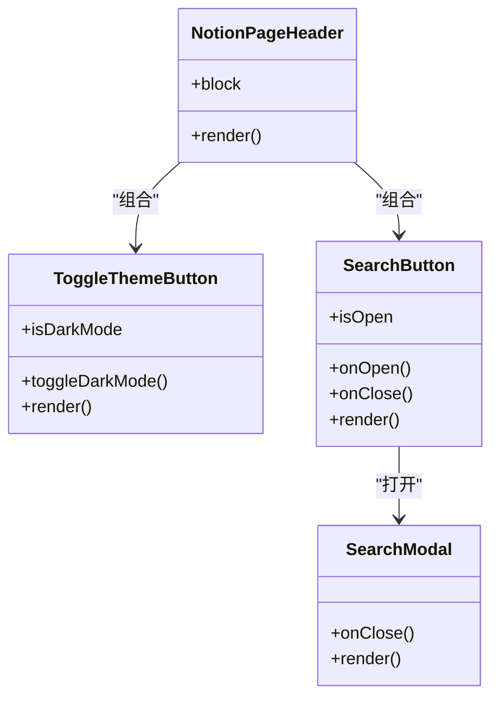
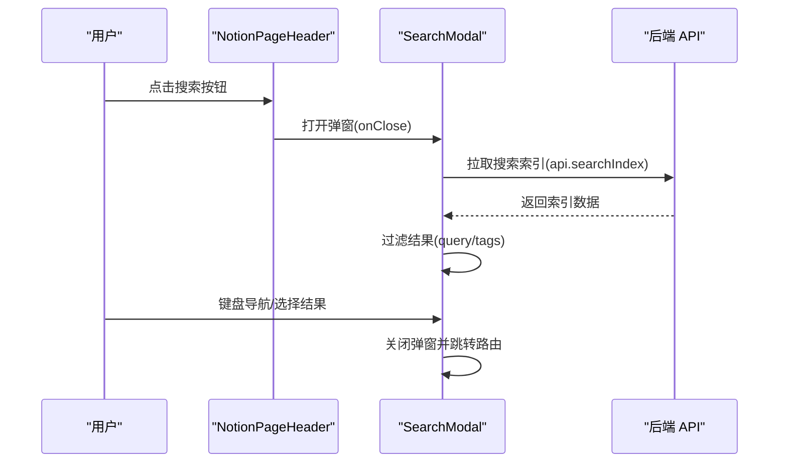
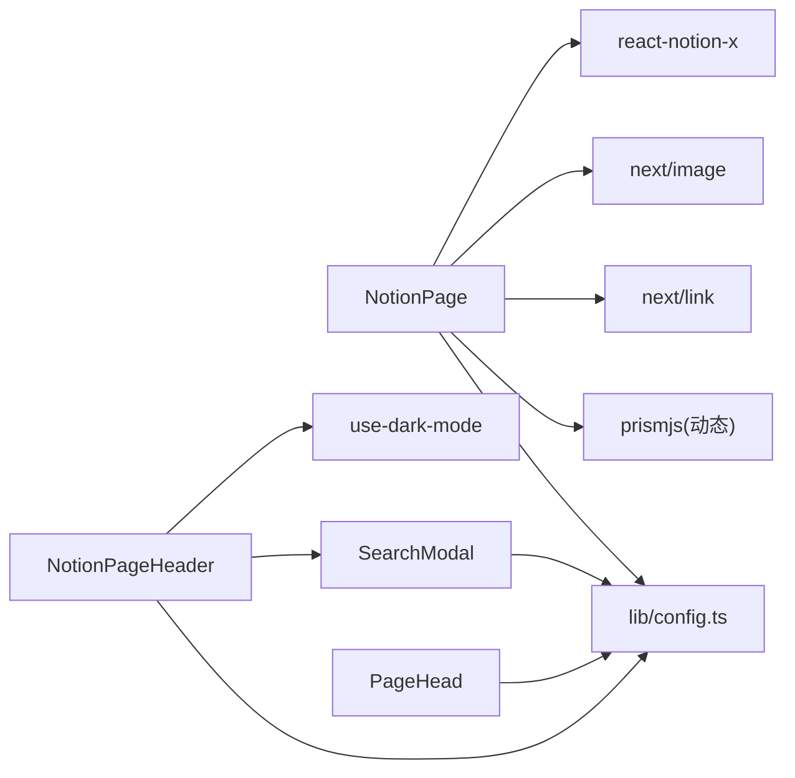

# 组件系统

<cite>
**本文引用的文件**   
- [components/NotionPage.tsx](file://components/NotionPage.tsx)
- [components/NotionPageHeader.tsx](file://components/NotionPageHeader.tsx)
- [components/Footer.tsx](file://components/Footer.tsx)
- [components/SearchModal.tsx](file://components/SearchModal.tsx)
- [components/PageAside.tsx](file://components/PageAside.tsx)
- [components/PageHead.tsx](file://components/PageHead.tsx)
- [lib/config.ts](file://lib/config.ts)
- [site.config.ts](file://site.config.ts)
- [lib/use-dark-mode.ts](file://lib/use-dark-mode.ts)
- [components/styles.module.css](file://components/styles.module.css)
- [styles/global.css](file://styles/global.css)
</cite>

## 目录
1. [简介](#简介)
2. [项目结构](#项目结构)
3. [核心组件](#核心组件)
4. [架构总览](#架构总览)
5. [详细组件分析](#详细组件分析)
6. [依赖关系分析](#依赖关系分析)
7. [性能与优化](#性能与优化)
8. [主题、样式与可定制性](#主题样式与可定制性)
9. [故障排查指南](#故障排查指南)
10. [结论](#结论)

## 简介
本文件面向使用 Next.js + Notion 的站点，系统性梳理 React 组件的设计与实现，重点覆盖以下核心组件：
- NotionPage：页面渲染编排、SEO 元数据注入、Notion 内容渲染配置、侧边栏与页脚挂载。
- NotionPageHeader：导航头、面包屑、主题切换、搜索入口。
- Footer：评论区域容器（如 Utterances）。
- SearchModal：基于本地索引的站内搜索弹窗，支持标签过滤与键盘导航。
- PageHead：SEO 元信息与结构化数据注入。
- PageAside：预留右侧信息区（当前为空占位）。

文档将解释组件间通信模式、状态管理、事件处理、可定制性与主题支持、生命周期与性能优化，并提供扩展自定义组件的实践建议。

## 项目结构
本项目采用“功能域 + 共享库”的组织方式：
- components：UI 组件层，包含页面级与通用 UI 组件。
- lib：业务逻辑与工具库，包括站点配置、API 地址、深色模式 Hook、类型定义等。
- styles：全局样式与主题变量。
- pages：Next.js 路由与 API 路由。

图表来源
- [components/NotionPage.tsx:196-356](file://components/NotionPage.tsx#L196-L356)
- [components/NotionPageHeader.tsx:78-128](file://components/NotionPageHeader.tsx#L78-L128)
- [components/Footer.tsx:5-13](file://components/Footer.tsx#L5-L13)
- [components/SearchModal.tsx:57-253](file://components/SearchModal.tsx#L57-L253)
- [components/PageHead.tsx:7-187](file://components/PageHead.tsx#L7-L187)
- [lib/config.ts:148-153](file://lib/config.ts#L148-L153)
- [lib/use-dark-mode.ts:3-9](file://lib/use-dark-mode.ts#L3-L9)
- [components/styles.module.css:48-130](file://components/styles.module.css#L48-L130)
- [styles/global.css:16-25](file://styles/global.css#L16-L25)

章节来源
- [components/NotionPage.tsx:1-357](file://components/NotionPage.tsx#L1-L357)
- [components/NotionPageHeader.tsx:1-129](file://components/NotionPageHeader.tsx#L1-L129)
- [components/Footer.tsx:1-14](file://components/Footer.tsx#L1-L14)
- [components/SearchModal.tsx:1-254](file://components/SearchModal.tsx#L1-L254)
- [components/PageHead.tsx:1-188](file://components/PageHead.tsx#L1-L188)
- [lib/config.ts:1-224](file://lib/config.ts#L1-L224)
- [site.config.ts:1-78](file://site.config.ts#L1-L78)
- [components/styles.module.css:1-226](file://components/styles.module.css#L1-L226)
- [styles/global.css:1-64](file://styles/global.css#L1-L64)

## 核心组件
- NotionPage
  - 职责：组装页面骨架、注入 SEO、渲染 Notion 内容、挂载侧边栏与页脚、根据博客文章类型决定是否显示目录。
  - 关键点：动态加载代码高亮、集合、公式、PDF、Modal；通过 NotionRenderer 的 components 属性替换默认组件；根据 lite 参数控制精简模式；根据 isDarkMode 注入 body class。
- NotionPageHeader
  - 职责：渲染面包屑、导航链接、主题切换按钮、搜索入口。
  - 关键点：使用 useNotionContext 获取 mapPageUrl 与 components；通过 useDarkMode 切换主题；条件渲染搜索按钮。
- Footer
  - 职责：承载评论组件（如 Utterances），提供 comments 插槽。
  - 关键点：使用 React.memo 包裹以提升性能。
- SearchModal
  - 职责：打开后从 API 拉取搜索索引，支持关键词与标签过滤、键盘导航、结果跳转。
  - 关键点：createPortal 渲染到 document.body；受控输入与状态管理；错误与加载态处理。
- PageHead
  - 职责：注入 meta、Open Graph、Twitter Card、canonical、RSS、JSON-LD 结构化数据。
  - 关键点：区分网站与博客文章两种 schema；统一语言与作者信息。
- PageAside
  - 职责：预留右侧信息区（当前返回 null）。
  - 关键点：便于后续扩展（如目录、相关文章等）。

章节来源
- [components/NotionPage.tsx:196-356](file://components/NotionPage.tsx#L196-L356)
- [components/NotionPageHeader.tsx:78-128](file://components/NotionPageHeader.tsx#L78-L128)
- [components/Footer.tsx:5-13](file://components/Footer.tsx#L5-L13)
- [components/SearchModal.tsx:57-253](file://components/SearchModal.tsx#L57-L253)
- [components/PageHead.tsx:7-187](file://components/PageHead.tsx#L7-L187)
- [components/PageAside.tsx:3-17](file://components/PageAside.tsx#L3-L17)

## 架构总览
整体渲染流程如下：
- 页面路由解析出 pageId 与 recordMap。
- NotionPage 负责：
  - 计算 SEO 标题、描述、图片、canonical URL。
  - 根据是否为博客文章决定展示目录。
  - 注入 BodyClassName 以支持 dark-mode 与 lite 模式。
  - 通过 NotionRenderer 渲染 Notion 内容，并传入自定义 components、mapImageUrl、mapPageUrl、searchNotion、pageAside、footer。
- NotionPageHeader 作为 NotionRenderer 的 Header 组件被调用，提供导航、主题切换与搜索入口。
- Footer 作为 NotionRenderer 的 footer 插槽被注入，承载评论组件。
- SearchModal 由 NotionPageHeader 触发，独立于主树，通过 createPortal 挂载至 body。

图表来源
- [components/NotionPage.tsx:319-353](file://components/NotionPage.tsx#L319-L353)
- [components/NotionPageHeader.tsx:78-128](file://components/NotionPageHeader.tsx#L78-L128)
- [components/SearchModal.tsx:80-106](file://components/SearchModal.tsx#L80-L106)
- [components/Footer.tsx:5-13](file://components/Footer.tsx#L5-L13)

## 详细组件分析

### NotionPage
- 设计要点
  - 动态按需加载重型第三方组件（Code、Collection、Equation、Pdf、Modal）以减少首屏体积。
  - 通过 notionRendererComponents 替换默认组件，注入 nextImage、nextLink、自定义 Tweet、Header、属性值渲染函数等。
  - 根据 lite 查询参数启用精简模式，并通过 BodyClassName 注入 notion-lite 类名。
  - 根据 isBlogPost 决定是否显示目录，并设置最小目录项数。
  - 为 SEO 准备 canonical URL、social image、description、published/modified time、author。
  - 在开发环境将关键对象挂到 window 上以便调试。
- 交互与事件
  - 无直接用户交互，主要承担装配与渲染职责。
- 状态管理
  - 内部状态较少，主要依赖 props 与外部 hook（useDarkMode、useSearchParam）。
- 性能考量
  - 大量使用 dynamic import 与 ssr:false 避免 SSR/CSR 不匹配与首屏阻塞。
  - useMemo 缓存 pageAside 与 mapPageUrl。
- 可扩展点
  - 通过 notionRendererComponents 扩展更多 Notion 块渲染器。
  - 通过 pageAside 插槽扩展右侧信息区。

图表来源
- [components/NotionPage.tsx:255-356](file://components/NotionPage.tsx#L255-L356)

章节来源
- [components/NotionPage.tsx:1-357](file://components/NotionPage.tsx#L1-L357)

### NotionPageHeader
- 设计要点
  - 使用 Breadcrumbs 渲染面包屑，根级导航。
  - 根据 navigationLinks 配置渲染内部页面链接或外链。
  - 提供主题切换按钮，使用 useDarkMode 切换 dark-mode 类名。
  - 条件渲染搜索按钮，打开 SearchModal。
- 交互与事件
  - 主题切换：onClick 触发 toggleDarkMode。
  - 搜索按钮：onClick 打开弹窗；键盘 Enter/Space 触发打开。
- 状态管理
  - 主题状态来自 useDarkMode；搜索弹窗开关为局部 state。
- 性能考量
  - 图标与按钮轻量，无重渲染风险。

图表来源
- [components/NotionPageHeader.tsx:15-76](file://components/NotionPageHeader.tsx#L15-L76)
- [components/SearchModal.tsx:57-253](file://components/SearchModal.tsx#L57-L253)

章节来源
- [components/NotionPageHeader.tsx:1-129](file://components/NotionPageHeader.tsx#L1-L129)

### Footer
- 设计要点
  - 仅作为评论区域的容器，接受 comments 节点。
  - 使用 React.memo 包裹以避免不必要的重渲染。
- 可扩展点
  - 可在 comments 插槽中接入任意评论系统（如 Utterances、Giscus）。

章节来源
- [components/Footer.tsx:1-14](file://components/Footer.tsx#L1-L14)

### SearchModal
- 设计要点
  - 首次打开时从 api.searchIndex 拉取索引，缓存于 state。
  - 支持关键词与标签过滤，AND 语义（同时包含所有选中标签）。
  - 键盘导航：Esc 关闭、上下键移动焦点、Enter 跳转。
  - 使用 createPortal 渲染到 document.body，避免父级样式影响。
- 交互与事件
  - 输入框 onChange 更新 query。
  - 标签按钮 onClick 切换 selectedTags。
  - 结果项 onClick 关闭弹窗并 router.push 跳转。
  - onKeyDown 处理键盘事件。
- 状态管理
  - index、isLoading、error、query、selectedTags、activeIndex、mounted。
- 性能考量
  - useMemo 计算 results，避免每次渲染重新过滤。
  - useEffect 清理取消未完成的请求。

图表来源
- [components/NotionPageHeader.tsx:37-76](file://components/NotionPageHeader.tsx#L37-L76)
- [components/SearchModal.tsx:80-147](file://components/SearchModal.tsx#L80-L147)
- [lib/config.ts:148-153](file://lib/config.ts#L148-L153)

章节来源
- [components/SearchModal.tsx:1-254](file://components/SearchModal.tsx#L1-L254)

### PageHead
- 设计要点
  - 注入基础 meta、viewport、theme-color、robots、author。
  - 根据 isBlogPost 输出 article 相关 OG/Twitter 字段。
  - 生成 JSON-LD 结构化数据（WebSite 与 BlogPosting）。
  - 输出 RSS 订阅链接与 canonical URL。
- 可扩展点
  - 可根据站点配置扩展更多 SEO 字段（如 locale、publisher 等）。

章节来源
- [components/PageHead.tsx:1-188](file://components/PageHead.tsx#L1-L188)

### PageAside
- 设计要点
  - 当前返回 null，预留扩展空间（例如目录、相关文章、广告等）。
- 可扩展点
  - 可结合 block 与 recordMap 渲染目录或侧边信息。

章节来源
- [components/PageAside.tsx:1-18](file://components/PageAside.tsx#L1-L18)

## 依赖关系分析
- 组件耦合
  - NotionPage 强依赖 NotionRenderer 与多个子组件（Header、Footer、PageAside、PageHead）。
  - NotionPageHeader 依赖 useNotionContext、useDarkMode、SearchModal。
  - SearchModal 依赖 config.api 与路由。
- 外部依赖
  - react-notion-x：Notion 内容渲染与上下文。
  - next/image、next/link：Next.js 内置组件。
  - prismjs：代码高亮语法包（按需动态加载）。
  - @fisch0920/use-dark-mode：深色模式能力。
- 配置与站点信息
  - site.config.ts 提供站点级配置（名称、域名、默认图标/封面、导航风格等）。
  - lib/config.ts 聚合站点配置与环境变量，暴露运行时常量与 API 地址。

图表来源
- [components/NotionPage.tsx:43-142](file://components/NotionPage.tsx#L43-L142)
- [components/NotionPageHeader.tsx:6-12](file://components/NotionPageHeader.tsx#L6-L12)
- [components/SearchModal.tsx:6-7](file://components/SearchModal.tsx#L6-L7)
- [lib/config.ts:148-153](file://lib/config.ts#L148-L153)

章节来源
- [components/NotionPage.tsx:1-357](file://components/NotionPage.tsx#L1-L357)
- [components/NotionPageHeader.tsx:1-129](file://components/NotionPageHeader.tsx#L1-L129)
- [components/SearchModal.tsx:1-254](file://components/SearchModal.tsx#L1-L254)
- [lib/config.ts:1-224](file://lib/config.ts#L1-L224)

## 性能与优化
- 代码分割与懒加载
  - 使用 dynamic import 延迟加载 Code、Collection、Equation、Pdf、Modal，减少首屏体积与 SSR/CSR 差异。
- 服务端渲染策略
  - Collection 与 Pdf 设置 ssr:false，避免服务端渲染与客户端不一致。
- 状态与计算优化
  - useMemo 缓存 pageAside 与 mapPageUrl，避免重复计算。
  - SearchModal 使用 useMemo 计算过滤结果，提升交互流畅度。
- 渲染优化
  - Footer 使用 React.memo 包裹，避免评论组件频繁重渲染。
  - 仅在客户端挂载 Portal，避免 SSR 阶段访问 document。
- 网络请求
  - SearchModal 在卸载时取消未完成请求，防止内存泄漏。
- 调试辅助
  - 开发环境下将 pageId、recordMap、block 挂到 window，便于控制台调试。

[本节为通用性能指导，无需特定文件引用]

## 主题、样式与可定制性
- 主题支持
  - 通过 useDarkMode 切换 dark-mode 类名，配合 CSS 变量实现明暗主题。
  - global.css 定义字体栈与滚动条样式，确保中文排版一致。
- 样式组织
  - components/styles.module.css 提供组件级样式（如 footer、comments、隐藏类等）。
  - SearchModal.module.css 提供弹窗样式（未在读取范围内，但被组件引用）。
- 可定制性
  - 通过 NotionRenderer 的 components 属性替换默认组件（如 Header、Code、Tweet 等）。
  - 通过 propertyLastEditedTimeValue、propertyTextValue、propertyDateValue 自定义属性渲染。
  - 通过 pageAside 插槽扩展右侧信息区。
  - 通过 footer 插槽注入评论系统或其他底部内容。
- 覆盖方法
  - 使用 CSS Modules 与全局 CSS 变量进行主题覆盖。
  - 通过 className 与 classnames 组合动态类名，适配不同页面场景（如 index-page）。

章节来源
- [lib/use-dark-mode.ts:3-9](file://lib/use-dark-mode.ts#L3-L9)
- [styles/global.css:16-25](file://styles/global.css#L16-L25)
- [components/styles.module.css:48-130](file://components/styles.module.css#L48-L130)
- [components/NotionPage.tsx:196-209](file://components/NotionPage.tsx#L196-L209)
- [components/NotionPage.tsx:319-353](file://components/NotionPage.tsx#L319-L353)

## 故障排查指南
- 搜索无法加载
  - 检查 api.searchIndex 是否可达，确认后端接口返回正确 JSON。
  - 查看 SearchModal 的错误状态与日志提示。
- 主题切换无效
  - 确认 useDarkMode 是否正确注入 dark-mode 类名。
  - 检查 CSS 变量与主题相关样式是否生效。
- Notion 内容渲染异常
  - 检查 recordMap 与 block 是否存在，必要时回退到 404。
  - 确认 NotionRenderer 的 components 配置是否正确注入。
- 评论不显示
  - 确认 Footer.comments 插槽是否传入有效节点。
  - 检查评论系统（如 Utterances）的配置与主题映射。

章节来源
- [components/SearchModal.tsx:80-106](file://components/SearchModal.tsx#L80-L106)
- [components/NotionPage.tsx:255-261](file://components/NotionPage.tsx#L255-L261)
- [components/Footer.tsx:5-13](file://components/Footer.tsx#L5-L13)

## 结论
该组件系统围绕 Notion 内容渲染展开，通过 NotionPage 统一编排页面结构与 SEO，NotionPageHeader 提供导航与主题切换，SearchModal 提供高效的站内检索，Footer 与 PageAside 提供可扩展的插槽。整体设计强调可定制性、主题支持与性能优化，适合快速搭建基于 Notion 的博客与知识库站点。开发者可通过替换 NotionRenderer 的 components、扩展 pageAside 与 footer 插槽，以及调整样式与配置，灵活定制站点外观与行为。

[本节为总结性内容，无需特定文件引用]