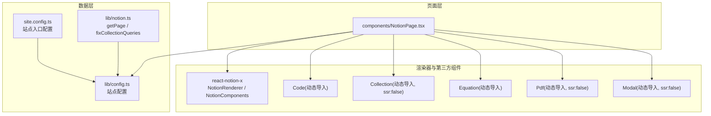
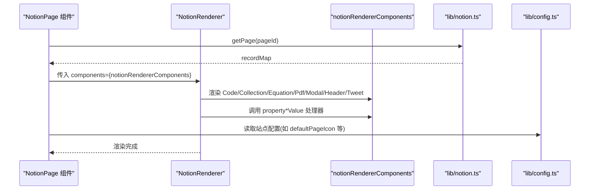
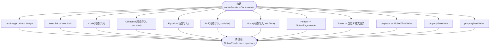
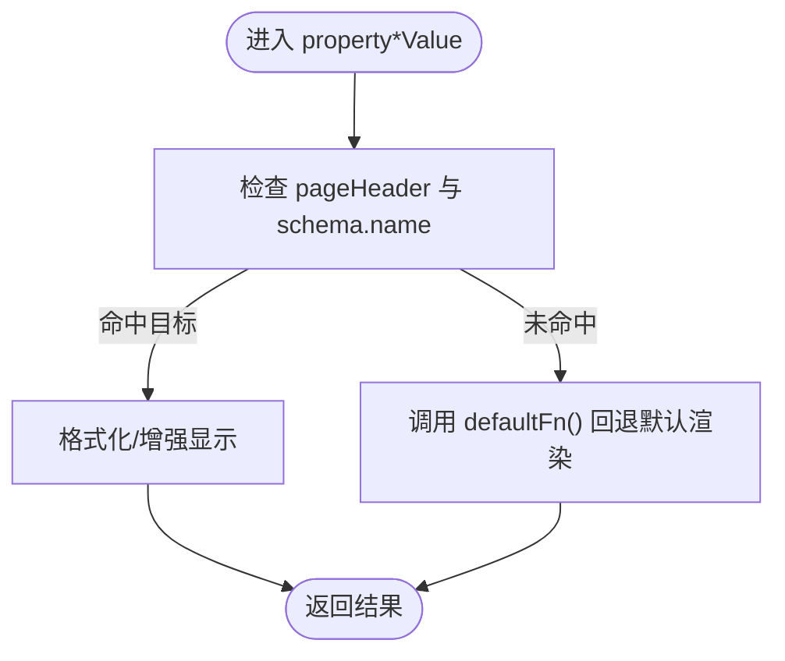
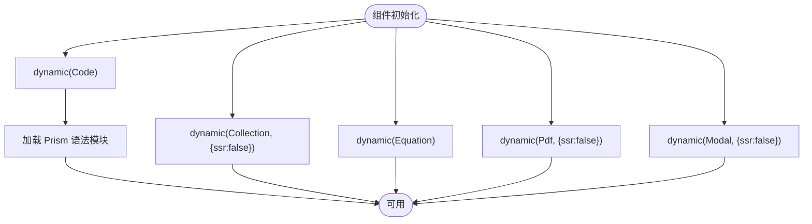
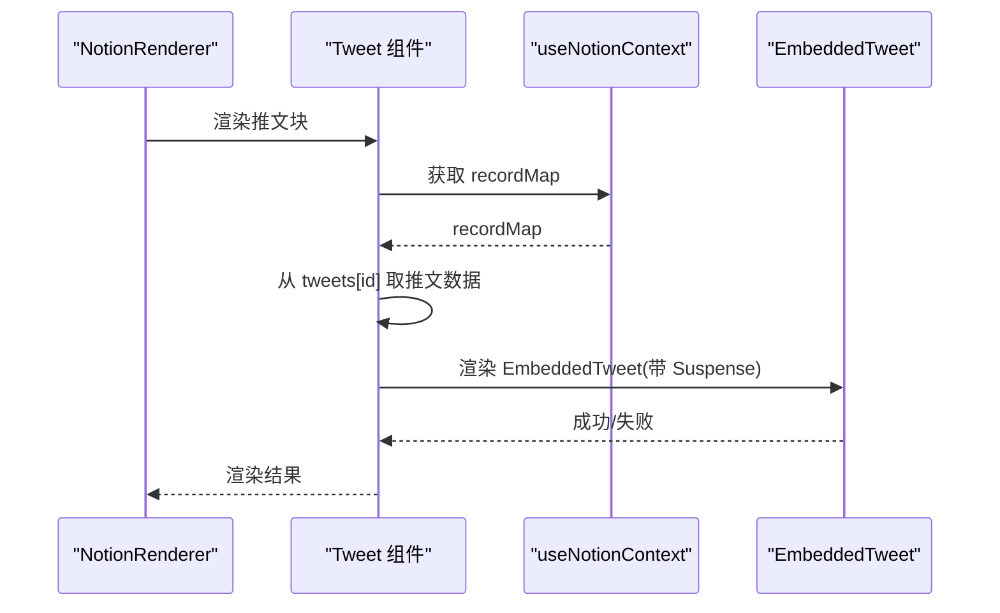
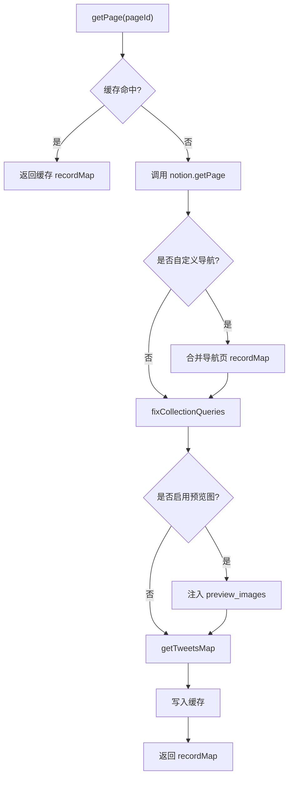
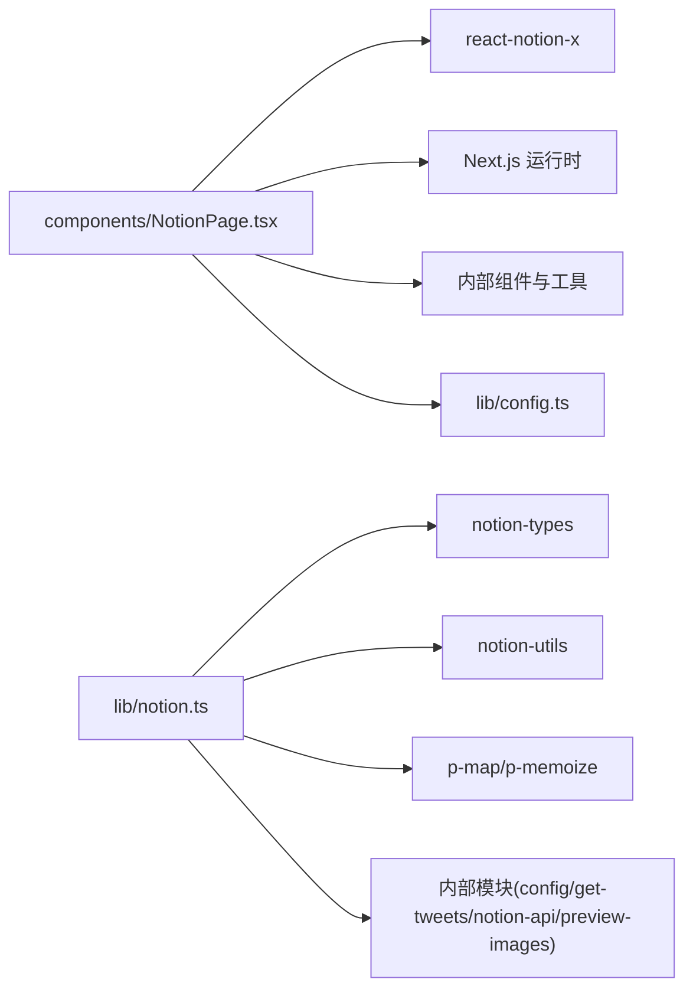

# 自定义组件开发

<cite>
**本文引用的文件**   
- [components/NotionPage.tsx](file://components/NotionPage.tsx)
- [lib/notion.ts](file://lib/notion.ts)
- [lib/config.ts](file://lib/config.ts)
- [lib/types.ts](file://lib/types.ts)
- [site.config.ts](file://site.config.ts)
</cite>

## 目录
1. [简介](#简介)
2. [项目结构](#项目结构)
3. [核心组件](#核心组件)
4. [架构总览](#架构总览)
5. [详细组件分析](#详细组件分析)
6. [依赖关系分析](#依赖关系分析)
7. [性能与优化](#性能与优化)
8. [故障排查指南](#故障排查指南)
9. [结论](#结论)
10. [附录：扩展清单与示例路径](#附录扩展清单与示例路径)

## 简介
本指南面向希望扩展和定制 Notion 渲染器的开发者，重点说明如何通过 notionRendererComponents 配置对象替换或增强 Notion 元素（代码块、集合视图、公式、PDF、模态框、属性值等），并给出类型定义、属性接口、事件回调与样式定制方法。同时提供动态导入、懒加载与性能优化的最佳实践，以及从简单文本替换到复杂交互式组件的完整开发思路与参考路径。

## 项目结构
本项目采用 Next.js + react-notion-x 的组合，页面层通过 components/NotionPage.tsx 组装 NotionRenderer，并通过 notionRendererComponents 注入自定义组件与行为。数据获取与缓存逻辑位于 lib/notion.ts，站点级配置集中在 site.config.ts 与 lib/config.ts，通用类型在 lib/types.ts。

图表来源
- [components/NotionPage.tsx:196-209](file://components/NotionPage.tsx#L196-L209)
- [lib/notion.ts:161-214](file://lib/notion.ts#L161-L214)
- [lib/config.ts:51-88](file://lib/config.ts#L51-L88)
- [site.config.ts:1-78](file://site.config.ts#L1-L78)

章节来源
- [components/NotionPage.tsx:1-357](file://components/NotionPage.tsx#L1-L357)
- [lib/notion.ts:1-219](file://lib/notion.ts#L1-L219)
- [lib/config.ts:1-88](file://lib/config.ts#L1-L88)
- [site.config.ts:1-78](file://site.config.ts#L1-L78)

## 核心组件
- NotionRenderer 与 NotionComponents：由 react-notion-x 提供，用于渲染 Notion 内容并允许通过 components 属性注入自定义实现。
- notionRendererComponents：在本项目中集中定义的 Partial<NotionComponents>，用于覆盖默认组件与行为，是扩展点的主入口。
- 动态导入的第三方组件：Code、Collection、Equation、Pdf、Modal，按需加载以减少首屏体积。
- 属性值处理器：propertyLastEditedTimeValue、propertyTextValue、propertyDateValue，用于定制集合属性的显示逻辑。

章节来源
- [components/NotionPage.tsx:196-209](file://components/NotionPage.tsx#L196-L209)
- [components/NotionPage.tsx:155-194](file://components/NotionPage.tsx#L155-L194)

## 架构总览
下图展示了页面渲染时，NotionRenderer 如何消费 notionRendererComponents 中的自定义组件与属性处理器，并与数据层交互。

图表来源
- [components/NotionPage.tsx:319-353](file://components/NotionPage.tsx#L319-L353)
- [lib/notion.ts:161-214](file://lib/notion.ts#L161-L214)
- [lib/config.ts:51-88](file://lib/config.ts#L51-L88)

## 详细组件分析

### notionRendererComponents 配置对象
- 作用：集中声明需要替换或增强的 Notion 渲染组件与行为。
- 已覆盖项：
  - nextImage、nextLink：使用 Next.js 的 Image/Link 组件以支持路由与图片优化。
  - Code、Collection、Equation、Pdf、Modal：通过 dynamic 动态导入，部分禁用 SSR 以避免水合差异。
  - Header：使用自定义头部组件。
  - Tweet：自定义推文渲染，结合 useNotionContext 获取 tweets 数据。
  - propertyLastEditedTimeValue、propertyTextValue、propertyDateValue：针对特定属性名进行格式化或样式增强。

图表来源
- [components/NotionPage.tsx:196-209](file://components/NotionPage.tsx#L196-L209)

章节来源
- [components/NotionPage.tsx:196-209](file://components/NotionPage.tsx#L196-L209)

### 属性值处理器（property*Value）
- propertyLastEditedTimeValue：当处于页面头部上下文且存在 last_edited_time 时，返回格式化后的“最后更新时间”文案；否则回退默认渲染。
- propertyDateValue：当处于页面头部上下文且属性名为 published 时，解析发布日并格式化输出；否则回退默认渲染。
- propertyTextValue：当处于页面头部上下文且属性名为 author 时，对默认文本加粗显示；否则回退默认渲染。

这些处理器接收两个参数：包含 data/schema/pageHeader 等上下文的对象，以及 defaultFn 默认渲染函数。通过判断 pageHeader 与 schema.name 可精准定位目标字段并进行定制。

图表来源
- [components/NotionPage.tsx:155-194](file://components/NotionPage.tsx#L155-L194)

章节来源
- [components/NotionPage.tsx:155-194](file://components/NotionPage.tsx#L155-L194)

### 动态导入与 SSR 控制
- Code：动态导入 react-notion-x/third-party/code，并在首次加载时并行引入多种 Prism 语法高亮模块，按需启用语言支持。
- Collection：动态导入 collection 组件，并设置 ssr:false，避免服务端/客户端水合不一致。
- Equation、Pdf、Modal：均为动态导入，其中 Pdf 与 Modal 设置 ssr:false。
- 优势：减少首屏包体，提升 LCP；仅在需要时加载重型功能。

图表来源
- [components/NotionPage.tsx:43-142](file://components/NotionPage.tsx#L43-L142)

章节来源
- [components/NotionPage.tsx:43-142](file://components/NotionPage.tsx#L43-L142)

### 自定义推文渲染（Tweet）
- 通过 useNotionContext 获取 recordMap，并从扩展的 ExtendedTweetRecordMap.tweets 中查找对应推文数据。
- 使用 React.Suspense 包裹 EmbeddedTweet，并提供骨架与未找到提示。
- 该组件作为 notionRendererComponents.Tweet 被注入，使 Notion 中的推文块按自定义方式渲染。

图表来源
- [components/NotionPage.tsx:144-153](file://components/NotionPage.tsx#L144-L153)

章节来源
- [components/NotionPage.tsx:144-153](file://components/NotionPage.tsx#L144-L153)

### 数据层与集合查询修正
- lib/notion.ts 的 getPage 负责拉取 recordMap，合并导航链接页数据，修正集合视图排序与过滤，并可选地注入预览图与推文映射。
- fixCollectionQueries 会重新执行每个集合视图的 query，确保前端展示与 Notion 一致。

图表来源
- [lib/notion.ts:161-214](file://lib/notion.ts#L161-L214)
- [lib/notion.ts:95-159](file://lib/notion.ts#L95-L159)

章节来源
- [lib/notion.ts:95-159](file://lib/notion.ts#L95-L159)
- [lib/notion.ts:161-214](file://lib/notion.ts#L161-L214)

## 依赖关系分析
- components/NotionPage.tsx 依赖：
  - react-notion-x 的 NotionRenderer、NotionComponents、useNotionContext
  - next/dynamic、next/image、next/link、next/router
  - 内部组件：Footer、Loading、NotionPageHeader、Page404、PageAside、PageHead、Utterances
  - 工具与配置：mapImageUrl、mapPageUrl、searchNotion、useDarkMode、config
- lib/notion.ts 依赖：
  - notion-types、notion-utils、p-map、p-memoize
  - 内部模块：config、get-tweets、notion-api、preview-images

图表来源
- [components/NotionPage.tsx:1-38](file://components/NotionPage.tsx#L1-L38)
- [lib/notion.ts:1-17](file://lib/notion.ts#L1-L17)

章节来源
- [components/NotionPage.tsx:1-38](file://components/NotionPage.tsx#L1-L38)
- [lib/notion.ts:1-17](file://lib/notion.ts#L1-L17)

## 性能与优化
- 动态导入与懒加载
  - 将重型第三方组件（Code、Collection、Equation、Pdf、Modal）使用 dynamic 延迟加载，显著降低首屏体积。
  - 对需要客户端交互的组件（Collection、Pdf、Modal）设置 ssr:false，避免服务端/客户端水合差异导致的闪烁与错误。
- 语法高亮按需加载
  - Code 组件首次加载时并行引入多种 Prism 语法模块，可按需裁剪以进一步减小包体。
- 数据缓存与并发
  - lib/notion.ts 使用内存缓存与 p-memoize 对导航链接页请求进行去重与缓存，缩短重复访问延迟。
  - fixCollectionQueries 使用 pMap 并发执行集合查询修正，平衡吞吐与稳定性。
- 预取与降级
  - 当 Notion API 不可用时，getPage 返回最近一次缓存数据，保证站点可用性。
  - 预览图与推文映射按需注入，避免不必要的网络开销。

[本节为通用性能建议，不直接分析具体文件]

## 故障排查指南
- 集合视图排序/过滤不一致
  - 现象：前端展示的集合顺序与 Notion 不一致，或显示了应被过滤的行。
  - 原因：代理返回的 collection_view 数据结构嵌套层级导致 notion-client 读取 view.query2 不完整。
  - 解决：lib/notion.ts 中的 fixCollectionQueries 会重新执行集合查询并回填正确数据。请确认该流程未被跳过，并关注控制台警告日志。
- 水合不一致（Hydration mismatch）
  - 现象：控制台出现水合不一致警告，或 UI 闪烁。
  - 原因：某些组件在服务端与客户端渲染不同（如 Collection、Pdf、Modal）。
  - 解决：确保这些组件使用 dynamic 并设置 ssr:false，或在客户端条件渲染。
- 推文无法显示
  - 现象：推文块空白或显示未找到。
  - 原因：recordMap 中 tweets 缺失或 ID 不匹配。
  - 解决：确认 get-tweets 映射已注入 recordMap，并检查 Tweet 组件是否正确从 useNotionContext 获取数据。
- 属性值未按预期显示
  - 现象：author/published/last_edited_time 等属性在页面头部未按定制逻辑显示。
  - 原因：pageHeader 上下文或 schema.name 判断不符合预期。
  - 解决：检查 property*Value 处理器的判断条件，必要时增加调试日志。

章节来源
- [lib/notion.ts:95-159](file://lib/notion.ts#L95-L159)
- [components/NotionPage.tsx:144-153](file://components/NotionPage.tsx#L144-L153)
- [components/NotionPage.tsx:155-194](file://components/NotionPage.tsx#L155-L194)

## 结论
通过 notionRendererComponents，你可以灵活替换 Notion 渲染器中的各类组件与行为，实现从简单的文本格式化到复杂的交互式组件的全链路定制。配合动态导入、SSR 控制与数据层的缓存与修正机制，可以在保证用户体验的同时获得良好的性能表现。建议在扩展时遵循以下原则：
- 优先使用 dynamic 与 ssr:false 控制加载时机与渲染环境。
- 通过 property*Value 精准定制属性显示，避免全局污染。
- 复用现有工具与配置，保持与站点主题、SEO、搜索等功能的一致性。
- 在关键路径添加必要的错误处理与降级策略，提升鲁棒性。

[本节为总结性内容，不直接分析具体文件]

## 附录：扩展清单与示例路径
- 替换图片与链接
  - 示例路径：[components/NotionPage.tsx:196-209](file://components/NotionPage.tsx#L196-L209)
- 自定义代码块（含语法高亮）
  - 示例路径：[components/NotionPage.tsx:43-112](file://components/NotionPage.tsx#L43-L112)
- 自定义集合视图（数据库内联）
  - 示例路径：[components/NotionPage.tsx:114-123](file://components/NotionPage.tsx#L114-L123)
- 自定义公式渲染
  - 示例路径：[components/NotionPage.tsx:124-126](file://components/NotionPage.tsx#L124-L126)
- 自定义 PDF 渲染
  - 示例路径：[components/NotionPage.tsx:127-132](file://components/NotionPage.tsx#L127-L132)
- 自定义模态框
  - 示例路径：[components/NotionPage.tsx:133-142](file://components/NotionPage.tsx#L133-L142)
- 自定义推文渲染
  - 示例路径：[components/NotionPage.tsx:144-153](file://components/NotionPage.tsx#L144-L153)
- 属性值处理器（时间/文本/日期）
  - 示例路径：[components/NotionPage.tsx:155-194](file://components/NotionPage.tsx#L155-L194)
- 注入到 NotionRenderer
  - 示例路径：[components/NotionPage.tsx:319-353](file://components/NotionPage.tsx#L319-L353)
- 数据层集合查询修正
  - 示例路径：[lib/notion.ts:95-159](file://lib/notion.ts#L95-L159)
- 站点配置与默认值
  - 示例路径：[site.config.ts:1-78](file://site.config.ts#L1-L78), [lib/config.ts:51-88](file://lib/config.ts#L51-L88)