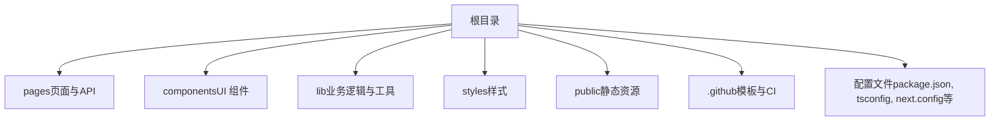
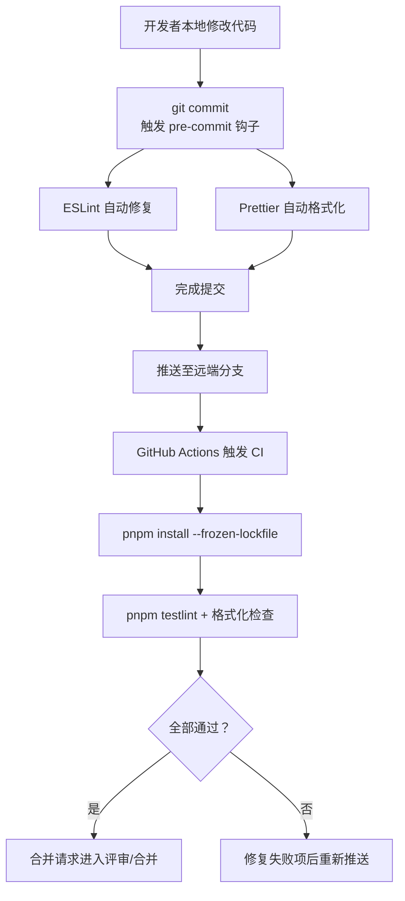
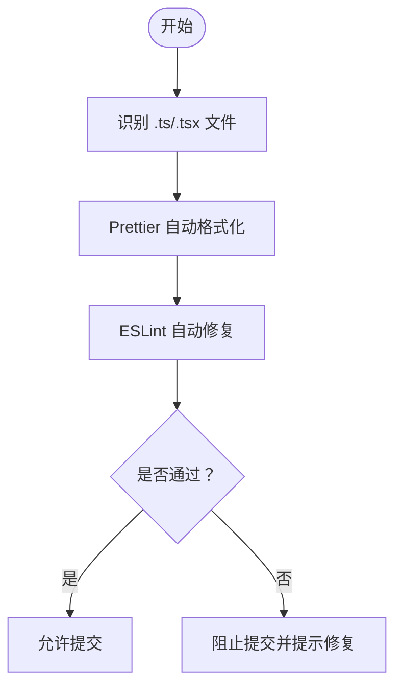
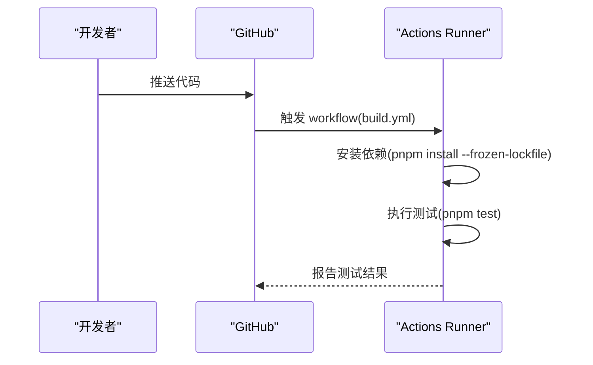
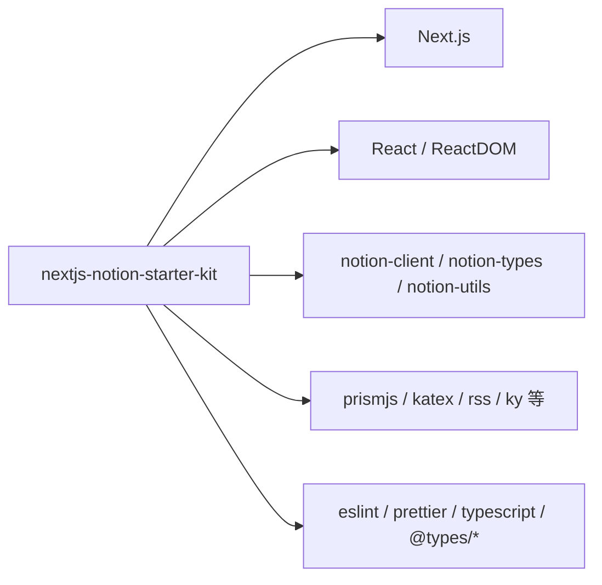

# 贡献指南

<cite>
**本文引用的文件**   
- [contributing.md](file://contributing.md)
- [package.json](file://package.json)
- [.eslintrc.json](file://.eslintrc.json)
- [eslint.config.js](file://eslint.config.js)
- [.github/pull_request_template.md](file://.github/pull_request_template.md)
- [.github/issue_template.md](file://.github/issue_template.md)
- [.github/workflows/build.yml](file://.github/workflows/build.yml)
</cite>

## 目录
1. [简介](#简介)
2. [项目结构](#项目结构)
3. [核心组件](#核心组件)
4. [架构总览](#架构总览)
5. [详细组件分析](#详细组件分析)
6. [依赖分析](#依赖分析)
7. [性能考虑](#性能考虑)
8. [故障排查指南](#故障排查指南)
9. [结论](#结论)
10. [附录](#附录)

## 简介
本指南面向希望参与 nextjs-notion-starter-kit 项目的开发者与贡献者，涵盖开发环境搭建、代码规范、提交流程、测试要求、Git 工作流与分支管理策略、Pull Request 规范、代码审查标准与质量保证流程，以及社区行为准则与沟通渠道。目标是帮助你在本地高效开发，并以高质量的方式向仓库提交变更。

## 项目结构
仓库采用 Next.js 应用的标准布局：
- pages：页面路由与 API 路由
- components：可复用 UI 组件
- lib：业务逻辑、工具函数与类型定义
- styles：全局样式与主题
- public：静态资源
- .github：GitHub 模板与 CI 配置
- 根级配置文件：package.json、tsconfig.json、next.config.js、eslint 与 prettier 相关配置

[无图表来源，因为该图为概念性结构示意]

## 核心组件
本节聚焦与贡献流程直接相关的“核心组件”：开发脚本、代码质量工具链、CI 流水线与模板。

- 开发与构建脚本
  - dev：启动本地开发服务器
  - build：生产构建
  - start：启动生产服务
  - test：运行测试（lint + 格式化检查）
  - deps:link/deps:unlink：用于本地联调 react-notion-x 包

- 代码质量与格式化
  - ESLint：基于 @fisch0920/eslint-config 的规则集，并在项目中覆盖部分规则
  - Prettier：统一代码风格，pre-commit 钩子自动修复

- CI 流水线
  - GitHub Actions：在 push 时触发，使用 pnpm 安装依赖并执行测试

- 模板
  - Pull Request 模板：引导填写描述与 Notion 测试页 ID
  - Issue 模板：引导填写问题描述与复现信息

**章节来源**
- [package.json:14-28](file://package.json#L14-L28)
- [.eslintrc.json:1-18](file://.eslintrc.json#L1-L18)
- [eslint.config.js:1-23](file://eslint.config.js#L1-L23)
- [.github/workflows/build.yml:1-35](file://.github/workflows/build.yml#L1-L35)
- [.github/pull_request_template.md:1-16](file://.github/pull_request_template.md#L1-L16)
- [.github/issue_template.md:1-16](file://.github/issue_template.md#L1-L16)

## 架构总览
下图展示了从代码提交到自动化检查的端到端流程，包括本地预提交钩子与 GitHub Actions 的协作关系。

**图表来源**
- [package.json:83-90](file://package.json#L83-L90)
- [.github/workflows/build.yml:1-35](file://.github/workflows/build.yml#L1-L35)

## 详细组件分析

### 开发环境与本地联调
- 前置条件
  - Node.js 版本：由 package.json 指定为 24
  - 包管理器：pnpm（推荐全局安装）
- 克隆与安装
  - 克隆仓库后，在项目根目录执行 pnpm 安装依赖
- 启动开发服务器
  - 执行 pnpm dev，访问 http://localhost:3000 预览站点
- 生产构建
  - 执行 pnpm build 进行生产构建
- 与 react-notion-x 本地联调
  - 先按 react-notion-x 仓库说明准备并构建其本地包
  - 使用 pnpm deps:link 将本地包链接到当前项目
  - 分别运行两个 pnpm dev 实例以同步更新
- 常见问题
  - 热重载异常时可重启 dev 进程
  - 若出现缓存相关问题，清理 .next 目录后重试

**章节来源**
- [contributing.md:5-54](file://contributing.md#L5-L54)
- [package.json:10-11](file://package.json#L10-L11)
- [package.json:14-28](file://package.json#L14-L28)
- [package.json:22-25](file://package.json#L22-L25)

### 代码规范与质量门禁
- ESLint
  - 继承自 @fisch0920/eslint-config，并在项目中覆盖若干规则
  - TypeScript 与 JSX 相关文件适用额外规则覆盖
- Prettier
  - 统一代码风格，pre-commit 钩子对 .ts/.tsx 文件进行自动格式化与 ESLint 修复
- 建议
  - 提交前确保 lint 与格式化通过
  - 新增或修改代码遵循现有风格，避免引入新的规则冲突

**图表来源**
- [package.json:83-90](file://package.json#L83-L90)
- [.eslintrc.json:1-18](file://.eslintrc.json#L1-L18)
- [eslint.config.js:1-23](file://eslint.config.js#L1-L23)

**章节来源**
- [.eslintrc.json:1-18](file://.eslintrc.json#L1-L18)
- [eslint.config.js:1-23](file://eslint.config.js#L1-L23)
- [package.json:83-90](file://package.json#L83-L90)

### 测试与持续集成
- 本地测试
  - pnpm test：并行执行 lint 与格式化检查
  - pnpm test:lint：仅执行 ESLint
  - pnpm test:prettier：仅执行 Prettier 校验
- CI 流水线
  - 触发时机：push 事件
  - 矩阵策略：Node.js 20/22/24 多版本并行测试
  - 步骤：checkout → 设置 pnpm → 安装依赖 → 执行测试
  - 可选：Redis 缓存相关注释说明（如需启用需配置 Secrets）

**图表来源**
- [.github/workflows/build.yml:1-35](file://.github/workflows/build.yml#L1-L35)
- [package.json:26-28](file://package.json#L26-L28)

**章节来源**
- [package.json:26-28](file://package.json#L26-L28)
- [.github/workflows/build.yml:1-35](file://.github/workflows/build.yml#L1-L35)

### Git 工作流与分支管理策略
- 分支命名建议
  - feature/*：新功能开发
  - fix/*：缺陷修复
  - docs/*：文档改进
  - refactor/*：代码重构
  - chore/*：日常维护任务
- 工作流程
  - 从 main/master 拉取最新代码创建功能分支
  - 在功能分支上提交小而明确的变更
  - 定期同步上游分支以保持代码一致
  - 完成后发起 Pull Request 并等待审查

[本节为通用实践建议，不直接分析具体文件，故无“章节来源”]

### Pull Request 规范
- 标题与描述
  - 清晰描述变更目的与影响范围
  - 必要时附上截图或录屏
- Notion 测试页
  - 提供至少一个公开的 Notion 页面 ID，便于复现与调试
- 自检清单
  - 本地已通过 pnpm test
  - 已更新必要文档与示例
  - 未引入无关变更

**章节来源**
- [.github/pull_request_template.md:1-16](file://.github/pull_request_template.md#L1-L16)

### 代码审查标准与质量保证
- 审查重点
  - 正确性与健壮性：边界条件、错误处理、兼容性
  - 可读性与一致性：命名、结构、注释、风格
  - 性能与安全：不必要的重渲染、敏感信息泄露、第三方依赖风险
  - 可维护性：模块职责清晰、依赖最小化
- 质量保证
  - 强制通过 CI（多 Node 版本）
  - 提交前预提交钩子保证基础质量
  - 建议补充单元测试（如适用）

[本节为通用实践建议，不直接分析具体文件，故无“章节来源”]

### 社区行为准则与沟通渠道
- 行为准则
  - 尊重他人、包容差异、建设性反馈
  - 遵守开源礼仪，理性讨论分歧
- 沟通渠道
  - Issues：用于提出问题、反馈 Bug、请求功能
  - Discussions：用于开放式讨论与经验分享
  - PR 评论：针对具体变更的技术讨论

[本节为通用实践建议，不直接分析具体文件，故无“章节来源”]

## 依赖分析
- 运行时依赖
  - Next.js、React、Notion 客户端与工具库、RSS、PrismJS、KaTeX 等
- 开发依赖
  - ESLint、Prettier、TypeScript、@types/* 等
- 包管理器与引擎
  - pnpm 作为包管理器
  - Node.js 版本锁定为 24（package.json engines）

**图表来源**
- [package.json:30-68](file://package.json#L30-L68)

**章节来源**
- [package.json:30-68](file://package.json#L30-L68)

## 性能考虑
- 构建与开发体验
  - 使用 pnpm 提升依赖安装速度
  - 合理拆分组件与页面，减少首屏体积
- 运行时优化
  - 合理使用缓存与惰性加载
  - 避免不必要的状态更新与重渲染
- 外部依赖
  - 谨慎引入重型库，评估替代方案

[本节为通用实践建议，不直接分析具体文件，故无“章节来源”]

## 故障排查指南
- 本地联调 react-notion-x 时热重载异常
  - 参考 contributing.md 中的“Gotchas”，尝试重启 dev 进程或清理 .next 缓存
- CI 失败
  - 确认本地已通过 pnpm test
  - 检查 Node 版本与 pnpm 版本是否与仓库一致
  - 查看 Actions 日志定位失败步骤
- 依赖安装问题
  - 使用 pnpm install --frozen-lockfile 确保锁文件一致
  - 如遇 peer dependency 冲突，根据报错调整依赖版本

**章节来源**
- [contributing.md:47-54](file://contributing.md#L47-L54)
- [.github/workflows/build.yml:26-27](file://.github/workflows/build.yml#L26-L27)

## 结论
通过遵循本指南，你可以快速搭建开发环境、保持代码质量稳定，并以规范的流程参与贡献。建议在每次提交前运行本地测试，确保符合仓库的质量标准；在发起 PR 时提供清晰的描述与测试页 ID，以便审查者高效验证变更。

[本节为总结性内容，不直接分析具体文件，故无“章节来源”]

## 附录
- 常用命令速查
  - pnpm dev：启动开发服务器
  - pnpm build：生产构建
  - pnpm test：运行测试（lint + 格式化）
  - pnpm deps:link：链接本地 react-notion-x 包
  - pnpm deps:unlink：取消链接
- 模板与配置
  - Pull Request 模板：.github/pull_request_template.md
  - Issue 模板：.github/issue_template.md
  - CI 配置：.github/workflows/build.yml
  - ESLint 配置：.eslintrc.json 与 eslint.config.js
  - 开发脚本与依赖：package.json

**章节来源**
- [package.json:14-28](file://package.json#L14-L28)
- [.github/pull_request_template.md:1-16](file://.github/pull_request_template.md#L1-L16)
- [.github/issue_template.md:1-16](file://.github/issue_template.md#L1-L16)
- [.github/workflows/build.yml:1-35](file://.github/workflows/build.yml#L1-L35)
- [.eslintrc.json:1-18](file://.eslintrc.json#L1-L18)
- [eslint.config.js:1-23](file://eslint.config.js#L1-L23)