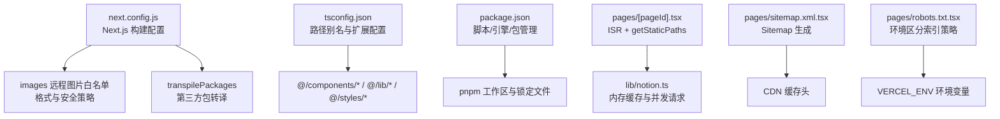
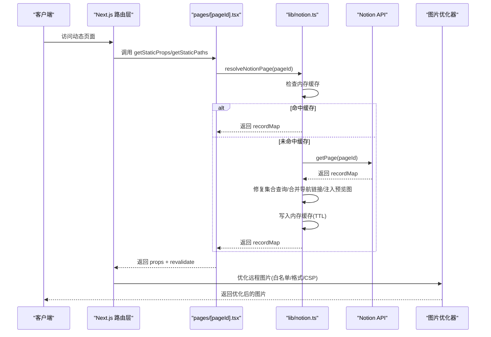
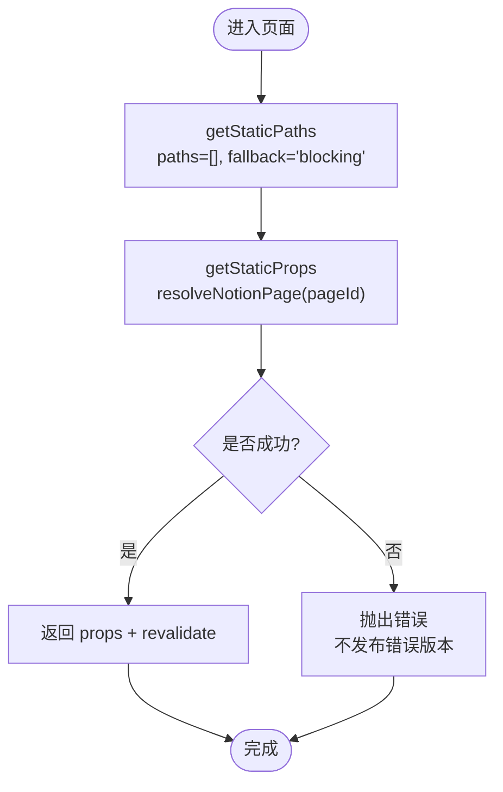
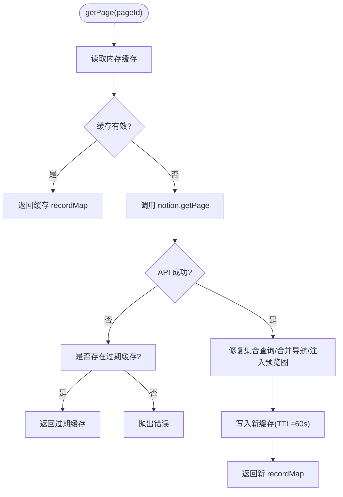
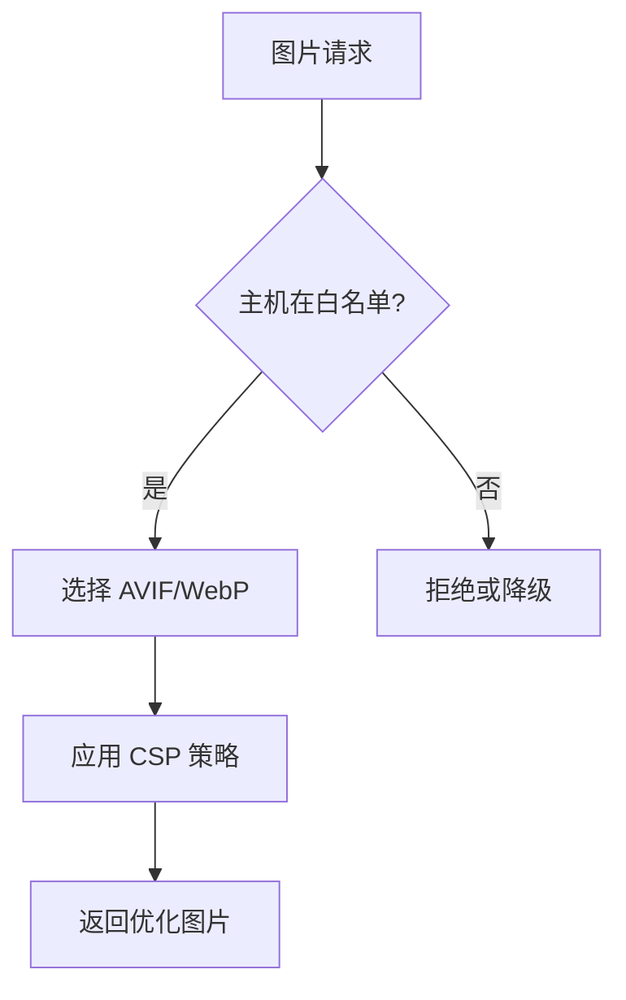
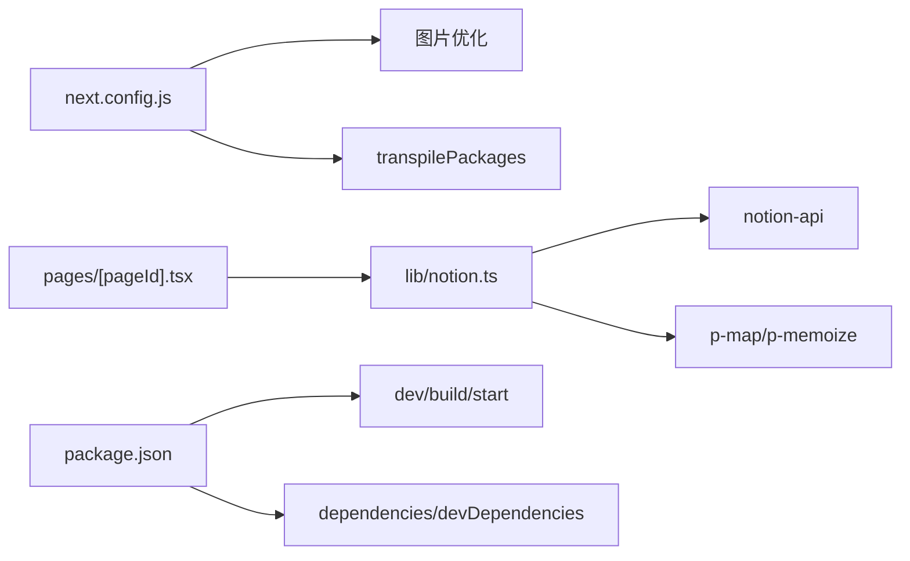

# 构建配置

<cite>
**本文引用的文件**   
- [next.config.js](file://next.config.js)
- [tsconfig.json](file://tsconfig.json)
- [package.json](file://package.json)
- [pages/[pageId].tsx](file://pages/[pageId].tsx)
- [lib/notion.ts](file://lib/notion.ts)
- [pages/sitemap.xml.tsx](file://pages/sitemap.xml.tsx)
- [pages/robots.txt.tsx](file://pages/robots.txt.tsx)
- [oxlint.config.ts](file://oxlint.config.ts)
</cite>

## 目录
1. [简介](#简介)
2. [项目结构](#项目结构)
3. [核心构建配置](#核心构建配置)
4. [架构总览](#架构总览)
5. [详细组件分析](#详细组件分析)
6. [依赖关系分析](#依赖关系分析)
7. [性能优化建议](#性能优化建议)
8. [常见问题与排错](#常见问题与排错)
9. [结论](#结论)

## 简介
本文面向 Next.js 项目的构建配置，围绕 next.config.js、TypeScript 编译配置与包管理器设置展开，重点说明静态生成、增量静态再生、代码分割、图片优化等关键能力，并结合本仓库的实际实现给出可操作的优化技巧、环境变量处理与插件配置建议。同时提供常见构建问题的排查思路与最佳实践，帮助你在保证功能正确性的前提下提升构建速度与运行时性能。

## 项目结构
本项目采用 Next.js App Router 之外的 Pages Router 组织页面，结合 Notion 数据源进行内容渲染。构建相关的关键文件包括：
- 构建配置：next.config.js
- TypeScript 编译：tsconfig.json
- 脚本与依赖：package.json
- 动态页面与 ISR：pages/[pageId].tsx
- 服务端数据缓存：lib/notion.ts
- SEO 与站点资源：pages/sitemap.xml.tsx、pages/robots.txt.tsx
- 代码质量工具：oxlint.config.ts

**图表来源**
- [next.config.js:4-42](file://next.config.js#L4-L42)
- [tsconfig.json:1-12](file://tsconfig.json#L1-L12)
- [package.json:10-26](file://package.json#L10-L26)
- [pages/[pageId].tsx:8-31](file://pages/[pageId].tsx#L8-L31)
- [lib/notion.ts:19-55](file://lib/notion.ts#L19-L55)
- [pages/sitemap.xml.tsx:7-31](file://pages/sitemap.xml.tsx#L7-L31)
- [pages/robots.txt.tsx:5-44](file://pages/robots.txt.tsx#L5-L44)

**章节来源**
- [next.config.js:4-42](file://next.config.js#L4-L42)
- [tsconfig.json:1-12](file://tsconfig.json#L1-L12)
- [package.json:10-26](file://package.json#L10-L26)

## 核心构建配置
本节聚焦 next.config.js 中的关键选项及其在本项目中的作用。

- 静态页面生成超时
  - staticPageGenerationTimeout 用于控制静态页面生成的超时时间，避免在外部 API（如 Notion）响应缓慢时阻塞构建。
  
- 图片优化 images
  - remotePatterns 允许指定远程图片的协议与主机名，本项目为 Notion CDN、AWS、Unsplash、Twitter 等域名放行，并允许任意 https 主机以兼容 Notion 中嵌入的外部图片。
  - formats 指定优先使用的现代图片格式（AVIF、WebP），以提升加载性能。
  - dangerouslyAllowSVG 允许 SVG 通过图片优化器处理。
  - contentSecurityPolicy 设置严格的 CSP，限制默认源与脚本执行，增强安全性。

- Webpack 自定义
  - 示例注释展示了如何通过 webpack 配置解决 react/react-dom 解析问题，当前未启用。

- transpilePackages
  - 将特定第三方包纳入转译流程，确保兼容性（例如 react-tweet）。

**章节来源**
- [next.config.js:4-42](file://next.config.js#L4-L42)

## 架构总览
下图展示从页面请求到数据获取与构建产物的整体流程，突出 ISR、服务端缓存与图片优化的协作关系。

**图表来源**
- [pages/[pageId].tsx:8-31](file://pages/[pageId].tsx#L8-L31)
- [lib/notion.ts:161-213](file://lib/notion.ts#L161-L213)
- [next.config.js:6-25](file://next.config.js#L6-L25)

## 详细组件分析

### 增量静态再生（ISR）与动态页面
- 使用 getStaticProps 配合 revalidate 开启增量静态再生，使页面在首次构建后按需更新。
- getStaticPaths 返回空 paths 并在非开发环境使用 fallback: 'blocking'，实现“按需预渲染 + 阻塞式回退”，减少冷启动延迟。
- 错误处理：当数据获取失败时显式抛出错误，阻止发布错误版本的页面。

**图表来源**
- [pages/[pageId].tsx:8-31](file://pages/[pageId].tsx#L8-L31)

**章节来源**
- [pages/[pageId].tsx:8-31](file://pages/[pageId].tsx#L8-L31)

### 服务端内存缓存与并发优化
- lib/notion.ts 维护一个基于 Map 的内存缓存，TTL 为 60 秒，用于吸收突发流量与临时网络抖动。
- 当 Notion API 不可用时，尝试返回过期缓存（stale-while-revalidate 模式），提高可用性。
- 对导航链接与集合视图查询使用 p-map 控制并发度，避免过载。
- 修正 collection_query 的双层嵌套问题，确保排序与过滤逻辑与 Notion 一致。

**图表来源**
- [lib/notion.ts:19-55](file://lib/notion.ts#L19-L55)
- [lib/notion.ts:161-213](file://lib/notion.ts#L161-L213)

**章节来源**
- [lib/notion.ts:19-55](file://lib/notion.ts#L19-L55)
- [lib/notion.ts:161-213](file://lib/notion.ts#L161-L213)

### 图片优化与远程图片白名单
- 通过 images.remotePatterns 精确放行 Notion CDN、AWS、Unsplash、Twitter 等域名，并允许任意 https 主机以兼容外部图片。
- 启用 AVIF/WebP 格式，显著减小图片体积。
- 开启 SVG 支持，满足复杂图标场景。
- 设置严格 CSP，限制脚本执行，降低 XSS 风险。

**图表来源**
- [next.config.js:6-25](file://next.config.js#L6-L25)

**章节来源**
- [next.config.js:6-25](file://next.config.js#L6-L25)

### TypeScript 编译配置
- 继承 @fisch0920/config/tsconfig-react，统一 React 生态的 TS 配置。
- 定义路径别名：@/components/*、@/lib/*、@/styles/*，便于模块导入与 IDE 提示。
- include 包含 next-env.d.ts、所有 ts/tsx 与配置文件，exclude node_modules。

**章节来源**
- [tsconfig.json:1-12](file://tsconfig.json#L1-L12)

### 包管理器与脚本
- packageManager 指定 pnpm 版本，确保团队与 CI 一致性。
- engines.node 指定 Node 版本，保障运行环境稳定。
- scripts 提供 dev/build/start/deploy 等常用命令；deps:* 系列脚本用于依赖管理与本地链接调试。
- overrides 强制子依赖的 keyv 版本，避免冲突。
- pnpm.onlyBuiltDependencies 仅构建必要原生依赖，缩短安装与构建时间。

**章节来源**
- [package.json:10-26](file://package.json#L10-L26)
- [package.json:68-92](file://package.json#L68-L92)

### 环境变量与环境区分
- robots.txt 根据 VERCEL_ENV 是否为 production 决定搜索引擎索引策略，防止预览部署被索引。
- sitemap.xml 设置 Cache-Control 头，利用 CDN 缓存提升性能。
- feed 与 sitemap 均通过 getServerSideProps 在服务端生成，适合频繁变化的站点元数据。

**章节来源**
- [pages/robots.txt.tsx:5-44](file://pages/robots.txt.tsx#L5-L44)
- [pages/sitemap.xml.tsx:7-31](file://pages/sitemap.xml.tsx#L7-L31)

### 代码质量与插件
- oxlint.config.ts 基于 @fisch0920/config/oxlint，关闭部分与 React Compiler 相关的规则，因为项目未启用 React Compiler，这些规则在此处作为优化提示而非正确性检查。

**章节来源**
- [oxlint.config.ts:1-15](file://oxlint.config.ts#L1-L15)

## 依赖关系分析
- next.config.js 与 pages 层解耦，但影响构建期行为（图片优化、转译包、超时）。
- pages/[pageId].tsx 依赖 lib/notion.ts 的数据获取与缓存逻辑。
- lib/notion.ts 依赖 notion-api、p-map、p-memoize 等库，控制并发与缓存。
- package.json 中的依赖与脚本驱动整个构建与运行流程。

**图表来源**
- [next.config.js:4-42](file://next.config.js#L4-L42)
- [pages/[pageId].tsx:8-31](file://pages/[pageId].tsx#L8-L31)
- [lib/notion.ts:1-17](file://lib/notion.ts#L1-L17)
- [package.json:27-66](file://package.json#L27-L66)

**章节来源**
- [next.config.js:4-42](file://next.config.js#L4-L42)
- [pages/[pageId].tsx:8-31](file://pages/[pageId].tsx#L8-L31)
- [lib/notion.ts:1-17](file://lib/notion.ts#L1-L17)
- [package.json:27-66](file://package.json#L27-L66)

## 性能优化建议
- 合理设置 staticPageGenerationTimeout，避免外部 API 慢导致构建卡住。
- 使用 images.remotePatterns 精确放行域名，减少不必要的远程图片请求；启用 AVIF/WebP 提升加载速度。
- 在 lib/notion.ts 中保持合理的 TTL 与并发度，平衡新鲜度与稳定性。
- 使用 getStaticPaths 的 fallback: 'blocking' 减少首屏等待；必要时结合 revalidate 控制更新频率。
- 通过 pnpm.onlyBuiltDependencies 缩小原生依赖构建范围，加快安装与构建。
- 使用 transpilePackages 仅转译必要的第三方包，避免全量转译带来的开销。
- 在需要 SEO 的页面（sitemap、feed、robots）使用 getServerSideProps 并设置合适的 Cache-Control，借助 CDN 缓存提升性能。

[本节为通用指导，不直接分析具体文件]

## 常见问题与排错
- 远程图片无法加载
  - 检查 images.remotePatterns 是否包含对应域名；确认 protocol 与 hostname 匹配。
  - 若仍失败，确认 CSP 策略是否限制了脚本或内联资源。

- 构建超时或卡顿
  - 调整 staticPageGenerationTimeout；检查 Notion API 响应时间与重试策略。
  - 评估 lib/notion.ts 中的并发度与缓存 TTL，避免过多并发请求。

- 第三方包兼容性问题
  - 使用 transpilePackages 将问题包加入转译列表（如 react-tweet）。
  - 必要时通过 webpack.resolve.alias 调整依赖解析（参考注释示例）。

- 类型检查失败
  - 检查 tsconfig.json 的路径别名是否正确映射；确保 include 覆盖所需文件。
  - 使用 pnpm 与固定 Node 版本，避免环境差异导致的类型问题。

- 预览部署被搜索引擎索引
  - 确认 robots.txt 根据 VERCEL_ENV 输出正确的 Disallow 规则。

**章节来源**
- [next.config.js:6-25](file://next.config.js#L6-L25)
- [next.config.js:27-38](file://next.config.js#L27-L38)
- [pages/robots.txt.tsx:24-37](file://pages/robots.txt.tsx#L24-L37)
- [tsconfig.json:4-8](file://tsconfig.json#L4-L8)

## 结论
本项目的构建配置围绕 Next.js 的 ISR、图片优化与 TypeScript 编译展开，并通过 lib/notion.ts 的服务端缓存与并发控制提升稳定性与性能。建议在保持现有架构的基础上，持续优化图片白名单、缓存 TTL 与并发度，并结合环境变量与 CDN 缓存策略进一步提升用户体验与构建效率。

[本节为总结性内容，不直接分析具体文件]