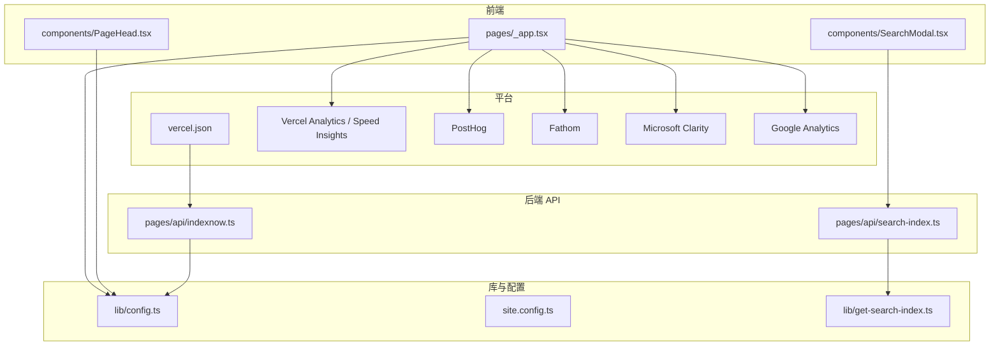
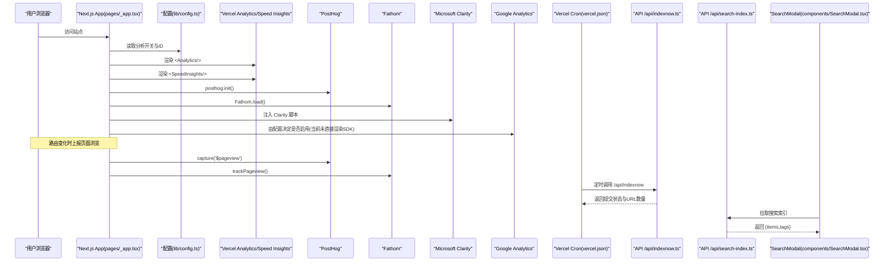
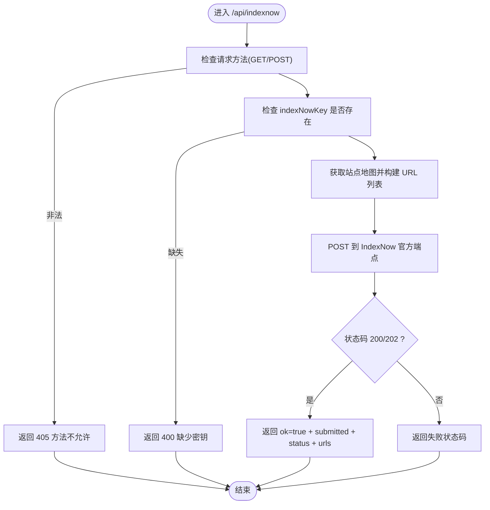
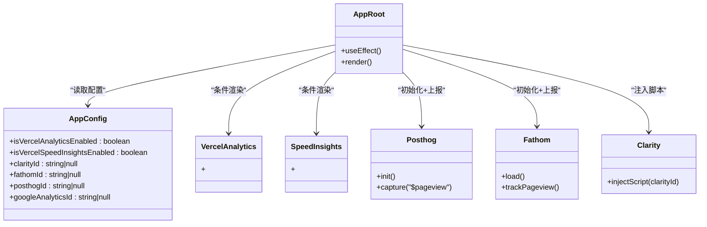
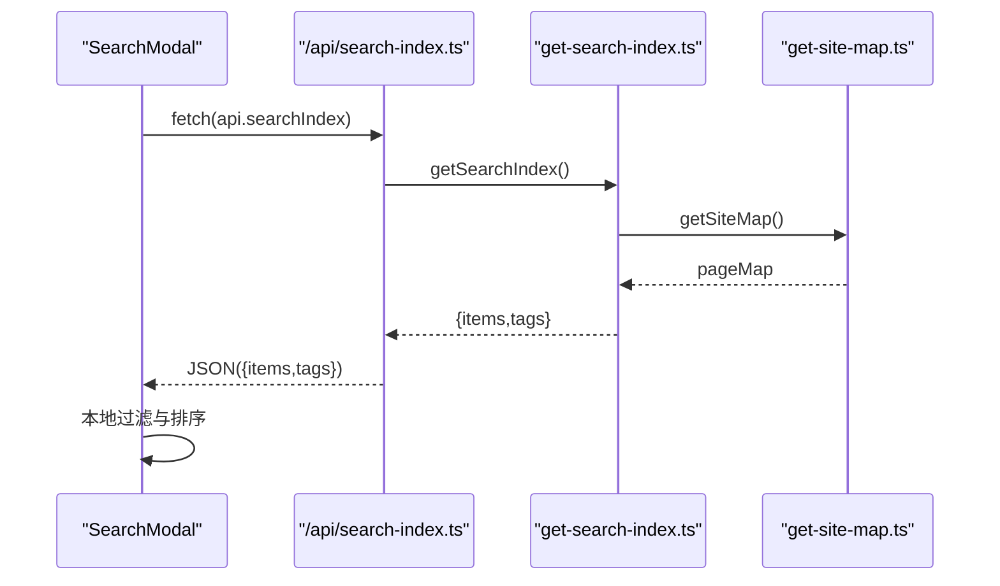
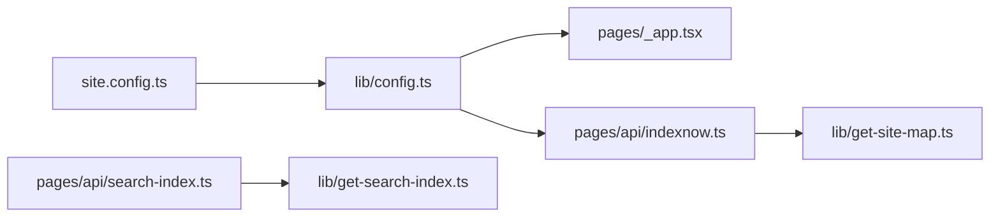

# 监控与分析

<cite>
**本文引用的文件**   
- [readme.md](file://readme.md)
- [site.config.ts](file://site.config.ts)
- [lib/config.ts](file://lib/config.ts)
- [lib/site-config.ts](file://lib/site-config.ts)
- [pages/_app.tsx](file://pages/_app.tsx)
- [components/PageHead.tsx](file://components/PageHead.tsx)
- [pages/api/indexnow.ts](file://pages/api/indexnow.ts)
- [vercel.json](file://vercel.json)
- [pages/api/search-index.ts](file://pages/api/search-index.ts)
- [lib/get-search-index.ts](file://lib/get-search-index.ts)
- [components/SearchModal.tsx](file://components/SearchModal.tsx)
- [pages/_error.tsx](file://pages/_error.tsx)
</cite>

## 目录
1. [引言](#引言)
2. [项目结构](#项目结构)
3. [核心组件](#核心组件)
4. [架构总览](#架构总览)
5. [详细组件分析](#详细组件分析)
6. [依赖关系分析](#依赖关系分析)
7. [性能与可观测性建议](#性能与可观测性建议)
8. [故障排查指南](#故障排查指南)
9. [结论](#结论)

## 引言
本文件面向生产环境的监控与分析，覆盖以下主题：
- 搜索引擎索引通知 API（IndexNow）的实现、触发方式与使用方式。
- 网站分析工具集成与配置，包括 Vercel Analytics、Vercel Speed Insights、PostHog、Fathom、Microsoft Clarity、Google Analytics。
- 性能监控、错误追踪、用户行为分析的最佳实践。
- 日志收集、告警配置、性能指标监控的落地建议。

本项目基于 Next.js Pages Router，站点内容来自 Notion，并通过 ISR 进行增量静态再生；部署在 Vercel，通过 Cron 定时调用 IndexNow API 向 Bing/Yandex 提交站点 URL，提升新内容与更新内容的收录速度。

**章节来源**
- [readme.md:32-48](file://readme.md#L32-L48)
- [readme.md:94-96](file://readme.md#L94-L96)

## 项目结构
从监控与分析视角，关键目录与文件如下：
- pages/_app.tsx：全局应用入口，负责初始化各分析 SDK、注入 Vercel Analytics/Speed Insights、Clarity 脚本。
- lib/config.ts：集中暴露分析相关开关与 ID，如 Vercel Analytics、Speed Insights、Clarity、Fathom、PostHog、Google Analytics。
- site.config.ts：站点级配置，包含 SEO 验证、IndexNow Key、分析开关等。
- components/PageHead.tsx：SEO 元数据与结构化数据，利于搜索引擎理解页面。
- pages/api/indexnow.ts：IndexNow 通知 API，供 Vercel Cron 或手动调用。
- vercel.json：定义 Vercel Cron，定时调用 /api/indexnow。
- pages/api/search-index.ts 与 lib/get-search-index.ts：构建并暴露客户端搜索索引。
- components/SearchModal.tsx：前端搜索弹窗，消费搜索索引 API。
- pages/_error.tsx：统一错误页入口，便于接入错误追踪。

**图表来源**
- [pages/_app.tsx:17-87](file://pages/_app.tsx#L17-L87)
- [lib/config.ts:100-175](file://lib/config.ts#L100-L175)
- [components/PageHead.tsx:116-184](file://components/PageHead.tsx#L116-L184)
- [pages/api/indexnow.ts:1-71](file://pages/api/indexnow.ts#L1-L71)
- [vercel.json:1-10](file://vercel.json#L1-L10)
- [pages/api/search-index.ts:1-22](file://pages/api/search-index.ts#L1-L22)
- [lib/get-search-index.ts:1-99](file://lib/get-search-index.ts#L1-L99)
- [components/SearchModal.tsx:80-106](file://components/SearchModal.tsx#L80-L106)

**章节来源**
- [pages/_app.tsx:1-91](file://pages/_app.tsx#L1-L91)
- [lib/config.ts:1-224](file://lib/config.ts#L1-L224)
- [site.config.ts:1-78](file://site.config.ts#L1-L78)
- [components/PageHead.tsx:1-188](file://components/PageHead.tsx#L1-L188)
- [pages/api/indexnow.ts:1-71](file://pages/api/indexnow.ts#L1-L71)
- [vercel.json:1-10](file://vercel.json#L1-L10)
- [pages/api/search-index.ts:1-22](file://pages/api/search-index.ts#L1-L22)
- [lib/get-search-index.ts:1-99](file://lib/get-search-index.ts#L1-L99)
- [components/SearchModal.tsx:1-254](file://components/SearchModal.tsx#L1-L254)

## 核心组件
本节聚焦与监控与分析直接相关的核心实现：
- 分析 SDK 初始化与路由事件上报：在应用根组件中根据配置启用 Vercel Analytics、Speed Insights、Fathom、PostHog、Clarity，并在路由变化时上报页面浏览。
- 站点配置与开关：通过 site.config.ts 与 lib/config.ts 暴露分析开关与 ID，支持环境变量覆盖。
- SEO 与结构化数据：PageHead 注入 robots、Open Graph、Twitter Card、Schema.org JSON-LD，提升搜索引擎抓取与展示质量。
- IndexNow 通知 API：聚合站点 URL 列表，调用 IndexNow 官方接口，返回提交结果。
- 搜索索引 API：将 Notion 公开页面映射为轻量索引，供前端搜索弹窗使用。

**章节来源**
- [pages/_app.tsx:41-87](file://pages/_app.tsx#L41-L87)
- [lib/config.ts:100-175](file://lib/config.ts#L100-L175)
- [components/PageHead.tsx:116-184](file://components/PageHead.tsx#L116-L184)
- [pages/api/indexnow.ts:15-69](file://pages/api/indexnow.ts#L15-L69)
- [pages/api/search-index.ts:5-20](file://pages/api/search-index.ts#L5-L20)
- [lib/get-search-index.ts:44-98](file://lib/get-search-index.ts#L44-L98)

## 架构总览
下图展示了生产环境中的监控与分析数据流：

**图表来源**
- [pages/_app.tsx:17-87](file://pages/_app.tsx#L17-L87)
- [lib/config.ts:100-175](file://lib/config.ts#L100-L175)
- [vercel.json:1-10](file://vercel.json#L1-L10)
- [pages/api/indexnow.ts:15-69](file://pages/api/indexnow.ts#L15-L69)
- [pages/api/search-index.ts:5-20](file://pages/api/search-index.ts#L5-L20)
- [components/SearchModal.tsx:80-106](file://components/SearchModal.tsx#L80-L106)

## 详细组件分析

### 搜索引擎索引通知 API（IndexNow）
IndexNow 用于向 Bing/Yandex 即时提交站点 URL，缩短新内容与更新内容的收录时间。

- 触发方式
  - Vercel Cron：每天凌晨 3 点自动调用 /api/indexnow。
  - 手动触发：GET/POST /api/indexnow。

- 处理流程
  - 校验请求方法，仅允许 GET/POST。
  - 校验 indexNowKey 是否配置。
  - 获取站点地图，构造首页与所有公开页面的 URL 列表。
  - 调用 IndexNow 官方端点，接收 200/202 成功响应。
  - 返回提交结果，包含是否成功、提交 URL 数量、IndexNow 状态码与 URL 列表。
  - 异常时记录错误日志并返回 500。

**图表来源**
- [pages/api/indexnow.ts:15-69](file://pages/api/indexnow.ts#L15-L69)

**章节来源**
- [pages/api/indexnow.ts:1-71](file://pages/api/indexnow.ts#L1-L71)
- [vercel.json:1-10](file://vercel.json#L1-L10)
- [site.config.ts:29-37](file://site.config.ts#L29-L37)
- [lib/config.ts:128-131](file://lib/config.ts#L128-L131)

### 网站分析工具集成与配置
- Vercel Analytics 与 Speed Insights
  - 通过条件渲染 <Analytics/> 与 <SpeedInsights/> 启用，开关由 isVercelAnalyticsEnabled 与 isVercelSpeedInsightsEnabled 控制。
  - 默认开启，可在 site.config.ts 中关闭。

- PostHog
  - 通过 posthog-js 初始化，监听路由变化后上报 $pageview。
  - 由 posthogId 与 posthogConfig 控制，posthogId 取自环境变量 NEXT_PUBLIC_POSTHOG_ID。

- Fathom
  - 通过 fathom-client 初始化，路由变化时 trackPageview。
  - fathomId 取自环境变量 NEXT_PUBLIC_FATHOM_ID，开发环境不加载。

- Microsoft Clarity
  - 通过 next/script 动态注入 Clarity 脚本，clarityId 取自 site.config.ts。

- Google Analytics
  - 配置项 googleAnalyticsId 已暴露，但当前未在 _app.tsx 中直接渲染 SDK；如需启用，可按现有模式扩展。

**图表来源**
- [pages/_app.tsx:17-87](file://pages/_app.tsx#L17-L87)
- [lib/config.ts:100-175](file://lib/config.ts#L100-L175)
- [site.config.ts:39-46](file://site.config.ts#L39-L46)

**章节来源**
- [pages/_app.tsx:41-87](file://pages/_app.tsx#L41-L87)
- [lib/config.ts:100-175](file://lib/config.ts#L100-L175)
- [site.config.ts:39-46](file://site.config.ts#L39-L46)

### 搜索索引 API 与前端搜索
- 服务端
  - pages/api/search-index.ts 调用 lib/get-search-index.ts 生成搜索索引。
  - 设置缓存头，提高 CDN/边缘缓存命中率。
  - 异常时返回空数组，避免前端崩溃。

- 索引构建逻辑
  - 遍历站点地图中的 Notion 页面，过滤非公开页面。
  - 提取标题、描述、标签、最后更新时间，计算规范化 URL。
  - 按最后更新时间倒序排序，合并去重标签集合。
  - 使用 p-memoize 对 getSearchIndex 做函数级缓存，减少重复计算。

- 前端
  - components/SearchModal.tsx 在打开时拉取 /api/search-index。
  - 支持关键词搜索与标签筛选（AND 语义）。
  - 键盘导航与无障碍属性完善。

**图表来源**
- [pages/api/search-index.ts:5-20](file://pages/api/search-index.ts#L5-L20)
- [lib/get-search-index.ts:44-98](file://lib/get-search-index.ts#L44-L98)
- [components/SearchModal.tsx:80-106](file://components/SearchModal.tsx#L80-L106)

**章节来源**
- [pages/api/search-index.ts:1-22](file://pages/api/search-index.ts#L1-L22)
- [lib/get-search-index.ts:1-99](file://lib/get-search-index.ts#L1-L99)
- [components/SearchModal.tsx:1-254](file://components/SearchModal.tsx#L1-L254)

### SEO 与结构化数据
- PageHead 注入 robots、Googlebot、Bingbot 指令，确保搜索引擎可抓取。
- 注入 Open Graph 与 Twitter Card 元信息，提升社交分享展示效果。
- 注入 Schema.org 结构化数据（WebSite/BlogPosting），增强搜索结果富摘要能力。
- 提供 RSS 订阅链接。

**章节来源**
- [components/PageHead.tsx:116-184](file://components/PageHead.tsx#L116-L184)

## 依赖关系分析
- 配置层
  - site.config.ts 定义站点级配置，包括 SEO 验证、IndexNow Key、分析开关等。
  - lib/config.ts 解析 site.config.ts 与环境变量，导出运行时配置。

- 运行层
  - pages/_app.tsx 依赖 lib/config.ts 提供的分析开关与 ID，初始化各分析 SDK。
  - pages/api/indexnow.ts 依赖 lib/config.ts 的 indexNowKey 与 lib/get-site-map.ts 的站点地图。
  - pages/api/search-index.ts 依赖 lib/get-search-index.ts 的索引构建逻辑。

**图表来源**
- [site.config.ts:1-78](file://site.config.ts#L1-L78)
- [lib/config.ts:1-224](file://lib/config.ts#L1-L224)
- [pages/_app.tsx:1-91](file://pages/_app.tsx#L1-L91)
- [pages/api/indexnow.ts:1-71](file://pages/api/indexnow.ts#L1-L71)
- [pages/api/search-index.ts:1-22](file://pages/api/search-index.ts#L1-L22)
- [lib/get-search-index.ts:1-99](file://lib/get-search-index.ts#L1-L99)

**章节来源**
- [site.config.ts:1-78](file://site.config.ts#L1-L78)
- [lib/config.ts:1-224](file://lib/config.ts#L1-L224)
- [pages/_app.tsx:1-91](file://pages/_app.tsx#L1-L91)
- [pages/api/indexnow.ts:1-71](file://pages/api/indexnow.ts#L1-L71)
- [pages/api/search-index.ts:1-22](file://pages/api/search-index.ts#L1-L22)
- [lib/get-search-index.ts:1-99](file://lib/get-search-index.ts#L1-L99)

## 性能与可观测性建议
- 性能监控
  - 保持 Vercel Speed Insights 开启，关注 Core Web Vitals 趋势。
  - 针对 ISR 页面，合理设置 revalidateSeconds，平衡新鲜度与函数调用成本。
  - 对搜索索引 API 使用缓存头，降低重复计算与带宽消耗。

- 错误追踪
  - 统一错误页入口 pages/_error.tsx 指向 components/ErrorPage，便于接入 Sentry、LogRocket 等错误追踪服务。
  - 建议在 ErrorPage 中捕获未处理异常并上报，同时保留最小化错误上下文。

- 用户行为分析
  - 优先使用 Vercel Analytics 与 PostHog，结合事件埋点（如搜索、标签筛选、外部链接点击）。
  - 使用 Clarity 录制会话回放，定位交互问题。
  - Fathom 可作为隐私友好的补充分析方案。

- 日志与告警
  - 在 IndexNow API 中记录失败日志，结合 Vercel Logs 设置告警规则（如连续失败、超时）。
  - 对搜索索引 API 的错误分支返回空数据，避免前端崩溃；同时在服务端记录错误以便排查。

[本节为通用建议，不直接分析具体代码文件]

## 故障排查指南
- IndexNow 提交失败
  - 检查 indexNowKey 是否配置且 public/<key>.txt 存在。
  - 查看 API 返回的 indexNowStatus 与 error 消息。
  - 确认 Vercel Cron 是否正常运行，必要时手动调用 /api/indexnow。

- 分析 SDK 未上报
  - 检查对应开关是否启用（isVercelAnalyticsEnabled、isVercelSpeedInsightsEnabled）。
  - 检查环境变量是否正确注入（NEXT_PUBLIC_POSTHOG_ID、NEXT_PUBLIC_FATHOM_ID、clarityId）。
  - 在浏览器控制台观察 SDK 初始化与路由事件上报。

- 搜索索引为空或加载失败
  - 检查 /api/search-index 的缓存头与返回结构。
  - 确认 Notion 页面标记为 Public，且有标题与规范化 URL。
  - 查看前端 SearchModal 的错误状态与网络请求。

**章节来源**
- [pages/api/indexnow.ts:23-69](file://pages/api/indexnow.ts#L23-L69)
- [pages/_app.tsx:44-68](file://pages/_app.tsx#L44-L68)
- [pages/api/search-index.ts:12-20](file://pages/api/search-index.ts#L12-L20)
- [components/SearchModal.tsx:80-106](file://components/SearchModal.tsx#L80-L106)

## 结论
本项目在生产环境中实现了较为完善的监控与分析体系：
- 通过 Vercel Cron 与 IndexNow API 提升搜索引擎收录效率。
- 集成多源分析工具（Vercel Analytics、Speed Insights、PostHog、Fathom、Clarity），并提供灵活的开关与配置。
- 提供搜索索引 API 与前端搜索体验，便于用户快速定位内容。
- 通过统一的错误页入口与结构化 SEO 元数据，提升可观测性与搜索引擎友好度。

建议后续逐步完善错误追踪与业务事件埋点，并结合 Vercel Logs 与第三方平台建立告警与可视化看板，持续优化用户体验与系统稳定性。

[本节为总结性内容，不直接分析具体代码文件]