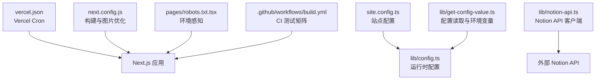
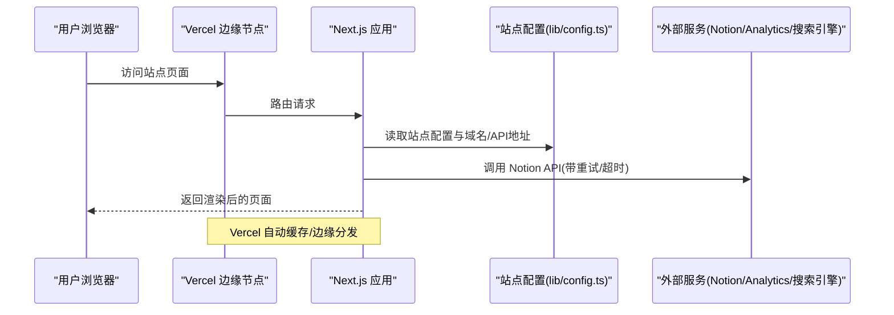
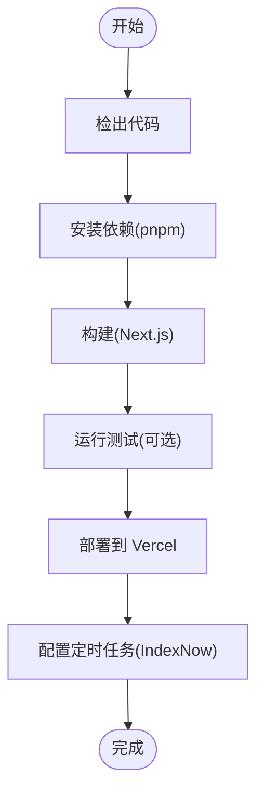
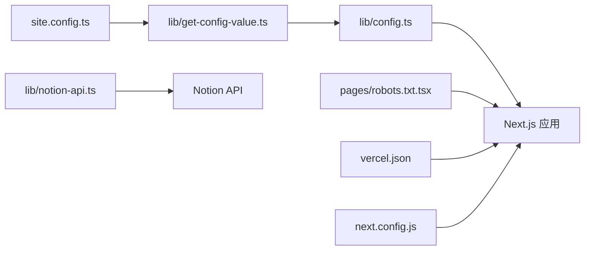

# 部署与生产环境

<cite>
**本文引用的文件**   
- [vercel.json](file://vercel.json)
- [next.config.js](file://next.config.js)
- [site.config.ts](file://site.config.ts)
- [lib/config.ts](file://lib/config.ts)
- [lib/get-config-value.ts](file://lib/get-config-value.ts)
- [lib/notion-api.ts](file://lib/notion-api.ts)
- [pages/robots.txt.tsx](file://pages/robots.txt.tsx)
- [.github/workflows/build.yml](file://.github/workflows/build.yml)
</cite>

## 目录
1. [简介](#简介)
2. [项目结构](#项目结构)
3. [核心组件](#核心组件)
4. [架构总览](#架构总览)
5. [详细组件分析](#详细组件分析)
6. [依赖关系分析](#依赖关系分析)
7. [性能与优化](#性能与优化)
8. [监控与分析](#监控与分析)
9. [CI/CD 与自动化](#cicd-与自动化)
10. [故障排查](#故障排查)
11. [结论](#结论)

## 简介
本文件面向生产环境与部署运维，覆盖以下主题：
- Vercel 部署配置、环境变量管理、域名与构建优化
- CDN 与图片优化策略
- 监控与分析工具集成（Google Analytics、Microsoft Clarity、Vercel Web Analytics/Speed Insights）
- CI/CD 流水线与版本管理建议
- 生产环境日志、错误处理与性能分析方法

本项目基于 Next.js + Notion 内容源，通过 Vercel 进行托管与边缘分发；站点元数据与运行时行为由 site.config.ts 与 lib/config.ts 统一管控，并通过环境变量实现多环境差异化。

## 项目结构
与部署和生产相关的关键文件与职责：
- vercel.json：定义 Vercel Cron 任务（定时触发 API）。
- next.config.js：Next.js 构建与运行时优化（图片远程来源、格式、CSP、包转译等）。
- site.config.ts：站点级配置（域名、SEO、分析、ISR 重验证间隔等）。
- lib/config.ts：集中导出站点运行所需常量（域名、API 地址、分析 ID、环境判断等），并支持环境变量覆盖。
- lib/get-config-value.ts：提供 getSiteConfig / getRequiredSiteConfig / getEnv 等工具，支持 NEXT_PUBLIC_SITE_CONFIG 注入覆盖。
- lib/notion-api.ts：Notion API 客户端配置（重试、超时、UA 等）。
- pages/robots.txt.tsx：根据 VERCEL_ENV 控制 robots 行为。
- .github/workflows/build.yml：GitHub Actions 测试矩阵（Node 版本矩阵与 pnpm 缓存）。

图表来源
- [vercel.json:1-10](file://vercel.json#L1-L10)
- [next.config.js:1-43](file://next.config.js#L1-L43)
- [site.config.ts:1-78](file://site.config.ts#L1-L78)
- [lib/config.ts:1-224](file://lib/config.ts#L1-L224)
- [lib/get-config-value.ts:1-73](file://lib/get-config-value.ts#L1-L73)
- [lib/notion-api.ts:1-20](file://lib/notion-api.ts#L1-L20)
- [pages/robots.txt.tsx:1-40](file://pages/robots.txt.tsx#L1-L40)
- [.github/workflows/build.yml:1-35](file://.github/workflows/build.yml#L1-L35)

章节来源
- [vercel.json:1-10](file://vercel.json#L1-L10)
- [next.config.js:1-43](file://next.config.js#L1-L43)
- [site.config.ts:1-78](file://site.config.ts#L1-L78)
- [lib/config.ts:1-224](file://lib/config.ts#L1-L224)
- [lib/get-config-value.ts:1-73](file://lib/get-config-value.ts#L1-L73)
- [lib/notion-api.ts:1-20](file://lib/notion-api.ts#L1-L20)
- [pages/robots.txt.tsx:1-40](file://pages/robots.txt.tsx#L1-L40)
- [.github/workflows/build.yml:1-35](file://.github/workflows/build.yml#L1-L35)

## 核心组件
- Vercel 部署配置
  - 定时任务：通过 vercel.json 的 crons 字段调度 /api/indexnow，用于搜索引擎即时收录。
- 构建与运行时优化
  - images.remotePatterns 允许 Notion 及第三方图床的 HTTPS 资源，启用 AVIF/WebP 格式，开启 SVG 渲染，设置严格 CSP。
  - transpilePackages 对 react-tweet 进行转译以规避兼容问题。
  - staticPageGenerationTimeout 提升静态生成超时阈值。
- 站点与运行时配置
  - site.config.ts 提供域名、SEO、分析、ISR 重验证间隔等。
  - lib/config.ts 汇总导出域名、API 基址、分析 ID、环境判断等，并支持环境变量覆盖。
  - lib/get-config-value.ts 提供 getSiteConfig / getRequiredSiteConfig / getEnv，并支持 NEXT_PUBLIC_SITE_CONFIG 动态覆盖。
- Notion API 客户端
  - lib/notion-api.ts 配置重试、超时、UA，提高稳定性。
- 环境感知
  - pages/robots.txt.tsx 在 VERCEL_ENV === 'production' 时输出不同 robots 规则。

章节来源
- [vercel.json:1-10](file://vercel.json#L1-L10)
- [next.config.js:1-43](file://next.config.js#L1-L43)
- [site.config.ts:1-78](file://site.config.ts#L1-L78)
- [lib/config.ts:1-224](file://lib/config.ts#L1-L224)
- [lib/get-config-value.ts:1-73](file://lib/get-config-value.ts#L1-L73)
- [lib/notion-api.ts:1-20](file://lib/notion-api.ts#L1-L20)
- [pages/robots.txt.tsx:1-40](file://pages/robots.txt.tsx#L1-L40)

## 架构总览
下图展示从浏览器到后端服务与外部依赖的整体交互，以及关键配置文件的作用点。

图表来源
- [lib/config.ts:109-115](file://lib/config.ts#L109-L115)
- [lib/notion-api.ts:6-18](file://lib/notion-api.ts#L6-L18)
- [vercel.json:1-10](file://vercel.json#L1-L10)

## 详细组件分析

### Vercel 部署配置与域名
- 定时任务
  - 使用 vercel.json 的 crons 字段调度 /api/indexnow，按固定周期执行，用于向搜索引擎提交站点更新。
- 域名与主机
  - 站点域名来自 site.config.ts 的 domain。
  - 运行时 apiHost 在非开发环境优先使用 VERCEL_URL，否则回退到 domain。
- 构建产物
  - Next.js 默认 SSR/SSG/ISR 混合模式，结合 ISR revalidateSeconds 控制增量静态再生频率。

章节来源
- [vercel.json:1-10](file://vercel.json#L1-L10)
- [site.config.ts:12-14](file://site.config.ts#L12-L14)
- [lib/config.ts:109-115](file://lib/config.ts#L109-L115)
- [site.config.ts:58-61](file://site.config.ts#L58-L61)

### 环境变量管理与覆盖机制
- 配置优先级
  - 基础配置：site.config.ts
  - 运行时覆盖：NEXT_PUBLIC_SITE_CONFIG（JSON 字符串）可覆盖 site.config.ts 中的字段。
  - 环境变量：getEnv 统一读取 process.env，缺失时在服务端抛出明确错误。
- 常用环境变量
  - NOTION_API_BASE_URL、NOTION_API_TOKEN：Notion API 自定义端点与令牌。
  - NEXT_PUBLIC_GOOGLE_ANALYTICS_ID：GA4 测量 ID（可通过 site.config.ts 或环境变量注入）。
  - NEXT_PUBLIC_FATHOM_ID、NEXT_PUBLIC_POSTHOG_ID：Fathom/PostHog 分析 ID。
  - GOOGLE_SITE_VERIFICATION、BING_SITE_VERIFICATION、INDEXNOW_KEY：搜索引擎验证与 IndexNow Key。
  - VERCEL_URL、VERCEL_ENV：Vercel 运行时域名与环境标识。
  - NODE_ENV、PORT：运行时环境与端口。
- 安全注意
  - 仅将需要暴露给浏览器的键以 NEXT_PUBLIC_ 前缀命名；敏感密钥（如 Notion Token）不要加该前缀。

章节来源
- [lib/get-config-value.ts:8-25](file://lib/get-config-value.ts#L8-L25)
- [lib/get-config-value.ts:52-72](file://lib/get-config-value.ts#L52-L72)
- [lib/config.ts:117-175](file://lib/config.ts#L117-L175)
- [lib/notion-api.ts:6-8](file://lib/notion-api.ts#L6-L8)

### 构建优化与 CDN 配置
- 图片优化与 CDN
  - images.remotePatterns 允许 Notion 与第三方图床的 HTTPS 域名，确保远端图片可被 Next.js 优化器处理。
  - formats 启用 AVIF/WebP，减少带宽与加载时间。
  - dangerouslyAllowSVG 允许 SVG 渲染，满足部分 Notion 嵌入需求。
  - contentSecurityPolicy 限制脚本执行，增强安全性。
- 包转译
  - transpilePackages 对 react-tweet 进行转译，避免现代语法在旧环境不兼容。
- 静态生成超时
  - staticPageGenerationTimeout 提升超时阈值，降低大型站点构建失败概率。

章节来源
- [next.config.js:4-25](file://next.config.js#L4-L25)
- [next.config.js:40-42](file://next.config.js#L40-L42)

### 监控与分析工具集成
- Google Analytics 4
  - 通过 site.config.ts 的 googleAnalyticsId 或环境变量 NEXT_PUBLIC_GOOGLE_ANALYTICS_ID 注入。
- Microsoft Clarity
  - 通过 site.config.ts 的 clarityId 注入。
- Vercel Web Analytics 与 Speed Insights
  - 通过 site.config.ts 的 isVercelAnalyticsEnabled 与 isVercelSpeedInsightsEnabled 开关控制。
- Fathom/PostHog（可选）
  - 通过环境变量 NEXT_PUBLIC_FATHOM_ID、NEXT_PUBLIC_POSTHOG_ID 注入。

章节来源
- [site.config.ts:39-46](file://site.config.ts#L39-L46)
- [lib/config.ts:133-175](file://lib/config.ts#L133-L175)

### 搜索引擎收录与 SEO
- IndexNow
  - site.config.ts 中 indexNowKey 与 public/<key>.txt 匹配，配合 vercel.json 的 cron 定时提交。
- 站点验证
  - Google/Bing 站点验证码可从 site.config.ts 或对应环境变量注入。
- robots.txt
  - pages/robots.txt.tsx 根据 VERCEL_ENV 控制是否允许索引。

章节来源
- [site.config.ts:29-37](file://site.config.ts#L29-L37)
- [vercel.json:1-10](file://vercel.json#L1-L10)
- [lib/config.ts:117-131](file://lib/config.ts#L117-L131)
- [pages/robots.txt.tsx:20-30](file://pages/robots.txt.tsx#L20-L30)

### 构建与部署流程（概念）

[本图为概念流程图，无需源码映射]

## 依赖关系分析
- 配置层
  - site.config.ts 提供基础站点配置。
  - lib/get-config-value.ts 提供配置读取与覆盖逻辑。
  - lib/config.ts 汇总导出运行时常量，并接入环境变量。
- 运行时层
  - lib/notion-api.ts 封装 Notion API 客户端，负责网络重试与超时。
  - pages/robots.txt.tsx 根据 VERCEL_ENV 输出不同响应。
- 平台层
  - vercel.json 声明定时任务。
  - next.config.js 定义构建期与运行期优化。

图表来源
- [site.config.ts:1-78](file://site.config.ts#L1-L78)
- [lib/get-config-value.ts:1-73](file://lib/get-config-value.ts#L1-L73)
- [lib/config.ts:1-224](file://lib/config.ts#L1-L224)
- [lib/notion-api.ts:1-20](file://lib/notion-api.ts#L1-L20)
- [pages/robots.txt.tsx:1-40](file://pages/robots.txt.tsx#L1-L40)
- [vercel.json:1-10](file://vercel.json#L1-L10)
- [next.config.js:1-43](file://next.config.js#L1-L43)

章节来源
- [site.config.ts:1-78](file://site.config.ts#L1-L78)
- [lib/get-config-value.ts:1-73](file://lib/get-config-value.ts#L1-L73)
- [lib/config.ts:1-224](file://lib/config.ts#L1-L224)
- [lib/notion-api.ts:1-20](file://lib/notion-api.ts#L1-L20)
- [pages/robots.txt.tsx:1-40](file://pages/robots.txt.tsx#L1-L40)
- [vercel.json:1-10](file://vercel.json#L1-L10)
- [next.config.js:1-43](file://next.config.js#L1-L43)

## 性能与优化
- 图片与 CDN
  - 启用 AVIF/WebP 格式，利用 Next.js 图片优化器与 Vercel CDN 加速。
  - 合理配置 remotePatterns，避免不必要的代理开销。
- ISR 与函数调用成本
  - 调整 revalidateSeconds（默认 3600，示例为 86400）以降低 Vercel 函数调用次数，平衡新鲜度与成本。
- 构建稳定性
  - 提升 staticPageGenerationTimeout，减少大站构建失败风险。
  - 对第三方包（如 react-tweet）进行转译，避免兼容性问题。
- 网络健壮性
  - Notion API 客户端配置重试与超时，避免偶发 5xx/429 导致页面崩溃。

章节来源
- [next.config.js:4-25](file://next.config.js#L4-L25)
- [site.config.ts:58-61](file://site.config.ts#L58-L61)
- [lib/notion-api.ts:6-18](file://lib/notion-api.ts#L6-L18)

## 监控与分析
- 前端分析
  - Google Analytics 4：通过 site.config.ts 或环境变量注入 measurement id。
  - Microsoft Clarity：通过 site.config.ts 注入项目 ID。
  - Vercel Web Analytics/Speed Insights：通过开关启用。
  - Fathom/PostHog：通过环境变量注入。
- 搜索引擎
  - IndexNow：通过 vercel.json 定时任务与 public/<key>.txt 验证文件配合。
  - Google/Bing 站点验证：通过 site.config.ts 或环境变量注入。
- 运行时指标
  - 借助 Vercel 控制台查看函数调用、冷启动、延迟与错误率。
  - 结合 Speed Insights 观察 Core Web Vitals。

章节来源
- [site.config.ts:29-46](file://site.config.ts#L29-L46)
- [lib/config.ts:133-175](file://lib/config.ts#L133-L175)
- [vercel.json:1-10](file://vercel.json#L1-L10)

## CI/CD 与自动化
- GitHub Actions
  - 在 push 事件触发测试矩阵（Node 20/22/24），使用 pnpm 缓存加速。
  - 当前工作流包含安装依赖与运行测试；构建步骤已预留注释，可按需启用。
- 版本管理建议
  - 使用语义化版本标签（vX.Y.Z）标记发布分支。
  - 在 Vercel 中关联 Git 仓库，启用 Preview/Demo 分支与 Production 分支保护。
  - 环境变量在 Vercel 项目设置中按环境（Production/Staging/Preview）分别配置，避免硬编码。

章节来源
- [.github/workflows/build.yml:1-35](file://.github/workflows/build.yml#L1-L35)

## 故障排查
- 构建失败
  - 检查 next.config.js 的图片 remotePatterns 是否包含所有必要域名。
  - 确认 staticPageGenerationTimeout 足够大，避免大型站点构建超时。
- 图片无法加载
  - 核对 remotePatterns 与目标域名协议（https）是否一致。
  - 检查 CSP 是否阻止了脚本或内联样式。
- Notion API 不稳定
  - 确认 NOTION_API_TOKEN 与 NOTION_API_BASE_URL 正确。
  - 关注重试与超时配置，必要时调高重试次数或延长超时。
- 环境变量未生效
  - 确认 NEXT_PUBLIC_* 仅在客户端可见，服务端密钥不加该前缀。
  - 若使用 NEXT_PUBLIC_SITE_CONFIG，请确保 JSON 合法且键名与 site.config.ts 一致。
- robots 误屏蔽
  - 检查 VERCEL_ENV 是否为 production，确认 pages/robots.txt.tsx 的输出是否符合预期。

章节来源
- [next.config.js:4-25](file://next.config.js#L4-L25)
- [lib/notion-api.ts:6-18](file://lib/notion-api.ts#L6-L18)
- [lib/get-config-value.ts:8-25](file://lib/get-config-value.ts#L8-L25)
- [pages/robots.txt.tsx:20-30](file://pages/robots.txt.tsx#L20-L30)

## 结论
本项目通过 Next.js 与 Vercel 的组合实现了高效的构建、边缘分发与稳定的生产运行。站点配置集中在 site.config.ts 与 lib/config.ts，并通过环境变量灵活覆盖；图片与 CDN 优化、ISR 重验证、搜索引擎收录与多类分析工具均已就绪。建议在发布前完善 CI/CD 构建步骤、环境变量管理与版本标签策略，并结合 Vercel 控制台与 Speed Insights 持续优化性能与稳定性。