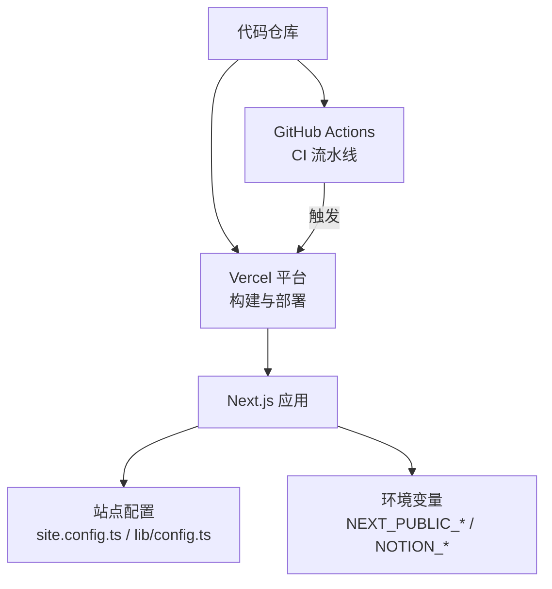
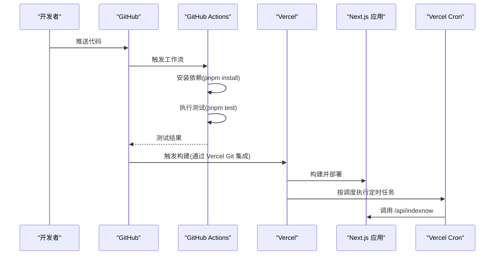
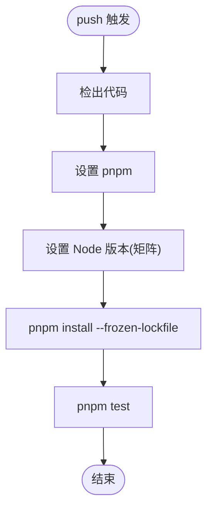
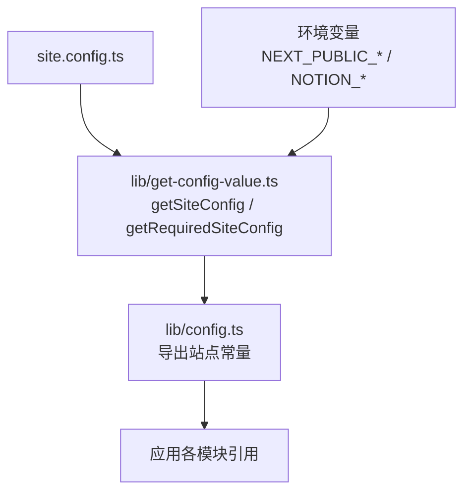
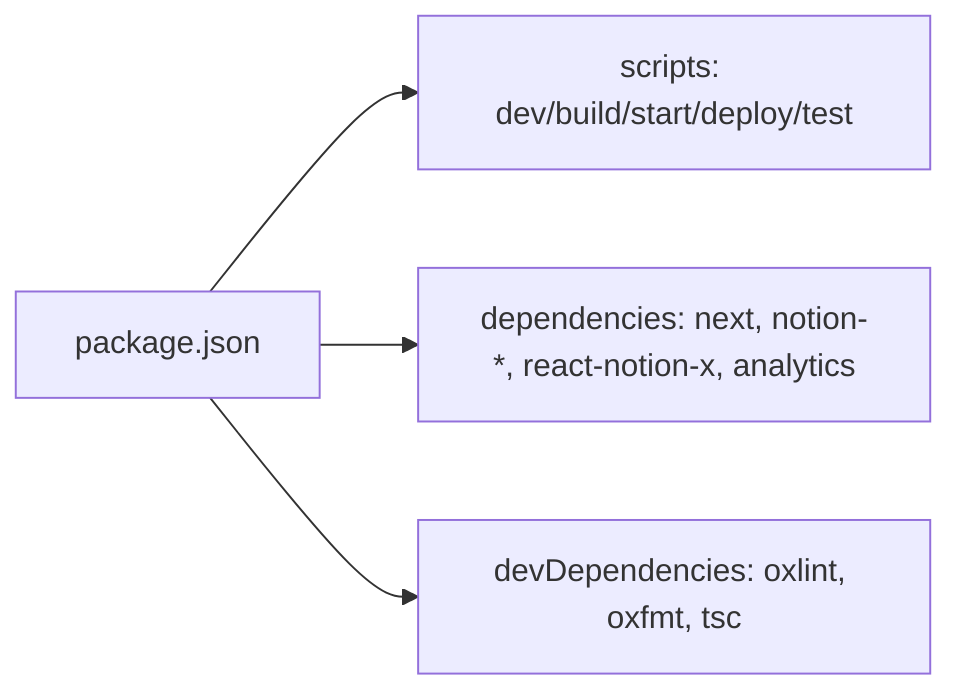

# 部署流程

<cite>
**本文引用的文件**   
- [vercel.json](file://vercel.json)
- [.github/workflows/build.yml](file://.github/workflows/build.yml)
- [package.json](file://package.json)
- [next.config.js](file://next.config.js)
- [lib/config.ts](file://lib/config.ts)
- [lib/get-config-value.ts](file://lib/get-config-value.ts)
- [site.config.ts](file://site.config.ts)
- [lib/site-config.ts](file://lib/site-config.ts)
</cite>

## 目录
1. [简介](#简介)
2. [项目结构](#项目结构)
3. [核心组件](#核心组件)
4. [架构总览](#架构总览)
5. [详细组件分析](#详细组件分析)
6. [依赖关系分析](#依赖关系分析)
7. [性能与成本考量](#性能与成本考量)
8. [故障排查指南](#故障排查指南)
9. [结论](#结论)
10. [附录：完整部署清单](#附录完整部署清单)

## 简介
本文件面向将本项目部署到 Vercel 的工程师与维护者，系统化说明部署策略、自动化流水线与环境变量管理。内容覆盖：
- Vercel 平台配置（含定时任务）
- GitHub Actions CI/CD 流水线（自动测试、构建、部署建议）
- 多环境策略与版本回滚思路
- 从本地开发到生产环境的端到端部署步骤

## 项目结构
本项目基于 Next.js，采用“站点配置 + 环境变量”的双层配置模型，并通过 Vercel 进行托管与部署。关键部署相关文件如下：
- vercel.json：Vercel 运行时配置（例如定时任务）
- .github/workflows/build.yml：GitHub Actions 持续集成
- package.json：脚本与依赖声明（包含 pnpm 与 Node 引擎要求）
- next.config.js：Next.js 构建与图片优化配置
- lib/config.ts、lib/get-config-value.ts、site.config.ts、lib/site-config.ts：站点配置与环境变量读取逻辑

图表来源
- [.github/workflows/build.yml:1-35](file://.github/workflows/build.yml#L1-L35)
- [vercel.json:1-10](file://vercel.json#L1-L10)
- [package.json:10-26](file://package.json#L10-L26)

章节来源
- [vercel.json:1-10](file://vercel.json#L1-L10)
- [.github/workflows/build.yml:1-35](file://.github/workflows/build.yml#L1-L35)
- [package.json:10-26](file://package.json#L10-L26)
- [next.config.js:1-43](file://next.config.js#L1-L43)

## 核心组件
- Vercel 配置与定时任务
  - vercel.json 定义了定时任务，用于周期性调用 /api/indexnow 以通知搜索引擎抓取站点更新。
- 持续集成（GitHub Actions）
  - build.yml 在 push 事件时运行测试矩阵（Node 20/22/24），安装依赖并执行 pnpm test。
- 站点配置与环境变量
  - site.config.ts 提供站点默认配置；lib/config.ts 与 lib/get-config-value.ts 负责合并站点配置与环境变量，并提供统一的读取接口。
- Next.js 构建配置
  - next.config.js 配置了图片远程来源、格式与安全策略，以及需要转译的第三方包。

章节来源
- [vercel.json:1-10](file://vercel.json#L1-L10)
- [.github/workflows/build.yml:1-35](file://.github/workflows/build.yml#L1-L35)
- [lib/config.ts:1-224](file://lib/config.ts#L1-L224)
- [lib/get-config-value.ts:1-72](file://lib/get-config-value.ts#L1-L72)
- [site.config.ts:1-78](file://site.config.ts#L1-L78)
- [next.config.js:1-43](file://next.config.js#L1-L43)

## 架构总览
下图展示了从代码提交到线上发布的整体流程，包括 CI 测试、Vercel 构建与部署、以及定时任务的触发路径。

图表来源
- [.github/workflows/build.yml:1-35](file://.github/workflows/build.yml#L1-L35)
- [vercel.json:1-10](file://vercel.json#L1-L10)
- [package.json:10-26](file://package.json#L10-L26)

## 详细组件分析

### Vercel 平台部署配置
- 定时任务
  - vercel.json 中定义了一个 cron 任务，每天凌晨 3 点调用 /api/indexnow，用于向搜索引擎提交站点索引更新。
- 域名与预览分支
  - 使用 Vercel 的 Git 集成后，每个分支会自动生成预览 URL；生产域可在 Vercel 控制台绑定自定义域名。
- 环境变量
  - 所有 NEXT_PUBLIC_* 变量会在构建期注入前端包；NOTION_* 等后端相关变量仅在服务端可用。
  - 站点级配置可通过 site.config.ts 提供默认值，并通过 NEXT_PUBLIC_SITE_CONFIG 环境变量进行覆盖。

章节来源
- [vercel.json:1-10](file://vercel.json#L1-L10)
- [lib/get-config-value.ts:1-72](file://lib/get-config-value.ts#L1-L72)
- [lib/config.ts:109-137](file://lib/config.ts#L109-L137)

### GitHub Actions CI/CD 流水线
- 触发条件
  - 每次 push 都会触发工作流。
- 测试矩阵
  - 在 Node 20、22、24 上并行执行测试，确保兼容性。
- 依赖与缓存
  - 使用 pnpm/action-setup 与 actions/setup-node，启用 pnpm 缓存加速安装。
- 构建与部署
  - 当前工作流仅执行测试；构建与部署由 Vercel 的 Git 集成完成。若需纯 GitHub 构建，可参考注释中的 Redis 示例扩展。

图表来源
- [.github/workflows/build.yml:1-35](file://.github/workflows/build.yml#L1-L35)
- [package.json:10-26](file://package.json#L10-L26)

章节来源
- [.github/workflows/build.yml:1-35](file://.github/workflows/build.yml#L1-L35)
- [package.json:10-26](file://package.json#L10-L26)

### 站点配置与环境变量管理
- 配置优先级
  - 默认站点配置来自 site.config.ts；可通过环境变量 NEXT_PUBLIC_SITE_CONFIG 进行覆盖。
- 统一读取接口
  - lib/get-config-value.ts 提供 getSiteConfig、getRequiredSiteConfig、getEnv 等方法，集中处理缺失必填项的错误提示。
- 常用环境变量
  - NEXT_PUBLIC_GOOGLE_ANALYTICS_ID：Google Analytics 测量 ID
  - NEXT_PUBLIC_FATHOM_ID：Fathom 分析 ID（非开发环境）
  - NEXT_PUBLIC_POSTHOG_ID：PostHog 项目 ID
  - GOOGLE_SITE_VERIFICATION / BING_SITE_VERIFICATION：搜索引擎验证
  - INDEXNOW_KEY：IndexNow 密钥
  - VERCEL_URL：Vercel 运行时域名（服务端）
  - NOTION_API_BASE_URL / NOTION_API_TOKEN：Notion API 访问凭据（服务端）

图表来源
- [site.config.ts:1-78](file://site.config.ts#L1-L78)
- [lib/get-config-value.ts:1-72](file://lib/get-config-value.ts#L1-L72)
- [lib/config.ts:1-224](file://lib/config.ts#L1-L224)

章节来源
- [lib/get-config-value.ts:1-72](file://lib/get-config-value.ts#L1-L72)
- [lib/config.ts:1-224](file://lib/config.ts#L1-L224)
- [site.config.ts:1-78](file://site.config.ts#L1-L78)

### Next.js 构建与图片优化
- 图片远程来源
  - 允许 Notion CDN、AWS、Twitter 等外部域名，同时放行任意 https 主机名以保证嵌入图片渲染。
- 图片格式与安全策略
  - 输出 AVIF/WebP，开启 SVG 支持，并设置严格的 Content Security Policy。
- 第三方包转译
  - 对 react-tweet 进行转译以避免兼容性问题。

章节来源
- [next.config.js:1-43](file://next.config.js#L1-L43)

## 依赖关系分析
- 构建与运行
  - package.json 指定 Node 引擎为 24，包管理器为 pnpm@10.29.3；scripts 提供 dev/build/start/deploy/test 等命令。
- 运行时依赖
  - 使用 notion-client/types/utils 与 react-notion-x 渲染 Notion 页面；引入 @vercel/analytics 与 @vercel/speed-insights 用于分析与性能洞察。
- 开发工具链
  - 使用 oxlint/oxfmt 进行代码检查与格式化，tsc 进行类型检查。

图表来源
- [package.json:1-94](file://package.json#L1-L94)

章节来源
- [package.json:1-94](file://package.json#L1-L94)

## 性能与成本考量
- ISR 重验证间隔
  - 通过 site.config.ts 的 revalidateSeconds 控制 ISR 刷新频率，降低 Vercel 函数调用次数，平衡内容新鲜度与成本。
- 图片优化
  - 使用 AVIF/WebP 与严格 CSP，减少带宽与提升安全性。
- 定时任务
  - 通过 cron 每日一次调用 IndexNow，避免频繁请求搜索引擎。

章节来源
- [site.config.ts:58-61](file://site.config.ts#L58-L61)
- [next.config.js:6-25](file://next.config.js#L6-L25)
- [vercel.json:1-10](file://vercel.json#L1-L10)

## 故障排查指南
- 站点配置缺失或无效
  - 当 site.config.ts 未正确导出或字段缺失时，lib/get-config-value.ts 会抛出明确错误信息，便于快速定位。
- 环境变量未设置
  - 使用 getEnv/getRequiredSiteConfig 时，若缺少必填环境变量或站点配置键，会抛出错误；请检查 Vercel 控制台的环境变量设置。
- 图片无法加载
  - 检查 next.config.js 的 remotePatterns 是否包含对应域名；确认图片链接为 HTTPS。
- 搜索引擎验证失败
  - 核对 GOOGLE_SITE_VERIFICATION/BING_SITE_VERIFICATION 与 site.config.ts 的值是否一致，并确保 public 目录下存在 IndexNow 校验文件。

章节来源
- [lib/get-config-value.ts:4-20](file://lib/get-config-value.ts#L4-L20)
- [lib/config.ts:23-30](file://lib/config.ts#L23-L30)
- [next.config.js:6-25](file://next.config.js#L6-L25)
- [site.config.ts:29-37](file://site.config.ts#L29-L37)

## 结论
本项目通过“站点配置 + 环境变量”实现灵活的多环境部署，结合 Vercel 的 Git 集成与定时任务能力，形成稳定高效的发布流程。GitHub Actions 负责质量门禁（测试矩阵），Vercel 负责构建与部署。建议在 Vercel 控制台完善环境变量与域名绑定，并根据业务需求调整 ISR 重验证间隔与图片优化策略。

## 附录：完整部署清单

- 前置准备
  - 安装 Node 24 与 pnpm@10.29.3（与 package.json engines/packageManager 保持一致）。
  - 初始化仓库并连接 Vercel（Git 集成）。

- 本地开发
  - 安装依赖：pnpm install
  - 启动开发服务器：pnpm dev
  - 运行测试：pnpm test（包含 lint/format/typecheck）

- 环境变量（在 Vercel 控制台设置）
  - 前端可见：NEXT_PUBLIC_GOOGLE_ANALYTICS_ID、NEXT_PUBLIC_FATHOM_ID、NEXT_PUBLIC_POSTHOG_ID、NEXT_PUBLIC_SITE_CONFIG（可选）
  - 服务端专用：NOTION_API_BASE_URL、NOTION_API_TOKEN、GOOGLE_SITE_VERIFICATION、BING_SITE_VERIFICATION、INDEXNOW_KEY、VERCEL_URL（自动注入）

- 站点配置
  - 编辑 site.config.ts 填写站点基础信息与 SEO 配置；如需覆盖，可在 Vercel 设置 NEXT_PUBLIC_SITE_CONFIG 为 JSON 字符串。

- 构建与部署
  - 推送到主分支触发 Vercel 构建与部署；或通过 pnpm deploy 手动触发（需已登录 Vercel CLI）。

- 域名与 SSL
  - 在 Vercel 控制台绑定自定义域名，启用自动 HTTPS。

- 定时任务
  - vercel.json 已配置 IndexNow 定时任务；无需额外操作。

- 版本管理与回滚
  - Vercel 会为每次部署生成预览 URL；生产部署可在 Vercel 控制台进行回滚至历史版本。
  - 建议使用语义化版本标签（如 v1.2.3）配合分支策略（main 为生产，feature/* 为功能分支），并在 PR 中触发 CI 测试。

- 常见问题
  - 构建失败：检查 Node/pnpm 版本与依赖锁定文件（pnpm-lock.yaml）。
  - 图片不显示：确认 next.config.js 的 remotePatterns 与图片域名匹配。
  - 搜索引擎验证失败：核对站点验证码与 IndexNow 密钥。

章节来源
- [package.json:82-92](file://package.json#L82-L92)
- [package.json:10-26](file://package.json#L10-L26)
- [vercel.json:1-10](file://vercel.json#L1-L10)
- [lib/config.ts:109-137](file://lib/config.ts#L109-L137)
- [site.config.ts:1-78](file://site.config.ts#L1-L78)