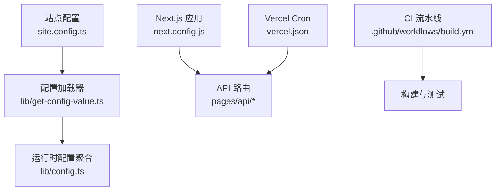
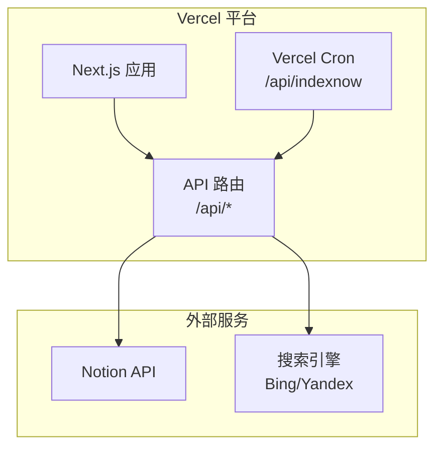
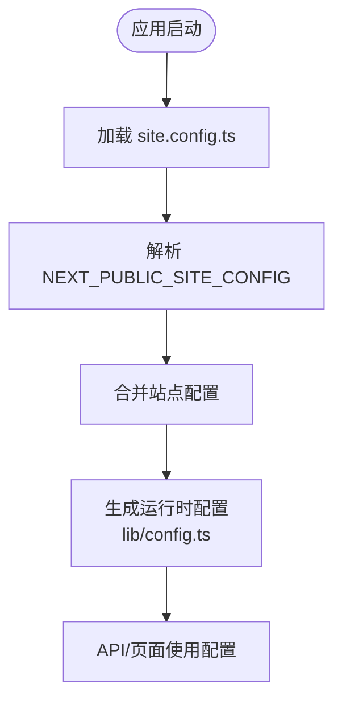
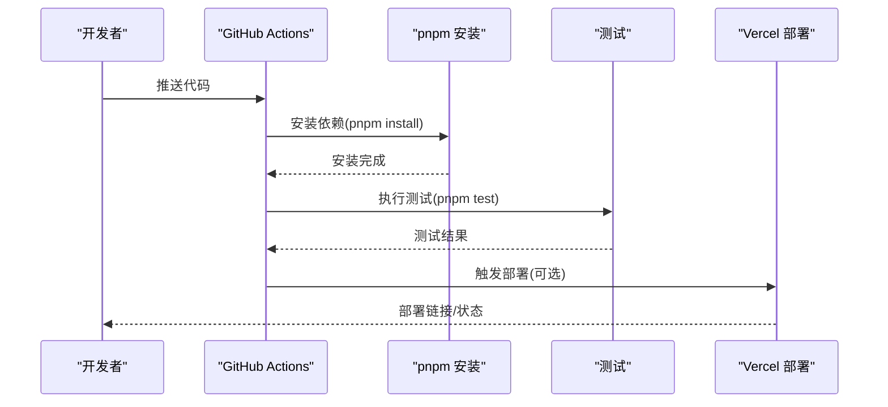
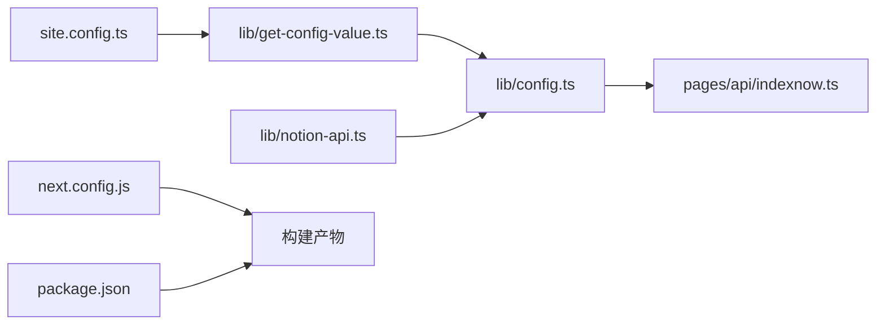

# 部署指南

<cite>
**本文引用的文件**   
- [vercel.json](file://vercel.json)
- [next.config.js](file://next.config.js)
- [package.json](file://package.json)
- [site.config.ts](file://site.config.ts)
- [lib/get-config-value.ts](file://lib/get-config-value.ts)
- [lib/config.ts](file://lib/config.ts)
- [lib/site-config.ts](file://lib/site-config.ts)
- [lib/notion-api.ts](file://lib/notion-api.ts)
- [pages/api/indexnow.ts](file://pages/api/indexnow.ts)
- [.github/workflows/build.yml](file://.github/workflows/build.yml)
</cite>

## 目录
1. [简介](#简介)
2. [项目结构](#项目结构)
3. [核心组件](#核心组件)
4. [架构总览](#架构总览)
5. [详细组件分析](#详细组件分析)
6. [依赖关系分析](#依赖关系分析)
7. [性能与优化](#性能与优化)
8. [故障排查](#故障排查)
9. [结论](#结论)
10. [附录：环境变量清单](#附录环境变量清单)

## 简介
本指南面向在 Vercel 平台部署 nextjs-notion-starter-kit 的读者，覆盖从环境准备、环境变量配置、域名与 SSL 设置、CI/CD 流水线到生产监控与维护的全流程。文档同时给出可操作的步骤说明和架构图示，帮助你在不同平台上顺利完成部署并稳定运行。

## 项目结构
本项目基于 Next.js，采用“站点配置 + API 路由 + 定时任务”的结构组织代码。关键目录与职责如下：
- site.config.ts：站点元信息、SEO、分析与 ISR 等站点级配置
- lib/*：配置读取、Notion API 客户端、站点地图、搜索索引等工具模块
- pages/api/*：服务端 API（搜索、社交图片、IndexNow 提交）
- vercel.json：Vercel Cron 定时任务配置
- next.config.js：Next.js 构建与图片优化配置
- package.json：脚本、依赖与 Node 版本要求
- .github/workflows/build.yml：GitHub Actions CI 测试流水线

图表来源
- [site.config.ts:1-77](file://site.config.ts#L1-L77)
- [lib/get-config-value.ts:1-73](file://lib/get-config-value.ts#L1-L73)
- [lib/config.ts:1-192](file://lib/config.ts#L1-L192)
- [next.config.js:1-36](file://next.config.js#L1-L36)
- [vercel.json:1-10](file://vercel.json#L1-L10)
- [.github/workflows/build.yml:1-35](file://.github/workflows/build.yml#L1-L35)

章节来源
- [site.config.ts:1-77](file://site.config.ts#L1-L77)
- [lib/get-config-value.ts:1-73](file://lib/get-config-value.ts#L1-L73)
- [lib/config.ts:1-192](file://lib/config.ts#L1-L192)
- [next.config.js:1-36](file://next.config.js#L1-L36)
- [vercel.json:1-10](file://vercel.json#L1-L10)
- [.github/workflows/build.yml:1-35](file://.github/workflows/build.yml#L1-L35)

## 核心组件
- 站点配置层：site.config.ts 定义站点名称、域名、SEO、分析与 ISR 等；lib/get-config-value.ts 支持通过 NEXT_PUBLIC_SITE_CONFIG 环境变量覆盖站点配置；lib/config.ts 汇总运行时配置，包括域名、API 地址、验证令牌与分析开关。
- Notion 集成层：lib/notion-api.ts 使用 NOTION_API_TOKEN 与可选 NOTION_API_BASE_URL 初始化 Notion 客户端，并内置重试策略以增强稳定性。
- API 服务层：pages/api/indexnow.ts 提供 IndexNow 提交接口，配合 vercel.json 中的 cron 定时触发。
- 构建与部署层：next.config.js 配置远程图片白名单、格式与安全策略；package.json 定义 Node 版本与脚本；vercel.json 声明定时任务。

章节来源
- [site.config.ts:1-77](file://site.config.ts#L1-L77)
- [lib/get-config-value.ts:1-73](file://lib/get-config-value.ts#L1-L73)
- [lib/config.ts:1-192](file://lib/config.ts#L1-L192)
- [lib/notion-api.ts:1-20](file://lib/notion-api.ts#L1-L20)
- [pages/api/indexnow.ts:1-50](file://pages/api/indexnow.ts#L1-L50)
- [next.config.js:1-36](file://next.config.js#L1-L36)
- [package.json:1-93](file://package.json#L1-L93)
- [vercel.json:1-10](file://vercel.json#L1-L10)

## 架构总览
下图展示 Vercel 上的部署与运行架构：站点静态资源由 Next.js 构建生成，API 路由在 Vercel Edge/Serverless 上执行，定时任务通过 Vercel Cron 调用 /api/indexnow，外部数据来自 Notion API。

图表来源
- [vercel.json:1-10](file://vercel.json#L1-L10)
- [pages/api/indexnow.ts:1-50](file://pages/api/indexnow.ts#L1-L50)
- [lib/notion-api.ts:1-20](file://lib/notion-api.ts#L1-L20)

## 详细组件分析

### Vercel 部署与优化
- 构建与运行
  - Node 版本：package.json 指定 engines.node=24，确保 Vercel 使用匹配的运行时。
  - 包管理器：pnpm@10.29.3，建议在 Vercel 中启用 pnpm 缓存以加速安装。
  - 构建脚本：next build；启动脚本：next start。
- 图片与性能
  - next.config.js 配置 remotePatterns 允许 Notion、Unsplash、Twitter 等外部图片域名，并启用 AVIF/WebP 格式以提升加载速度。
  - 开启 dangerouslyAllowSVG 以支持 SVG 内容。
  - 设置 images.contentSecurityPolicy 限制脚本执行，提升安全性。
- 定时任务
  - vercel.json 声明 cron 任务，每天凌晨 3 点调用 /api/indexnow 向搜索引擎提交站点 URL。
- 环境变量注入
  - 所有环境变量需在 Vercel 项目的 Settings > Environment Variables 中配置，区分 Production、Preview、Development 环境。

章节来源
- [package.json:1-93](file://package.json#L1-L93)
- [next.config.js:1-36](file://next.config.js#L1-L36)
- [vercel.json:1-10](file://vercel.json#L1-L10)

### 环境变量配置
- 必需变量
  - NOTION_API_TOKEN：Notion 内部集成 Token，用于访问 Notion 页面与数据库。
  - 可选：NOTION_API_BASE_URL：自定义 Notion API 基础地址（例如代理或私有部署）。
- 站点与 SEO
  - NEXT_PUBLIC_SITE_CONFIG：JSON 字符串，用于覆盖 site.config.ts 中的站点配置（如 domain、analyticsId 等），便于在不同环境动态切换。
  - GOOGLE_SITE_VERIFICATION、BING_SITE_VERIFICATION、INDEXNOW_KEY：搜索引擎验证与即时收录密钥。
- 分析与监控
  - NEXT_PUBLIC_GOOGLE_ANALYTICS_ID：Google Analytics 测量 ID。
  - NEXT_PUBLIC_FATHOM_ID、NEXT_PUBLIC_POSTHOG_ID：Fathom 与 PostHog 分析 ID。
  - isVercelAnalyticsEnabled、isVercelSpeedInsightsEnabled：在 site.config.ts 中控制是否启用 Vercel Web Analytics 与 Speed Insights。
- 配置优先级
  - site.config.ts 提供默认值；NEXT_PUBLIC_SITE_CONFIG 可覆盖；lib/config.ts 将两者合并并在运行时暴露给前端与后端。

图表来源
- [lib/get-config-value.ts:1-73](file://lib/get-config-value.ts#L1-L73)
- [lib/config.ts:1-192](file://lib/config.ts#L1-L192)
- [site.config.ts:1-77](file://site.config.ts#L1-L77)

章节来源
- [lib/notion-api.ts:1-20](file://lib/notion-api.ts#L1-L20)
- [lib/get-config-value.ts:1-73](file://lib/get-config-value.ts#L1-L73)
- [lib/config.ts:1-192](file://lib/config.ts#L1-L192)
- [site.config.ts:1-77](file://site.config.ts#L1-L77)

### 域名绑定与 SSL 证书
- 域名绑定
  - 在 Vercel 项目的 Domains 中添加自定义域名，Vercel 会自动签发并续期 SSL 证书。
  - 若使用 NEXT_PUBLIC_SITE_CONFIG 覆盖 domain，请确保与 Vercel 绑定的域名一致。
- 安全策略
  - next.config.js 中 images.contentSecurityPolicy 限制脚本执行，建议在生产环境保持严格模式。
  - 如需引入第三方脚本（如分析 SDK），请在 Vercel 的 Security Headers 或 Next.js 配置中谨慎添加。

章节来源
- [next.config.js:1-36](file://next.config.js#L1-L36)
- [lib/config.ts:100-150](file://lib/config.ts#L100-L150)

### CI/CD 流水线与自动化部署
- GitHub Actions
  - .github/workflows/build.yml 在 push 时触发，对 Node 20/22/24 进行矩阵测试，使用 pnpm 安装依赖并执行测试。
  - 可结合 Vercel CLI 或 Vercel Integration 实现自动部署预览与生产分支。
- 本地与 CI 脚本
  - package.json 提供 dev/build/start/deploy 等脚本；deploy 命令为 vercel deploy。
  - 可在 Vercel 项目中设置 Build & Development Settings，选择 pnpm 作为包管理器，并缓存 node_modules。

图表来源
- [.github/workflows/build.yml:1-35](file://.github/workflows/build.yml#L1-L35)
- [package.json:14-28](file://package.json#L14-L28)

章节来源
- [.github/workflows/build.yml:1-35](file://.github/workflows/build.yml#L1-L35)
- [package.json:14-28](file://package.json#L14-L28)

### 生产环境监控与维护
- 搜索引擎收录
  - vercel.json 配置 cron 每日调用 /api/indexnow，自动向 Bing/Yandex 提交站点 URL。
  - 确保 public/<indexNowKey>.txt 存在且可被访问。
- 分析与性能
  - 在 site.config.ts 中启用 isVercelAnalyticsEnabled 与 isVercelSpeedInsightsEnabled，获取页面访问与性能指标。
  - 可通过 Google Analytics 与 Microsoft Clarity 进一步追踪用户行为。
- ISR 与函数调用优化
  - revalidateSeconds 控制 ISR 刷新频率，适当增大可减少 Vercel 函数调用次数，降低冷启动开销。
- 日志与错误
  - 关注 Vercel 构建与运行日志，定位 Notion API 超时或鉴权失败问题。
  - 检查 next.config.js 的图片远程域名是否包含实际使用的 CDN 域名。

章节来源
- [vercel.json:1-10](file://vercel.json#L1-L10)
- [pages/api/indexnow.ts:1-50](file://pages/api/indexnow.ts#L1-L50)
- [site.config.ts:38-60](file://site.config.ts#L38-L60)
- [lib/config.ts:90-143](file://lib/config.ts#L90-L143)

## 依赖关系分析
- 配置依赖
  - site.config.ts 提供默认站点配置；lib/get-config-value.ts 支持通过环境变量覆盖；lib/config.ts 聚合运行时配置。
- API 依赖
  - lib/notion-api.ts 依赖 NOTION_API_TOKEN 与可选 NOTION_API_BASE_URL。
  - pages/api/indexnow.ts 依赖 lib/config.ts 提供的 host/domain/indexNowKey。
- 构建依赖
  - next.config.js 配置图片远程域名与格式；package.json 指定 Node 与 pnpm 版本。

图表来源
- [site.config.ts:1-77](file://site.config.ts#L1-L77)
- [lib/get-config-value.ts:1-73](file://lib/get-config-value.ts#L1-L73)
- [lib/config.ts:1-192](file://lib/config.ts#L1-L192)
- [lib/notion-api.ts:1-20](file://lib/notion-api.ts#L1-L20)
- [pages/api/indexnow.ts:1-50](file://pages/api/indexnow.ts#L1-L50)
- [next.config.js:1-36](file://next.config.js#L1-L36)
- [package.json:1-93](file://package.json#L1-L93)

章节来源
- [site.config.ts:1-77](file://site.config.ts#L1-L77)
- [lib/get-config-value.ts:1-73](file://lib/get-config-value.ts#L1-L73)
- [lib/config.ts:1-192](file://lib/config.ts#L1-L192)
- [lib/notion-api.ts:1-20](file://lib/notion-api.ts#L1-L20)
- [pages/api/indexnow.ts:1-50](file://pages/api/indexnow.ts#L1-L50)
- [next.config.js:1-36](file://next.config.js#L1-L36)
- [package.json:1-93](file://package.json#L1-L93)

## 性能与优化
- 图片优化
  - 启用 AVIF/WebP 格式，减少带宽占用。
  - 合理配置 remotePatterns，避免不必要的跨域请求。
- ISR 调优
  - 根据更新频率调整 revalidateSeconds，平衡新鲜度与函数调用成本。
- 构建优化
  - 使用 pnpm 缓存与只构建必要依赖（package.json 中 onlyBuiltDependencies）。
  - 按需启用 transpilePackages，减少编译开销。
- 安全与稳定性
  - 保持 CSP 严格模式，限制脚本执行。
  - Notion API 客户端已内置重试策略，应对临时网络波动。

[本节为通用指导，不直接分析具体文件]

## 故障排查
- Notion 鉴权失败
  - 检查 NOTION_API_TOKEN 是否正确配置，确认 Notion 内部集成权限。
  - 如使用代理或私有部署，检查 NOTION_API_BASE_URL。
- 图片无法加载
  - 确认 next.config.js 的 remotePatterns 包含图片域名。
  - 检查 Content-Security-Policy 是否阻止了图片加载。
- IndexNow 未生效
  - 确认 vercel.json 的 cron 配置正确，public/<key>.txt 存在并可访问。
  - 检查 indexNowKey 是否在 site.config.ts 或环境变量中配置。
- 构建失败
  - 确认 Node 版本与 package.json engines 匹配。
  - 检查 pnpm 缓存与依赖安装日志。

章节来源
- [lib/notion-api.ts:1-20](file://lib/notion-api.ts#L1-L20)
- [next.config.js:1-36](file://next.config.js#L1-L36)
- [vercel.json:1-10](file://vercel.json#L1-L10)
- [pages/api/indexnow.ts:1-50](file://pages/api/indexnow.ts#L1-L50)
- [package.json:1-93](file://package.json#L1-L93)

## 结论
通过合理的站点配置、环境变量管理、Vercel 部署与 CI/CD 流水线，nextjs-notion-starter-kit 可以在不同平台上快速上线并保持稳定运行。生产环境中应重点关注搜索引擎收录、分析与性能监控，并根据业务需求调整 ISR 与图片优化策略。

[本节为总结性内容，不直接分析具体文件]

## 附录：环境变量清单
- NOTION_API_TOKEN：必填，Notion 内部集成 Token
- NOTION_API_BASE_URL：可选，自定义 Notion API 基础地址
- NEXT_PUBLIC_SITE_CONFIG：可选，JSON 字符串覆盖站点配置
- GOOGLE_SITE_VERIFICATION：可选，Google Search Console 验证码
- BING_SITE_VERIFICATION：可选，Bing Webmaster Tools 验证码
- INDEXNOW_KEY：可选，IndexNow 密钥（需对应 public/<key>.txt）
- NEXT_PUBLIC_GOOGLE_ANALYTICS_ID：可选，GA4 测量 ID
- NEXT_PUBLIC_FATHOM_ID：可选，Fathom 分析 ID
- NEXT_PUBLIC_POSTHOG_ID：可选，PostHog 分析 ID

章节来源
- [lib/notion-api.ts:1-20](file://lib/notion-api.ts#L1-L20)
- [lib/get-config-value.ts:1-73](file://lib/get-config-value.ts#L1-L73)
- [lib/config.ts:114-172](file://lib/config.ts#L114-L172)
- [site.config.ts:28-45](file://site.config.ts#L28-L45)