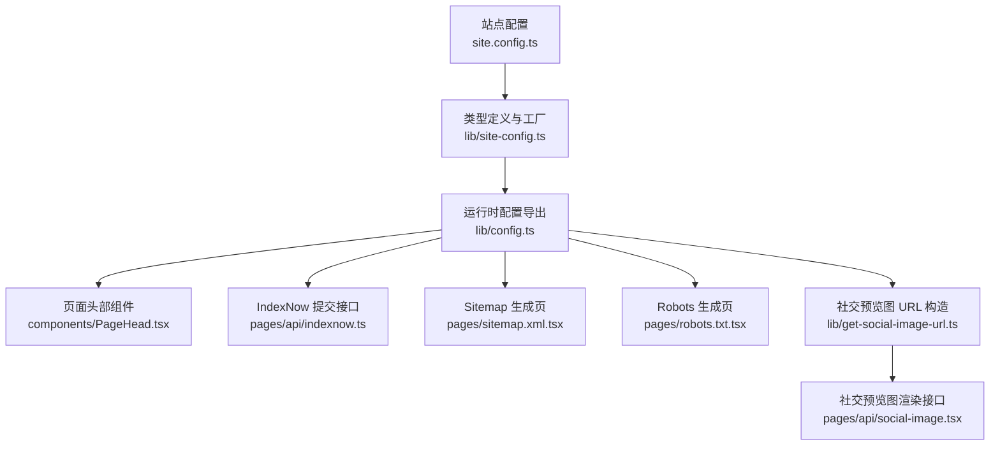
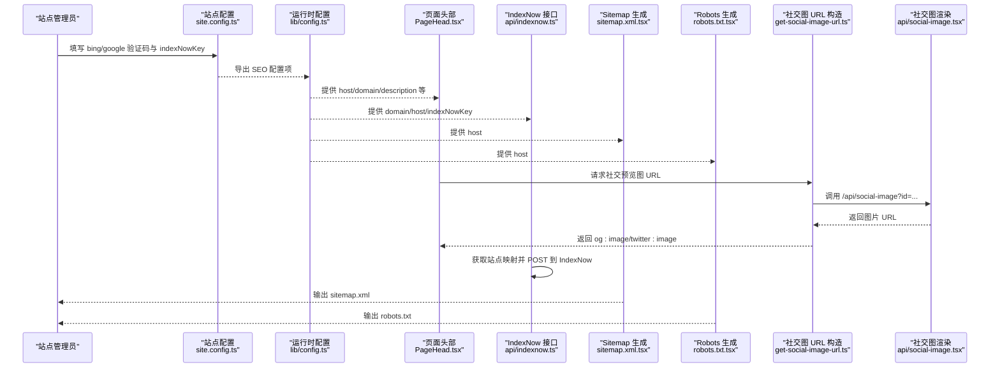
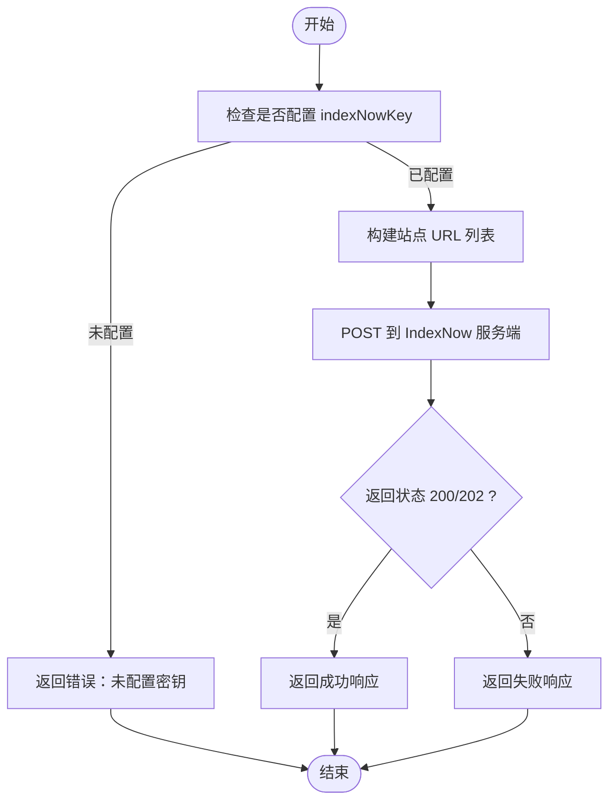
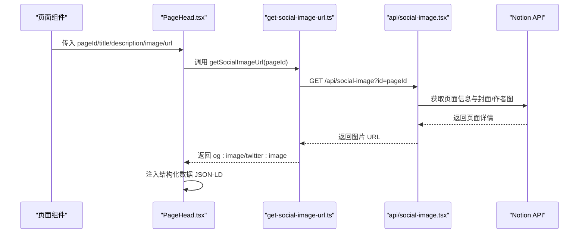
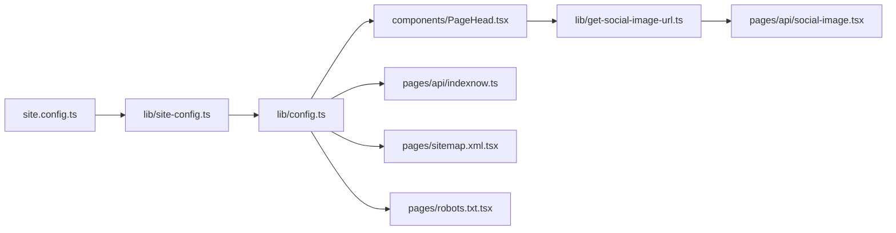

# SEO 配置

<cite>
**本文引用的文件**   
- [site.config.ts](file://site.config.ts)
- [lib/site-config.ts](file://lib/site-config.ts)
- [lib/config.ts](file://lib/config.ts)
- [components/PageHead.tsx](file://components/PageHead.tsx)
- [pages/api/indexnow.ts](file://pages/api/indexnow.ts)
- [pages/sitemap.xml.tsx](file://pages/sitemap.xml.tsx)
- [pages/robots.txt.tsx](file://pages/robots.txt.tsx)
- [lib/get-social-image-url.ts](file://lib/get-social-image-url.ts)
- [pages/api/social-image.tsx](file://pages/api/social-image.tsx)
</cite>

## 目录
1. [简介](#简介)
2. [项目结构](#项目结构)
3. [核心组件](#核心组件)
4. [架构总览](#架构总览)
5. [详细组件分析](#详细组件分析)
6. [依赖关系分析](#依赖关系分析)
7. [性能与缓存](#性能与缓存)
8. [SEO 最佳实践](#seo-最佳实践)
9. [常见问题排查](#常见问题排查)
10. [结论](#结论)

## 简介
本指南面向使用 Next.js + Notion 的站点，聚焦搜索引擎优化（SEO）相关配置与实现。内容涵盖：
- 搜索引擎验证代码配置：Bing、Google
- IndexNow 即时收录密钥配置与自动提交
- Open Graph 元数据与 description 字段的作用
- 社交媒体预览图片生成与结构化数据
- Sitemap、Robots 与 RSS 订阅
- 常见 SEO 问题定位与解决方案

## 项目结构
本项目将 SEO 相关的配置集中在站点配置文件，并在页面头部统一注入元数据；同时提供 API 用于社交预览图生成与 IndexNow 提交。

**图表来源**
- [site.config.ts:1-77](file://site.config.ts#L1-L77)
- [lib/site-config.ts:1-56](file://lib/site-config.ts#L1-L56)
- [lib/config.ts:100-150](file://lib/config.ts#L100-L150)
- [components/PageHead.tsx:1-188](file://components/PageHead.tsx#L1-L188)
- [pages/api/indexnow.ts:1-71](file://pages/api/indexnow.ts#L1-L71)
- [pages/sitemap.xml.tsx:1-140](file://pages/sitemap.xml.tsx#L1-L140)
- [pages/robots.txt.tsx:1-49](file://pages/robots.txt.tsx#L1-L49)
- [lib/get-social-image-url.ts:1-17](file://lib/get-social-image-url.ts#L1-L17)
- [pages/api/social-image.tsx:1-313](file://pages/api/social-image.tsx#L1-L313)

**章节来源**
- [site.config.ts:1-77](file://site.config.ts#L1-L77)
- [lib/site-config.ts:1-56](file://lib/site-config.ts#L1-L56)
- [lib/config.ts:100-150](file://lib/config.ts#L100-L150)

## 核心组件
- 站点配置入口：在站点根目录的配置文件集中声明 SEO 相关项，包括 Bing/Google 验证码与 IndexNow 密钥。
- 运行时配置：从站点配置与环境变量中解析出域名、主机地址、验证密钥等，供各模块使用。
- 页面头部组件：统一注入 meta、Open Graph、Twitter Card、canonical、RSS、结构化数据等 SEO 标签。
- IndexNow 接口：定时或手动触发，向 IndexNow 提交站点所有 URL，加速 Bing/Yandex 收录。
- Sitemap 与 Robots：动态生成站点地图与爬虫规则，辅助搜索引擎抓取。
- 社交预览图：根据 Notion 页面信息动态生成高质量预览图，并通过 OG/Twitter 元数据暴露。

**章节来源**
- [site.config.ts:28-36](file://site.config.ts#L28-L36)
- [lib/config.ts:114-128](file://lib/config.ts#L114-L128)
- [components/PageHead.tsx:91-184](file://components/PageHead.tsx#L91-L184)
- [pages/api/indexnow.ts:1-71](file://pages/api/indexnow.ts#L1-L71)
- [pages/sitemap.xml.tsx:1-140](file://pages/sitemap.xml.tsx#L1-L140)
- [pages/robots.txt.tsx:1-49](file://pages/robots.txt.tsx#L1-L49)
- [lib/get-social-image-url.ts:1-17](file://lib/get-social-image-url.ts#L1-L17)
- [pages/api/social-image.tsx:1-313](file://pages/api/social-image.tsx#L1-L313)

## 架构总览
下图展示了 SEO 相关的数据流与控制流：站点配置驱动运行时配置，页面头部组件消费配置并注入 SEO 标签；IndexNow 接口读取站点映射并提交 URL；Sitemap/Robots 为爬虫提供索引依据；社交预览图接口根据 Notion 页面数据生成图片。

**图表来源**
- [site.config.ts:28-36](file://site.config.ts#L28-L36)
- [lib/config.ts:107-128](file://lib/config.ts#L107-L128)
- [components/PageHead.tsx:28-37](file://components/PageHead.tsx#L28-L37)
- [lib/get-social-image-url.ts:1-17](file://lib/get-social-image-url.ts#L1-L17)
- [pages/api/social-image.tsx:21-49](file://pages/api/social-image.tsx#L21-L49)
- [pages/api/indexnow.ts:15-69](file://pages/api/indexnow.ts#L15-L69)
- [pages/sitemap.xml.tsx:7-32](file://pages/sitemap.xml.tsx#L7-L32)
- [pages/robots.txt.tsx:5-39](file://pages/robots.txt.tsx#L5-L39)

## 详细组件分析

### 搜索引擎验证代码配置（Bing、Google）
- 配置位置：站点根配置文件中设置 `bingSiteVerification` 与 `googleSiteVerification`。
- 运行时导出：运行时配置模块从站点配置与环境变量中解析出对应值，供其他模块使用。
- 注入方式：页面头部组件会基于这些配置注入相应的验证标签（例如 Google 的 HTML tag 验证）。

配置步骤
1. 打开站点根配置文件，找到 SEO 区域。
2. 填入 Bing Webmaster Tools 提供的验证字符串至 `bingSiteVerification`。
3. 填入 Google Search Console 提供的 HTML tag 验证值至 `googleSiteVerification`。
4. 部署后，确保页面源码中包含对应的验证标签。

注意事项
- 若环境变量存在同名键，可覆盖站点配置中的值。
- 验证通过后，可在对应平台查看站点状态与索引报告。

**章节来源**
- [site.config.ts:28-33](file://site.config.ts#L28-L33)
- [lib/site-config.ts:21-26](file://lib/site-config.ts#L21-L26)
- [lib/config.ts:114-123](file://lib/config.ts#L114-L123)

### IndexNow 即时收录密钥配置与自动提交
- 配置位置：站点根配置文件中设置 `indexNowKey`。
- 验证文件：需在静态资源目录放置 `<key>.txt` 文件，文件名与密钥一致。
- 自动提交：IndexNow 接口会收集站点所有 URL 并 POST 到 IndexNow 服务，支持定时任务触发。

配置步骤
1. 在站点根配置文件中设置 `indexNowKey`。
2. 在静态资源目录创建名为 `<key>.txt` 的文件，内容为空或平台要求的校验内容。
3. 通过 API 手动触发或配置定时任务自动提交 URL。

流程图（IndexNow 提交）

**图表来源**
- [pages/api/indexnow.ts:15-69](file://pages/api/indexnow.ts#L15-L69)

**章节来源**
- [site.config.ts:34-36](file://site.config.ts#L34-L36)
- [lib/config.ts:125-128](file://lib/config.ts#L125-L128)
- [pages/api/indexnow.ts:1-71](file://pages/api/indexnow.ts#L1-L71)

### Open Graph 元数据与 description 字段
- 标题与描述：页面头部组件优先使用页面级 title/description，否则回退到站点级 name/description。
- OG/Twitter 元数据：当存在社交预览图时，启用大图卡片；否则使用普通卡片。
- description 作用：作为搜索引擎摘要与社交平台预览文本，影响搜索展示与分享效果。

建议
- 为每个页面设置独立的 description，避免重复。
- 保持 description 长度适中（通常 120–160 字符），突出关键词与价值点。
- 确保 og:title、og:description、og:image 三者一致且准确。

**章节来源**
- [components/PageHead.tsx:28-37](file://components/PageHead.tsx#L28-L37)
- [components/PageHead.tsx:145-161](file://components/PageHead.tsx#L145-L161)
- [components/PageHead.tsx:178-180](file://components/PageHead.tsx#L178-L180)

### 社交媒体预览图片与结构化数据
- 社交预览图 URL 构造：根据页面 ID 拼接 `/api/social-image?id=...`。
- 社交预览图渲染：Edge 函数从 Notion 拉取页面信息，动态生成 1200×630 的图片。
- 结构化数据：页面头部组件注入 Website 与 BlogPosting 两种 JSON-LD，包含标题、作者、发布时间、修改时间、语言等。

流程（社交预览图）

**图表来源**
- [components/PageHead.tsx:28-37](file://components/PageHead.tsx#L28-L37)
- [lib/get-social-image-url.ts:1-17](file://lib/get-social-image-url.ts#L1-L17)
- [pages/api/social-image.tsx:21-49](file://pages/api/social-image.tsx#L21-L49)
- [pages/api/social-image.tsx:173-276](file://pages/api/social-image.tsx#L173-L276)

**章节来源**
- [lib/get-social-image-url.ts:1-17](file://lib/get-social-image-url.ts#L1-L17)
- [pages/api/social-image.tsx:1-313](file://pages/api/social-image.tsx#L1-L313)
- [components/PageHead.tsx:50-89](file://components/PageHead.tsx#L50-L89)

### Sitemap 与 Robots
- Sitemap：动态生成站点地图，包含首页与各页面的 loc、lastmod、changefreq、priority，并按路径深度计算优先级与更新频率。
- Robots：生产环境允许抓取根路径并指向 sitemap；预览环境默认禁止抓取以避免重复内容索引。

建议
- 定期提交 sitemap 到搜索引擎控制台。
- 确保 robots.txt 正确放行必要路径，屏蔽敏感 API 路径。

**章节来源**
- [pages/sitemap.xml.tsx:1-140](file://pages/sitemap.xml.tsx#L1-L140)
- [pages/robots.txt.tsx:1-49](file://pages/robots.txt.tsx#L1-L49)

## 依赖关系分析
SEO 相关模块之间的依赖如下：

**图表来源**
- [site.config.ts:1-77](file://site.config.ts#L1-L77)
- [lib/site-config.ts:1-56](file://lib/site-config.ts#L1-L56)
- [lib/config.ts:100-150](file://lib/config.ts#L100-L150)
- [components/PageHead.tsx:1-188](file://components/PageHead.tsx#L1-L188)
- [pages/api/indexnow.ts:1-71](file://pages/api/indexnow.ts#L1-L71)
- [pages/sitemap.xml.tsx:1-140](file://pages/sitemap.xml.tsx#L1-L140)
- [pages/robots.txt.tsx:1-49](file://pages/robots.txt.tsx#L1-L49)
- [lib/get-social-image-url.ts:1-17](file://lib/get-social-image-url.ts#L1-L17)
- [pages/api/social-image.tsx:1-313](file://pages/api/social-image.tsx#L1-L313)

**章节来源**
- [lib/config.ts:100-150](file://lib/config.ts#L100-L150)

## 性能与缓存
- Sitemap 响应头设置了较长的 CDN 缓存（最大 8 小时），减少频繁生成开销。
- Robots 响应头在 CDN 层缓存一天，浏览器可重新验证。
- IndexNow 接口对重复触发做了短暂缓存控制，避免频繁请求外部服务。
- 社交预览图 Edge 函数按需加载字体，避免包体积过大。

建议
- 合理调整 ISR 重验证间隔，平衡内容新鲜度与函数调用成本。
- 监控 IndexNow 提交成功率与延迟，必要时增加重试与告警。

**章节来源**
- [pages/sitemap.xml.tsx:20-24](file://pages/sitemap.xml.tsx#L20-L24)
- [pages/robots.txt.tsx:17-21](file://pages/robots.txt.tsx#L17-L21)
- [pages/api/indexnow.ts:54-59](file://pages/api/indexnow.ts#L54-L59)
- [pages/api/social-image.tsx:34-38](file://pages/api/social-image.tsx#L34-L38)

## SEO 最佳实践
- 验证站点所有权
  - 完成 Bing 与 Google 验证，确保平台能识别站点。
- 完善 Open Graph 与 Twitter Card
  - 为每个页面设置唯一的 og:title、og:description、og:image。
  - 使用 summary_large_image 以获得更好的社交分享展示。
- 结构化数据
  - 使用 JSON-LD 标注 Website 与 BlogPosting，包含作者、发布时间、修改时间、语言等。
- Sitemap 与 Robots
  - 提交 sitemap 到搜索引擎控制台。
  - 在生产环境允许抓取，预览环境禁止抓取。
- 社交预览图
  - 为 Notion 页面设置合适的封面图与作者头像，确保图片可达且尺寸合适。
  - 使用 1200×630 比例，保证主流平台显示效果。
- 内容质量与更新频率
  - 保持 description 简洁明确，突出关键词。
  - 定期更新内容，并在 sitemap 中体现 lastmod。

[本节为通用指导，不直接分析具体文件]

## 常见问题排查
- 搜索引擎验证失败
  - 检查站点配置中是否填写了正确的验证值。
  - 确认部署后页面源码中存在对应的验证标签。
  - 若使用环境变量覆盖，请确认环境变量生效。
- IndexNow 提交失败
  - 确认已配置 indexNowKey 且静态资源目录存在 `<key>.txt`。
  - 检查 API 返回状态码与错误消息，确认网络连通性。
- 社交预览图不显示
  - 检查页面是否传入了有效的 pageId。
  - 确认 Notion 页面属性（封面图、作者头像）可用且链接可达。
  - 查看社交预览图接口返回状态与日志。
- Sitemap/Robots 异常
  - 检查生产环境与预览环境的 robots 策略是否正确。
  - 确认 sitemap 生成的 URL 列表完整且无重复。

**章节来源**
- [lib/config.ts:114-128](file://lib/config.ts#L114-L128)
- [pages/api/indexnow.ts:23-27](file://pages/api/indexnow.ts#L23-L27)
- [pages/api/indexnow.ts:66-69](file://pages/api/indexnow.ts#L66-L69)
- [pages/api/social-image.tsx:27-32](file://pages/api/social-image.tsx#L27-L32)
- [pages/robots.txt.tsx:24-37](file://pages/robots.txt.tsx#L24-L37)

## 结论
通过站点配置文件集中管理 SEO 相关项，配合页面头部组件统一注入元数据与结构化数据，再辅以 Sitemap、Robots、IndexNow 与社交预览图能力，可以显著提升站点的搜索引擎可见性与社交分享体验。建议在发布前完成搜索引擎验证、完善 OG/Twitter 元数据、配置 IndexNow 密钥并测试社交预览图生成，持续监控索引与收录情况，不断优化内容与展示效果。