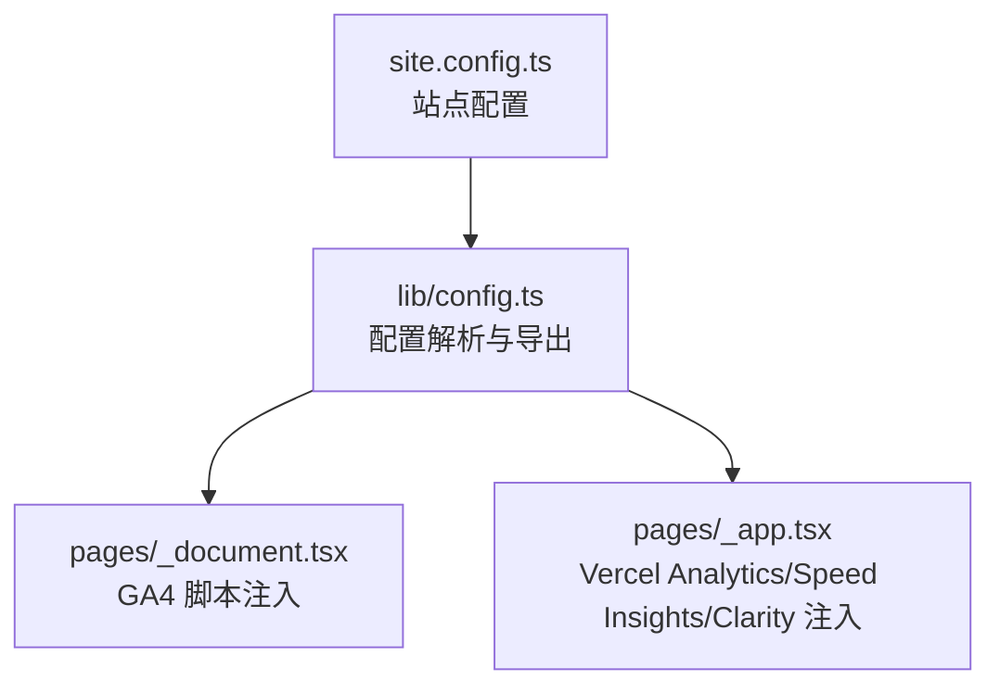
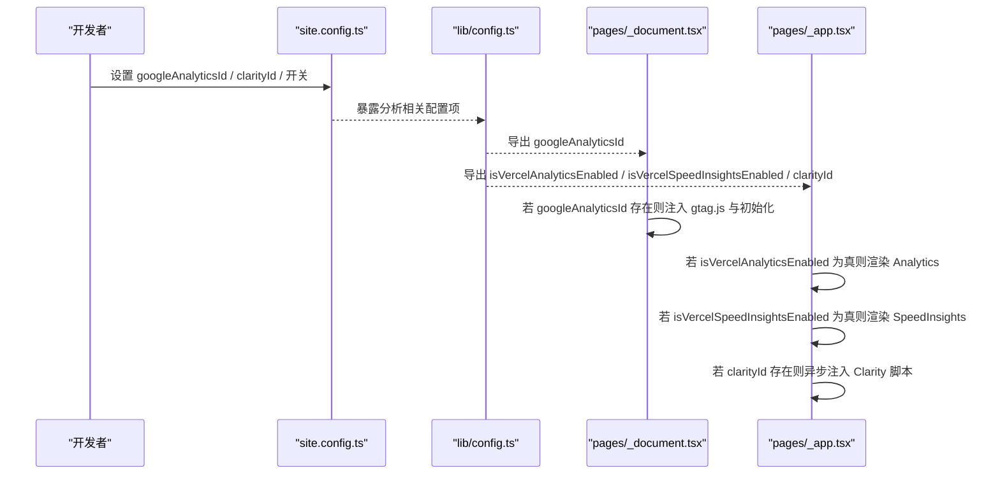
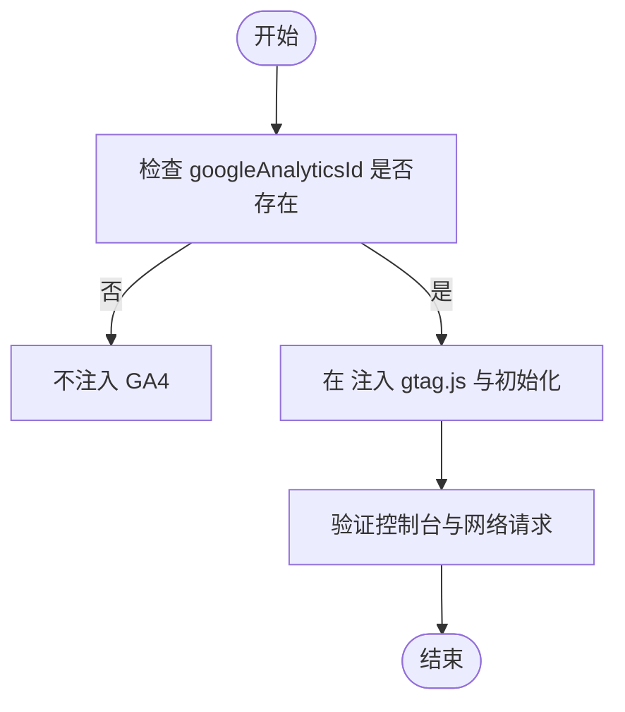
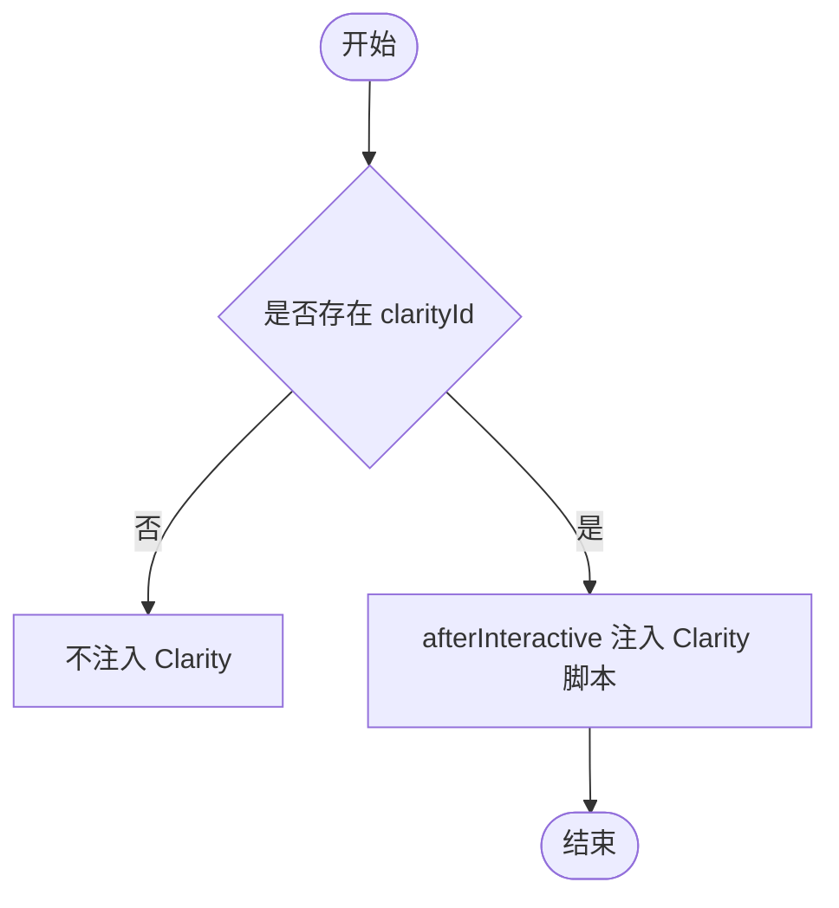
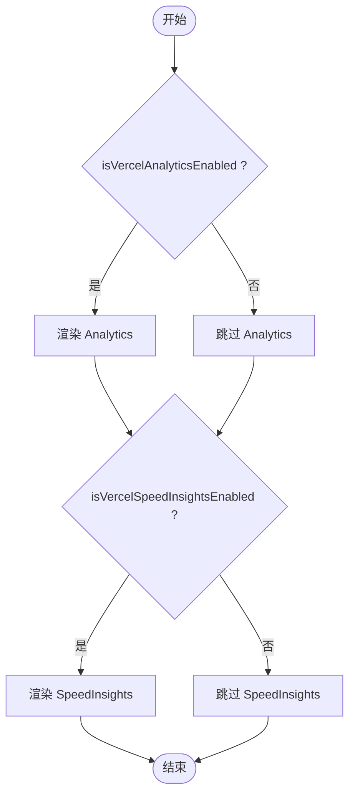
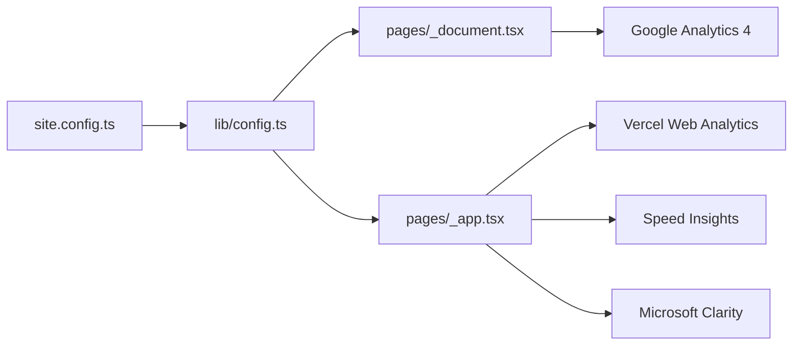

# 分析工具配置

<cite>
**本文引用的文件**   
- [site.config.ts](file://site.config.ts)
- [lib/config.ts](file://lib/config.ts)
- [pages/_document.tsx](file://pages/_document.tsx)
- [pages/_app.tsx](file://pages/_app.tsx)
</cite>

## 目录
1. [简介](#简介)
2. [项目结构](#项目结构)
3. [核心组件](#核心组件)
4. [架构总览](#架构总览)
5. [详细组件分析](#详细组件分析)
6. [依赖关系分析](#依赖关系分析)
7. [性能考虑](#性能考虑)
8. [故障排查指南](#故障排查指南)
9. [结论](#结论)
10. [附录](#附录)

## 简介
本文面向需要在 Next.js + Notion 博客模板中集成多种前端分析工具的开发者，提供可操作的配置说明与最佳实践。重点覆盖：
- Google Analytics 4（GA4）的启用与 measurementId 配置
- Microsoft Clarity 会话录制的集成方式
- Vercel Web Analytics 与 Speed Insights 的开关控制
- 不同分析工具的优缺点对比、选择建议与隐私合规注意事项

本仓库采用“站点配置文件 + 运行时注入”的模式：所有分析相关参数在站点配置中集中声明，由应用层根据开关条件动态加载对应脚本或组件，从而保证灵活性与可维护性。

## 项目结构
与分析相关的代码主要分布在以下位置：
- 站点配置入口：site.config.ts
- 配置解析与导出：lib/config.ts
- GA4 脚本注入（HTML Head）：pages/_document.tsx
- 路由级分析与录制脚本注入（客户端）：pages/_app.tsx

图表来源
- [site.config.ts:38-45](file://site.config.ts#L38-L45)
- [lib/config.ts:130-143](file://lib/config.ts#L130-L143)
- [pages/_document.tsx:32-49](file://pages/_document.tsx#L32-L49)
- [pages/_app.tsx:70-87](file://pages/_app.tsx#L70-L87)

章节来源
- [site.config.ts:38-45](file://site.config.ts#L38-L45)
- [lib/config.ts:130-143](file://lib/config.ts#L130-L143)
- [pages/_document.tsx:32-49](file://pages/_document.tsx#L32-L49)
- [pages/_app.tsx:70-87](file://pages/_app.tsx#L70-L87)

## 核心组件
- 站点配置（site.config.ts）
  - 集中声明分析相关字段：googleAnalyticsId、clarityId、isVercelAnalyticsEnabled、isVercelSpeedInsightsEnabled
- 配置导出（lib/config.ts）
  - 从站点配置与环境变量读取并导出上述字段，供页面组件消费
- GA4 注入（pages/_document.tsx）
  - 当存在 googleAnalyticsId 时，在 HTML <Head> 中注入 gtag.js 与初始化脚本
- 客户端分析注入（pages/_app.tsx）
  - 根据 isVercelAnalyticsEnabled 渲染 Vercel Analytics
  - 根据 isVercelSpeedInsightsEnabled 渲染 Speed Insights
  - 当存在 clarityId 时，异步注入 Microsoft Clarity 追踪脚本

章节来源
- [site.config.ts:38-45](file://site.config.ts#L38-L45)
- [lib/config.ts:97-98](file://lib/config.ts#L97-L98)
- [lib/config.ts:130-143](file://lib/config.ts#L130-L143)
- [pages/_document.tsx:32-49](file://pages/_document.tsx#L32-L49)
- [pages/_app.tsx:70-87](file://pages/_app.tsx#L70-L87)

## 架构总览
下图展示了从配置到脚本注入的完整链路：

图表来源
- [site.config.ts:38-45](file://site.config.ts#L38-L45)
- [lib/config.ts:130-143](file://lib/config.ts#L130-L143)
- [pages/_document.tsx:32-49](file://pages/_document.tsx#L32-L49)
- [pages/_app.tsx:70-87](file://pages/_app.tsx#L70-L87)

## 详细组件分析

### Google Analytics 4（GA4）
- 配置位置
  - 站点配置：site.config.ts 中的 googleAnalyticsId
  - 配置导出：lib/config.ts 将 googleAnalyticsId 暴露给页面层
- 注入时机与方式
  - pages/_document.tsx 在 HTML <Head> 中注入 gtag.js 与初始化逻辑，仅在 googleAnalyticsId 存在时生效
- 配置步骤
  1. 在 site.config.ts 中设置 googleAnalyticsId（格式通常为 G-XXXXXXXXXX）
  2. 确保 lib/config.ts 已正确导出该值（默认已支持）
  3. 构建部署后，检查页面 <head> 是否包含 gtag.js 与初始化脚本
- 环境变量覆盖
  - lib/config.ts 同时支持通过 NEXT_PUBLIC_GOOGLE_ANALYTICS_ID 环境变量覆盖站点配置值

图表来源
- [lib/config.ts:130-134](file://lib/config.ts#L130-L134)
- [pages/_document.tsx:32-49](file://pages/_document.tsx#L32-L49)

章节来源
- [site.config.ts:38-40](file://site.config.ts#L38-L40)
- [lib/config.ts:130-134](file://lib/config.ts#L130-L134)
- [pages/_document.tsx:32-49](file://pages/_document.tsx#L32-L49)

### Microsoft Clarity
- 配置位置
  - 站点配置：site.config.ts 中的 clarityId
  - 配置导出：lib/config.ts 导出 clarityId
- 注入时机与方式
  - pages/_app.tsx 在客户端使用 afterInteractive 策略注入 Clarity 脚本，仅在 clarityId 存在时生效
- 配置步骤
  1. 在 site.config.ts 中设置 clarityId（来自 Microsoft Clarity 项目）
  2. 确认 lib/config.ts 已导出 clarityId（默认已支持）
  3. 构建部署后，检查页面是否在交互后加载 Clarity 脚本
- 行为特性
  - 脚本以异步方式注入，避免阻塞首屏渲染

图表来源
- [lib/config.ts:97-98](file://lib/config.ts#L97-L98)
- [pages/_app.tsx:75-87](file://pages/_app.tsx#L75-L87)

章节来源
- [site.config.ts:41-42](file://site.config.ts#L41-L42)
- [lib/config.ts:97-98](file://lib/config.ts#L97-L98)
- [pages/_app.tsx:75-87](file://pages/_app.tsx#L75-L87)

### Vercel Web Analytics 与 Speed Insights
- 配置位置
  - 站点配置：site.config.ts 中的 isVercelAnalyticsEnabled 与 isVercelSpeedInsightsEnabled
  - 配置导出：lib/config.ts 导出两个布尔开关
- 注入时机与方式
  - pages/_app.tsx 根据开关分别渲染 Analytics 与 SpeedInsights 组件
- 配置步骤
  1. 在 site.config.ts 中将 isVercelAnalyticsEnabled 设为 true/false 以启用/禁用 Vercel Web Analytics
  2. 在 site.config.ts 中将 isVercelSpeedInsightsEnabled 设为 true/false 以启用/禁用 Speed Insights
  3. 构建部署后，检查页面是否按需加载对应组件

图表来源
- [lib/config.ts:136-143](file://lib/config.ts#L136-L143)
- [pages/_app.tsx:73-74](file://pages/_app.tsx#L73-L74)

章节来源
- [site.config.ts:43-45](file://site.config.ts#L43-L45)
- [lib/config.ts:136-143](file://lib/config.ts#L136-L143)
- [pages/_app.tsx:73-74](file://pages/_app.tsx#L73-L74)

### 配置优先级与覆盖规则
- 站点配置优先：site.config.ts 中的字段作为默认值
- 环境变量覆盖：部分字段（如 GA4）支持通过 NEXT_PUBLIC_* 环境变量覆盖
- 运行时开关：isVercelAnalyticsEnabled 与 isVercelSpeedInsightsEnabled 用于在客户端决定是否加载对应组件

章节来源
- [lib/config.ts:130-143](file://lib/config.ts#L130-L143)

## 依赖关系分析
- 模块耦合
  - pages/_document.tsx 与 pages/_app.tsx 均依赖 lib/config.ts 导出的分析配置
  - site.config.ts 是所有分析配置的单一事实来源
- 外部依赖
  - GA4：googletagmanager.com/gtag.js
  - Clarity：clarity.ms/tag
  - Vercel Analytics/Speed Insights：由 Next/Vercel 生态提供的组件

图表来源
- [site.config.ts:38-45](file://site.config.ts#L38-L45)
- [lib/config.ts:130-143](file://lib/config.ts#L130-L143)
- [pages/_document.tsx:32-49](file://pages/_document.tsx#L32-L49)
- [pages/_app.tsx:70-87](file://pages/_app.tsx#L70-L87)

章节来源
- [site.config.ts:38-45](file://site.config.ts#L38-L45)
- [lib/config.ts:130-143](file://lib/config.ts#L130-L143)
- [pages/_document.tsx:32-49](file://pages/_document.tsx#L32-L49)
- [pages/_app.tsx:70-87](file://pages/_app.tsx#L70-L87)

## 性能考虑
- 脚本加载策略
  - GA4 在 <head> 中注入，可能影响首字节时间；可通过 CDN 缓存优化
  - Clarity 使用 afterInteractive 策略，避免阻塞首屏
  - Vercel Analytics/Speed Insights 按需渲染，减少不必要的资源消耗
- 开关控制
  - 建议在开发环境关闭非必要的分析，提升本地调试效率
  - 在生产环境按需开启，平衡数据收集与用户体验

[本节为通用指导，不涉及具体文件分析]

## 故障排查指南
- GA4 未上报数据
  - 检查 site.config.ts 是否正确设置 googleAnalyticsId
  - 检查 lib/config.ts 是否成功导出 googleAnalyticsId
  - 检查 pages/_document.tsx 是否在 <head> 注入了 gtag.js 与初始化脚本
  - 浏览器控制台与网络面板查看是否有 googletagmanager.com 的请求
- Clarity 未录制
  - 检查 site.config.ts 是否正确设置 clarityId
  - 检查 pages/_app.tsx 是否在交互后注入 Clarity 脚本
  - 浏览器控制台与网络面板查看是否有 clarity.ms/tag 的请求
- Vercel Analytics/Speed Insights 未生效
  - 检查 site.config.ts 中 isVercelAnalyticsEnabled 与 isVercelSpeedInsightsEnabled 是否为 true
  - 检查 pages/_app.tsx 是否按需渲染了对应组件
  - 确认部署平台为 Vercel 且具备相应权限

章节来源
- [lib/config.ts:130-143](file://lib/config.ts#L130-L143)
- [pages/_document.tsx:32-49](file://pages/_document.tsx#L32-L49)
- [pages/_app.tsx:70-87](file://pages/_app.tsx#L70-L87)

## 结论
- 本模板提供了统一的分析配置入口与灵活的运行时注入机制
- GA4 通过站点配置与文档头注入实现；Clarity 通过客户端异步注入实现；Vercel Analytics/Speed Insights 通过布尔开关控制
- 建议根据业务需求与隐私合规要求，合理选择与分析工具组合，并在生产环境中谨慎开启数据采集

[本节为总结性内容，不涉及具体文件分析]

## 附录

### 各分析工具优缺点与选择建议
- Google Analytics 4（GA4）
  - 优点：生态完善、事件模型强大、与 Google 生态深度集成
  - 缺点：脚本体积较大、隐私合规要求较高
  - 适用场景：需要精细化事件追踪与跨渠道归因的项目
- Microsoft Clarity
  - 优点：会话回放、热力图、性能友好（异步注入）
  - 缺点：偏向体验分析，指标维度不如 GA4 丰富
  - 适用场景：关注用户行为与界面体验优化的项目
- Vercel Web Analytics
  - 优点：开箱即用、与 Vercel 生态无缝集成、隐私友好
  - 缺点：功能相对基础，定制化能力有限
  - 适用场景：快速上线、轻量统计的需求
- Vercel Speed Insights
  - 优点：自动采集 Core Web Vitals，便于性能监控
  - 缺点：仅聚焦性能指标
  - 适用场景：重视性能指标与持续优化的项目

[本节为概念性内容，不涉及具体文件分析]

### 隐私合规注意事项
- 明确告知用户数据采集范围与用途
- 提供退出/拒绝选项（例如 Cookie 同意弹窗）
- 最小化数据收集原则，避免敏感信息上报
- 遵循当地法规（如 GDPR、CCPA），必要时进行数据跨境传输评估
- 定期审查第三方脚本对隐私的影响，及时下线不再使用的分析工具

[本节为通用指导，不涉及具体文件分析]