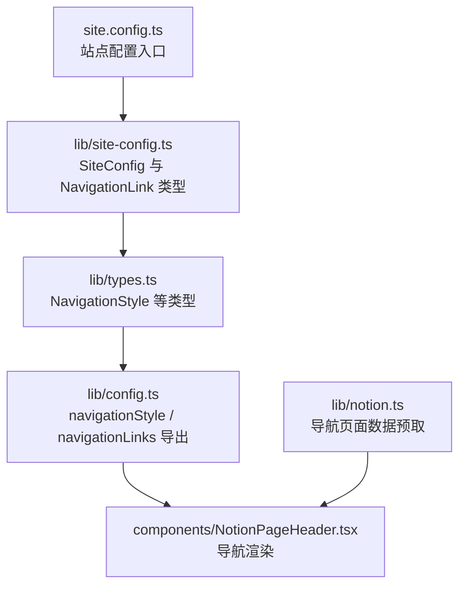
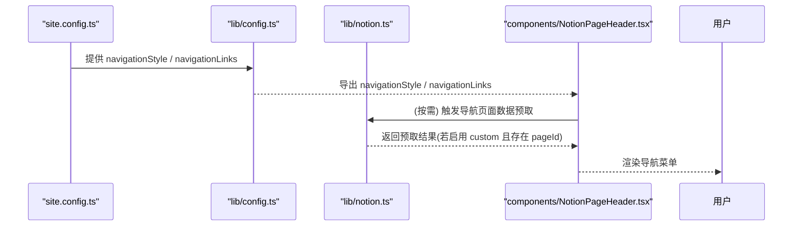
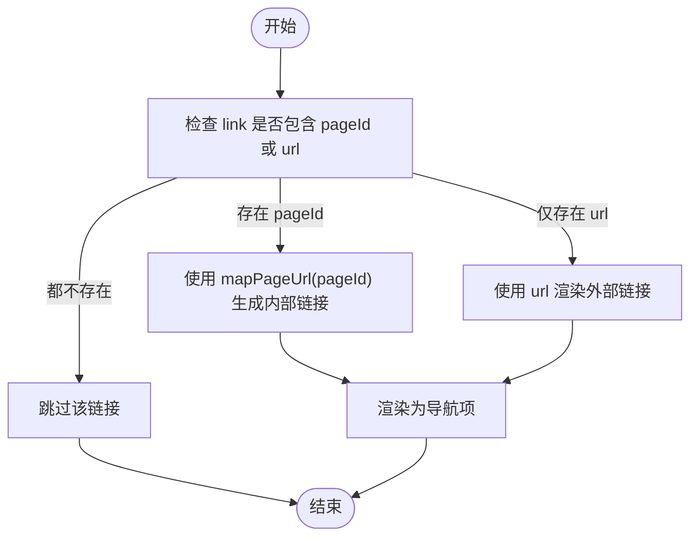
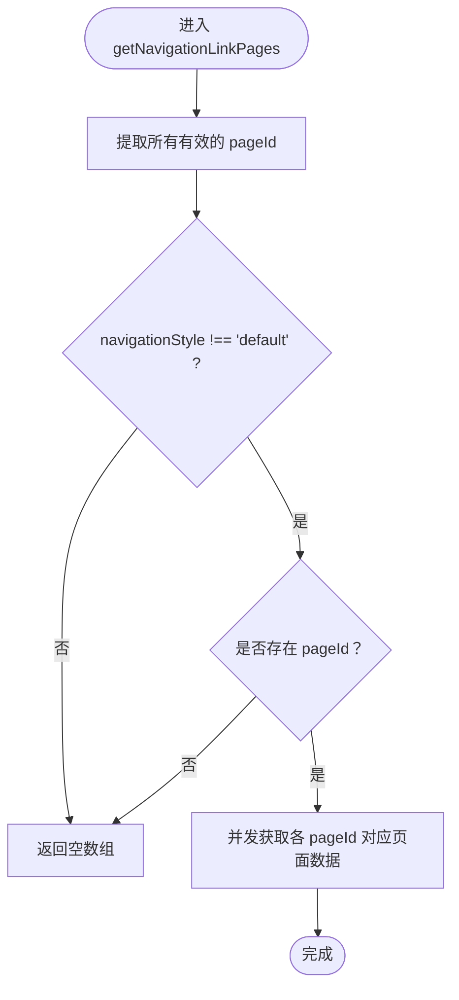
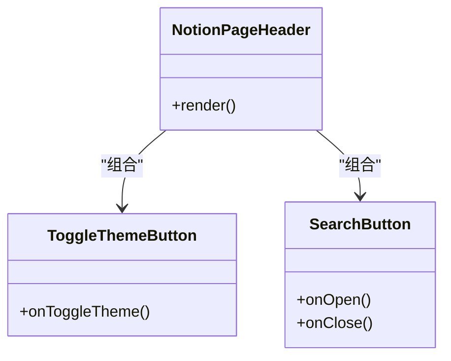
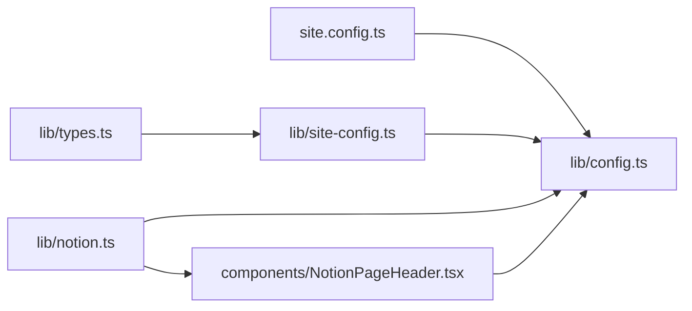

# 导航菜单配置

<cite>
**本文引用的文件**   
- [site.config.ts](file://site.config.ts)
- [lib/site-config.ts](file://lib/site-config.ts)
- [lib/types.ts](file://lib/types.ts)
- [lib/config.ts](file://lib/config.ts)
- [lib/notion.ts](file://lib/notion.ts)
- [components/NotionPageHeader.tsx](file://components/NotionPageHeader.tsx)
</cite>

## 目录
1. [简介](#简介)
2. [项目结构](#项目结构)
3. [核心组件](#核心组件)
4. [架构总览](#架构总览)
5. [详细组件分析](#详细组件分析)
6. [依赖关系分析](#依赖关系分析)
7. [性能考虑](#性能考虑)
8. [故障排查指南](#故障排查指南)
9. [结论](#结论)
10. [附录](#附录)

## 简介
本指南聚焦于站点导航菜单的配置与定制，重点说明 navigationStyle 的两种模式（'default' 默认 Notion 导航、'custom' 自定义导航），以及 navigationLinks 数组中每个链接对象的 title 与 pageId 属性设置方法。同时提供自定义导航菜单的设计模式与最佳实践，包括响应式导航的实现建议，以及导航样式定制与交互效果的配置选项。

## 项目结构
导航相关配置与渲染涉及以下关键文件：
- 站点配置入口：site.config.ts
- 类型定义与站点配置封装：lib/site-config.ts、lib/types.ts
- 运行时配置导出：lib/config.ts
- 导航数据预取逻辑：lib/notion.ts
- 导航渲染组件：components/NotionPageHeader.tsx

**图表来源**
- [site.config.ts:62-76](file://site.config.ts#L62-L76)
- [lib/site-config.ts:39-51](file://lib/site-config.ts#L39-L51)
- [lib/types.ts:7-7](file://lib/types.ts#L7-L7)
- [lib/config.ts:80-88](file://lib/config.ts#L80-L88)
- [lib/notion.ts:57-80](file://lib/notion.ts#L57-L80)
- [components/NotionPageHeader.tsx:94-123](file://components/NotionPageHeader.tsx#L94-L123)

**章节来源**
- [site.config.ts:62-76](file://site.config.ts#L62-L76)
- [lib/site-config.ts:39-51](file://lib/site-config.ts#L39-L51)
- [lib/types.ts:7-7](file://lib/types.ts#L7-L7)
- [lib/config.ts:80-88](file://lib/config.ts#L80-L88)
- [lib/notion.ts:57-80](file://lib/notion.ts#L57-L80)
- [components/NotionPageHeader.tsx:94-123](file://components/NotionPageHeader.tsx#L94-L123)

## 核心组件
- 站点配置入口 site.config.ts：集中声明 navigationStyle 与 navigationLinks，是导航行为的唯一配置源。
- 类型定义 lib/site-config.ts 与 lib/types.ts：定义 SiteConfig.navigationStyle、NavigationLink 以及 NavigationStyle 联合类型。
- 运行时配置 lib/config.ts：从站点配置读取 navigationStyle 与 navigationLinks，并导出供组件使用。
- 导航数据预取 lib/notion.ts：根据 navigationStyle 与 navigationLinks 决定是否需要预取关联页面数据。
- 导航渲染 components/NotionPageHeader.tsx：将 navigationLinks 渲染为导航项，支持内部 Notion 页面与外部 URL。

**章节来源**
- [site.config.ts:62-76](file://site.config.ts#L62-L76)
- [lib/site-config.ts:39-51](file://lib/site-config.ts#L39-L51)
- [lib/types.ts:7-7](file://lib/types.ts#L7-L7)
- [lib/config.ts:80-88](file://lib/config.ts#L80-L88)
- [lib/notion.ts:57-80](file://lib/notion.ts#L57-L80)
- [components/NotionPageHeader.tsx:94-123](file://components/NotionPageHeader.tsx#L94-L123)

## 架构总览
导航配置在站点启动时由 site.config.ts 提供，经 lib/config.ts 暴露给组件；渲染层 components/NotionPageHeader.tsx 消费 navigationLinks 进行展示；数据层 lib/notion.ts 根据 navigationStyle 与 navigationLinks 决定是否拉取关联页面数据。

**图表来源**
- [site.config.ts:62-76](file://site.config.ts#L62-L76)
- [lib/config.ts:80-88](file://lib/config.ts#L80-L88)
- [lib/notion.ts:57-80](file://lib/notion.ts#L57-L80)
- [components/NotionPageHeader.tsx:94-123](file://components/NotionPageHeader.tsx#L94-L123)

## 详细组件分析

### navigationStyle 模式说明
- 'default'：使用默认 Notion 导航行为，不强制加载自定义导航链接对应的页面数据。
- 'custom'：启用自定义导航模式，当 navigationLinks 中存在有效的 pageId 时，系统会批量预取这些 Notion 页面数据以提升首屏体验。

该模式由 lib/types.ts 中的 NavigationStyle 联合类型约束，并在 lib/config.ts 中作为站点配置的一部分导出。

**章节来源**
- [lib/types.ts:7-7](file://lib/types.ts#L7-L7)
- [lib/config.ts:80-83](file://lib/config.ts#L80-L83)

### navigationLinks 数组配置
- 每个链接对象包含：
  - title：显示文本
  - pageId：指向 Notion 页面的 ID（用于内部跳转）
  - url：可选的外部链接地址（当未提供 pageId 时使用）
- 渲染逻辑：
  - 若 link.pageId 存在，则通过 mapPageUrl 生成内部路由并渲染为站内链接
  - 否则使用 link.url 渲染为外部链接
- 过滤规则：
  - 若 link 既无 pageId 也无 url，则该链接将被忽略

**图表来源**
- [components/NotionPageHeader.tsx:94-123](file://components/NotionPageHeader.tsx#L94-L123)

**章节来源**
- [lib/site-config.ts:47-51](file://lib/site-config.ts#L47-L51)
- [components/NotionPageHeader.tsx:94-123](file://components/NotionPageHeader.tsx#L94-L123)

### 导航数据预取逻辑
当 navigationStyle 不为 'default' 且 navigationLinks 中包含有效 pageId 时，系统会并发预取这些 Notion 页面数据，以减少后续交互时的延迟。

**图表来源**
- [lib/notion.ts:57-80](file://lib/notion.ts#L57-L80)

**章节来源**
- [lib/notion.ts:57-80](file://lib/notion.ts#L57-L80)

### 导航样式定制与交互效果
- 样式类名：
  - 导航项统一应用 styles.navLink 与通用 breadcrumb/button 类名，便于通过 CSS 覆盖外观
- 主题切换按钮：
  - ToggleThemeButton 提供明暗主题切换，结合 useDarkMode 状态管理
- 搜索按钮：
  - SearchButton 打开 SearchModal 实现站内搜索，受 isSearchEnabled 控制

**图表来源**
- [components/NotionPageHeader.tsx:15-35](file://components/NotionPageHeader.tsx#L15-L35)
- [components/NotionPageHeader.tsx:37-79](file://components/NotionPageHeader.tsx#L37-L79)
- [components/NotionPageHeader.tsx:82-132](file://components/NotionPageHeader.tsx#L82-L132)

**章节来源**
- [components/NotionPageHeader.tsx:15-35](file://components/NotionPageHeader.tsx#L15-L35)
- [components/NotionPageHeader.tsx:37-79](file://components/NotionPageHeader.tsx#L37-L79)
- [components/NotionPageHeader.tsx:94-123](file://components/NotionPageHeader.tsx#L94-L123)

## 依赖关系分析
- site.config.ts 提供原始配置
- lib/site-config.ts 定义 SiteConfig 与 NavigationLink 接口
- lib/types.ts 定义 NavigationStyle 联合类型
- lib/config.ts 从站点配置读取 navigationStyle 与 navigationLinks 并导出
- lib/notion.ts 根据 navigationStyle 与 navigationLinks 决定是否预取页面数据
- components/NotionPageHeader.tsx 消费 navigationLinks 进行渲染

**图表来源**
- [site.config.ts:62-76](file://site.config.ts#L62-L76)
- [lib/site-config.ts:39-51](file://lib/site-config.ts#L39-L51)
- [lib/types.ts:7-7](file://lib/types.ts#L7-L7)
- [lib/config.ts:80-88](file://lib/config.ts#L80-L88)
- [lib/notion.ts:57-80](file://lib/notion.ts#L57-L80)
- [components/NotionPageHeader.tsx:94-123](file://components/NotionPageHeader.tsx#L94-L123)

**章节来源**
- [site.config.ts:62-76](file://site.config.ts#L62-L76)
- [lib/site-config.ts:39-51](file://lib/site-config.ts#L39-L51)
- [lib/types.ts:7-7](file://lib/types.ts#L7-L7)
- [lib/config.ts:80-88](file://lib/config.ts#L80-L88)
- [lib/notion.ts:57-80](file://lib/notion.ts#L57-L80)
- [components/NotionPageHeader.tsx:94-123](file://components/NotionPageHeader.tsx#L94-L123)

## 性能考虑
- 预取策略：仅在 navigationStyle 为 'custom' 且 navigationLinks 包含有效 pageId 时才预取页面数据，避免不必要的请求
- 并发控制：预取采用并发限制，提升整体吞吐
- 渲染优化：导航项按顺序映射并过滤无效项，减少无用 DOM 节点

[本节为通用指导，无需具体文件引用]

## 故障排查指南
- 导航项不显示：
  - 检查 navigationLinks 中每个对象是否至少包含 pageId 或 url
  - 确认 navigationStyle 已设置为 'custom' 以启用自定义导航
- 点击导航无响应：
  - 若使用 pageId，确保 Notion 页面 ID 正确且可访问
  - 若使用 url，确保外部链接有效
- 主题切换异常：
  - 检查 ToggleThemeButton 的状态管理与 useDarkMode 是否正确挂载
- 搜索按钮不可用：
  - 确认 isSearchEnabled 配置为 true

**章节来源**
- [components/NotionPageHeader.tsx:94-123](file://components/NotionPageHeader.tsx#L94-L123)
- [components/NotionPageHeader.tsx:15-35](file://components/NotionPageHeader.tsx#L15-L35)
- [components/NotionPageHeader.tsx:37-79](file://components/NotionPageHeader.tsx#L37-L79)

## 结论
通过 site.config.ts 中的 navigationStyle 与 navigationLinks，你可以灵活选择默认 Notion 导航或自定义导航模式。自定义模式下，系统会根据配置的 pageId 预取页面数据，并通过 NotionPageHeader 渲染导航项。结合样式类名与主题切换、搜索等交互能力，可实现一致的导航体验。

[本节为总结性内容，无需具体文件引用]

## 附录

### 配置清单与最佳实践
- 启用自定义导航：
  - 将 navigationStyle 设置为 'custom'
  - 在 navigationLinks 中添加至少一个包含 title 与 pageId 的对象
- 链接类型选择：
  - 优先使用 pageId 指向 Notion 页面，以获得更好的站内路由一致性
  - 必要时使用 url 指向外部资源
- 响应式导航建议：
  - 在小屏幕设备上折叠次要导航项，保留核心链接
  - 使用媒体查询调整导航项间距与字号，保证可读性与触控友好性
- 样式定制要点：
  - 基于 styles.navLink 与 breadcrumb/button 类名扩展样式
  - 保持与主题切换按钮一致的视觉语言
- 交互增强：
  - 为导航项添加 hover/focus 状态反馈
  - 在移动端增加手势支持（如滑动展开/收起）

[本节为通用指导，无需具体文件引用]