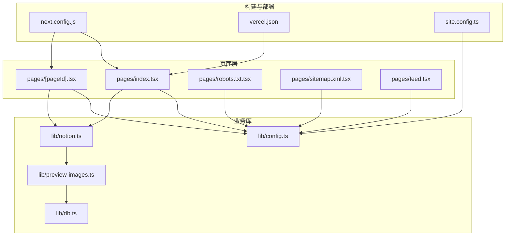
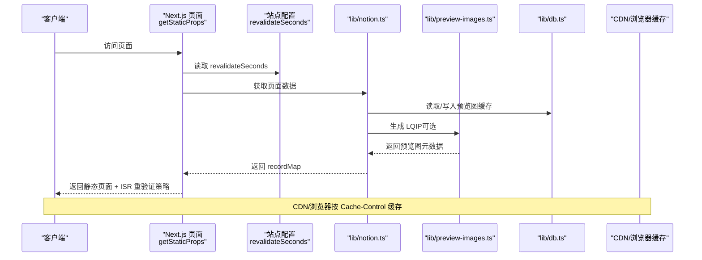
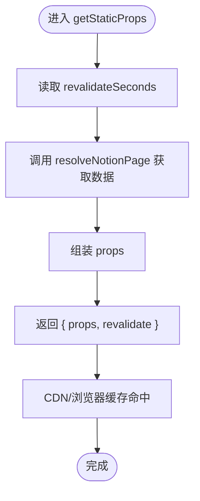
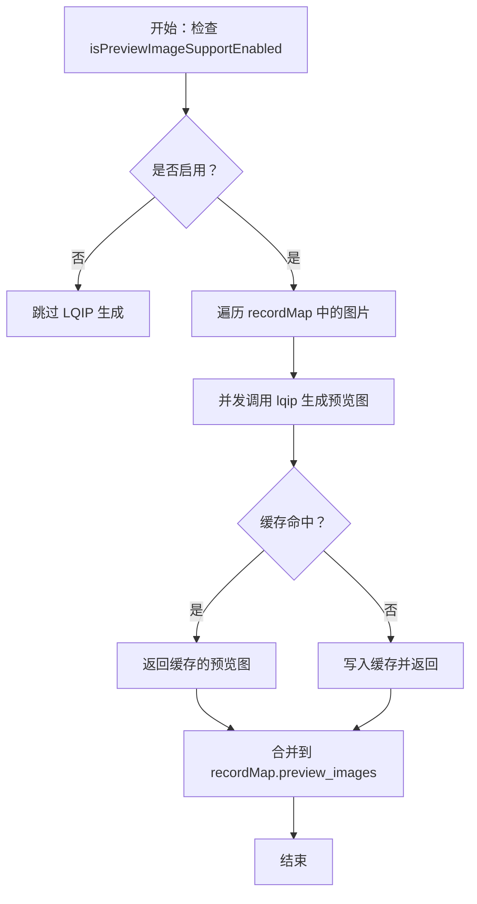
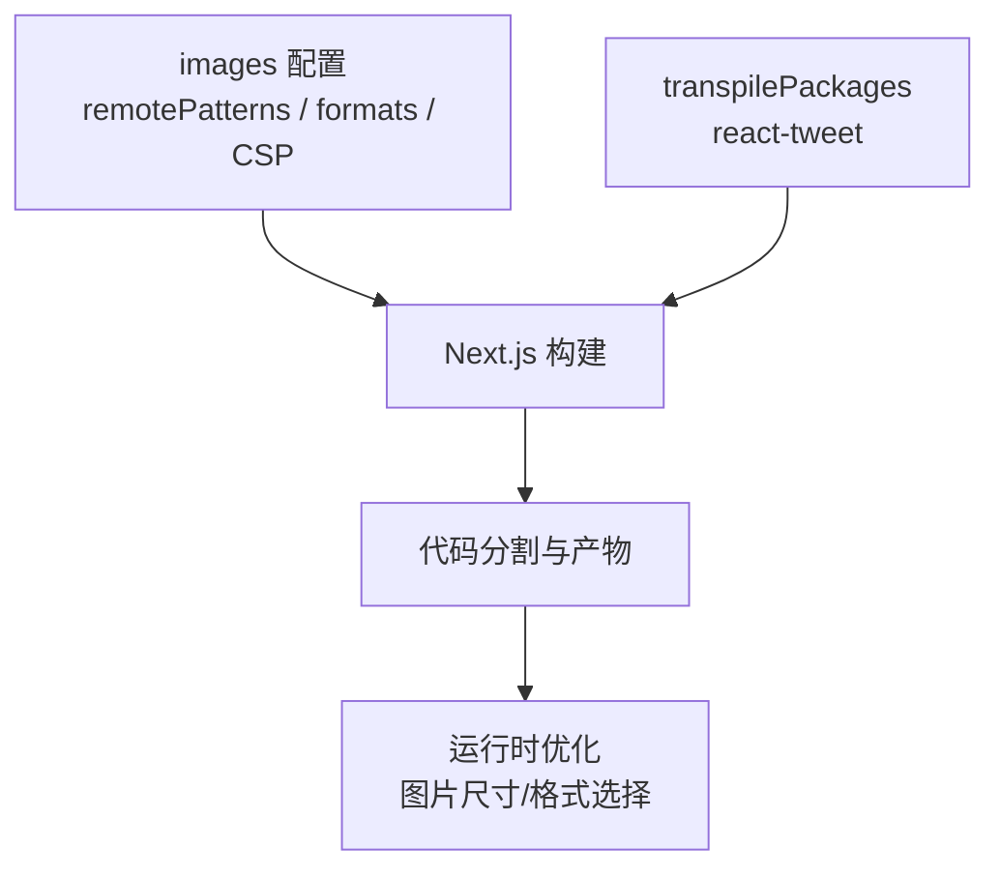
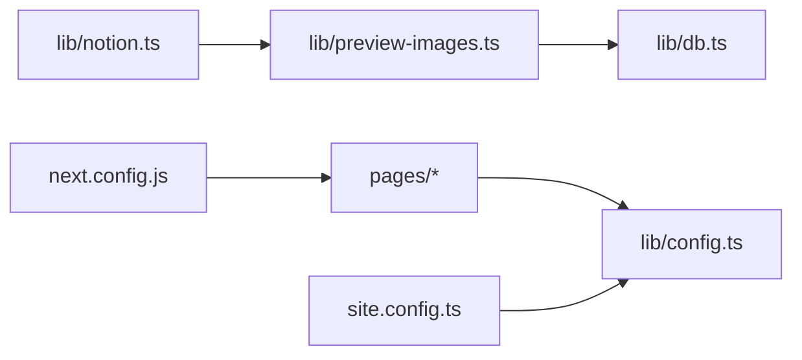

# 性能优化配置

<cite>
**本文引用的文件**   
- [next.config.js](file://next.config.js)
- [site.config.ts](file://site.config.ts)
- [lib/config.ts](file://lib/config.ts)
- [pages/[pageId].tsx](file://pages/[pageId].tsx)
- [pages/index.tsx](file://pages/index.tsx)
- [lib/notion.ts](file://lib/notion.ts)
- [lib/preview-images.ts](file://lib/preview-images.ts)
- [lib/db.ts](file://lib/db.ts)
- [pages/robots.txt.tsx](file://pages/robots.txt.tsx)
- [pages/sitemap.xml.tsx](file://pages/sitemap.xml.tsx)
- [pages/feed.tsx](file://pages/feed.tsx)
- [vercel.json](file://vercel.json)
</cite>

## 目录
1. [简介](#简介)
2. [项目结构](#项目结构)
3. [核心组件](#核心组件)
4. [架构总览](#架构总览)
5. [详细组件分析](#详细组件分析)
6. [依赖关系分析](#依赖关系分析)
7. [性能考量与调优建议](#性能考量与调优建议)
8. [故障排查指南](#故障排查指南)
9. [结论](#结论)

## 简介
本文面向 Next.js + Notion 博客的性能优化配置，重点说明以下方面：
- revalidateSeconds 选项的作用与 ISR（增量静态再生成）工作原理、缓存策略
- isPreviewImageSupportEnabled 对 LQIP（低质量图片占位符）的支持机制
- Next.js 构建与运行时优化：代码分割、懒加载、图片优化
- 性能监控与调优最佳实践，包括更新频率与性能的平衡

## 项目结构
本项目采用“页面驱动 + 库模块”的组织方式：
- pages 目录定义路由与数据获取逻辑，集中体现 ISR 与缓存策略
- lib 目录封装业务逻辑、缓存、Notion API 调用、预览图生成等
- next.config.js 集中配置图片优化、远程域名白名单、包转译等
- site.config.ts 提供站点级配置，如 ISR 重验证间隔、LQIP 开关等

图表来源
- [next.config.js:1-36](file://next.config.js#L1-L36)
- [site.config.ts:1-77](file://site.config.ts#L1-L77)
- [lib/config.ts:77-115](file://lib/config.ts#L77-L115)
- [pages/index.tsx:1-22](file://pages/index.tsx#L1-L22)
- [pages/[pageId].tsx:1-58](file://pages/[pageId].tsx#L1-L58)
- [lib/notion.ts:1-219](file://lib/notion.ts#L1-L219)
- [lib/preview-images.ts:45-98](file://lib/preview-images.ts#L45-L98)
- [lib/db.ts:1-6](file://lib/db.ts#L1-L6)
- [pages/robots.txt.tsx:1-48](file://pages/robots.txt.tsx#L1-L48)
- [pages/sitemap.xml.tsx:1-54](file://pages/sitemap.xml.tsx#L1-L54)
- [pages/feed.tsx:82-103](file://pages/feed.tsx#L82-L103)
- [vercel.json:1-9](file://vercel.json#L1-L9)

章节来源
- [next.config.js:1-36](file://next.config.js#L1-L36)
- [site.config.ts:1-77](file://site.config.ts#L1-L77)
- [lib/config.ts:77-115](file://lib/config.ts#L77-L115)

## 核心组件
- ISR 与重验证：通过 getStaticProps 返回 revalidate 字段实现增量静态再生成；revalidateSeconds 由站点配置注入。
- LQIP 预览图：isPreviewImageSupportEnabled 控制是否启用低质量图片占位符，结合内存缓存减少重复计算。
- 图片优化：next.config.images 配置远程域名白名单、输出格式、SVG 支持与安全策略。
- 运行时缓存：lib/notion.ts 维护短 TTL 的内存缓存，用于快速响应与降级；lib/db.ts 使用 Keyv 作为轻量缓存后端。
- CDN/边缘缓存：robots、sitemap、feed 等接口设置 Cache-Control，配合 stale-while-revalidate 提升边缘命中与回源体验。

章节来源
- [pages/[pageId].tsx:9-25](file://pages/[pageId].tsx#L9-L25)
- [pages/index.tsx:6-18](file://pages/index.tsx#L6-L18)
- [lib/config.ts:93-95](file://lib/config.ts#L93-L95)
- [site.config.ts:25-26](file://site.config.ts#L25-L26)
- [site.config.ts:57-60](file://site.config.ts#L57-L60)
- [next.config.js:4-18](file://next.config.js#L4-L18)
- [lib/notion.ts:19-55](file://lib/notion.ts#L19-L55)
- [lib/db.ts:1-6](file://lib/db.ts#L1-L6)
- [pages/robots.txt.tsx:17-21](file://pages/robots.txt.tsx#L17-L21)
- [pages/sitemap.xml.tsx:20-24](file://pages/sitemap.xml.tsx#L20-L24)
- [pages/feed.tsx:90-93](file://pages/feed.tsx#L90-L93)

## 架构总览
下图展示 ISR 请求在页面渲染、数据获取、缓存与图片处理之间的交互流程。

图表来源
- [pages/[pageId].tsx:9-25](file://pages/[pageId].tsx#L9-L25)
- [lib/config.ts:93-95](file://lib/config.ts#L93-L95)
- [lib/notion.ts:161-213](file://lib/notion.ts#L161-L213)
- [lib/preview-images.ts:56-96](file://lib/preview-images.ts#L56-L96)
- [lib/db.ts:1-6](file://lib/db.ts#L1-L6)

## 详细组件分析

### ISR 与 revalidateSeconds
- 作用：revalidateSeconds 决定 ISR 的重验证周期。在该时间窗口内，同一页面的后续请求将直接复用已生成的静态版本，从而降低函数调用与外部依赖压力。
- 工作原理：
  - 页面通过 getStaticProps 返回 { props, revalidate }，Next.js 据此进行增量静态再生成。
  - 首次请求或过期后触发重新构建；在重验证周期内，CDN/浏览器可命中缓存。
  - 站点配置中默认值为 3600 秒，本仓库设置为 86400 秒（一天一次），显著降低函数调用次数。
- 缓存策略：
  - 服务端：lib/notion.ts 维护 60 秒的内存缓存，用于快速响应与临时降级。
  - 边缘/浏览器：robots、sitemap、feed 等接口通过 Cache-Control 设置 s-maxage 与 stale-while-revalidate，兼顾新鲜度与性能。

图表来源
- [pages/[pageId].tsx:9-25](file://pages/[pageId].tsx#L9-L25)
- [pages/index.tsx:6-18](file://pages/index.tsx#L6-L18)
- [lib/config.ts:93-95](file://lib/config.ts#L93-L95)
- [site.config.ts:57-60](file://site.config.ts#L57-L60)

章节来源
- [pages/[pageId].tsx:9-25](file://pages/[pageId].tsx#L9-L25)
- [pages/index.tsx:6-18](file://pages/index.tsx#L6-L18)
- [lib/config.ts:93-95](file://lib/config.ts#L93-L95)
- [site.config.ts:57-60](file://site.config.ts#L57-L60)

### LQIP 与 isPreviewImageSupportEnabled
- 作用：isPreviewImageSupportEnabled 控制是否启用 LQIP（低质量图片占位符）。开启后，系统会为图片生成缩略预览图，提升首屏感知速度。
- 工作流程：
  - 当开关为 true 时，lib/notion.ts 会调用 getPreviewImageMap 生成预览图映射并注入到 recordMap。
  - lib/preview-images.ts 负责并发拉取原图、提取低质量预览图，并通过 lib/db.ts 的 Keyv 缓存结果。
  - 若缓存命中则直接返回，避免重复计算；失败时记录警告并跳过该图片。
- 性能影响：
  - 优点：显著提升首屏加载体验，尤其在大图场景下。
  - 成本：首次生成需要 CPU 与 I/O 开销；需合理控制并发与缓存命中率。

图表来源
- [lib/notion.ts:203-206](file://lib/notion.ts#L203-L206)
- [lib/preview-images.ts:45-98](file://lib/preview-images.ts#L45-L98)
- [lib/db.ts:1-6](file://lib/db.ts#L1-L6)
- [site.config.ts:25-26](file://site.config.ts#L25-L26)

章节来源
- [lib/notion.ts:203-206](file://lib/notion.ts#L203-L206)
- [lib/preview-images.ts:45-98](file://lib/preview-images.ts#L45-L98)
- [lib/db.ts:1-6](file://lib/db.ts#L1-L6)
- [site.config.ts:25-26](file://site.config.ts#L25-L26)

### Next.js 构建与运行时优化
- 图片优化：
  - 远程域名白名单：允许 notion.so、unsplash、twitter、AWS S3 等域名图片被优化。
  - 输出格式：优先 AVIF/WebP，减小体积。
  - SVG 支持：dangerouslyAllowSVG 打开以支持 SVG 资源。
  - CSP：限制脚本执行，增强安全性。
- 代码分割与懒加载：
  - Next.js 默认对页面与动态导入进行代码分割；本仓库未自定义 webpack 配置，保持默认行为。
  - 通过 p-memoize 与并发控制（p-map）减少重复计算与网络请求。
- 包转译：
  - transpilePackages 指定 react-tweet 包进行转译，确保兼容性。

图表来源
- [next.config.js:4-18](file://next.config.js#L4-L18)
- [next.config.js:33-35](file://next.config.js#L33-L35)

章节来源
- [next.config.js:4-18](file://next.config.js#L4-L18)
- [next.config.js:33-35](file://next.config.js#L33-L35)

### 其他缓存与边缘优化
- robots.txt：s-maxage=86400，stale-while-revalidate=86400，适合长期稳定的爬虫抓取。
- sitemap.xml：s-maxage=28800，stale-while-revalidate=28800，平衡 SEO 更新与性能。
- feed：根据 ttlSeconds 设置 max-age 与 stale-while-revalidate，适配订阅源更新节奏。
- Vercel Cron：定时任务触发 IndexNow，加速搜索引擎收录。

章节来源
- [pages/robots.txt.tsx:17-21](file://pages/robots.txt.tsx#L17-L21)
- [pages/sitemap.xml.tsx:20-24](file://pages/sitemap.xml.tsx#L20-L24)
- [pages/feed.tsx:90-93](file://pages/feed.tsx#L90-L93)
- [vercel.json:1-9](file://vercel.json#L1-L9)

## 依赖关系分析
- 页面层依赖 lib/config.ts 获取站点配置（如 revalidateSeconds、isSearchEnabled 等）。
- lib/notion.ts 依赖 lib/preview-images.ts 与 lib/db.ts，形成“数据获取 → 预览图生成 → 缓存”的链路。
- next.config.js 与 site.config.ts 分别承担构建期与运行期配置职责，解耦清晰。

图表来源
- [pages/[pageId].tsx:1-58](file://pages/[pageId].tsx#L1-L58)
- [pages/index.tsx:1-22](file://pages/index.tsx#L1-L22)
- [lib/config.ts:77-115](file://lib/config.ts#L77-L115)
- [lib/notion.ts:1-219](file://lib/notion.ts#L1-L219)
- [lib/preview-images.ts:45-98](file://lib/preview-images.ts#L45-L98)
- [lib/db.ts:1-6](file://lib/db.ts#L1-L6)
- [next.config.js:1-36](file://next.config.js#L1-L36)
- [site.config.ts:1-77](file://site.config.ts#L1-L77)

章节来源
- [pages/[pageId].tsx:1-58](file://pages/[pageId].tsx#L1-L58)
- [pages/index.tsx:1-22](file://pages/index.tsx#L1-L22)
- [lib/config.ts:77-115](file://lib/config.ts#L77-L115)
- [lib/notion.ts:1-219](file://lib/notion.ts#L1-L219)
- [lib/preview-images.ts:45-98](file://lib/preview-images.ts#L45-L98)
- [lib/db.ts:1-6](file://lib/db.ts#L1-L6)
- [next.config.js:1-36](file://next.config.js#L1-L36)
- [site.config.ts:1-77](file://site.config.ts#L1-L77)

## 性能考量与调优建议
- 调整 revalidateSeconds：
  - 内容更新不频繁时，增大重验证周期（例如 86400 秒）以降低函数调用与外部依赖压力。
  - 高频更新内容可适当缩短周期，但需权衡冷启动与回源成本。
- 合理使用 LQIP：
  - 大图较多的站点建议开启 isPreviewImageSupportEnabled，改善首屏体验。
  - 注意并发与缓存命中率，避免生成阶段成为瓶颈。
- 图片优化：
  - 确认 remotePatterns 覆盖所有图片域名，必要时扩展白名单。
  - 优先 AVIF/WebP，确保 CDN 支持相应格式。
- 边缘缓存：
  - 对 robots、sitemap、feed 等接口设置合适的 Cache-Control，利用 stale-while-revalidate 提升稳定性。
- 监控与度量：
  - 启用 Vercel Analytics 与 Speed Insights，观察 TTFB、FCP、LCP 等指标。
  - 关注 ISR 重验证频率与函数调用量，结合日志定位热点页面。

[本节为通用指导，不直接分析具体文件]

## 故障排查指南
- ISR 未生效或更新延迟：
  - 检查 revalidateSeconds 是否过大导致更新缓慢。
  - 查看 Next.js 构建日志与 Vercel 函数调用统计。
- LQIP 未显示或性能下降：
  - 确认 isPreviewImageSupportEnabled 为 true。
  - 检查 lib/db.ts 缓存是否正常读写，关注异常日志。
  - 评估并发参数与图片数量，必要时降低并发或优化图片源。
- 图片无法加载或 CSP 报错：
  - 核对 next.config.js 中 images.remotePatterns 是否包含对应域名。
  - 检查 contentSecurityPolicy 是否限制了必要资源。
- 边缘缓存未命中：
  - 检查 robots/sitemap/feed 的 Cache-Control 头是否正确设置。
  - 确认 CDN 与浏览器缓存策略是否符合预期。

章节来源
- [lib/notion.ts:161-213](file://lib/notion.ts#L161-L213)
- [lib/preview-images.ts:56-96](file://lib/preview-images.ts#L56-L96)
- [lib/db.ts:1-6](file://lib/db.ts#L1-L6)
- [next.config.js:4-18](file://next.config.js#L4-L18)
- [pages/robots.txt.tsx:17-21](file://pages/robots.txt.tsx#L17-L21)
- [pages/sitemap.xml.tsx:20-24](file://pages/sitemap.xml.tsx#L20-L24)
- [pages/feed.tsx:90-93](file://pages/feed.tsx#L90-L93)

## 结论
通过合理配置 revalidateSeconds、启用 LQIP、优化图片与边缘缓存，并结合监控与日志，可以在保证内容新鲜度的同时显著提升性能与用户体验。建议在低频更新场景下采用较长的 ISR 周期，并在高并发环境下谨慎评估 LQIP 的并发与缓存策略，持续观测关键性能指标并进行迭代优化。