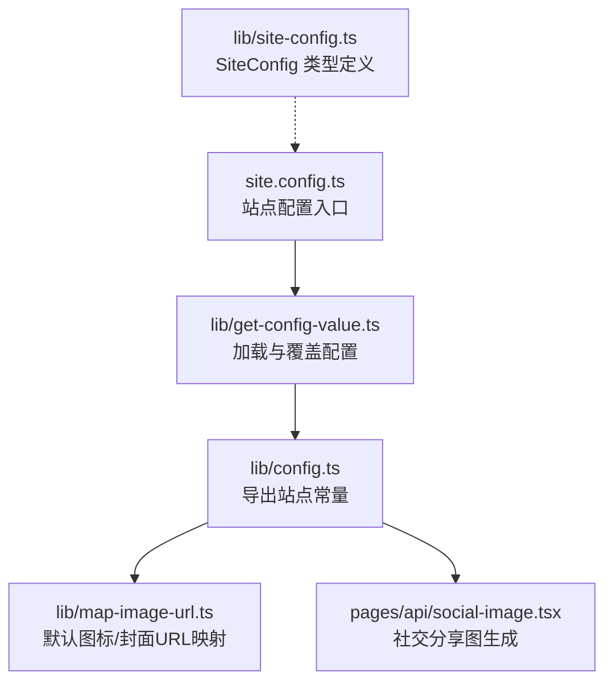
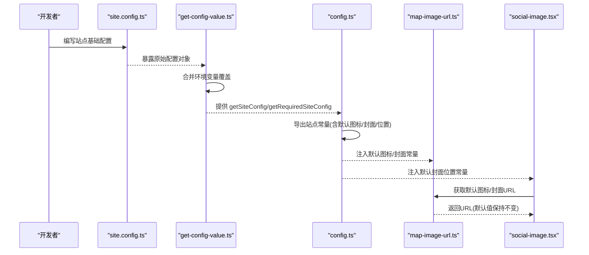
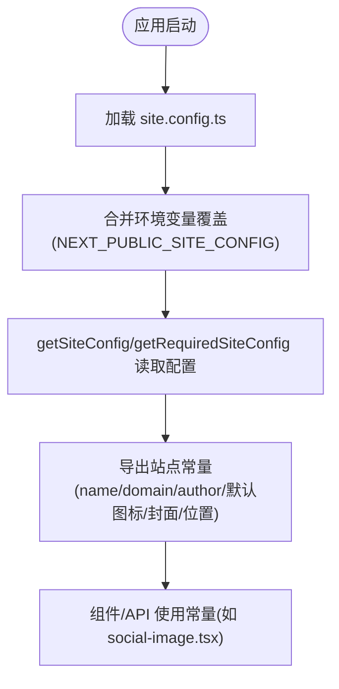
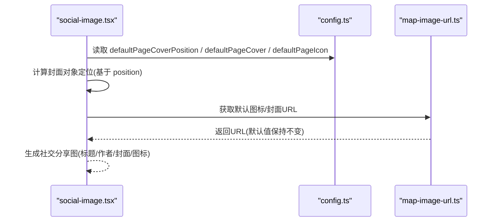
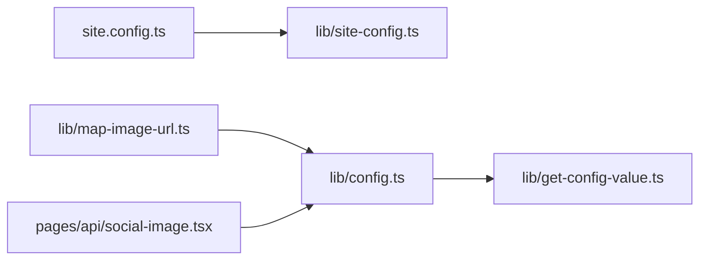

# 站点基础配置

<cite>
**本文引用的文件**   
- [site.config.ts](file://site.config.ts)
- [lib/site-config.ts](file://lib/site-config.ts)
- [lib/config.ts](file://lib/config.ts)
- [lib/get-config-value.ts](file://lib/get-config-value.ts)
- [lib/map-image-url.ts](file://lib/map-image-url.ts)
- [pages/api/social-image.tsx](file://pages/api/social-image.tsx)
</cite>

## 目录
1. [简介](#简介)
2. [项目结构](#项目结构)
3. [核心组件](#核心组件)
4. [架构总览](#架构总览)
5. [详细组件分析](#详细组件分析)
6. [依赖关系分析](#依赖关系分析)
7. [性能与最佳实践](#性能与最佳实践)
8. [故障排查指南](#故障排查指南)
9. [结论](#结论)

## 简介
本文聚焦站点基础配置，围绕 site.config.ts 中的核心选项进行说明，重点解释 rootNotionPageId、rootNotionSpaceId、name、domain、author 等必需配置项的作用与设置方法；并详细说明默认页面图标与封面图片的配置方式，包括 defaultPageIcon、defaultPageCover、defaultPageCoverPosition 的使用。文末提供具体配置示例与最佳实践建议，帮助开发者正确设置站点基本信息。

## 项目结构
站点基础配置由以下文件共同协作：
- site.config.ts：站点配置的入口，集中声明所有站点级配置项。
- lib/site-config.ts：定义 SiteConfig 类型与 siteConfig 包装函数，用于类型约束与扩展点。
- lib/get-config-value.ts：负责加载 site.config.ts，并支持通过环境变量覆盖配置。
- lib/config.ts：从 get-config-value 中读取配置值，导出供其他模块使用的站点常量（如 name、domain、author、defaultPageIcon 等）。
- lib/map-image-url.ts：对默认图标/封面 URL 做特殊处理，避免被错误改写。
- pages/api/social-image.tsx：生成社交分享图时，使用默认封面位置与默认图标/封面作为回退。

图表来源
- [site.config.ts:1-77](file://site.config.ts#L1-L77)
- [lib/get-config-value.ts:1-73](file://lib/get-config-value.ts#L1-L73)
- [lib/config.ts:1-84](file://lib/config.ts#L1-L84)
- [lib/map-image-url.ts:1-12](file://lib/map-image-url.ts#L1-L12)
- [pages/api/social-image.tsx:173-230](file://pages/api/social-image.tsx#L173-L230)
- [lib/site-config.ts:1-56](file://lib/site-config.ts#L1-L56)

章节来源
- [site.config.ts:1-77](file://site.config.ts#L1-L77)
- [lib/site-config.ts:1-56](file://lib/site-config.ts#L1-L56)
- [lib/get-config-value.ts:1-73](file://lib/get-config-value.ts#L1-L73)
- [lib/config.ts:1-84](file://lib/config.ts#L1-L84)
- [lib/map-image-url.ts:1-12](file://lib/map-image-url.ts#L1-L12)
- [pages/api/social-image.tsx:173-230](file://pages/api/social-image.tsx#L173-L230)

## 核心组件
本节梳理与“站点基础配置”直接相关的核心模块及其职责：
- site.config.ts：声明站点名称、域名、作者、根 Notion 页面 ID、可选的根工作区 ID、默认图标/封面及位置、预览图开关、SEO 验证、分析工具、导航样式等。
- lib/site-config.ts：定义 SiteConfig 接口，明确各字段类型与可选性，为配置提供类型安全。
- lib/get-config-value.ts：合并 site.config.ts 与环境变量 NEXT_PUBLIC_SITE_CONFIG，提供 getSiteConfig 与 getRequiredSiteConfig 两个读取器。
- lib/config.ts：基于 getSiteConfig/getRequiredSiteConfig 导出站点常量，如 name、domain、author、defaultPageIcon/defaultPageCover/defaultPageCoverPosition 等。
- lib/map-image-url.ts：当传入 URL 等于默认图标或默认封面时，保持原样返回，避免被外部逻辑改写。
- pages/api/social-image.tsx：在生成社交分享图时，优先使用页面属性中的封面与图标，否则回退到站点默认值，并使用 defaultPageCoverPosition 计算对象定位。

章节来源
- [site.config.ts:1-77](file://site.config.ts#L1-L77)
- [lib/site-config.ts:1-56](file://lib/site-config.ts#L1-L56)
- [lib/get-config-value.ts:1-73](file://lib/get-config-value.ts#L1-L73)
- [lib/config.ts:1-84](file://lib/config.ts#L1-L84)
- [lib/map-image-url.ts:1-12](file://lib/map-image-url.ts#L1-L12)
- [pages/api/social-image.tsx:173-230](file://pages/api/social-image.tsx#L173-L230)

## 架构总览
站点基础配置的数据流如下：
- 启动阶段：get-config-value 加载 site.config.ts，并可被环境变量 NEXT_PUBLIC_SITE_CONFIG 覆盖。
- 配置解析：config.ts 通过 getSiteConfig/getRequiredSiteConfig 获取配置值，并导出为站点常量。
- 渲染阶段：map-image-url.ts 对默认图标/封面 URL 做特殊处理；social-image.tsx 在生成社交分享图时使用默认封面位置与默认图标/封面作为回退。

图表来源
- [site.config.ts:1-77](file://site.config.ts#L1-L77)
- [lib/get-config-value.ts:1-73](file://lib/get-config-value.ts#L1-L73)
- [lib/config.ts:1-84](file://lib/config.ts#L1-L84)
- [lib/map-image-url.ts:1-12](file://lib/map-image-url.ts#L1-L12)
- [pages/api/social-image.tsx:173-230](file://pages/api/social-image.tsx#L173-L230)

## 详细组件分析

### 必需配置项说明与设置方法
- rootNotionPageId（必需）
  - 作用：指定站点的根 Notion 页面 ID，是站点内容树的起点。
  - 设置方法：在 site.config.ts 中填写有效的 Notion 页面 ID。
  - 校验：lib/config.ts 会解析该值并在缺失时报错。
  - 参考路径：[site.config.ts:4-9](file://site.config.ts#L4-L9)、[lib/config.ts:23-30](file://lib/config.ts#L23-L30)

- rootNotionSpaceId（可选）
  - 作用：限制站点仅访问单个 Notion 工作区，提升安全性与一致性。
  - 设置方法：在 site.config.ts 中填写目标工作区的 Space ID；未设置则为 null。
  - 使用场景：social-image.tsx 在生成社交分享图时会校验页面所属工作区是否与 rootNotionSpaceId 一致。
  - 参考路径：[site.config.ts:7-9](file://site.config.ts#L7-L9)、[lib/config.ts:32-34](file://lib/config.ts#L32-L34)、[pages/api/social-image.tsx:192-204](file://pages/api/social-image.tsx#L192-L204)

- name（必需）
  - 作用：站点名称，常用于标题、社交分享图等。
  - 设置方法：在 site.config.ts 中填写站点名称。
  - 参考路径：[site.config.ts:11-14](file://site.config.ts#L11-L14)、[lib/config.ts:51-56](file://lib/config.ts#L51-L56)

- domain（必需）
  - 作用：站点域名，用于 SEO、链接生成等。
  - 设置方法：在 site.config.ts 中填写域名。
  - 参考路径：[site.config.ts:11-14](file://site.config.ts#L11-L14)、[lib/config.ts:51-56](file://lib/config.ts#L51-L56)

- author（必需）
  - 作用：站点作者信息，常用于元数据与社交分享图。
  - 设置方法：在 site.config.ts 中填写作者名。
  - 参考路径：[site.config.ts:11-14](file://site.config.ts#L11-L14)、[lib/config.ts:51-56](file://lib/config.ts#L51-L56)

章节来源
- [site.config.ts:4-14](file://site.config.ts#L4-L14)
- [lib/config.ts:23-56](file://lib/config.ts#L23-L56)
- [pages/api/social-image.tsx:192-204](file://pages/api/social-image.tsx#L192-L204)

### 默认页面图标与封面图片配置
- defaultPageIcon（可选）
  - 作用：站点级默认页面图标，若页面未设置图标则回退到此值。
  - 设置方法：在 site.config.ts 中填写图标 URL；可为 null 表示不使用默认图标。
  - 行为：lib/map-image-url.ts 会对该默认值做特殊处理，避免被外部逻辑改写。
  - 参考路径：[site.config.ts:19-23](file://site.config.ts#L19-L23)、[lib/config.ts:58-66](file://lib/config.ts#L58-L66)、[lib/map-image-url.ts:1-12](file://lib/map-image-url.ts#L1-L12)

- defaultPageCover（可选）
  - 作用：站点级默认页面封面图片，若页面未设置封面则回退到此值。
  - 设置方法：在 site.config.ts 中填写封面图片 URL；可为 null 表示不使用默认封面。
  - 行为：social-image.tsx 在生成社交分享图时，若页面无封面则使用该默认值。
  - 参考路径：[site.config.ts:19-23](file://site.config.ts#L19-L23)、[lib/config.ts:58-66](file://lib/config.ts#L58-L66)、[pages/api/social-image.tsx:217-223](file://pages/api/social-image.tsx#L217-L223)

- defaultPageCoverPosition（可选）
  - 作用：默认封面图片的裁剪位置（百分比），影响封面图的显示区域。
  - 设置方法：在 site.config.ts 中填写 0~1 之间的数值；默认值为 0.5。
  - 行为：social-image.tsx 根据该值计算对象定位，使封面图在不同尺寸下显示合理。
  - 参考路径：[site.config.ts:19-23](file://site.config.ts#L19-L23)、[lib/config.ts:58-66](file://lib/config.ts#L58-L66)、[pages/api/social-image.tsx:210-215](file://pages/api/social-image.tsx#L210-L215)

章节来源
- [site.config.ts:19-23](file://site.config.ts#L19-L23)
- [lib/config.ts:58-66](file://lib/config.ts#L58-L66)
- [lib/map-image-url.ts:1-12](file://lib/map-image-url.ts#L1-L12)
- [pages/api/social-image.tsx:210-223](file://pages/api/social-image.tsx#L210-L223)

### 配置读取与覆盖机制
- 读取流程
  - get-config-value.ts 加载 site.config.ts，并尝试从环境变量 NEXT_PUBLIC_SITE_CONFIG 解析覆盖配置。
  - 提供 getSiteConfig(key, defaultValue) 与 getRequiredSiteConfig(key) 两种读取方式。
- 类型约束
  - lib/site-config.ts 定义 SiteConfig 接口，确保配置项的类型安全与完整性。
- 站点常量导出
  - lib/config.ts 基于读取器导出站点常量，供其他模块使用。

图表来源
- [lib/get-config-value.ts:1-73](file://lib/get-config-value.ts#L1-L73)
- [lib/site-config.ts:1-56](file://lib/site-config.ts#L1-L56)
- [lib/config.ts:1-84](file://lib/config.ts#L1-L84)

章节来源
- [lib/get-config-value.ts:1-73](file://lib/get-config-value.ts#L1-L73)
- [lib/site-config.ts:1-56](file://lib/site-config.ts#L1-L56)
- [lib/config.ts:1-84](file://lib/config.ts#L1-L84)

### 默认图标/封面在社交分享图中的使用流程

图表来源
- [pages/api/social-image.tsx:210-230](file://pages/api/social-image.tsx#L210-L230)
- [lib/config.ts:58-66](file://lib/config.ts#L58-L66)
- [lib/map-image-url.ts:1-12](file://lib/map-image-url.ts#L1-L12)

章节来源
- [pages/api/social-image.tsx:210-230](file://pages/api/social-image.tsx#L210-L230)
- [lib/config.ts:58-66](file://lib/config.ts#L58-L66)
- [lib/map-image-url.ts:1-12](file://lib/map-image-url.ts#L1-L12)

## 依赖关系分析
- 模块耦合
  - site.config.ts 依赖 lib/site-config.ts 的类型定义。
  - lib/config.ts 依赖 lib/get-config-value.ts 提供的读取器。
  - lib/map-image-url.ts 依赖 lib/config.ts 导出的默认图标/封面常量。
  - pages/api/social-image.tsx 依赖 lib/config.ts 导出的默认封面位置与默认图标/封面常量。
- 外部依赖
  - notion-utils 用于解析 Notion Page ID。
  - notion-types 用于类型定义。

图表来源
- [site.config.ts:1-77](file://site.config.ts#L1-L77)
- [lib/site-config.ts:1-56](file://lib/site-config.ts#L1-L56)
- [lib/config.ts:1-84](file://lib/config.ts#L1-L84)
- [lib/get-config-value.ts:1-73](file://lib/get-config-value.ts#L1-L73)
- [lib/map-image-url.ts:1-12](file://lib/map-image-url.ts#L1-L12)
- [pages/api/social-image.tsx:173-230](file://pages/api/social-image.tsx#L173-L230)

章节来源
- [site.config.ts:1-77](file://site.config.ts#L1-L77)
- [lib/site-config.ts:1-56](file://lib/site-config.ts#L1-L56)
- [lib/config.ts:1-84](file://lib/config.ts#L1-L84)
- [lib/get-config-value.ts:1-73](file://lib/get-config-value.ts#L1-L73)
- [lib/map-image-url.ts:1-12](file://lib/map-image-url.ts#L1-L12)
- [pages/api/social-image.tsx:173-230](file://pages/api/social-image.tsx#L173-L230)

## 性能与最佳实践
- 根页面与工作区
  - 始终设置 rootNotionPageId，并确保其有效；如需限制访问范围，请设置 rootNotionSpaceId。
- 站点基本信息
  - name、domain、author 为必需项，务必准确填写，以保障 SEO 与社交分享效果。
- 默认图标与封面
  - 建议为 defaultPageIcon 与 defaultPageCover 提供合适的占位资源，避免社交分享图出现空白。
  - defaultPageCoverPosition 建议设置为 0.5 以获得居中裁剪效果；可根据品牌视觉微调。
- 配置覆盖
  - 可通过环境变量 NEXT_PUBLIC_SITE_CONFIG 覆盖部分配置，便于不同环境差异化部署。
- 类型安全
  - 遵循 lib/site-config.ts 定义的 SiteConfig 接口，确保新增或修改配置项时具备类型提示与约束。

[本节为通用指导，不直接分析具体文件]

## 故障排查指南
- 缺少必需配置
  - 现象：启动时报错提示缺少 required site config value。
  - 原因：未设置 name、domain、author 或 rootNotionPageId。
  - 解决：在 site.config.ts 中补充对应字段。
  - 参考路径：[lib/get-config-value.ts:40-48](file://lib/get-config-value.ts#L40-L48)、[lib/config.ts:23-30](file://lib/config.ts#L23-L30)

- 环境变量覆盖失败
  - 现象：NEXT_PUBLIC_SITE_CONFIG 无法生效或报错。
  - 原因：环境变量格式非法或非 JSON。
  - 解决：检查环境变量是否为合法 JSON，且键名与 SiteConfig 匹配。
  - 参考路径：[lib/get-config-value.ts:11-20](file://lib/get-config-value.ts#L11-L20)

- 社交分享图工作区不一致
  - 现象：生成社交分享图时报错页面属于不同工作区。
  - 原因：页面所在 workspace 与 rootNotionSpaceId 不一致。
  - 解决：统一工作区或调整 rootNotionSpaceId。
  - 参考路径：[pages/api/social-image.tsx:192-204](file://pages/api/social-image.tsx#L192-L204)

- 默认图标/封面 URL 被改写
  - 现象：默认图标/封面 URL 在渲染时被意外修改。
  - 原因：未走 mapImageUrl 的特殊处理分支。
  - 解决：确保通过 mapImageUrl 获取默认图标/封面 URL。
  - 参考路径：[lib/map-image-url.ts:1-12](file://lib/map-image-url.ts#L1-L12)

章节来源
- [lib/get-config-value.ts:11-20](file://lib/get-config-value.ts#L11-L20)
- [lib/get-config-value.ts:40-48](file://lib/get-config-value.ts#L40-L48)
- [lib/config.ts:23-30](file://lib/config.ts#L23-L30)
- [pages/api/social-image.tsx:192-204](file://pages/api/social-image.tsx#L192-L204)
- [lib/map-image-url.ts:1-12](file://lib/map-image-url.ts#L1-L12)

## 结论
站点基础配置是 Next.js + Notion 博客项目的关键入口。通过 site.config.ts 集中管理 rootNotionPageId、rootNotionSpaceId、name、domain、author 以及默认图标/封面等核心选项，并结合 lib/get-config-value.ts 与 lib/config.ts 的读取与导出机制，可确保配置的类型安全与运行时可用性。建议在开发初期即完成这些必填项的设置，并根据业务需求选择合适的默认图标与封面策略，以提升 SEO 与社交分享体验。